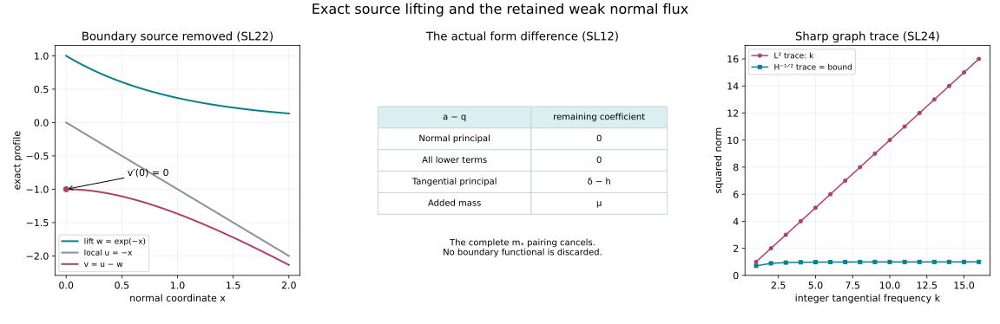

# Removing weak forcing while preserving the boundary flux

*AN-04 proof supplement. Independent proofs, examples and reproducible illustration by GPT-6 Astra (OpenAI), Ultra, CC0-1.0. Linked programme components retain their own credits and terms.*

A natural-antidual source can contain boundary data and need not be an interior function. We construct an auxiliary coercive equation with exactly the original normal principal part and every original lower coefficient. Subtracting its solution cancels the entire source as a weak functional. The remaining right-hand side uses only tangential derivatives. Its microlocal order is quantified below, and the resulting normal flux has an actual distributional boundary trace.

This supplies a reduction for the unfinished strict-diffraction argument. It does not make a first-normal-differential commutant a legal energy test or prove strict propagation. Both weak boundary domains, time-dependent principal coefficients and arbitrary complex lower matrices remain in the statement.

The complete inputs are [U057, the energy domains](../20261007-restored-boundary-form/boundary-form-localization.md), Section 1.1; [U058, uniform localization and natural duals](../20261007-restored-uniform-microsupport/uniform-microsupport-and-dual-sources.md), (UM8) and (UM19); [U059, the full complex form defect](../20261007-restored-sharp-form/sharp-boundary-form-defect.md), (SF5) and (SF16); and [U061, legal regularizers and their supported limits](../20261007-restored-quadratic-normal-regularizer/quadratic-normal-errors-and-regularization.md), (QR17)–(QR25). The [Hilbert representation proof T1](../20261004-free-canonical-composition/compactness-and-essential-norms.md), [closed-subspace projection proof H1](../20261005-mixed-halfspace-foundations/halfspace-support-and-duality.md), and [Hilbert Fourier/Sobolev proofs H1–H2](../20261007-restored-first-order-systems/hilbert-coefficient-calculus-and-positivity.md) supply the functional foundations. The proof map binds exact versions. These links provide proved inputs, not external citations in place of proofs.

## 1. Keep the normalized weak problem intact

Use the full normalized form of [the weak quadratic supplement](../20261007-strict-diffraction-weak-quadratics/weak-characteristic-quadratic-estimates.md), (WQ1)–(WQ5). Thus
\[
 X=[0,\infty)_x\times\mathbb R^d_z,\quad D=-i\partial,\quad
 V=H^1_0(X;\mathbb C^N)\ \hbox{or}\ H^1(X;\mathbb C^N),\quad d\ge1,
 \tag{SL1}
\]
with inner product linear first and norm \(\|v\|_V^2=\|v\|^2+\|\nabla v\|^2\). Its antidual acts antilinearly on tests. All coefficients are smooth and bounded with the derivatives used below. The tangential principal matrix \(h^{ab}=h^{ba}\) is real, scalar and possibly indefinite; it may depend on time among the variables \(z\). The finite matrices \(\ell_j,m_j,c\) are arbitrary complex matrices. Set
\[
\begin{split}
 q(v,\varphi)&=(D_xv,D_x\varphi)+\sum_{a,b}(h^{ab}D_bv,D_a\varphi)+q_1(v,\varphi),\\
 q_1(v,\varphi)&=\sum_{j\in\{x,1,\ldots,d\}}(\ell_jD_jv,\varphi)
       +\sum_j(m_jv,D_j\varphi)+(cv,\varphi).
\end{split}\tag{SL2}
\]
The equation is \(q(u,\varphi)=f(\varphi)\) on the chosen test space. Section 6 handles a local equation without extending that equation to arbitrary global tests.

The b-regularity index \(t\) in this supplement means that an actual scalar b-tester of order \(t\), elliptic at the covector in question, has value in the indicated space \(V\), \(V^*\), or \(L^2\). It is the same definition and full-family topology as U058. Ordinary normal derivatives are intrinsic derivatives on \(x>0\). A negative b-order never supplies an unstated ordinary normal derivative.

## 2. A coercive lift with every lower coefficient retained

**L1. Existence, uniqueness and the quantitative bound.** Write
\[
 L=\sum_j(\|\ell_j\|_\infty+\|m_j\|_\infty),\quad C_0=\|c\|_\infty,
 \quad \mu=1+C_0+\tfrac12L^2,
 \tag{SL3}
\]
where matrix norms are operator norms. Define
\[
 a(v,\varphi)=(D_xv,D_x\varphi)+\sum_a(D_av,D_a\varphi)
                      +q_1(v,\varphi)+\mu(v,\varphi).
 \tag{SL4}
\]
For every \(f\in V^*\), there is exactly one \(w\in V\) with
\[
 a(w,\varphi)=f(\varphi)\quad(\varphi\in V),\qquad
 \|w\|_V\le2\|f\|_{V^*}.
 \tag{SL5}
\]
The choice of domain in (SL1) is retained.

**Proof.** Each term defines a bounded form on \(V\), by Cauchy–Schwarz. If \(d_v=\|\nabla v\|\) and \(b_v=\|v\|\), then
\[
 \operatorname{Re}a(v,v)\ge d_v^2+\mu b_v^2-Ld_vb_v-C_0b_v^2
       \ge\tfrac12d_v^2+b_v^2\ge\tfrac12\|v\|_V^2.
 \tag{SL6}
\]
The second inequality is \(Ld_vb_v\le(d_v^2+L^2b_v^2)/2\). No lower coefficient is required to be Hermitian.

Here is the complete surjectivity argument. The actual Hilbert-space structure of \(V\) is proved in U057. Applying T1 to the conjugate of an antilinear functional gives its unique representative \(f(\varphi)=(h,\varphi)_V\), with \(\|h\|_V=\|f\|_{V^*}\). Apply the same representation for each first argument of \(a\) to define a bounded linear operator \(T:V\to V\) by \((Tv,\varphi)_V=a(v,\varphi)\). Inequality (SL6) and Cauchy–Schwarz imply \(\|Tv\|_V\ge\|v\|_V/2\). Its range is closed: a convergent sequence \(Tv_j\) makes \(v_j\) Cauchy, and completeness and continuity identify its limit. If \(y\) is perpendicular to this range, take \(v=y\) to get \(a(y,y)=(Ty,y)_V=0\), hence \(y=0\). The closed-subspace projection proof H1 now shows that the range is all of \(V\). Thus \(Tw=h\) has a unique solution, and the same lower bound proves (SL5). ∎

## 3. The lift preserves microlocal energy order

**L2. The regularized half-step.** Let \(A_\rho\) be scalar componentwise localizers bounded at b-order \(t\ge0\), with common compact input/output supports and full uniform microsupport in a compact set \(K\). Each individual operator and its actual adjoint have nonpositive order. Let \(F\) be an order-\(t\) source tester elliptic on a neighborhood of \(K\), and let \(Q_-\) be a scalar order-\(t-1/2\) tester elliptic on the same neighborhood. Suppose
\[
 Y=\|f\|_{V^*}+\|Ff\|_{V^*}<\infty,\qquad
 X_- =\|w\|_V+\|Q_-w\|_V<\infty.
 \tag{SL7}
\]
Then
\[
 \|A_\rho w\|_V^2\le4C_\Delta X_-^2+4C_A^2Y^2
 \tag{SL8}
\]
uniformly in \(\rho\), at the fixed supports.

**Proof.** The full complex form defect (SF16) applies to \(a\): it allows all the matrices in (SL4), the added constant \(\mu\), and a positive scalar principal form. In particular
\[
 a(A_\rho w,A_\rho w)=f(A_\rho^*A_\rho w)+\Delta_\rho(w),
       \qquad |\Delta_\rho(w)|\le C_\Delta X_-^2.
 \tag{SL9}
\]
This uses only the actual equation tested by a legal member of \(V\). The source estimate (UM19), with \(\epsilon=1/4\), bounds the modulus of its first term by \(\|A_\rho w\|_V^2/4+C_A^2Y^2\). Use (SL6) on the left and absorb this quarter. The result is (SL8). The whole form, including its complex normal test-side coefficient, remains in the defect. No equation for \(A_\rho w\) and no discarded regularizer commutator have been used. ∎

**L3. Finite order and one common smooth region.** If \(f\) has \(V^*\)-index \(t\ge0\) throughout an open conic region \(O\), then \(w\) has \(V\)-index \(t\) there. For a fixed compact microlocal support \(K\Subset O\) and a scalar compactly supported order-\(t\) tester \(B\) there, a suitable source tester \(F\) of that order gives
\[
 \|Bw\|_V\le C_{t,K,O,B}\bigl(\|f\|_{V^*}+\|Ff\|_{V^*}\bigr).
 \tag{SL10}
\]
If every source index is available on the same \(O\), every solution index is available on that same region. In particular a fixed smaller open neighborhood can be used for every order around any compact anchor subset of \(O\).

**Proof.** Order zero follows from (SL5) and the order-zero domain maps. For one step choose the actual regularizers of (QR17)–(QR22), with an integer \(J\ge\max(1,t)\), and put \(A_\rho=B\Lambda_\rho\). This family has the precise individual order, uniform target order, proper support and full microsupport required in L2. Its cutoffs and widths are fixed. Under the lower-order hypothesis, (SL8) is a uniform bound in \(V\). The full supported removal lemma (QR23)–(QR25) proves that the actual \(Bw\) belongs to \(V\), with this bound. In particular it preserves \(H^1_0\) when that is the domain. One does not infer an energy bound from an L2 limit.

For a general finite \(t>0\), use the finite list of target orders \(1/2,1,\ldots\) below \(t\), followed by \(t\) if necessary. Consecutive gaps are at most one-half. Choose a finite nested list of compact microlocal neighborhoods between \(K\) and \(O\), one for each step, with each lower tester elliptic on the support of the next localizer. At a step of order \(r\), the required lower order is \(r-1/2\). It is either nonpositive, when its tester is bounded on \(V\), or at most the previously established order. In the latter case U058's actual localization/parametrix proof (UM8) supplies its \(V\) value. The same proof supplies the source testers at each \(r\le t\) from a single order-\(t\) tester elliptic on the largest chosen neighborhood; operators of lower order are also bounded families of order \(t\). U058's finite-cover construction (UM11) supplies that source tester. Applying (SL8) finitely many times, and using (SL5) for the bare norm, proves (SL10). Constants can depend on the chosen finite nest and on \(t\); no shrinking-width uniformity is claimed.

For smoothness, first fix the desired smaller open region with compact closure inside \(O\). For each finite order choose its finite nest between that same closure and \(O\). The terminal region is unchanged as the order grows. Thus every order holds throughout it; this proves the common-region assertion without intersecting a sequence of shrinking terminal neighborhoods. ∎

## 4. Exact cancellation and the order of the new source

**L4. The source reduction.** Let \(u\in V\) solve the original equation and let \(w\) be L1's lift. Put \(v=u-w\). Define a functional, using tangential derivatives only, by
\[
 g=\sum_{a,b}D_a\bigl((\delta_{ab}-h^{ab})D_bw\bigr)+\mu w.
 \tag{SL11}
\]
Then, on the original test domain,
\[
 q(v,\varphi)=\sum_{a,b}((\delta_{ab}-h^{ab})D_bw,D_a\varphi)
                      +\mu(w,\varphi)=g(\varphi).
 \tag{SL12}
\]
All normal and lower-coefficient weak pairings cancel exactly. This defines \(g\in V^*\) globally; its interior expression is (SL11). It is not assumed to be a global L2 function.

**Proof.** Subtract \(q(w,\varphi)\) from \(q(u,\varphi)=f(\varphi)=a(w,\varphi)\). The identical normal principal terms and the identical entire form \(q_1\) cancel. What remains is exactly (SL12). Tangential integration by parts identifies (SL11), with a plus sign for each selfadjoint \(D_a\). It introduces no physical-face term. Boundedness on \(V\) follows from Cauchy–Schwarz and bounded coefficients. In the supported realization, zero extension commutes with these tangential derivatives; hence there is no hidden delta distribution from a normal zero-extension derivative. In the Dirichlet realization (SL12) is its restriction to the specified tests. ∎

**L5. Exact indices and preservation of the solution front.** Suppose \(f\) has \(V^*\)-index \(s+1\), \(s\ge0\), on \(O\). Then on \(O\),
\[
 w:\ V\hbox{-index }s+1,\qquad
 g:\ L^2\hbox{-index }s,\qquad
 u:\ V\hbox{-index }s\ \Longleftrightarrow\ v:\ V\hbox{-index }s.
 \tag{SL13}
\]
The smooth version holds on one common smaller neighborhood when every source order is available on \(O\).

**Proof.** L3 gives the first assertion. To prove the second, let \(B\) have b-order \(s\) with compact microsupport inside \(O\). Expand the tangential differential operator in (SL11) before applying the mixed localization lemma (SF5):
\[
 Bg=\sum_{a,b}B D_a M_{\delta_{ab}-h^{ab}}D_bw+\mu Bw.
 \tag{SL14}
\]
Here \(M_c\) is multiplication by \(c\). The coefficients \(BD_aM_c\) are b-operators of order \(s+1\) before one ordinary tangential derivative. The last coefficient has order \(s\), at most the allowed zero-derivative order \(s+2\). Thus (SL14) is in the class \(\mathcal M_{s+1}\) of (SF4), with full microsupport in that of \(B\). The complete proof of (SF5) gives an actual L2 value and its bound from an order-\(s+1\) energy tester of \(w\), including every coefficient derivative and separated remainder. There are not two ordinary normal derivatives on an input. The identity is valid in the actual supported or restricted distribution action; the antidual action agrees on the dense smooth tests by the coefficient-adjoint identity. This proves the claimed L2-index.

At each covector the order-\(s+1\) assertion supplies an order-\(s\) tester for \(w\), by the same parametrix/order-lowering localization. Choose a common smaller tester for \(u,v,w\) using (UM8). Linearity and \(u=v+w\) prove the equivalence. For all orders use L3's fixed terminal region; (SL14) and the same linear argument hold throughout it. ∎

The gain in (SL13) has a precise meaning: the original source index \(s+1\) in the natural dual has become index \(s\) in L2, while the removed solution has one more energy index than the target. It does not assert full ordinary Sobolev smoothness in the normal direction.

## 5. The normal flux has a trace at the correct weak order

Put \(\Lambda=(1+|D_z|^2)^{1/2}\). Pairings on the boundary are the extended linear-first Sobolev pairings.

**L6. Graph trace and its Green identity.** Suppose
\[
 N\in L^2(X;\mathbb C^N),\qquad
 \partial_xN\in L^2([0,\infty);H^{-1}(\mathbb R^d;\mathbb C^N)).
 \tag{SL15}
\]
There is a canonical trace \(\gamma N\in H^{-1/2}(\mathbb R^d;\mathbb C^N)\), agreeing with the usual restriction on smooth functions, with
\[
 \|\gamma N\|_{H^{-1/2}}^2
       \le2\|N\|_{L^2}\|\Lambda^{-1}\partial_xN\|_{L^2}.
 \tag{SL16}
\]
For compact smooth tests up to the boundary,
\[
 (N,D_x\varphi)=(D_xN,\varphi)-i\langle\gamma N,\varphi|_{x=0}\rangle.
 \tag{SL17}
\]
The first pairing on the right is the integrated tangential \(H^{-1},H^1\) pairing.

**Proof of density.** Approximate simultaneously in the two graph norms in (SL15). Inward translation \(N(x+\epsilon,z)\) converges in \(L^2_xL^2_z\), and its derivative converges in \(L^2_xH^{-1}_z\). For the derivative this is translation continuity for the Hilbert-valued L2 function \(\partial_xN\); translation continuity follows first for compact continuous finite-valued step approximants and then by L2 density. Smooth it in \(x\) with radius less than \(\epsilon/2\), using only original positive arguments, and in \(z\) with a Schwartz approximate identity. Both convolutions converge in the indicated norms: the Fourier multipliers in \(z\) are uniformly bounded and tend pointwise to one, so weighted Plancherel and dominated convergence apply; the normal convolution follows by integrating the translation bound. The intrinsic derivative commutes with these convolutions by testing distributions. Finally cut off at large \(x,z\). The extra normal derivative is the cutoff derivative times \(N\), tending to zero in \(L^2_xH^{-1}_z\). Tangential cutoff multiplication is uniformly bounded and converges strongly on \(H^{-1}\): by duality its uniform bound follows from the ordinary H1 product rule, and density of L2 in \(H^{-1}\), proved by Fourier truncation, reduces convergence to L2. These arguments also prove convergence for Hilbert-valued L2 functions by finite simple approximation. Successively choosing translation, convolution and cutoff parameters gives smooth compact approximants up to the face in both graph norms. This construction makes no zero-extension assumption for a normal derivative.

**Proof of trace and Green identity.** For such a smooth approximant, integrate the derivative of \(\|\Lambda^{-1/2}N(x)\|^2\) from zero to infinity. Selfadjoint Fourier weights and Cauchy–Schwarz give
\[
 \|\Lambda^{-1/2}N(0)\|^2
 =-2\operatorname{Re}\int_0^\infty(\Lambda^{-1}\partial_xN,N)\,dx
 \le2\|\Lambda^{-1}\partial_xN\|\|N\|.
 \tag{SL18}
\]
Apply this also to differences of approximants. Their boundary values are Cauchy in the complete space \(H^{-1/2}\); (SL18) makes the limit independent of the approximants and proves (SL16). Smooth integration of \(-i\partial_x(N\overline\varphi)\) gives (SL17), including its minus sign. Each term is continuous in the two graph norms or in the boundary trace norm, so the identity passes to the actual \(N\). ∎

**L7. Recover the actual homogeneous weak boundary condition.** For the reduced solution \(v\) in L4 define the full normal flux
\[
 N_v=D_xv+m_xv.
 \tag{SL19}
\]
Locally on the face this has the graph regularity (SL15). If \(V=H^1\), then \(\gamma N_v=0\) in \(H^{-1/2}_{\rm loc}\). If \(V=H^1_0\), the retained condition is zero trace of \(v\); no zero-flux condition follows.

**Proof.** The flux is L2. The interior equation, obtained by testing (SL12) away from the face, states
\[
 D_xN_v=g-\sum_{a,b}D_a(h^{ab}D_bv)
                 -\sum_j\ell_jD_jv-\sum_aD_a(m_av)-cv.
 \tag{SL20}
\]
Every expression on the right lies locally in \(L^2_xH^{-1}_z\). For \(g\) use (SL11) and \(w\in H^1\); each remaining divergence is tangential and its input is L2. The other terms are L2. Smooth multiplication has the required bounds on these fixed patches. A compact cutoff of \(N_v\) therefore satisfies (SL15); its new normal derivative term is L2. L6 defines a compatible local trace.

Group (SL2)'s normal derivative-on-test term with its normal principal term as \((N_v,D_x\varphi)\). Apply (SL17), use tangential integration by parts, and substitute (SL20). It follows for every compact smooth test that
\[
 q(v,\varphi)-g(\varphi)
             =-i\langle\gamma N_v,\varphi|_{x=0}\rangle.
 \tag{SL21}
\]
For the \(H^1\) domain the left side vanishes for all these tests. Every compact smooth boundary function is the trace of one: multiply it by a smooth normal cutoff equal to one at zero. Thus the trace distribution is zero. For \(H^1_0\), the allowed smooth tests have zero trace and (SL21) imposes no condition on \(\gamma N_v\). The zero trace of \(v=u-w\) is retained because both functions belong to the closed Dirichlet domain. All assertions use the original complex matrix \(m_x\); replacing the flux by \(D_xv\) alone would generally be wrong. ∎

## 6. Local equations and the original coordinates

**L8. Local construction without a fictitious cutoff equation.** Let the original equation hold only on a larger relatively compact smooth-face patch. Choose a real smooth \(\chi\) compactly supported there and equal to one on a fixed smaller patch. The functional \(f_\chi(\varphi)=f(\chi\varphi)\) belongs to global \(V^*\) by the definition of the local natural dual. Extend the smooth lower coefficients, and choose the auxiliary positive tangential block as in (SL4); all extensions agree with the original lower coefficients on that smaller patch. Solve L1 for \(f_\chi\).

For tests supported inside the plateau of \(\chi\), this lift satisfies \(a(w,\varphi)=f(\varphi)\). Subtract it from the original local solution, without multiplying that solution by \(\chi\). Exactly (SL12) follows on these tests. The coefficient \(h\) in (SL11) is the original local one. For microlocal conclusions fix all tester kernel inputs/outputs and the finite nests inside this plateau; U058's local support proof identifies the source values there. L3–L5 and L7 then apply on any fixed smaller conic patch. Bounds use fixed localized original norms and the finite norms of the extensions. No global equation for \(\chi u\) is asserted.

The full boundary normalization (NC15)–(NC17) in [U065](../20261007-restored-normal-window/boundary-normal-coordinates-and-window-transfer.md) is an isomorphism on both local energy domains and their actual antiduals. Apply it first, including its density, multiplier derivatives and all transformed lower matrices. The preceding local construction applies to that exact normalized equation. Inverse transport returns \(u=w+v\) and the weak tests to the original coordinates. The flux statement (SL19)–(SL21) is in those normalized coordinates; it is not an assertion that \(D_x\) is unchanged by a coordinate map. This completes the local reduction for the original time-dependent class. ∎

## 7. Three examples with complete solutions

### Exercise 1. Lift a pure boundary functional

On the half-line set \(q(u,\varphi)=(u',\varphi')\), \(a=q+(u,\varphi)\), and \(f(\varphi)=\overline{\varphi(0)}\) on H1. Find the lift and give a local solution before and after subtraction.

**Solution.** The trace is continuous because \(|\varphi(0)|^2\le2\|\varphi\|\|\varphi'\|\le\|\varphi\|_{H^1}^2\), first for compact smooth tests by the fundamental theorem and then by density. Direct integration gives \(w=e^{-x}\), since \(-w''+w=0\) and \(-w'(0)=1\). This is the unique global H1 lift by L1. The local function \(u=-x\) satisfies \(-u''=0\), \(-u'(0)=1\), hence the local weak equation with this source. After subtraction,
\[
 v=-x-e^{-x},\qquad -v''=e^{-x}=g,\qquad v'(0)=0.
 \tag{SL22}
\]
The polynomial \(u\) is used only locally; it is not a global H1 solution. The boundary source has become an interior source by exact subtraction. In H1-zero the functional is zero and its lift is zero instead, showing why the domain must be specified.

### Exercise 2. Omitting a complex lower term recreates a boundary source

Take \(m_x=M=\begin{pmatrix}i&1\\0&-2\end{pmatrix}\) and \(w=e^{-x}(1,1)^T\). If an auxiliary form omitted \((Mw,D_x\varphi)\), what extra term would remain in \(a(w,\varphi)-q(w,\varphi)\)?

**Solution.** It would contain
\[
 -(Mw,D_x\varphi)=-(D_x(Mw),\varphi)
                    +i(Mw(0),\varphi(0)),\quad
 Mw(0)=(1+i,-2)^T.
 \tag{SL23}
\]
The identity follows from (SL17) on this smooth profile. The boundary coefficient \(iMw(0)=(-1+i,-2i)^T\) is nonzero, so this extra functional cannot be treated as an interior source alone. Here \(D_x(Mw)=i e^{-x}M(1,1)^T\), giving the displayed volume term as well. Retaining the identical matrix in (SL4) cancels the full pairing before any integration by parts. No symmetry or commutation property of \(M\) is needed.

### Exercise 3. The flux trace need not be bounded in L2

Use a tangential circle with normalized measure and the graph norms in L6. For integers \(k\ge1\), set \(N_k(x,z)=\sqrt{k}\,e^{-kx}e^{ikz}\). Compute both graph norms and both the L2 and H-minus-one-half boundary norms.

**Solution.** Parseval and \(\int_0^\infty e^{-2kx}dx=1/(2k)\) give
\[
 \|N_k\|^2=\tfrac12,\quad
 \|\Lambda^{-1}\partial_xN_k\|^2=\frac{k^2}{2(1+k^2)},\quad
 \|N_k(0)\|_{L^2}^2=k,\quad
 \|N_k(0)\|_{H^{-1/2}}^2=\frac{k}{\sqrt{1+k^2}}.
 \tag{SL24}
\]
The last expression is exactly twice the product of the two graph norms, so (SL16) is an equality. The graph norms stay bounded and the L2 trace diverges. This checks the trace order, without claiming that these profiles solve the wave equation. The circle version of L6 has the identical proof using the complete Fourier-series norm identification in U058.

*Left: the exact local profiles in (SL22), on the displayed interval only. Middle: the full form subtraction in (SL12); normal and lower terms cancel, while the tangential difference and added mass remain. Right: the two squared trace norms in (SL24), sampled at integer frequencies. The H-minus-one-half value equals the proved trace bound, while the L2 value is unbounded. These are algebraic and analytic examples, not characteristic rays. Complete proofs: L1–L8 and Exercises 1–3.*

## 8. What this resolves and what still needs a proof

The natural-dual source and its boundary part can now be removed by a lift with the same microlocal energy order. The remaining source has the exact L2-index needed in (SL13). The reduced weak Neumann solution has the proved homogeneous normal flux (SL19), in its actual negative-order trace space; the Dirichlet solution retains its original zero trace. No approved-source restriction was added.

The next argument must use this reduction to prove the normal-commutant estimate, including its rough-domain regularization, the complex Robin flux terms, the incoming error, all lower coefficients and one common neighborhood. L6 alone does not permit pairing two arbitrary negative-order traces, and L3 supplies no ordinary normal smoothing. The full strict-diffractive singular segment and every remaining AN-04 obligation therefore remain active.

The credited mathematical antecedents of the reused boundary calculus are Hörmander III, 2007 edition, Section 18.3, and the Vasy route documented in U057–U062. This supplement derives the coercive lift and flux reduction from those complete programme proofs and the explicit Hilbert/Fourier arguments above. It does not attribute a new weak-source theorem to a book or paper without checking it. Independent expression and figures are CC0-1.0; linked components retain their terms.  
