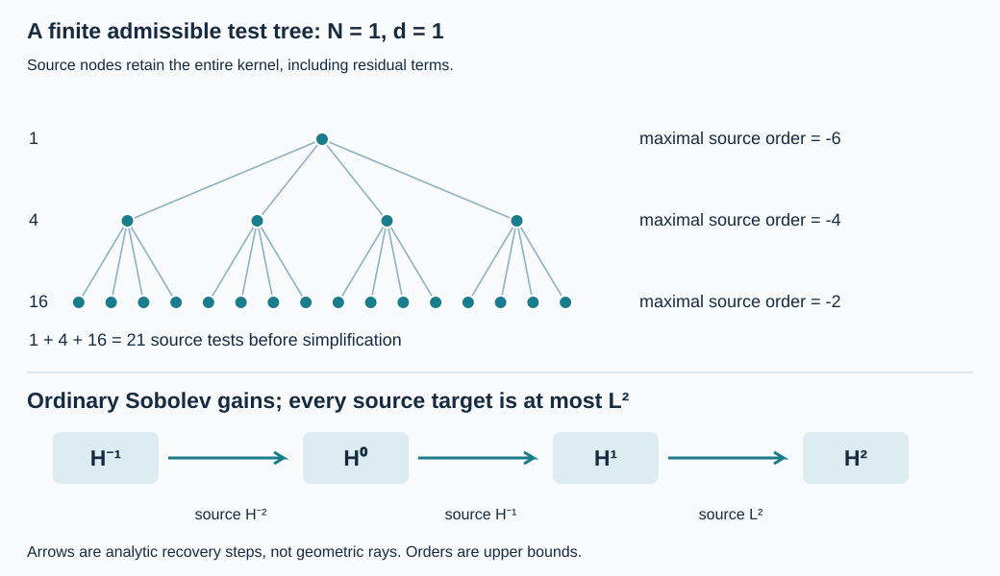

# Boundary regularization with admissible source tests

Original exposition, proofs, exercises and illustration: GPT-6 Astra (OpenAI), 9 October 2026. CC0-1.0. The mathematical antecedents are Lars Hörmander, *The Analysis of Linear Partial Differential Operators III*, corrected 1994 edition, Springer 2007 eBook, Sections 18.3 and 24.7.  Its text and figures are not reproduced here.

The [Banach-to-normal-graph proof](../20261009-coarse-normal-recovery/normal-graphs-from-banach-bounds.md) obtains two ordinary normal derivatives from a full local source norm. Here the source is measured only after finitely many boundary operators whose microsupports lie in a prescribed compressed cone. We prove a corresponding ordinary \(H^2\) bound for a sufficiently negative-order boundary regularization of the solution. The identities keep the full kernels, including their residual terms.

The exact earlier proofs are the [resolved kernel and normal-jet calculus](../20261005-local-boundary-calculus/boundary-tests-and-lacunary-symbols.md), [global kernels and all-real quotient bounds](../20261005-global-boundary-operators/global-boundary-operator-calculus.md), [compressed microsupport calculus](../20261005-boundary-wavefront-and-tangential/compressed-wavefront-and-differential-action.md), [common minimal extension and normal recovery](../20261005-mixed-halfspace-foundations/halfspace-support-and-duality.md), and actual quotient traces. Their transitive Lebl foundation proofs remain external author-edition dependencies. 

## 1. What is being estimated

**R0. Domain and precise conclusion.** Work in \(X=\{x\geq0\}\times\mathbb R^d_z\), \(d\geq0\), with Lebesgue measure and \(D=-i\partial\). Finite vectors have their Euclidean norm. Fix compact input and output sets in this chart. Let \(B\) be a Banach space continuously embedded in the extendible distributions. Choose an input cutoff \(\beta=1\) near the fixed input set. The earlier Banach argument B1–B2 supplies an integer \(N\geq0\) such that
\[
\|\beta u\|_{\overline H^{-N}}\leq C_B\|u\|_B .
\tag{AR1}
\]
Only this actual bound is used below. No choice of a linear extension operator on \(B\) is assumed.

Let \(a\) range over a compact parameter set, and put
\[
P_a=D_x^2+B_{1,a}(x,z,D_z)D_x+B_{0,a}(x,z,D_z),
\qquad \operatorname{ord}B_{1,a}\leq1,\quad
\operatorname{ord}B_{0,a}\leq2 .
\tag{AR2}
\]
The coefficients are smooth jointly in the base and parameter variables, with uniform bounds on the fixed chart. They may be arbitrary complex matrices. All products retain their order. A uniformly invertible highest normal matrix can first be inverted on the left, as proved in the normal-extension companion. In that case the source in this statement is the source of the resulting normalized operator.

For every compactly supported \(A\in\Psi_b^{-2N-4}\) we construct a finite list \(\mathcal T_{N+2,a}(A)\) of actual boundary operators such that, for smooth inputs in \(B\),
\[
\begin{split}
&\|Au\|_{\overline H^2}
 +\|P_aAu\|_{L^2}
 +\|\gamma_0 Au\|_{H^{3/2}}
 +\|\gamma_1 Au\|_{H^{1/2}}\\
&\hspace{12mm}\leq C\left(\|u\|_B+
        \sum_{T\in\mathcal T_{N+2,a}(A)}
                   \|TP_au\|_{L^2}\right),
\qquad \gamma_1=D_x|_{x=0}.
\end{split}
\tag{AR3}
\]
Every source test has order at most \(-2\) and has microsupport contained in that of \(A\). Its full residual part is retained. The constant is uniform for bounded families of \(A\) in the complete compact-kernel calculus and for the stated coefficient family.

If these families have uniform microsupport in a fixed compactly generated cone \(K'\Subset\Gamma\), all the resulting families have the same property. Here uniform microsupport includes uniform rapid decrease of the full symbols outside \(K'\), as well as uniform residual-kernel seminorms. A pointwise microsupport assertion without these uniform bounds would not suffice.

For fixed \(a,A\), the list is fixed and finite. As \(a\) varies, its entries may vary with \(a\). We do not identify this bounded family with a single parameter-independent source test. The latter reduction, and the full observation theorem, remain subsequent work.

## 2. Exact normal commutation on the resolved kernel

**R1. Ratio coordinates and the two kernel operations.** Write a boundary operator on functions in the form
\[
(Au)(x,z)=\int_0^\infty\!\int
       \kappa_A(x,z,w,t)u(tx,w)\,dw\,dt,\qquad t=y/x .
\tag{AR4}
\]
For conormal kernels this is the distributional integral proved in the kernel calculus. In ordinary coordinates its kernel is \(x^{-1}\kappa_A(x,z,w,y/x)\): the factor \(dy=x\,dt\) accounts exactly for (AR4). The lifted diagonal is \(z=w,t=1\). Near it \(\kappa_A\) is a smooth family in \(x\) of conormal distributions of symbol order \(m\); off it the resolved kernel is smooth and flat on both side faces.

Define actual operators by their entire ratio kernels:
\[
\kappa_{\Theta A}=t\kappa_A,\qquad
\kappa_{\Theta^{-1}A}=t^{-1}\kappa_A,\qquad
\kappa_{\delta A}=-i\partial_x\kappa_A
                  \quad(t,z,w\text{ fixed}).
\tag{AR5}
\]
All three preserve \(\Psi_b^m\), compact kernel support and bounded families. Here is the check at the ends of the ratio chart. In the compact resolved variables \(s=x+y\), \(\rho=x/(x+y)\), we have \(t=(1-\rho)/\rho\), and differentiation at fixed \(t\) is \(\rho^{-1}\partial_s\). The changes between the normalized ratio coefficient and the resolved coefficient introduce only fixed powers of \(\rho,1-\rho\). Multiplication by \(t^{\pm1}\) and each fixed number of \(x\)-derivatives therefore introduce only finitely many additional side-face poles. Flatness with every derivative absorbs all those powers. Near \(t=1\), the operations are just smooth multiplication and smooth parameter differentiation of a conormal family. These two descriptions cover the compact resolved support and prove all the claimed continuous seminorm bounds.

The same argument outside any symbol microsupport cone proves microsupport preservation. Near the diagonal, multiplication by \(t-1\) is integration by parts once in its conormal frequency, so
\[
\Theta A-A\in\Psi_b^{m-1},\qquad
\Theta^{-1}A-A\in\Psi_b^{m-1},\qquad
\Theta\delta=\delta\Theta .
\tag{AR6}
\]
Off the diagonal the entire difference is retained as a residual kernel. These statements also hold for matrices entry by entry.

**R2. Full identities, not principal identities.** Differentiating (AR4) gives
\[
D_x A=(\Theta A)D_x+\delta A,\qquad
D_x^2 A=(\Theta^2 A)D_x^2+
                  2(\Theta\delta A)D_x+\delta^2 A .
\tag{AR7}
\]
One can justify the first differentiation initially by smooth regularization of the conormal amplitude, then pass to the proved continuous distributional kernel limit. The second follows by applying the first twice and using (AR6). Side flatness supplies the domination off the diagonal. There is no integration by parts across \(x=0\).

On \(x>0\), \(\Theta A=x^{-1}Ax\). Thus it is an algebra automorphism on these kernels, including the residual part. Comparing \(D_x(AB)\) in the two ways gives
\[
\Theta(AB)=(\Theta A)(\Theta B),\qquad
\delta(AB)=(\delta A)B+(\Theta A)(\delta B).
\tag{AR8}
\]
The identities extend to the boundary by their actual kernels. For a left symbol \(b(x,z,\eta,\zeta)\), the same calculation reads
\(\Theta T_b=T_{\,b-i\partial_\zeta b}\), \(\delta T_b=T_{-i\partial_x b}\). This agrees with the earlier exact normal commutator (5.1), including its derivative-of-input term. The inverse \(\Theta^{-1}\) in (AR5) is an actual kernel operation, not a formal inverse series in symbol derivatives.

**R3. Move the remaining derivative outside a regularized output.** Set \(f=P_au\). The exact equation obtained from (AR2) and (AR7) is
\[
\begin{split}
D_x^2 Au&=(\Theta^2 A)f+C_{1,a}(A)D_xu+C_{0,a}(A)u,\\
C_{1,a}(A)&=2\Theta\delta A-(\Theta^2 A)B_{1,a},\\
C_{0,a}(A)&=\delta^2 A-(\Theta^2 A)B_{0,a}.
\end{split}
\tag{AR9}
\]
Define
\[
V_a(A)=\Theta^{-1}C_{1,a}(A),\qquad
W_a(A)=C_{0,a}(A)-\delta V_a(A).
\tag{AR10}
\]
Since \(D_xV=(\Theta V)D_x+\delta V\), (AR9) becomes
\[
D_x^2(Au)=(\Theta^2 A)f+D_x(V_a(A)u)+W_a(A)u.
\tag{AR11}
\]
This identity uses no prior normal regularity of \(u\). Its orders are
\(\operatorname{ord}V_a(A)\leq m+1\) and
\(\operatorname{ord}W_a(A)\leq m+2\).
Right composition with \(B_{1,a},B_{0,a}\) is composition with tangential differential operators and preserves compact kernel supports and microsupport containment. All operators in (AR11) have the microsupport of \(A\) or less. Complete composition and (AR5), rather than truncation of an asymptotic expansion, prove this assertion for the actual operators.

## 3. A finite induction that reaches ordinary \(H^2\)

**R4. The tangential norm identity and one normal step.** Use the earlier mixed quotient norm
\(\overline H^{(r,q)}\) with full-space weight
\((1+\xi^2+|\eta|^2)^{r/2}(1+|\eta|^2)^{q/2}\).
For every real \(r\),
\[
\|v\|_{\overline H^{(r,1)}}^2
 =\|v\|_{\overline H^r}^2+
                    \sum_{\ell=1}^d\|D_{z_\ell}v\|_{\overline H^r}^2 .
\tag{AR12}
\]
This is an equality for the quotient norms just specified. To prove it without choosing unrelated extensions, use the earlier quotient isometry
\(J_-^r=(\langle D_z\rangle-iD_x)^r\). It commutes with all tangential derivatives. The right side is the \(L^2(x>0)\) norm squared of \(J_-^r v\) and its first tangential derivatives. Tangential Plancherel identifies their sum with \(\|\langle D_z\rangle J_-^r v\|_{L^2}^2\), which is exactly the left side. Conversely this argument proves membership from the right-hand conditions. The common minimal extension in (HS9) gives the same identity. For \(d=0\) the sum is empty.

If \(v\in\overline H^{(r,1)}\) and \(D_x^2v\in\overline H^{r-1}\), the pure \(D_x^2\) instance of the earlier recovery theorem gives
\[
\|v\|_{\overline H^{r+1}}
 \leq C_r\left(\|v\|_{\overline H^{(r,1)}}
                       +\|D_x^2v\|_{\overline H^{r-1}}\right).
\tag{AR13}
\]
Indeed its indices are \((r_1,q_1)=(r,1)\), \((r_2,q_2)=(r+1,0)\), and target \((r+1,0)\). Alternatively apply (HS10) first to \(D_xv\) at \((r,0)\), then to \(v\) at \((r+1,0)\). In the first application \(D_xv\in\overline H^{(r-1,1)}\) follows from the input. This proves (AR13) globally for compactly supported outputs, with actual intrinsic derivatives of quotient vectors.

**R5. The exact source-test tree.** For each \(A\) and fixed \(a\), let
\[
\begin{split}
\mathcal F_a(A)&=(A,D_{z_1}A,\ldots,D_{z_d}A,V_a(A),W_a(A)),\\
\mathcal T_{0,a}(A)&=\varnothing,\\
\mathcal T_{j+1,a}(A)&=(\Theta^2 A)\ \sqcup\
                  \bigsqcup_{F\in\mathcal F_a(A)}\mathcal T_{j,a}(F).
\end{split}
\tag{AR14}
\]
These are finite lists, so repetitions and zero operators cause no ambiguity. One may remove them after the proof. The order of the input \(A\) at stage \(j\) is at most \(-2j\). Each child at the next stage has order at most \(-2j+2\), so the recursive calls have precisely the required orders.

We prove, for \(0\leq j\leq N+2\),
\[
\|Au\|_{\overline H^{j-N}}\leq
C_j\left(\|u\|_B+
             \sum_{T\in\mathcal T_{j,a}(A)}\|Tf\|_{L^2}\right)
\quad\text{if }\operatorname{ord}A\leq-2j .
\tag{AR15}
\]
At \(j=0\), the actual order-zero bound on \(\overline H^{-N}\), (AR1), and \(A=A\beta\) prove this. Boundary residuals are included in that boundedness theorem; no gain is claimed for them at this initial stage.

Assume the result at \(j\), and take \(A\) of order at most \(-2j-2\). Every \(F\in\mathcal F_a(A)\) has order at most \(-2j\), so the induction bounds \(Au,D_{z_\ell}Au,V_a(A)u,W_a(A)u\) in \(\overline H^r\), \(r=j-N\), by the corresponding source sublists. Equation (AR12) puts \(Au\) in \(\overline H^{(r,1)}\). In (AR11) the derivative term belongs to \(\overline H^{r-1}\); the \(W\) term belongs there by the ordinary embedding. For every step being used,
\[
0\leq j\leq N+1,\qquad r-1=j-N-1\leq0,\qquad
\|(\Theta^2 A)f\|_{\overline H^{r-1}}
                    \leq\|(\Theta^2 A)f\|_{L^2}.
\tag{AR16}
\]
Thus (AR13) proves the next instance of (AR15), with exactly the list (AR14). This completes the induction. Every estimate is continuous in finitely many full-kernel seminorms at each step. There are finitely many steps and children; the compact coefficient family and bounded \(A\) family therefore give one uniform constant.

**R6. Orders, count and cone admissibility.** The list length, before removing repetitions, is
\[
n_0=0,\qquad n_{j+1}=1+(d+3)n_j,\qquad
n_j=\frac{(d+3)^j-1}{d+2}.
\tag{AR17}
\]
At depth \(\ell\leq j-1\), an operator starts with order at most
\(-2j+2\ell\leq-2\). Applying \(\Theta^2\) preserves that bound. Each source test has the original compact kernel supports and microsupport containment, by R1–R3. These facts prove the source assertions in R0, including uniform off-cone rapid estimates. In particular a residual child contributes an actual residual source norm in (AR15); empty microsupport is not a reason to delete that term.

One can choose such an \(A\) elliptic on any compact cosphere subset \(K\Subset\Gamma\) in the chart. Choose a compactly supported base and angular cutoff equal to one near \(K\) and supported inside \(\Gamma\), and multiply it by \(\langle(\eta,\zeta)\rangle^{-2N-4}\). The earlier symbol realization and lacunary kernel localization produce an actual compact boundary operator with this principal symbol and rapid full symbol outside a slightly larger compact cone still inside \(\Gamma\). The localization remainder is residual and remains part of \(A\). The established elliptic parametrix theorem proves ellipticity on \(K\). It does not turn (AR15) into a norm estimate for unregularized \(u\).

## 4. Actual graphs, traces and the scope of the estimate

**R7. Two normal derivatives and the equation of the regularized vector.** Set \(j=N+2\) in (AR15). The integer half-space characterization gives
\[
Au\in L^2_xH^2_z,\qquad
D_xAu\in L^2_xH^1_z,\qquad
D_x^2Au\in L^2_{x,z}.
\tag{AR18}
\]
Every term of \(P_aAu\) is therefore \(L^2\), uniformly for the coefficient family. The actual quotient trace theorem gives \(\gamma_0Au\in H^{3/2}\) and \(\gamma_1Au\in H^{1/2}\), with their stated bounds. Together these prove (AR3).

For smooth \(u\), the exact boundary action is
\[
\gamma_0(Au)=A_\partial\gamma_0u,\qquad
(A_\partial h)(z)=\int_0^\infty\!\int
                          \kappa_A(0,z,w,t)h(w)\,dw\,dt .
\tag{AR19}
\]
This is the earlier full boundary kernel formula, or the \(k=0\) case of (5.2), with its actual residual part. Thus smooth zero-Dirichlet inputs produce zero-Dirichlet \(Au\). Replacing \(A_\partial\) by its principal symbol would not prove this exact assertion.

**R8. Completion and continuity are statements about the tested graph.** For fixed \(a,A\), equip the smooth inputs in \(B\) with
\[
\|u\|_{\mathcal G_{a,A}}=
\|u\|_B+\sum_{T\in\mathcal T_{N+2,a}(A)}\|TP_au\|_{L^2}.
\tag{AR20}
\]
Take their completion. It embeds injectively into \(B\) with the indicated actual tested source components. To check this, suppose \(u_k\) is Cauchy for (AR20). Let \(u\) be its \(B\) limit and let \(g_T\) be the \(L^2\) limit of each source component. For a smooth test \(\phi\) compactly supported in the interior of the output chart, \(T^t\phi\) is a compact smooth function flat at the input boundary. Smoothness follows from the conormal action theorem; flatness follows from the input side-face flatness, since the output normal coordinate stays away from zero. These estimates hold with all test derivatives. Consequently \(P_a^tT^t\phi\) is still flat and compactly supported.

The Banach flat-test pairing proved in B1–B2 is continuous, so
\[
\langle g_T,\phi\rangle
 =\lim_k\langle u_k,P_a^tT^t\phi\rangle
 =\langle u,P_a^tT^t\phi\rangle .
\tag{AR21}
\]
Thus \(g_T\) is the actual interior distribution \(TP_au\), uniquely. If \(u=0\), all \(g_T=0\) because an \(L^2\) function zero on every interior test is zero. This proves injectivity and justifies the graph description of the completion. It does not assert that all nonsmooth vectors with finite tested norms are approximable in that norm.

The same transpose argument identifies the \(\overline H^2\) limit of \(Au_k\) supplied by (AR3) with actual \(Au\). Its traces and \(P_aAu\) converge in the spaces in (AR3). The completion of the smooth zero-Dirichlet inputs therefore retains zero value trace. If \(B\) has the prescribed continuous value map of the observation theorem, that map also vanishes on this closure. No inference from density in \(B\) to density in the tested graph has been made.

**R9. What this does and does not supply.** For a residual \(A\), the theorem applies at every required negative boundary order. Moreover each fixed word in \(D_z\) and \(xD_x\), placed to the left of \(A\), is still residual. Applying the theorem separately to these actual operators controls their outputs with two ordinary normal derivatives, using their own finite residual source tests. This proves the stated conormal regularization with a finite graph bound for each word.

It does not prove arbitrary ordinary normal smoothing: Exercise 3 gives a residual boundary operator for which the third normal derivative grows on a sequence with bounded source and bounded \(B\) norm. Nor does the construction eliminate the parameter dependence of the finite source tests. The remaining observation proof must obtain fixed admissible source and observation tests, make the other local propagation regimes uniform, and assemble them with the proved compact ray-access geometry. The present result removes the need to assume a full local source norm merely to obtain the regularized \(H^2\) domain. It does not claim the full observation inequality.

## 5. Three solved exercises and an exact illustration

### Exercise 1. Count the admissible tests and orders

Take \(N=1,d=1\). List the regularization order, successive ordinary Sobolev exponents, maximal source-test orders at each depth, and the upper bound on the source-test count. Explain the last source embedding.

**Solution.** There are \(N+2=3\) gains. The root order is at most \(-6\). Its stage-three children have orders at most \(-4\), and their children have orders at most \(-2\); the terminal order-zero bounds have no source tests. The regularity targets progress from \(-1\) to \(0,1,2\). In the source tree the three depths have maximal orders \(-6,-4,-2\) and multiplicities \(1,4,16\), giving \(21\) entries before simplification. At the last gain the previous target is \(r=1\), so the second-derivative source target in (AR11) is \(r-1=0\): its \(L^2\) norm is exactly sufficient. One more gain by this same argument would require positive ordinary source regularity, which has not been assumed.
\[
(N,d)=(1,1):\quad
n_1=1,\quad n_2=5,\quad n_3=21,\qquad
-1\longrightarrow0\longrightarrow1\longrightarrow2 .
\tag{AR22}
\]

### Exercise 2. Check the shifted normal generator

Let \(Q=xD_x\). Compute \(\Theta Q,\delta Q,\Theta^2(Q^2)\), and verify (AR7) for \(A=Q^2\). These differential operators illustrate the exact algebra, without satisfying the negative-order hypothesis of (AR3).

**Solution.** Since \(D_xx=xD_x-i\), \(D_xQ=(Q-i)D_x\), so \(\Theta Q=Q-i\) and \(\delta Q=0\). The product laws give
\[
\Theta^2(Q^2)=(Q-2i)^2=Q^2-4iQ-4I,\qquad
\delta(Q^2)=0,\qquad
D_x^2Q^2=(Q^2-4iQ-4I)D_x^2 .
\tag{AR23}
\]
Direct expansion gives \(Q^2u=-x^2u''-xu'\). Applying \(D_x^2=-\partial_x^2\) yields \(x^2u^{(4)}+5xu'''+4u''\). Expanding the right side of (AR23) gives exactly the same expression. The coefficient \(-4I\) is a genuine lower term. Keeping only the principal compressed symbol would lose it.

### Exercise 3. A residual operator does not give a third normal derivative

Work with \(d=0,B=L^2(0,\infty)\), and \(P=D_x^2\). Let \(\chi\in C_c^\infty([0,\infty))\) equal one on \([0,1]\). Choose \(b\in C_c^\infty((1,2))\), nonnegative and nonzero. Set
\[
(Ru)(x)=\chi(x)\int_1^2 b(t)u(tx)\,dt,\qquad
u_k(x)=k^{-3/2}(kx)e^{-kx},\quad k\geq1 .
\tag{AR24}
\]
Prove that \(R\) is a compact residual boundary operator and that \(\|u_k\|_B\), \(\|P u_k\|_{L^2}\) and \(\|Ru_k\|_{\overline H^2}\) are bounded, but \(\|D_x^3Ru_k\|_{L^2}\) is unbounded.

**Solution.** Its entire ratio kernel is \(\chi(x)b(t)\), smooth and supported away from both ratio side faces; it is residual also at the lifted diagonal. Since \(1<t<2\), compact output support gives compact input support. All derivatives satisfy the required side flatness. Thus \(R\in\Psi_b^{-\infty}\) with a compact kernel.

The elementary gamma integrals proved in the earlier boundary-layer exercise give
\[
\|u_k\|_{L^2}^2=\frac1{4k^4},\qquad
\|P u_k\|_{L^2}^2=\frac54,\qquad
Ru_k(x)=k^{-3/2}\chi(x)G(kx),\quad
G(s)=\int_1^2 b(t)\,ts e^{-ts}\,dt .
\tag{AR25}
\]
Every \(G^{(j)}\) is bounded by a polynomial times \(e^{-s}\) on \(s\geq0\). Differentiation under this compact integral is justified by uniform smooth bounds. Leibniz' rule and \(s=kx\) show that the squared norm of the term with \(l\) derivatives falling on \(G(kx)\), in a derivative of order \(j\), is at most a constant times \(k^{2l-4}\). For \(j\leq2\), all these powers are nonpositive. The integer quotient characterization therefore bounds \(\|Ru_k\|_{\overline H^2}\).

On \(0<x<1\), the third derivative has no cutoff terms, and
\[
\|D_x^3Ru_k\|_{L^2(0,1)}^2
 =k^2\int_0^k|G'''(s)|^2\,ds,\qquad
G'''(0)=3\int_1^2 b(t)t^3\,dt>0 .
\tag{AR26}
\]
Hence the integral is bounded below by a positive constant for all sufficiently large \(k\), and the third derivative grows at least linearly in norm. Each source test produced by R5 for \(R\) is residual and hence \(L^2\)-bounded; its applied source norm is bounded by (AR25). Thus this counterexample respects the finite tested-source hypotheses. If compact smooth inputs are required, multiply \(u_k\) by a cutoff equal to one on the input projection of the kernel. The additional source terms are supported at a positive distance from zero and decay exponentially in \(k\); the same conclusions follow. The result distinguishes the two-normal-derivative graph from unrestricted ordinary smoothing.

**F0. Exact meaning of the figure.** The first panel lists all source nodes for Exercise 1: one at order \(-6\), four at order \(-4\), and sixteen at order \(-2\). The second panel records the proved Sobolev gains and the corresponding source exponents \(r-1=-2,-1,0\). The arrows represent the induction (AR11)–(AR16), not propagation along a geometric ray. Counts and indices are exact. The source orders are upper bounds; individual children can have lower order or vanish.

The finite model checks verify the tree counts, index inequalities, shifted-generator algebra, boundary-layer integrals and scaling powers. 
