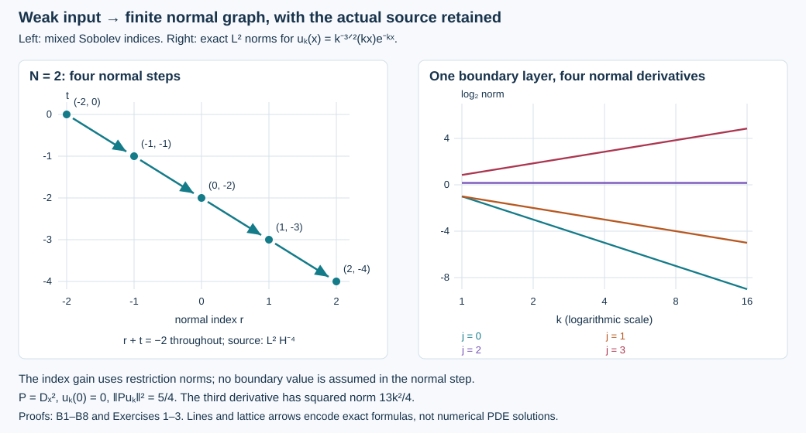

# Recovering the normal graph from a Banach bound

The local glancing estimate starts with a finite mixed Sobolev norm. An abstract Banach norm is not that norm. We prove the missing normal-recovery estimate: a weak distribution bound and one negative tangential norm of the actual source control two normal derivatives, with constants uniform in a compact smooth family of noncharacteristic operators. We also prove continuity of the actual traces on the resulting graph completion.

This is a domain and topology component for Hörmander, *The Analysis of Linear Partial Differential Operators III*, corrected edition reprinted in 2007, Propositions 24.7.1 and 24.7.1′, printed pages 465–467. It uses the programme's [restriction-space normal recovery](../20261005-mixed-halfspace-foundations/halfspace-support-and-duality.html), [localization estimates](../20261007-elliptic-boundary-wavefront/elliptic-boundary-wavefront.html) and [actual rough traces](../20261009-robin-diffraction-comparison/robin-diffraction-by-dirichlet-comparison.html). The proof map records the complete earlier dependencies. Required Lebl foundations are external.

## 1. The exact estimate

**B0. Domain, source and conclusion.** Work in a fixed product boundary chart \(x\ge0,\ z\in\mathbb R^d\), with compactly nested coordinate neighborhoods. Put \(D=-i\partial\). Let \(a\) range over a compact subset \(Z_0\) of an open smooth parameter domain. Consider a finite matrix differential operator
\[
 P_a=D_x^2+B_{1,a}(x,z,D_z)D_x+B_{0,a}(x,z,D_z),
 \qquad \operatorname{ord}B_{1,a}\le1,\quad
 \operatorname{ord}B_{0,a}\le2.
 \tag{NG1}
\]
The coefficients are jointly smooth. They may be complex; no positivity or real-principal assumption is needed for this component. An invertible highest normal coefficient reduces to (NG1) by multiplication on the left by its inverse, as discussed in B3.

Let \(B\) be a Banach space continuously embedded in extendible distributions on the original manifold with boundary. In particular, evaluation against each compact smooth test flat at the boundary is continuous on \(B\). When a continuous value map \(\tau:B\to\mathcal D'(\partial X)\) extending smooth restriction is specified, keep that map; we identify it with the recovered trace on the graph closure in B7. No multiplication operator is assumed bounded on \(B\).

Choose fixed scalar base cutoffs \(\chi,\beta\), with \(\beta=1\) on an open neighborhood of the support of \(\chi\) and with room for intermediate cutoffs. There is an integer \(N\ge0\), depending on the Banach embedding and the outer chart but not on \(a\), such that
\[
 \|\chi u\|_{\overline H^{(2,-N-2)}}\le
 C\left(\|u\|_B+
          \|\beta P_au\|_{L^2_xH^{-N-2}_z}\right).
 \tag{NG2}
\]
Here the source is its actual interior differential expression, required to have the displayed \(L^2\) representative. It is not a freely assigned boundary extension. The constant is uniform on \(Z_0\). The estimate holds for all \(u\in B\) with that source norm finite, including nonsmooth distributions.

For the two-weight restriction norm, the whole-space weight is
\[
 q^r\lambda^t,\qquad
 \lambda=(1+|\eta|^2)^{1/2},\quad
 q=(1+|\eta|^2+\kappa^2)^{1/2};
 \tag{NG3}
\]
the bar norm is the infimum over whole-space extensions. In particular (NG2) controls
\[
 \|\chi u\|_{L^2H^{-N}}+
 \|D_x(\chi u)\|_{L^2H^{-N-1}}+
 \|D_x^2(\chi u)\|_{L^2H^{-N-2}}.
 \tag{NG4}
\]
Thus it supplies the actual \(\mathcal X_{-N}\) input of the [uniform glancing estimate](../20261009-uniform-glancing-estimate/uniform-half-order-gain-at-glancing.html). The conversion of its full source norm into source testers confined to a prescribed compressed cone is a further step; it is not assumed here.

## 2. One distribution order for the whole Banach ball

**B1. The flat test space is complete.** Fix a compact product set \(K\) in the ambient chart, including part of \(x=0\). Let \(F_K\) consist of smooth ambient tests supported in \(K\cap\{x\ge0\}\). Their ordinary smooth extensions by zero are flat at \(x=0\). Give \(F_K\) the increasing seminorms
\[
 p_m(\phi)=\max_{|\alpha|\le m}\sup |D^\alpha\phi|.
 \tag{NG5}
\]
It is a closed subspace of the complete fixed-support smooth test space: uniform convergence of every derivative preserves the support and the zero values of all derivatives on \(x<0\), hence their boundary limits. The seminorm-metric and smooth-completeness proofs TG:B2–B3 therefore make \(F_K\) a complete metric vector space.

An extendible distribution has a well-defined continuous pairing with \(F_K\). To prove independence of the ambient extension, approximate a flat test by tests supported a positive distance from the boundary. Use \(\rho(x/\epsilon)\phi\), where \(\rho=0\) below \(1\) and \(\rho=1\) above \(2\). Taylor's formula and flatness bound every derivative of \(\phi\) on \(0\le x\le2\epsilon\) by any prescribed power of \(\epsilon\). The finite product-rule terms, including the negative powers from \(\rho\), therefore tend to zero in every \(p_m\). Any two ambient extensions agree on these interior tests and hence on their limit. Their fixed finite distribution-order bounds also prove continuity on \(F_K\).

**B2. Baire, then an actual Sobolev extension.** For each \(\phi\in F_K\), continuity of the Banach embedding gives
\[
 T(\phi):=\sup_{\|u\|_B\le1}|u(\phi)|<\infty.
 \tag{NG6}
\]
The sets \(E_j=\{\phi:T(\phi)\le j\}\) are closed in \(F_K\), since each fixed distributional pairing is continuous there. They cover \(F_K\). By the proved complete-metric Baire theorem TG:B1, some \(E_j\) has interior. Consequently there are \(\phi_0\in E_j\), an integer \(M\) and \(\epsilon>0\) such that \(\phi_0+\{\phi:p_M(\phi)<\epsilon\}\subset E_j\). Subtract the two pairings to get \(T(\phi)\le2j\) on this zero neighborhood. Rescaling a nonzero test, and then taking a limit at its boundary, gives
\[
 |u(\phi)|\le C_K\|u\|_B\,p_M(\phi)
 \qquad(\phi\in F_K).
 \tag{NG7}
\]
If the chosen seminorm vanishes, the same bound follows by arbitrary rescaling; \(p_0\) is already separating.

Choose an integer \(N>M+(d+1)/2\). The earlier Fourier Sobolev inequality gives \(p_M(\phi)\le C\|\phi\|_{H^N}\). The functional on the subspace \(F_K\subset H^N\) therefore extends by the proved complex Hahn–Banach theorem with the bound
\[
 |\widetilde u(\phi)|\le C\|u\|_B\|\phi\|_{H^N}.
 \tag{NG8}
\]
Hilbert/Fourier duality identifies this extension with an \(H^{-N}\) distribution. It agrees with \(u\) on interior tests in the smaller chart, so
\[
 \|\chi_0u\|_{\overline H^{(-N,0)}}\le C_0\|u\|_B
 \tag{NG9}
\]
for a fixed outer cutoff \(\chi_0\) supported strictly inside \(K\) tangentially and at its upper normal end. Multiplication by that cutoff has the full all-real Sobolev bound. The extension need not be chosen linearly in \(u\); the restriction infimum is all that (NG9) uses. The same \(N\) and constant work for the entire Banach ball. Increasing \(N\), if needed, preserves the bound.

## 3. Full coefficients and fixed supports

**B3. Uniformity uses finitely many actual coefficient derivatives.** Choose
\[
 \chi_0,\chi_1,\ldots,\chi_{N+2}=\chi
 \tag{NG10}
\]
so that each outer cutoff is one on a neighborhood of the support of the next one, and \(\beta=1\) near all their supports. These are ordinary base cutoffs, independent of \(a\). Their supports have fixed positive margins. No microlocal remainder is hidden in this localization.

Smooth multiplication and tangential differential action have the all-real mixed bounds MH:M1, MH:T1–T2 and EW:M1. At each fixed pair of indices they use finitely many derivatives of the complete coefficients. Those derivatives are uniformly bounded on the joint compact parameter/base set. The same is true of the fixed cutoff commutators. The indices below form a finite list, so one finite list of coefficient bounds suffices.

If the original highest normal matrix is \(A_{2,a}\), assume it is invertible throughout a common compact collar. Compactness gives a uniform positive lower bound for its smallest singular value. The identity \(\partial A_2^{-1}=-A_2^{-1}(\partial A_2)A_2^{-1}\), iterated by the finite product rule, bounds each needed derivative of its inverse. Multiplying on the left gives (NG1) and replaces the source by \(A_{2,a}^{-1}P_au\). The same all-real multiplication estimate controls this source by the original one. Matrix order is preserved throughout; no coefficient is commuted across a normal derivative.

## 4. The complete normal step

**B4. Gain one normal order while retaining every error.** Suppose the outer localized input \(w=\chi_j u\) lies in \(\overline H^{(r,t)}\), with
\[
 r=-N+j,\qquad t=-j,\qquad 0\le j\le N+1.
 \tag{NG11}
\]
Write \(v=\chi_{j+1}u\). Its initial \((r,t)\) norm is bounded by that of \(w\). The exact equation is
\[
 D_x^2v
 =\chi_{j+1}f-B_{1,a}D_xv-B_{0,a}v+
          [P_a,\chi_{j+1}]u,\qquad f=P_au.
 \tag{NG12}
\]
Every coefficient in the commutator has support where \(\chi_j=1\). Since (NG1) is a differential operator, the last term equals \([P_a,\chi_{j+1}]w\) exactly. In particular
\[
 [D_x^2,\chi_{j+1}]
 =-2i(\partial_x\chi_{j+1})D_x-\partial_x^2\chi_{j+1};
 \tag{NG13}
\]
the commutators of the tangential differential coefficients and all lower terms are retained. Their total order is at most one.

The first-order normal term maps \((r,t)\) to \((r-1,t-1)\). The order-two tangential term first maps it to \((r,t-2)\), which embeds into \((r-1,t-1)\) because its target/source weight ratio is \(\lambda/q\le1\). The commutator's normal and tangential terms map respectively into \((r-1,t)\) and \((r,t-1)\), and the required embeddings use \(\lambda^{-1}\le1\) and \(q^{-1}\le1\). The zero-order terms satisfy the same bounds.

For the source use \(r\le1\) and \(r+t=-N\). Its precise weight inequality is
\[
 q^{r-1}\lambda^{t-1}\le
 \lambda^{r+t-2}=\lambda^{-N-2}.
 \tag{NG14}
\]
Thus \(\chi_{j+1}f\in\overline H^{(r-1,t-1)}\), bounded by the single source norm in (NG2). This uses extension infima, not a zero-extension assertion for a negative restriction index.

Apply the actual restriction-space normal-recovery theorem MH:R1 to the polynomial \(D_x^2\). With \(v\in\overline H^{(r,t)}\) and \(D_x^2v\in\overline H^{(r-1,t-1)}\), its conclusion and norm estimate are
\[
 \|v\|_{\overline H^{(r+1,t-1)}}\le
 C_{r,t}\left(
 \|v\|_{\overline H^{(r,t)}}+
 \|D_x^2v\|_{\overline H^{(r-1,t-1)}}\right).
 \tag{NG15}
\]
This theorem is proved from the intrinsic first-normal-step equivalence MH:N1, with the actual quotient norms, and does not assume traces. For orientation, its full-space weight inequality, for \(l=0,1,2\), is
\[
 |\kappa|^l q^{r-l+1}\lambda^{t-1}
 \le2\left(q^r\lambda^t+
         |\kappa|^2q^{r-1}\lambda^{t-1}\right).
 \tag{NG16}
\]
On \(|\kappa|\le\lambda\), divide by the first weight; on \(|\kappa|>\lambda\), divide by the second. The remaining ratios are bounded by \(2\). The quotient-space proof in MH:N1 and MH:R1 is necessary to pass this gain to a half-space; selecting an arbitrary extension and differentiating it would not suffice.

Combining (NG12)–(NG15), with the uniform coefficient bounds, proves
\[
 \|\chi_{j+1}u\|_{\overline H^{(r+1,t-1)}}\le
 C_j\left(\|\chi_j u\|_{\overline H^{(r,t)}}+
          \|\beta f\|_{L^2H^{-N-2}}\right),
 \tag{NG17}
\]
where \(C_j\) is independent of \(a\).

**B5. Exactly \(N+2\) steps.** Start with (NG9). Iterate (NG17) through \(j=0,\ldots,N+1\). The successive index pairs are
\[
 (-N,0),\ (-N+1,-1),\ldots,\ (2,-N-2).
 \tag{NG18}
\]
At every step their sum is \(-N\). The last use of (NG14) has \(r=1\), so the source requirement is still exactly \(L^2H^{-N-2}\). A finite product and sum of the \(C_j\) proves (NG2). The coefficient family and the final collar have not been reduced during the iteration.

For \(l=0,1,2\),
\[
 |\kappa|^l\lambda^{-N-l}\le q^2\lambda^{-N-2}.
 \tag{NG19}
\]
For \(l=0\) this is \(\lambda^2\le q^2\), for \(l=1\) it is \(|\kappa|\lambda\le q^2\), and for \(l=2\) it is \(\kappa^2\le q^2\). Apply the actual restriction derivative maps and take extension infima. This proves all three bounds (NG4), including the full second normal derivative.

## 5. Actual traces, not assigned boundary values

**B6. The negative-order trace bounds.** The unequal-order trace theorem LG:L1 applied first to \(v,D_xv\), and then to \(D_xv,D_x^2v\), gives
\[
 \|\gamma_0v\|_{H^{-N-1/2}}+
 \|\gamma_1v\|_{H^{-N-3/2}}
 \le C\left(\|u\|_B+\|\beta P_au\|_{L^2H^{-N-2}}\right).
 \tag{NG20}
\]
These are the actual normal limits in sufficiently negative tangential Sobolev spaces. The proof uses absolutely continuous representatives paired with tangential tests and Fourier Cauchy–Schwarz. Consequently it agrees with ordinary restriction for smooth inputs and with the programme's intrinsic trace whenever that intrinsic representative is available, by EW:J3. It has no dependence on a selected ambient Sobolev extension.

For a base cutoff the exact identities are
\[
 \gamma_0(\chi u)=\chi(0)\gamma_0u,\qquad
 \gamma_1(\chi u)=\chi(0)\gamma_1u
                 -i\chi_x(0)\gamma_0u.
 \tag{NG21}
\]
They follow by the product rule on the same absolutely continuous representative. Cutoffs may be chosen normal-independent near zero, but the second term is retained when they are not.

**B7. The complete graph and its smooth closure.** Fix \(a\) and the outer cutoff \(\beta\). Let \(F=L^2_xH^{-N-2}_z\), over the fixed coordinate region, and define
\[
 E_a=\{u\in B:\beta P_au\text{ has an }F\text{ representative}\},
 \qquad
 \|u\|_{E_a}=\|u\|_B+\|\beta P_au\|_F.
 \tag{NG22}
\]
This is a Banach space. Indeed an \(E_a\)-Cauchy sequence has limits \(u\in B\) and \(f\in F\). The continuous distribution embedding and differential action show \(\beta P_au=f\) in the interior. An \(F\) function is determined by its interior distribution, since the boundary has zero volume measure. Hence \(u\in E_a\) and both norm terms converge. Completeness of \(F\) is the earlier Fourier/Hilbert proof.

Let \(E_a^{\rm sm}\) be the closure in (NG22) of those smooth inputs belonging to \(E_a\). Estimate (NG2) applied to differences makes \(u\mapsto\chi u\) continuous into \(\overline H^{(2,-N-2)}\), and (NG20) makes both local traces continuous. If \(\tau\) is the prescribed continuous \(B\)-value map, then on this closure
\[
 \gamma_0(\chi u)=\chi(0)\tau u .
 \tag{NG23}
\]
Both sides are continuous to boundary distributions and agree on the defining smooth inputs. In particular the graph closure of smooth zero-Dirichlet inputs has the actual zero value trace.

Density in \(B\) alone does not assert density in the stronger graph norm. We use the stated graph closure and make no claim that it equals all of \(E_a\). The observation inequality ultimately concerns smooth zero-Dirichlet inputs, so this distinction preserves their actual domain rather than adding a density assumption.

## 6. Limits while the coefficients change

**B8. Strong graph convergence recovers the same traces.** Let \(a_\nu\to a_*\) in \(Z_0\), let smooth \(u_\nu\to u\) in \(B\), and suppose
\[
 \beta P_{a_\nu}u_\nu\longrightarrow f\quad\hbox{in }F.
 \tag{NG24}
\]
On every smaller retained collar,
\[
 \chi u_\nu\longrightarrow\chi u
       \quad\hbox{in }\overline H^{(2,-N-2)},
 \tag{NG25}
\]
and both actual traces converge in the spaces of (NG20).

Here is the complete argument. Insert two fixed intermediate cutoff regions between \(\chi\) and the region where \(\beta=1\). The uniform estimate (NG2) bounds \(u_\nu\) and both of its normal derivatives at the orders (NG4) on the larger intermediate region. The highest normal coefficient in (NG1) is the identity, so
\[
 (P_{a_*}-P_{a_\nu})u_\nu
 =(B_{1,a_*}-B_{1,a_\nu})D_xu_\nu
  +(B_{0,a_*}-B_{0,a_\nu})u_\nu .
 \tag{NG26}
\]
The finitely many coefficient derivatives in the corresponding mixed mapping bounds tend to zero. The first term has order at most one tangentially and the second at most two, so (NG4) makes the localized right side tend to zero in \(F\). Thus the actual localized \(P_{a_*}u_\nu\) converges in \(F\) on the smaller intermediate region. Apply (NG2), now for the fixed operator \(P_{a_*}\), to differences \(u_\nu-u_\mu\) with these regions as its source and target supports. Their Banach norms tend to zero and their localized source norms tend to zero. They are therefore Cauchy in the target mixed space. Its limit is \(\chi u\), because convergence there implies convergence in interior distributions, where the \(B\) limit already identifies it. The trace inequality proves the remaining assertions.

If \(\tau\) is given, its continuity and smooth restriction identity now prove \(\gamma_0(\chi u)=\chi(0)\tau u\). In particular a sequence with actual zero Dirichlet values has an actual zero limiting value. No derivative of \(u_\nu\) with respect to \(a_\nu\) was used. For an unnormalized highest coefficient, first use the uniform inverse in B3; smooth multiplication by that convergent inverse also preserves (NG24).

**B9. Starting order and normal-graph bounds.** The result supplies a fixed finite starting order, uniform actual normal-graph bounds and trace continuity. It does not claim that an arbitrary family bounded only in \(B\) has a convergent subsequence in \(B\). It does not replace the source norm in (NG2) by a citation or by individual membership in the intrinsic class.

The full compressed observation theorem also uses admissible source and observation tests in the specified cones, control of residual normal contributions, uniform estimates in every propagation regime, compact-access geometry and the exact operator domains. These are additional ingredients beyond the normal-graph bounds proved here.

The source norm needed here has no normal derivatives. Full ordinary normal smoothness would require additional source-jet control, but that is not an extra prerequisite for an \(L^2\) observation estimate. The exact boundary-layer solution below demonstrates the distinction. Controlling the norms in the observation estimate therefore requires no additional source normal jets.

## 7. Index transfer and a boundary layer

**F0. Exact meaning of the figure.** The left panel takes \(N=2\). Its five lattice points are \((r,t)=(-2,0),(-1,-1),(0,-2),(1,-3),(2,-4)\). Each arrow is one proved normal step, and every point has \(r+t=-2\). These are Sobolev indices, not physical space coordinates.

The right panel uses the exact half-line family \(u_k(x)=k^{-3/2}(kx)e^{-kx}\), with one unit-normalized constant tangential mode. Its horizontal coordinate is \(\log_2 k\), \(1\le k\le16\); its vertical coordinate is \(\log_2\|D_x^j u_k\|_2\), for \(j=0,1,2,3\). The four lines are exact:
\[
 \log_2\|D_x^j u_k\|_2
 =(j-2)\log_2 k+
   \tfrac12\log_2\!\left(\frac{2j^2-2j+1}{4}\right).
 \tag{NG27}
\]
The source for \(P=D_x^2\) has bounded \(L^2\) norm, while the third normal derivative grows. This is an exact solution with a specified source and zero value trace, not a claim about a homogeneous wave.

## 8. Three complete solutions

### Exercise 1. Count every recovery step

Suppose the Banach embedding supplies \(\overline H^{-2}\). Determine the source space, all intermediate mixed indices, the resulting three jet norms and the two trace orders. Check the final source embedding directly.

**Solution.** Here \(N=2\), so the source space is \(L^2H^{-4}\). Four uses of (NG17) give the five pairs in F0. The final space is \(\overline H^{(2,-4)}\), controlling \(u\in L^2H^{-2}\), \(D_xu\in L^2H^{-3}\) and \(D_x^2u\in L^2H^{-4}\). The traces have orders \(-5/2\) and \(-7/2\). In the last step the input pair is \((1,-3)\), so the source weight in (NG14) is \(q^0\lambda^{-4}\), exactly its assumed weight. No source normal derivative is required. The step count and order loss are finite; no claim of optimality is made.

### Exercise 2. Two normal derivatives without a third

For the family in F0 compute every displayed derivative norm and the actual traces. Show that even all weighted normal derivatives of its source are bounded in \(L^2\).

**Solution.** Put \(s=kx\) and \(h(s)=se^{-s}\). Repeated differentiation gives \(h^{(j)}(s)=(-1)^j(s-j)e^{-s}\). Integration by parts gives \(\int_0^\infty s^m e^{-2s}\,ds=m!/2^{m+1}\) for \(m=0,1,2\). Therefore
\[
 \|D_x^j u_k\|_2^2
 =k^{2j-4}\int_0^\infty(s-j)^2e^{-2s}\,ds
 =k^{2j-4}\frac{2j^2-2j+1}{4}.
 \tag{NG28}
\]
For \(j=0,1,2,3\) these are \(1/(4k^4),1/(4k^2),5/4,13k^2/4\). The actual value is zero and \(\gamma_1u_k=-ik^{-1/2}\). Its source is \(f_k=D_x^2u_k=k^{1/2}(2-s)e^{-s}\), so \(\|f_k\|_2^2=5/4\). The operator \(x\partial_x\) becomes \(s\partial_s\); each fixed iterate of it applied to \(f_k\) is \(k^{1/2}\) times a fixed polynomial in \(s\) times \(e^{-s}\). Changing variables cancels this factor in the squared integral, giving a bound independent of \(k\). Tangential derivatives of the constant mode vanish. Thus these source bounds coexist with the unbounded third ordinary normal derivative of \(u_k\). Restriction to any fixed collar at zero preserves that divergence, since its omitted exponential tail tends to zero after every displayed power of \(k\).

### Exercise 3. Why the graph norm matters for the normal trace

On the half-line take \(v_k(x)=k^{-1}(e^{-kx}-e^{-2kx})\) and \(B=H^1\). Compare its Banach norm, actual value, normal trace and source \(D_x^2v_k\).

**Solution.** Direct integration gives
\[
 \|v_k\|_2^2=\frac1{12k^3},\qquad
 \|D_xv_k\|_2^2=\frac1{6k},\qquad
 \|D_x^2v_k\|_2^2=\frac{11k}{6}.
 \tag{NG29}
\]
Thus \(v_k\to0\) in \(H^1\). Its value trace is exactly zero, consistent with continuity of \(H^1\) restriction. But \(v_k'(0)=1\), so \(\gamma_1v_k=-i\) does not tend to zero. The source norm diverges, so (NG24) fails. This verifies why B8 includes the actual source graph convergence when identifying both traces. It does not question continuity of the prescribed value map.

Independent exposition, proofs, solved exercises and the reproducible figure are CC0-1.0. Linked components retain their terms. 
