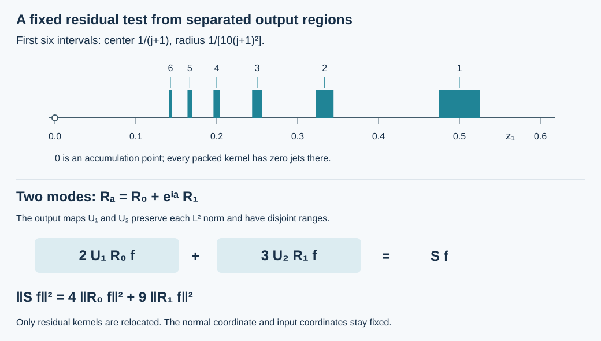

# Fixed source tests by packing residual outputs

Original exposition, proofs, exercises and illustration: GPT-6 Astra (OpenAI), Ultra, 9 October 2026. CC0-1.0. The antecedent is Lars Hörmander, *The Analysis of Linear Partial Differential Operators III*, corrected 1994 edition, Springer 2007 eBook, Sections 18.3 and 24.7.  The argument below supplies a constructive fixed-test step in the parameter-dependent observation problem.

The [admissible regularization proof](../20261009-admissible-boundary-regularization/boundary-regularization-with-source-tests.md) controls a regularized solution by finitely many source operators that can vary with the coefficient parameter. Here we replace a smooth compact parameter family of those operators by two fixed tests: one elliptic in the prescribed compressed cone and one residual. The residual test is an actual compact boundary operator; its source contribution is not discarded.

We use the complete [resolved kernels and boundary calculus](../20261005-global-boundary-operators/global-boundary-operator-calculus.md), [uniform microsupport and separated products](../20261007-restored-uniform-microsupport/uniform-microsupport-and-dual-sources.md), [periodic Fourier basis and Parseval proof](../20261005-restored-graph-egorov/global-inverses-and-periodic-multipliers.md), [complete smooth test spaces](../20261004-free-tangent-zoom/prerequisites/complete-test-spaces.md), and [L2 integration and duality](../20261005-cauchy-foundations/integration-and-duality.md). Their exact transitive Lebl proofs remain external author-edition providers.

## 1. The fixed-test statement and its hypotheses

**S0. Keep the dimension and the full family topology.** Work on a boundary chart
\(X=[0,\infty)_x\times\mathbb R^d_z\), with \(d\geq1\), Lebesgue measure and finite Euclidean fibers. The given families and final testers have fixed compact input and output projections. A smooth parameter family in \(\Psi_b^m\) means smoothness in every complete symbol and resolved-kernel seminorm, with all parameter derivatives bounded on the chosen compact parameter set \(Z\). It extends smoothly to an open parameter neighborhood. Boundary faces of a parameter set are allowed when this extension is part of its smoothness convention.

For a finite list \(T_{\ell,a}\), \(1\leq\ell\leq L\), assume a common finite order \(m\) and uniform microsupport contained in a compact compressed-cosphere set \(K\Subset\Gamma\). The off-cone rapid estimates hold also after every parameter derivative. We will construct fixed compactly supported operators
\[
Q\in\Psi_b^m,\qquad S\in\Psi_b^{-\infty},
\qquad \operatorname{WF}'_b(Q)\subset\Gamma ,
\tag{FT1}
\]
such that, for every smooth input \(f\) on their fixed input set,
\[
\sum_{\ell=1}^L\sup_{a\in Z}\|T_{\ell,a}f\|_{L^2}
       \leq C\|Qf\|_{L^2}+\|Sf\|_{L^2}.
\tag{FT2}
\]
The residual operator has empty compressed microsupport. For scalar inputs and outputs both \(Q,S\) are scalar. Finite matrices retain their dimensions; the elliptic tester on the common input fiber is a scalar symbol times its identity.

The essential intermediate statement is stronger for residual families:
\[
\sum_{\ell=1}^L\sup_{a\in Z}\|R_{\ell,a}f\|_{L^2}
                  \leq\|Sf\|_{L^2},
\qquad R_{\ell,a}\in\Psi_b^{-\infty}.
\tag{FT3}
\]
The hypothesis here is a smooth compact family in the full residual topology, not merely that each member is residual. Exercise 3 shows why that distinction is necessary.

## 2. Turn smooth parameter dependence into rapidly decreasing coefficients

**S1. Compact parameter localization.** First suppose \(Z\) lies in a cube in an open parameter neighborhood. Rescale that cube into the interior of \((-\pi,\pi)^p\), multiply the family by a parameter cutoff equal to one on \(Z\), and extend by zero periodically. This produces a smooth family on the parameter torus. Its operator supports stay fixed, and every complete residual seminorm of every parameter derivative is bounded.

For a general compact parameter set, take a finite partition of unity subordinate to such cubes. Each localized piece is extended separately. At any original parameter the original family is the finite sum of its localized pieces, evaluated in their own torus coordinates. It therefore suffices to dominate the sum of the suprema of this enlarged finite collection. Constant families can be regarded as families on one dummy circle; this also covers parameter dimension zero.

**S2. Fourier coefficients converge in every residual seminorm.** For a torus family define its coefficients by integration of its entire resolved kernel:
\[
R_n=(2\pi)^{-p}\int_{\mathbb T^p}e^{-in\cdot a}R_a\,da,
\qquad n\in\mathbb Z^p.
\tag{FT4}
\]
The kernel is smooth, flat at both side faces, and compactly supported in the same set. Differentiation under this compact integral preserves all those properties. Integrating by parts with \((1-\Delta_a)^M\) gives, for each residual seminorm \(p_\nu\),
\[
p_\nu(R_n)\leq C_{\nu,M}(1+|n|^2)^{-M}
\quad\text{for every integer }M\geq0.
\tag{FT5}
\]
There are no parameter boundary terms because the extension is periodic.

The count of integer vectors in \(|n|_\infty\leq k\) is \((2k+1)^p\). Consequently the Fourier series and each of its differentiated parameter series converge absolutely in every residual seminorm when \(M\) is chosen sufficiently large. Their sum equals the original kernel. Here is the product-torus uniqueness step from the earlier circle theorem. If an L2 function on a product of \(p\) circles has every product coefficient zero, each first-variable Fourier coefficient, viewed as a function of the remaining variables, has all its coefficients zero. Induction in \(p\), Fubini and the circle completeness theorem make all these functions zero almost everywhere. There are only countably many first-variable coefficients, so the circle theorem then makes the original function zero almost everywhere. For a continuous function it is zero everywhere. Apply this to the difference between the original kernel and the absolutely convergent series, at each fixed resolved base point and for each kernel derivative. Uniform convergence of the derivatives makes the identification valid jointly in all resolved variables and at the faces. Thus
\[
R_a=\sum_{n\in\mathbb Z^p}e^{in\cdot a}R_n
\quad\text{in the full residual topology}.
\tag{FT6}
\]

Enumerate the lattice in nondecreasing \(|n|_\infty\), breaking finite ties in any fixed order. Write \(A_j=R_{n(j)}\), \(j\geq1\). Since \(j\leq(2|n(j)|_\infty+1)^p\), (FT5) implies
\[
p_\nu(A_j)\leq C_{\nu,M}(1+j)^{-M}
\quad\text{for every }\nu,M .
\tag{FT7}
\]
The constants in (FT7) need not be uniform in the differentiability indices. They are finite for each specified pair, which is exactly what the subsequent smooth summation requires.

## 3. Pack the outputs without changing their L2 norms

**S3. Explicit disjoint tangential regions.** By an initial fixed affine change of output tangential coordinates, suppose that the output support of each \(A_j\) lies strictly inside \((-1,1)^d\). This coordinate change is implemented with its square-root Jacobian, so it is an isometry for Lebesgue L2. We may work with the resulting family and use its norms in the original statement.

With \(e_1=(1,0,\ldots,0)\), put
\[
z_j=\frac{e_1}{j+1},\qquad
\mu_j=\frac1{10(j+1)^2},\qquad
c_j=\frac1{j+1}.
\tag{FT8}
\]
The cubes \(C_j=z_j+\mu_j(-1,1)^d\) are disjoint. Indeed the first-coordinate gap of consecutive centers is \(1/((j+1)(j+2))\), while
\[
\frac{\mu_j+\mu_{j+1}}{(j+1)^{-1}-(j+2)^{-1}}
 =\frac1{10}\left(\frac{j+2}{j+1}+\frac{j+1}{j+2}\right)
 \leq\frac{13}{60}<1.
\tag{FT9}
\]
The intervals are ordered, so consecutive disjointness implies pairwise disjointness. They accumulate only at \(z=0\).

For a function supported in the original tangential cube, define
\[
(U_jh)(x,z)=\mu_j^{-d/2}
       h\!\left(x,\frac{z-z_j}{\mu_j}\right).
\tag{FT10}
\]
Extend it by zero off \(C_j\). The original support stays away from the cube boundary, so a smooth input of that support extends smoothly. The exact change of variables \(z=z_j+\mu_j Z\) proves
\[
\|U_jh\|_{L^2(X)}=\|h\|_{L^2(X)},\qquad
(U_jh,U_k g)_{L^2}=0\quad(j\ne k).
\tag{FT11}
\]
The normal coordinate is unchanged. This fact will preserve the resolved normal ratio, including the face where both normal coordinates vanish.

**S4. The sum is an actual residual boundary operator.** Define
\[
S=\sum_{j\geq1}c_j^{-1}U_jA_j .
\tag{FT12}
\]
The maps \(U_j\) alone are not asserted to be boundary pseudodifferential operators. The products \(U_jA_j\) are residual, as the following full-kernel calculation proves.

Write \(A_j\) in the exact function-kernel convention
\[
(A_jf)(x,z)=\int\kappa_j(x,z,w,t)f(tx,w)\,dw\,dt,
\qquad t=y/x.
\tag{FT13}
\]
The normalized ratio kernel of the \(j\)-th summand in (FT12) is
\[
\sigma_j(x,z,w,t)=
c_j^{-1}\mu_j^{-d/2}
\kappa_j\!\left(x,\frac{z-z_j}{\mu_j},w,t\right).
\tag{FT14}
\]
Both normal variables, the ratio and all density factors from (FT13) remain unchanged. In compact resolved coordinates \(s=x+y,\rho=x/(x+y)\), the same affine substitution acts only on \(z\). Thus every derivative of tangential order at most \(k\) contributes at most \(\mu_j^{-k}\); each fixed complete residual seminorm satisfies
\[
p_\nu(\sigma_j)
 \leq C_\nu(1+j)^{1+d+2k_\nu}p_{\nu'}(A_j).
\tag{FT15}
\]
Here \(k_\nu\) is its largest output tangential derivative count, and \(\nu'\) includes the corresponding original derivatives and side-face weights. Input derivatives and normal resolved derivatives do not introduce any additional scaling factors. The constants include the fixed affine normalization in S3.

By (FT7), the right side is summable in \(j\), with arbitrarily fast remaining polynomial decay, for every \(\nu\). All summands have support in one compact resolved set. The complete smooth-test theorem proves that their sum is smooth with every derivative equal to the uniformly convergent derivative series. Every side-face jet is zero in every summand, so it is zero in the sum. The kernel therefore remains residual. At the accumulation point \(z=0\), every summand and every derivative vanishes; uniform convergence proves that the sum has zero jets there as well. This explicitly verifies the only new gluing point.

The input projection stays fixed. The output tangential cubes have compact closure, and the normal output support is unchanged. Hence \(S\) is a compactly supported member of \(\Psi_b^{-\infty}\). None of its infinite summation is being hidden in an uncontrolled smooth error.

## 4. The exact norm bound

**S5. Orthogonality gives the dominating source test.** For a smooth input on the common compact input set, the partial sums of (FT12) converge to \(Sf\) smoothly on the fixed compact output set, by the proved continuous smooth action of residual kernels. In particular they converge in L2. Equation (FT11) gives
\[
\|Sf\|_{L^2}^2
       =\sum_{j\geq1}c_j^{-2}\|A_jf\|_{L^2}^2.
\tag{FT16}
\]
For every parameter, the Fourier identity (FT6), its L2 convergence and Cauchy–Schwarz now give
\[
\begin{split}
\|R_af\|_{L^2}
&\leq\sum_{j\geq1}\|A_jf\|_{L^2}\\
&\leq\left(\sum_{j\geq1}c_j^2\right)^{1/2}
       \left(\sum_{j\geq1}c_j^{-2}\|A_jf\|_{L^2}^2\right)^{1/2}
\leq\|Sf\|_{L^2}.
\end{split}
\tag{FT17}
\]
For the last inequality,
\(\sum_{j\geq1}(j+1)^{-2}\leq\int_1^\infty t^{-2}\,dt=1\).
The bound is uniform in the parameter. No normal source derivatives, global source norm or Banach remainder have entered it.

**S6. Finitely many families use one residual test.** For \(L\) torus families enumerate all pairs \((\ell,n)\), ordering by lattice radius and then the finite label. The lattice-count bound acquires only a fixed factor, so (FT7) remains true. Apply the same packing to their combined sequence \(A_j\). For each label its parameter Fourier series uses a subset of the coefficients. Therefore
\[
\sum_{\ell=1}^L\sup_a\|R_{\ell,a}f\|_{L^2}
\leq\sum_{\ell,n}\|R_{\ell,n}f\|_{L^2}
\leq\|Sf\|_{L^2}.
\tag{FT18}
\]
For finite parameter charts in S1, include the chart label in this same enumeration. Different finite matrix output ranks can first be embedded isometrically in one fixed finite Euclidean output space by adding zero components. For the scalar application no enlargement is needed: all output regions carry scalar functions.

## 5. Add the fixed elliptic test

**S7. Reduce the full family with its entire residual remainder.** Choose a fixed compact \(Q\in\Psi_b^m\), elliptic on a neighborhood of \(K\), with microsupport inside \(\Gamma\). The complete symbol realization and compact conic cutoff proof construct it, also for negative or noninteger \(m\). Let \(G\in\Psi_b^{-m}\) be a fixed proper microlocal left inverse. In the exact operator identity
\[
GQ=I+E,\qquad \operatorname{WF}'_b(E)\cap K=\varnothing ,
\tag{FT19}
\]
the residual part is included in \(E\).

Multiply by \(T_{\ell,a}\) on the left:
\[
T_{\ell,a}=C_{\ell,a}Q+R_{\ell,a},\qquad
C_{\ell,a}=T_{\ell,a}G,\qquad
R_{\ell,a}=-T_{\ell,a}E .
\tag{FT20}
\]
The \(C\) family is bounded of order zero, so it is uniformly L2 bounded. The uniform separated-product proof makes the \(R\) family residual, with all its resolved seminorms bounded. Apply that proof also to every parameter derivative of \(T\). Because the fixed \(E,G,Q\) do not depend on the parameter, it proves precisely the smooth residual-family hypothesis needed by S1–S6.

Properness of \(G,E\), and the common compact support of \(T_{\ell,a}\), make the input and output projections of the resulting products compact uniformly in \(a,\ell\). A fixed finite chart partition handles any enlarged projections. In the present chart their residual kernels are exactly of the form already treated. Applying (FT18) to (FT20) proves (FT2), with \(C\) the sum of the finitely many uniform order-zero bounds. The proof retains the actual source \(Sf\), even where the compressed microsupport of the remainder is empty.

## 6. The regularized boundary graph now has fixed source tests

**S8. Apply the construction to the finite normal-recovery tree.** Keep the hypotheses and notation of the earlier admissible regularization theorem, with \(d\geq1\). Choose its regularizer \(A\in\Psi_b^{-2N-4}\) fixed, with compact uniform microsupport in \(K\Subset\Gamma\). Its finite tree \(\mathcal T_{N+2,a}(A)\) has a parameter-independent finite labeling, even if some entries coincide or vanish. Each entry depends smoothly on the coefficient parameter in the complete calculus: its operations are finite ordered products, the actual ratio-kernel maps \(\Theta^{\pm1},\delta\), and finite tangential differentiations. Every parameter derivative has the same order and off-cone rapid bounds.

The maximal order of these source tests is \(-2\). Apply S7 with \(m=-2\) and put \(f=P_au\), allowing this input to vary with the parameter. The uniform operator inequality applies to each such smooth input separately. The result is the fixed-test estimate
\[
\begin{split}
&\|Au\|_{\overline H^2}+\|P_aAu\|_{L^2}
 +\|\gamma_0Au\|_{H^{3/2}}+\|\gamma_1Au\|_{H^{1/2}}\\
&\hspace{12mm}\leq C\bigl(\|u\|_B+
                \|QP_au\|_{L^2}+\|SP_au\|_{L^2}\bigr),
\end{split}
\tag{FT21}
\]
where the two source tests are fixed, \(\operatorname{ord}Q=-2\),
\(\operatorname{WF}'_b(Q)\subset\Gamma\), and \(S\) is residual. The constant is independent of the coefficient parameter on its fixed compact set.

For a fixed parameter the norm on the right defines the corresponding smooth source graph. Its completion embeds into \(B\) with actual tested source components: the earlier flat-transpose proof applies to the fixed \(Q,S\) exactly as it did to the finite tree. Equation (FT2) sends a Cauchy sequence for this fixed graph norm to a Cauchy sequence for the earlier tree norm. Consequently the \(\overline H^2\) regularized vector, its actual equation and both traces have the same limits as in that theorem. Smooth zero-Dirichlet inputs retain zero value trace. No density in a graph norm is inferred merely from density in \(B\).

**S9. Remaining scope.** The packing uses a tangential direction to separate output regions, so it proves the fixed-test reduction on boundary charts with \(d\geq1\). It makes no assertion of this construction in dimension \(d=0\). It also produces two fixed tests, whose norms are both written in (FT21); they have not been replaced without proof by a single scalar tester.

[Global scalar assembly](../20261017-angular-output-reserve-assembly/scalar-tests-from-a-missing-tangential-direction.html) gives fixed tests for complete finite families. The packing construction here concerns a positive-dimensional boundary and retains its residual-source norm; dropping that norm would make the bound false.

## 7. Three solved exercises and the exact packing geometry

### Exercise 1. Verify the disjoint regions and every scaling factor

For \(d=1\), compute the first three centers, radii and interval gaps in (FT8). For general \(d\), compute the factor in an output derivative of order \(k\) of the \(j\)-th packed kernel.

**Solution.** The centers are \(1/2,1/3,1/4\), the radii are \(1/40,1/90,1/160\), and the center gaps are \(1/6,1/12\). The first two radius sums are \(13/360\) and \(5/288\), both strictly smaller than their respective center gap. For the complete family (FT9) proves the same strict inequality. The weighted derivative factor is exactly
\[
c_j^{-1}\mu_j^{-d/2-k}
   =10^{d/2+k}(j+1)^{1+d+2k}.
\tag{FT22}
\]
It is polynomial in \(j\), so arbitrary coefficient decay (FT7) gives summability for every specified derivative. The L2 factor without the weight \(c_j^{-1}\) is \(\mu_j^{-d/2}\); its square cancels the Jacobian \(\mu_j^d\) exactly.

### Exercise 2. A two-mode family and the sharp Cauchy–Schwarz constant

Let \(R_a=R_0+e^{ia}R_1\). Use the first two weights and regions to build \(S\), and calculate the constant given by Cauchy–Schwarz. Show that this constant can be attained by a residual family.

**Solution.** Set \(S=2U_1R_0+3U_2R_1\). Orthogonality gives
\[
\|Sf\|^2=4\|R_0f\|^2+9\|R_1f\|^2,\qquad
\sup_a\|R_af\|\leq\frac{\sqrt{13}}6\|Sf\|.
\tag{FT23}
\]
Take a nonzero compact residual operator \(R\) and put \(R_0=R/4\), \(R_1=R/9\). At \(a=0\) the two vectors point in the same direction, and their norms have the Cauchy–Schwarz equality ratio \(1/4:1/9\). For any \(f\) with \(Rf\ne0\), both sides of the second inequality in (FT23) equal \(13\|Rf\|/36\). A concrete \(R\) is a rank-one operator with two nonzero smooth kernel factors compactly supported in the interior. Such a kernel is residual, including the required side flatness.

### Exercise 3. Individual residual operators need not admit uniform residual domination

Choose \(g\in C_c^\infty(X^\circ)\) supported in a fixed chart with \(\|g\|_{L^2}=1\), and put
\[
f_k(x,z)=e^{ikz_1}g(x,z),\qquad
R_k h=f_k(h,f_k)_{L^2},\qquad k=1,2,\ldots .
\tag{FT24}
\]
Show that every \(R_k\) is residual but no fixed compact residual \(S\) and constant \(C\) can satisfy \(\|R_kh\|\leq C\|Sh\|\) for all \(h,k\).

**Solution.** The kernel \(f_k(x,z)\overline{f_k(y,w)}\) is smooth with fixed compact support wholly inside the interior, so it is residual on the resolved square. The norm of \(f_k\) is one, and \(R_kf_k=f_k\).

For fixed residual \(S\), restrict its input kernel to the fixed interior support of \(g\). That restriction is an ordinary smooth kernel on a fixed compact output-input set, including the output boundary: when the output normal coordinate tends to zero but the input normal coordinate stays positive, resolved side flatness absorbs the ordinary kernel's finite inverse normal powers and every differentiated inverse power. Thus all input tangential derivatives of this restricted kernel are uniformly bounded with finite L2 output bounds.

Integrate by parts \(M\) times in \(w_1\) against \(e^{ikw_1}\). The compact input cutoff eliminates all boundary terms, and Cauchy–Schwarz on its fixed support gives
\[
\|Sf_k\|_{L^2}\leq C_M k^{-M}
\quad\text{for every integer }M\geq0.
\tag{FT25}
\]
The proposed domination would give \(1=\|R_kf_k\|\leq C C_1/k\), a contradiction for large \(k\). This family is not bounded in the full residual seminorms and cannot be inserted into S0 simply because every member is residual.

**F0. Exact meaning of the figure.** The first panel draws the first six one-dimensional output intervals, with centers and radii exactly as in (FT8), on one common tangential coordinate axis. The omitted intervals continue toward zero and are not replaced by an interval containing zero. The second panel gives the exact two-mode weights and squared-norm identity (FT23). Output relocation is applied only after a kernel is residual; no nonlocal coordinate relocation of an elliptic pseudodifferential operator is being asserted.

The checks verify interval geometry, derivative and Jacobian factors, Fourier decay bookkeeping and the finite-mode norm identities. The smooth residual summation, fixed elliptic reduction and graph conclusions are proved in the text, not inferred from those finite checks.
