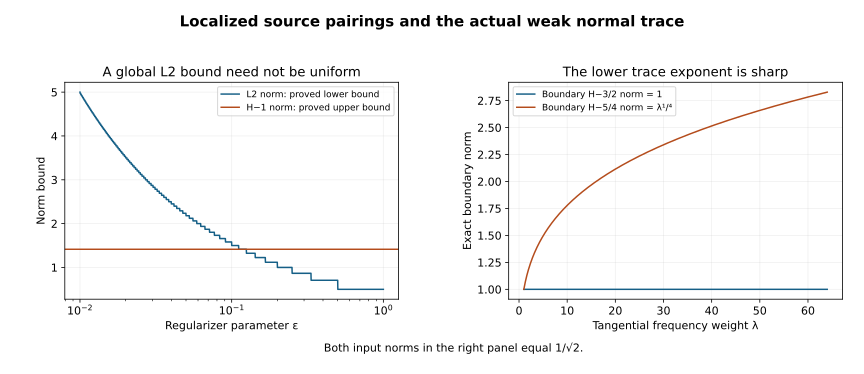

# A localized half-order estimate at strict diffraction

The matrix damping estimate retains a localized source. Its L2 norm can grow without bound when the regularizer is removed, even though every pairing used in the proof stays bounded. We prove those pairing bounds, keep the actual boundary traces, and obtain a half-order gain from a precisely stated incoming hypothesis. We also prepare the actual compressed-regular source for this estimate. The geometric incoming argument, a bootstrap on one common neighborhood, and the Neumann boundary estimate remain separate obligations.

**Independent exposition, proofs, exercises and figure: CC0-1.0.** The primary antecedent is Lars Hörmander, *The Analysis of Linear Partial Differential Operators III*, Springer 2007 edition, ISBN 978-3-540-49938-1, Section 24.4, Lemma 24.4.7, printed pages 449–451. The complete matrix damping, graph-trace and localized pairing arguments below use the exact programme proofs in the proof map. See source credit and [review](proof-review.json). Required Lebl proofs remain external; internal P514 closure of this export is not claimed. 

## 1. Exact hypotheses and conclusion

**L0. The finite-order receiving statement.** Work on a compact patch of \(X=[0,\infty)_x\times\mathbb R^d_z\), with finite component space \(\mathbb C^N\), \(D=-i\partial\), and inner products linear first. Smooth extensions of all coefficients and their derivatives are bounded on larger patches. Put
\[
 P=D_x^2-R(x,z,D_z),\qquad \sigma_2(R)=r(x,z,\eta)I_N,
 \qquad p=\xi^2-r,\qquad
 \|w\|_{\mathcal X_s}^2=\|\Lambda^s w\|^2+
                  \|\Lambda^{s-1}D_xw\|^2,
 \quad\Lambda=\langle D_z\rangle .\tag{LG1}
\]
The full lower coefficients of the tangential differential operator \(R\) are arbitrary complex matrices. The strict anchor \(a=(0,z_*,\eta_*)\), \(\eta_*\ne0\), satisfies
\[
 r(a)=0,\qquad \partial_xr(a)>0.\tag{LG2}
\]
Let \(\Omega\) be an open conic parameter neighborhood of \(a\). Fix a real order \(s\). The actual solution is locally H1, with \(Pu=f\in L^2\). For every scalar proper tangential cutoff \(\chi\) of order zero compactly supported in \(\Omega\), assume
\[
 \chi u\in\mathcal X_s,\qquad
 \chi f\in L^2_xH^s_z,\qquad
 \chi(0)\gamma u\in H^m_z\quad\hbox{for every real }m.
 \tag{LG3}
\]
Normal derivatives of these smooth cutoff families are included in the same calculus. Fixed spatial cutoffs outside a larger patch are understood; all their actual commutators are retained. The zero Dirichlet trace is a special case of the last condition.

Take the two commutants of [SDC:S8](../20261007-strict-diffraction-symbols/characteristic-squares-and-diffractive-commutants.html), with their damping constant chosen in L4. Each incoming coefficient \(\rho_\alpha\) is supported where \(r\ge c_\alpha|\eta|^2>0\). On a neighborhood of that support fix an actual tangential matrix operator \(A_{+,\alpha}\) of order one with scalar principal symbol \(+\sqrt r\), and a scalar cutoff \(\phi_\alpha=1\) there. The incoming hypothesis is the actual norm condition
\[
 \phi_\alpha(D_x-A_{+,\alpha})u\in L^2_xH^s_z,
 \qquad \alpha=1,2.\tag{LG4}
\]
It concerns the entire selected incoming support. Merely declaring a principal symbol to be incoming is insufficient. Full positive-root factors from the earlier reflection theorem are admissible choices.

Under (LG1)–(LG4), there is a scalar tangential cutoff \(K\), elliptic at \(a\), such that
\[
 Ku\in\mathcal X_{s+1/2},\qquad
 \gamma D_xu\in H^{s-1/2}\ \hbox{microlocally at }(z_*,\eta_*).
 \tag{LG5}
\]
The normal trace is the actual weak graph trace. Constants may depend on \(s\), the selected supports and finitely many of the stated norms. No uniformity in arbitrary cutoff choices is asserted. We prove (LG5) below; in particular no iteration on a fixed neighborhood is hidden in this finite-order statement.

## 2. A lower trace bound for the regularized family

**L1. Unequal tangential orders.** If \(v\in L^2_xH^a_z\), \(\partial_xv\in L^2_xH^b_z\), and \(v\) has bounded normal support, its actual trace satisfies
\[
 \|\gamma v\|_{H^{(a+b)/2}}^2
 \le 2\|v\|_{L^2_xH^a}\|\partial_xv\|_{L^2_xH^b}.
 \tag{LG6}
\]
For a smooth input, the fundamental theorem in \(x\), followed by tangential Plancherel, writes the squared boundary norm as the negative integral of its normal derivative. In that integral move the Fourier weights to the two factors with powers \(a\) and \(b\); their product is the required power \(a+b\). Cauchy–Schwarz proves (LG6). For a rough input, first truncate tangential frequencies. Each truncation has an L2 normal derivative and hence the one-dimensional absolutely continuous representative obtained by integrating that derivative. The same estimate for a difference of two truncations makes the boundary values Cauchy in \(H^{(a+b)/2}\). Their limit is the distributional trace: integration against a compact normal test identifies it by one-dimensional integration by parts. This also proves uniqueness and agreement with any stronger Sobolev or graph trace. Smooth normal approximation gives the same identity if one starts from distributions. An expanding compact normal cutoff proves the analogous result for decaying inputs with both displayed norms finite.

In particular, if a family has
\[
 \|w\|_{\mathcal X_0}+\|Pw\|_{L^2_xH^{-1}_z}\le C,
 \quad P=D_x^2-R,
 \tag{LG7}
\]
then \(D_x^2w=Rw+Pw\) is bounded in \(L^2_xH^{-2}_z\). Applying (LG6) to \(v=D_xw\), with \(a=-1,b=-2\), proves
\[
 \|\gamma D_xw\|_{H^{-3/2}}\le C'.\tag{LG8}
\]
The constant uses the fixed coefficient bounds. This weaker uniform trace suffices to pair the normal jet with smooth boundary data; we do not assert a uniform positive-order normal trace before proving the estimate.

## 3. Regularization and the source that is actually present

**L2. The complete regularized equation.** Choose one scalar tangential cutoff \(\chi\), equal to the identity microlocally on a neighborhood of all commutant, completion and incoming supports and compactly supported in \(\Omega\). Its full symbol equals one there outside a fixed frequency ball; all normal derivatives of \(\chi-I\) are smoothing there. Slightly larger cutoffs in \(\Omega\) control its derivatives. Define
\[
 a_\epsilon(\eta)=\frac{\langle\eta\rangle^s}{1+\epsilon^2|\eta|^2},\quad
 W_\epsilon=a_\epsilon(D_z),\quad
 u_\epsilon=W_\epsilon\chi u,\quad 0<\epsilon\le1.
 \tag{LG9}
\]
The exact equation is
\[
 \begin{split}
 Pu_\epsilon&=g_\epsilon+Z_\epsilon u_\epsilon,\\
 g_\epsilon&=W_\epsilon\chi f+h_\epsilon,\qquad
 h_\epsilon=W_\epsilon[P,\chi]u,\\
 [P,\chi]u&=-2i\dot\chi D_xu-\ddot\chi u-[R,\chi]u,\\
 Z_\epsilon&=[P,W_\epsilon]W_\epsilon^{-1}.
 \end{split}\tag{LG10}
\]
A dot denotes the full normal derivative of the operator family. The inverse multiplier exists for each fixed \(\epsilon\). [UMD:D6–D7](../20261008-uniform-matrix-damping/uniform-matrix-damping-and-robin-defects.html) prove, including every differentiated remainder, that \(Z_\epsilon\) is uniformly of tangential order one and its Hermitian part is uniformly of order zero. Its leading symbol is purely imaginary scalar. They also prove the fixed-parameter H2 regularity here: \(\chi u\in\mathcal X_s\), \(P\chi u\in L^2_xH^{s-1}\), and \(W_\epsilon\) has order \(s-2\), so all second derivatives of \(u_\epsilon\) are L2 by its exact equation.

All constants in the following lower bounds are uniform:
\[
 \|u_\epsilon\|_{\mathcal X_0}\le C_s,
 \quad \|g_\epsilon\|_{L^2_xH^{-1}}\le C_s,
 \quad \|Pu_\epsilon\|_{L^2_xH^{-1}}\le C_s.
 \tag{LG11}
\]
The source term with \(f\) is even bounded in L2 by (LG3). In the cutoff term, \(\dot\chi D_xu\) has local tangential order \(s-1\), as does \([R,\chi]u\); the latter commutator has order one because \(R\)'s leading symbol is scalar. Insert a larger cutoff in \(\Omega\) before using these bounds. The remaining off-support products are tangentially smoothing, uniformly with normal derivatives, and act on the original local H1 input. The uniform order-\(s\) bound on \(W_\epsilon\) proves (LG11). Thus L1 gives a uniform \(H^{-3/2}\) bound for \(b_{1\epsilon}=\gamma D_xu_\epsilon\). Also
\[
 b_{0\epsilon}=\gamma u_\epsilon=W_\epsilon\chi(0)\gamma u
 \quad\hbox{is bounded in every }H^m.
 \tag{LG12}
\]
These are actual traces by [NR:N7](../20261009-normal-commutator-graph/normal-commutators-on-the-weak-graph-domain.html) and tangential Sobolev continuity. No uniform global L2 norm for \(h_\epsilon\) is claimed.

**L3. The cutoff source is bounded in every required pairing.** Let \(J_\epsilon\) be any uniformly bounded tangential family of fixed order, including the needed normal derivatives, whose microsupport lies strictly inside the region where \(\chi=I\). Then, for every fixed real \(t\),
\[
 \|J_\epsilon^*h_\epsilon\|_{L^2_xH^t_z}\le C_{s,t,J}.
 \tag{LG13}
\]
Indeed every coefficient of \([P,\chi]\), including its normal-derivative coefficient, is smoothing on that region. The exact ordered symbol product for \(J_\epsilon^*W_\epsilon[P,\chi]\) has all its terms zero there to every symbol order. Outside that region the separated microsupports allow repeated integration by parts in the tangential composition integral. Each repetition gives an additional inverse frequency power; the uniform bounds on \(W_\epsilon\) and \(J_\epsilon\) control every differentiated amplitude. The finite-order remainder formula of SY:H7, used to an arbitrarily large order, therefore gives a uniformly smoothing tangential coefficient for both \(u\) and \(D_xu\). Its Sobolev bound acts on the original compact H1 input, proving (LG13). This argument includes full proper-support and low-frequency remainders; it is not a claim that the product is exactly zero.

Write a normal commutant as \(Q=A D_x+B\), with \(A=A^*\) of order minus one and \(B\) of order zero. Moving only tangential adjoints gives
\[
 \begin{split}
 |(h_\epsilon,Qu_\epsilon)|
 &\le\|\Lambda A^*h_\epsilon\|\,
                   \|\Lambda^{-1}D_xu_\epsilon\|
       +\|B^*h_\epsilon\|\,\|u_\epsilon\|,\\
 |(h_\epsilon,G_\epsilon u_\epsilon)|
 &\le\|G_\epsilon^*h_\epsilon\|\,\|u_\epsilon\| .
 \end{split}\tag{LG14}
\]
Here \(G_\epsilon\) may be either the scalar completion test or the uniformly bounded matrix damping test of order minus one. Choose their actual supports inside the region where \(\chi=I\); their symbol constructions and symmetric quantizations permit this. Equation (LG13) bounds every right-hand side of (LG14). No normal derivative is transferred to the cutoff source, so no unaccounted boundary term appears.

For \(W_\epsilon\chi f\), its uniform L2 bound and
\(\|Qu_\epsilon\|+\|G_\epsilon u_\epsilon\|\le C\|u_\epsilon\|_{\mathcal X_0}\)
give the same conclusion. Finally
\[
 |(Z_\epsilon u_\epsilon,G_\epsilon u_\epsilon)|
 \le\|\Lambda^{-1}Z_\epsilon u_\epsilon\|
                         \|\Lambda G_\epsilon u_\epsilon\|
 \le C\|u_\epsilon\|^2 .\tag{LG15}
\]
Thus all source pairings used in both characteristic completions are uniformly bounded, even though the stronger norm estimate for the full source may fail.

## 4. Complete the uniform quadratic estimate

**L4. Damping and the smooth Dirichlet datum.** Fix a uniform Hermitian symbol \(k_\epsilon\) for the anti-Hermitian parts of \(R\) and \(Z_\epsilon\), modulo order zero. UMD:D1 gives one constant \(M\) for which
\[
 m_\epsilon=M I+2k_\epsilon/|\eta|\ge I
 \quad (|\eta|\ge1),\tag{LG16}
\]
with a uniformly bounded positive matrix square root. Choose the two SDC:S8 commutants for this \(M\) and then choose \(\chi\) as in L2. There is no circular dependence: the bound on \(Z_\epsilon\) depends on \(P,s\), not on \(\chi\).

UMD:D2–D3 prove the two operator completions and the entry-by-entry cancellation of all anti-Hermitian matrix leading terms. Their proofs use the source only in the pairings of L3. One additional boundary pairing occurs for the present possibly nonzero smooth Dirichlet datum. For the actual H2 input and any selfadjoint tangential \(G\), normal integration gives exactly
\[
 (D_xu_\epsilon,D_xG u_\epsilon)-(Ru_\epsilon,G u_\epsilon)
 =(Pu_\epsilon,G u_\epsilon)
       -i\langle b_{1\epsilon},G(0)b_{0\epsilon}\rangle .
 \tag{LG17}
\]
This is the full Green identity, not an application of a zero-boundary weak equation to an inadmissible test. The tangential first-order terms in \(R\) remain in the same ordered lower form as in SDQ:W4. For either completion test \(G_\epsilon\), its order minus one, (LG8) and (LG12) bound the extra boundary pairing by
\[
 \|b_{1\epsilon}\|_{H^{-3/2}}
             \|G_\epsilon(0)b_{0\epsilon}\|_{H^{3/2}}\le C_s.
 \tag{LG18}
\]
Hence the same completion inequalities hold with a uniformly bounded additional scalar error.

Choose the commutant's normal coefficient at the face to be exactly \(A(0)=-T^*T\), using NR:N6. Its lower-order adjustment does not change the two principal rows, the scalar completion or the uniform lower-form bounds. The complete normal identity NR:N3–N4 gives
\[
 \mathcal B_Q(u_\epsilon)
 =-\|T b_{1\epsilon}\|^2
       +2\operatorname{Re}\langle B(0)b_{0\epsilon},b_{1\epsilon}\rangle
       +\langle\operatorname{Herm}(AR_h)(0)b_{0\epsilon},b_{0\epsilon}\rangle,
 \tag{LG19}
\]
where \(R_h=(R+R^*)/2\). Both remaining terms are uniformly bounded by (LG8), (LG12) and the tangential orders zero and one. Thus, for each of the two commutants, the completed estimate is
\[
 \|\Psi_{\alpha0}u_\epsilon+\Psi_{\alpha1}D_xu_\epsilon\|^2
       +\|T_\alpha b_{1\epsilon}\|^2
 \le \mathcal I_\alpha[u_\epsilon]+C_s,
 \quad
 \mathcal I_\alpha[w]=\operatorname{Re}
            (\rho_\alpha(D_x-A_{+,\alpha})w,w).
 \tag{LG20}
\]
The additional nonnegative matrix damping square can be retained; it was only dropped in writing (LG20). To verify the direction of the inequality, the exact normal identity says that its volume array equals \(2\operatorname{Im}(Pu_\epsilon,Qu_\epsilon)-\mathcal B_Q\). The scalar completion bounds the corrected array above by a negative \(\Psi\) square; the matrix-weight completion bounds the damping form below. Substitution gives \(\Psi^2\le\mathcal B_Q+\mathcal I+C_s\), precisely (LG20) after (LG19). All uniform error bounds come from L2–L3 and the proved ordered lower-form estimates.

**L5. The actual incoming term is uniform.** Put \(L_+=D_x-A_{+,\alpha}\). On the incoming support,
\[
 L_+W_\epsilon\chi u
  =W_\epsilon\chi L_+u+[L_+,W_\epsilon\chi]u .
 \tag{LG21}
\]
After an output cutoff there, the first term is uniformly L2 by (LG4). Insert a larger incoming cutoff before the input; the separated remainder is smoothing on the original H1 input. The second term has uniform tangential order \(s\) on \(u\), including the normal derivative of \(\chi\). In detail, \([D_x,W_\epsilon]=0\), \([D_x,\chi]=-i\dot\chi\), \([A_+,W_\epsilon]\) has order \(s\) because the multiplier is scalar, and \([A_+,\chi]\) has order zero because \(\chi\) is scalar. Larger cutoffs in \(\Omega\) and (LG3) therefore bound it. The full commutator expansion and its remainders use the same uniform composition bounds as L3. Since \(\rho_\alpha u_\epsilon\) is L2 bounded,
\[
 |\mathcal I_\alpha[u_\epsilon]|\le C_s.\tag{LG22}
\]
The choice of an actual full positive-root factor matters for verifying (LG4) from a PDE. This proof of the estimate does not replace that hypothesis by the root's principal symbol.

**L6. Remove the regularizer in the interior and at the boundary.** SDC:S8 gives two independent principal rows. The complete elliptic pair estimate SDQ:W6 applied to (LG20)–(LG22) gives, for some cutoff \(K\) elliptic at \(a\),
\[
 \|K u_\epsilon\|_{\mathcal X_{1/2}}
                  +\sum_{\alpha=1}^2\|T_\alpha b_{1\epsilon}\|\le C_s.
 \tag{LG23}
\]
Its use of \(D_xK u_\epsilon\) instead of \(K D_xu_\epsilon\) adds only \(-i\dot K u_\epsilon\), of the controlled lower order. Fourier dominated convergence gives
\(u_\epsilon\to\Lambda^s\chi u\) in \(\mathcal X_0\), and hence distributionally with every fixed differential operator. A distributional limit of an L2-bounded sequence is L2: its pairing with a compact smooth test is bounded by the common constant times that test's L2 norm; density and the Hilbert representation theorem supply the L2 representative and its norm bound. Apply this argument separately to the two weighted components in (LG23). It proves
\(K\Lambda^s\chi u\in\mathcal X_{1/2}\).

Commuting \(\Lambda^s\) past \(K\) creates an operator of order \(s-1\). Its normal derivative has the same tangential order, and its action on \(\chi u\) and \(D_x\chi u\) is one order better than needed, by (LG3). A tangential elliptic parametrix for \(K\chi\), on a smaller neighborhood of \(a\), then proves the interior part of (LG5). Its normal derivative and both smoothing remainders are included by the same composition and Sobolev bounds. A finite number of slightly larger cutoffs controls all these terms.

For the normal trace, actual graph trace commutation gives
\[
 b_{1\epsilon}=W_\epsilon
     \bigl(\chi(0)b_1-i\dot\chi(0)b_0\bigr),
 \qquad b_j=\gamma D_x^j u .\tag{LG24}
\]
The second term is smooth microlocally on the commutant support and contributes a uniformly bounded term after \(T_\alpha\); its separated part is uniformly smoothing. The first converges distributionally to \(\Lambda^s\chi(0)b_1\). The boundary part of (LG23) therefore puts \(T_\alpha\Lambda^s\chi(0)b_1\) in L2. SDC:S8 makes \(T_\alpha\) elliptic of order minus one half at the anchor. Its exact tangential parametrix proves \(b_1\in H^{s-1/2}\) there. This establishes both conclusions of (LG5) for the original actual traces.

## 5. Preparing the actual compressed-regular source

**L7. Normal elliptic frequencies can be removed with smooth boundary traces.** Suppose the BPL reduction gives an actual compact H1 representative \(U\), with \(PU=F\in L^2\), and \(F\) has every compressed L2 order on one fixed neighborhood of the nonzero tangential strict anchor. All original source lifts, gauge factors and localization terms are part of this \(F\). First use the ordered normal gauge NR:N8 to remove any first normal coefficient. Smooth invertible multiplication preserves this fixed compressed regularity by the full compressed calculus; it preserves the Dirichlet value and keeps any induced Robin condition explicitly.

Extend the resulting differential operator smoothly across the face. On a sufficiently small compact base patch, \(|r|\le C_0\langle\eta\rangle^2\). Choose a real scalar ordinary symbol \(E\) which is zero for \(|\xi|\le C\langle\eta\rangle\) and one for \(|\xi|\ge2C\langle\eta\rangle\), with \(C^2>4(C_0+1)\). Low-frequency modifications and fixed proper cutoffs are included. Both normal caps are elliptic for the full matrix operator. The exact ordinary parametrix gives an operator \(Q\) of order minus two such that, on a smaller base patch,
\[
 P Q E=E+S,\qquad S\in\Psi^{-\infty},\qquad
 Z=QE(e_+F),\qquad W=U-Z|_{x\ge0},
 \quad PW=(I-E)e_+F-S(e_+F).
 \tag{LG25}
\]
Here \(e_+F\) is the actual zero extension and the last equation is restricted to the half-space. To localize it, first take the fixed input cutoff equal to one on a larger patch; every additional commutator has separated support and is smooth on the smaller patch by the full proper kernel estimates. The parametrix is for the full matrix operator, not only its principal symbol. Since \(F\) is L2, \(Z\) is H2. Its value and normal traces are actual Sobolev traces.

The theorem ZE:Z0–Z4 proves ordinary wavefront absence of \(e_+F\) at every finite-normal lift of the anchor. The normalized lifts with \(|\xi|\le3C|\eta|\) form a compact set, so wavefront closedness supplies one fixed smaller base and tangential cone where all of them are regular. The full symbol of \(I-E\) is supported in a finite-normal region modulo smoothing. Consequently, for tangential cutoffs \(\theta\) in a further smaller parameter neighborhood,
\[
 \theta PW\in L^2_xH^m_z\quad\hbox{for every }m.\tag{LG26}
\]
Here are the projection details. Localize the base on a larger patch. The ordinary Fourier estimates on the compact finite-normal cone have arbitrary inverse powers of the full frequency, hence of \(\langle\eta\rangle\). A finite-normal output cutoff excludes the complementary normal frequencies. In the composition with a tangential cutoff, split the input tangential frequency into a slightly larger cone and its separated complement. On the first part use those Fourier estimates; on the second, repeated tangential integration by parts gives arbitrary decay. Off the enlarged normal cap, integrate in the normal composition variables as well; the separated normal supports give an arbitrarily smoothing remainder. Taking the expansion to an order larger than \(m\) and the dimension makes every resulting frequency integral absolutely bounded. The remaining smooth kernel acts on the compact L2 input. Partial Plancherel then proves (LG26), uniformly on the smaller collar. Thus this projection does not infer tangential regularity from finite-normal wavefront absence while allowing uncontrolled pure-normal output.

Apply IT:T0–T5 to the full ordinary operators \(QE\) and \(D_xQE\), of orders minus two and minus one. Both orders are strictly below minus one half. It proves, on one fixed smaller tangential neighborhood,
\[
 \gamma Z\in H^m\text{ microlocally},\qquad
 \gamma D_xZ\in H^m\text{ microlocally}\quad\hbox{for every }m.
 \tag{LG27}
\]
For a homogeneous Dirichlet \(U\), \(\gamma W=-\gamma Z\), exactly the smooth value datum required in (LG3). For an original Neumann or Robin problem, (LG27) instead preserves the corresponding regular inhomogeneous conormal datum; it does not make \(\gamma W\) smooth. The present half-order theorem therefore cannot be applied to that problem merely by changing the boundary label. Since \(E\) vanishes near the characteristic set, \(Z\) is ordinarily regular there; subtracting it preserves the original incoming characteristic regularity. Verifying (LG4) on the whole selected incoming support still requires the full factorization and incoming propagation argument.

## 6. Three solved exercises

### Exercise 1. A source norm diverges while its lower norm stays bounded

On the circle with normalized measure, let a distribution \(h\) have Fourier coefficients \(h_n=\langle n\rangle^{-s}\) for \(n\ge1\), and zero otherwise. Put \(h_\epsilon=W_\epsilon h\). Prove a divergent L2 lower bound and a uniform \(H^{-1}\) upper bound.

**Solution.** The coefficients of \(h_\epsilon\) are exactly \((1+\epsilon^2n^2)^{-1}\). For \(1\le n\le\lfloor\epsilon^{-1}\rfloor\), they are at least one half. Therefore
\[
 \|h_\epsilon\|_2^2\ge\tfrac14\lfloor\epsilon^{-1}\rfloor,
 \qquad
 \|h_\epsilon\|_{H^{-1}}^2
   \le\sum_{n\ge1}\frac1{1+n^2}<2.
 \tag{LG28}
\]
The last bound follows by comparing \(\sum_{n\ge2}n^{-2}\) with \(\int_1^\infty t^{-2}dt=1\), and adding the first term. The same comparison proves \(h\in H^{s-1}\). Each fixed \(\epsilon\) gives an L2 function, since its coefficients decay quadratically. This example shows why (LG11) cannot be replaced by a uniform L2 assertion about the entire cutoff source. L3 controls its actual localized pairings, which is stronger information than its global lower norm alone.

### Exercise 2. The lower normal trace exponent is sharp

Take one normalized tangential Fourier mode with weight \(\lambda=\langle\eta\rangle\), and let \(v_\lambda(x)=\lambda^{3/2}e^{-\lambda x}\). Compute the two norms entering (LG6) for \(a=-1,b=-2\), and its boundary norm.

**Solution.** The integral of \(e^{-2\lambda x}\) is \((2\lambda)^{-1}\), so
\[
 \|v_\lambda\|_{L^2H^{-1}}=2^{-1/2},\qquad
 \|\partial_xv_\lambda\|_{L^2H^{-2}}=2^{-1/2},\qquad
 \|v_\lambda(0)\|_{H^{-3/2}}=1.
 \tag{LG29}
\]
Thus equality holds in (LG6). Any attempted replacement of the trace exponent by \(-3/2+\delta\), \(\delta>0\), makes the last norm \(\lambda^\delta\), which is unbounded. On a torus take actual integer modes with \(\lambda=(1+n^2)^{1/2}\). The continuous \(\lambda\) plot is the exact frequency-weight formula; it does not assert that every plotted weight is a torus eigenvalue. Expanding compact normal truncations justify using this decaying profile.

### Exercise 3. Retain every local cutoff term

For \(P=D_x^2-zD_z^2\) and a smooth scalar multiplication cutoff \(\chi(x,z)\), compute \([P,\chi]u\). Explain why applying \(Q^*\) by a normal integration is unnecessary in L3.

**Solution.** The product rule with \(D=-i\partial\) gives
\[
 [P,\chi]u=-2i\chi_xD_xu-\chi_{xx}u
                    +2iz\chi_zD_zu+z\chi_{zz}u.
 \tag{LG30}
\]
Both second derivatives of the cutoff are essential. If \(\chi\) is identically one near the commutant microsupport, all four coefficients vanish there, but the actual pseudodifferential compositions have smoothing tails. For \((h,AD_xu_\epsilon)\), move only the tangential \(A^*\) onto \(h\). Equation (LG14) pairs \(\Lambda A^*h\) with \(\Lambda^{-1}D_xu_\epsilon\); it requires neither a normal derivative of \(h\) nor a new boundary integral. The source commutator is retained and estimated, rather than set to zero.

## 7. Exact illustration and remaining scope

**F0. Coordinates and meanings.** The left panel plots the exact lower bound \(\tfrac12\sqrt{\lfloor1/\epsilon\rfloor}\) from (LG28), for \(0.01\le\epsilon\le1\), and the constant upper bound \(\sqrt2\) for the different H-minus-one norm. These are proved bounds for two norms of the same Fourier sequence, not computed PDE solutions. The right panel plots the exact boundary norms \(1\) and \(\lambda^{1/4}\) from (LG29), for \(1\le\lambda\le64\). The two input norms remain \(1/\sqrt2\). The [figure source](figures/build_figure.py) retains every constant and formula.

This completes the localized finite-order half-gain and actual normal-trace limit, including the source pairings that were left open in the damping supplement. L7 prepares the actual compressed-regular Dirichlet source and its value datum. Returning to the original energy-b front also requires the correction's regularity in that same interior norm; its H2 bound and smooth traces alone do not prove that transfer. The incoming hypothesis must still be verified on the entire commutant support, and iteration must preserve one common neighborhood before claiming smooth strict propagation. Neumann and Robin require control of their remaining boundary form. None of those obligations, the complementary Airy response, or the full AN-04 objective is declared complete here.
