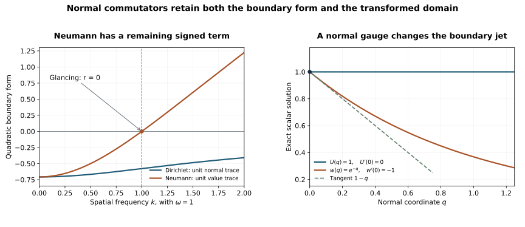

# Normal commutators on the weak graph domain

The characteristic quadratic estimates need a normal commutator identity. Its multiplier contains a normal derivative and need not preserve the Dirichlet form domain. An energy solution also has a weak normal trace rather than a classical one. We prove the identity directly on the actual graph domain, retain every boundary term, and justify the tangential regularizers used in the next propagation estimate.

**Independent exposition, proofs, exercises and figure: CC0-1.0.** The primary antecedent is Lars Hörmander, *The Analysis of Linear Partial Differential Operators III*, Springer 2007 edition, ISBN 978-3-540-49938-1, Section 24.4, Lemma 24.4.2, printed pages 443–444. The proof here retains the full complex matrix normal coefficient, gives explicit ordered operators, and passes to the weak graph domain.  Required Lebl foundations remain external. The prerequisite proof index gives the earlier results used here.

## 1. The actual equation and traces

**N0. Complete normalized operator.** Work on \(X=[0,\infty)_q\times\mathbb R^d_z\), with finite component space \(\mathbb C^N\), \(D=-i\partial\), and inner products linear in the first entry. All localizations have fixed compact support; operators and all needed parameter derivatives have the corresponding uniform bounds on larger patches. Write
\[
 P=D_q^2+C(q,z)D_q-R(q,z,D_z),\qquad
 R=H+iK,\quad H=\frac{R+R^*}{2},\quad
 K=\frac{R-R^*}{2i}.
 \tag{NR1}
\]
Here \(R\) is a tangential differential operator of order two. The adjoints in \(R^*,H,K\) are tangential adjoints at fixed \(q\).
The principal symbol of \(R\) is a real scalar \(r(q,z,\eta)I_N\) of order two. Thus \(H=H^*\) has order two and \(K=K^*\) has order at most one. The normal coefficient \(C\) and all lower coefficients of \(R\) are arbitrary smooth complex matrices. Put
\[
 u\in H^1_{\rm comp}(X;\mathbb C^N),\qquad Pu=F\in L^2,\qquad
 u_0=\gamma u,\quad v=D_qu,\quad v_0=\gamma v .
 \tag{NR2}
\]
The last trace is the graph trace. In fact
\(D_qv=F+Ru-Cv\in L^2_qH^{-1}_z\): a second tangential derivative of an H1 function is a tangential derivative of an L2 function, and all lower terms have the same or better regularity. [WSL:L6](../20261008-weak-source-lift/weak-source-lifting-and-normal-flux.html) therefore gives
\[
 u_0\in H^{1/2},\qquad v_0\in H^{-1/2}.
 \tag{NR3}
\]
The [BPL reduction](../20261008-boundary-preserving-localization/boundary-preserving-localization-of-weak-sources.html) supplies precisely such an L2-source representative from the original natural-dual problem, with its full source, both actual weak domains and matrix gauge retained. In normalized variables the imposed condition is \(u_0=0\) or \(v_0=0\). More generally we may keep \(v_0+Mu_0=0\) for a smooth matrix \(M\). The identity below is first proved with arbitrary traces, so none of these conditions is assumed during approximation.

## 2. Graph approximation without a false boundary condition

**N1. Smooth approximation in both equation norms.** There are smooth functions \(u_\epsilon\), compactly supported up to the face, with
\[
 u_\epsilon\longrightarrow u\ \hbox{in }H^1,\qquad
 Pu_\epsilon\longrightarrow Pu\ \hbox{in }L^2.
 \tag{NR4}
\]
To prove this locally, take a smooth nonnegative compact kernel \(\kappa(a,b)\) of integral one, supported where \(1<a<2\) and \(|b|<1\). Define
\[
 J_\epsilon u(q,z)=
       \int\kappa(a,b)u(q+\epsilon a,z+\epsilon b)\,da\,db .
 \tag{NR5}
\]
Only strictly positive input normal coordinates occur. Translation continuity on the half-space, proved by smooth H1 and L2 approximation, gives \(J_\epsilon u\to u\) in H1 and \(J_\epsilon F\to F\) in L2. Derivatives commute with this convolution on interior distributions; its output is smooth on a neighborhood of the closed face.

Here is the coefficient commutator estimate needed for the equation. For a smooth bounded coefficient \(a_{ij}\), the second-order term of \([a_{ij}\partial_i\partial_j,J_\epsilon]u\) has kernel
\[
 \int K_\epsilon(x,y)\,[a_{ij}(x)-a_{ij}(y)]
                        \partial_i\partial_j u(y)\,dy .
 \tag{NR6}
\]
Integrate one input derivative by parts. There is no face term: for each output \(q\ge0\), the kernel is supported where the input normal coordinate is at least \(q+\epsilon\). On its support \(|x-y|\le c\epsilon\), so the coefficient difference is \(O(\epsilon)\). A kernel derivative costs \(\epsilon^{-1}\), while a derivative on the coefficient difference is bounded. The absolute integrals in either kernel variable are therefore bounded independently of \(\epsilon\). For such a kernel \(L\), Cauchy–Schwarz in its input variable gives
\(\lvert Lf(x)\rvert^2\le(\int|L(x,y)|dy)(\int|L(x,y)||f(y)|^2dy)\); integration in \(x\) proves its L2 bound. Applied to (NR6) after integration by parts, this bounds the commutator by \(C\|u\|_{H^1}\). First-order and zeroth-order coefficient commutators have the same bound.

For a fixed smooth function the commutator tends to zero in L2, by the coefficient difference bound and ordinary differentiation. Approximate an H1 function by smooth functions up to the face and use the uniform estimate to conclude
\[
 [P,J_\epsilon]u\longrightarrow0\quad\hbox{in }L^2.
 \tag{NR7}
\]
Together with \(PJ_\epsilon u=J_\epsilon F+[P,J_\epsilon]u\), this proves (NR4). A fixed cutoff equal to one on the support and its small enlargement makes the approximants compact. For a merely local solution, first insert a compact cutoff and retain the exact source \(\chi F+[P,\chi]u\); the commutator is first order and hence L2.

The traces in (NR4) converge in exactly the spaces in (NR3). The value trace follows from H1 continuity. For the normal trace, \(D_qu_\epsilon\to D_qu\) in L2 and
\[
 D_q^2(u_\epsilon-u)
   =P(u_\epsilon-u)+R(u_\epsilon-u)-C D_q(u_\epsilon-u)
       \longrightarrow0\quad\hbox{in }L^2_qH^{-1}_z .
 \tag{NR8}
\]
WSL:L6 proves convergence of the normal graph trace. The approximants need not satisfy the boundary condition; the actual condition is imposed after this convergence. Thus no unproved density in a stronger boundary domain is being used.

## 3. A selfadjoint normal multiplier and its exact boundary form

**N2. Symmetric placement of the normal derivative.** Let \(A(q)=A(q)^*\in\Psi^{-1}\) and \(B(q)=B(q)^*\in\Psi^0\) be smooth tangential families. Write a dot for \(\partial_q\) and put
\[
 Q=\tfrac12(AD_q+D_qA)+B=AD_q+Q_0,\qquad
 Q_0=B-\tfrac i2\dot A,\qquad Q_0^*=B+\tfrac i2\dot A .
 \tag{NR9}
\]
This is formal selfadjointness in the open half-space. It does not assert selfadjointness on either boundary domain. Tangential integration and the one-dimensional Green identity give, for smooth compact \(f,g\),
\[
 (Qf,g)_X-(f,Qg)_X=i(A(0)f_0,g_0)_{\partial X}.
 \tag{NR10}
\]
Indeed \((D_qf,g)=(f,D_qg)+i(f_0,g_0)\); differentiating \(A\) contributes \(-i\dot A\), and its half in each side of (NR9) yields (NR10). This also checks the normal sign.

**N3. Exact matrix identity.** With \(\operatorname{Herm}T=(T+T^*)/2\), define the following tangential operators, in the indicated order:
\[
 \begin{split}
 E&=[H,A]/i,\\
 C_{11}&=2\dot A+(AC-C^*A)/i,\\
 C_{10}&=\dot Q_0+\tfrac12 E-AK-C^*Q_0/i,\qquad C_{01}=C_{10}^*,\\
 C_{00}&=\operatorname{Herm}\!\left(A\dot H+[H,Q_0]/i\right)
                    -(Q_0^*K+KQ_0).
 \end{split}\tag{NR11}
\]
Here \(C_{jk}\) is a coefficient of a quadratic form and is distinct from the normal coefficient \(C\) in (NR1). The orders are \(1-j-k\). The boundary form is
\[
 \mathcal B_Q(u_0,v_0)
  =(A(0)v_0,v_0)+2\operatorname{Re}(Q_0(0)u_0,v_0)
                 +(\operatorname{Herm}(AH)(0)u_0,u_0).
 \tag{NR12}
\]
Then, with \(u_1=v\) and all volume pairings integrated over \(q>0\),
\[
 2\operatorname{Im}(Pu,Qu)_X
   =\mathcal B_Q(u_0,v_0)+
                   \sum_{j,k=0}^1(C_{jk}u_k,u_j)_X .
 \tag{NR13}
\]
The sum is real: its diagonal entries are selfadjoint and \(C_{01}=C_{10}^*\).

We prove the formula first for smooth compact \(u\). One normal integration followed by (NR10) gives
\[
 \begin{split}
 2\operatorname{Im}(D_q^2u,Qu)
  ={}&(A(0)v_0,v_0)+2\operatorname{Re}(Q_0(0)u_0,v_0)\\
     &+2(\dot A v,v)+2\operatorname{Re}(\dot Q_0u,v).
 \end{split}\tag{NR14}
\]
For clarity, \(D_qQu=Qv-i\dot A v-i\dot Q_0u\). The difference
\(((v,Qv)-(Qv,v))/i\) equals \(-(A(0)v_0,v_0)\); the two boundary terms from the first integration contribute twice that normal square plus the cross term. The remaining differences yield the two volume terms in (NR14).

For the selfadjoint tangential part \(H\), (NR10) applied to \(Hu,u\) yields
\[
 -2\operatorname{Im}(Hu,Qu)
   =\operatorname{Re}(AHu_0,u_0)
                  +\operatorname{Re}(([H,Q]/i)u,u).
 \tag{NR15}
\]
Since \([H,D_q]=i\dot H\), expand
\([H,Q]=[H,A]D_q+iA\dot H+[H,Q_0]\).
This gives the \(E\), \(A\dot H\) and \([H,Q_0]/i\) terms in (NR11).
For the other two pieces of \(P\), no normal integration is needed:
\[
 \begin{split}
 -2\operatorname{Re}(Ku,Qu)
      &=-2\operatorname{Re}(AKu,v)-2\operatorname{Re}(Q_0^*Ku,u),\\
 2\operatorname{Im}(Cv,Qu)
      &=((AC-C^*A)v,v)/i
                 +2\operatorname{Im}(Q_0^*Cv,u).
 \end{split}\tag{NR16}
\]
The off-diagonal coefficients in the last term are \(Q_0^*C/i\) and its adjoint \(-C^*Q_0/i\). Combining (NR14)–(NR16) gives exactly (NR11)–(NR13), without commuting any matrix factors.

**N4. Passage to the weak graph domain.** Every term of (NR13) is continuous under (NR4). The left side is continuous because \(Q:H^1\to L^2\). In the volume sum, the diagonal orders are one and minus one and the cross orders are zero. The ordinary Sobolev bounds therefore apply to \(u\in L^2_qH^1_z\) and \(v\in L^2\). On the boundary, \(A\) maps \(H^{-1/2}\) to \(H^{1/2}\), \(Q_0\) maps \(H^{1/2}\) to itself, and \(AH\) maps \(H^{1/2}\) to \(H^{-1/2}\). All pairings in (NR12) are thus continuous dual pairings of the actual traces (NR3). N1 proves their convergence. This establishes (NR13) for every \(u\) in (NR2).

In particular the proof never pairs a natural-dual source with an inadmissible normal test. The L2 source in (NR2) is essential to this version of the identity; in the original problem it comes from the complete BPL reduction. Nor does the proof replace a weak Neumann trace by a classical derivative.

## 4. The full principal quadratic form

**N5. Scalar escape symbol with matrix lower terms.** Suppose \(A,B\) have real scalar homogeneous principal symbols \(aI_N,bI_N\) of degrees minus one and zero. Put
\[
 p=\rho^2-r,\qquad q=a\rho+b,\qquad
 C_{\rm ah}=(C-C^*)/(2i),\qquad k=\sigma_1(K).
 \tag{NR17}
\]
With the full Poisson convention
\(\{p,q\}=p_\rho q_q-p_q q_\rho+
 p_\eta\cdot q_z-p_z\cdot q_\eta\), the matrix of principal coefficients in (NR11) satisfies
\[
 \sum_{j,k'=0}^1\sigma_{1-j-k'}(C_{jk'})\rho^{j+k'}
       =\{p,q\}I_N+2q(C_{\rm ah}\rho-k).
 \tag{NR18}
\]
The index \(k'\) here is an integer, whereas \(k=\sigma_1(K)\) is the Hermitian matrix symbol in (NR17).

To check (NR18), \([H,A]/i\) has principal symbol
\(-\{r,a\}_z\), and \([H,Q_0]/i\) has principal symbol
\(-\{r,b\}_z\). The terms independent of \(C_{\rm ah},k\) therefore sum to
\[
 2\dot a\rho^2+2\dot b\rho+a\dot r
              -\{r,a\}_z\rho-\{r,b\}_z=\{p,q\}.
 \tag{NR19}
\]
The \(K\) terms give \(-2(a\rho+b)k\); the \(C\) terms give
\(2(a\rho+b)C_{\rm ah}\rho\), because \(a,b\) are scalars. The full lower-order operators remain exactly those of (NR11). The ordinary principal commutator formula used here follows from the complete ordered symbol product; its factor \(1/i\) accounts for the minus signs just checked. Formula (NR18) shows why deleting a complex normal coefficient or treating a complex system as formally selfadjoint changes the estimate.

## 5. Boundary realizations and an exact Dirichlet square

**N6. Substitute only the actual imposed condition.** In the Dirichlet case the boundary form is \((A(0)v_0,v_0)\). In the bare Neumann case it is
\((\operatorname{Herm}(AH)(0)u_0,u_0)\). For the Robin condition \(v_0=-Mu_0\), it is the quadratic form with operator
\[
 M^*A(0)M-M^*Q_0(0)-Q_0(0)^*M
                         +\operatorname{Herm}(AH)(0).
 \tag{NR20}
\]
These follow by direct substitution into (NR12) and tangential adjunction. In particular the Neumann boundary form is generally nonzero and has no automatic sign.

There is a useful exact choice in the Dirichlet case. Suppose the desired principal coefficient satisfies \(a(0,z,\eta)=-t(z,\eta)^2\), where \(t\) is real of order minus one half. Choose a proper \(T\in\Psi^{-1/2}\) with principal symbol \(t\), and an initial selfadjoint family \(A_{\rm s}\) with principal symbol \(a\). The selfadjoint boundary operator \(A_{\rm s}(0)+T^*T\) has order minus two. With a real cutoff \(\chi(q)=1\) near zero define
\[
 A=A_{\rm s}-\chi(q)\,[A_{\rm s}(0)+T^*T].
 \tag{NR21}
\]
This keeps the full desired principal symbol, preserves selfadjointness and gives \(A(0)=-T^*T\) exactly. The lower-order correction and its proper-support remainders are part of the operator. Consequently
\[
 u_0=0\quad\Longrightarrow\quad
 \mathcal B_Q(0,v_0)=-\|Tv_0\|_2^2.
 \tag{NR22}
\]
The norm is meaningful since \(v_0\in H^{-1/2}\). No uncontrolled lower-order boundary remainder has to be dropped. Combined with a negative interior quadratic estimate, this is the signed boundary square needed in the Dirichlet diffraction argument. For Neumann or Robin, (NR20) must still be estimated.

## 6. Tangential regularizers are legitimate graph operations

**N7. Exact localized equation and face jets.** Let \(L(q)\in\Psi^0\) be a smooth tangential family, or any family of lower order. Ordinary Sobolev bounds, including those for \(\dot L\), show \(Lu\in H^1\). The complete localized equation is
\[
 P(Lu)=LF-2i\dot L\,v-\ddot L\,u
                     +[C,L]v-iC\dot L\,u-[R,L]u .
 \tag{NR23}
\]
Here \([R,L]\) has order at most one: the order-two principal symbol of \(R\) is scalar. Thus every right-hand term is L2 for the fixed \(L\), and \(Lu\) is in the graph domain. Approximate using N1 and apply this continuous identity to the approximants. Their face jets then give
\[
 \gamma(Lu)=L(0)u_0,\qquad
 \gamma D_q(Lu)=L(0)v_0-i\dot L(0)u_0 .
 \tag{NR24}
\]
Both equalities concern the actual traces, with the second in \(H^{-1/2}\).

If \(\dot L(0)=0\), both homogeneous normalized domains are preserved. For a general Robin condition the new defect is
\((ML(0)-L(0)M-i\dot L(0))u_0\); normal independence alone does not remove its matrix commutator.

For example take \(L_\epsilon=\langle\epsilon D_z\rangle^{-2J}
\langle D_z\rangle^s\ell(q,z,D_z)\), with a proper order-zero scalar cutoff \(\ell\), fixed \(\epsilon>0\) and \(2J\ge s+2\). It has order at most minus two. If \(\ell\) is normal-independent at the face, (NR24) preserves both bare domains. Its tangential gain puts two tangential derivatives and each mixed normal-tangential derivative in L2. Equation (NR23) then implies \(D_q^2(L_\epsilon u)\in L^2\), so it lies locally in H2 as well as in the graph domain. All terms in (NR23) remain in subsequent estimates; the present assertion is for each fixed \(\epsilon\), and does not assert a uniform propagation estimate as \(\epsilon\) tends to zero.

**N8. Eliminating the normal coefficient changes the boundary condition.** One may instead solve the ordered matrix ODE
\[
 \partial_q S=-\tfrac i2 CS,\qquad S(0,z)=I,\qquad U=Sw .
 \tag{NR25}
\]
The programme's parameter-dependent linear ODE proof gives a smooth invertible \(S\) on a fixed collar. Its inverse satisfies the corresponding right-multiplication equation; differentiating \(S^{-1}S\) proves the inverse identity. The transformed operator is
\[
 S^{-1}PS=D_q^2-\widetilde R,\qquad
 \widetilde R=S^{-1}RS-S^{-1}(D_q^2S+C D_qS).
 \tag{NR26}
\]
All tangential derivatives in \(RS\) act on the product, so this is an ordered operator identity, not a coefficient substitution. Since \(D_qS=-CS/2\), the normal coefficient cancels. The value trace is unchanged, but
\(\gamma D_qU=\gamma D_qw-C(0)w_0/2\).
Thus bare Neumann for \(U\) becomes Robin
\(\gamma D_qw-C(0)w_0/2=0\).
The exact identity (NR13) permits retaining \(C\) and the original bare domain instead. Either choice must keep these complete transformed terms and traces.

## 7. Three solved exercises

### Exercise 1. A nonselfadjoint normal coefficient contributes to the identity

Use one normalized constant tangential mode, let \(u(q)=e^{-q}\), and freeze \(A=a\), \(B=b\), \(H=h\), \(K=k\), \(C=c\), with \(a,b,h,k\) real and \(c\) complex. Verify the identity, and evaluate it at \(a=-1,b=2,h=3,k=5,c=1+4i\).

**Solution.** The normal integral of \(|u|^2\) is \(1/2\), \(v=iu\),
\(Pu=(-1-h-ik+ic)u\), and \(Qu=(b+ia)u\). Hence the left side is
\[
 \operatorname{Im}[(-1-h-ik+ic)(b-ia)]
   =a(1+h)-bk+a\operatorname{Im}c+b\operatorname{Re}c.
 \tag{NR27}
\]
The boundary form is \(a(1+h)\); the cross term is purely imaginary. The volume form is \(-bk+a\operatorname{Im}c+b\operatorname{Re}c\). The requested values are boundary \(-4\), volume \(-12\), total \(-16\). Exponential decay justifies the integrations by compact normal truncation and passage to the limit. The constant tangential mode can be taken on a unit-volume torus, so no infinite-volume plane-wave norm is used. The contribution of \(C\) is \(-2\); removing it would increase the total by two.

### Exercise 2. The Neumann boundary term changes sign across glancing

On a tangential two-torus take \(R=D_t^2-D_y^2\) and a normalized Fourier mode with time frequency \(\omega\) and space frequency \(k\). Put \(\lambda=(1+\omega^2+k^2)^{1/2}\), \(A(0)=-\lambda^{-1}\), \(Q_0(0)=0\). Compute the boundary form under the two homogeneous conditions.

**Solution.** The symbol of \(R\) is \(r=\omega^2-k^2\). With unit normal trace and zero value trace, the Dirichlet boundary form is \(-1/\lambda\). With unit value trace and zero normal trace, the Neumann form is
\[
 -\frac{\omega^2-k^2}{\sqrt{1+\omega^2+k^2}}.
 \tag{NR28}
\]
It is negative for \((\omega,k)=(2,1)\), positive for \((1,2)\), and zero for \((1,1)\), with values \(-3/\sqrt6,3/\sqrt6,0\). Smooth normal profiles with the prescribed jets realize each example. This is a boundary-form calculation, not a claim that these profiles solve the homogeneous PDE. It proves that the Neumann term in (NR12) cannot be deleted by calling \(Q\) selfadjoint.

### Exercise 3. Normal gauge cancellation does not preserve bare Neumann

Take constant matrices
\[
 M=\begin{pmatrix}0&1\\0&0\end{pmatrix},\qquad
 R=\begin{pmatrix}0&0\\1&0\end{pmatrix},\qquad C=2iM .
 \tag{NR29}
\]
Compute \(S,\widetilde R\) and the transformed boundary condition.

**Solution.** Since \(M^2=0\), (NR25) gives \(S=I+qM\) and \(S^{-1}=I-qM\). The normal zeroth-order correction in (NR26) vanishes. Ordered multiplication gives
\[
 \widetilde R=(I-qM)R(I+qM)
       =\begin{pmatrix}-q&-q^2\\1&q\end{pmatrix},
 \qquad \gamma D_qw-iMw_0=0 .
 \tag{NR30}
\]
The \(q^2\) term comes from \(-q^2MRM\), and \(MRM=M\). It would disappear under an invalid commutation. A vector function constant near the face with \(w_0=(0,1)^T\) has zero bare normal derivative, but \(U=Sw\) has \(\gamma D_qU=(-i,0)^T\). Keeping bare Neumann after the gauge therefore selects a different domain.

## 8. Exact illustration and remaining propagation step

**F0. Coordinates and meanings.** The left panel plots the two expressions in Exercise 2 with \(\omega=1\) and continuous \(0\le k\le2\). The vertical marker \(k=1\) is the glancing equation \(r=0\); integer values give actual torus modes. The curves use unit value trace or unit normal trace, respectively, and are quadratic boundary forms, not solution amplitudes.

The right panel takes the scalar coefficient \(C=2i\). The exact gauge is \(S=e^q\), and the solution \(U=1\) of \(PU=0\) becomes \(w=e^{-q}\) for the operator \(D_q^2+1\). At the face \(U'(0)=0\) while \(w'(0)=-1\); the dashed line \(1-q\) is its tangent. This scalar panel illustrates (NR25)–(NR26); Exercise 3 retains the matrix order. The [figure script](figures/build_figure.py) contains every formula and coordinate.

The [characteristic quadratic estimates](../20261007-strict-diffraction-weak-quadratics/weak-characteristic-quadratic-estimates.html) now have a complete normal graph identity available for their receiving argument, including legitimate regularizers and every boundary term. A uniform positive estimate and its bootstrap still have to control the regularizer commutators, incoming error and full lower matrices. The Neumann/Robin boundary form requires its own estimate. On the complementary Airy route, the response of boundary frequencies outside the chosen patch still needs justification on the full dependence region. This supplement does not claim any of those propagation conclusions .
