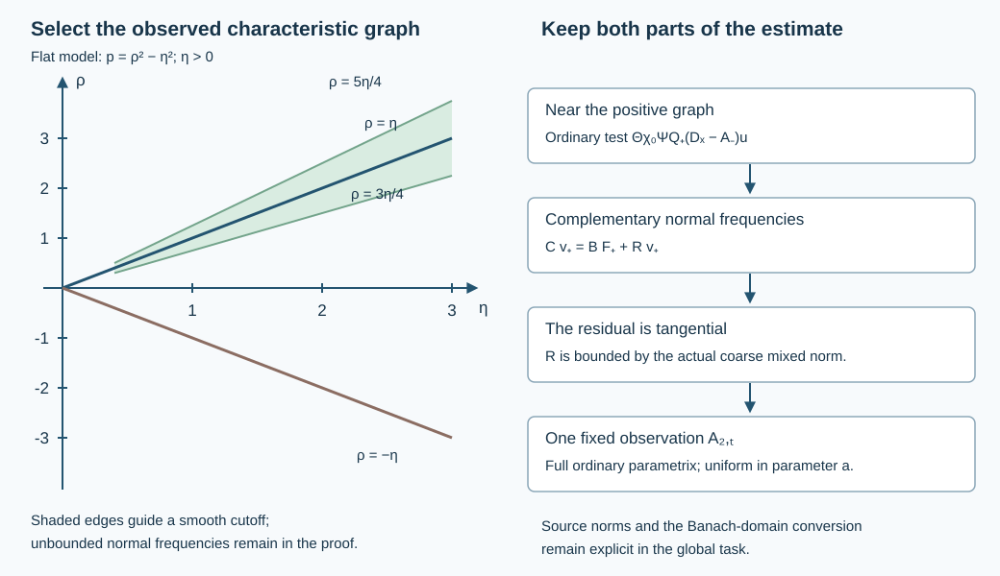

# A fixed interior observation test for transverse reflection

The [uniform reflection estimate](../20261009-uniform-transverse-reflection/uniform-transverse-reflection-with-strip-observations.html) used the norm of an entire transported branch on an interior strip. Here we replace that norm by one fixed ordinary pseudodifferential observation of the original solution, supported near the observed characteristic graph. The complementary normal frequencies are controlled by the actual source and the coarse mixed norm. The observation test is independent of the operator parameter.

The antecedent is Hörmander, *The Analysis of Linear Partial Differential Operators III*, 2007 edition, the ordinary/tangential comparison of §18.1, the reflection argument of Theorem 24.2.1 and the parameter requirement in Proposition 24.7.1′. We give the complete quantitative reduction, including a calculus whose remainders improve tangential order without being called normally smoothing. The proof uses the programme's [ordinary calculus](../20261004-free-intrinsic-graph/prerequisites/ordinary-operator-calculus.md), [mixed composition proof](../20261005-restored-first-order-cauchy/spacetime-symbol-composition.html), [finite-derivative boundedness theorem](../20261005-restored-airy-models/bounded-derivative-operators.html) and the exact current reflection factors.

## 1. Symbols that measure tangential regularity

**M0. Keep the normal frequency unbounded.** Put \(Y=(x,z)\in\mathbb R^{1+d}\), \(\Xi=(\rho,\eta)\), \(d\ge1\), \(n=d+1\), and
\(\lambda(\eta)=(1+|\eta|^2)^{1/2}\). Define \(\mathscr S_\eta^m\) by the bounds
\[
 |\partial_Y^\alpha\partial_\Xi^\beta a(Y,\Xi)|
 \le C_{\alpha\beta}\lambda(\eta)^{m-|\beta|}.
 \tag{OI1}
\]
Every component of \(\beta\), including a normal-frequency derivative, lowers this tangential weight. The bounds are uniform in \(\rho\), which can be arbitrarily large. Extra compact smooth parameters are included in the seminorms. Let \(\mathscr S_\eta^{-\infty}\) be the intersection over all \(m\). Use left quantization on all variables. All spatial and normal localizations below have fixed compact supports in an interior coordinate chart.

These symbols preserve Schwartz functions. Differentiating the defining Fourier integral introduces only fixed polynomial frequency factors, while integration by parts in frequency gives arbitrary output-position decay. The input Fourier transform is rapidly decreasing in the full frequency, and every differentiated symbol is polynomially bounded there. The same argument for the adjoint kernel gives the tempered-distribution action. Regularized integrals therefore have the same operator meanings as in P2:OP1–OP4.

The elementary inequalities
\[
 \lambda(\eta+\theta)\le\sqrt2\,\lambda(\eta)\langle\theta\rangle,
 \qquad
 \lambda(\eta)\le\sqrt2\,\lambda(\eta+\theta)\langle\theta\rangle
 \tag{OI2}
\]
follow by squaring and using \(2|\eta||\theta|\le|\eta|^2+|\theta|^2\). They also hold with \(t\theta\), uniformly for \(0\le t\le1\). They imply the corresponding estimate for every real power, with a fixed power of \(\langle\theta\rangle\). No comparison between \(|\rho|\) and \(|\eta|\) is used.

**M1. Full finite composition and amplitude reduction.** For \(a\in\mathscr S_\eta^m\), \(b\in\mathscr S_\eta^{m'}\), the left symbol of the product has the complete finite expansion
\[
 a\# b=\sum_{|\alpha|<J}
       \frac{\partial_\Xi^\alpha a\,D_Y^\alpha b}{\alpha!}
       +r_J,\qquad
 r_J\in\mathscr S_\eta^{m+m'-J},\quad D_Y=-i\partial_Y .
 \tag{OI3}
\]
Here is the remainder argument. The regularized composition integral is
\[
 (2\pi)^{-n}\iint e^{-iV\cdot\Theta}
              a(Y,\Xi+\Theta)b(Y+V,\Xi)\,dV\,d\Theta .
 \tag{OI4}
\]
Taylor expand the first symbol in \(\Theta\) to degree \(J-1\), with its integral remainder. Integrating each monomial against the phase gives the displayed derivatives of \(b\), with precisely the factors in (OI3). Each remainder integrand contains \(|\alpha|=J\) derivatives of \(a\), a monomial of degree \(J\) in \(\Theta\), and a bounded integral over \(0\le t\le1\). After any specified output derivatives, (OI2) bounds it by the desired power \(\lambda^{m+m'-J-|\beta|}\) times a fixed polynomial in \(\Theta\).

For completeness the convergence is obtained in the following order. Apply \((1-\Delta_\Theta)^M\) to obtain a factor \((1+|V|^2)^{-M}\), with \(2M>n\). The resulting additional symbol derivatives and differentiated monomials introduce only a fixed further polynomial bound in \(\Theta\), by (OI2). Then integrate by parts in \(V\) with \((1-\Delta_V)^N\), where \(2N\) exceeds \(n\) plus that polynomial degree. Base derivatives do not increase symbol order. The final absolute majorant is a constant times
\(\lambda^{m+m'-J-|\beta|}\langle V\rangle^{-n-1}\langle\Theta\rangle^{-n-1}\), after increasing the integers if needed. It is integrable uniformly in \(t,Y,\rho,\eta\). This proves every differentiated remainder estimate and lets the regularization tend to one. Each fixed estimate uses finitely many input seminorms.

The same integral argument reduces compactly based amplitudes \(a(Y,Y',\Xi)\) satisfying (OI1) in all base variables to left symbols. Taylor expansion in \(Y'-Y\), or the integral with \(Y'=Y+V\), gives the same successive loss of one \(\lambda\)-order. Thus composition, adjoints and proper-kernel realizations have their actual finite remainders in this calculus.

A kernel cutoff away from \(Y=Y'\) contributes \(\mathscr S_\eta^{-\infty}\): integrate by parts in \(\Xi\) along \((Y-Y')/|Y-Y'|^2\) as many times as required, then apply the amplitude reduction just proved. On fixed compact input/output sets the coefficients and every derivative of this vector are bounded away from the diagonal. Each integration lowers the \(\lambda\)-order. This is a tangential-order remainder statement, not an assertion that the kernel is smooth in both normal variables.

**M2. Mapping bounds and actual sums.** For every real \(r\),
\[
 \|\operatorname{Op}(a)h\|_{L^2_xH^{r-m}_z}
       \le C\|h\|_{L^2_xH^r_z},\qquad a\in\mathscr S_\eta^m .
 \tag{OI5}
\]
Indeed conjugate by the frequency multipliers \(\lambda^{r-m}\) and \(\lambda^{-r}\). Formula (OI3) puts the full conjugated symbol in \(\mathscr S_\eta^0\). Its finitely many derivatives needed in the proved packet bound AM:B1–B3 are bounded on the whole joint phase space, since \(\lambda\ge1\). That bound is an \(L^2(dY)\) estimate in dimension \(n\), with no restriction on normal frequency. Proper errors satisfy the same conclusion. In particular a \(\mathscr S_\eta^{-\infty}\) operator maps any fixed finite tangential \(L^2\) order to every other one, uniformly for bounded families.

Asymptotic summation also holds. For successive orders \(m-j\), multiply the \(j\)-th term by a fixed smooth cutoff of \(\lambda/R_j\), zero for \(\lambda<R_j\) and one for \(\lambda>2R_j\). Choose \(R_j\) so large that its first \(j\) required seminorms, measured one order above its own, are at most \(2^{-j}\). Differentiating the cutoff obeys the same \(\lambda^{-1}\) losses; normal-frequency derivatives of it vanish. The derivative series converges uniformly in each requisite lower-order seminorm. Subtracting any finite initial segment leaves the asserted lower order. The portion changed at bounded \(\eta\), even with unbounded \(\rho\), belongs to \(\mathscr S_\eta^{-\infty}\), because all its seminorms are uniform in \(\rho\). This proves the construction on one fixed parameter set.

We will sum inverse symbols \(b_j\) for which both \(b_j\) and \(\rho b_j\) have stated orders. Include the seminorms of both families in this same diagonal choice of \(R_j\). The resulting \(b\) then has both expansions. This extra requirement is essential when composing the completed inverse with \(D_x\).

## 2. Remove the complementary normal frequencies

**M3. A uniform inverse away from one root.** Let
\[
 L_a=D_x-A_a(x,z,D_z),\qquad
 \sigma_1(A_a)=h_a(x,z,\eta)\in\mathbb R,\qquad
 A_a-h_a(x,z,D_z)\in\Psi^0_{\rm tan}.
 \tag{OI6}
\]
Use a smooth low-frequency completion of the real degree-one root \(h_a\). It and all derivatives have uniform tangential symbol bounds. The normal variable is a smooth parameter in \(A_a\). Consider a compactly based bounded family \(C_a\) of \(\mathscr S_\eta^0\) operators whose full symbols, modulo \(\mathscr S_\eta^{-\infty}\), are supported where
\[
 |\rho-h_a(Y,\eta)|\ge \epsilon\langle(\rho,\eta)\rangle,
 \qquad |\eta|\ge1,
 \tag{OI7}
\]
with one \(\epsilon>0\). The support is inside a slightly larger region of this kind.

There is a properly realized family \(B_a\), with symbol in \(\mathscr S_\eta^{-1}\), and a remainder \(R_a\in\operatorname{Op}(\mathscr S_\eta^{-\infty})\), such that
\[
 C_a=B_aL_a+R_a .
 \tag{OI8}
\]
To prove it, set \(\ell_a=\rho-h_a\). On (OI7), \(\ell_a^{-1}\in\mathscr S_\eta^{-1}\) and \(\rho/\ell_a\in\mathscr S_\eta^0\). Differentiate the reciprocal repeatedly: each differentiated \(h_a\) has its tangential bound, each denominator is bounded below by \(\epsilon\langle(\rho,\eta)\rangle\), and \(\lambda\le\langle(\rho,\eta)\rangle\). A normal-frequency derivative has numerator one and obeys the required loss as well. The product rule proves every mixed estimate, including those for the extra numerator \(\rho\).

For a leading full symbol \(c_a\) of \(C_a\), begin with \(b_0=c_a/\ell_a\) on that region, extended with a cutoff in a slightly larger elliptic region. Right composition with \(D_x\) is exactly multiplication of the left symbol by \(\rho\). Formula (OI3) therefore gives
\[
 \sigma(\operatorname{Op}(b_0)L_a)
       =\rho b_0-b_0\# a_a=c_a+e_1,\qquad
 e_1\in\mathscr S_\eta^{-1}.
 \tag{OI9}
\]
The lower part of \(a_a\) and every positive derivative term have gained at least one tangential order. Divide the successive order-minus-\(j\) defect by \(\ell_a\) with the opposite sign. This gives a correction \(b_j\in\mathscr S_\eta^{-j-1}\), with \(\rho b_j\in\mathscr S_\eta^{-j}\), and the remaining defect has order at most \(-j-1\). Use full finite expansions at each step. Their terms are supported in the same elliptic region; errors outside a larger such region are in every negative tangential order and are retained in \(R_a\). Equivalently, multiply each correction by a cutoff equal to one on the smaller formal support. The difference is of every negative order there by (OI3). This is the usual nested-support recursion, now with the explicit weight (OI1).

Sum the corrections with simultaneous control of \(b_j,\rho b_j\) as in M2. Comparison with every finite stage makes \(\rho b-b\#a_a-c_a\) belong to \(\mathscr S_\eta^{-\infty}\). After proper localization, derivatives of the kernel cutoff in \(B_aD_x\) have the same property: the off-diagonal argument of M1 applies to both \(b\) and \(\rho b\). Thus (OI8) holds for actual operators with the full remainder, not just formal symbols. Every step is uniform on the compact parameter set.

**M4. An interior strip estimate with a retained remainder.** All tests can have normal input and output supports inside a prescribed slightly larger interior interval. Choose a smooth normal cutoff \(\chi_1\) equal to one on those input supports. For a smooth \(v\) satisfying \(L_av=F\) there, apply (OI8) to \(\chi_1v\), extended by zero. The extra source \(-i\chi_1'v\) is annihilated by the input support of \(B_a\). Also \(C_a(\chi_1v)=C_av\). Hence (OI5) gives, for arbitrary real \(r,q\),
\[
 \|C_av\|_{L^2_xH^r_z}
 \le C_{r,q}\bigl(
       \|\chi_1F\|_{L^2_xH^{r-1}_z}
          +\|\chi_1v\|_{L^2_xH^q_z}\bigr).
 \tag{OI10}
\]
If a wider proper realization is used instead, the extra cutoff term has separated supports and belongs to the tangential remainder of M1. The displayed coarse term still bounds it. Both descriptions retain its actual value. No normal derivative of \(F\) occurs in (OI10).

## 3. Place the observation near the characteristic graph

**O0. The observation region and its margin.** Use the scalar reflection family, all four full factors and the exactly matched initial tests of UTR:R0–R8. Denote the plus branch by
\[
 v_{+,a}=Q_{+,a}(D_x-A_{-,a})u,\qquad
 L_{+,a}v_{+,a}=F_{+,a}.
 \tag{OI11}
\]
Fix a positive normal strip \(J\Subset(0,L)\), and a slightly larger strip \(I\Subset(0,L)\). Suppose the ordinary observation cone \(\Omega\) contains a compact neighborhood of every graph point
\[
 (x,z;\rho,\eta)=(x,z;h_{+,a}(x,z,\eta),\eta),
 \quad x\in I,\quad (x,z,\eta)\in\operatorname{WF}'(Q_{+,a}),
 \tag{OI12}
\]
for the whole compact parameter family. All graph covectors in this formula have \(\eta\ne0\). Compactness is on the unit cosphere over fixed compact bases. After shrinking the initial test and parameter neighborhood around a chosen observed transverse germ, openness of \(\Omega\) supplies precisely this condition. The larger strip and support margins are chosen before any Sobolev order.

Choose a fixed proper tangential order-zero test \(\Psi\), with full symbol one near the uniform microsupport of \(Q_{+,a}\) over \(I\), and with slightly larger microsupport still satisfying (OI12). Fixed low tangential frequencies may be included in the remainders. Choose \(\chi_0\in C_c^\infty(I)\) equal to one near \(J\). The complete separated-product calculus gives
\[
 \chi_0(v_{+,a}-\Psi v_{+,a})
      =S_{0,a}u+S_{1,a}D_xu,\qquad
 S_{j,a}\in\Psi_{\rm tan}^{-\infty}.
 \tag{OI13}
\]
For the coarse norm \(X_s\) of UTR, its \(L^2H^{t-1}\) norm is at most \(C_{s,t}\|u\|_{X_s}\). This uses the actual first normal derivative already present in \(X_s\).

**O1. A full ordinary cutoff and its elliptic complement.** Choose a fixed ordinary order-zero cutoff \(\Theta\), with compact full microsupport inside \(\Omega\), equal to the identity microlocally near the union of the graph sets over the larger support of \(\chi_0\Psi\). Its symbol can vanish in a cone around the pure normal directions; graph slopes are uniformly bounded. Realize it with sufficiently small fixed proper kernel range. The family
\[
 C_a=(I-\Theta)\chi_0\Psi
 \tag{OI14}
\]
belongs to the calculus of M0. Its full symbol is of every negative tangential order near the graphs, since the full symbol of \(\Theta\) is one there; away from the graphs it satisfies (OI7) after removing low tangential frequencies into a remainder. To verify the uniform separation, intersect with a bounded-slope unit cosphere: compactness away from the graph gives a positive lower bound for \(|\rho-h_{+,a}|\). In the remaining high-slope region use \(|h_{+,a}|\le C\lambda\) and \(|\rho|\ge2C\lambda\). This proves (OI7) with one smaller \(\epsilon\). Complete symbol tails and all kernel cutoffs are retained in \(\mathscr S_\eta^{-\infty}\).

Apply M3–M4 with \(r=t-1\), \(q=s-1\). The exact decomposition \(\chi_0\Psi v=\Theta\chi_0\Psi v+C_av\), together with (OI13), yields
\[
 \begin{aligned}
 \|v_{+,a}\|_{L^2(J;H^{t-1})}
 \le C_{s,t}\bigl(&
 \|\Theta\chi_0\Psi Q_{+,a}(D_x-A_{-,a})u\|_{L^2H^{t-1}}\\
 &+\|\chi_1F_{+,a}\|_{L^2(I;H^{t-2})}
 +\|u\|_{X_s}\bigr).
 \end{aligned}
 \tag{OI15}
\]
Here and below \(I\) may be enlarged once inside \((0,L)\) to include every proper input support, and \(\chi_1\) is supported in that enlargement. The coarse branch bound used here is
\[
 \|\chi_1v_{+,a}\|_{L^2H^{s-1}}
 \le C_s\|u\|_{X_s},
 \tag{OI16}
\]
because its two terms have respectively one controlled normal derivative and one tangential operator of order one. The estimate covers unbounded normal frequencies; it assumes neither their absence nor a finite normal-frequency cutoff.

**O2. Replace the bounded observation family by one fixed scalar test.** The first term of (OI15) is a bounded family of ordinary order-\(t\) tests of \(u\). Indeed \(\Theta\) vanishes near pure normal covectors. The complete ordinary/tangential multiplication theorems FC:M2–M4 make
\(\Theta\chi_0\Psi Q_{+,a}(D_x-A_{-,a})\) ordinary of order one with microsupport in \(\Omega\). Left composition with \(\Lambda_z^{t-1}\) is ordinary of order \(t\) by the same theorem. Keep its proper compact part and all full ordinary smoothing tails. Those tails map the coarse \(L^2_xH^s_z\) input continuously into \(L^2\), by their actual smooth kernels and the compact input supports. Thus this norm is bounded by
\[
 \|O_{t,a}u\|_{L^2}+C_{s,t}\|u\|_{X_s},
 \qquad O_{t,a}\in\Psi^t_{\rm ordinary},
 \quad\operatorname{WF}'(O_{t,a})\Subset\Omega ,
 \tag{OI17}
\]
with common compact supports and uniform full seminorms.

Choose one fixed proper scalar \(A_{2,t}\in\Psi^M_{\rm ordinary}\), where \(M\) is any nonnegative integer at least \(t\), elliptic on that common compact microsupport and supported in a slightly larger cone still inside \(\Omega\). A cutoff times \(\langle\Xi\rangle^M\), followed by proper realization, constructs it. The complete ordinary parametrix recursion, with all residuals, gives
\[
 O_{t,a}=G_{t,a}A_{2,t}+R_{t,a}^{\rm ord},
 \qquad \operatorname{ord}G_{t,a}\le t-M\le0 .
 \tag{OI18}
\]
For example choose a fixed microlocal inverse of \(A_{2,t}\), multiply it on the left by \(O_{t,a}\), and retain the complete residual product. Every symbol division takes place on a fixed elliptic set, so the seminorms are uniform in \(a\). The order-zero bound controls \(G_{t,a}\). The residual \(R_{t,a}^{\rm ord}\) has a smooth proper kernel with fixed interior supports. Apply the adjoint tangential multiplier \(\Lambda_z^{-s}\) to its input kernel and use Cauchy–Schwarz in both variables; its \(L^2\) kernel norm is finite and uniformly bounded. This proves
\(\|R_{t,a}^{\rm ord}u\|_{L^2}\le C_{s,t}\|u\|_{X_s}\).
Consequently (OI15) holds with its first term replaced by \(\|A_{2,t}u\|_{L^2}\) and the same coarse term. The observation operator is scalar and independent of \(a\). Its compact kernel is entirely in the interior, so it is also an admissible boundary-calculus operator there with the same microsupport.

## 4. The resulting reflection estimate

**O3. Combine with the actual boundary transmission.** The full source identities of UTR:R3 give
\[
 F_{\pm,a}=Q_{\pm,a}P_au+
                 E_{\pm,0,a}u+E_{\pm,1,a}D_xu .
 \tag{OI19}
\]
Their tangentially smoothing errors satisfy the stated \(X_s\) bound at any target order. In (OI15) the plus source is needed only at order \(t-2\), which is bounded by its order-\(t-1\) norm. Substituting the fixed-test version of (OI15) into UTR:R8 therefore gives, for every real \(s\) and finite \(t\ge s\),
\[
 \begin{aligned}
 \|T_0u\|_{X_t([0,L_0])}\le C_{s,t}\bigl(
 &\|A_{2,t}u\|_{L^2}
 +\|Q_{+,a}P_au\|_{L^2([0,L];H^{t-1})}\\
 &+\|Q_{-,a}P_au\|_{L^2([0,L];H^{t-1})}
 +\|\beta_a b\|_{H^{t-1}}
 +\|u\|_{X_s}\bigr).
 \end{aligned}
 \tag{OI20}
\]
The constant may depend on the fixed positive strip width and collar lengths. All geometric neighborhoods, including the parameter neighborhood, remain independent of \(t\). For \(b=0\), the boundary term vanishes because the full initial operators agree. Starting with the minus branch and its graph in \(\Omega\) proves the symmetric assertion, with its own fixed scalar observation test.

**O4. The remaining source and global interfaces.** This completes the replacement of the actual strip observation by one fixed admissible interior observation operator on the stated common graph neighborhood. The two source norms and the coarse \(X_s\) norm in (OI20) are still the actual norms displayed. They have not been replaced by the arbitrary Banach norm and one global admissible source tester of HIII24.7.1′. That source/domain conversion, global scalar assembly across different patches, the other uniform local regimes and the compact-ray assembly remain required. The proof makes no new normal-source-derivative assumption and does not convert tangential remainders into full ordinary smoothing.

## 5. Three complete checks

### Exercise 1. The constant-coefficient inverse sees every normal frequency

Let \(L=D_x-cD_z\) in two variables. Choose a smooth multiplier \(q(\rho,\eta)\), bounded in absolute value by one, supported where
\(|\rho-c\eta|\ge\delta\langle\eta\rangle\), \(\delta>0\). Set
\(b=q/(\rho-c\eta)\). For Schwartz \(v\), prove an exact source estimate with one tangential derivative gained.

**Solution.** All symbols are independent of the base, so right factorization is exact:
\[
 b(D)Lv=q(D)v,\qquad
 \|q(D)v\|_{L^2_xH^{r+1}_z}
       \le\delta^{-1}\|Lv\|_{L^2_xH^r_z}.
 \tag{OI21}
\]
Indeed \(\langle\eta\rangle|b|\le\delta^{-1}\) on its support, and Plancherel proves the inequality at every real \(r\). The integral includes arbitrarily large \(|\rho|\). For \(c=2\) and \(\rho=2\eta+2\delta\langle\eta\rangle\), the weighted reciprocal is exactly \(1/(2\delta)\). This model has no base derivatives and hence no symbolic composition remainder; the variable-coefficient proof retains them in (OI8).

### Exercise 2. Tangential residual does not mean normal smoothing

On the product of two circles of length \(2\pi\), let \(R\) have Fourier multiplier \(e^{-\eta^2}\), independent of \(\rho\). For integers \(N,k\), take \(v_N=e^{iNx+ikz}\). Compare its mixed and ordinary Sobolev norms after applying \(R\).

**Solution.** Every derivative of \(e^{-\eta^2}\) is a polynomial times that Gaussian, and every positive \(\rho\)-derivative is zero. Its lifted symbol belongs to every class in (OI1). On the given mode,
\[
 Rv_N=e^{-k^2}v_N,\quad
 \|Rv_N\|_{L^2_xH^r_z}^2=(2\pi)^2e^{-2k^2}(1+k^2)^r,\quad
 \|Rv_N\|_{H^q_{x,z}}^2=(2\pi)^2e^{-2k^2}(1+N^2+k^2)^q .
 \tag{OI22}
\]
For fixed \(k\) the first norm is independent of \(N\), whereas the second diverges for \(q>0\) as \(|N|\) grows. The input \(L^2\) norms are constant. Thus an operator can improve every tangential order while preserving arbitrarily large normal frequencies. This is exactly why (OI8) uses the coarse mixed input to bound its remainder.

### Exercise 3. One observed branch and the actual boundary term

Fix \(k>0,c>0\), \(\kappa=ck\), and the exact flat solution
\(u=(a_+e^{i\kappa x}+a_-e^{-i\kappa x})e^{ikz}\).
Compute the two factor outputs and the boundary comparison. Explain the role of the Dirichlet condition when only the plus graph is observed.

**Solution.** Direct differentiation gives
\[
 v_+=(D_x+\kappa)u=2\kappa a_+e^{i\kappa x+ikz},
 \qquad
 v_-=(D_x-\kappa)u=-2\kappa a_-e^{-i\kappa x+ikz},
 \qquad
 b=(a_++a_-)e^{ikz}.
 \tag{OI23}
\]
The plus output has only the normal root \(\rho=\kappa\); the other input mode is annihilated exactly. At zero,
\[
 v_-(0)-v_+(0)=-2\kappa b .
 \tag{OI24}
\]
If \(b=0\), then \(a_-=-a_+\), and observation of the plus coefficient determines the other coefficient. The branch outputs, though their input amplitudes have opposite signs, agree at zero. Without the boundary term or the condition \(b=0\), choose \(a_+=0\) and \(a_-\ne0\): the observed plus output is zero while the other branch is nonzero. Formula (OI24) retains exactly the missing datum. These plane-wave identities describe the local characteristic modes; no nonintegrable plane wave is assigned a finite whole-space norm.

## 6. The frequency diagram

**F0. What is exact and what is schematic.** The left panel has tangential frequency \(\eta>0\) horizontally and normal frequency \(\rho\) vertically. The flat roots are \(\rho=\eta\) and \(\rho=-\eta\). The shaded geometric neighborhood has edges \(\rho=3\eta/4\) and \(\rho=5\eta/4\); a smooth ordinary cutoff can be supported within it and equal to one on a smaller neighborhood of the positive root. The edges are support guides, not a discontinuous symbol. The omitted high-slope frequencies continue beyond the drawing and are included in the inverse estimate.

The right panel records the exact two terms in the reduction: the ordinary test on the observed graph and the source inverse on the complementary frequencies, together with the retained tangential remainder. The final fixed scalar observation is obtained by the full ordinary parametrix (OI18). Reproducible [figure source](figures/build_figure.py), [exact checks](check_models.py), proof map, [receiving review](proof-review.json) and source credit accompany the lesson.

The independent lesson, exercises and figure are CC0. Earlier components retain their actual terms. Lebl's foundational proofs remain explicit external author-edition dependencies; internal P514 closure of this CC0 export is not claimed. 
