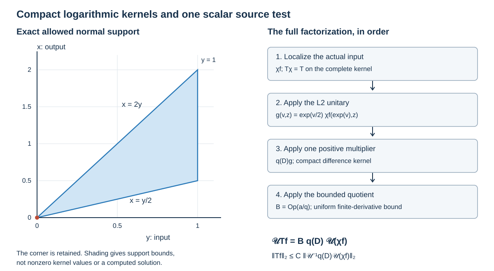

# Scalar source tests from compact logarithmic kernels

Original exposition, proofs, exercises and illustration: GPT-6 Astra (OpenAI), Ultra, 9 October 2026. CC0-1.0. The primary antecedent is Lars Hörmander, *The Analysis of Linear Partial Differential Operators III*, corrected 1994 edition, Springer 2007 eBook, Sections 18.3 and 24.7. 

The [previous fixed-test proof](../20261009-fixed-residual-source-tests/fixed-source-tests-by-residual-packing.md) retained an elliptic test and a residual test separately and used a positive tangential dimension for its packing construction. Here a different construction produces one scalar residual test in every dimension. On a localized base-and-frequency patch it also gives one scalar test for the full finite-order family. The factorization is exact; no residual source norm is discarded.

We use the [complete boundary kernels](../20261005-global-boundary-operators/global-boundary-operator-calculus.md), their [resolved geometry](../20261005-global-boundary-operators/stretched-kernels-and-compressed-geometry.md), [uniform full-symbol microsupport](../20261007-restored-uniform-microsupport/uniform-microsupport-and-dual-sources.md), Fourier inversion and Plancherel, and the finite-derivative packet bound. These are exact earlier programme proofs. Their linked human foundations remain external.

## 1. Two precise scalar statements

**D0. Retain the support and cone conditions.** Let
\[
 X=[0,\infty)_x\times\mathbb R^d_z,\qquad n=d+1,\qquad d\geq0,
 \tag{SF1}
\]
with Lebesgue L2. Let \(T_{\ell,a}\), \(1\leq\ell\leq L\), be a family of scalar boundary operators with fixed compact input and output projections, bounded in the complete \(\Psi_b^m\) topology. The parameter set may be arbitrary; uniform full-kernel seminorms are the hypothesis. Smooth families on a compact parameter set satisfy it. Fixed finite-dimensional matrix outputs obey the same argument with a scalar tester on the input components.

There are two conclusions.

* If the family is bounded in the full residual topology, there is one fixed compact scalar \(S\in\Psi_b^{-\infty}\) such that
\[
 \sum_{\ell=1}^L\sup_a\|T_{\ell,a}f\|_{L^2}
       \leq C\|Sf\|_{L^2}.
 \tag{SF2}
\]
* For the finite-order conclusion, impose the following local patch condition. There is a compactly supported smooth input cutoff \(\chi\), equal to one on a neighborhood of every input projection, and open angular cones
\[
 F\Subset V\subset\mathbb R^n\setminus0
 \quad\text{on the unit sphere},\qquad
 (\operatorname{supp}\chi)\times\overline V\Subset\Gamma .
 \tag{SF3}
\]
Here the frequency coordinates are dual to \((\log x,z)\), equivalently the boundary frame \((x\partial_x,\partial_z)\). The full symbols of \(T_{\ell,a}\) are uniformly rapidly decreasing outside \(F\). There is then one fixed compact scalar \(A\in\Psi_b^M\), with \(M\) any chosen nonnegative integer at least \(m\), for which
\[
 \operatorname{WF}'_b(A)\subset\Gamma,\qquad
 \sum_{\ell=1}^L\sup_a\|T_{\ell,a}f\|_{L^2}
       \leq C\|Af\|_{L^2}.
 \tag{SF4}
\]
If \(F\) is the entire sphere, take \(V\) to be the entire sphere and omit the outside-cone condition. In dimension \(n=1\), angular sets are subsets of the two-point sphere; the same convention applies. The patch condition concerns the whole input support, including residual parts. It is not inferred just from the compressed microsupport of an arbitrary operator.

The input \(f\) is smooth up to the boundary on the common compact input set. Thus all displayed norms exist. Density and graph consequences will be stated separately, without an assumed graph-density theorem.

## 2. The exact logarithmic density

**D1. A unitary change of variable.** Put \(v=\log x\) for \(x>0\) and define
\[
 (\mathcal Uf)(v,z)=e^{v/2}f(e^v,z).
 \qquad
 \|\mathcal Uf\|_{L^2(dv\,dz)}=\|f\|_{L^2(dx\,dz)} .
 \tag{SF5}
\]
The equality follows from \(dx=e^v\,dv\); the inverse is
\(\mathcal U^{-1}g(x,z)=x^{-1/2}g(\log x,z)\). Smooth compactly supported functions on \(X\), including those nonzero at \(x=0\), become Schwartz functions in \((v,z)\): they vanish for sufficiently large \(v\), while every \(v\)-derivative is a finite sum of terms \(e^{v/2}e^{kv}\partial_x^k f(e^v,z)\). Multiplication by any power of \(|v|\) preserves boundedness as \(v\to-\infty\).

Use the function-kernel convention
\[
 (Tf)(x,z)=\int\kappa(x,z,w,t)f(tx,w)\,dt\,dw,\qquad t=y/x.
 \tag{SF6}
\]
For \(Y=(v,z)\), \(H=(s,h)=Y-Y'\), the exact kernel of
\(\widetilde T=\mathcal UT\mathcal U^{-1}\), with respect to \(dY'\), is
\[
 k(Y;H)=e^{-s/2}
       \kappa(e^v,z,z-h,e^{-s}).
 \tag{SF7}
\]
Indeed \(v'=v+\log t\), \(s=-\log t\), and \(|dt|=t\,ds\); the density factor \(t^{-1/2}\) from the two unitary maps therefore leaves \(t^{1/2}=e^{-s/2}\). This is also the identity
\(\sqrt{xy}\,K(x,z;y,w)=\sqrt t\,\kappa(x,z,w,t)\)
for the ordinary function kernel \(K=x^{-1}\kappa\). There is no choice of sign or half-density left implicit.

**D2. Full Fourier symbols, including the side tails.** With the convention
\[
 \widehat g(\xi)=\int e^{-iY\cdot\xi}g(Y)\,dY,\qquad
 g(Y)=(2\pi)^{-n}\int e^{iY\cdot\xi}\widehat g(\xi)\,d\xi ,
 \tag{SF8}
\]
write the full left symbol as
\[
 a(Y,\xi)=\int e^{-iH\cdot\xi}k(Y;H)\,dH,\qquad
 \widetilde T g(Y)=(2\pi)^{-n}
       \int e^{iY\cdot\xi}a(Y,\xi)\widehat g(\xi)\,d\xi .
 \tag{SF9}
\]
The first formula is a distributional Fourier transform when the kernel is conormal.

Here are the uniform estimates needed from that formula. In a fixed neighborhood of \(H=0\), the map between \((s,h)\) and the resolved normal difference is a smooth change of conormal defining coordinates with invertible derivative. In the symmetric difference convention \(r=2(x-y)/(x+y)\), it is
\[
 r=2\tanh(s/2),\qquad s=2\operatorname{artanh}(r/2),\qquad
 \left.\frac{dr}{ds}\right|_{s=0}=1.
 \tag{SF10}
\]
The earlier complete conormal symbol reduction, with its actual remainder, therefore gives \(a\in S^m\) there, uniformly with each specified base derivative. Smooth output \(x\)-derivatives are stronger than the \(v\)-derivatives \(x\partial_x\) required here, since the output \(x\)-range is bounded.

Away from \(H=0\) the kernel is smooth. Its tangential difference is in a compact set. At \(|s|\to\infty\), flatness on both resolved side faces gives arbitrary exponential decay in \(|s|\), after every derivative in \(s,h,x,z\) and after every factor arising from the density in (SF7). To see the coordinates explicitly, use
\(x+y=x(1+e^{-s})\) and \(\rho=x/(x+y)=(1+e^{-s})^{-1}\).
Differentiating these coordinates and their density factors introduces only finite powers of \(e^{|s|}\); side flatness absorbs each such power. Powers of \(s\) are absorbed as well. Integrating by parts in \(H\) then gives a uniformly rapidly decreasing symbol for the entire off-diagonal tail. Differentiation under these integrals is justified by the resulting integrable majorants. This treats the complete kernel, not a quotient by residual kernels.

Consequently a bounded residual family has all bounds
\[
 \sup_{\ell,a,Y,\xi}
  \langle\xi\rangle^N
  |\partial_Y^\alpha\partial_\xi^\beta a_{\ell,a}(Y,\xi)|<\infty
 \quad\text{for every }\alpha,\beta,N.
 \tag{SF11}
\]
For a finite-order family the same derivatives obey order \(m-|\beta|\), and (SF11) holds outside the stated angular cone. The full-symbol coordinate theorem and the uniform microsupport proof preserve that assertion under (SF10). Fixed finite changes of density do not change the cone.

## 3. A positive Fourier floor with compact kernel

**D3. The lattice construction.** Choose a nonzero nonnegative
\(\phi\in C_c^\infty(\mathbb R^n)\). Its support can be as small as desired. Set
\[
 h(\xi)=|\widehat\phi(\xi)|^2,\qquad
 c_\phi(H)=\int\phi(Y+H)\overline{\phi(Y)}\,dY.
 \tag{SF12}
\]
Then \(h\) is nonnegative Schwartz, \(h(0)>0\), and
\(\widehat {c_\phi}=h\). The last identity follows by the change of variable
\(W=Y+H\) and Fubini; every integrand is absolutely integrable. The support of \(c_\phi\) lies in the difference of the support of \(\phi\) with itself.

Choose a lattice spacing \(\delta>0\) and \(h_*>0\) such that
\[
 h(\eta)\geq h_*
 \quad\text{on }[-\delta/2,\delta/2]^n.
 \tag{SF13}
\]
Continuity at zero supplies them. For any positive rapidly decreasing sequence
\((c_j)_{j\in\mathbb Z^n}\), put
\[
 r(\xi)=\sum_{j\in\mathbb Z^n}c_jh(\xi-\delta j).
 \tag{SF14}
\]
This is a positive Schwartz function, and on the cube
\(Q_j=\delta j+[-\delta/2,\delta/2]^n\),
\[
 r(\xi)\geq h_*c_j.
 \tag{SF15}
\]
The cubes cover frequency space, so \(r\) has no real zero.

For completeness, the Schwartz bound follows from
\(\langle\xi\rangle^N\leq C_N\langle j\rangle^N
\langle\xi-\delta j\rangle^N\). After any frequency derivative, the corresponding weighted supremum of a summand is at most
\(C_{\beta,N}c_j\langle j\rangle^N\), a summable sequence. The series and all its derivatives thus converge in every Schwartz seminorm. Fourier inversion gives the exact compactly supported smooth kernel
\[
 k_r(H)=c_\phi(H)\sum_{j\in\mathbb Z^n}c_j e^{i\delta j\cdot H}.
 \tag{SF16}
\]
All differentiated series in this expression converge uniformly because the sequence is rapidly decreasing. In particular the compact support has not been traded for a merely rapidly decreasing spatial tail.

**D4. Choose the floor using only finitely many derivatives.** Set
\[
 K=4(n+1).
 \tag{SF17}
\]
The earlier packet estimate applies to every symbol whose derivatives of total order at most \(K\) are bounded: it permits \(4N\) derivatives with \(N>n/2\), and here \(N=n+1\).

First consider the residual case. Define the nonnegative sequence
\[
 A_j=\max_{\substack{1\leq\ell\leq L\\|\alpha|+|\beta|\leq K}}
   \sup_{\substack{a,Y\\\xi\in Q_j}}
   |\partial_Y^\alpha\partial_\xi^\beta a_{\ell,a}(Y,\xi)|.
 \tag{SF18}
\]
It is rapidly decreasing by (SF11). The positive sequence
\[
 c_j=D^{-1}\bigl(A_j+e^{-\sqrt{1+|j|^2}}\bigr)^{1/(K+1)}
 \tag{SF19}
\]
is also rapidly decreasing. Choose a fixed \(D\geq1\) sufficiently large that \(c_j\leq1\) for every \(j\). Explicitly, the boundedness of \(A_j\) makes the supremum of the unnormalized sequence finite. For any required polynomial decay, use the corresponding \((K+1)\)-times stronger bound on \(A_j\); taking the root then proves that decay. No differentiability of a discrete supremum is needed.

Every derivative of \(r\) is globally bounded. Differentiating \(1/r\) repeatedly gives finite sums
\[
 \partial_\xi^\beta(1/r)
   =\sum C\,
     r^{-p-1}\prod_{\nu=1}^p\partial_\xi^{\gamma_\nu}r,
 \qquad
 \gamma_\nu\ne0,\quad \sum_\nu\gamma_\nu=\beta,\quad p\leq|\beta|.
 \tag{SF20}
\]
This follows inductively by the product rule, starting with
\(\partial(1/r)=-r^{-2}\partial r\).
On \(Q_j\), (SF15), \(c_j\leq1\), and the bounded derivatives of \(r\) make the right side at most \(C_\beta c_j^{-|\beta|-1}\).
Leibniz's rule, (SF18) and (SF19) therefore prove
\[
 \sup_{\ell,a,Y,\xi}
 \bigl|\partial_Y^\alpha\partial_\xi^\beta
       (a_{\ell,a}/r)(Y,\xi)\bigr|<\infty
 \quad (|\alpha|+|\beta|\leq K).
 \tag{SF21}
\]
Indeed \(A_jc_j^{-(K+1)}\leq D^{K+1}\) on every cube. This proves exactly the finite set of estimates used by the packet bound; there is no unsupported claim that division preserves the complete boundary symbol class.

## 4. One residual test in all dimensions

**D5. Exact right factorization and compactness.** Take a smooth compact input cutoff \(\chi\) equal to one near the common input projection. Define
\[
 S=\mathcal U^{-1}r(D_Y)\mathcal U\,\chi,\qquad
 B_{\ell,a}=\operatorname{Op}(a_{\ell,a}/r).
 \tag{SF22}
\]
The packet theorem and (SF21) give a uniform L2 bound on \(B_{\ell,a}\). Direct substitution in the full left quantization formula, with the Fourier multiplier on the right, gives the exact identity
\[
 \mathcal U T_{\ell,a} f
     =B_{\ell,a}\,r(D_Y)\mathcal U(\chi f).
 \tag{SF23}
\]
To justify it initially, \(\mathcal U(\chi f)\) is Schwartz by D1, and \(r\) is Schwartz. The symbol \(a/r\) is bounded, so its Fourier integral on this input is absolutely convergent. Multiplying by \(r\) cancels the denominator exactly in (SF9). The remaining operator is \(\widetilde T_{\ell,a}\mathcal U(\chi f)\), which equals \(\mathcal UT_{\ell,a}f\) because \(T_{\ell,a}\chi=T_{\ell,a}\) on the complete kernel. No symbolic-composition remainder occurs.

The actual normalized boundary kernel of \(S\) is
\[
 \kappa_S(x,z,w,t)
   =t^{-1/2}k_r(-\log t,z-w)\,\chi(tx,w).
 \tag{SF24}
\]
It is smooth and supported where the ratio \(t\) is bounded above and bounded away from zero. Hence it is flat at both side faces. In resolved coordinates \(s_0=x+y,\rho=x/(x+y)\), it is smooth down to \(s_0=0\), since its ratio remains in a compact subset of \((0,\infty)\), while \(\chi(tx,w)=\chi(y,w)\) is smooth. Thus it is an actual residual boundary kernel.

If the first difference coordinate in \(\operatorname{supp}k_r\) satisfies \(|H_0|\leq R\), and its tangential difference has length at most \(R'\), then
\[
 e^{-R}y\leq x\leq e^R y,\qquad |z-w|\leq R'.
 \tag{SF25}
\]
The input projection lies in \(\operatorname{supp}\chi\), so these inequalities give a fixed compact output projection. They also show explicitly that the corner \(x=y=0\) is retained. This proves compact support in the required boundary sense. Taking norms in (SF23), summing the finitely many uniform bounds, and using the unitarity in (SF5) proves (SF2). The argument works unchanged for \(d=0\); no tangential output region is used.

## 5. Put the elliptic part and the floor in one multiplier

**D6. Preserve the conic support while making the kernel compact.** For the finite-order case choose angular neighborhoods
\[
 \overline F\subset C_0\Subset C_1\Subset V.
 \tag{SF26}
\]
Choose a smooth nonnegative symbol \(q_0\in S^M\), supported in \(C_1\) at high frequency and equal to \(\langle\xi\rangle^M\) on a neighborhood of \(\overline {C_0}\) there. Make it positive on a fixed ball about zero. Such a symbol follows from finite smooth angular cutoffs and a radial cutoff; if the angular set is the whole sphere, take \(q_0=\langle\xi\rangle^M\).

Use the same \(\phi\) as in D3 and set
\[
 q_{\mathrm e}(\xi)=(2\pi)^{-n}\int q_0(\xi-\eta)h(\eta)\,d\eta.
 \tag{SF27}
\]
This is nonnegative, belongs to \(S^M\), is elliptic of order \(M\) on \(C_0\), and is rapidly decreasing outside \(V\). Here are the complete estimates. Differentiation moves onto \(q_0\), and
\(\langle\xi-\eta\rangle^r\leq C_r\langle\xi\rangle^r\langle\eta\rangle^{|r|}\)
for each real \(r\), so the Schwartz moments of \(h\) prove every symbol derivative bound. On \(C_0\) at sufficiently large frequency, restricting the integral to a fixed small ball in \(\eta\), where \(h\) has positive integral, places \(\xi-\eta\) in the elliptic region of \(q_0\) and gives \(q_{\mathrm e}(\xi)\geq c\langle\xi\rangle^M\). On the remaining compact part of \(C_0\), positivity on a sufficiently large low-frequency ball and the same small-\(\eta\) argument give a positive lower bound. Enlarging that ball in the original choice of \(q_0\) is allowed.

Outside \(V\), the angular separation from the high-frequency support of \(q_0\) implies \(|\eta|\geq c|\xi|\) whenever \(q_0(\xi-\eta)\ne0\), apart from its bounded-frequency part, which has the same conclusion for large \(|\xi|\). The rapid tails of \(h\), with arbitrary extra powers to absorb the polynomial growth of \(q_0\) and the integration dimension, then give every rapidly decreasing derivative estimate. Thus convolution has introduced only a full residual tail outside the desired cone.

Finally the inverse Fourier kernel of \(q_{\mathrm e}\) is exactly
\[
 k_{\mathrm e}(H)=c_\phi(H)\,k_0(H),\qquad
 k_0=\mathcal F^{-1}q_0.
 \tag{SF28}
\]
This distributional identity follows by testing against Schwartz functions, applying the proved Fourier product identity, and then continuity. It is a product of a smooth compact function and a conormal distribution, so its difference support is compact. Its order and full conormal remainder are the ones already proved in the boundary and ordinary symbol calculus.

**D7. The floor dominates every division error.** Set \(q=q_{\mathrm e}+r\), but choose the sequence in \(r\) anew. In (SF18) now take the supremum only on \(Q_j\) outside \(C_0\), and insert the factor \(\langle\xi\rangle^{MK}\) in front of each derivative of \(a_{\ell,a}\). Declare an empty supremum to be zero. This new \(A_j\) is rapidly decreasing because the complete family is uniformly residual outside \(F\Subset C_0\). Choose \(c_j\) by (SF19).

On \(C_0\), \(q\geq c\langle\xi\rangle^M\). All its derivatives satisfy the \(S^M\) bounds, and \(a_{\ell,a}\) has order \(m\leq M\). The reciprocal formula (SF20) and Leibniz's rule give bounded derivatives of \(a_{\ell,a}/q\) up to order \(K\) on this region. For example, a term with \(p\) differentiated factors of \(q\) has order at most \(m+pM-(p+1)M=m-M\leq0\), even before using the favorable frequency-derivative gains.

Outside \(C_0\), the lower bound is \(q\geq r\geq h_*c_j\), and each of the at most \(K\) differentiated factors of \(q\) is bounded by \(C\langle\xi\rangle^M\). The extra factor in the definition of \(A_j\) absorbs their entire product. Thus again
\[
 \sup_{\ell,a,Y,\xi}
 |\partial_Y^\alpha\partial_\xi^\beta(a_{\ell,a}/q)|
   \leq C_{\alpha,\beta},\qquad |\alpha|+|\beta|\leq K .
 \tag{SF29}
\]
The constants are uniform in the original family. The two closed-region estimates agree on their overlap and cover every frequency; no derivative of a sharp angular indicator is taken.

**D8. The single scalar tester and its microsupport.** Define
\[
 A=\mathcal U^{-1}q(D_Y)\mathcal U\,\chi .
 \tag{SF30}
\]
The exact kernel is (SF24) with \(k_r\) replaced by
\(k_q=k_{\mathrm e}+k_r\). Both summands have the same fixed compact difference support. The kernel is conormal of order \(M\) at the diagonal, smooth as a resolved family at the front face, and zero near the side faces. It is therefore a compact member of \(\Psi_b^M\). Formula (SF25) still proves compactness of its projections.

The frequency microsupport of \(q\) lies in \(\overline V\). Multiplication by the input cutoff restricts its base microsupport to \(\operatorname{supp}\chi\). This statement follows also directly from the full product theorem: off the diagonal the kernel is smooth, and near the diagonal every cutoff derivative remains supported in \(\operatorname{supp}\chi\). Hence (SF3) gives the claimed containment in \(\Gamma\), including all residual tails.

With \(B_{\ell,a}=\operatorname{Op}(a_{\ell,a}/q)\), (SF29) and the packet theorem give uniform L2 bounds. The exact identity (SF23) holds with \(q\) in place of \(r\): \(q\in S^M\) sends Schwartz functions to Schwartz functions, the quotient symbol is bounded, and Fourier multiplication cancels it exactly. Taking norms proves (SF4). It is one scalar test, even for scalar families with infinitely many parameter values.

## 6. The local regularized graph

**D9. Apply the scalar test to the admissible source tree.** In the [admissible regularization theorem](../20261009-admissible-boundary-regularization/boundary-regularization-with-source-tests.md), choose a fixed regularizer \(E\in\Psi_b^{-2N-4}\) whose entire input projection lies in the interior of a cutoff \(\chi\) satisfying (SF3). Choose its uniform microsupport inside the smaller product patch with angular cone \(F\).

Such local choices exist: take a compact conic symbol supported in a smaller base-frequency rectangle, realize it by the full boundary calculus, and multiply its input and output by cutoffs supported inside the chosen base patch. The full microsupport is the chosen conic support. All differences introduced by this localization remain part of its actual kernel.

Every member \(T_{\ell,a}\) of its finite source tree is obtained by the exact ratio maps \(\Theta^{\pm1},\delta\), tangential differentiation and composition on the right with the differential coefficient operators. These operations do not enlarge the input projection: right composition differentiates the kernel in its input variables and multiplies it by smooth coefficients. Their parameter derivatives obey the same support assertion. The complete tree therefore satisfies (SF3), the common order bound \(-2\), and the uniform outside-cone estimates.

Choose \(M=0\) in (SF4). There is one fixed compact scalar \(A\in\Psi_b^0\), microsupported in \(\Gamma\), such that the earlier source-tree estimate becomes
\[
 \begin{split}
 &\|Eu\|_{\overline H^2}+\|P_aEu\|_{L^2}
   +\|\gamma_0Eu\|_{H^{3/2}}+\|\gamma_1Eu\|_{H^{1/2}}\\
 &\hspace{12mm}\leq C\bigl(\|u\|_B+\|AP_au\|_{L^2}\bigr).
 \end{split}
 \tag{SF31}
\]
The order-zero source tester is permitted because the full observation problem asks for a finite-order tester, not an optimal negative order. The parameter neighborhood and all geometric supports stay fixed. The input \(P_au\) may vary with \(a\); the uniform operator inequality applies to each such input separately.

For fixed \(a\), a Cauchy sequence in the smooth norm
\(\|u\|_B+\|AP_au\|_{L^2}\) is a Cauchy sequence in the earlier finite-tree graph by (SF4). The previous exact transpose-on-flat-tests proof identifies each source limit with its actual distributional action and makes the graph completion inject into \(B\). The earlier trace theorem and (SF31) then identify the regularized H2 vector, its equation and both traces. Smooth zero-Dirichlet vectors keep zero value trace. No assertion that all of \(B\) is approximable in this graph norm is needed or made.

**D10. Exact scope.** The all-dimensional residual theorem (SF2) has no product-cone restriction. The finite-order scalar theorem (SF4) has the explicit whole-input patch condition (SF3). It supplies the scalar source test for every admissibly localized regularization chart, including \(d=0\). It does not combine an arbitrary finite collection of different base-frequency patches into the single global scalar source and observation testers of the full propagation theorem.

For whole-manifold scalar assembly, see [scalar tests from a missing tangential direction](../20261017-angular-output-reserve-assembly/scalar-tests-from-a-missing-tangential-direction.html). Tangential packing gives an alternative local construction.

## 7. Three solved exercises

### Exercise 1. Density and the exact support wedge

Assume the normal difference support is \(|H_0|\leq\log2\), and the input normal support is \(0\leq y\leq1\). Find the exact ratio and output bounds. Check the unitary image and norm of \(f(x)=e^{-x}\) in the one-dimensional half-line.

**Solution.** Since \(H_0=\log(x/y)\), the kernel lies in
\[
 \tfrac12 y\leq x\leq2y,\qquad 0\leq y\leq1,
 \qquad 0\leq x\leq2.
 \tag{SF32}
\]
These closed support bounds include the corner. They do not mean that a particular kernel is nonzero at every point of the wedge. The test function has
\[
 \mathcal Uf(v)=e^{v/2}e^{-e^v},\qquad
 \|\mathcal Uf\|_2^2
    =\int_{\mathbb R}e^v e^{-2e^v}\,dv
    =\int_0^\infty e^{-2x}\,dx=\tfrac12.
 \tag{SF33}
\]
The ordinary kernel factor \(x^{-1}\) in (SF6) becomes
\(\sqrt{xy}/x=\sqrt{y/x}\), exactly the factor in (SF7). Omitting the half-density would change the L2 measure and invalidate the packet estimate as used.

### Exercise 2. Why taking a fixed root preserves every polynomial decay

Let \(n=2\), so \(K=12\), and suppose
\(A_j\leq C_L\langle j\rangle^{-L}\) for every \(L\). Determine a sufficient exponent \(L\) to ensure that \(c_j\) from (SF19) decays like \(\langle j\rangle^{-10}\). Bound the worst denominator occurring in the derivative proof.

**Solution.** Here \(K+1=13\), so \(L=130\) suffices, together with the same polynomial bound on the exponential summand. The inequality
\((a+b)^{1/13}\leq a^{1/13}+b^{1/13}\) for \(a,b\geq0\) follows by expanding the thirteenth power of the right side. Hence \(c_j\leq C\langle j\rangle^{-10}\). For derivatives of any total order at most twelve, the worst reciprocal factor is \(c_j^{-13}\), and
\[
 A_jc_j^{-13}
    =D^{13}\frac{A_j}{A_j+e^{-\sqrt{1+|j|^2}}}
    \leq D^{13}.
 \tag{SF34}
\]
For a finite-order family with \(M=3\), the additional numerator weight is \(\langle\xi\rangle^{36}\). It absorbs all twelve possible factors of order three. Since the off-cone symbols have arbitrary polynomial decay, this finite loss does not change the construction.

### Exercise 3. An exact factorization and the role of the input cutoff

On the logarithmic Euclidean space, let \(b(Y)\) be smooth with bounded derivatives, and let \(r\) be the positive floor from D3. Put \(a(Y,\xi)=b(Y)r(\xi)\). Show directly that its operator is multiplication by \(b\) after \(r(D)\). Explain why the tester for the boundary theorem includes the input cutoff on its right.

**Solution.** In the left Fourier formula,
\[
 \operatorname{Op}(a)g(Y)
     =b(Y)(2\pi)^{-n}\int e^{iY\cdot\xi}r(\xi)\widehat g(\xi)\,d\xi
     =b(Y)r(D)g(Y).
 \tag{SF35}
\]
Thus the quotient symbol is exactly \(b\), and the norm bound is
\(\|\operatorname{Op}(a)g\|_2\leq\|b\|_\infty\|r(D)g\|_2\).
No derivatives of \(b\) occur in this exact right factorization. Reversing the factors would introduce them; the two orders must not be interchanged.

In the boundary problem, \(\chi\) is equal to one near the actual input projection, so \(T\chi=T\) as a complete kernel identity. The operator \(r(D)\mathcal U\chi\) consequently carries exactly the localized input used in that identity. Its compact difference support turns the compact input projection into a compact output projection by (SF25). Omitting \(\chi\) would leave a translation-invariant logarithmic multiplier with a noncompact base projection. Placing it on the left would generally destroy the exact cancellation in (SF23).

**F0. What the illustration records.** The first panel shows the exact closed support bounds in (SF32), with \(y\) horizontal and \(x\) vertical. The marked corner remains part of the boundary kernel. The second panel records the actual order of the maps in (SF23): localize the input, apply the unitary logarithmic density, apply the one positive multiplier, and then the uniformly bounded quotient operator. The support plot is an allowed region, not a claim about nonzero kernel values or a computed solution.

Finite algebraic checks verify the density identities, ratio map, derivative counts, root exponents and support coordinates. The full-kernel bounds, smooth summation, positivity, exact factorization and proof of the scalar norm estimates are the arguments above.
