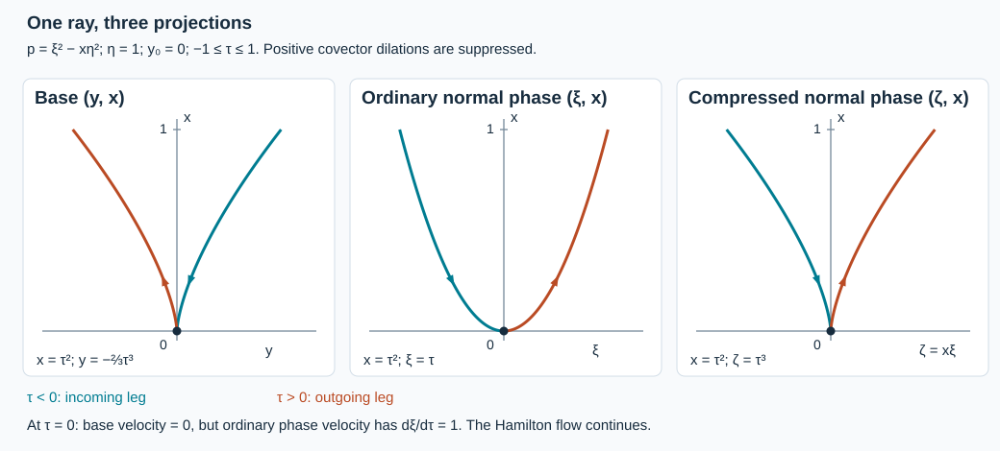

# Singularities on a diffractive Tricomi ray

A ray can touch the boundary while its projection to the base has zero velocity. We construct a continuous solution with zero boundary value whose singularities occupy both legs of that ray. The forcing is smooth on a base neighborhood, including its boundary. The construction keeps every lower coefficient of the original operator.

The antecedent is Hörmander, *The Analysis of Linear Partial Differential Operators III*, corrected edition reprinted in 2007, Theorem 24.6.5, printed pages 464–465, together with Section 23.4. The closing remark on printed465 concerns an explicit Airy construction for the model; Section8 supplies it below.  This lesson gives independent exposition and supplies the characteristic-endpoint argument that connects the Cauchy construction to the whole base-neighborhood conclusion.

The proof map records exact earlier providers. In particular, we use the complete [principal-type Cauchy proof](../20261005-restored-principal-boundary/principal-type-hyperbolic-boundaries-and-cauchy-problems.html), the [single-direction Fourier construction](../20261005-restored-singular-ray/prescribed-finite-singular-rays.html), [interior propagation](../20261005-restored-real-principal/real-principal-type-kernels-and-propagation.html), and the [scalar boundary propagation proof](../20261009-general-scalar-boundary/scalar-boundary-propagation-through-general-glancing.html). Required human foundational providers remain explicitly external.

## 1. The precise point to be realized

**D0. The hypothesis and conclusion.** Work near a noncharacteristic boundary in coordinates \((x,y)\), with \(x\ge0\), \(y\in\mathbb R^d\), and \(D=-i\partial\). The real quadratic principal symbol, after the exact boundary-preserving normalization GSP:C1, is
\[
 p(x,y,\xi,\eta)=\xi^2-r(x,y,\eta).
 \tag{TD1}
\]
The tangential symbol \(r\) is real and homogeneous of degree two. All smooth complex lower coefficients are allowed. At the nonzero boundary covector \(q=(y_0,\eta_0)\), assume
\[
 r(0,q)=0,\qquad r_x(0,q)>0,\qquad
 r(0,y,\eta)\ge0\quad\hbox{near }q.
 \tag{TD2}
\]
The last condition says that \(q\) is outside the closure of the elliptic boundary set \(r(0)<0\). It does not say that every nearby boundary point is glancing.

The ordinary Hamilton curve through \((0,y_0,0,\eta_0)\) has
\[
 H_px=2\xi,\qquad H_p^2x=2r_x>0
 \quad\hbox{at its boundary point}.
 \tag{TD3}
\]
It therefore has two local interior legs and just one boundary contact. Denote its compressed image by \(\gamma\), and the positive cone generated by that image by \(\Gamma\). Compression replaces \(\xi\) by \(\zeta=x\xi\). We prove that there is a compactly localized \(u\in C(X)\) and a base neighborhood \(V\) of \((0,y_0)\) such that
\[
 u|_{\partial X}=0,\qquad Pu\in C^\infty(V),\qquad
 \operatorname{WF}_b(u)|_V=\Gamma|_V.
 \tag{TD4}
\]
The equality concerns a sufficiently small germ of the curve. Smoothness of \(Pu\) is asserted at every covector over \(V\), not only at the chosen direction.

Boundary coordinate changes and the smooth invertible scalar normalization in GSP:C1 preserve continuity, the zero value trace and the indicated wavefront equality. It suffices to prove (TD4) in the displayed coordinates. Write the full normalized operator as
\[
 P=D_x^2+C(x,y)D_x-R(x,y,D_y),
 \tag{TD5}
\]
where \(C\) is smooth and complex, \(R\) is tangential of order two, and its principal symbol is \(r\). The coordinate normalization removes mixed principal terms; its remaining first normal coefficient has order zero. No symmetry of \(R\) or reality of \(C\) is imposed.

## 2. A comparison equation with the full local operator

**D1. Extend the symbol, retaining all local terms.** Shrink the angular and base neighborhood once. Compactness on its unit covectors and integration of \(r_x\) give
\[
 r(x,y,\eta)\ge c x|\eta|^2,\qquad 0\le x\le T,
 \tag{TD6}
\]
there, for some \(c,T>0\). Indeed choose \(r_x\ge c|\eta|^2\) throughout this collar and integrate from the nonnegative value at zero.

Choose a real degree-zero cutoff \(0\le\theta(y,\eta)\le1\), supported in that neighborhood and equal to one on a smaller neighborhood of \(q\). At high frequency extend the principal symbol by
\[
 b(x,y,\eta)=\theta(y,\eta)r(x,y,\eta)
                  +(1-\theta(y,\eta))c x|\eta|^2.
 \tag{TD7}
\]
The product \(\theta r\) is extended by zero outside its compact base support. Smoothly fill in bounded frequencies and extend in the normal parameter. Its homogeneous principal part satisfies \(b\ge cx|\eta|^2\) on the whole tangential cotangent space for \(0\le x\le T\). All derivatives have uniform symbol bounds. In particular, on this interval,
\[
 |b_\eta|\le C_1|\eta|,\qquad |b_y|\le C_1|\eta|^2.
 \tag{TD8}
\]
The inequalities in (TD6)–(TD8) refer to the homogeneous principal part; low-frequency completion introduces only the permitted lower errors.

Use a larger cutoff of the same type to extend the full symbol of \(R\), including every lower term, so that it equals the original full symbol on the retained cone and has principal part \(b\). Call the properly supported family \(B(x)\). Extend \(C\) to a bounded smooth coefficient \(\widetilde C\) equal to it on the retained base patch. Set
\[
 \widetilde P=D_x^2+\widetilde C D_x-B.
 \tag{TD9}
\]
This is a smooth tangential pseudodifferential family in the precise class of the principal-type Cauchy lesson. To check its model form, put \(A=-\widetilde C/2\). Ordered multiplication gives
\[
 (D_x-A)^2=D_x^2-2AD_x+iA_x+A^2,\qquad
 \widetilde P=(D_x-A)^2-\mathcal B,\quad
 \mathcal B=B+iA_x+A^2.
 \tag{TD10}
\]
Thus \(\operatorname{Im}A\) is order zero and \(\operatorname{Im}\mathcal B\) is order at most one. Its real principal part is \(b\), and (TD6) supplies the required positive normal degeneracy. This checks the hypotheses of PT:T1–T6 and PT:W1–W5 with the actual lower terms present. Proper quantization may leave a tangentially smoothing discrepancy on the smaller cone; D4 and D7 below account for its action up to the face.

## 3. A normal datum that is continuous enough but singular

**D2. The one-direction datum.** Put \(s=d+2\), \(K=s+3\), \(k=d-1\), and \(\beta=(d+1)/4\). In linear coordinates \(z=(z',v)\) centered at \(y_0\), choose the positive last covector to correspond to the ray of \(\eta_0\). For \(\nu\in\mathbb R^k\), \(\lambda\in\mathbb R\), define
\[
 \widehat c_K(\nu,\lambda)
   =h(\lambda)\lambda^{-\beta-K}
             \exp\!\left(-\frac{|\nu|^2}{4\lambda}\right)
       \quad(\lambda>0),\qquad
 \widehat c_K=0\quad(\lambda\le0),
 \tag{TD11}
\]
where \(h=0\) on \((-\infty,1]\) and \(h=1\) on \([2,\infty)\), smoothly. Empty \(\nu\) variables when \(d=1\) contribute a factor one. This is the exact SR:P0–P7 construction with an additional integer power.

Here are the shifted estimates. With \(\nu=\sqrt\lambda\,w\), Gaussian integration and the two-sided weighted moment bounds give
\[
 \int_{\mathbb R^k}
  (1+|\nu|^2+\lambda^2)^t
  \lambda^{-2\beta-2K}e^{-|\nu|^2/(2\lambda)}\,d\nu
       \asymp_t\lambda^{\,2t-2K-1},\qquad\lambda\ge2.
 \tag{TD12}
\]
For the upper bound divide the weight by \(\lambda^{2t}\): its absolute power is bounded by a fixed polynomial in \(1+|w|^2\), whose Gaussian integral is finite. For the lower bound restrict to \(|w|\le1\), where that quotient is bounded above and below by positive constants. Since \(-2\beta+k/2=-1\), (TD12) proves \(c_K\in H^{K-\epsilon}\) for every \(\epsilon>0\), and failure at \(H^K\).

Every off-origin smoothness and off-cone rapid-decay estimate in SR:P2–P6 remains valid: the additional power lowers the exponents in the integration-by-parts bounds. Moreover
\[
 D_v^K c_K=c_0.
 \tag{TD13}
\]
The earlier proof shows that \(c_0\) fails to be locally \(L^2\) in every neighborhood of zero and has exactly the positive last wavefront ray. If \(c_K\) were locally \(H^K\), (TD13) would contradict that failure. The weighted cutoff convolution and finite spherical-cover argument SR:P7 then shows failure of microlocal \(H^K\) on this single ray.

Multiply \(c_K\) by a smooth compact cutoff equal to one near zero, and undo the linear coordinate change. The resulting datum \(\phi\) has compact support as small as desired and satisfies
\[
 \phi\in H^{s+2}(\mathbb R^d),\qquad
 \operatorname{WF}(\phi)=\{(y_0,\rho\eta_0):\rho>0\}.
 \tag{TD14}
\]
Multiplication does not add directions and does not remove the proved local singularity. The linear change preserves Sobolev membership because its dual map gives comparable Euclidean frequency norms and a fixed Jacobian.

## 4. Solve with the actual two Cauchy jets

**D3. Lift and correct.** Choose a compact smooth \(\chi_0(x)\) equal to one near zero. An elementary lift of the datum is
\[
 \ell(x,y)=i x\chi_0(x)\phi(y),\qquad
 \ell(0)=0,\quad D_x\ell(0)=\phi.
 \tag{TD15}
\]
All normal derivatives of \(\ell\) lie in \(L^2_xH^{s+2}_y\). PT:T1, including derivatives of the operator coefficients, gives \(f=-\widetilde P\ell\in L^2_xH^s_y=H_{(0,s)}\).

PT:T3–T6 constructs a solution of \(\widetilde P w=f\) on a fixed smaller collar, with
\[
 w\in\overline H_{(1,s)}\cap\overline H_{(2,s-1)},
 \qquad w(0)=D_xw(0)=0.
 \tag{TD16}
\]
These are actual traces. That provider proves the distributional zero-extension equation, the coefficients of both boundary delta terms, and graph approximation preserving both zero jets; it does not merely prescribe formal data. Therefore
\[
 u=\ell+w,\qquad \widetilde Pu=0,\qquad
 u(0)=0,\quad D_xu(0)=\phi.
 \tag{TD17}
\]
The integer mixed-norm equivalence PT:T1 gives \(u,D_xu\in L^2_xH^s_y\). The Hilbert-valued fundamental theorem follows by smoothing in \(x\), integrating the derivative and taking the \(L^2\) limit; it gives a representative continuous into \(H^s_y\). More explicitly, its increments obey
\[
 \|u(x)-u(t)\|_{H^s_y}
       \le |x-t|^{1/2}\|\partial_xu\|_{L^2_xH^s_y}.
 \tag{TD18}
\]
One value is controlled by the \(L^2\) norm, so this also gives a uniform \(H^s\) bound on a compact interval. Since \(s>d/2\), Fourier inversion and Cauchy–Schwarz give
\[
 \|v\|_{C^0}\le (2\pi)^{-d}
       \left(\int\langle\eta\rangle^{-2s}\,d\eta\right)^{1/2}
       \|\langle\eta\rangle^s\widehat v\|_{L^2}.
 \tag{TD19}
\]
The integral is finite by radial integration. Dominated convergence in the same Fourier integral gives continuity in \(y\). Equations (TD18)–(TD19) give joint continuity on the closed collar and the actual zero boundary value.

**D4. Identify the boundary front and its representative.** Normal recovery PT:T2 applied repeatedly to (TD17) gives arbitrarily many normal derivatives at finite, possibly decreasing, tangential orders. The exact noncharacteristic extension used in PT:W1 places this solution with these jets in the intrinsic class \(\mathcal N\). Its normal derivatives are intrinsic derivatives, with the canonical boundary corrections. Continuity alone is not being used to infer membership in \(\mathcal N\).

Apply the full quadratic boundary-front equality PT:W1–W5. The forcing is zero and the two jets are \(0,\phi\), so
\[
 \operatorname{WF}_b(u)|_{x=0}
       =\{(y_0,\rho\eta_0):\rho>0\}.
 \tag{TD20}
\]
This conclusion includes every other boundary direction. The provider proves all orders on one fixed final collar at each regular direction and retains the pure-normal exclusion. In particular, tangentially smoothing families applied to this representative and its normal jets give smooth functions up to the face. One can also see this directly from their mapping into every tangential order and the repeated normal recovery just described. A smooth family maps each finite distributional tangential order to every desired order; differentiating in \(x\) a fixed number of times costs only finitely many input orders. Sobolev embedding then supplies every ordinary derivative.

## 5. Every interior characteristic has a boundary endpoint

**D5. An integrable estimate through the degeneracy.** The homogeneous principal symbol of the comparison equation is \(\widetilde p=\xi^2-b\). At a nonzero interior characteristic, \(\eta\ne0\), \(b\ge cx|\eta|^2>0\), and \(\xi\) has a fixed sign until the face is reached. Parameterize either branch by \(x\). Hamilton's equations become
\[
 \frac{dy}{dx}=-\frac{b_\eta}{2\xi},\qquad
 \frac{d\eta}{dx}=\frac{b_y}{2\xi},\qquad
 \xi=\pm\sqrt b.
 \tag{TD21}
\]
Equations (TD6) and (TD8) give, with one constant \(M\),
\[
 \left|\frac{dy}{dx}\right|\le Mx^{-1/2},\qquad
 \left|\frac{d\eta}{dx}\right|\le Mx^{-1/2}|\eta|.
 \tag{TD22}
\]
Integrate the first estimate. For the second, \(\eta\) cannot vanish before reaching the face by ordinary uniqueness; differentiate \(\log|\eta|\), whose derivative has absolute value at most \(Mx^{-1/2}\). Thus on \(0<x\le x_1\),
\[
 |y(x)-y(x_1)|\le2M\sqrt{x_1},\qquad
 e^{-2M\sqrt{x_1}}|\eta(x_1)|
 \le|\eta(x)|\le e^{2M\sqrt{x_1}}|\eta(x_1)|.
 \tag{TD23}
\]
The ordinary smooth ODE cannot stop at a positive lower endpoint: these bounds keep it in a compact phase region with \(|\eta|\) bounded away from zero and \(|\xi|\ge\sqrt{cx}|\eta|\). The existing smooth-flow existence and continuation theorem therefore extends it. It follows that the branch exists down to every \(x>0\).

Both right sides in (TD22) are integrable at zero, now with bounded \(\eta\). Hence \(y\to y_*\), \(\eta\to\eta_*\ne0\), and \(\xi\to\xi_*=\pm\sqrt{b(0,y_*,\eta_*)}\). For Hamilton time \(\tau\),
\[
 \left|\frac{d\tau}{dx}\right|=\frac1{2|\xi|}
 \le\frac{e^{2M\sqrt{x_1}}}
             {2\sqrt c\,|\eta(x_1)|\sqrt x}.
 \tag{TD24}
\]
The Hamilton time to the face is finite. The limit is consequently a genuine endpoint of the smooth ordinary Hamilton flow, not merely an unparameterized accumulation point. Its uniqueness is the ordinary ODE uniqueness at that endpoint. After normalizing the tangential covector, the elapsed Hamilton time is uniformly \(O(\sqrt{x_1})\).

## 6. No other singular ray can enter the collar

**D6. Interior containment.** Interior ellipticity puts \(\operatorname{WF}(u)\) in the characteristic set of \(\widetilde p\). The equation is a tangential pseudodifferential family, but on a closed cone with \(\eta\ne0\) it is an ordinary pseudodifferential operator with smooth real principal symbol and all its lower terms. Thus RP:P0–P5 applies there. The pure-normal cone is elliptic. These observations cover every possible nonzero interior covector.

Take an interior singular covector and follow its branch down to the endpoint from D5. On each compact subarc with \(x>0\), the forcing is zero, so interior propagation keeps the entire subarc singular. Compression and closedness of \(\operatorname{WF}_b(u)\), using \(\eta_*\ne0\), put \((y_*,\eta_*)\) in (TD20). Therefore it is a positive multiple of \(q\). Since \(b(0,q)=0\), its ordinary normal component is \(\xi_*=0\). Ordinary Hamilton uniqueness now puts the original point on the curve through that same ordinary boundary covector. Homogeneity makes its compressed image a member of \(\Gamma\).

There is no hidden excursion to a remote portion of that curve in arbitrarily small collars. The normalized time bound following (TD24), and smooth flow on a compact neighborhood of the normalized endpoint, force every such point into the fixed local germ when the collar is small. Consequently, on a sufficiently small closed base neighborhood,
\[
 \operatorname{WF}_b(u)\subset\Gamma.
 \tag{TD25}
\]
At the face this is (TD20); in the interior it is the preceding argument. The intrinsic class excludes the remaining normal compressed caps.

## 7. Return to the original equation

**D7. Smooth forcing on a whole base neighborhood.** Shrink \(V\) until its entire part of the curve in (TD25) lies in the full-symbol agreement cone from D1. Choose a proper tangential operator \(Q\) equal to the identity microlocally on a neighborhood of that curve and with full microsupport inside the agreement cone. It can be chosen on a compact input collar. The exact tangential calculus and tester criterion give
\[
 u=Qu+(1-Q)u,\qquad (1-Q)u\in C^\infty(V).
 \tag{TD26}
\]
For clarity, choose cutoffs identically one on a slightly larger neighborhood of \(\overline V\); all their errors are kept outside that neighborhood or are separated-kernel tangential smoothing terms. The family \(P-\widetilde P\), composed with \(Q\), has a tangentially smoothing coefficient at each normal degree, since the complete symbols agree there. Its action on \(u\), including the possible \(D_xu\) coefficient, is smooth up to the boundary by D4. Its action on \((1-Q)u\) is smooth as well, using proper input localization. Kernel pieces with input outside the selected patch are tangentially smoothing; D4 applies to their actual normal jets on their compact input patches. Thus
\[
 Pu=(P-\widetilde P)u\in C^\infty(V).
 \tag{TD27}
\]
This accounts for the full lower-symbol and proper-kernel discrepancies. Agreement of principal symbols alone would not justify (TD27).

**D8. Both legs really are singular.** By (TD20), the boundary point \(q\) is singular. The original operator now has smooth forcing near its base, and the actual Dirichlet value is zero. The strict diffractive case of GSP:C10 forces the local generalized singular arc through \(q\). At this strictly positive normal second derivative, the local arc is the compressed ordinary Hamilton curve from (TD3), with both interior legs. Its uniqueness follows from the smooth Hamilton flow and strict positivity; this statement makes no uniqueness assertion at infinite-order contact. Hence \(\Gamma|_V\subset\operatorname{WF}_b(u)|_V\). Together with (TD25), this proves the equality in (TD4).

**D9. Compact localization and return to the manifold.** Choose a smooth base cutoff equal to one on a smaller \(V\) and supported within the coordinate collar where \(u\) is constructed. Multiplying by it and extending by zero outside the chart gives a continuous compactly supported distribution on \(X\). Its value trace is zero everywhere. On \(V\), it is unchanged, so its forcing is smooth and its boundary wavefront is exactly the asserted germ. The cutoff may produce nonsmooth forcing outside \(V\); the theorem makes no claim there. Undo the smooth scalar and coordinate normalization of D0. This completes the full stated realization theorem.

## 8. An explicit normalized Airy solution for the Tricomi model

**D10. The model formula and its full wavefront.** The general construction above applies with variable coefficients and complex lower terms. For
\[
 P_0=D_x^2-x|D_y|^2,\qquad x\ge0,\quad y\in\mathbb R^d,\quad d\ge1,
 \tag{TD32}
\]
we can also give an explicit formula. Define
\[
 \mathcal S(t)=
 \sum_{j=0}^{\infty}
  \frac{(-1)^j t^{3j+1}}
       {\prod_{\ell=1}^{j}(3\ell)(3\ell+1)} .
 \tag{TD33}
\]
The empty product is one. On every compact complex disk, the ratio of successive absolute terms is at most a fixed constant divided by \((3j+3)(3j+4)\). The same conclusion holds after any fixed number of derivatives, since their additional factors grow only polynomially in \(j\). The convergent-series and uniform differentiated-sum proof U001:P13.2-series therefore gives an entire function. Comparing coefficients yields
\[
 \mathcal S''(t)+t\mathcal S(t)=0,\qquad
 \mathcal S(0)=0,\quad \mathcal S'(0)=1.
 \tag{TD34}
\]
In particular \(A(z)=\mathcal S(-z)\) satisfies the Airy equation \(A''(z)=zA(z)\). Formula (TD33) fixes its normalization without choosing an implicit linear combination of named Airy solutions.

Here are bounds sufficient for the Fourier formula. On the nonnegative real axis \(\mathcal S\) is real. Put
\[
 \mathcal E(t)=|\mathcal S'(t)|^2+t|\mathcal S(t)|^2.
 \quad
 \mathcal E'(t)=|\mathcal S(t)|^2,\qquad
 \left(\frac{\mathcal E(t)}t\right)'
       =-\frac{|\mathcal S'(t)|^2}{t^2}\quad(t>0).
 \tag{TD35}
\]
Thus for \(t\ge1\), \(\mathcal E(t)\le t\mathcal E(1)\). Compactness on \([0,1]\) gives
\[
 |\mathcal S(t)|\le C,\qquad
 |\mathcal S'(t)|\le C(1+t)^{1/2},\qquad
 |\mathcal S^{(m)}(t)|\le C_m(1+t)^{m/2}.
 \tag{TD36}
\]
The last bound follows by induction from
\(\mathcal S^{(m+2)}=-t\mathcal S^{(m)}-m\mathcal S^{(m-1)}\);
for \(m=0\) use the equation itself. These bounds are polynomial; no unproved oscillatory asymptotic is required.

Choose a datum \(\phi\) by (TD11), before multiplication by a spatial cutoff, with an integer \(K\) as large as needed, for example \(K=2d+10\), and rotate and translate so that its unique wavefront ray is the prescribed \((y_0,\eta_0)\). Its Fourier transform vanishes for \(|\eta|<1\). The Gaussian estimates in D2 give both its single wavefront ray and arbitrarily high, finite Sobolev regularity as \(K\) increases. They also give \(\widehat\phi\in L^1\) with the finitely many polynomial weights used below: this follows either by integrating the transverse Gaussian after \(\nu=\sqrt\lambda\,w\), or by Fourier Cauchy–Schwarz from its high Sobolev norm.

Define, with the Fourier convention of D2,
\[
 u(x,y)=\frac{i}{(2\pi)^d}
   \int_{\mathbb R^d}e^{iy\cdot\eta}
     |\eta|^{-2/3}
     \mathcal S\!\left(x|\eta|^{2/3}\right)
     \widehat\phi(\eta)\,d\eta .
 \tag{TD37}
\]
The integrand is zero near \(\eta=0\). Equations (TD36) and the \(L^1\) bound give uniform absolute convergence and joint continuity on compact closed collars. The first two normal derivatives also converge in the Sobolev spaces required in D3, after choosing this fixed large \(K\). For any higher fixed normal derivative, (TD36) gives a polynomial Fourier multiplier bound; it defines a distribution at some finite tangential order. Distributional differentiation and (TD34) consequently prove the exact identities
\[
 P_0u=0,\qquad u(0,y)=0,\qquad D_xu(0,y)=\phi(y).
 \tag{TD38}
\]
The factor \(i\) is necessary because \(D_x=-i\partial_x\). The noncharacteristic extension and actual-jet argument of D4 applies; these are the original intrinsic jets, and \(u\) belongs to the same intrinsic class.

The full boundary-front equality PT:W1–W5, with \(b=x|\eta|^2\), puts the boundary front exactly on the prescribed ray of \(\phi\). Every interior characteristic of \(P_0\) has the finite boundary endpoint proved in D5. Interior propagation and that exact boundary front give the containment of D6. The singular boundary point and the strict diffractive theorem give both singular legs as in D8. Thus (TD37) has precisely the same local wavefront germ claimed in (TD4). A compact base cutoff equal to one near the contact gives the global localized version of D9, with smooth forcing on that whole smaller neighborhood. This proves the explicit model assertion as well as its regularity and wavefront interpretation.

## 9. Nearby elliptic turns and a local interior realization

**D11. The remaining strict-diffractive case.** A strict diffractive point in the closure of the elliptic boundary set also admits the local conclusion (TD4). Together with D0–D9, this gives a local source-free realization through every strict diffractive point. The proof must allow the approximating interior rays to have vertical base tangents.

Indeed, assume \(r_x(0,q)>0\) and choose \(q_j=(y_j,\eta_j)\to q\) with \(r(0,q_j)<0\), on one normalized section. On a common collar \(r_x\ge c|\eta|^2\). The intermediate-value theorem and strict monotonicity in \(x\) give a unique
\[
 x_j>0,\qquad r(x_j,q_j)=0,\qquad
 x_j\le C|r(0,q_j)|,\qquad x_j\longrightarrow0.
 \tag{TD39}
\]
Start the ordinary Hamilton ray at \((x_j,y_j,0,\eta_j)\). On a fixed sufficiently short signed Hamilton interval, \(\xi'=r_x\) stays uniformly positive on normalized covectors. Since \(x'=2\xi\), integration in either direction gives \(x(s)\ge x_j+c_1s^2\). Thus the whole approximating arc is interior, and smooth dependence of the ordinary flow gives uniform convergence to the tangent ray through \(q\). Its endpoints at fixed nonzero times are interior.

These arcs need not have nonzero base velocity. For example
\[
 p=\xi^2-(x-y^2)\eta^2,\qquad q=(y=0,\eta=1)
 \tag{TD40}
\]
has elliptic boundary points \(y_j\ne0\). Their turns are \(x_j=y_j^2,\xi=0\), where both \(p_\xi\) and \(p_\eta\) vanish. A realization theorem that assumes nonvertical approximants cannot simply be invoked for this sequence.

We give the needed interior family directly. Extend the smooth operator through the face only for this local construction. At the limiting turn \(H_p\xi=r_x>0\), whereas the radial field has zero \(\xi\) component. Hence \(H_p\) is independent of the radial field there and on a smaller conic neighborhood. A positive order-minus-one reducer and the homogeneous normal form in RP:P2 put the reduced real principal symbol into the model \(\tau\). The full lower-term construction GE:D12–D19 gives order-zero graph operators \(A,B\), both inverse identities and both conjugation identities, modulo smoothing on smaller matched cones. In particular, if \(Q\) is the elliptic reducer, then
\[
 QPA-AD_t\ \text{is smoothing},\qquad
 BA-I\ \text{and}\ AB-I\ \text{are smoothing}.
 \tag{TD41}
\]
Multiplication by a full proper parametrix of \(Q\) gives the corresponding identity for \(PA\), with an order-one factor in front of \(D_t\) and a smoothing remainder. All these are the complete operators; complex lower terms have been removed by that same gauge, not omitted.

Choose the signed time interval so small that the entire limiting compact arc, and every sufficiently late approximating compact arc, fit inside this one matched normal-form neighborhood. This is a local chart around the turning point, not an assertion of global compact-tube conjugation. In model coordinates each approximant is a segment \(t\mapsto(t,z_j;0,\zeta_j)\), with \(\zeta_j\ne0\). A common smaller model-time interval can be used after restricting the arcs. Its images still have interior endpoints and converge to the desired local tangent arc. The model time is strictly increasing, so these normalized arcs and their limit are injective even at vertical base tangents.

Here is the actual test family for one fixed late approximant. Put \(s=n+4\), with \(n=d+1\). Use SR:P0–P7 and SR:X1 in the \(n-1\) transverse model variables to choose compact \(c\), with exactly the ray \((z_j,\zeta_j)\), such that \(c\in H^{s-1}\) and \(c\) is not microlocally \(H^s\) there. Regularize it by \(c_\epsilon=\theta\chi(\epsilon D_z)c\), as in LBR:T2. It is uniformly bounded in \(H^{s-1}\), converges in distributions and is uniformly smooth off that ray. Let \(\rho(t)\) be compactly supported in the model-time interval, equal to one near a fixed interior seed, and with its derivative supported in arbitrarily small endpoint intervals. Set
\[
 w_\epsilon(t,z)=\rho(t)c_\epsilon(z),\qquad
 u_\epsilon=\vartheta_j A w_\epsilon.
 \tag{TD42}
\]
The full physical cutoff \(\vartheta_j\) is compactly supported in \(x>0\), equals one near the whole chosen compact arc and has derivative support away from it. Such a cutoff exists since this fixed arc has positive distance from the boundary. Its constants may depend on \(j\).

Fourier integration of the product shows that \(\|w_\epsilon\|_{H^{s-1}}\) is bounded: for the positive integer \(s-1\), use
\(\langle(\tau,\zeta)\rangle^{s-1}\le C\langle\tau\rangle^{s-1}\langle\zeta\rangle^{s-1}\), and the fixed smooth \(\rho\). GE:D7 then bounds \(\|u_\epsilon\|_{H^{s-1}}\), hence its supremum norm by Sobolev embedding. Every \(u_\epsilon\) is smooth, compactly supported in a fixed set and identically zero near the physical boundary.

Apply the complete identity (TD41). The nonsmoothing source is the order-one graph image of \((D_t\rho)c_\epsilon\), whose microsupport is in the selected endpoint caps. The term \([P,\vartheta_j]Aw_\epsilon\) has its coefficient supported away from the retained arc and is uniformly smooth. Full graph wavefront mapping and separated-kernel estimates make every other error uniformly smooth with every derivative, from the bounded \(H^{s-1}\) datum. Thus any finite list of solution tests away from this arc and forcing tests away from its endpoint caps has uniformly bounded smooth-output seminorms. Tangential boundary tests have the same bound; their possible interior action is separated from the arc, and the family vanishes on a whole boundary collar.

The critical norm diverges at the seed. Otherwise, a physical order-zero test \(Z\), elliptic there and supported in a smaller matched cone, would have bounded \(\|Zu_\epsilon\|_{H^s}\). The full inverse \(B\), a smaller model cutoff and the elliptic parametrix for \(Z\) would give a bounded \(H^s\) norm for \(\rho_0(t)C c_\epsilon(z)\), modulo uniformly smooth errors. Here \(\rho_0\) is nonzero and \(C\) is elliptic at the singular transverse datum. But \(s>0\) and Fourier integration give
\[
 \|\rho_0 Cc_\epsilon\|_{H^s_{t,z}}^2
       \ge \|\rho_0\|_{L^2_t}^2
                       \|Cc_\epsilon\|_{H^s_z}^2.
 \tag{TD43}
\]
Distributional convergence and the Fourier Fatou argument would put \(Cc\) in \(H^s\), contradicting the choice of \(c\). This proves divergence without taking a trace of a general joint Sobolev function and without a physical base-velocity assumption.

Now use the explicit countable space and its completeness proved in LBR:T3–T4 for the limiting arc, compact support and interior endpoint rays. If every member were microlocally \(H^s\) at a chosen interior seed of that limit, LBR:T5 would give a finite-seminorm bound. Uniform convergence permits a sufficiently late interior approximant, and sufficiently small endpoint caps, separated from all the finitely many tested bad sets, exactly as in LBR:T6. The family (TD42) has bounded values for every one of those seminorms and unbounded critical norm, contradicting that bound. All members of the family lie in the countable space because they are smooth with zero boundary value.

Consequently some continuous intrinsic distribution in that space is singular away from the endpoints. The closed-and-open propagation argument LBR:T7 fills the embedded target arc; at this boundary contact strict diffractive uniqueness identifies both legs. The endpoint argument LBR:T8 gives exactly the two forcing rays. Removing their base points leaves a whole neighborhood of the contact where the forcing is smooth. Compact localization then gives (TD4) in the original manifold. This proves the nearby-elliptic case with its actual hypotheses. D0–D9 cover the complementary case, where \(r(0)\ge0\) near \(q\).

## 10. Three phase-space views of the same ray

**F0. What the figure represents.** For \(p=\xi^2-x\eta^2\), fix \(\eta=1\) and \(y_0=0\). The curve is
\[
 x(\tau)=\tau^2,\quad y(\tau)=-\frac23\tau^3,\quad
 \xi(\tau)=\tau,\quad \zeta(\tau)=x\xi=\tau^3,
 \qquad -1\le\tau\le1.
 \tag{TD28}
\]
All three panels use exactly these coordinates and the same two signs of \(\tau\). The ordinary phase curve is regular at zero because \(\dot\xi=1\). Its base projection and its displayed compressed projection have zero velocity there. These are projections of a wavefront ray; they are not values or amplitudes of the constructed distribution. The fixed \(\eta\) slice suppresses the positive dilations present in the theorem.

## 11. Exercises with complete solutions

### Exercise 1. Verify the cusp without stopping the Hamilton flow

For the model in (TD28), verify all four Hamilton equations, find the two base branches as functions of \(x\), and determine whether the ray is tangent to a cotangent fiber at its boundary point.

**Solution.** The Hamilton equations are \(\dot x=2\xi\), \(\dot y=-2x\eta\), \(\dot\xi=\eta^2\), \(\dot\eta=0\). Differentiating (TD28), with \(\eta=1\), gives \(2\tau,-2\tau^2,1,0\), respectively, exactly these four values. Also \(p=\tau^2-\tau^2=0\). The branches are
\[
 \xi=\pm\sqrt x,\qquad y=\mp\frac23x^{3/2}.
 \tag{TD29}
\]
Both lie at \(x>0\) except at the contact. At zero the full Hamilton vector is \(\partial_\xi\), nonzero and vertical over the base. Its base velocity is zero, so an argument requiring a nowhere-vertical base projection does not apply at this contact. The ordinary ODE nevertheless continues uniquely through it. Compression gives \(\zeta=\tau^3\), whose derivative also vanishes at zero.

### Exercise 2. Check the lift and its exact forcing

For \(P=D_x^2-xD_y^2\) and \(\ell=i x\chi_0(x)\phi(y)\), compute both boundary jets and \(P\ell\). Explain the role of the factor \(i\).

**Solution.** Since \(\chi_0=1\) near zero, \(\ell(0)=0\) and \(D_x\ell(0)=\phi\). The full differentiated expression is
\[
 P\ell=-i(2\chi_0'+x\chi_0'')\phi
                     -i x^2\chi_0 D_y^2\phi.
 \tag{TD30}
\]
Every term is in \(L^2_xH^s_y\) when \(\phi\in H^{s+2}\), with compact normal support. Replacing \(i x\) by \(x\) changes the normal datum to \(-i\phi\). For the original general operator, the additional terms are exactly \(\widetilde C D_x\ell\) and the remaining terms in \(-B\ell\); their mapping was included in D3, so the comparison correction cancels them as well.

### Exercise 3. Why the endpoint estimate is integrable

Suppose the same derivative bounds as in (TD8) are known, but the available lower bound is only \(b\ge cx^m|\eta|^2\), \(m>0\). Determine the range in which the argument of D5 still supplies finite base displacement and a nonzero limiting tangential covector from these bounds alone.

**Solution.** The right sides of (TD22) become \(Mx^{-m/2}\) and \(Mx^{-m/2}|\eta|\). For \(0<m<2\),
\[
 \int_0^{x_1}x^{-m/2}\,dx
       =\frac{x_1^{1-m/2}}{1-m/2}.
 \tag{TD31}
\]
This finite number replaces \(2\sqrt{x_1}\) in the displacement and exponential bounds, and gives finite Hamilton time by the same positive lower bound on \(|\eta|\). At \(m=2\), the integral from \(\epsilon\) to \(x_1\) is \(\log(x_1/\epsilon)\), unbounded as \(\epsilon\downarrow0\); for \(m>2\) the power diverges. These upper bounds then give no finite endpoint control. That is a limitation of this estimate, not a nonexistence theorem for more degenerate equations, whose derivative structure may improve the bounds.

The separate elliptic-side Tricomi theorem remains available in the [preceding lesson](../20261009-tricomi-hypoellipticity/tricomi-boundary-regularity.html). General Airy energy mapping and parameter-dependent boundary propagation require their stated analytic hypotheses. Independent exposition, proofs, exercises and figure: GPT-6 Astra (OpenAI). Explicit normalized Airy formula, its estimates and the interior-turning realization: GPT-6.1 Sol (OpenAI). October2026. Original expression and the reproducible figure are CC0-1.0; linked components retain their own terms.
