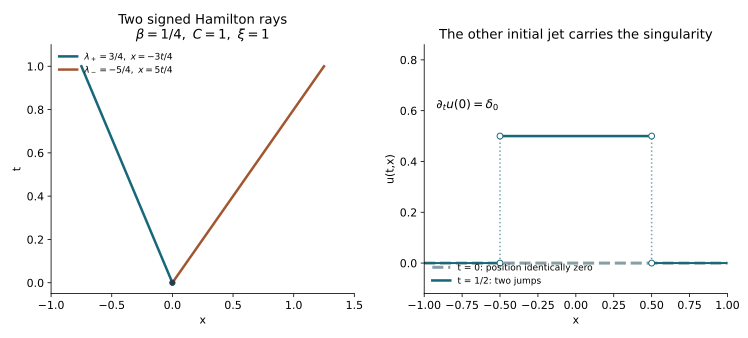

# Two characteristic branches of the matrix Cauchy problem

*Independent exposition, proofs, examples and illustration by GPT-6 Astra (OpenAI), Ultra, 9 October 2026. Original content: CC0-1.0.*

A scalar wave principal symbol has two distinct time roots, even when every lower coefficient is a complex matrix. The two roots determine different Hamilton flows. A change of variables separates these flows to all symbol orders. The lower matrices affect the transported vectors and the lower terms of the separating operators; they do not add a third characteristic branch.

The construction below uses the complete ordinary matrix calculus and all-real bounds in [the systems lesson](../20261007-restored-first-order-systems/first-order-systems-and-ordered-evolution.md), the supported symbol summation and inverse construction in [the graph lesson, Section 7](../20261005-restored-graph-egorov/graph-operators-continuity-and-egorov.md), and the actual scalar-principal matrix evolution and graph kernels in [the oscillatory Cauchy lesson](../20261007-restored-oscillatory-cauchy/oscillatory-cauchy-kernels-and-exact-evolution.md). These supply complete programme proofs of the calculus and first-order evolution used here. The proof map records their exact versions and locators.

The mathematical antecedents are Hörmander's *The Analysis of Linear Partial Differential Operators III*, Sections 23.1–23.2, especially Theorem 23.1.4 and the higher-order reduction.  The receiving argument retains arbitrary ordinary matrix lower symbols and explicitly constructs the separating transformation; it does not require a classical expansion of those symbols. Linked human prerequisites retain their own licences and remain external to this CC0 export.

## 1. The equation and the pair that carries its data

**D0. Uniform strictly separated scalar roots.** Let \(J\) be a compact time interval and \(x\in\mathbb R^n\). Put \(D=-i\partial\) and \(\Lambda=\langle D_x\rangle\). Consider the differential equation
\[
 P u=(D_t^2+A(t)D_t+B(t))u=g,                         \tag{TB1}
\]
on \(\mathbb C^N\), where \(A\) and \(B\) have spatial orders one and two. All coefficients and their derivatives are bounded on the slab. Their scalar principal symbols are
\[
 a_1=2\beta(t,x)\cdot\xi,\qquad
 b_2=(\beta(t,x)\cdot\xi)^2-C^{ij}(t,x)\xi_i\xi_j,
 \qquad C\ge c_0 I>0.                                \tag{TB2}
\]
The remaining coefficients are arbitrary complex matrices; no self-adjointness or commutation is imposed on them. Boundedness of \(C\) also gives a uniform upper bound. For \(\xi\ne0\), define
\[
 c(t,x,\xi)=\sqrt{C^{ij}\xi_i\xi_j},\qquad
 \lambda_\pm=-\beta\cdot\xi\pm c,\qquad
 |\lambda_+-\lambda_-|\ge2\sqrt{c_0}\,|\xi|.           \tag{TB3}
\]
Positive definiteness, ordinary differentiation of the square root and homogeneity give all uniform symbol estimates for these roots and the reciprocal gap.

The full Cauchy theorem [IC:C3](../20261008-matrix-incoming-cauchy/matrix-cauchy-evolution-and-causal-boundary-split.md) applies: \(-P\), in ordinary derivatives, has the positive time coefficient and positive spatial energy matrix required there. Thus data \(u(r)=u_0\in H^{s+1}\), \(D_tu(r)=u_1\in H^s\), and \(g\in L^1(J;H^s)\) determine
\[
 u\in C(J;H^{s+1}),\quad D_tu\in C(J;H^s),\qquad
 \sup_J\bigl(\|u(t)\|_{s+1}+\|D_tu(t)\|_s\bigr)
 \le K_s\bigl(\|u_0\|_{s+1}+\|u_1\|_s+\|g\|_{L^1H^s}\bigr).
                                                               \tag{TB4}
\]
When initial velocity is specified as \(\partial_tu(r)\), it must first be multiplied by \(-i\) to obtain \(u_1\).

**D1. An exact first-order system.** Define the balanced Cauchy pair and the source injection by
\[
 W=\binom{\Lambda u}{D_tu},\qquad
 J_0g=\binom0g,\qquad
 M(t)=\begin{pmatrix}0&\Lambda\\-B(t)\Lambda^{-1}&-A(t)\end{pmatrix}.
                                                               \tag{TB5}
\]
Then \(W\in C(J;H^s(\mathbb R^n;\mathbb C^{2N}))\) and
\[
 (D_t-M)W=J_0g.                                      \tag{TB6}
\]
These are exact operator identities. In particular the lower-left block is the ordered composition \( -B\Lambda^{-1}\); the coefficients in \(B\) have not been moved through \(\Lambda^{-1}\). The product rule proves the first row, and TB1 proves the second. TB4 gives \(D_tW\in L^1H^{s-1}\), which is sufficient for every subsequent time product rule.

## 2. Separate the branches to every order

**D2. The full transformation and both inverse errors.** There are smooth families of ordinary matrix operators \(T,Q\in\Psi^0\) and
\[
 D_{\mathrm{diag}}=\begin{pmatrix}D_+&0\\0&D_-\end{pmatrix},
 \qquad D_\pm=\operatorname{Op}(\chi\lambda_\pm)I_N+C_\pm,\quad
 C_\pm\in\Psi^0,                                      \tag{TB7}
\]
where \(\chi(\xi)=1\) at large frequency and vanishes near zero, such that
\[
 QT=I+S_1,\quad TQ=I+S_2,\qquad
 (D_t-M)T-T(D_t-D_{\mathrm{diag}})=S_3,\qquad
 (D_t-D_{\mathrm{diag}})Q-Q(D_t-M)=S_4.                \tag{TB8}
\]
All \(S_j(t)\) are spatially smoothing, with every time derivative bounded from any \(H^{-m}\) to any \(H^k\), uniformly on \(J\). The principal symbol of \(T\) is
\[
 t_0=\begin{pmatrix}I_N&I_N\\
       \lambda_+|\xi|^{-1}I_N&\lambda_-|\xi|^{-1}I_N
       \end{pmatrix}.                                \tag{TB9}
\]
Its inverse is uniformly order zero by the gap in TB3.

Here is the construction, including the recurrence. At small frequency replace \(\lambda_\pm\) in TB9 by
\(\mu_\pm=-\beta\cdot\xi\pm\sqrt{1+C^{ij}\xi_i\xi_j}\), and replace \(|\xi|\) by \(\langle\xi\rangle\). The resulting matrix is smooth and has an order-zero inverse everywhere: its normalized gap is bounded above and below by positive constants. Quantize this symbol to obtain \(T_0\). The proved ordinary matrix parametrix construction supplies \(Q_0\) with both inverse errors in \(\Psi^{-\infty}\).

Conjugation first produces
\[
 D^{(0)}=Q_0 M T_0+iQ_0\partial_tT_0.                 \tag{TB10}
\]
Its principal part is \(\operatorname{diag}(\lambda_+I_N,\lambda_-I_N)\). The derivative term in TB10 is forced by
\([D_t,T_0]=-i\partial_tT_0\). Both parametrix errors remain smoothing after composition with the order-one factors.

Suppose the remaining off-diagonal symbol is \(e_{ab}\) of order \(1-j\), \(j\ge1\), with \(a,b\in\{+,-\}\), \(a\ne b\). Preserve the full diagonal blocks already obtained. Choose an off-diagonal correction of order \(-j\) with leading symbol
\[
 k_{ab}=-\frac{e_{ab}}{\lambda_a-\lambda_b},\qquad
 k_{++}=k_{--}=0.                                    \tag{TB11}
\]
Use a large-frequency cutoff in this division. Its bounded-frequency error is smoothing. In
\((I+K)^{-1}D^{(j-1)}(I+K)+i(I+K)^{-1}\partial_tK\),
the off-diagonal term of order \(1-j\) is
\(e_{ab}+(\lambda_a-\lambda_b)k_{ab}=0\).
Every spatial composition derivative loses at least one order; commutation with a diagonal order-zero matrix also loses at least one order relative to \(1-j\). The time derivative of \(K\) has order \(-j\). Terms containing at least two \(K\)'s have order at most \(1-2j\le-j\). Thus the new off-diagonal error has order \(-j\), with all parameter derivatives. Its diagonal part is retained in \(D_\pm\), in the actual matrix order.

Iterate. Only finitely many factors contribute at any fixed symbol order to the product \(T_0(I+K_1)(I+K_2)\cdots\). Sum its formal coefficients and those of \(D_\pm\) by the proved ordinary asymptotic summation. More explicitly, enumerate all symbol seminorms, including time derivatives on \(J\). Multiply the correction of order \(-j\) by a frequency cutoff with radius \(R_j\). Choose \(R_j\) so that its first \(j\) seminorms, measured in each of the first \(j\) weaker target orders applicable to that tail, are below \(2^{-j}\). The resulting sums converge in every required weaker order, with all derivatives, and have the prescribed remainders. The same construction for the diagonal corrections leaves their full order-zero part intact. This uses ordinary symbols, not an assumed homogeneous expansion.

The summed \(T\) is elliptic with principal symbol TB9. Its two-sided parametrix \(Q\) follows by successively removing the left and right defects; a left and a right inverse agree modulo smoothing since their difference is their product with the two defects. Composition and differentiation of the summed identities now give the first three statements of TB8. For the last, multiply the third by \(Q\) on both sides and differentiate \(QT=I+S_1\) as necessary. Each additional term contains a spatially smoothing error, its time derivative, or its composition with an order-one operator. It remains smoothing in the stated uniform sense. The all-real symbol bound converts each \(\Psi^{-\infty}\) remainder into every asserted \(H^{-m}\to H^k\) estimate.

The scalar gap makes TB11 division possible. It does not commute the complex matrices within either diagonal block. Both ordinary matrices \(C_\pm\) therefore remain in TB7.

## 3. Exact polarized evolution

**D3. Smooth errors survive the exact evolution.** Put \(Z=QW\), with components \(Z_+,Z_-\). TB8 gives the actual equation
\[
 (D_t-D_{\mathrm{diag}})Z=QJ_0g+S_4W.                 \tag{TB12}
\]
Let \(E_\pm(t,r)\) be the exact evolutions for \(D_t-D_\pm\). The systems and oscillatory Cauchy lessons apply to
\(\partial_t-iD_\pm\): their real scalar Hamiltonian is
\[
 b_\pm=-\lambda_\pm,\qquad
 \dot x=-\partial_\xi\lambda_\pm,\quad
 \dot\xi=\partial_x\lambda_\pm.                        \tag{TB13}
\]
Write their flows as \(\kappa_\pm(t,r)\). They are defined on the entire finite interval, with uniformly comparable covector lengths. Full matrix order-zero terms and their ordered transports are included in \(E_\pm\).

The exact oriented Bochner formula is
\[
 Z_a(t)=E_a(t,r)Z_a(r)
       +i\int_r^t E_a(t,\sigma)
          \bigl((QJ_0g)_a(\sigma)+(S_4W)_a(\sigma)\bigr)\,d\sigma,
 \qquad a\in\{+,-\}.                                  \tag{TB14}
\]
The factor \(i\) follows from \(D_t=-i\partial_t\). The equation and the value at \(r\) verify TB14; uniqueness proves it first on smooth data, then on TB4 data by approximation and the all-real bounds.

For every \(k\), \(S_4W\in C(J;H^k)\). Its evolution integral is consequently in \(C(J;H^k)\) for every \(k\), because the exact \(E_a\) is bounded at that same order. Also \(W-TZ=-S_2W\) has this property. Thus, writing \(H^\infty=\bigcap_kH^k\), for \(g=0\),
\[
 W(t)=T(t)\operatorname{diag}(E_+(t,r),E_-(t,r))Q(r)W(r)
                  \pmod{C(J;H^\infty)}.              \tag{TB15}
\]
For homogeneous solutions this remainder is smooth in time as well, into every \(H^k\). Inductively TB6 gives \(W\in C^j(J;H^{s-j})\). Differentiating the smoothing products therefore costs only finitely many of their arbitrarily available spatial orders. Differentiating the oriented integrals adds smoothing endpoint terms and derivatives of the evolutions, whose finite order losses were proved in the oscillatory Cauchy lesson. All derivatives exist in the asserted norms.

Neither \(TQ=I\) nor an exactly diagonal differential equation was assumed. The residuals have been carried through the exact evolution.

## 4. Spatial wavefronts, including a usable source criterion

**D4. Propagation of each polarized datum.** Assume initially that \(u_0,u_1\) are compactly supported distributions with the orders in TB4 and \(g=0\). Then, for every real \(m\),
\[
 \operatorname{WF}^{m}(Z_a(t))
   =\kappa_a(t,r)\operatorname{WF}^{m}(Z_a(r)),\qquad
 \operatorname{WF}^{m}(W(t))
   =\operatorname{WF}^{m}(Z_+(t))\cup
                         \operatorname{WF}^{m}(Z_-(t)).           \tag{TB16}
\]
Here \(\operatorname{WF}^{m}\) means failure of microlocal \(H^m\) regularity of a vector, taking the union over its entries. \(Z_a(r)\) is the full component of \(Q(r)(\Lambda u_0,u_1)\). Replacing \(Q\) by just the inverse of TB9 generally changes its finite-order regularity.

We justify the support issue in applying the earlier graph theorem. An ordinary uniformly bounded symbol applied to a compactly supported distribution is a compactly supported distribution plus an \(H^\infty\) function. Choose a spatial cutoff equal to one on a larger neighborhood of the input support. Outside that cutoff, integration by parts in \(\xi\) in the symbol kernel gives arbitrary decay in \(x-y\), with arbitrary output derivatives. A fixed finite distributional order of the input consumes only finitely many such derivatives. The tail therefore has every global Sobolev norm. This argument is uniform in time and applies to \(\Lambda\), \(Q\) and their compositions. It supplies exactly the compact-input plus global-smooth decomposition used in the finite-time graph proof.

Each \(E_a(t,r)\) is an elliptic order-zero graph operator with both all-real bounds and a graph inverse. A test at the output pulls back to a test at \(\kappa_a(r,t)\) with the same Sobolev order by those bounds. Applying the inverse gives the converse. The \(H^\infty\) errors in TB14 cannot change either inclusion. Finally \(T,Q\) are mutually inverse modulo smoothing, so the same ordinary elliptic argument identifies the vector wavefront of \(W\) and \(Z\). This proves TB16. Ordinary smooth wavefront identities follow from the same graph action and its inverse on distributions smooth on one fixed conic neighborhood. The tests can be fixed independently of the Sobolev order; shrinking order-dependent neighborhoods would not establish this assertion.

**D5. A source must be regular along the whole incoming tube.** For a useful inhomogeneous form, retain \(g\in L^1(J;H^s)\) with one fixed compact spatial support, and fix a terminal covector for branch \(a\) at time \(t\ge r\). Choose a sufficiently small compact-base closed conic neighborhood \(K_t\) of it. Let \(A_t\in\Psi^0\) be elliptic at that covector, with compact output support and microsupport inside the interior of \(K_t\). For every \(\sigma\in[r,t]\), choose a scalar test \(B_a(\sigma)\in\Psi^0\), smoothly and uniformly in \(\sigma\), equal to identity microlocally on a neighborhood of
\(\kappa_a(\sigma,t)K_t\). Use one larger compact set to contain all these flow images and all relevant input supports. Suppose, for some real \(m\),
\[
 B_a(r)Z_a(r)\in H^m,\qquad
 B_a(\sigma)(Q(\sigma)J_0g(\sigma))_a
                            \in L^1([r,t];H^m).       \tag{TB17}
\]
Then \(A_tZ_a(t)\in H^m\). If TB17 holds for every \(m\), with these same nested conic regions, then this branch is smooth at the terminal covector.

To prove this, insert \(B_a(\sigma)+(I-B_a(\sigma))\) in TB14. The graph part of
\(A_tE_a(t,\sigma)(I-B_a(\sigma))\) has empty wavefront relation on the selected compact supports. The complete phase integration-by-parts estimates of the graph construction give smoothing norms, uniformly in \(\sigma\). Uniformity follows because the excluded conic sets have a positive separation on the compact normalized flow tube; a finite collection of short-time graph charts covers it. At \(\sigma=t\) the same assertion is the ordinary separated-symbol smoothing estimate. The evolution's remaining error has the global-output smoothing bounds proved in that construction.

The source \(QJ_0g\) has uniformly integrable \(H^s\) norm. Outside one larger spatial cutoff it has integrable \(H^k\) norm for every \(k\), by the off-diagonal kernel argument in D4, with the bound applied to \(g(\sigma)\). Thus the preceding compact-support argument covers the whole source. The same observation covers the initial datum. The complementary terms are bounded in \(H^m\) by the baseline source and data norms. The \(B_a\) terms are bounded using TB17 and the \(H^m\) bound for \(E_a\). The \(S_4W\) term is already smoothing. In particular,
\[
 \|A_tZ_a(t)\|_m\le C_m\left(
 \|B_a(r)Z_a(r)\|_m+
 \int_r^t\|B_a(\sigma)(QJ_0g)_a(\sigma)\|_m\,d\sigma
 +\sup_J\|W\|_s+\|g\|_{L^1H^s}\right).               \tag{TB18}
\]
All support and cone choices are fixed before taking the norms. This proves the assertion. Reversing the time interval proves its backward version.

TB17 is a uniform, integrable regularity statement on a whole transported tube. Knowing that the source is regular at the one terminal covector is insufficient to invoke it. No assertion about ordinary normal smoothness follows from a boundary energy \(b\)-index alone.

## 5. The spacetime sign and the two Cauchy jets

**D6. Homogeneous spacetime branches.** For compactly supported data as in D4 and \(g=0\), the smooth wavefront of \(u\) in the open time slab is exactly the union, for \(a=+,-\), of
\[
 \left\{(t,x;\lambda_a(t,x,\xi),\xi):
       (x,\xi)=\kappa_a(t,r)(y,\eta),\
       (y,\eta)\in\operatorname{WF}(Z_a(r))\right\}.    \tag{TB19}
\]
The flow sign in TB13 is essential. Indeed
\[
 p=(\tau-\lambda_+)(\tau-\lambda_-),\qquad
 \left.\frac{H_p}{\partial_\tau p}\right|_{\tau=\lambda_a}
 =\partial_t-\partial_\xi\lambda_a\cdot\partial_x
       +\partial_x\lambda_a\cdot\partial_\xi
       +\partial_t\lambda_a\,\partial_\tau .           \tag{TB20}
\]
Differentiating \(\lambda_a(t,x(t),\xi(t))\) along TB13 cancels the two mixed Hamilton terms and leaves \(\partial_t\lambda_a\), as required for the last component.

For completeness the exact spacetime identification uses the parameter estimates, not just a fixed-time kernel. On each short interval the earlier graph construction has phase \(S_a(t,r,x,\eta)-y\cdot\eta\), with
\(\partial_tS_a=\lambda_a(t,x,\partial_xS_a)\). Its full nonstationary estimates, including time derivatives, show that its action has wavefront only on the set displayed in TB19 for that branch. The jointly smooth correction from D3 adds no directions. Finite-time composition of these same parametrices preserves that relation through changes of phase chart. The off-support global tails are jointly smooth by their all-time smoothing estimates.

Conversely, the restriction of \(Z_a\) to a time slice is the actual continuous Sobolev slice. The proved transverse pullback theorem applies because the displayed relation has \(\xi\ne0\), and hence contains no conormal to a time slice. It says that any spatial wavefront direction of this restriction comes from a spacetime direction above it. There is only one permitted time covector there, \(\tau=\lambda_a\). TB16 therefore supplies every direction of the polarized spacetime relation.

It remains to pass from \(Z_a\) to the original \(u\), rather than just to the pair. On a conic spacetime neighborhood of branch \(a\), the other branch is absent by the strict gap. The first row of \(T\) on that branch has principal matrix \(I_N\); applying \(\Lambda^{-1}\) gives an elliptic order-minus-one scalar principal factor. This is an ordinary elliptic statement in that spacetime cone: after a cutoff with \(|\tau|\le C|\xi|\), the proved partial-to-full calculus applies. Its parametrix gives both wavefront inclusions. No normal-to-time direction occurs, by the preceding graph containment. Thus the single branch cannot cancel in \(u\); the other branch has a different time covector. This proves TB19.

At a fixed time the two branches can meet at the same spatial covector, and cancellation in \(u(t)\) is possible. TB16 concerns the full Cauchy pair and its full polarizations. An identity for the wavefront of \(u(t)\) alone does not follow.

## 6. Use in the incoming boundary construction

**D7. What can now be selected microlocally.** The full-space incoming solution of [the causal boundary split](../20261008-matrix-incoming-cauchy/matrix-cauchy-evolution-and-causal-boundary-split.md) is an instance of TB1 after retaining the exact coefficient extension, forcing and both initial jets. Apply \(Q(r)\) to its balanced pair to obtain the two correct polarized data. A spatial conic cutoff equal to one near either required incoming flow image separates the data into a selected part and a complementary part. D4 proves that the complementary homogeneous part has no wavefront on the selected branch tube. D5 gives the corresponding forced conclusion when TB17 is verified for the actual extended source. The argument retains arbitrary complex lower matrices and does not require diagonalizing those matrices among themselves.

This resolves the two-root matrix Cauchy wavefront step. It does not verify TB17 for every source furnished by [boundary-preserving localization](../20261008-boundary-preserving-localization/boundary-preserving-localization-of-weak-sources.md): that source is genuinely \(L^2\), with the stated microlocal boundary energy orders, and its needed incoming-tube regularity still has to be checked. Nor does this construction eliminate boundary response generated by the complementary boundary datum. The Airy comparison continues to require the complete boundary agreement and smooth errors on the closed dependence region proved in [transposed boundary uniqueness](../20261008-transposed-boundary-uniqueness/transposed-boundary-uniqueness-and-parametrix-identification.md). These distinct requirements remain visible.

## 7. Three complete exercises

### Exercise 1. The time derivative of the eigenvectors

In one positive-frequency cone take principal matrix
\(M_1=\left(\begin{smallmatrix}0&\xi\\c(t)^2\xi&0\end{smallmatrix}\right)\), \(c(t)>0\), and \(T_0=\left(\begin{smallmatrix}1&1\\c&-c\end{smallmatrix}\right)\). Compute the time contribution and the first off-diagonal correction.

**Solution.** Direct inversion and multiplication give
\[
 iT_0^{-1}T_0'
 =\frac{ic'}{2c}\begin{pmatrix}1&-1\\-1&1\end{pmatrix},
 \qquad
 k_{+-}=\frac{ic'}{4c^2\xi},\quad
 k_{-+}=-\frac{ic'}{4c^2\xi}.                         \tag{TB21}
\]
The principal roots are \(c\xi,-c\xi\). Substitution in TB11 proves both signs. In the evolution equation \(\partial_tZ=iD_{\rm diag}Z\), the diagonal term \(ic'/(2c)\) contributes \(-c'/(2c)\), whose scalar transport factor is \(\sqrt{c(r)/c(t)}\). This follows by differentiating that factor; its initial value is one. Omitting the time derivative in TB10 would omit both this factor and the nonzero off-diagonal terms.

### Exercise 2. Ordered products in the next diagonal terms

Let \(\rho>0\) be a constant frequency parameter and \(A,B\) arbitrary constant \(N\times N\) matrices. For
\(M=\operatorname{diag}(\rho I,-\rho I)+\left(\begin{smallmatrix}0&A\\B&0\end{smallmatrix}\right)\), find the first correction and its remaining intertwining error.

**Solution.** Set
\[
 K=\begin{pmatrix}0&-A/(2\rho)\\B/(2\rho)&0\end{pmatrix},\quad
 D_0=\begin{pmatrix}\rho I&0\\0&-\rho I\end{pmatrix},\quad
 D_1=\begin{pmatrix}AB/(2\rho)&0\\0&-BA/(2\rho)\end{pmatrix}.
                                                               \tag{TB22}
\]
Writing \(E=M-D_0\), direct multiplication yields
\([D_0,K]=-E\) and \(EK=D_1\). Therefore
\[
 M(I+K)-(I+K)(D_0+D_1)=-KD_1.                        \tag{TB23}
\]
The remaining error is order \(\rho^{-2}\); all the displayed identities are exact. With
\(A=\left(\begin{smallmatrix}0&1\\0&0\end{smallmatrix}\right)\) and
\(B=\left(\begin{smallmatrix}0&0\\1&0\end{smallmatrix}\right)\),
\(AB=\operatorname{diag}(1,0)\) while \(BA=\operatorname{diag}(0,1)\). The two ordered products cannot be exchanged. Higher spatially varying symbols also have composition-derivative terms, which the recurrence in D2 retains; this exercise has constant coefficients.

### Exercise 3. A smooth initial position can have a singular evolution

For \(\partial_t^2u-\partial_x^2u=0\), take \(u(0)=0\) and \(\partial_tu(0)=\delta_0\). Find \(u(t)\) and explain why a fixed-time statement must retain both jets.

**Solution.** In distributions,
\[
 u(t,x)=\tfrac12\bigl(H(x+t)-H(x-t)\bigr),\qquad
 \partial_tu(t,x)=\tfrac12\bigl(\delta(x+t)+\delta(x-t)\bigr).
                                                               \tag{TB24}
\]
Differentiating twice proves the wave equation. Testing against a smooth compact spatial function proves the two initial values: the first difference tends to zero, and the two delta evaluations tend to its value at zero. The Fourier transform of \(\delta_0\) is constant, so it belongs to \(H^s(\mathbb R)\) for every \(s<-1/2\); TB4 applies at any such order. For \(t>0\) the position has two jumps, at \(x=-t\) and \(x=t\). A localized jump has a Fourier leading term proportional to \((i\xi)^{-1}\), obtained by one integration by parts, with a rapidly decreasing remainder after the cutoff is constant near the jump. It is therefore singular in both nonzero cotangent directions at each endpoint and smooth elsewhere. At \(t=0\), however, the position is identically zero. The two jets in TB5 and the separated time covectors in TB19 account for this cancellation without losing either later characteristic.

**F0. Exact coordinates of the figure.** The left panel uses \(C=1\), \(\beta=1/4\), and \(\xi=1\). Its rays from \(x=0\) are \(x=-3t/4\) and \(x=5t/4\), with time covectors \(3/4\) and \(-5/4\), respectively. They are base projections of TB13, with their covectors stated explicitly. The right panel plots TB24 at \(t=0\) and \(t=1/2\), with height \(1/2\) between the latter two jump locations. Endpoint values are immaterial for the distribution; the open endpoint markers indicate jumps. The [figure source](figures/build_figure.py) retains all constants. The figure illustrates proved formulas, not a numerical model of the matrix transport.
