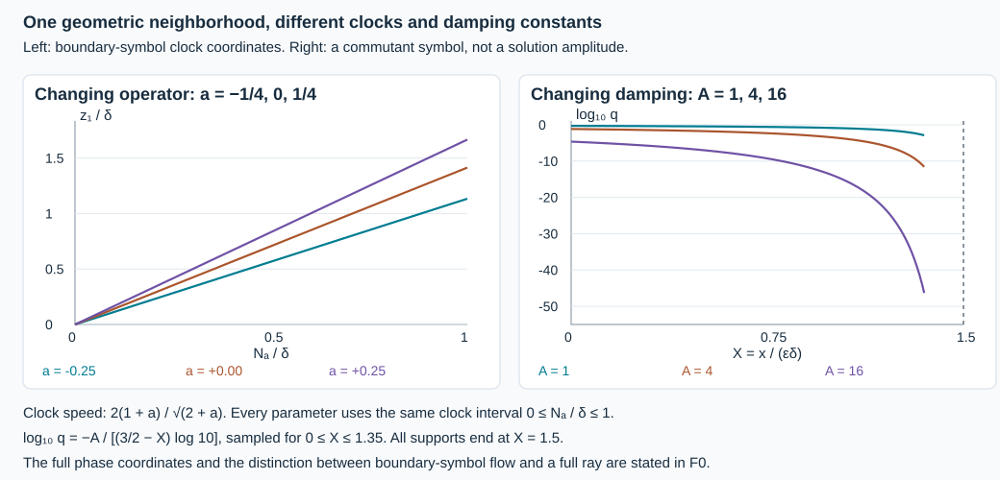

# A uniform half-order gain at general glancing

An estimate for each operator does not give an estimate for a family of operators. The constants, coordinate neighborhoods and actual boundary traces must be controlled together. We prove that control for the general scalar glancing estimate, at every real starting Sobolev order. One geometric neighborhood works throughout a compact smooth parameter family and through arbitrarily many finite regularity steps.

This is the local analytic input to the parameter theorem of Hörmander, *The Analysis of Linear Partial Differential Operators III*, approved corrected edition reprinted in 2007, Proposition 24.7.1′, printed page 467. The underlying commutant is the one used in Proposition 24.5.1 and Lemma 24.5.2, printed pages 455–458. We give the coefficient-uniform argument, including the characteristic completion and boundary pairings. The final observation estimate in an arbitrary admissible Banach norm still requires its global graph argument; it is not asserted here.

The [fixed-operator scalar proof](../20261009-general-scalar-boundary/scalar-boundary-propagation-through-general-glancing.html), [finite-order trace and comparison proof](../20261009-robin-diffraction-comparison/robin-diffraction-by-dirichlet-comparison.html), [smooth characteristic completion](../20261007-strict-diffraction-symbols/characteristic-squares-and-diffractive-commutants.html) and [uniform damping calculation](../20261008-uniform-matrix-damping/uniform-matrix-damping-and-robin-defects.html) supply exact earlier arguments. The proof map binds their current versions. Lebl foundations remain external; internal P514 closure of this CC0-only export is not claimed.

## 1. The family, the domain and the conclusion

**L0. Actual finite-order inputs.** Let \(a\) range over a compact parameter set \(Z_0\) contained in an open smooth parameter domain. On a fixed compact half-space chart \(x\ge0\), use
\[
 P_a=D_x^2-R_a(x,z,D_z),\qquad
 \sigma_2(R_a)=r_a(x,z,\eta)\in\mathbb R,\qquad
 p_a=\rho^2-r_a,\quad D=-i\partial .
 \tag{UG1}
\]
All lower coefficients may be complex. The complete coefficients are smooth jointly in \(a,x,z\). Every operator and every cutoff has fixed compact proper input and output supports inside a larger chart. Set
\[
 \|v\|_{\mathcal X_s}^2
 =\|\Lambda^sv\|_{L^2}^2+
   \|\Lambda^{s-1}D_xv\|_{L^2}^2,\qquad
 \Lambda=\langle D_z\rangle,\qquad s\in\mathbb R .
 \tag{UG2}
\]
Local statements mean that all displayed norms are taken after the specified larger cutoffs. Tangential smoothing improves tangential order only; no normal smoothing is assumed.

Consider any family \(u_a\), with no differentiability in \(a\) required, whose local \(\mathcal X_s\) norms are uniformly bounded for some finite real \(s\). Write \(f_a=P_au_a\). On one fixed open conic parameter region \(W\), assume that every properly supported tangential test with full microsupport compactly inside \(W\) gives uniformly bounded
\[
 Tf_a\in L^2_xH^m_z,\qquad
 T(0)g_a\in H^m_z\quad(m\in\mathbb R),\qquad
 g_a=\gamma_0u_a .
 \tag{UG3}
\]
The trace is the actual distributional normal limit. Its existence on the tested region follows from L1, not from assigning an independent boundary value. Uniformity in (UG3) concerns the entire family, including its proper-kernel remainders. For parameter-dependent bounded families of tests we use the same uniform bounds; L2 explains the finite-seminorm meaning. It suffices to verify them with fixed larger elliptic testers and the stated finite-order remainder bounds.

Let \(K\) be a compact set of pairs \((a,q)\), with \(q\) a normalized glancing covector at \(x=0\), such that the projected boundary Hamilton field is nonzero. We prove the following local implication, uniformly over \(K\). There are geometric constants \(c,\delta_0,\varepsilon_0>0\), independent of Sobolev order. For
\[
 0<\varepsilon<\varepsilon_0,\qquad
 0<\delta<\min(\delta_0,c\varepsilon),
 \tag{UG4}
\]
uniform tangential regularity on the full incoming window implies uniform regularity of all orders on one fixed smaller neighborhood of the anchor. At each finite step there is an actual half-order estimate, including the normal component of (UG2). Constants may depend on the requested order and the chosen positive widths; they are uniform in the operator parameter. They are not asserted uniform as the widths tend to zero.

## 2. Traces and the meaning of uniform constants

**L1. Recover the original normal data.** On a localized region where \(u_a\in\mathcal X_s\) and \(f_a\in L^2H^{s-2}\), the exact equation gives
\[
 D_x^2u_a=R_au_a+f_a\in L^2H^{s-2},\qquad
 \gamma_0u_a\in H^{s-1/2},\qquad
 \gamma_1u_a\in H^{s-3/2}.
 \tag{UG5}
\]
The constants are uniform. Indeed the tangential order-two mapping bound uses finitely many symbol seminorms of \(R_a\), bounded on \(Z_0\). Apply the unequal-order normal trace inequality LG:L1 first to \(u_a,D_xu_a\), then to \(D_xu_a,D_x^2u_a\). That Fourier and absolutely-continuous-representative proof has no coefficient-dependent step. It holds for every real \(s\).

For a localized tangential family \(T_a(x)\),
\[
 \gamma_0(T_au_a)=T_a(0)g_a,\qquad
 \gamma_1(T_au_a)
 =T_a(0)\gamma_1u_a-i(\partial_xT_a)(0)g_a.
 \tag{UG6}
\]
To prove these identities, apply tangential Fourier truncation and evaluate the absolutely continuous representative in a sufficiently negative tangential Sobolev space. The product rule gives the second identity; the trace bounds let the truncation tend to the identity. The estimates are uniform for a bounded family of \(T_a\). These are the same traces as in RDC:R1, including after a coordinate change or scalar normal gauge.

**L2. Finite seminorms, full remainders.** For each required operator norm, the earlier tangential calculus gives a bound by finitely many quantities of the form
\[
 \sup_{a,x,z,\eta}
 \langle\eta\rangle^{-m+|\beta|}
 |\partial_{x,z}^{\alpha}\partial_\eta^\beta t_a(x,z,\eta)|,
 \tag{UG7}
\]
together with finitely many derivatives of its proper smooth tangential kernel. Fixing a compact parameter set makes these quantities finite. A differentiated composition is estimated by expanding to a finite order exceeding the requested remainder order and then applying the proved remainder bound. The same statement holds with adjoints and normal parameter derivatives. Thus a separated product is uniformly tangentially smoothing; acting on \(u_a,D_xu_a\) uses their known finite \(\mathcal X_s\) bounds.

Here is the tester reduction used in (UG3). If a fixed \(F\) is elliptic on the common full microsupport of a bounded family \(T_a\), construct one fixed complete parametrix \(G\) there. Then
\[
 T_a=T_aGF+S_a,\qquad S_a\in\Psi_{\rm tan}^{-\infty}
 \text{ uniformly}.
 \tag{UG8}
\]
On an input with a fixed finite tangential \(L^2\) order, the remainder is uniformly bounded at every requested tangential order. For a normal jet its actual finite jet norm must be used. For the source \(f_a\), (UG8) requires a bound for the actual \(S_af_a\); it cannot be inferred from the order of \(u_a\) alone. One may retain that additional source test among (UG3). This records rather than discards the normal-source remainder. All estimates below involve only finitely many such tests for each fixed target order.

## 3. One set of flow boxes for the changing symbols

**L3. Uniform nonradial charts.** On the boundary characteristic set let \(\lambda(\eta)>0\) be a smooth homogeneous norm and put
\[
 W_a=\Pi_*(\lambda^{-1}H_{r_{a,0}}),\qquad
 r_{a,0}=r_a|_{x=0}.
 \tag{UG9}
\]
This field is nonzero on \(K\). At a chosen pair \((a_0,q_0)\), choose a transverse hyperplane to \(W_{a_0}\). The full smooth parameter-flow theorem gives a map from time and transverse coordinates whose derivative remains invertible on a common smaller neighborhood of \(a_0\). The parameter inverse-function theorem therefore gives jointly smooth coordinates
\[
 W_aN_a=1,\qquad W_av_{a,j}=0.
 \tag{UG10}
\]
Shrink the coordinate box once, leaving a positive margin from its boundary, and use compactness to cover \(K\) by finitely many such boxes. All coordinate and inverse-coordinate derivatives needed at any finite order are uniformly bounded on their retained compact subsets. The boxes themselves do not depend on that order.

For the current anchor \(q\), define
\[
 \Theta_a=N_a-N_a(q),\qquad
 \omega_a=\sum_j(v_{a,j}-v_{a,j}(q))^2 .
 \tag{UG11}
\]
The boundary characteristic orbit through \(q\) has \(r_{a,0}=0\). Taylor's integral formula in the transverse variables and (UG10) give, uniformly,
\[
 |r_{a,0}|\le C\lambda^2\sqrt{\omega_a},\qquad
 H_{r_{a,0}}\omega_a=0,\qquad
 |\partial_z\omega_a|+\lambda|\partial_\eta\omega_a|
 \le C\sqrt{\omega_a}.
 \tag{UG12}
\]
All parameters, including the anchor in its compact set, are retained in these bounds.

**L4. Escape at both normal roots.** Define
\[
 \phi_a=-\Theta_a+\frac{x}{\varepsilon}
                +\frac{\omega_a}{\delta\varepsilon^2}.
 \tag{UG13}
\]
On the relevant support, where \(\Theta_a\le(1+\varepsilon)\delta\) and \(\phi_a\le2\delta\), the exact calculation gives
\[
 x\le4\varepsilon\delta,\quad
 \omega_a\le4\varepsilon^2\delta^2,\quad
 |\rho|\le C\lambda\sqrt{\varepsilon\delta}\quad(p_a=0),
 \qquad
 H_{p_a}\phi_a
 =H_{r_a}N_a+\frac{2\rho}{\varepsilon}
              -\frac{H_{r_a}\omega_a}{\delta\varepsilon^2}.
 \tag{UG14}
\]
In particular the signed normal term is present. The first two bounds follow directly from (UG13); the root bound uses \(|r_a-r_{a,0}|\le Cx\lambda^2\) and (UG12). Smoothness gives \(H_{r_a}N_a=\lambda+O(x\lambda)\) and \(H_{r_a}\omega_a=O(x\lambda\sqrt{\omega_a})\). Hence
\[
 |H_{p_a}\phi_a-\lambda|
 \le C\lambda\left(\varepsilon\delta+
                    \sqrt{\delta/\varepsilon}+\delta\right).
 \tag{UG15}
\]
Choose \(c,\delta_0,\varepsilon_0\) in (UG4) once so the right side is at most \(\lambda/2\). The coefficient bounds used here are uniform over the finite chart cover. Neither a Sobolev order nor a regularization parameter enters this choice.

## 4. Jointly smooth completion through root merging

**L5. The parameter is part of the compact set.** The nonradial hypothesis implies a nonzero tangential differential of \(r_{a,0}/\lambda^2\). In each retained box choose one such derivative with magnitude bounded below by a positive constant. Include \(a\), the anchor and the fixed positive widths as parameters in SDC:S3–S6. The zero of \(r_a\) is then accessible in the same half-space, uniformly; no sign condition on \(\partial_xr_a\) is needed.

For completeness, the potentially delicate flat-error step is uniform as follows. After even/odd descent, the two error coefficients vanish on \(r_a\ge0\), with every derivative bounded by \(C_N|r_a|^N\) on the joint compact set. In the SDC:S4 majorant, take the supremum over this joint compact set, including the operator parameter. The resulting scalar function \(S(t)\) still satisfies \(S(t)=O(t^N)\) for every \(N\). Its smoothed majorant \(H(t)\) has \(|H^{(j)}(t)|\le C_{j,N}t^{N-j}\). Consequently \(H(-r_a)\), extended by zero, is smooth jointly with uniform derivatives. The even/odd extension is made with all parameter derivatives in its countable seminorm list. Thus it, too, is one smooth family, rather than unrelated extensions for individual \(a\).

It follows that a smooth characteristic equality for the quadratic array admits a uniform complete inequality
\[
 A_a(\rho)+(\psi_{a,0}+\rho\psi_{a,1})^2
       -h_a(\rho^2-r_a)\le0\quad(\rho\in\mathbb R),
 \quad
 \deg(\psi_{a,0},\psi_{a,1},h_a)=(1/2,-1/2,-1).
 \tag{UG16}
\]
Quantization uses the full ordered block array of GSP:C2, not only the characteristic values. The weighted Gårding and normal-commutator estimates have uniform constants by (UG7). Its Green error is the actual pairing of the source with an order-minus-one tangential operator, together with the actual value/normal-trace boundary pairing. Neither term is omitted.

## 5. Damping changes the size, not the neighborhood

**L6. A separate order-dependent parameter.** Let \(\chi_0(v)=e^{-1/v}\) for \(v>0\), zero otherwise, and
\(\chi_1(h)=\chi_0(h)/(\chi_0(h)+\chi_0(1-h))\).
For \(0\le\theta\le1\) and \(A\ge1\), set
\[
 \nu=\frac{1+\theta-\phi_a/\delta}{A},\qquad
 h=\frac{\delta-\Theta_a}{\varepsilon\delta}+\theta,\qquad
 q_{a,\theta}=\chi_0(\nu)\chi_1(h),\qquad
 W_{a,\theta}=\{q_{a,\theta}>0\}.
 \tag{UG17}
\]
The positivity sets are independent of \(A\); their closures nest strictly when \(\theta\) increases, inside the fixed larger chart. Define the incoming and gain symbols by
\[
 e_{a,\theta}^{\,2}
 =\frac{\chi_0(\nu)\chi_1'(h)H_{r_a}N_a}{\varepsilon\delta},
 \qquad
 b_{a,\theta}^{\,2}
 =\frac{\lambda\chi_0'(\nu)\chi_1(h)}{4A\delta}.
 \tag{UG18}
\]
All square roots are smooth, jointly with the parameters, by the explicit flat-function estimates SDC:S1. The characteristic identity is
\[
 H_{p_a}q_{a,\theta}+M\lambda q_{a,\theta}
       =-\psi_{a,\theta}^{\,2}-b_{a,\theta}^{\,2}
          +e_{a,\theta}^{\,2},
\quad
 \psi_{a,\theta}^{\,2}
 =\chi_0'(\nu)\chi_1(h)
   \left(\frac{H_{p_a}\phi_a}{A\delta}
                 -M\lambda\nu^2-\frac{\lambda}{4A\delta}\right).
 \tag{UG19}
\]
On these supports \(0<\nu<4/A\). If
\[
 A\ge\max(1,128M\delta),
 \tag{UG20}
\]
the parentheses are at least \(\lambda/(8A\delta)\). This follows from (UG15) and
\(1/(4A\delta)-16M/A^2\ge1/(8A\delta)\).
The strict positive margin gives a common neighborhood of the characteristic support on which the square root is smooth. A support cutoff there gives the complete symbol. L5 handles the roots and the noncharacteristic side together. Increases in \(M\) required by a higher Sobolev order are absorbed in \(A\), with no change to any \(W_{a,\theta}\).

## 6. The uniform regularized estimate

**L7. Every input to the quadratic form is legal.** For a fixed real \(s\), choose a properly supported scalar tangential cutoff \(\chi(x,z,D_z)\), with complete symbol equal to one on a neighborhood of all commutant and completion supports. Its full microsupport lies in \(W\); the actual source output \(\chi f_a\), including its proper-kernel remainder, is one of the tests in (UG3). The commutator formula below is an operator identity for this tangential cutoff. With \(0<\mu\le1\), put
\[
 J_\mu=\frac{\Lambda^s}{1+\mu^2|D_z|^2},\qquad
 w_{a,\mu}=J_\mu\chi u_a,\qquad
 P_aw_{a,\mu}=F_{a,\mu}+Z_{a,\mu}w_{a,\mu},
\quad
 F_{a,\mu}=J_\mu\{\chi f_a+[P_a,\chi]u_a\}.
 \tag{UG21}
\]
The full scalar regularizer calculation UMD:D6 shows that \(Z_{a,\mu}\) is uniformly of order one and its Hermitian part is uniformly of order zero, for \(a\in Z_0\) and \(0<\mu\le1\). The proof differentiates the exact quotient symbol of \(J_\mu\); its rational bounds are uniform in \(\mu\), while its coefficient factors have (UG7). It therefore gives joint uniformity, rather than only separate bounds for each \(a\).

For each positive \(\mu\), \(w_{a,\mu}\in H^2\). Its tangential order is two after applying \(J_\mu\) to an \(\mathcal X_s\) input, its first normal derivative has tangential order one, and its exact equation supplies the second normal derivative in \(L^2\). Uniformly in both parameters,
\[
 \|w_{a,\mu}\|_{\mathcal X_0}
 +\|P_aw_{a,\mu}\|_{L^2H^{-1}}
 +\|\gamma_1w_{a,\mu}\|_{H^{-3/2}}\le C_s\mathcal D_s(u_a,f_a,g_a).
 \tag{UG22}
\]
Here \(\mathcal D_s\) is a finite sum of larger localized \(\mathcal X_s\) norms of \(u_a\), actual localized \(L^2H^s\) source norms and \(H^{s+3/2}\) value-data norms. Retain each separated source remainder from L2 as an additional source test if needed. The tests have fixed supports and bounded families of complete symbols. The hypotheses make these quantities uniformly bounded.

To verify (UG22), retain
\([P_a,\chi]=-2i\chi_xD_x-\chi_{xx}-[R_a,\chi]\).
These terms map the known \(\mathcal X_s\) input into \(L^2H^{s-1}\). Applying \(J_\mu\) gives \(L^2H^{-1}\). The source term has that order as well. The \(Z\) term is bounded there by its order-one bound. Now apply (UG5) to the regularized equation. The smooth value trace is \(J_\mu\chi(0)g_a\), with (UG6) for any further localization. Pairing it with an \(H^{-3/2}\) normal trace uses exactly the retained \(H^{s+3/2}\) datum. No norm of an unlocalized high normal derivative of \(f_a\) has been assumed.

For each localized source pairing against a tangential order-zero or order-minus-one test, the part of \([P_a,\chi]\) separated from its support has uniformly tangentially smoothing coefficients on \(u_a,D_xu_a\). The full composition remainder bound in L2 controls it at their finite known orders. This is why the argument uses actual finite source tests and does not assert a global \(L^2\) bound on \(F_{a,\mu}\).

**L8. Keep the anti-Hermitian cancellation.** Let \(k_{a,\mu}\) be the real uniformly order-one leading symbol of
\((R_a-R_a^*)/(2i)+(Z_{a,\mu}-Z_{a,\mu}^*)/(2i)\).
For this fixed \(s\), compactness of \(Z_0\) and (UG7) give \(L_s<\infty\) with \(|k_{a,\mu}|\le L_s\lambda\). Choose
\[
 M_s\ge4L_s+1,\qquad
 M_s+2k_{a,\mu}/\lambda\ge1.
 \tag{UG23}
\]
The convergent square-root series UMD:D1, differentiated term by term, is bounded uniformly in \(a,\mu\) in every required symbol seminorm. Quantizing
\(\lambda^{1/2}\sqrt{M_s+2k_{a,\mu}/\lambda}\sqrt q\)
shows that the damping form is bounded below by \(-C_s\|w\|_2^2\). The difference from its norm square is the full order-zero operator, bounded by L2.

Apply the actual normal commutator identity to \(w=w_{a,\mu}\in H^2\), with a selfadjoint tangential \(Q\) whose principal symbol is \(q\). Subtract the \(Z\) pairing and add damping and the gain/incoming squares. Its characteristic polynomial is exactly
\[
 H_{p_a}q-2k_{a,\mu}q+
       (M_s\lambda+2k_{a,\mu})q+b^2-e^2=-\psi^2.
 \tag{UG24}
\]
L5 bounds the ordered array. Its source Green term contains \(F_{a,\mu}\), controlled by L7, and \(Z_{a,\mu}w\), controlled after the order-minus-one completion by \(\|w\|_2^2\). The actual boundary cross terms are bounded by (UG22) and the value datum. Dropping only nonnegative squares gives
\[
 \|B_aw_{a,\mu}\|_2^2
 \le\|E_aw_{a,\mu}\|_2^2+C_s\mathcal D_s(u_a,f_a,g_a)^2,
 \tag{UG25}
\]
with one \(C_s\) for the entire operator family.

If the incoming outputs \(E_au_a\) are uniformly bounded in \(L^2H^s\), commute \(E_a\) past \(J_\mu\chi\). The commutator has uniformly bounded order \(s-1/2\); its separated errors act on the finite \(\mathcal X_s\) norm. Thus the right side of (UG25) is uniformly bounded in \(a,\mu\). For each \(a\), let \(\mu\downarrow0\). The exact distributional bounded-norm limit argument LG:L6 yields \(B_a\Lambda^s\chi u_a\in L^2\) with that same bound. Taking the supremum in \(a\) after this conclusion preserves the bound; no subsequence in \(a\) or differentiability of \(u_a\) is needed.

On a smaller region where \(b_a\) is elliptic uniformly on the compact family, this gives the complete half-order gain. In fact the equation and the cutoff commutator give \(D_x^2Ku_a\in L^2H^{s-3/2}\); the normal interpolation inequality with endpoints \(s+1/2\) and \(s-3/2\) gives \(D_xKu_a\in L^2H^{s-1/2}\). Its constants are independent of \(a\). Therefore
\[
 \|Ku_a\|_{\mathcal X_{s+1/2}}
 \le C_s\left(\|E_au_a\|_{L^2H^s}
                    +\mathcal D_s(u_a,f_a,g_a)\right).
 \tag{UG26}
\]
The parametrix and the smaller cutoff are chosen with a positive support margin inside the ellipticity region; their uniformity follows from the positive minimum of the normalized \(b_a\) there. That minimum can decrease with \(s\), since \(A\) increases, but it stays positive for each fixed step.

## 7. A fixed neighborhood after every finite number of gains

**L9. The whole incoming support is controlled.** On the support of \(e_{a,\theta}\), (UG17) gives
\[
 |\Theta_a-\delta|\le\varepsilon\delta,\qquad
 x\le4\varepsilon\delta,\qquad
 \sqrt{\omega_a}\le2\varepsilon\delta .
 \tag{UG27}
\]
The inverse-coordinate bounds of L3 put its tangential projection within \(C_0\varepsilon\delta\) of \(\exp(\delta W_a)q\), with one \(C_0\) on the finite cover. Require uniform tangential regularity on a larger closed window, with normal width \(5\varepsilon\delta\) and tangential radius \(2C_0\varepsilon\delta\). The extra room permits all proper cutoffs and their finite remainders. A finite partition and the actual full tester bounds make \(\|E_au_a\|_{L^2H^m}\) uniformly bounded at each requested \(m\). Pointwise smoothness for each parameter, without these bounds, is insufficient.

**L10. The parameter neighborhood never shrinks with order.** For a requested positive integer \(k\), choose
\[
 \theta_j=1-\frac{j}{2k},\qquad j=0,\ldots,k .
 \tag{UG28}
\]
At step \(j\), choose the commutant index strictly between \(\theta_j\) and \(\theta_{j+1}\). All its supports and completion supports fit inside \(W_{a,\theta_j}\); the gain symbol is elliptic on the closure of the selected smaller compact part of \(W_{a,\theta_{j+1}}\), uniformly in \(a\). Apply (UG26) at order \(s+j/2\). Choose its \(M\) from (UG23), then \(A\) from (UG20). Neither changes the positivity regions. Finitely many support partitions make the statement valid for every test compactly inside the smaller region.

Induction reaches \(\mathcal X_{s+k/2}\) on \(W_{a,1/2}\). The operator parameter set \(Z_0\), coordinate cover, widths and final positivity region are the same for every \(k\). Only constants, intermediate cutoffs and the flat damping parameter change. In a fixed chart, any compact set inside the limiting \(W_{0,1/2}\) remains inside all sufficiently nearby \(W_{a,1/2}\) by continuity; this one restriction of \(Z_0\) is geometric and independent of \(k\).

If the localized source and all its normal derivatives are uniformly tangentially regular on the same collar, differentiating \(D_x^2u_a=R_au_a+f_a\) proves uniform bounds for every normal derivative there, by the finite Leibniz rule at each order. The existing all-order Sobolev embedding then gives uniform smoothness up to the boundary. Without these additional source-jet bounds, the conclusion proved above is the all-order tangential \(\mathcal X_m\) conclusion, not an unsupported assertion of ordinary normal smoothness.

**L11. What this establishes for the full parameter theorem.** The half-gain and its fixed-neighborhood iteration are uniform for the original complete smooth scalar family at nonradial glancing, with all complex lower terms retained. The geometric constants are chosen before any Sobolev order. The derivative bounds required of the coefficients increase with that order but are bounded on the same compact parameter set.

To obtain the full observation estimate of Proposition 24.7.1′, one must still combine every local regime, derive the required coarse normal and source-jet bounds from the actual Banach graph seminorms, and pass from the resulting bounded-family propagation statement to finitely many compactly supported source and observation tests. In particular, individual membership in \(\mathcal N\), or a separate fixed-operator closed-graph estimate, does not prove these uniform bounds. The completed [compact-access geometry](../20261009-parameter-ray-stability/stable-observation-for-boundary-rays.html) supplies the geometric input. This remaining analytic work and the subsequent wave application stay active.

## 8. Geometry stays fixed while constants change

**F0. Coordinates and meaning.** The left panel uses the exact family
\(r_a=(1+a)\eta_1^2+\eta_2^2-\eta_3^2+x\eta_3^2\),
with normalized anchor
\(\eta=(1,0,\sqrt{1+a})/\sqrt{2+a}\).
Its clock is \(N_a=z_1|\eta|/[2(1+a)\eta_1]\). The lines plot \(z_1/\delta=2(1+a)(N_a/\delta)/\sqrt{2+a}\) on the boundary-symbol orbit. Other coordinates are not zero: in particular \(z_3/\delta=-2\sqrt{1+a}(N_a/\delta)/\sqrt{2+a}\); the normal position and momentum are zero at the boundary anchor. These are clock-coordinate curves of \(H_{r_{a,0}}\), not asserted full \(p_a\) trajectories. The full tangent trajectory at this strict diffractive anchor moves into the interior.

The right panel is a slice of the commutant, not a solution amplitude. Put \(\Theta_a=\omega_a=0\), \(\theta=1/2\), and \(X=x/(\varepsilon\delta)\), so \(\chi_1(h)=1\). Then \(\log_{10}q=-A/[(3/2-X)\log 10]\) for \(0\le X<3/2\). All three damping choices have exactly that same positivity interval. The plotted logarithmic curves are sampled from this formula; the vertical endpoint and clock lines are exact coordinate constructions. Large damping can make the ellipticity constants small while leaving the neighborhood unchanged.

## 9. Three complete solutions

### Exercise 1. A changing clock for an indefinite quadratic form

For the family in F0, compute the clock and two transverse invariants. Retain the normal-variable error in the third coordinate.

**Solution.** On \(\eta_1>0\), set
\(N_a=z_1|\eta|/[2(1+a)\eta_1]\),
\(v_2=z_2-\eta_2z_1/[(1+a)\eta_1]\), and
\(v_3=z_3+\eta_3z_1/[(1+a)\eta_1]\).
The symbol is independent of \(z\), so \(H_{r_a}\) differentiates these functions only in \(z\). Direct calculation gives \(H_{r_a}N_a=|\eta|\), \(H_{r_a}v_2=0\), and \(H_{r_a}v_3=2x\eta_3\). Thus both \(v_j\) are boundary-flow invariants, and the last error is precisely first order in \(x\). The normalized anchor satisfies \(r_{a,0}=0\) and \(|\eta|=1\). Its \(z_1\) and \(z_3\) speeds are those in F0. For \(|a|\le1/4\), \(1+a\), \(2+a\) and the displayed nonzero clock speed have positive uniform bounds. This is an indefinite tangential quadratic form; no positive spatial energy was used.

### Exercise 2. More damping with exactly the same support

Fix \(\delta=1/16\), \(M_s=2s^2+3\) and \(A_s=8M_s\). Check (UG20), compute the worst lower bound in the characteristic square, and determine the positivity interval on the normal slice in F0.

**Solution.** Since \(128M_s\delta=8M_s=A_s\ge24\), (UG20) holds. With \(H_p\phi/\lambda\ge1/2\) and \(\nu\le4/A_s\), the normalized lower bound is
\[
 \frac{1}{4A_s\delta}-\frac{16M_s}{A_s^2}
       =\frac{1}{8A_s\delta}>0.
 \tag{UG29}
\]
On that slice \(q=\exp[-A_s/(3/2-X)]\) for \(0\le X<3/2\) and zero for \(X\ge3/2\), for every real \(s\). At \(X=3/4\), its value is \(\exp(-4A_s/3)\), which tends to zero as \(|s|\to\infty\). The support stays fixed while the inverse ellipticity constant grows. The theorem promises a finite constant for each order, not one constant for all orders.

### Exercise 3. Smooth members need not be a uniformly smooth family

On the circle of length \(2\pi\), let \(v_n(y)=e^{iny}\), \(n\ge1\). Compare individual smoothness, distributional convergence and uniform Sobolev regularity.

**Solution.** Every \(v_n\) is smooth. Repeated integration by parts in its pairing with a smooth periodic test gives convergence to zero as a distribution. The exact periodic Fourier norm is
\[
 \|v_n\|_{H^m}^2=2\pi(1+n^2)^m .
 \tag{UG30}
\]
It is uniformly bounded for \(m\le0\) and unbounded for \(m>0\). For any nonzero smooth cutoff \(\chi\), the triangle inequality gives
\(\|D_y(\chi v_n)\|_2\ge n\|\chi\|_2-\|D_y\chi\|_2\), so the failure occurs on every open arc. Empty wavefront sets of all individual members do not furnish the uniform incoming bounds of L9. This is a test-family counterexample, not a claimed solution of a particular boundary equation.

Independent exposition, proofs, solved exercises and the reproducible figure are CC0-1.0. Linked components retain their terms. 
