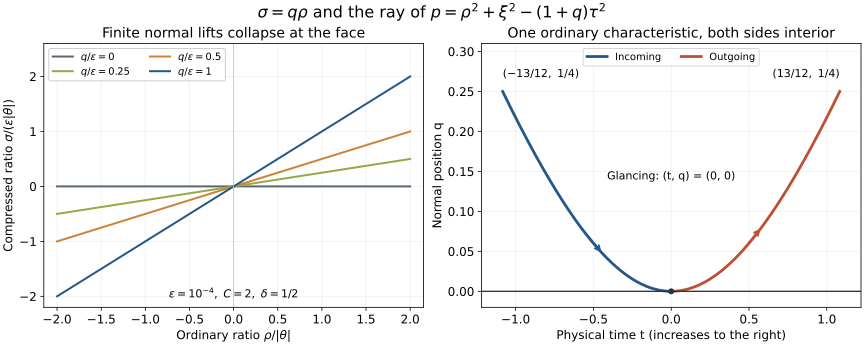

# Zero extension and incoming regularity at a glancing ray

Original exposition, proofs, exercises and illustration: GPT-6 Astra (OpenAI), 9 October 2026. Original content is CC0-1.0. Earlier components retain their terms.

The boundary source construction gives an actual L2 source with regularity in compressed spacetime directions. This chapter proves that its zero extension is ordinarily microlocally smooth at every finite normal lift of the relevant nonzero tangential boundary covector. Ordinary matrix propagation can then carry the actual incoming Cauchy solution through a strictly diffractive tangency. The causal boundary correction remains a separate part of the original solution.

The precise source antecedent is Hörmander, *The Analysis of Linear Partial Differential Operators III*, 2007 eBook, ISBN 978-3-540-49938-1, §18.3, especially Lemma 18.3.4 and the compressed quantization preceding it.  The receiving estimates below are proved here from the exact [lacunary kernel calculus](../20261005-local-boundary-calculus/boundary-tests-and-lacunary-symbols.md), its [L2 bounds](../20261005-local-boundary-calculus/boundary-bounds-and-conormal-action.md), the [boundary-preserving source reduction](../20261008-boundary-preserving-localization/boundary-preserving-localization-of-weak-sources.md), the [actual matrix Cauchy split](../20261008-matrix-incoming-cauchy/matrix-cauchy-evolution-and-causal-boundary-split.md), and the [ordinary matrix propagation proof](../20261007-restored-interior-front/interior-energy-fronts-and-matrix-propagation.md). The proof map retains exact earlier dependencies, including explicitly external Lebl proofs. 

## 1. The source and the two frequency spaces

**Z0. One fixed compressed neighborhood.** Write \(X_+=\{(q,z):q>0\}\), where \(z\in\mathbb R^d\), \(d\ge1\). In the application \(z\) includes physical time as well as spatial tangential variables. Use \(D=-i\partial\). Ordinary covectors are \((\rho,\theta)\); compressed covectors are \((\sigma,\eta)\), with
\[
 \pi(q,z;\rho,\theta)=(q,z;q\rho,\theta),\qquad
 e_+g(q,z)=
 \begin{cases}g(q,z),&q>0,\\0,&q<0.\end{cases}                 \tag{ZE1}
\]
The value at zero is immaterial for an L2 function. Fix \(g\in L^2(X_+;\mathbb C^N)\) of compact support and a boundary covector
\(b_0=(0,z_0;0,\eta_0)\), \(\eta_0\ne0\).
Assume that on one open conic neighborhood \(O\) of \(b_0\), every properly localized compressed test of integer order \(j\ge0\) with microsupport in \(O\) sends \(g\) into L2. This is all-order compressed L2 regularity on \(O\). It is stronger than having separate neighborhoods that shrink to \(b_0\) with \(j\); the neighborhood here is fixed.

For each finite \(C>0\), we will find a base cutoff \(\chi=1\) near \((0,z_0)\) and an open tangential cone \(\Gamma\ni\eta_0\), independent of \(j\), such that
\[
 \int_{\substack{\theta\in\Gamma,\ |\theta|\ge1\\|\rho|\le C|\theta|}}
       \langle\rho,\theta\rangle^{2j}
       |\widehat{\chi e_+g}(\rho,\theta)|^2\,d\rho\,d\theta<\infty
       \quad\text{for every }j\ge0.                           \tag{ZE2}
\]
A fixed smaller cone and the Fourier localization/embedding argument give ordinary smooth wavefront absence there. In particular
\[
 (0,z_0;\rho_0,\eta_0)\notin\operatorname{WF}(e_+g)
                \quad\text{for every finite }\rho_0.          \tag{ZE3}
\]
The union of these cones excludes pure normal covectors, for which \(\theta=0\). We do not assert global smoothness of the zero extension.

## 2. Separate the regular part with a lacunary operator

**Z1. A cutoff with a controlled full symbol.** Choose nested compact base neighborhoods of \((0,z_0)\), nested tangential angular cones, and \(0<\delta<1\), so that
\[
 0\le q<q_*,\quad z\text{ in the chosen base neighborhood},
 \quad \eta\text{ in the larger angular cone},\quad
 |\sigma|<4\delta|\eta|
 \quad\Longrightarrow\quad(q,z;\sigma,\eta)\in O              \tag{ZE4}
\]
at high frequency. A smooth scalar order-zero symbol can be chosen equal to one on a smaller such set containing \(|\sigma|\le3\delta|\eta|\), with smaller base and angular neighborhoods, and microsupported in \(O\). Low frequencies have a smooth cutoff. Apply LB:S4's convolution in \(\sigma\) to make it strongly lacunary. The difference is residual with every base and frequency derivative; hence the full resulting symbol \(b\) still equals one modulo \(S^{-\infty}\) on the inner set. Write \(B=T_b\).

Normal input/output ratios in this actual kernel lie in \([1/2,2]\). A smooth tangential proper-support cutoff equal to one near the diagonal changes the full symbol only by a residual symbol. Its exact tangential Fourier reduction preserves the normal-ratio support and the uniform compressed symbol bounds; denote the resulting full left symbol again by \(b\). Thus this construction retains the actual kernel, not just a principal-symbol statement. Choose the final output cutoff \(\chi\) inside the inner base neighborhood, with \(0\le q<\epsilon\). Compact input localization may be fixed once, equal to one on the given support of \(g\).

For all \(|\alpha|\le j\), \(D_z^\alpha B\) is a compressed operator of order at most \(j\), with microsupport in \(O\). This follows from the exact left differentiation formula in LB:A1: differentiating the phase supplies \(\eta^\alpha\), and differentiation of the coefficient supplies the remaining lower terms. The hypothesis therefore gives
\[
 D_z^\alpha(\chi Bg)\in L^2(X_+)\quad\text{for every }\alpha.
                                                               \tag{ZE5}
\]
All cutoffs are fixed. Tangential derivatives commute with zero extension as distributional derivatives: test the weak derivative in \(z\), use Fubini, and note that no \(q\)-derivative is taken. Plancherel gives
\[
 \int\langle\theta\rangle^{2j}
       |\widehat{e_+(\chi Bg)}(\rho,\theta)|^2\,d\rho\,d\theta
 \le C_j\sum_{|\alpha|\le j}\|D_z^\alpha(\chi Bg)\|_2^2 .
                                                               \tag{ZE6}
\]
On \(|\rho|\le C|\theta|\), this controls the weight in ZE2. It remains to handle \(R=I-B\), whose source has only its original L2 bound.

## 3. The normal rescaling and its uniform estimates

**Z2. No singular factor remains after Fourier transformation.** On the localized patch the left kernel of \(R\) has full symbol \(a=1-b\), with all localized derivatives of order zero. Its exact oscillatory form is
\[
 K_R(q,z;q',w)=(2\pi)^{-d-1}q^{-1}
  \int e^{i[(z-w)\cdot\eta+(1-q'/q)\sigma]}
                   a(q,z,\eta,\sigma)\,d\eta\,d\sigma.          \tag{ZE7}
\]
Here the identity kernel is included: its symbol is one and its normal ratio is exactly one. An output cutoff makes the otherwise constant symbol properly localized. Strong lacunarity permits insertion of a smooth function of \(q/q'\) supported in \((1/4,4)\) and equal to one on \([1/2,2]\).

Fourier transform \(\chi K_R\) in the output variables and, for \(q'>0\), set \(q=q'r\). The integration density and phase become
\[
 \frac{dq}{q}=\frac{dr}{r},\qquad
 \Phi=(z-w)\cdot\eta-z\cdot\theta+(1-r^{-1})\sigma-q'r\rho,
 \qquad
 \partial_r\Phi=\frac{\sigma}{r^2}-q'\rho .                   \tag{ZE8}
\]
The amplitude includes \(\chi(q'r,z)\), the ratio cutoff and \(1/r\). It is supported where \(1/4<r<4\), \(z\) is in one compact set, and \(0<q'<4\epsilon\). Every \(r,z\) derivative is uniformly bounded by the corresponding order-zero symbol bound. In particular
\(\partial_r a(q'r,z,\eta,\sigma)=q'\partial_q a(q'r,z,\eta,\sigma)\);
no inverse power of \(q'\) is introduced. The smooth proper-support factors have the same property. We will prove, for \(\theta\) in a smaller fixed cone and \(|\rho|\le C|\theta|\),
\[
 \sup_{\substack{0<q'<4\epsilon\\w\text{ in the input compact set}}}
 |\widehat{\chi K_R}(\rho,\theta;q',w)|
       \le C_M\langle\rho,\theta\rangle^{-M}
       \quad\text{for every }M.                             \tag{ZE9}
\]
This is a uniform estimate at \(q'=0\); it is not integration by parts on the rough input.

**Z3. All frequency regions are integrable.** Put \(\lambda=\langle\theta\rangle\). It suffices to consider large \(\lambda\). Choose a smooth partition into the near region \(|\eta-\theta|\le a\lambda\) and its complement, with small fixed \(a\), allowing the usual overlapping transition. On the near region,
\(|\eta|\ge\lambda/2\), \(|\eta|\le2\lambda\), and \(\eta\) lies in ZE4's inner angular cone. On the complementary support,
\[
 |\eta-\theta|\ge c(\lambda+|\eta|).                         \tag{ZE10}
\]
Indeed when \(|\eta|\ge2|\theta|\) the triangle inequality gives the bound; otherwise \(\lambda+|\eta|\le3\lambda\) up to a fixed bounded-frequency adjustment.

Choose
\[
 0<\epsilon<\min\{q_*/4,\ \delta/[1024(C+1)]\}.               \tag{ZE11}
\]
On the near region split once more into low \(\sigma\), supported in \(|\sigma|<2\delta|\eta|\), and high \(\sigma\), supported where \(|\sigma|\ge\delta|\eta|\). Use a smooth overlap and choose Z1's region on which \(a\) is residual to include the low support. Then:

* In the low part, every amplitude derivative is \(O(\langle\eta,\sigma\rangle^{-L})\) for every \(L\). Its frequency volume is \(O(\lambda^{d+1})\). Absolute integration gives \(O(\lambda^{d+1-L})\).
* In the high part, \(r^{-2}\ge1/16\), \(q'\le4\epsilon\), and \(|\rho|\le C|\theta|\), so
\[
 |\partial_r\Phi|\ge|\sigma|/16-4\epsilon C\lambda
                      \ge|\sigma|/32,\qquad
 |\sigma|\ge\delta\lambda/2.                                \tag{ZE12}
\]
Every higher \(r\)-derivative of the phase is bounded by a constant times \(|\sigma|\); the linear last term is covered by the same bound. Repeatedly apply
\((i\partial_r\Phi)^{-1}\partial_r\) to the exponential and its transpose to the amplitude. Each transpose gains one factor \(|\sigma|^{-1}\): derivatives of the reciprocal have that same bound, and derivatives of the amplitude are uniformly of order zero. There is no \(r\)-endpoint term because the ratio cutoff is compactly supported. After \(L>1\) steps, integration over \(|\sigma|\ge\delta\lambda/2\) and the near \(\eta\) region is bounded by \(C_L\lambda^{d+1-L}\).

On the complementary \(\eta\) region first integrate in \(z\), using
\((i|\eta-\theta|^2)^{-1}(\eta-\theta)\cdot\partial_z\). Each transpose gains \(|\eta-\theta|^{-1}\); all base derivatives remain bounded. To justify integration in the otherwise unbounded normal frequency, split it into \(|\sigma|\le2(\lambda+|\eta|)\) and \(|\sigma|\ge\lambda+|\eta|\). In the first part its interval length is \(O(\lambda+|\eta|)\). After \(L\) tangential integrations the integral is bounded by
\[
 C_L\int_{\mathbb R^d}(\lambda+|\eta|)^{1-L}\,d\eta
                  \le C'_L\lambda^{d+1-L}\quad(L>d+1).
                                                               \tag{ZE13}
\]
The last inequality follows by \(\eta=\lambda v\) and a dyadic shell sum. In the high part ZE11 again gives
\(|\partial_r\Phi|\ge|\sigma|/32\).
Take \(J>1\) normal integrations in addition to the \(L\) tangential ones. The two denominators commute with the other base differentiation because \(\partial_r\Phi\) is independent of \(z\) and \(\eta-\theta\) is independent of \(r\). The resulting bound is
\[
 C_{L,J}\int_{\mathbb R^d}(\lambda+|\eta|)^{-L}
       \int_{|\sigma|\ge\lambda+|\eta|}|\sigma|^{-J}\,d\sigma\,d\eta
       \le C'_{L,J}\lambda^{d+1-L-J}.                         \tag{ZE14}
\]
Smooth frequency partitions do not affect these integrations: they are independent of \(r,z\). The estimates are uniform in \(q',w\). Choosing \(L,J\) arbitrarily large proves ZE9. The tangential off-diagonal proper-support error, if retained separately, has arbitrary tangential frequency decay and obeys the same near/far estimates. No term is assigned ordinary normal smoothing merely because its compressed symbol is residual.

**Z4. The oscillatory estimate acts on the actual L2 source.** One can first insert smooth compact frequency cutoffs and use compact smooth inputs supported at \(q'>0\). The formulas follow from the kernel Fourier identity in LB:K0, Fubini and ZE8. For the kernel estimate multiply the full distributional kernel by the ratio cutoff before regularizing; this is an exact insertion. All integrations just used differentiate only \(r,z\), so bounds are uniform as the frequency cutoffs tend to one. The absolutely integrable bounds after integration by parts define the same oscillatory distribution, by testing and dominated convergence. They give ZE9 for \(q'>0\).

Fix a compact set \(K\) containing the input support and all approximations used below. It has finite measure. Consequently
\[
 |\widehat{\chi e_+(Rg)}(\rho,\theta)|
 \le C_M\langle\rho,\theta\rangle^{-M}
                  |K|^{1/2}\|g\|_2 .                        \tag{ZE15}
\]
For a general compact L2 input approximate by smooth interior inputs in L2, with one fixed slightly larger compact support. The order-zero bound LB:L2–L4 gives \(Rg_n\to Rg\) in L2. Multiplication by \(\chi\) makes this L1 convergence too, so their Fourier transforms converge uniformly. The right side of ZE15 passes to the limit. The measure-zero set \(q'=0\) contributes no boundary datum. This proves ZE15 for the actual zero extension, not for a separately chosen extension.

Combining ZE6 and ZE15 proves ZE2. To pass from weighted cone L2 estimates to ordinary smooth wavefront absence, choose a smooth frequency cutoff supported in that cone and equal to one on a smaller one. Its action on \(\chi e_+g\) belongs to every full-space Sobolev space, by ZE2 and the harmless bounded frequencies. IP:A1's fixed-test Fourier embedding makes that one output smooth. The discarded frequency cone has no wavefront in the smaller cone: after a compact base localization, Fourier convolution with a Schwartz transform has arbitrary decay there, by angular separation and the original L2 bound. This is the earlier ordinary conic localization proof. The spatial and angular neighborhoods have not shrunk with the Sobolev order.

The same argument at one fixed nonnegative integer \(j\) proves ZE2 at that order when the source hypothesis is available through order \(j\). The residual estimate uses only the baseline L2 norm. The all-order assertion uses the single neighborhood stipulated in Z0.

## 4. Apply the lemma to the actual incoming field

**Z5. The normalized source meets the lemma.** Let the original weak equation and its homogeneous Dirichlet or Robin condition have BPL:L7–L8's hypotheses, with the original natural-dual source regular at every b-order on one open region. Keep its exact source lift, Robin solution and test gauge, coordinate/density transformations and localization commutators. They give
\[
 U\in H^1,\qquad PU=G\in L^2,\qquad
 \gamma U=0\ \text{or}\ \gamma D_qU=0,                       \tag{ZE16}
\]
and \(G\) has all compressed L2 orders on a fixed inner region \(O_1\). Here \(G\) is BPL's entire localized source. Terms outside a smaller base plateau remain part of it. Multiplying by compact smooth cutoffs equal to one on the patch under discussion preserves this assertion; any equation commutators are retained as in IC14. Localizing a distribution to prove its wavefront statement does not change the full Cauchy source.

Take IC:C4's full-space smooth extension of the actual coefficients, including every matrix lower term. On the agreement patch its scalar real wave principal symbol has nonzero physical-time Hamilton component on the nonzero characteristic set. This follows by completing its time square: the two time roots are separated by twice a positive spatial norm, so the derivative in the time covariable is nonzero. A nonzero characteristic covector with zero normal covariable at glancing has nonzero tangential covector. Every compact normalized ordinary neighborhood of that covector therefore lies in \(|\rho|\le C|\theta|\) for some finite \(C\).

At the boundary, Z4 applies to \(e_+G\). At positive \(q\), compressed quantization is ordinary quantization after the invertible frequency change \(\sigma=q\rho\), with both local order-zero inverses and proper errors retained. The earlier interior comparison supplies the same smoothness there. At negative \(q\), the source is zero. Thus, after shrinking about the glancing lift,
\[
 \operatorname{WF}(e_+G)\cap\mathcal U=\varnothing            \tag{ZE17}
\]
for a fixed ordinary open conic neighborhood \(\mathcal U\) of that lift. The assertion includes the face. Smooth nonvanishing scalar source normalizations and smooth invertible matrix gauges preserve it, by ordinary composition and inverse multiplication. This is an ordinary spacetime statement; no spatial norm bound on every time slice has been assumed.

**Z6. The incoming branch agrees microlocally with the original representative.** Let \(\gamma\) be the short ordinary characteristic through a strictly diffractive glancing point, parametrized by increasing physical time, with contact at \(t=0\). The geometric theorem GGL:T015 gives \(q>0\) on both punctured sides. After changing from Hamilton time to physical time, \(q(t)\ge c t^2\) still holds with a smaller \(c>0\), because the time derivative is bounded away from zero. Shrink the interval so its closure lies in the coefficient agreement patch and in \(\mathcal U\).

Choose a good energy slice \(r<0\) strictly before a selected incoming time \(t_-<0\), both sufficiently near zero. Such slices have full measure by IC:C5. The segment from a time a little before \(r\) to \(t_-\) stays strictly inside \(q>0\). Construct the actual full-space \(V_{\rm in}\) from IC:C3–C5, using the extended position, velocity and source \(e_+G\). Match both Cauchy jets at \(r\). Its causal difference satisfies the exact identities
\[
 W=H(t-r)(U-V_{\rm in})\in H^1,\qquad
 PW=0\ (q>0),\qquad W=0\ (t<r),\qquad
 U=V_{\rm in}+W\ (t>r).                                    \tag{ZE18}
\]
IC:C6 proves these statements in the actual distributional equation, including the cancellation of both possible time-interface terms. Neither smooth initial jets nor an assumed strong energy trace at every time is required.

The full ordinary matrix propagation theorem IP:T013–T020 applies to \(W\) along the wholly interior segment crossing \(r\). Its source is zero there, including at \(r\), and \(W\) is zero on its past end. Hence \(W\) is microlocally smooth at \(\gamma(t_-)\). The fixed-flow-chart, all-order form of that theorem keeps one common neighborhood. Addition of a microlocally smooth vector distribution does not change a wavefront, so
\[
 \gamma(t_-)\notin\operatorname{WF}(U)
 \quad\Longleftrightarrow\quad
 \gamma(t_-)\notin\operatorname{WF}(V_{\rm in}).              \tag{ZE19}
\]
This step works with all complex matrix lower terms; it propagates the full vector state.

**Z7. Propagate the incoming field through the ordinary tangency.** The full-space equation is
\(PV_{\rm in}=e_+G\).
It has smooth coefficients on both sides of the physical face. ZE17 supplies ordinary source regularity on a fixed open neighborhood of the whole shortened characteristic. The same matrix propagation theorem, now applied to \(V_{\rm in}\) in full space, gives
\[
 \gamma(t_-)\notin\operatorname{WF}(U)
 \quad\Longrightarrow\quad
 \operatorname{WF}(V_{\rm in})\cap\gamma([t_-,t_+])
                         =\varnothing,\qquad t_+>0.          \tag{ZE20}
\]
In fact membership in the ordinary wavefront of \(V_{\rm in}\) is constant along this interval, and ZE19 identifies its incoming value. A compact interval is covered by finitely many overlapping ordinary flow charts from the fixed source-free region. The full matrix lower terms are removed by the earlier ordered conjugation, with both inverse errors retained; they do not change the scalar Hamilton curves. No boundary propagation theorem is being used to prove ZE20: the equation for \(V_{\rm in}\) is a full-space equation.

The earlier [two-branch Cauchy theorem](../20261009-two-branch-cauchy/two-branch-matrix-cauchy-wavefronts.md) remains valid. Its sufficient estimate TB17 asks for uniform spatial regularity integrable along a transported source tube. ZE20 obtains the required incoming conclusion directly from ordinary spacetime propagation and the actual compressed source hypothesis. It does not assert that the stronger TB17 hypothesis follows.

For \(t>r\) the total representative is \(U=V_{\rm in}+W\). ZE20 alone gives no outgoing regularity of \(W\): its boundary trace may contain complementary tangential frequencies. Nor does ordinary regularity at finite normal lifts alone license a smooth trace assertion while pure normal covectors remain uncontrolled. IC:C8 and the [transposed comparison theorem](../20261008-transposed-boundary-uniqueness/transposed-boundary-uniqueness-and-parametrix-identification.md) still require complete boundary-data agreement and smooth errors on the entire closed dependence region. Those boundary-response estimates, the sharp Airy energy mapping and the resulting strict propagation theorem remain substantive obligations. The present result removes the actual incoming-source obstruction.

## 5. Three complete exercises

### Exercise 1. A jump that the theorem deliberately permits

Take \(g(q,z)=e^{-q}\psi(z)\) for \(q>0\), with nonzero compact smooth \(\psi\). Determine the ordinary wavefront of its zero extension at a boundary point where \(\psi\ne0\). Does arbitrarily high tangential regularity remove that wavefront?

**Solution.** Local compact \(q\)-cutoffs can be inserted. Every tangential derivative is L2, and every compressed differential derivative is a polynomial in \(q\) times \(e^{-q}\) times a derivative of \(\psi\), hence L2. For the uncut normal profile direct integration gives
\[
 \widehat{H(q)e^{-q}\psi(z)}(\rho,\theta)
                  =\frac{\widehat\psi(\theta)}{1+i\rho}.       \tag{ZE21}
\]
The numerator has arbitrary decay, so every cone with \(|\rho|\le C|\theta|\) is regular. The distributional normal derivative is
\[
 \partial_q e_+g=\delta(q)\psi(z)-H(q)e^{-q}\psi(z).            \tag{ZE22}
\]
The delta is not L2 locally where \(\psi\ne0\): normal bumps equal to one at zero, with width \(h\), have L2 norm of order \(h^{1/2}\), while their pairing with that nonzero boundary value has a nonzero limit. Thus the extension is not H1 there.

More precisely, after any base localization nonzero at such a point, integrate the smooth positive-side profile by parts in \(q\). Its Fourier transform has leading term \(\widehat{\chi(0,\cdot)\psi}(\theta)/(i\rho)\), with remainder \(O(|\rho|^{-2})\) for bounded \(\theta\). The leading numerator is a nonzero function and is nonzero at some bounded \(\theta\), by Fourier uniqueness. Let \(\rho\to+\infty\) or \(-\infty\) with that \(\theta\) fixed. This excludes rapid decay in either pure normal cone. The wavefront over that point is exactly the two nonzero normal rays. Tangential regularity does not remove them.

### Exercise 2. Cutting a source at the initial time can create waves

For \(L=\partial_t^2-\partial_x^2\), set \(y_+=\max(y,0)\) and, for \(t\ge0\), define
\[
 v(t,x)=\frac{(x+t)_+^2+(x-t)_+^2-2x_+^2}{4}.                \tag{ZE23}
\]
Find its source, its two initial jets and its characteristic singularities for \(t>0\). Explain why one cannot replace Z6's matched causal difference by a casual assertion that a time-cut source creates no waves.

**Solution.** Testing against compact functions and integrating twice gives
\(\partial_y(y_+^2)=2y_+\) and \(\partial_y^2(y_+^2)=2H(y)\).
Consequently \(Lv=H(x)\) and \(v(0,x)=v_t(0,x)=0\) in the local energy spaces. For \(t>0\), away from the interfaces, the four expressions are
\[
 v=
 \begin{cases}
 0,&x<-t,\\
 (x+t)^2/4,&-t<x<0,\\
 t^2/2-(x-t)^2/4,&0<x<t,\\
 t^2/2,&x>t.
 \end{cases}                                                \tag{ZE24}
\]
Values and first derivatives match across all three interfaces. Second derivatives jump at \(x=-t\), \(x=0\), \(x=t\). Near \(x=\pm t\), \(t>0\), the nonsmooth term is a nonzero multiple of the square of the positive part of the corresponding defining function. Its second derivative is a step, whose one-dimensional Fourier decay is algebraic by the integration-by-parts argument of Exercise 1. All tangential derivatives along the interface are smooth. Thus both conormal rays occur there, with \(\tau=\pm\xi\), the characteristic directions of \(L\).

The original source \(H(x)\), viewed on all times, has only \(\tau=0\) source wavefront and is regular at those nonzero characteristic covectors. But its retarded extension \(H(t)H(x)\) has a corner at the initial slice; it is the source of the zero-past solution \(H(t)v\). The two vanishing solution jets eliminate interface deltas in the equation, not the newly cut forcing. Ordinary propagation must account for this initial corner. In Z6, by contrast, the propagated difference has source exactly zero on an open interval through the initial slice. That is the hypothesis that makes the argument work. This is a local L2 example; no global integrability of \(H(x)\) is needed.

### Exercise 3. A strictly diffractive ray with the physical clock

For
\[
 p(q,t,x;\rho,\tau,\xi)=\rho^2+\xi^2-(1+q)\tau^2             \tag{ZE25}
\]
find the ordinary characteristic with initial \(q=t=x=\rho=0\) and \(\tau=\xi=1\). Determine which Hamilton direction is increasing physical time, and compute its compressed normal covariable.

**Solution.** Hamilton's equations give \(q'=2\rho\), \(\rho'=\tau^2\), \(t'=-2(1+q)\tau\), \(x'=2\xi\), \(\tau'=\xi'=0\). Their exact solution is
\[
 q=s^2,\quad \rho=s,\quad t=-2s-\tfrac23s^3,\quad x=2s,
 \quad \tau=\xi=1,\qquad \sigma=q\rho=s^3.                  \tag{ZE26}
\]
Substitution gives \(p=0\) identically. Increasing physical time means decreasing \(s\). At the tangency \(H_pq=0\) and \(H_p^2q=2>0\), so both punctured sides are interior. For \(|s|\le1/2\),
\[
 \frac{36}{169}\,t^2\le q\le\frac14t^2,\qquad
 \frac{|\rho|}{|(\tau,\xi)|}\le\frac1{2\sqrt2}.              \tag{ZE27}
\]
Indeed \(t^2=4s^2(1+s^2/3)^2\), with \(1\le1+s^2/3\le13/12\).
The incoming side \(t<0\) has \(s>0,\rho>0\); the outgoing side \(t>0\) has \(s<0,\rho<0\). Both collapse to \(\sigma=0\) at the face. This sign calculation concerns the Hamilton field of ZE25 and does not replace it by an oppositely oriented physical clock.

**F0. Exact coordinates of the figure.** The first panel plots \(\sigma/(\epsilon|\theta|)=(q/\epsilon)(\rho/|\theta|)\), for \(-2\le\rho/|\theta|\le2\) and \(q/\epsilon=0,1/4,1/2,1\), with \(\epsilon=1/10000\), \(\delta=1/2\), \(C=2\). These constants meet ZE11's numerical bound, with the chart also chosen to contain the collar. All displayed lifts have \(|\sigma|\le2\epsilon|\theta|<\delta|\theta|\). The second panel is the exact \((t,q)\) projection of ZE26 for \(-1/2\le s\le1/2\). Its endpoints are \((\mp13/12,1/4)\), its tangency is \((0,0)\), and arrows point in increasing physical time. The colors identify incoming and outgoing ordinary segments; they do not assert regularity of the total boundary solution. The [figure script](figures/build_figure.py) preserves these constants.

  
