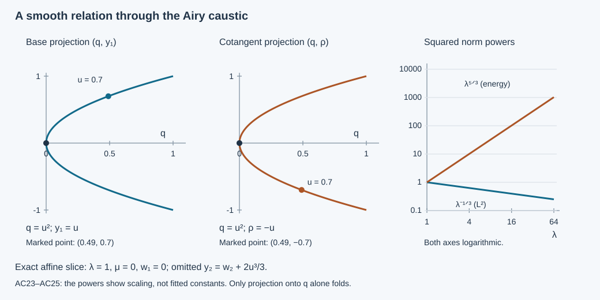

# Sharp Sobolev mapping for the decaying Airy kernel

The real Airy integral resolves a caustic by adding one frequency variable. For a boundary input and a full interior collar, that variable produces a smooth canonical relation: the output projection is an immersion and the input projection has one-dimensional fibers. Composing the adjoint with the operator therefore gives an ordinary pseudodifferential operator. We prove the resulting gain of one sixth of a derivative, including the sharp energy exponent \(5/6\), for the variable-coefficient phase and matrix amplitudes already constructed in this course.

The primary antecedent is Melrose–Taylor, [*Boundary Problems for Wave Equations With Grazing and Gliding Rays*](https://mtaylor.web.unc.edu/wp-content/uploads/sites/16915/2018/04/glide.pdf), §6.3, especially (6.3.28). The argument here uses the complete programme proofs of the [boundary cubic phase](../20261008-boundary-cubic-phase/boundary-normalized-cubic-phases.md), [matrix amplitudes](../20261008-coupled-airy-amplitudes/coupled-matrix-airy-amplitudes.md), [Airy contour and tails](../20261005-restored-airy-models/airy-functions-and-fold-model-operators.md), [clean composition](../20261005-restored-analytic-composition/clean-composition-of-fourier-integral-operators.md) and [Sobolev localization](../20261004-free-canonical-composition/fio-sobolev-mapping.md). It keeps the extra dimension in the order calculation.

Independent text, proofs, exercises and figure: **CC0-1.0**. The proof map records exact providers. Required human foundation proofs remain external. The growing Airy mode, its exponential coefficient domain and the complete variable-coefficient two-mode energy representation remain further obligations.

## 1. The operator and the estimate

**H0. The actual collar kernel.** Let \(Y\subset\mathbb R^d\), \(d\ge2\), and let \(X_+=[0,q_*)\times Y\). Write \(x=(q,y)\), \(\eta=(\mu,\eta',\lambda)\), with \(\lambda>0\) and \(|\eta|\asymp\lambda\) on a small cone about a marked glancing direction \(\eta_0\), normalized by \(\lambda_0=1,\mu_0=0\). All base supports are compact in the coordinate patches. The real phases and classical matrix amplitudes satisfy

\[
 \theta(0,y,\eta)=S(y,\eta),\quad \det S_{y\eta}\ne0,\quad
 \zeta(0,y,\eta)=-\mu\lambda^{-1/3},\quad
 -C\lambda^{2/3}\le\zeta_q\le-c\lambda^{2/3}.
 \tag{AC1}
\]

Their degrees are \(1,2/3,0,-1/3\) for \(\theta,\zeta,g,h\), respectively; the last two assertions mean \(g\in S^0_{\mathrm{cl}}\), \(h\in S^{-1/3}_{\mathrm{cl}}\). Finite square matrices are allowed. The CAA construction has \(h|_{q=0}=0\), and \(g_0\) invertible at the marked boundary point; impose those two additional hypotheses only for the lower estimate. Choose smooth output and input cutoffs \(\chi,\chi_{\rm in}\) and a degree-zero angular cutoff \(\omega\), with a smooth high-frequency cutoff at \(\lambda=1\). Define

\[
 (Tf)(x)=\chi(x)(2\pi)^{-d}\int e^{i\theta(x,\eta)}
 \omega(\eta)\bigl[g(x,\eta)\operatorname{Ai}(\zeta)
                  +ih(x,\eta)\operatorname{Ai}'(\zeta)\bigr]
 \widehat{\chi_{\rm in}f}(\eta)\,d\eta .
 \tag{AC2}
\]

The cutoffs can be supported in one fixed sufficiently small patch. The distributional meaning and the estimates will be proved below. This is the unnormalized decaying Airy kernel: no division by a boundary Airy value occurs.

**H1. The conclusions with their localization.** For every real \(r\),

\[
 \|Tf\|_{H^r(X_+)}
       \le C_r\|\chi_{\rm in}f\|_{H^{\,r-1/6}(\mathbb R^d)}.
 \tag{AC3}
\]

The norm on \(X_+\) is the restriction norm, the infimum of full-space extension norms. For \(r=1\) it is equivalent on a fixed collar to the usual norm of the function and all its first weak derivatives. The estimate holds for the actual variable-coefficient phases, with constants controlled by finitely many of their seminorms and quantitative nondegeneracy bounds.

If the cutoffs equal one on a small interior piece of a ray issuing from the marked input point, there is an input operator \(B\in\Psi^0\), elliptic on a smaller input cone, such that for each real \(r\) and \(N>0\),

\[
 \|Bf\|_{H^{\,r-1/6}}
       \le C_{r,N}\bigl(\|Tf\|_{H^r(X_+)}+\|f\|_{H^{-N}}\bigr).
 \tag{AC4}
\]

Here \(f\) has a fixed compact support in the input patch. The statement is microlocal: \(B\) is supported where the retained ray piece and the input cutoff are present. In particular the energy exponent is \(r-1/6=5/6\), and no smaller input Sobolev exponent gives a uniform local \(H^1\) bound at an elliptic point.

## 2. Restore the homogeneous frequency variable

**F0. A signed extension used only for estimates.** The earlier phase and amplitude construction gives smooth functions on one common collar up to the boundary, with symbol estimates on its compact normalized frequency patch. Extend them smoothly to a small negative \(q\) collar, preserving those estimates. One may use the explicit parameter-dependent extension FD:E2 on \(\lambda=1\), restore homogeneity for the phases, and extend each amplitude with its symbol seminorms by the same controlled extension and supported summation. The inequalities in AC1 and the invertibility of \(\theta_{y\eta}\) persist after shrinking.

This extension is an estimating device; no differential equation on \(q<0\) is asserted. Multiply it by a fixed compact output cutoff extending \(\chi\). Denote the resulting full-space operator by \(\widetilde T\). Its restriction is exactly AC2. Proving a full-space estimate therefore proves AC3 by the definition of the restriction norm. For integer \(1\), the weak derivative norm equivalence also follows directly from the reflection extension and restriction estimates already proved in the boundary Sobolev providers.

**F1. The cubic formula and the amplitude sign.** Put

\[
 z=\lambda^{-2/3}\zeta,\qquad u=\sigma/\lambda,\qquad
 \Phi(x,w,\eta,\sigma)=\theta(x,\eta)-w\cdot\eta
                 +\sigma z(x,\eta)+\frac{\sigma^3}{3\lambda^2}.
 \tag{AC5}
\]

Thus \(\Phi\) has ordinary degree one jointly in \((\eta,\sigma)\). The Airy integral AM:A1–A3 gives

\[
 \operatorname{Ai}(a)=\frac1{2\pi}\operatorname{Os}
     \int e^{i(s^3/3+as)}\,ds,\qquad
 \operatorname{Ai}'(a)=\frac1{2\pi}\operatorname{Os}
     \int is\,e^{i(s^3/3+as)}\,ds .
 \tag{AC6}
\]

Substitution \(s=\lambda^{-2/3}\sigma\) gives the exact kernel, before a nonstationary tail is removed, with prefactor \((2\pi)^{-d-1}\) and amplitude

\[
 \chi(x)\chi_{\rm in}(w)\omega(\eta)\lambda^{-2/3}
              \bigl[g(x,\eta)-h(x,\eta)\lambda^{-2/3}\sigma\bigr].
 \tag{AC7}
\]

The minus sign is \(i\cdot i=-1\). On \(|\sigma|\le\varepsilon\lambda\), the bracket has ordinary order zero; both its terms in AC7 have order \(-2/3\).

**F2. The unbounded auxiliary tail is smooth.** Choose a cutoff in \(u=\sigma/\lambda\), equal to one for \(|u|\le\varepsilon/2\) and zero for \(|u|\ge\varepsilon\). Shrink the base and angular patch so \(|z|<\varepsilon^2/16\). On the omitted part, \(|z+u^2|\ge c_\varepsilon(1+u^2)\). In the \(u\) integral the phase is

\[
 \theta-w\eta+\lambda(zu+u^3/3),\qquad
 L=\frac{1}{i\lambda(z+u^2)}\partial_u,\qquad
 L e^{i\Phi}=e^{i\Phi}.
 \tag{AC8}
\]

The amplitude before integrations is \(\lambda^{1/3}(g-\lambda^{1/3}hu)\), times cutoffs. It has at most first-degree growth in \(u\). Each transposed \(L\) gains one power of \(\lambda^{-1}\) and reduces a polynomial \(u\) bound by three for large \(|u|\). Derivatives of \((z+u^2)^{-1}\) have the corresponding extra inverse powers. Any fixed collection of \(x,w,\eta\) derivatives inserts only a fixed power of \(\lambda\) and a fixed polynomial in \(u\); differentiated coefficients obey the same bounds. Consequently sufficiently many integrations give an integrable \(u\) majorant and an arbitrarily negative power of \(\lambda\), after any requested derivatives.

Make the argument first with compact cutoffs in \(u\) and frequency. Derivatives of the expanding \(u\) cutoff satisfy the same integrable bounds and tend to zero; dominated convergence removes it. The subsequent \(\eta\) integral and all external derivatives converge absolutely after choosing the negative power below \(-d\). This proves a smooth compactly supported residual kernel. It also proves that the compact-\(u\) oscillatory kernel equals AC2 on test inputs, including the \(\operatorname{Ai}'\) term. No truncation of one real critical branch was made.

## 3. Both projections, including the caustic

**G0. The critical manifold.** The critical equations of AC5 are

\[
 z+u^2=0,\qquad
 w=\theta_\eta+\lambda u z_\eta-\tfrac23u^3 e_\lambda .
 \tag{AC9}
\]

Equivalently, \(s^2=-\zeta\), \(w=\theta_\eta+s\zeta_\eta\), as in BCP:C7. Here frequency derivatives in AC9 are at fixed \(\sigma\), and \(e_\lambda\) is the unit covector in its last frequency coordinate. The \(d\) critical differentials in \(\eta\) have independent coefficients \(-dw\); the remaining differential has the nonzero \(dq\) coefficient \(z_q\) at \(u=0\). They remain independent nearby. The associated relation is

\[
 C=\{(x,\theta_x+\lambda u z_x;\ w,\eta):\text{AC9 holds}\}.
 \tag{AC10}
\]

It has dimension \(2d+1\). Both covectors are nonzero: \(\eta\ne0\), while \(\theta_y+\lambda u z_y\) is close to \(S_y\ne0\). The latter is nonzero since Euler's identity gives \(S_y=S_{y\eta}\eta\), and \(S_{y\eta}\) is invertible. Compact normalized supports stay away from both covector axes.

**G1. The output projection is an embedding on a small patch.** At the marked point \(q=\mu=u=0,\lambda=1\), one has

\[
 z_y=0,\qquad z_\mu=-1,\qquad z_{\eta',\lambda}=0,
 \qquad z_q<0,\qquad \theta_{y\eta}=S_{y\eta}.
 \tag{AC11}
\]

Let a tangent vector to \(C\) have zero output base and covector variations. Its base variations \(\delta q,\delta y\) vanish. The first equation of AC9 then gives \(\delta\mu=0\). The tangential output covector variation is \(S_{y\eta}\delta\eta\), because \(u=z_y=0\); its vanishing forces all of \(\delta\eta\) to vanish. The normal covector variation is now \(z_q\delta u\), so \(\delta u=0\). AC9 determines \(\delta w=0\). Thus the output projection has injective differential.

The constant-rank coordinate proof makes an immersion injective on a sufficiently small neighborhood of this point. Shrink the compact normalized support into that neighborhood and restore positive dilation. The output projection \(\pi_X:C\to T^*X\) is then an embedding there. This argument includes \(u=0\); it does not divide by \(u\).

**G2. The input projection is a submersion.** At the same point, fix \((\eta,u)\) and use the first equation of AC9 and its \(w\) equations to solve for \((q,y)\). Their derivative in \((q,y)\) has block form

\[
 \begin{pmatrix}z_q&0\\ *&S_{\eta y}\end{pmatrix}.
 \tag{AC12}
\]

It is invertible. The inverse-function theorem with parameters gives smooth coordinates \((w,\eta,u)\) on \(C\) throughout one smaller fixed neighborhood. Projection to \((w,\eta)\) is a submersion with one-dimensional fibers. The permitted output and angular supports give a compact interval of \(u\) on each compact normalized input patch. All amplitudes vanish near that interval's ends; the complete geometric fiber need not be compact.

## 4. A clean product with one-dimensional excess

**C0. The exact order and compact-fiber localization.** The compact-\(u\) kernel has \(d+1\) ordinary phase variables and base dimension \(2d+1\). Its amplitude order \(-2/3\) therefore gives

\[
 m=-\frac23+\frac{d+1}{2}-\frac{2d+1}{4}
      =-\frac5{12}.
 \tag{AC13}
\]

The smooth tail F2 changes none of these conclusions. Adjoint and ordinary pseudodifferential factors are covered by RC:C2 and the complete composition proof.

We check the relevant local clean composition rather than assuming a globally compact geometric fiber. In \(C^t\times_{T^*X}C\), equality of the output covectors forces equality of the two points of \(C\), by G1. Infinitesimally the same assertion follows from the injective output differential. Thus this matching manifold is \(C\) itself, with precisely its tangent space: the intersection is clean. Its projection to the input product is the diagonal map of \(\pi_Y\). By G2 its rank is \(2d\) and its fiber dimension, or excess, is one.

For compactly localized amplitudes, all matching fiber integrals are over the compact \(u\) support just described. The local proof RC:C5–C8 applies: unequal frequencies give a smooth remainder by repeated integration; on comparable frequencies the middle base variables become homogeneous phase variables; clean stationary phase reduces the transverse variables, leaving the compact supported integral in \(u\). Every derivative can pass through that last integral on a common compact interval. Its finite remainders have the orders in that proof, uniformly in the remaining variables. A finite coordinate partition suffices. This establishes the localized version without imposing properness on the entire open fiber. It yields

\[
 \widetilde T^* Q^{\,2r}\widetilde T
          \in\Psi^{\,2r-1/3},\qquad
 2m+2r+\tfrac12=2r-\tfrac13,
 \tag{AC14}
\]

for an ordinary output operator \(Q^{2r}\) of order \(2r\) with the stated compact localizations. Smooth tails compose to smooth localized kernels by the nonzero-covector mapping theorem RC:C1. Finite matrix products keep their actual order.

**C1. All-real Sobolev mapping.** Use the supported elliptic weights and exact smoothing parametrices of W6 in the earlier mapping lesson. The conjugated operator

\[
 A=Q_X^r\widetilde T P_Y^{\,1/6-r}
 \quad\hbox{has order }-\tfrac14,\qquad A^*A\in\Psi^0 .
 \tag{AC15}
\]

Here \(P_Y^{1/6-r}\) is the parametrix of an input weight of order \(r-1/6\). All factors have fixed support margins. The ordinary order-zero bound P1:B4 and the exact adjoint pairing imply, first on tests,
\(\|Af\|_2^2=\langle A^*Af,f\rangle\le C\|f\|_2^2\).
Insert the input identity \(P_Y^{1/6-r}Q_Y^{r-1/6}=I+R\), retaining its compact smooth remainder. The preliminary distribution estimate and the output elliptic identity W19–W20 then give

\[
 \|\widetilde T f\|_{H^r(\mathbb R^{d+1})}
                  \le C_r\|f\|_{H^{\,r-1/6}(\mathbb R^d)}.
 \tag{AC16}
\]

Every smooth remainder has this bound by the Fourier Cauchy–Schwarz proof W1, for any fixed real exponents. This is also the full localization argument for noninteger or negative \(r\), so no unproved fractional derivative rule is required.

Smooth compactly supported inputs are dense in the indicated Sobolev spaces after a slightly larger support cutoff. The estimate extends the operator continuously. RC:C1 identifies its limit with the kernel acting on distributions, because its tested action is continuous; therefore it is the actual AC2, not a different completion. Restriction of AC16 proves AC3.

## 5. Ellipticity and the reverse estimate

**E0. Keep one ordinary interior branch.** Impose the additional boundary hypotheses in H0. Choose a small fixed \(q_1>0\), then an interval \(I\Subset(0,q_*)\) about \(q_1\). Reduce the input angular cone so \(|\mu|/\lambda\ll q_1\). On \(I\), \(-\zeta\ge c q_1\lambda^{2/3}\), so the two real critical points are separated. The Airy asymptotics AM:A5 give two ordinary graph phases

\[
 \phi_\pm(x,\eta)=\theta(x,\eta)
                      \pm\tfrac23(-\zeta(x,\eta))^{3/2}.
 \tag{AC17}
\]

Their graph matrices in \(y,\eta\) are invertible on this smaller patch. Here is a quantitative reason. Write \(z=-\mu/\lambda-q\,d(q,y,\widehat\eta)\), with \(d>0\). Then \(z_y=O(q)\), \(z_{y\eta}=O(q/\lambda)\), \(z_\eta=O(1/\lambda)\). Differentiating \(\lambda(-z)^{3/2}\) once in \(y\), once in \(\eta\), gives \(O(\sqrt{q_1})\) on \(I\), after choosing its endpoints comparable to \(q_1\). Also \(\theta_{y\eta}=S_{y\eta}+O(q_1)\). Invertibility follows for sufficiently small \(q_1\).

The branch normal covectors differ by \(2\sqrt{-\zeta}\,\zeta_q\ne0\). A smooth ordinary output microlocal cutoff \(E\) supported inside the collar selects one branch and equals one on a smaller ray piece. Its other branch and separated critical points give a smooth remainder by the complete wavefront localization proof. The selected branch amplitude has leading term

\[
 c_\epsilon(-\zeta)^{-1/4}
       [\,g_0+\epsilon\sqrt{-\zeta}\,h_0\,],
       \qquad |c_\epsilon|=(2\sqrt\pi)^{-1},\quad \epsilon=\pm1,
 \tag{AC18}
\]

where \(\epsilon\) labels the phase in AC17. Indeed its critical point is \(s=-\epsilon\sqrt{-\zeta}\), and AC7 has \(g-sh\); the bracket in AC18 follows directly. The stationary constants have the displayed nonzero modulus.

Since \(h|_b=0\), \(\lambda^{1/3}h_0=O(q_1)\), whereas \(g_0\) remains invertible. The bracket is invertible on the chosen small interior patch. The branch amplitude has ordinary order \(-1/6\). Smooth densities and finite matrix frame changes multiply its Gram matrix by positive bounded weights.

**E1. A positive normal symbol and an actual inverse.** Let \(J\) be a fixed ordinary output cutoff selecting the retained branch and compact interior ray segment. Put \(T_1=J\widetilde T\). For any real \(r\), form \(D=Q_X^rT_1\), with the full supported weight from C1. The normal operator \(D^*D\) has order \(2r-1/3\). Its leading symbol on the selected input patch is a positive fiber integral of the branch Gram matrix. In graph coordinates it is

\[
 \int_I
   \frac{|j_0(q,y(q,w,\eta),\xi)|^2
          |\xi(q,w,\eta)|^{2r}}
        {|\det(\phi_{\epsilon,y\eta})|}
       a_{\epsilon,0}^*a_{\epsilon,0}
             (q,y(q,w,\eta),\eta)\,dq .
 \tag{AC19}
\]

The ordinary graph normalization \((2\pi)^{-d}\) and its density formula GE:D2 give exactly this expression; the phase factors cancel against their conjugates. Restrict the integral to a smaller interval on which \(j_0=1\). AC18, the determinant bound and \(|\xi|\asymp|\eta|\) show that AC19 is bounded below by \(c|\eta|^{2r-1/3}I\). Thus it is elliptic as a matrix symbol. The unselected parts can only add nonnegative matrices to the leading normal symbol; no cancellation of opposite Airy branches is used in this lower bound.

Write \(s=r-1/6\) and \(A=D P_Y^{-s}\). Then \(A^*A\in\Psi^0\) is elliptic on the chosen input cone, and both \(A\) and \(A^*\) are \(L^2\)-bounded by C1. A supported left parametrix \(M\in\Psi^0\) gives, for an input cutoff \(B_0\) with microsupport in that cone,

\[
 B_0 v=B_0M A^*A v+R v,\qquad
 \|B_0v\|_2\le C\|Av\|_2+C_N\|v\|_{H^{-N}} .
 \tag{AC20}
\]

Here the input localization is absorbed into \(M\); outside it the product has separated microsupport and is smoothing. The smooth remainder estimate follows from W1. Take \(v=Q_Y^s f\) and retain the exact input elliptic remainder as in C1. Ordinary composition and elliptic localization convert the left side to \(\|Bf\|_{H^s}\), with a possibly smaller \(B\). The right side is bounded by \(\|Tf\|_{H^r(X_+)}+\|f\|_{H^{-N}}\): \(J\) is supported strictly inside \(X_+\), and its extension by zero there is bounded on every local Sobolev space. To check the restriction norm assertion, apply the ordinary operator to any full-space extension, observe that its actual input cutoff stays in that interior region, and take the infimum. This proves AC4 for smooth inputs.

The same identity proves regularity for distributions. A compact distribution has some finite negative Sobolev order. If \(Tf\) belongs to the indicated \(H^r\), the right side of the identity belongs to \(L^2\); \(A^*\) acts on that \(L^2\) vector by its established extension, and the remainder is smooth. The exact distributional kernel identities identify the terms. No a priori membership of \(Bf\) in \(H^s\) is assumed.

**E2. The sharpness statement.** Choose a smooth compact input function \(a\ne0\), supported where \(B\) is elliptic, and a fixed polarization vector \(e\ne0\). Let

\[
 f_R(w)=a(w)e^{iR\,w\cdot\eta_0}e,\qquad R\longrightarrow\infty .
 \tag{AC21}
\]

Fourier translation and rapid decay of \(\widehat a\) give
\(\|f_R\|_{H^t}\asymp R^t\) for every fixed real \(t\). For the lower bound integrate over a fixed ball where \(\widehat a\) has nonzero mass. For the upper bound split into \(|\xi-R\eta_0|\le R/2\) and its complement; arbitrarily rapid decay controls the latter, including negative \(t\). Ellipticity and an ordinary input parametrix give the same lower bound for \(Bf_R\), up to a rapidly decreasing remainder. AC3–AC4 now imply

\[
 \|Tf_R\|_{H^r(X_+)}\asymp R^{\,r-1/6}.
 \tag{AC22}
\]

If AC3 held with input exponent \(r-1/6-\delta\), \(\delta>0\), these packets would require \(R^\delta\) to be bounded. Hence the gain cannot be improved. This establishes local sharpness on the actual variable-coefficient elliptic patch.

## 6. Energy meaning and the remaining two-mode problem

**D0. What this proves for the constructed kernel.** The CAA amplitudes satisfy H0, including the extra ellipticity hypotheses. Taking \(r=1\) proves that their unnormalized \(\operatorname{Ai}\) component is a continuous map from \(H^{5/6}\) coefficient data into the actual collar energy space, and conversely identifies that coefficient regularity microlocally from energy. Smooth input approximation converges in energy and in distributions. Applying any smooth differential operator to that convergent sequence also converges distributionally, by transposition on compact tests; localization retains its differentiated output-cutoff terms.

For an input Fourier multiplier \(M\) for which \(Mf\) is a compactly localized \(H^{5/6}\) distribution, the same proof gives the exact estimate \(\|T(Mf)\|_{H^1}\le C\|Mf\|_{H^{5/6}}\), with the actual input cutoff included. This applies to the decaying component after any specified boundary normalization whose coefficient belongs to that domain. It does not turn a growing mode into an ordinary real-phase FIO.

The affine energy lesson AES:E3–E9 shows why the distinction matters: two normalized incoming/outgoing coefficients can fail to be tempered even when their combination is an energy solution. The present theorem supplies a needed sharp component estimate. It does not identify all variable-coefficient energy solutions with two separately tempered normalized inputs, or prove the growing coefficient's exponential norm.

## 7. Three solved exercises

**X1. The affine relation and both projection ranks.** Take \(d=2\), \(\theta=y_1\mu+y_2\lambda\), \(\zeta=-q\lambda^{2/3}-\mu\lambda^{-1/3}\), \(g=1,h=0\). Compute the critical relation in \((w_1,w_2,\mu,\lambda,u)\).

**Solution.** AC9 gives

\[
 q=u^2-\mu/\lambda,\quad y_1=w_1+u,\quad
 y_2=w_2-u\mu/\lambda+2u^3/3,\quad
 (\rho,\xi_1,\xi_2)=(-\lambda u,\mu,\lambda).
 \tag{AC23}
\]

Indeed \(z=-q-\mu/\lambda\), so differentiation at fixed \(\sigma\) gives \(w_1=y_1-u\) and \(w_2=y_2+u\mu/\lambda-2u^3/3\). The inverse of the output projection on its image is
\[
 \lambda=\xi_2,\quad \mu=\xi_1,\quad u=-\rho/\xi_2,\quad
 w_1=y_1-u,\quad w_2=y_2+u\mu/\lambda-2u^3/3.
 \tag{AC24}
\]

The input projection forgets \(u\) and has rank four. AC24 proves that the output projection has rank five, including \(u=0\). On the boundary \(\mu/\lambda=u^2\), it gives \(w_2=y_2+u^3/3\), consistent with BCP:BC39 after using its opposite normal variable \(t=-u\).

**X2. Check the energy exponent directly.** For the same model, fix a nonnegative smooth cutoff \(\chi(q)\) supported in \(0<a<q<b\). Set \(\mu=0\), \(\lambda\to\infty\). Determine the leading \(q\)-integrals of \(|\operatorname{Ai}(-q\lambda^{2/3})|^2\), its \(\lambda\)-tangential derivative energy, and its normal derivative energy.

**Solution.** The negative Airy expansion and a single nonstationary integration in \(q\) give
\[
\begin{aligned}
 \int\chi\,|\operatorname{Ai}(-q\lambda^{2/3})|^2dq
   &=\frac{\lambda^{-1/3}}{2\pi}\int\chi(q)q^{-1/2}dq
          +O(\lambda^{-4/3}),\\
 \int\chi\,|\lambda\operatorname{Ai}(-q\lambda^{2/3})|^2dq
   &=\frac{\lambda^{5/3}}{2\pi}\int\chi(q)q^{-1/2}dq
          +O(\lambda^{2/3}),\\
 \int\chi\,|\partial_q\operatorname{Ai}(-q\lambda^{2/3})|^2dq
   &=\frac{\lambda^{5/3}}{2\pi}\int\chi(q)q^{1/2}dq
          +O(\lambda^{2/3}).
\end{aligned}
 \tag{AC25}
\]

For example \(\cos^2(2\lambda q^{3/2}/3-\pi/4)\) has mean \(1/2\), and its oscillatory part gains \(\lambda^{-1}\) since \(\partial_q(4q^{3/2}/3)=2\sqrt q\) is bounded away from zero. The Airy remainder has the same or a smaller order on this fixed interval. For the last line use \(\partial_q\operatorname{Ai}=-\lambda^{2/3}\operatorname{Ai}'\) and the corresponding sine expansion. Thus the squared energy weight is \(\lambda^{5/3}\); its square root is the \(5/6\) Sobolev weight.

**X3. A variable coefficient and the actual density.** Set \(r=e^{y_1/4}(q+q^2/5)=f(q,y_1)\), \(z=y\), as in the earlier phase example. Express the critical normal covector and the scalar half-density factor for pulling back the affine Airy operator.

**Solution.** The Jacobian is
\(J=f_q=e^{y_1/4}(1+2q/5)>0\) on the small collar. The unitary half-density pullback is \(Uu=J^{1/2}u(f(q,y_1),y)\). Its Airy amplitudes are \(g=J^{1/2},h=0\), and its critical relation satisfies
\[
 f(q,y_1)=u^2-\mu/\lambda,\qquad
 \rho=-\lambda u f_q,\quad
 \xi_1=\mu-\lambda u f_{y_1},\quad \xi_2=\lambda.
 \tag{AC26}
\]

The full Jacobian and its inverse are bounded on a compact small collar. Change of variables proves the \(L^2\) identity exactly. The product and chain rules, with their bounded inverse coefficients, give equivalence of \(H^1\) norms in both directions. Hence this example preserves both the \(H^{-1/6}\)-to-\(L^2\) and \(H^{5/6}\)-to-\(H^1\) estimates. It checks the normal sign, the tangential cross term and the density. The general theorem also covers canonical phases that are not produced by a base change.

## 8. Read the figure precisely

**V0. Exact coordinates and scaling.** The left panel plots the affine slice \(\lambda=1,\mu=0,w_1=0\) of AC23: \(q=u^2,\ y_1=u,\ \rho=-u\). It displays the two projections \(u\mapsto(q,y_1)\) and \(u\mapsto(q,\rho)\); the full omitted coordinate is \(y_2=w_2+2u^3/3\). The physical collar is \(q\ge0\). Both curves are smooth through the caustic; only projection onto \(q\) alone folds. The right panel displays the exact powers \(\lambda^{-1/3}\) and \(\lambda^{5/3}\), divided by their values at \(\lambda=1\). These are squared-norm scaling powers from AC25, not numerical solutions or uniform constants for a general coefficient field. The [figure source](figures/build_figure.py) reproduces the plots.
