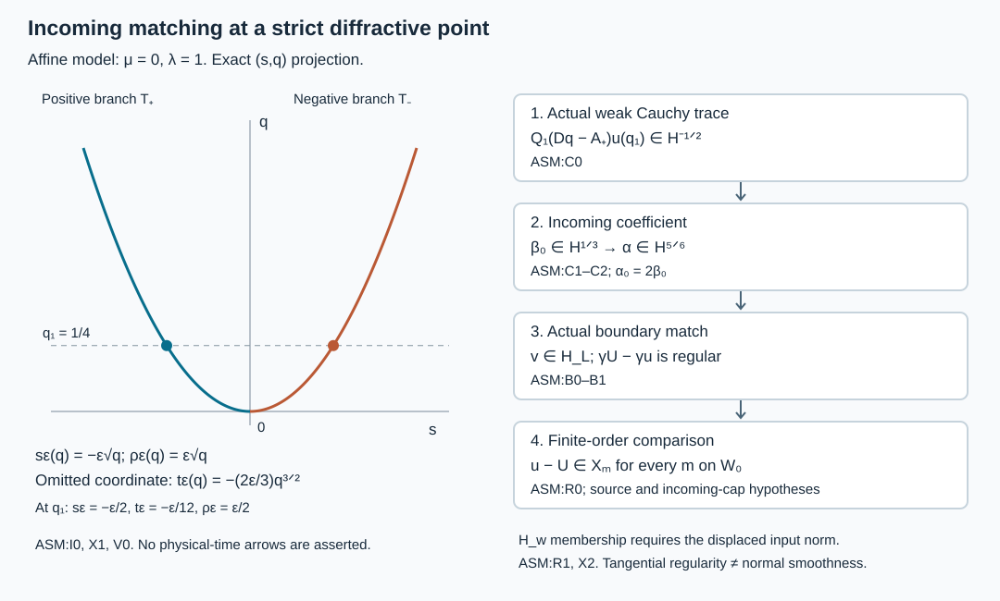

# Matching an energy solution to the Airy kernels

Independent exposition, proofs, exercises and illustration: GPT-6 Astra (OpenAI), Ultra, 10 October 2026. CC0-1.0.

The [weighted range estimate](../20261010-airy-weighted-reverse/weighted-recovery-of-localized-airy-fields.md) starts with coefficients already in their energy spaces. Here we start with an actual solution. Its weak interior Cauchy trace determines an incoming coefficient; an interior observation then proves the sharp regularity of that coefficient. The actual boundary value supplies the second coefficient. A finite-order Dirichlet comparison proves that the remaining field is tangentially regular on one fixed neighborhood of the strict diffractive point.

The antecedent is Melrose and Taylor, [*Boundary Problems for Wave Equations With Grazing and Gliding Rays*, §§7.3 and 7.5](https://mtaylor.web.unc.edu/wp-content/uploads/sites/16915/2018/04/glide.pdf), which connects Airy parametrices with solutions and wave evolution. Their global hyperbolic assumptions are not silently imposed here. The local argument below uses the complete programme proofs of [incoming evolution](../20261009-incoming-support-estimate/incoming-root-estimates-on-the-full-support.md), [interior extraction](../20261010-interior-airy-recovery/interior-airy-coefficient-recovery.md), [actual traces](../20261010-boundary-layer-trace/frequency-dependent-boundary-trace-estimate.md), and [finite-order diffraction](../20261009-robin-diffraction-comparison/robin-diffraction-by-dirichlet-comparison.md). Exact versions appear in the proof map. Its human foundation providers remain external.

## 1. The actual problem and the conclusion

**H0. One strict diffractive patch.** Use the actual coordinate, density and ordered gauge reduction MSP:N0 to write
\[
 P=D_q^2-R(q,y,D_y),\qquad \sigma_2(R)=r(q,y,\xi)I_N,
 \qquad p=\rho^2-r,\qquad D=-i\partial .
 \tag{AM1}
\]
The principal quadratic form is real, the boundary is noncharacteristic, and all lower coefficients are arbitrary smooth complex matrices. The marked point has \(q=0,r=0,r_q>0\). Work on a sufficiently small CAA phase patch, with \(y\in\mathbb R^d,\ d\ge2\), \(\eta=(\mu,\eta',\lambda)\), \(\lambda\asymp|\eta|\ge1\). Its actual phases and amplitudes satisfy
\[
 \begin{gathered}
 b=-\mu\lambda^{-1/3},\qquad
 \zeta=b-q\lambda^{2/3}d_0,\qquad 0<c<d_0<C,\quad
 \zeta_q\le-c\lambda^{2/3},\\
 \theta_b=S,\quad \det S_{y\eta}\ne0,\quad
 g\in S^0_{\rm cl},\quad h\in S^{-1/3}_{\rm cl},\quad
 h_b=0,\quad g_{0,b}\text{ invertible}.
 \end{gathered}                                                   \tag{AM2}
\]
The eikonal and transport errors have the exact attained-side and boundary-jet properties of CAA:A0–A8. No condition on a physical time function is required.

Let \(u\in H^1\), \(Pu=f\in L^2\), on a larger compact collar. Every scalar tangential test supported in a fixed open parameter region \(W\) containing the marked point and a short incoming tube satisfies \(\chi f\in L^2_qH^m_y\) for every real \(m\). The actual value trace \(\gamma u\) is given; it need not be smooth or zero. Local cutoffs in the strong equation retain their complete first-order commutators.

**H1. A distributional representation with a regular remainder.** Define \(A=\operatorname{Ai}\), \(B=\operatorname{Bi}\), \(c_\epsilon=\sqrt\pi e^{i\epsilon\pi/4}\), \(F_\epsilon=c_\epsilon(A-i\epsilon B)\), and \(Z_\epsilon=c_\epsilon/F_\epsilon(b)\). With the same CAA amplitudes and cutoffs,
\[
 T_\epsilon=T_A-i\epsilon T_B,\qquad
 T_A=\tfrac12(T_++T_-),\qquad K_\epsilon=T_\epsilon Z_\epsilon .
 \tag{AM3}
\]
The last identity is used on an interior slab; \(K_\epsilon\) on the collar has its ADT distributional definition.

There are compact precursors \(f_0\in H^{5/6}\), \(f_1\in\mathcal H_L\), and a smooth conic Fourier cutoff \(\omega\), such that, with \(\alpha=\omega(D)f_0\), \(v=\omega(D)f_1\),
\[
 U=T_A\alpha+K_+v,\qquad e=u-U,\qquad
 \chi e\in\mathcal X_m\quad(m\in\mathbb R),\qquad
 \gamma e,\ \gamma D_qe\in H^\infty
 \tag{AM4}
\]
on one fixed smaller parameter region \(W_0\). Here
\[
 \|z\|_{\mathcal X_m}^2=\|\Lambda^mz\|_2^2+
             \|\Lambda^{m-1}D_qz\|_2^2,\qquad
 L=\ell^{4/3}\langle-m\ell^{-1/3}\rangle^{-1/2},
 \quad \|v\|_{\mathcal H_L}^2=(2\pi)^{-d}\int L|\widehat v|^2 .
 \tag{AM5}
\]
In the weight, \(m(\eta),\ell(\eta)\) are SAL:H0's smooth frequency functions, equal to \(\mu,\lambda\) on the cone; the index in \(\mathcal X_m\) is a separate real number. All trace assertions are microlocal on the fixed boundary portion of \(W_0\).

This proves actual solution matching. It does not yet prove that these localized \(v\) belong to the full stable space \(\mathcal H_w\), or a global representation in every complementary microlocal component. Those further assertions require the missing oscillating weighted norm with its full input localizations. If \(f\) has only the stated tangential regularity, AM4 is not an assertion of unlimited normal smoothness.

## 2. The incoming kernel has an elliptic Cauchy row

**I0. Fix a slab and identify both signs.** Choose \(q_1>0\) small, an interval \(I\) about \(q_1\), and then \(|\mu|/\lambda\ll q_1\). On this fixed slab \(-\zeta\asymp q_1\lambda^{2/3}\). IAR:B0 proves that \(T_\epsilon(q)\) is an ordinary elliptic graph operator of order \(-1/6\), with
\[
 \phi_\epsilon=\theta+\epsilon\tfrac23(-\zeta)^{3/2},
 \qquad
 a_{\epsilon,0}=c_\epsilon^{-1}(-\zeta)^{-1/4}
                    (g_0+\epsilon\sqrt{-\zeta}\,h_0).
 \tag{AM6}
\]
The constants may depend on \(q_1\). At the boundary the mixed eikonal identity in the normalized coordinates gives \(\theta_q\zeta_q=0\), since \(\zeta_y=0\). Thus \(\theta_q=0\) there, and \(\theta_q=O(q\lambda)\). The other term in \(\phi_{\epsilon,q}\) has size \(\sqrt{q_1}\lambda\) on \(I\). Shrinking \(q_1\) and then the cone gives
\[
 \phi_{+,q}>0,\qquad \phi_{-,q}<0,\qquad
 \phi_{\epsilon,q}=\epsilon\sqrt{r(q,y,\phi_{\epsilon,y})}.
 \tag{AM7}
\]
The last equality follows from the exact attained eikonal equation. IAR:B1 supplies disjoint neighborhoods of the *full* two output images after reducing the base, cone and interval. It excludes intersections from different input frequencies as well.

**I1. The unnormalized equation error.** CAA:A8 gives the full residual coefficients \(-ir_j+e_j\), where \(e_j\in S^{-\infty}\), with all normal derivatives, and \(r_j=0\) on the attained side. The eikonal errors also vanish there. On \(I\), insert this into the exact CAA:A1 product identity using \(F_-\). Its argument stays negative; every derivative of \(F_-(\zeta)\) and \(F_-'(\zeta)\) has at most polynomial frequency growth. Derivatives of \(e^{i\theta}\) likewise cost a fixed polynomial. Hence the complete kernel of \(PT_-\) is smooth on this interior patch, after every output and input derivative. The same proof holds for \(T_+\).

This argument uses the unnormalized residual coefficients directly. Multiplying a normalized smoothing error by the potentially exponential \(F_-(b)\) would not justify the conclusion. Input and proper-support cutoff errors away from the retained graph are smooth by nonstationary phase. An outer output cutoff contributes \([P,\chi_{\rm out}]T_\epsilon\); keep it outside the plateau containing the slab and selected tubes.

**I2. Invert the actual negative row.** On a slightly larger interior tube, ISE:I2 constructs full matrix roots with \(A_-=-A_+\), principal symbols \(\pm\sqrt r I_N\), and
\[
 P_e=(D_q-A_-)(D_q-A_+)+S_0,\qquad
 S_0\in C^\infty_q\Psi^{-\infty}_{\rm tan}.
 \tag{AM8}
\]
The full extension difference \(P_e-P\) is tangentially smoothing on the retained tubes. Put \(B_-(q_1)=(D_q-A_+)T_-(q_1)\). Differentiate the full fixed-slab graph formula and apply ordinary FIO composition to \(A_+T_-\). Its order is \(5/6\), and its principal amplitude is
\[
 [\phi_{-,q}-\sqrt{r(q_1,y,\phi_{-,y})}]\,a_{-,0}
       =-2\sqrt{r(q_1,y,\phi_{-,y})}\,a_{-,0}.
 \tag{AM9}
\]
It is invertible. The term \(-i\partial_q a_-\) and every nonprincipal composition term have order at most \(-1/6\); they remain in the full symbol. The complete graph-parametrix construction GE:D5–D6 therefore gives a proper inverse-graph operator \(H_-\) of order \(-5/6\), with both inverse identities modulo smooth compact kernels on nested patches. In particular \(H_-:H^{-1/2}_{\rm comp}\to H^{1/3}_{\rm comp}\). This uses the full row, not only the multiplier in AM9.

## 3. Match a weak trace, then recover its energy regularity

**C0. The weak datum exists before the inversion.** Let \(w=(D_q-A_+)u\). Local energy gives \(w\in L^2_qL^2_y\). Its equation obtained from AM8 has right side in \(L^2_qH^{-1}_y\), including the extended-coefficient discrepancy, so \(D_qw\in L^2_qH^{-1}_y\). The actual graph trace at \(q_1\) belongs to \(H^{-1/2}\), by ISE:I4 and LG:L1. It is the value of the absolutely continuous \(H^{-1}\) representative.

Choose a slice test \(Q_1\) inside the inverse patch, equal to one near the selected incoming image. Set
\[
 \beta_0=H_-Q_1w(q_1)\in H^{1/3}_{\rm comp},
 \qquad \alpha_0=2\beta_0 .
 \tag{AM10}
\]
A smaller test \(Q_2\), supported where \(Q_1=1\), satisfies
\(Q_2[w(q_1)-B_-(q_1)\beta_0]\in H^\infty_{\rm comp}\).
Indeed \(B_-H_-Q_1-Q_1\) has a full smooth kernel there, and \(Q_2(I-Q_1)\) is smoothing. All operators act on the known finite trace order, so these statements do not presuppose a regular incoming coefficient.

**C1. Equality of weak evolutions gives the incoming match.** Write \(z=u-T_-\beta_0\). By IAR:B2, the subtracted field belongs to \(H^{1/2}\) on the slab, and its full normal family has the fixed-slice graph mapping bounds. Thus \(z\) and \((D_q-A_+)z\) have finite tangential orders on the prolonged slab. Transport \(Q_2\) using ISE:I3 to a full matrix test \(Q(q)\), with \([D_q-A_-,Q]\) smoothing and \(Q(q_1)=Q_2\) exactly. Then
\[
 (D_q-A_-)Q(D_q-A_+)z
 =Q Pz+Q(P_e-P)z-QS_0z+
                [D_q-A_-,Q](D_q-A_+)z .
 \tag{AM11}
\]
Every term on the right has all \(L^2_qH^m_y\) orders: \(Pz=f-PT_-\beta_0\), I1 treats the second term, the source tests treat \(f\), and all other operators displayed are tangentially smoothing on finite-order inputs. The initial value is the smooth trace from C0.

The all-real weak uniqueness proof RDC:R2 applies. Pair the difference of the actual solution and its Duhamel expression with the adjoint evolution; the pairing is absolutely continuous in a sufficiently negative Sobolev space and has derivative zero. Its zero initial value forces equality. The actual solution of AM11 therefore has every tangential Sobolev order on one fixed smaller tube.

Such a tangentially regular \(L^2\) field has no ordinary wavefront direction with nonzero tangential covector: Fourier integration by parts in \(y\) gives arbitrary tangential decay uniformly in the normal frequency, after compact localization. On a bounded normal-to-tangential cone, the full ordinary localization of \(D_q-A_+\) is elliptic at the negative root. ISE:I5's separated-frequency argument controls its complete remainder, including high normal inputs. Its ordinary parametrix then proves that \(z\) is regular on the retained negative characteristic cap. This reasoning permits pure normal source roughness.

AM3 and branch separation give \(u-T_A\alpha_0=z-T_+\beta_0\) regular on that cap. The factor two in AM10 is indispensable.

**C2. The coefficient gains its missing half derivative.** Use the bounded IAR:N1–N2 extractor \(\mathcal R_-\), supported in a smaller incoming observation cap. It maps \(H^1\) to \(H^{5/6}\) and has the distributional identity \(\mathcal R_-T_Aa=B_0a+\text{smooth}\) for compact finite-order \(a\). Since the observed difference in C1 is smooth,
\[
 B_0\alpha_0=\mathcal R_-u+\text{smooth}\in H^{5/6}.
 \tag{AM12}
\]
The leading symbol of \(B_0\) is elliptic on a smaller input patch. A full order-zero parametrix therefore makes \(C_0\alpha_0\in H^{5/6}\) for any proper order-zero test \(C_0\) supported inside that patch. Choose \(C_0=I\) near the selected central input, a compact base cutoff \(\chi_0=1\) there, and an angular multiplier \(\omega=1\) on a still smaller cone. Put \(f_0=\chi_0C_0\alpha_0\), \(\alpha=\omega(D)f_0\). This is the claimed compact precursor and global Sobolev bound.

On a smaller fixed incoming cap \(T_A(\alpha-\alpha_0)\) is smooth. For its two interior ordinary graph pieces this follows from the full microlocal cutoff identities, retaining the inverse remainder. For the noncompact tail created by \(\omega(D)\), the precursor is compact: its Fourier multiplier kernel is rapidly decreasing away from the diagonal after arbitrarily many derivatives. IAR:N2's larger input cutoff and separated-kernel estimate reduce it to compact data, with every smooth-output seminorm bounded by a fixed coarse precursor norm. Thus the sharp coefficient regularity has been proved before any collar energy assertion for the second mode.

## 4. Match the boundary value in its actual trace space

**B0. Construct the boundary coefficient.** Let \(J=T_{g_b}\) be the exact boundary graph and \(G\) its proper order-zero inverse from ABI:B1–B3. The decaying field \(T_A\alpha\) is in \(H^1\), has smooth local equation error, and has actual value \(JA(b)\alpha\), by GAE and SAL:C2. Set \(h_0=\gamma u-JA(b)\alpha\) on the boundary patch.

BLT:G3 applies to \(u\) and to \(T_A\alpha\), with every physical cutoff commutator retained in \(L^2\). Equivalently, its first application and SAL:C2's inequality \(L|A(b)|^2\le C\ell^{5/3}\), followed by full graph composition, give \(Gh_0\in\mathcal H_L\) on a smaller input patch. Smooth inverse remainders map the known finite-order data into this space. BLT:L0 proves that all proper ordinary order-zero cutoffs used here are bounded on \(\mathcal H_L\).

Choose such a test \(C_1\), equal to one near the marked input, and a compact cutoff \(\chi_1\). Set
\[
 f_1=\chi_1C_1Gh_0\in\mathcal H_L,\qquad v=\omega(D)f_1,
 \qquad Jv-h_0\in H^\infty
 \tag{AM13}
\]
on the smaller boundary patch. A bounded Fourier cutoff is bounded in the defining weighted integral. The ordinary graph identities and nested microsupports prove the last assertion with complete smooth remainders. The cutoffs and \(\omega\) may be chosen common to C2 by shrinking only their final plateaus. They have support in the slab cone of I0.

**B1. The collar field exists on this weaker domain.** ADT:D6–D9 defines \(K_+v\) as an actual smooth normal family of distributions for compact finite-order precursor data, with actual value \(Jv\) and smooth local PDE residual. Insert \(\omega\) in its amplitude and apply that theorem to \(f_1\); it is not necessary for \(v\) itself to have compact support. The finite-loss bound ADT:D7, for normal derivatives through order two, places the result in some \(\mathcal X_{-M}\).

On the interior slab the exact identity \(K_+v=T_+Z_+v\) holds. The scalar Airy bounds imply \(|Z_+|\le C\langle\eta\rangle^{1/6}\), so \(Z_+v\) is tempered. The full fixed-slab graph kernel consequently has wavefront only in the positive branch. For noncompact data, insert a larger input cutoff around the compact set of all \(\phi_{+,\eta}\); outside it the phase gradient in \(\eta\) is separated. Repeated integration by parts gives a smooth kernel with arbitrarily decreasing input weight, after all output derivatives. On the compact piece IAR:B1 applies. This proves that \(K_+v\) is regular on the incoming cap, without using a theorem restricted to physical wave time.

## 5. The residual satisfies the finite-order Dirichlet theorem

**R0. Verify every receiving hypothesis.** The field \(e=u-T_A\alpha-K_+v\) belongs to \(\mathcal X_{-M}\) for some finite \(M\), by energy of the first two terms and B1. Its actual trace is the sum of their actual traces, by RDC:R1. On an output plateau containing the boundary patch and the chosen short incoming tube,
\[
 Pe=f-\text{smooth},\qquad \gamma e\in H^\infty,
 \qquad e\text{ is regular on the negative interior cap}.
 \tag{AM14}
\]
The first statement follows from GAE:E1 and ADT:D8, the second from AM13, and the third from C1–C2 and B1. Outside the plateau the complete error is \([P,\chi_{\rm out}]U\), and no regularity is asserted for it. Fix the plateau before the comparison so this support misses the tube and smaller boundary neighborhood.

These are exactly RDC:R0's hypotheses, for the same real quadratic \(r\), complex matrices and actual finite-order distribution. RDC:R5 constructs one accessible region \(W_0\): its negative branches reach the selected cap, and the glancing events on positive branches remain in the controlled region. That proved geometry, rather than an assumption of global backward escape, is the reachability used here. Its all-real bootstrap gives AM4 on this single region. In particular the localized \(U=u-e\) is an actual \(H^1\) field there. We did not use this conclusion to define \(K_+v\).

RDC:R1 also gives \(\chi D_q^2e\in L^2H^{m-2}\) for every \(m\), with the full source. Further normal derivatives require the corresponding normal derivatives of \(f\). With a source smooth in all variables on a fixed larger microlocal patch, differentiate the equation inductively, keep nested tests and their derivatives, and use the already controlled lower normal derivatives. This yields all normal mixed orders and then smoothness on a fixed smaller patch. For the original weaker source hypothesis, AM4 is the stated conclusion.

**R1. Scope of the energy coefficient identity.** The exact nonnegative integral identity is
\[
 \|v\|_{\mathcal H_w}^2
   =\pi^{-1}\|\ell(D)^{5/6}Z_+v\|_2^2+\|v\|_{\mathcal H_L}^2 .
 \tag{AM15}
\]
We have established the second term and actual representation modulo a regular remainder. Interior extraction on an observation contained in \(W_0\) also gives \(B_0(\alpha+2Z_+v)\in H^{5/6}\), hence \(B_0Z_+v\in H^{5/6}\), on its exact input patch. It does not give the global first term for the previously chosen compact precursor. The multiplier \(Z_+\) has a nonzero input displacement; a spatial cutoff cannot be commuted through it as an identity. To finish the sharp microlocal coefficient theorem, one must control that displacement and every complementary input contribution on common nested patches. AWR proves the reverse estimate on its already completed weighted domain; it is not used circularly to assert the missing membership.

## 6. Three solved exercises

**X1. Recover the affine coefficients and check the factor two.** For
\(P_0=D_q^2-D_sD_t-qD_t^2\), fix \((\mu,\lambda)\), put
\(\zeta=-\mu\lambda^{-1/3}-q\lambda^{2/3}\), \(k=\lambda^{2/3}\), and let
\(u(q)=aA(\zeta)+cB(\zeta)\). From the value \(u_1\) and ordinary derivative \(d_1=u'(q_1)\), recover \(a,c\), and write the stable pair.

**Solution.** At \(\zeta_1=\zeta(q_1)\), the Wronskian \(AB'-A'B=1/\pi\) gives
\[
 a=\pi(B'u_1+B d_1/k),\qquad
 c=-\pi(A'u_1+A d_1/k),\qquad
 \alpha=a-ic,\quad v=c[B(b)+iA(b)],\quad Z_+v=ic .
 \tag{AM16}
\]
The values without an argument in the first two formulas are at \(\zeta_1\). Multiplying the two-by-two system verifies both signs, since \(d_1=-k(aA'+cB')\). The incoming unnormalized coefficient is \((a-ic)/2\), whereas the decaying stable coefficient is \(a-ic\). Substitution into \(T_A\alpha+K_+v\) gives \(aA+cB\) exactly.

**X2. Layer regularity alone is insufficient.** Let \(\widehat v\) be a sum of disjoint unit-volume smooth frequency packets centered at \((0,\ldots,0,2^j)\), each with squared \(L^2\) norm \(2^{-3j/2}\). Compare its layer and oscillating norms.

**Solution.** On these packets \(b=O(2^{-j/3})\), so \(L\asymp2^{4j/3}\), and \(|F_+(b)|\) is bounded above and below by positive constants. The layer series is comparable to \(\sum_j2^{-j/6}\), which converges. The first series in AM15 is comparable to \(\sum_j2^{j/6}\), which diverges. The packets define a tempered \(L^2\) function; disjointness makes the norm computations exact up to uniform constants. This example distinguishes the two coefficient spaces. It does not assert that these data produce an energy solution.

**X3. Why the normal qualification in AM4 matters.** On a compact collar take \(e(q,s,t)=\chi(q)q^{9/4}\psi(s,t)\), where \(\chi=1\) near zero and \(\psi\) is smooth and compactly supported. Use the affine \(P_0\) above.

**Solution.** The second normal derivative is a constant times \(q^{1/4}\) near zero, so \(e\in H^2\), and \(P_0e\) has all \(L^2_qH^m_{s,t}\) orders. Both boundary traces vanish. The third normal derivative is a nonzero constant times \(q^{-3/4}\), whose square is not integrable at zero. Thus unlimited tangential regularity and smooth boundary traces do not imply unlimited normal regularity for a tangentially regular source. This is consistent with every assertion in AM4.

## 7. Exact geometry of the matching

**V0. Plotted coordinates and proof locators.** In X1 at \(\mu=0,\lambda=1\), the input \(w=0\) has branches
\(s_\epsilon(q)=-\epsilon\sqrt q\), \(t_\epsilon(q)=-(2\epsilon/3)q^{3/2}\), and \(\rho_\epsilon(q)=\epsilon\sqrt q\). The left panel plots exactly their \((s,q)\) projection for \(0\le q\le1\), with the slice \(q_1=1/4\). The omitted \(t\) and \(\rho\) coordinates are stated explicitly. The right panel records the actual logical order C0, C2, B0 and R0; its boxes are proof steps, not coordinate plots. Neither panel asserts a physical-time orientation for the general principal form.
