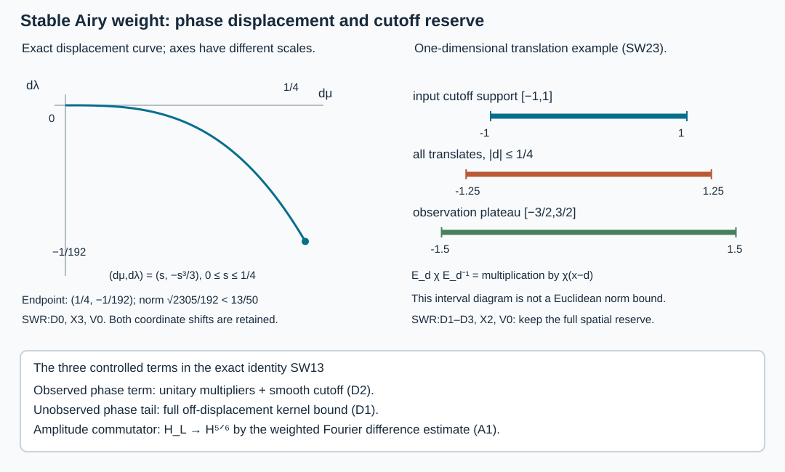

# Recovering the stable weight of actual Airy solutions

Independent exposition, proofs, exercises and illustration: GPT-6 Astra (OpenAI), Ultra, 10–11 October 2026. CC0-1.0.

The [actual matching theorem](../20261010-airy-solution-matching/matching-an-energy-solution-to-airy-kernels.md) constructs a decaying coefficient in \(H^{5/6}\), a boundary coefficient in the layer space \(\mathcal H_L\), and a tangentially regular residual. It also recovers the oscillating coefficient locally, but leaves open whether a suitable spatially localized boundary coefficient has the full stable energy weight. We prove that missing implication and preserve the match to the original solution.

The mechanism is an exact phase-amplitude factorization. The phase multiplier is unitary on every Sobolev space. Its finite input displacement is handled by nested spatial supports. The amplitude commutator gains precisely enough regularity from the known layer norm. No inverse of an exponentially decaying amplitude is used.

Melrose and Taylor's [*Boundary Problems for Wave Equations With Grazing and Gliding Rays*, §§5.3–5.4 and 6.3–6.5](https://mtaylor.web.unc.edu/wp-content/uploads/sites/16915/2018/04/glide.pdf) supplies primary background for Airy multipliers and their propagation. The exact scalar bounds, earlier kernel arguments and programme dependencies used here are identified in the proof map. Its human foundation providers remain external; internal P514 closure of this export is unclaimed.

## 1. Two summands of one norm

**H0. Global auxiliary weights and the receiving solution.** Retain SAL:H0's real smooth ordinary symbols \(\ell,m\in S^1\), with \(\ell\asymp\langle\eta\rangle\), \(\ell\ge c>0\), \(|m|\le C\ell\). They equal \(\lambda,\mu\) on the actual phase cone. Put
\[
 b=-m\ell^{-1/3},\qquad
 L=\ell^{4/3}\langle b\rangle^{-1/2},\qquad
 Z_\epsilon=\frac{c_\epsilon}{F_\epsilon(b)},\qquad
 w=\ell^{5/3}|F_\epsilon(b)|^{-2}+L .
 \tag{SW1}
\]
Here \(c_\epsilon=\sqrt\pi e^{i\epsilon\pi/4}\), \(F_\epsilon=c_\epsilon(\operatorname{Ai}-i\epsilon\operatorname{Bi})\), and \(\epsilon=\pm1\). The squared weighted norm is the integral of the weight times \(|\widehat v|^2\), with factor \((2\pi)^{-d}\). Because \(|F_+|=|F_-|\), the space \(\mathcal H_w\) is the same for both signs. BLT:C0 proves the identity of nonnegative extended integrals
\[
 \|v\|_{\mathcal H_w}^2
 =\pi^{-1}\|\ell(D)^{5/6}Z_\epsilon(D)v\|_2^2+
                                      \|v\|_{\mathcal H_L}^2 .
 \tag{SW2}
\]
It does not require prior finiteness of the left side.

For the application use the exact strict diffractive scalar-principal matrix problem ASM:H0. In normalized coordinates \(P=D_q^2-R\), with real quadratic principal symbol \(\rho^2-r\) and arbitrary complex lower matrices. The actual \(u\in H^1\), \(Pu\in L^2\), has source in all tested tangential \(L^2H^s\) orders on one fixed larger region. No physical-time or homogeneous-boundary hypothesis is added.

## 2. Remove the oscillation without losing the weight

**A0. The amplitude has a stronger first derivative estimate.** Choose smooth real \(p(t)\) equal to \(2(-t)^{3/2}/3\) for \(t\le-2\), and zero for \(t\ge-1\). Define
\[
 \sigma(\eta)=p(b(\eta)),\qquad
 E_\epsilon=e^{-i\epsilon\sigma(D)},\qquad
 a_\epsilon(t)=e^{i\epsilon p(t)}c_\epsilon/F_\epsilon(t).
 \quad Z_\epsilon(D)=E_\epsilon a_\epsilon(b(D)).
 \tag{SW3}
\]
ABQ:B2–B4 gives
\[
 |a_\epsilon^{(j)}(t)|\le C_j\langle t\rangle^{1/4-j}
 \quad(t\le0),\qquad
 |a_\epsilon^{(j)}(t)|\le C_{j,M}\langle t\rangle^{-M}
 \quad(t\ge0,\ M\ge0).
 \tag{SW4}
\]
To verify the first bound on the negative ray, write
\(F_\epsilon(-s)=s^{-1/4}e^{i\epsilon2s^{3/2}/3}M_\epsilon(2s^{3/2}/3)\).
The full differentiated expansion is \(M_\epsilon=1+S^{-1}\); it is bounded away from zero for large \(s\). Differentiate its reciprocal by the identity \(M_\epsilon M_\epsilon^{-1}=1\), inductively. Composing with \(2s^{3/2}/3\) gives the symbol \(s^{1/4}/M_\epsilon\) and each \(s\)-derivative lowers its order by one. On the positive ray the reciprocal of \(F_\epsilon\) is an exponentially decreasing factor times a symbol of order \(1/4\), with all differentiated estimates. Every polynomial introduced by differentiation is absorbed by that exponential. The remaining compact intervals are smooth and have nonzero denominator. This proves SW4 including the transition.

The auxiliary symbol estimates give
\[
 |\nabla_\eta b|\le C\ell^{-1/3},\qquad
 |\nabla_\eta a_\epsilon(b)|\le
                  C\ell^{-1/3}\langle b\rangle^{-3/4}.
 \tag{SW5}
\]
Indeed \(\nabla b=-\ell^{-1/3}\nabla m+(m/3)\ell^{-4/3}\nabla\ell\), and both gradients on the right are bounded. The chain rule and SW4 with \(j=1\) prove the second bound. Also \(|a_\epsilon(b)|=|Z_\epsilon|\le C\ell^{1/6}\), since \(|b|\le C\ell^{2/3}\). Thus
\[
 \|Z_\epsilon v\|_{H^{1/3}}\le C\|v\|_{\mathcal H_L}.
 \tag{SW6}
\]
Here \(L\ge c\ell\), and the ordinary \(H^{1/3}\) weight is equivalent to \(\ell^{1/3}\). The real phase makes \(E_\epsilon\) unitary on each \(H^s\) by Plancherel, with inverse \(e^{i\epsilon\sigma(D)}\). Its smooth polynomial derivative bounds also make both multipliers continuous on Schwartz functions and tempered distributions.

**A1. The spatial commutator is controlled by the layer norm.** For \(\chi\in C^\infty_c\),
\[
 [a_\epsilon(b(D)),\chi]:\mathcal H_L\longrightarrow H^{5/6}
 \quad\hbox{boundedly}.
 \tag{SW7}
\]
Here is the full Fourier proof. Write \(a(\eta)=a_\epsilon(b(\eta))\), \(h=\eta-\nu\), and \(\tau=\nu+th\), \(0\le t\le1\). The weighted commutator kernel is, apart from the fixed Fourier constant,
\[
 \ell(\eta)^{5/6}\,[a(\eta)-a(\nu)]\,
                          \widehat\chi(h)L(\nu)^{-1/2}.
 \tag{SW8}
\]
The mean value formula gives
\(a(\eta)-a(\nu)=\int_0^1h\cdot\nabla a(\tau)\,dt\).
For any two points on this segment, the ratios of their positive \(\ell\)'s are bounded by \(C\langle h\rangle\). Also \(\nabla b\) is bounded, so
\(\langle b(\nu)\rangle/\langle b(\tau)\rangle\le C\langle h\rangle\).
Consequently SW5 gives, uniformly in \(t\),
\[
 \ell(\eta)^{5/6}|\nabla a(\tau)|L(\nu)^{-1/2}
 \le C\langle h\rangle^{7/4}
                 \ell(\tau)^{-1/6}\langle b(\tau)\rangle^{-1/2}
 \le C'\langle h\rangle^{7/4}.
 \tag{SW9}
\]
The exponent is \(5/6+2/3+1/4=7/4\); it accounts for both frequency-weight ratios and the Airy-variable ratio. Thus SW8 is dominated by
\(C|h|\langle h\rangle^{7/4}|\widehat\chi(h)|\), an integrable convolution kernel. The scalar convolution bound, applied to the finite vector norm, proves SW7. It treats widely separated frequencies as well as comparable ones. Start with Schwartz data and pass to the weighted completion by BLT:H1's density and the distributional multiplier bounds. The extension agrees with the actual commutator in tempered distributions.

## 3. Control the phase displacement on the complete kernel

**D0. Choose the cone after the spatial margin.** Fix compact \(\operatorname{supp}\chi\) inside a region where a smooth \(\psi\) equals one. Let their distance to \(\operatorname{supp}(1-\psi)\) be \(d_*>0\). Choose a working cone \(|\mu|/\lambda<\delta\), \(\lambda>R_0\), and an ordinary multiplier \(\Omega_1\) supported in it. AWR:S1 proves on this support
\[
 |\nabla\sigma|\le C\sqrt\delta+CR_0^{-1/3},\qquad
 |\partial_\eta^\gamma\sigma|
       \le C_\gamma\langle\eta\rangle^{-|\gamma|/3}
                         \quad(|\gamma|\ge2).
 \tag{SW10}
\]
For clarity, on \(b\le-2\) the first derivatives are exactly
\(\partial_\mu\sigma=\sqrt{\mu/\lambda}\),
\(\partial_\lambda\sigma=-(\mu/\lambda)^{3/2}/3\), and
\(\partial_{\eta'}\sigma=0\). On the compact \(b\) transition they are \(O(\lambda^{-1/3})\); on the rest they vanish. The differentiated chain rule yields the higher bounds in SW10. Choose \(\delta,R_0\) to make the first bound less than \(d_*/2\).

**D1. The inverse phase has a smooth off-displacement kernel.** For every real \(s\),
\[
 \chi E_\epsilon^{-1}\Omega_1(D)(1-\psi):L^2\longrightarrow H^s
 \quad\hbox{boundedly}.
 \tag{SW11}
\]
The kernel has phase \((x-z)\eta+\epsilon\sigma(\eta)\). For \(x\in\operatorname{supp}\chi\), \(z\in\operatorname{supp}(1-\psi)\), its frequency gradient has length at least \(d_*/2\), and for large \(|z|\) is comparable to \(1+|z|\). Integrate repeatedly in \(\eta\) with the vector field
\((x-z+\epsilon\nabla\sigma)\cdot\partial_\eta/(i|x-z+\epsilon\nabla\sigma|^2)\).
An amplitude derivative gains at least one ordinary order. A derivative of a vector-field coefficient contains a second or higher derivative of \(\sigma\), so SW10 gives at least a \(1/3\) gain in the general repeated-product count. Iteration after any fixed \(x,z\) derivatives gives arbitrary frequency decay and arbitrary inverse powers of \(1+|z|\). This is AWR:S2's full integration argument with the input and output supports interchanged; its sign is immaterial.

Insert a compact frequency truncation first. More integrations make all differentiated boundary terms tend to zero. The limiting kernel and all its \(x\)-derivatives are square-integrable in \((x,z)\), since \(x\) is compact and \(z\) has arbitrary decay. Cauchy–Schwarz gives \(L^2\to H^k\) for every integer \(k\), hence SW11 for every real \(s\). This proves a global norm bound on the omitted input, not just a wavefront inclusion.

**D2. A localized weighted recovery theorem.** Suppose \(v_2\in\mathcal H_L\) has Fourier support where \(\Omega_1=1\), and \(\psi Z_\epsilon v_2\in H^{5/6}\). Then
\[
 \|\chi v_2\|_{\mathcal H_w}
 \le C\bigl(\|\psi Z_\epsilon v_2\|_{H^{5/6}}
                                    +\|v_2\|_{\mathcal H_L}\bigr).
 \tag{SW12}
\]
Put \(f=Z_\epsilon v_2\), so \(f=\Omega_1f\) and \(f\in L^2\) by SW6. The exact identity in tempered distributions is
\[
 Z_\epsilon\chi v_2
  =E_\epsilon\chi E_\epsilon^{-1}f+
           E_\epsilon[a_\epsilon(b(D)),\chi]v_2 .
 \tag{SW13}
\]
The second term belongs to \(H^{5/6}\) by SW7 and unitarity. In the first insert
\(\Omega_1[\psi f+(1-\psi)f]\) before \(E_\epsilon^{-1}\). The first resulting term is bounded in \(H^{5/6}\) by unitarity, the bounded multiplier \(\Omega_1\), and smooth multiplication by \(\chi\). The second is bounded by SW11 and SW6. Finally \(\chi v_2\in\mathcal H_L\) by BLT:L0. The extended integral identity SW2 proves SW12. There is no approximation requiring prior \(\mathcal H_w\) membership.

**D3. Receive an ordinary microlocal observation.** Let \(B_0\in\Psi^0\) be elliptic near an input glancing covector \((x_0,\eta_0)\), and suppose \(B_0Z_\epsilon v\in H^{5/6}\), with \(v\in\mathcal H_L\). Choose \(\psi,\chi\) in its base patch, \(\chi=1\) near \(x_0\), and nested angular multipliers \(\Omega,\Omega_1\), equal to one near \(\eta_0\), with \(\Omega_1=1\) on \(\operatorname{supp}\Omega\). Shrink the cone and increase the low-frequency threshold after these spatial margins are fixed, as in D0.

Full ordinary elliptic inversion gives
\(\psi\Omega(D)Z_\epsilon v\in H^{5/6}\): its parametrix error maps the known global \(H^{1/3}\) input from SW6 into every local Sobolev space. Proper input cutoffs and their complete smoothing remainders are retained. Take \(v_2=\Omega(D)v\). SW12 and bounded Fourier multiplication now give
\[
 v_{\rm new}=\Omega_1(D)\chi\,\Omega(D)v\in\mathcal H_w .
 \tag{SW14}
\]
Its precursor \(\chi\Omega(D)v\) is compact and belongs to \(\mathcal H_w\). The difference \(v-v_{\rm new}\) is ordinarily microlocally smooth near \((x_0,\eta_0)\): the nested ordinary cutoff product equals the identity there modulo its complete smooth error. The removed bounded frequencies are smooth and included in that error. This assertion concerns the same coefficients as in the hypothesis, rather than new data selected by a boundary condition.

## 4. Preserve the match on a general scalar-principal collar

**K0. The kernel estimate needs the phase contract, not a physical clock.** We prove the receiving version of AWT:W1–W5 for the general CAA/ADT phase contract in ASM:H0. The relevant hypotheses are
\(\theta_b=S\), \(\zeta_b=b\), \(b-\zeta=q\lambda^{2/3}d_0\) with \(d_0>0\), the actual symbol bounds for \(g,h\), and the ADT distributional domain. They hold for the normalized general scalar-principal matrix equation. No step below uses a Lorentzian tangential form or \(p(dt)<0\).

Set \(a=\zeta\) temporarily, and use smooth cutoffs \(\chi_0+\chi_1=1\), with \(\chi_0=0\) on \((-\infty,-2]\), \(\chi_0=1\) on \([-1,\infty)\). The normalized kernel splits exactly into three phases
\[
 \theta,\qquad \theta+\epsilon\psi_-(a),\qquad
 \theta+\epsilon[\psi_-(a)-\psi_-(b)],
 \qquad \psi_-(t)=\tfrac23(-t)^{3/2},
 \tag{SW15}
\]
on respective amplitude supports
\(\chi_0(a)\), \(\chi_1(a)\chi_0(b)\), \(\chi_1(a)\chi_1(b)\).
In the last two pieces extract the exact negative-ray exponentials of \(F_\epsilon\) and \(F_\epsilon'\); in the third also extract that of the denominator. Each phase is used only where its powers are smooth. The sum is the original kernel, including all transition terms.

**K1. Full derivative bounds at the face.** On \(\lambda\asymp R\), the three amplitudes satisfy
\[
 |\partial_q^k\partial_y^\alpha\partial_\eta^\beta A_j|
       \le C R^{k+2|\alpha|/3-|\beta|/3},
 \qquad
 q^M|\partial_q^k\partial_y^\alpha\partial_\eta^\beta A_0|
       \le C R^{k-2M/3+2|\alpha|/3-|\beta|/3}.
 \tag{SW16}
\]
Here is the receiving derivation, including the boundary layer. Put \(\Delta=b-a=qR^{2/3}d_0\). For \(a\ge1\) the Airy ratio is an ordinary symbol ratio times
\(\exp(-E)\), with \(E=\frac23[b^{3/2}-(b-\Delta)^{3/2}]\ge\Delta\sqrt a\).
At fixed \(\Delta\), derivatives in \(b\) of \(E\) are bounded by a polynomial in \(E\); the same holds for \(\Delta\partial_\Delta\), its iterates, and the symbol ratio. This follows by writing \(E\) as the integral of \(\sqrt{b-s}\) over \(0\le s\le\Delta\), with \(a\ge1\). Every polynomial is absorbed by \(\exp(-E)\). A frequency derivative of \(b\) costs at most \(R^{-1/3}\); a logarithmic derivative of \(\Delta\) costs \(R^{-1}\). Normal differentiation costs at most \(R\), including the possible factor \(\sqrt a\). The \(hF'\) term's initial square-root factor is canceled by the order \(-1/3\) of \(h\).

For bounded \(a\), bounded \(b\) gives smooth factors, while unbounded positive \(b\) gives exponential decay from the denominator. The identity \(q^M\le C R^{-2M/3}\Delta^M\) supplies the second estimate. In the third piece \(a\le b\le-1\); the undifferentiated ratio is bounded by \(C((-b)/(-a))^{1/4}\le C\). Each Airy-variable derivative improves its negative-ray order by one. In the second piece the inverse denominator and its derivatives are bounded, with rapid decay on fixed negative input cones \(\mu/\lambda\le-\delta\). These arguments and the product rule prove the first estimate and all mixed bounds. Cutoff derivatives obey the same counts.

For each phase \(\varphi\) in SW15, the normalized gradients satisfy
\[
 |\partial_y^\alpha\partial_\eta^\beta(R^{-1}\varphi_y)|
 +|\partial_y^\alpha\partial_\eta^\beta\varphi_\eta|
       \le C R^{2|\alpha|/3-|\beta|/3}.
 \tag{SW17}
\]
This is the differentiated chain rule for \((-a)^{3/2}\) on \(-a\ge1\): one derivative of the power costs at most \(R^{1/3}\); two or more derivatives have nonpositive powers controlled by \(-a\ge1\). The denominator phase has no base derivative. A fixed number of normal derivatives of the complete integrand produces only a finite new initial amplitude order, with the same tangential/frequency increments. ADT:D4's fixed tangential vector has \(T\varphi\ge cR\) after shrinking the collar; this excludes a zero output tangential covector. Its proof uses \(\theta_b=S\), nonzero \(S_y\), and \(\zeta_y=O(qR^{2/3})\), so it has the present generality.

**K2. Uniform boundary microlocality.** Let a finite-order tempered input \(h\) be ordinarily microlocally smooth on an open input patch. Then on the corresponding smaller boundary graph patch there is one \(q_*>0\) such that, for every supported tangential test \(B\),
\[
 B K_\epsilon h\in C^\infty([0,q_*)\times Y).
 \tag{SW18}
\]
Use compact input localization first. The Fourier transform of a localized shell kernel in \((y,z)\) has phase
\(\varphi(q,y,\eta)-z\eta-y\xi+z\nu\).
Away from its limiting stationary set, one of
\(|\nu-\eta|\ge cR\), \(|\varphi_y-\xi|\ge cR\), or
\(|\varphi_\eta-z|\ge c\) holds on a finite partition. Integration respectively in \(z,y,\eta\), with the corresponding normalized phase-gradient field, gains at least \(R^{-1/3}\) each time by SW16–SW17. The quotient rule gives the same count for derivatives of those fields and of the partition. After any fixed normal derivatives the initial order is finite, so more integrations absorb that order, the frequency dimension and every requested Fourier weight. External frequencies not comparable to \(R\) use the first or second gradient; the lower bound for \(T\varphi\) treats small output tangential frequencies. Dyadic summation is then absolutely convergent. This proves complete smooth kernel bounds on separated pieces.

At \(q=0\) the limiting relation is exactly
\((S_\eta(y,\eta),\eta)\mapsto(y,S_y(y,\eta))\).
In the third phase, the actions cancel at the face. Their first frequency-derivative difference is \(O(\sqrt q)\) on \(\mu/\lambda\ge0\), by
\(|\sqrt{v+qd_0}-\sqrt v|\le C\sqrt q\); their normalized base-derivative difference is \(O(q\sqrt{v+q})\). In the second phase only the limiting input direction \(v=\mu/\lambda=0\) can be singular in the interior. The same first-derivative limits hold there. The remaining fixed negative input cones are uniformly rapidly decreasing by the denominator estimate in K1. The first phase tends to \(S\) directly.

Thus a smaller closed output cone has a fixed positive separation from singular input pieces on one collar \(0\le q<q_*\). Neither this separation nor the collar changes with derivative order. On regular input pieces, the localized input Fourier transform already has arbitrary decay. On all other pieces use the complete kernel bounds just proved and pair with the polynomial input Fourier bound. Insert a general tester's Fourier kernel; ordinary frequency-separation estimates retain all its lower terms. This gives SW18 after all normal derivatives. ADT's actual smooth normal distributional family identifies their boundary values.

Finally, for noncompact tempered data insert a compact input cutoff around all possible \(\varphi_\eta\) over the compact output chart and reduced sphere. Outside it the third gradient is separated and comparable to \(1+|z|\) for large \(|z|\). The same integrations give arbitrary decay in \(z\), with every output derivative uniformly up to the face. Pairing with a fixed negative Sobolev norm, or the known global \(L^2\) norm in our application, controls this tail. Hence SW18 holds for the actual noncompact Fourier-projected coefficients as well.

## 5. The full local weighted representation

**R0. Apply the estimates to the actual matched solution.** ASM:R0 provides
\(u=T_A\alpha+K_+v+e\), with \(\alpha\in H^{5/6}\), \(v\in\mathcal H_L\), compact precursors, and \(\chi e\in\mathcal X_s\) for every \(s\) on a fixed accessible region. Choose a fixed interior slice inside that region and then a smaller input cone. IAR:N2 and the exact identity \(K_+=T_+Z_+\) give an ordinary elliptic input test \(B_0\) such that
\[
 B_0Z_+v\in H^{5/6}.
 \tag{SW19}
\]
Indeed the positive extractor applied to \(u\) lies in \(H^{5/6}\); its application to \(e\) is smooth on its supported ordinary cap; and its distributional identity gives \(B_0(\alpha+2Z_+v)\) modulo a full smooth coarse error. The already regular \(\alpha\) can be subtracted. All observations are fixed inside the accessible region before orders are taken.

Choose the spatial margins inside this \(B_0\) patch and the new cone and threshold as in D3. It gives \(v_{\rm new}\in\mathcal H_w\), with a compact weighted precursor. Since \(v-v_{\rm new}\) is microlocally smooth near the marked input, K2 makes \(K_+(v-v_{\rm new})\) smooth after the required tangential tests on a fixed smaller collar. Therefore
\[
 u=T_A\alpha+K_+v_{\rm new}+e_{\rm new},\qquad
 \alpha\in H^{5/6},\quad v_{\rm new}\in\mathcal H_w,\qquad
 \chi e_{\rm new}\in\mathcal X_s\quad(s\in\mathbb R).
 \tag{SW20}
\]
The actual value and first normal traces of \(e_{\rm new}\) are smooth there. SAL:C1 now supplies the full forward \(H^1\) construction for the coefficient pair. Its source and traces have their original distributional meanings; no new weak solution is substituted. The decaying coefficient is unchanged. If it needs a smaller Fourier cone in a displayed common kernel formula, retain the discarded original decaying field separately until its actual microlocal relation is checked; no such extra restriction is needed for SW20.

**R1. The actual enhanced value trace and scope.** On the same input patch, the actual boundary inverse satisfies
\[
 G\gamma u=A(b(D))\alpha+v_{\rm new}+\text{smooth},
 \qquad G\gamma u\in\mathcal H_w\text{ microlocally}.
 \tag{SW21}
\]
For the last assertion, apply any proper ordinary order-zero test supported in a smaller input patch. SAL:C2 proves \(w|A(b)|^2\le C\ell^{5/3}\), so the first coefficient is in \(\mathcal H_w\). The second is in that space by SW14. SAL:M1 bounds the input test, and the full graph remainder maps finite-order compact data into every Sobolev space. This proves the stated microlocal membership for the actual value trace. It does not claim invariance of the scalar weight under an arbitrary canonical change.

SW20 and SW21 finish the local strict diffractive stable-weight representation and enhanced value-trace membership for the stated source class. They do not provide a global decomposition in all complementary regimes, the general-manifold scalar observation assembly, or completion of the entire course. Nor does a merely tangentially regular source make the residual smooth in every normal derivative; ASM:X3 remains applicable. A quantitative uniform norm theorem must keep its exact source norms and support constants.

## 6. Three solved exercises

**X1. Check the weight saved by the amplitude derivative.** Compute the local ratio in SW9 when all frequencies are the same, and the polynomial loss when they are separated.

**Solution.** At one frequency,
\[
 \frac{\ell^{5/6}\ell^{-1/3}\langle b\rangle^{-3/4}}
             {\ell^{2/3}\langle b\rangle^{-1/4}}
       =\ell^{-1/6}\langle b\rangle^{-1/2}.
 \tag{SW22}
\]
It is bounded globally. Comparing the two \(\ell\) ratios costs \(5/6+2/3\), and comparing the bracket ratio costs \(1/4\), giving \(7/4\). The mean value formula supplies one additional \(|h|\). Any Schwartz bound on \(\widehat\chi(h)\) of order greater than \(d+11/4\) makes the resulting convolution majorant integrable. This verifies exactly the Schur estimate rather than treating \(a\) as an arbitrary symbol of order \(1/6\).

**X2. A phase cutoff is a transported cutoff.** In one dimension set \(E_d=e^{-idD}\), with \(d\in\mathbb R\). Compute \(E_d\chi E_d^{-1}\), and determine where its cutoff is supported.

**Solution.** Fourier inversion gives \(E_df(x)=f(x-d)\). Hence
\[
 E_d\chi E_d^{-1}f(x)=\chi(x-d)f(x).
 \tag{SW23}
\]
The support is \(\operatorname{supp}\chi+d\). If \(\operatorname{supp}\chi\subset[-1,1]\) and \(|d|\le1/4\), it lies in \([-5/4,5/4]\). A function \(\psi=1\) on \([-3/2,3/2]\) covers it with a positive margin. Replacing the transported cutoff by \(\chi(x)\) is generally false, even when the amplitude is the constant one and its commutator is zero.

**X3. Exact Airy displacement and its size.** On the negative Airy ray let \(v=\mu/\lambda\in[0,1/16]\). Compute both nonzero components of \(\nabla\sigma\) and an exact upper bound for its Euclidean norm.

**Solution.** The components are \((\sqrt v,-v^{3/2}/3)\), so the squared norm is \(v+v^3/9\), increasing on this interval. Therefore
\[
 |\nabla\sigma|\le \frac{\sqrt{2305}}{192}<\frac{13}{50}.
 \tag{SW24}
\]
At \(v=1/16\) the components are \(1/4,-1/192\). The strict rational upper bound follows by squaring positive quantities. Thus a spatial separation larger than \(13/25\) suffices for the negative-ray part of D0; the compact transition also requires the stated large-frequency threshold. The bound does not assume that the second component is zero.

## 7. The displacement and the support reserve

**V0. Exact plotted objects.** The left panel is the parametric curve
\((d_\mu,d_\lambda)=(s,-s^3/3)\), \(0\le s\le1/4\), with its endpoint \((1/4,-1/192)\). The coordinate axes have separately labelled scales. The right panel shows the exact intervals of X2: the input cutoff \([-1,1]\), all possible translated supports within \([-5/4,5/4]\), and the observation plateau \([-3/2,3/2]\). It is a one-dimensional support example, not a replacement for the Euclidean norm bound SW24. The final row records the three analytic terms of SW13 with their proof locators.
