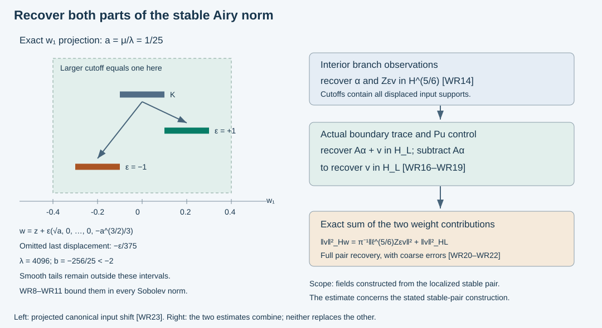

# Weighted recovery of localized Airy fields

The interior extraction theorem controls the decaying coefficient and an Airy multiplier of the normalized coefficient. The boundary-layer trace theorem supplies a different part of the energy norm. We combine them into a reverse estimate for the actual variable-coefficient Airy construction.

The support issue matters: the Airy multiplier moves input singularities, so it cannot be passed through a spatial cutoff without proof. We bound that displacement, control the complete off-support kernels, and choose the observation supports around all the displaced inputs. The resulting estimate recovers the full stable pair norm from the energy field, up to explicit coarse norms.

The primary background is Melrose and Taylor, [*Boundary Problems for Wave Equations With Grazing and Gliding Rays*, §§6.3–6.5 and 7.3](https://mtaylor.web.unc.edu/wp-content/uploads/sites/16915/2018/04/glide.pdf). Their construction and justification motivate the question. The proof here uses the exact programme Airy estimates, the already constructed matrix kernels and their actual weak traces. A reverse estimate on their range does not yet show that every energy solution belongs to that range.

## 1. State the pair, the field and all support margins

**H0. Actual kernels and a small input patch.** Use the scalar-principal CAA system, its complex matrix amplitudes, and the SAL stable pair. On the working cone write
\[
 \eta=(\mu,\eta',\lambda),\quad \lambda\asymp\langle\eta\rangle,\quad
 b=-\mu\lambda^{-1/3},\quad
 F_\epsilon=c_\epsilon(A-i\epsilon B),\quad
 Z_\epsilon=\frac{c_\epsilon}{F_\epsilon(b)},\quad \epsilon=\pm1 .
 \tag{WR1}
\]
Here \(A=\operatorname{Ai}\), \(B=\operatorname{Bi}\), \(|c_\epsilon|^2=\pi\). The same matrix amplitudes are used for both scalar signs. Use the global auxiliary frequencies \(\ell,m\) of SAL:H0 for all norms; they agree with \(\lambda,\mu\) on this cone. In particular
\[
 w=\ell^{5/3}|F_\epsilon(b)|^{-2}+L,\qquad
 L=\ell^{4/3}\langle b\rangle^{-1/2},\qquad
 \|v\|_{\mathcal H_w}^2
   =\pi^{-1}\|\ell(D)^{5/6}Z_\epsilon(D)v\|_2^2
       +\|v\|_{\mathcal H_L}^2 .
 \tag{WR2}
\]
The exact identity is BLT:C0, not a comparison of principal symbols.

Choose a compact input set \(K\) inside the common boundary-graph and interior-extraction chart. Fix a small interior slab \(I\) as in IAR:H0. Let \(\omega\in S^0\) be a real smooth Fourier cutoff, supported where
\[
 \lambda\ge R_0,\qquad |\mu|/\lambda<\delta ,
 \tag{WR3}
\]
and in a smaller angular patch. The constants \(\delta>0\) and \(R_0\ge1\) will be fixed below. The available input chart contains a neighborhood of \(K\) with positive distance to its boundary. First make \(\delta\ll\inf I\) sufficiently small, and then \(R_0\) sufficiently large, to fit all the displacements and cutoff margins proved in Section 2 inside that chart. These choices are made once, not as a function of the input or its Sobolev order.

**H1. The precise range on which the estimate is proved.** Take vector distributions \(f_0,f_1\) supported in \(K\), and set
\[
 \alpha=\omega(D)f_0,\qquad v=\omega(D)f_1,\qquad
 U=T_A\alpha+K_\epsilon v .
 \tag{WR4}
\]
For the theorem assume \(\alpha\in H^{5/6}\), \(v\in\mathcal H_w\). SAL:C1 defines \(U\) as an actual \(H^1\) field. The kernel has a fixed compact output cutoff equal to one near all boundary and interior observation inputs used below. All local equation-error estimates are on that inner region. The full differentiated output-cutoff error is retained outside it.

For each \(N\ge0\) for which it is finite, write
\[
 Q_N=\|f_0\|_{H^{-N}}+\|f_1\|_{H^{-N}} .
 \tag{WR5}
\]
Compact distributions admit some finite such norm by the earlier Fourier distribution estimates. The constants below can depend on \(N\), the fixed supports and symbol seminorms. We do not claim a bound for an infinite right-hand norm, or dispense with the coarse term.

## 2. Prove how far the scalar input multipliers can move singularities

**S0. Exact phase extraction on the negative Airy ray.** Choose a smooth real function \(p(t)\) equal to \(2(-t)^{3/2}/3\) for \(t\le-2\), and zero for \(t\ge-1\). Put \(\sigma(\eta)=p(b(\eta))\). On the support of \(\omega\), the exact multipliers have decompositions
\[
 Z_\epsilon(b)=e^{-i\epsilon\sigma}a_\epsilon,\qquad
 A(b)=e^{i\sigma}a_++e^{-i\sigma}a_-+a_0,
 \tag{WR6}
\]
where, after multiplication by any of our ordinary angular cutoffs,
\[
 |\partial_\eta^\gamma a_\epsilon|
       \le C_\gamma\langle\eta\rangle^{1/6-|\gamma|/3},
 \qquad
 |\partial_\eta^\gamma a_j|
       \le C_\gamma\langle\eta\rangle^{-|\gamma|/3}
       \quad(j=+,-,0).
 \tag{WR7}
\]
The symbols \(a_\pm\) in the second expression are not \(a_\epsilon\) in the first.

Here are exact constructions and the derivative proof. ABQ:B2 gives
\(F_+(-s)=s^{-1/4}e^{2is^{3/2}/3}m(2s^{3/2}/3)\), with the full differentiated symbol expansion and nonzero \(m\) for large \(s\). Its conjugate gives \(F_-\). Thus
\(a_\epsilon=e^{i\epsilon\sigma}c_\epsilon/F_\epsilon(b)\)
is a symbol of order \(1/4\) in \(-b\) on that ray. A negative-ray cutoff and the exact identity
\(A=(F_+/c_++F_-/c_-)/2\)
give \(a_+,a_-\) of order \(-1/4\) in \(-b\). Let \(a_0\) contain the complementary compact transition and positive-ray part of \(A\). On the positive ray both \(A\) and \(1/F_\epsilon\) decay exponentially with all derivatives up to polynomial factors, by ABQ:B4. They therefore have bounded derivatives of every fixed order there. On the remaining compact interval all factors are smooth and \(F_\epsilon\) is nonzero.

To verify WR7 after composition, use
\(|b|\le C\langle\eta\rangle^{2/3}\) and
\(|\partial^\gamma b|\le C_\gamma\langle\eta\rangle^{2/3-|\gamma|}\).
In a derivative of total order \(n\), a term with \(j\) Airy-variable derivatives costs at most \(\langle\eta\rangle^{2j/3-n}\). For the negative-ray inverse amplitude its zeroth derivative is \(O(\langle\eta\rangle^{1/6})\); every positive Airy-variable derivative is bounded because its exponent \(1/4-j\) is negative. Since \(j\le n\), the claimed weaker bound follows. For the decaying amplitudes all those derivatives are bounded, giving the second inequality. Ordinary cutoff derivatives improve these estimates.

**S1. A uniform small bound for the phase gradient.** On the same support,
\[
 |\nabla_\eta\sigma|\le C\sqrt\delta+C R_0^{-1/3},
 \qquad
 |\partial_\eta^\gamma\sigma|
       \le C_\gamma\langle\eta\rangle^{-|\gamma|/3}
       \quad(|\gamma|\ge2).
 \tag{WR8}
\]
Where \(b\le-2\), set \(a=\mu/\lambda>0\). There
\[
 \sigma=\tfrac23\mu^{3/2}\lambda^{-1/2},\qquad
 \partial_\mu\sigma=\sqrt a,\qquad
 \partial_\lambda\sigma=-\tfrac13a^{3/2},\qquad
 \partial_{\eta'}\sigma=0 .
 \tag{WR9}
\]
The first estimate follows there from \(a<\delta\). On the compact \(b\) transition the chain rule gives \(O(\lambda^{-1/3})\); elsewhere the phase vanishes. For a derivative of order \(n\ge2\), the term with one derivative of \(p\) is bounded by
\(C\langle\eta\rangle^{1-n}\). Terms with \(j\ge2\) derivatives of \(p\) have a bounded \(p^{(j)}\), and hence bound \(C\langle\eta\rangle^{2j/3-n}\le C\langle\eta\rangle^{-n/3}\). Also \(1-n\le-n/3\) for \(n\ge2\). This proves the second estimate, including the transition.

**S2. Off-displacement kernels are fully smoothing.** Fix \(r>0\) smaller than the available chart margin. Choose \(\delta,R_0\) so that the first bound in WR8 is at most \(r/4\). If \(\chi\) equals one on the closed \(r/2\)-neighborhood of \(K\), then, for every real \(s\) and finite \(N\),
\[
 \|(1-\chi)Z_\epsilon(D)\omega(D)f\|_{H^s}
  +\|(1-\chi)A(b(D))\omega(D)f\|_{H^s}
  +\|(1-\chi)\omega(D)f\|_{H^s}
       \le C_{s,N}\|f\|_{H^{-N}},\quad \operatorname{supp}f\subset K .
 \tag{WR10}
\]
This statement includes the entire off-support kernels, not only their wavefront relations.

For each term of WR6 its convolution kernel has phase
\((w-z)\cdot\eta+\tau\sigma(\eta)\), \(\tau=0,\pm1\), and amplitude of the class in WR7. If \(z\) lies in a slightly larger compact neighborhood of \(K\) and \(w\) lies in the support of \(1-\chi\), shrink that neighborhood so that the phase gradient has length at least a positive constant. For large \(|w|\) it is comparable to \(1+|w|\). Integrate in \(\eta\) with
\[
 \mathcal L=
  \frac{(w-z+\tau\nabla\sigma)\cdot\partial_\eta}
       {i|w-z+\tau\nabla\sigma|^2},\qquad
 \mathcal L e^{i((w-z)\cdot\eta+\tau\sigma)}
       =e^{i((w-z)\cdot\eta+\tau\sigma)} .
 \tag{WR11}
\]
Each integration by parts lowers the amplitude order by at least \(1/3\). A derivative falling on the amplitude has this gain by WR7; a derivative of a coefficient of \(\mathcal L\) contains a second or higher derivative of \(\sigma\), whose gain is at least \(2/3\). Differentiating repeatedly gives the same induction using WR8. Arbitrary \(w,z\) derivatives introduce only a fixed polynomial frequency loss and extra inverse-distance factors. More integrations absorb both that loss and the frequency dimension. Thus every differentiated kernel is bounded and decreases faster than any power of \(|w|\) on the separated set.

One can insert a frequency cutoff first. Its boundary derivative terms tend to zero after sufficiently many integrations by parts, proving the stated kernel for the distributional oscillatory integral. Multiply the input kernel by a compact function equal to one near \(K\). Its \(H^N_z\) seminorms, and those of every output derivative, have arbitrary output decay. The \(H^{-N},H^N\) pairing bounds the output derivatives; integration in \(w\) gives every integer Sobolev estimate, and an integer above \(s\) gives WR10. The zero phase term proves the assertion for \(\omega(D)\). There has been no commutation of \(Z_\epsilon\) with \(\chi\).

## 3. Recover the oscillating part of the coefficient norm

**I0. Enlarge the extraction cutoff around every shifted input.** Choose \(\chi_2\) compactly supported in the common input chart, equal to one near the \(r/2\)-neighborhood of \(K\). Choose an ordinary angular cutoff \(\omega_2=1\) near \(\operatorname{supp}\omega\), whose support lies in the IAR elliptic patch. Use
\[
 B_0=\chi_2(w)\omega_2(D)
 \tag{WR12}
\]
as the cutoff in IAR:N1. The fixed branch observations may be enlarged within their coordinate patches to contain every input in this compact support; after reducing the cone and slab their full output covector images remain separated by IAR:B1.

The three functions \(\alpha,Z_\epsilon v,A(b(D))\alpha\) have frequency support in \(\operatorname{supp}\omega\). Hence \(B_0\alpha=\chi_2\alpha\) and \(B_0Z_\epsilon v=\chi_2Z_\epsilon v\) exactly. WR10 controls both omitted tails in every Sobolev norm by \(Q_N\).

The raw branch coefficients on the interior slab are
\[
 f_{-\epsilon}=\alpha,\qquad
 f_\epsilon=\alpha+2Z_\epsilon v .
 \tag{WR13}
\]
Their coarse norms needed by IAR are controlled by \(Q_N\): \(|Z_\epsilon|\le C\langle\eta\rangle^{1/6}\) by WR7, so \(H^{-N-1}\) suffices for both branch coefficients. The convolution tails in WR10 justify compact input reduction for the IAR identities; their full smooth remainders retain the same coarse bounds.

**I1. Interior energy controls the complete multiplier norm.** Apply IAR:N2 at \(r=1\), first with the common \(B_0\), then use WR10 and WR13. The extraction operators and all supports are fixed. Thus
\[
 \|\alpha\|_{H^{5/6}}
       +\|Z_\epsilon(D)v\|_{H^{5/6}}
 \le C\|\chi_{\rm int}U\|_{H^1}+C_N Q_N .
 \tag{WR14}
\]
Here \(\chi_{\rm int}\) equals one on all interior observation inputs. The identity
\(2Z_\epsilon v=f_\epsilon-f_{-\epsilon}\)
is used after applying the same linear \(B_0\), and the off-support tails are estimated afterwards. This keeps the correct order of every operator. In particular, no exponentially growing inverse Airy multiplier occurs in WR14.

## 4. Recover the boundary-layer part

**B0. The actual boundary row, with complete localized errors.** Put
\[
 t=A(b(D))\alpha+v .
 \tag{WR15}
\]
SAL:C2 gives the actual value trace \(U_b=Jt\) on the inner physical boundary patch. Let \(G\) be the properly localized inverse boundary graph. Choose a physical boundary cutoff \(\psi\) equal to one on the corresponding larger graph image. With a cutoff \(B_1=\chi_1(w)\omega_1(D)\) supported inside that patch and equal to one near the displaced input set, ABI:B1–B3 give
\[
 B_1G(\psi U_b)=B_1t+Rt,\qquad
 \|Rt\|_{\mathcal H_L}\le C_N Q_N .
 \tag{WR16}
\]
Here \(\chi_1=1\) near \(K\) and \(\omega_1=1\) near \(\operatorname{supp}\omega\); all base and angular margins are nested.

To check the coarse assertion, \(A(b)\) is bounded on the real line, so \(\|t\|_{H^{-N}}\le C Q_N\). Insert a larger compact input cutoff equal to one on the full displaced set. WR10 shows that its omitted part of \(t\) belongs to every global Sobolev space with bounds \(C_{s,N}Q_N\). The ordinary graph bounds control its entire contribution to the smaller outputs. On the retained compact part, the full graph parametrix has a smooth kernel, bounded from \(H^{-N}\) to \(H^{2/3}\subset\mathcal H_L\). Angular leakage from the inserted spatial cutoff is smoothing by SAL:L0, with the same coarse bounds. This proves WR16 without treating a merely principal identity as an exact inverse.

**B1. Apply the equation estimate before subtracting the decaying trace.** BLT:G3 and BLT:L0 give
\[
 \|B_1G(\psi U_b)\|_{\mathcal H_L}
       \le C\bigl(\|U\|_{H^1}+\|\chi_{\rm src}PU\|_2\bigr),
 \tag{WR17}
\]
with the fixed nested physical cutoffs specified there, all inside the region where the original output cutoff equals one for the source term. Spatial commutators used in making this localization are first order and are covered by the displayed energy norm.

The already proved Airy bound SAL:C2 gives
\[
 \|A(b(D))\alpha\|_{\mathcal H_L}
       \le C\|\alpha\|_{H^{5/6}},
 \tag{WR18}
\]
since \(L|A(b)|^2\le w|A(b)|^2\le C\ell^{5/3}\). Ordinary \(B_1\) is bounded on \(\mathcal H_L\) by BLT:L0. Subtract \(B_1A\alpha\) from WR16, use WR17–WR18, and restore the tail \((1-\chi_1)v\) with WR10 for \(\omega\). Because \(\omega_1v=v\) exactly, this yields
\[
 \|v\|_{\mathcal H_L}
  \le C\bigl(\|U\|_{H^1}+\|\chi_{\rm src}PU\|_2
                   +\|\alpha\|_{H^{5/6}}\bigr)+C_NQ_N .
 \tag{WR19}
\]

## 5. The combined estimate and its exact scope

**E0. A full weighted reverse estimate on the constructed range.** Combining WR2, WR14 and WR19 gives
\[
 \boxed{\ 
 \|\alpha\|_{H^{5/6}}+\|v\|_{\mathcal H_w}
 \le C\bigl(\|U\|_{H^1}+\|\chi_{\rm src}PU\|_2\bigr)+C_N Q_N .
 \ }
 \tag{WR20}
\]
All data, cutoffs and source hypotheses are those of H0–H1. The comparison between \(\ell^{5/6}\) and the ordinary \(H^{5/6}\) multiplier is SAL:H0. This proves both weight summands for either physical sign and for the actual variable phases and arbitrary complex lower matrices.

**E1. The source term is coarse for these actual kernels.** In the source region the original output cutoff is constant. GAE:E1 and CAA:A10–A11 give rapidly decreasing equation-error amplitudes for \(T_A\) and the normalized \(K_\epsilon\), after every specified output derivative. Direct Fourier Cauchy–Schwarz therefore gives
\[
 \|\chi_{\rm src}PU\|_2\le C_N Q_N .
 \tag{WR21}
\]
Indeed, differentiating \(e^{i\theta}\) costs only a fixed polynomial power of frequency. Choose the amplitude decay order larger than that power plus \(N+d/2+1\). Pair the remaining integrable Fourier factor with
\(\langle\eta\rangle^{-N}\widehat\alpha\) or
\(\langle\eta\rangle^{-N}\widehat v\).
The cutoff \(\omega\) is bounded in \(H^{-N}\). This proves every needed compact output derivative bound and, in particular, WR21. It uses the normalized error directly, not the exponentially weighted raw growing input.

Outside this region the exact equation still has \([P,\chi_{\rm out}](T_A\alpha+K_\epsilon v)\). It is not declared smooth or removed. Its support is disjoint from \(\chi_{\rm src}\), and any physical localization commutator inside the trace proof is already controlled by the energy term in WR17.

Thus SAL:C1 and WR20–WR21 give the two inequalities
\[
 \|U\|_{H^1}\le C\bigl(\|\alpha\|_{H^{5/6}}+\|v\|_{\mathcal H_w}\bigr),
 \qquad
 \|\alpha\|_{H^{5/6}}+\|v\|_{\mathcal H_w}
       \le C\|U\|_{H^1}+C_N Q_N .
 \tag{WR22}
\]
They include the actual boundary layer, which IAR:O1 proves is invisible to a fixed interior observation alone.

**R0. No extra smoothness assumption is hidden in the estimate.** The construction in H1 is already the completed weighted-domain construction of SAL:C1. Its actual weak trace is SAL:C2, so BLT applies to that field itself. On the interior slab, both raw branch coefficients are polynomial Sobolev distributions; IAR's proper kernel identities apply directly to them. WR10 was proved by distributional pairing, and all graph remainders have the displayed coarse bounds. Consequently the proof of WR22 applies directly to every pair in H1, without requiring a frequency truncation to preserve compact spatial support.

The same inequalities apply to differences of two such pairs, by linearity. If an observed field is \(U+e\), with \(e\in H^1\) on the energy region, the reverse estimate has right side
\(C\|U+e\|_{H^1}+C\|e\|_{H^1}+C_NQ_N\).
This retains the quantitative cost of an error instead of discarding it because it happens to be smooth.

**R1. What remains before a general energy representation.** WR22 proves a bounded inverse estimate, modulo the stated coarse term, for the localized stable coefficient construction. It does not construct coefficients for an arbitrary \(H^1\) solution of \(Pu=0\), nor identify a residual solution from its extracted coefficients. That further argument must match the actual boundary data, remove the equation error with controlled norms, and account for all complementary microlocal components. A closed-range or surjectivity assertion also requires its own proof. The full AN-04 goal keeps those obligations and all other outstanding course components active.

## 6. Three solved exercises

**X1. Compute the displacement instead of commuting a cutoff.** On the homogeneous negative-ray region fix \(a=\mu/\lambda>0\). Find the input-base displacement of the Fourier multiplier \(e^{-i\epsilon\sigma(D)}\).

**Solution.** Its kernel phase is \((w-z)\cdot\eta-\epsilon\sigma(\eta)\). Stationarity in \(\eta\) gives
\[
 w=z+\epsilon\nabla\sigma
   =z+\epsilon\bigl(\sqrt a,0,\ldots,0,-a^{3/2}/3\bigr),\qquad
 |w-z|=\sqrt{a+a^3/9}.
 \tag{WR23}
\]
This is an exact canonical graph formula on that region. In particular a spatial cutoff covering only \(K\) may fail to cover its image. For \(a=1/25\), the first displacement is \(\epsilon/5\) and the last is \(-\epsilon/375\). The larger supports in S2 and I0 cover these shifts; the transition is covered by WR8.

**X2. Recombine the two recovered norms with their constants.** Suppose
\(\|\alpha\|_{H^{5/6}}+\|Zv\|_{H^{5/6}}\le M\) and
\(\|v\|_{\mathcal H_L}\le B\). What is the resulting bound on the stable pair?

**Solution.** Let \(C_\ell\) be the fixed norm comparison
\(\|\ell(D)^{5/6}f\|_2\le C_\ell\|f\|_{H^{5/6}}\).
WR2 gives
\[
 \|v\|_{\mathcal H_w}\le
    \sqrt{\pi^{-1}C_\ell^2M^2+B^2},\qquad
 \|\alpha\|_{H^{5/6}}+\|v\|_{\mathcal H_w}
    \le M+\sqrt{\pi^{-1}C_\ell^2M^2+B^2}.
 \tag{WR24}
\]
The factor \(\pi^{-1}\) is necessary because \(Z=c_\epsilon/F_\epsilon\), not \(1/F_\epsilon\). The estimate uses both summands. Setting \(B=0\) without a boundary estimate would contradict the exact packets in IAR:O0.

**X3. Does a forward and reverse estimate prove representation?** Give a linear map with exact forward and reverse norm equalities whose range is not its whole target.

**Solution.** \(T:\mathbb C\to\mathbb C^2\), \(Tz=(z,0)\), has \(\|Tz\|=|z|\) and \(|z|=\|Tz\|\), even without a coarse error. Nevertheless \((0,1)\) is not in its range, since its second coordinate is nonzero. Thus WR22 alone cannot supply the missing PDE representation theorem. One must prove that the particular class of solutions is contained in the constructed range modulo the controlled errors.

## 7. Read the support displacement and the two recovery mechanisms

**V0. Exact figure data and proof locators.** The left panel is the \(w_1\) projection of WR23 for \(a=1/25\), \(K=[-1/10,1/10]\), and either sign. It uses \(\lambda=4096\), hence \(b=-(1/25)4096^{2/3}=-256/25<-2\), so the displayed homogeneous formula is exact. The other shifted coordinate is \(w_d=z_d-\epsilon/375\); it is stated but not drawn. The larger interval \([-2/5,2/5]\) covers both projected shifted intervals. This is a projection of the input canonical relation, not a physical boundary trajectory or a claim of compact support for the entire multiplier output. WR10 controls the smooth tails outside the larger supports.

The right panel separates the actual estimates: WR14 recovers \(\alpha\) and \(Zv\) from interior observations; WR16–WR19 recover \(v\) in \(\mathcal H_L\) from the actual boundary trace and the already recovered decaying coefficient. WR2 then combines them exactly. The statement pertains to the range specified in H1; the general PDE representation remains R1.

Independent exposition, proofs, solutions and figure: **CC0-1.0**. Linked components retain their terms. All nine approved books remain valid sources. Required human foundations in the proof map remain external; internal P514 closure of this export is unclaimed.
