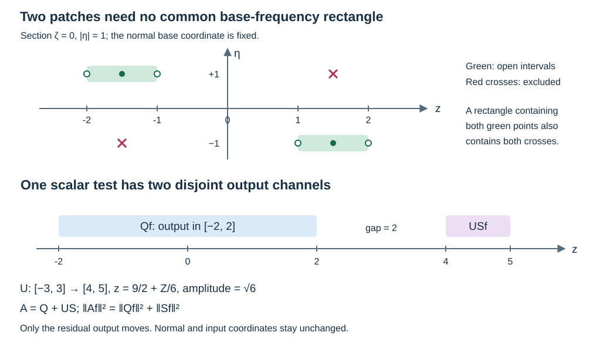

# One scalar test across boundary-chart patches

The local source estimates retain a finite collection of full boundary operators. A single scalar test must control that entire collection, including the residual kernels. This lesson constructs such a test for arbitrary compact microlocal patches in a positive-dimensional boundary chart. Its key step is an exact orthogonal placement of the residual output.

The antecedent is Lars Hörmander, *The Analysis of Linear Partial Differential Operators III*, corrected edition reprinted in 2007, §§18.3 and 24.7, especially the two observation estimates on printed pages 465–467. The complete argument below uses the programme's [global boundary calculus](../20261005-global-boundary-operators/global-boundary-operator-calculus.html), [uniform microsupport proof](../20261007-restored-uniform-microsupport/uniform-microsupport-and-dual-sources.html), [fixed elliptic and residual reduction](../20261009-fixed-residual-source-tests/fixed-source-tests-by-residual-packing.html), and [exact scalar residual factorization](../20261009-scalar-fourier-source-tests/scalar-source-tests-from-compact-logarithmic-kernels.html). It supplies a missing assembly step; it does not replace the remaining propagation proofs by a citation.

## 1. The full family and the exact conclusion

**H0. Arbitrary compact patches in one boundary chart.** Work on
\[
 X=[0,\infty)_x\times\mathbb R^d_z,\qquad d\ge1,
 \qquad L^2=L^2(X,dx\,dz).
 \tag{BA1}
\]
Let \(T_{\ell,a}\), \(1\le\ell\le L\), be a finite list of families bounded in the complete scalar \(\Psi_b^m\) topology. All kernels have common compact input and output projections. The parameter set is arbitrary. Boundedness includes the full resolved kernels and every uniform off-cone symbol estimate, not just their principal symbols. Suppose their uniform compressed microsupports lie in a compact cosphere set \(K\Subset\Gamma\), where \(\Gamma\) is open and conic. The corresponding homogeneous sets are understood when writing operator microsupports.

The base and angular components of \(K\) may vary independently from patch to patch. No rectangle containing the whole input support times all the frequency directions is required to lie in \(\Gamma\). The residual input supports remain compact, but can project outside its base projection.

**H1. One scalar test, with actual bounded factors.** For any nonnegative integer \(M\ge m\), there is a fixed compact scalar \(A\in\Psi_b^M\), independent of \(a\), and uniformly bounded operators \(B_{\ell,a}:L^2\to L^2\), such that
\[
 \operatorname{WF}'_b(A)\Subset\Gamma,\qquad
 T_{\ell,a}f=B_{\ell,a}Af,
 \qquad
 \sum_{\ell=1}^L\sup_a\|T_{\ell,a}f\|_2\le C\|Af\|_2 .
 \tag{BA2}
\]
The identities hold for smooth inputs on the fixed compact input set. The factors are asserted to be bounded operators; no membership in the boundary calculus is needed for them. Matrix families with one fixed finite input fiber use the same scalar \(A\) componentwise, as proved below.

## 2. Separate the elliptic part from its complete error

**E0. A fixed microlocal inverse retains every residual.** Choose a compact scalar \(Q\in\Psi_b^M\), elliptic on a neighborhood of \(K\), with microsupport compactly inside \(\Gamma\). A finite conic partition, the complete symbol realization and fixed proper cutoffs construct it. Its principal symbol can be positive on \(K\); this choice is used only for ellipticity.

The complete ordered inverse gives a fixed proper \(G\in\Psi_b^{-M}\) for which
\[
                       GQ=I+E,\qquad
                  \operatorname{WF}'_b(E)\cap K=\varnothing .
 \tag{BA3}
\]
The full error is the actual difference in this identity. In particular it contains the low-frequency and proper-kernel terms. Define
\[
 C_{\ell,a}=T_{\ell,a}G,\qquad
 R_{\ell,a}=-T_{\ell,a}E,
 \qquad T_{\ell,a}=C_{\ell,a}Q+R_{\ell,a}.
 \tag{BA4}
\]
This is the ordered reduction in FST:S7, with the inverse order now \(-M\). The complete product theorem gives a bounded family \(C_{\ell,a}\in\Psi_b^{m-M}\subset\Psi_b^0\). The uniform separated-product theorem makes \(R_{\ell,a}\) a bounded family in the full residual topology. These assertions require no derivatives in the index \(a\): composition by the fixed operators is continuous in the full symbol and kernel seminorms, and the uniform off-cone bounds in H0 give each residual seminorm bound.

All resulting projections are compact. For example, properness of \(G\) localizes its input to a compact set once its output meets the common input support of \(T\). Alternatively the exact identity \(R=T-CQ\) puts the input projection of \(R\) in the union of the input projections of \(T\) and \(Q\). Fix these compact sets throughout. The order-zero bound supplies
\[
                         \sup_{\ell,a}\|C_{\ell,a}\|_{2\to2}<\infty .
 \tag{BA5}
\]

**E1. One residual test for the whole bounded family.** Apply SFT:D1–D5 to the full family \(R_{\ell,a}\). It gives a fixed compact scalar residual \(S\) and bounded factors \(D_{\ell,a}\) satisfying
\[
                 R_{\ell,a}f=D_{\ell,a}Sf,\qquad
                   \sup_{\ell,a}\|D_{\ell,a}\|_{2\to2}<\infty .
 \tag{BA6}
\]
To identify the actual factors, use the unitary map
\(\mathcal Uf(v,z)=e^{v/2}f(e^v,z)\). If \(r_{\ell,a}(Y,\Xi)\) are the complete logarithmic left symbols, that proof constructs a positive scalar Schwartz multiplier \(p(\Xi)\) with compact inverse Fourier kernel and
\[
 S=\mathcal U^{-1}p(D_Y)\mathcal U\chi,\qquad
 D_{\ell,a}=\mathcal U^{-1}
                   \operatorname{Op}(r_{\ell,a}/p)\mathcal U .
 \tag{BA7}
\]
Here \(\chi=1\) near every residual input projection. The quotient has all the finitely many bounded derivatives required by the proved packet estimate. Right Fourier multiplication cancels \(p\) exactly. Consequently (BA6) includes the entire residual kernel and has no untested source norm. The residual theorem has no product-cone hypothesis. Its compact difference support gives fixed compact projections of \(S\).

## 3. Place the residual output orthogonally

**R0. A tangential isometry with a disjoint output region.** Choose \(R,L_0>0\) such that the tangential output projection of \(Q\) is contained in \([-R,R]^d\), and that of \(S\) in \([-L_0,L_0]^d\). For a center \(b\in\mathbb R^d\) and scale \(\mu>0\), define
\[
             (Uh)(x,z)=\mu^{-d/2}
                               h\bigl(x,(z-b)/\mu\bigr).
 \tag{BA8}
\]
Changing variables \(z=b+\mu Z\) proves that \(U\) is unitary on \(L^2(X)\), with inverse
\[
             (U^{-1}h)(x,Z)=\mu^{d/2}h(x,b+\mu Z).
 \tag{BA9}
\]
For example, set \(\mu=(2L_0)^{-1}\) and \(b=(R+2,0,\ldots,0)\). The first tangential coordinate of every output of \(US\) then lies in
\[
                       [R+3/2,R+5/2],
 \tag{BA10}
\]
which is separated from the output projection of \(Q\). The normal variable is unchanged. All input variables of \(S\) are unchanged as well.

**R1. The relocated kernel is still fully residual.** Write the exact normalized kernel of \(S\) as
\[
 (Sf)(x,z)=\int\kappa_S(x,z,w,t)f(tx,w)\,dt\,dw,
                         \qquad t=y/x .
 \tag{BA11}
\]
Then
\[
 \kappa_{US}(x,z,w,t)
       =\mu^{-d/2}\kappa_S\bigl(x,(z-b)/\mu,w,t\bigr).
 \tag{BA12}
\]
This formula proves the complete boundary-kernel assertion. The resolved normal coordinates \(x+y\) and \(x/(x+y)\) do not change. Smoothness down to the front face is preserved. Every derivative of order \(|\alpha|\) in the output tangential variable introduces exactly the fixed factor \(\mu^{-|\alpha|}\); input and resolved normal derivatives retain the earlier bounds. Flatness at both side faces is therefore preserved with every derivative. The new tangential output projection is a compact affine image of the old one; normal and input projections retain their old bounds. Thus
\[
               US\in\Psi_b^{-\infty},\qquad
               \operatorname{WF}'_b(US)=\varnothing .
 \tag{BA13}
\]
Only a residual kernel has been relocated. The isometry \(U\) by itself, and a relocated singular elliptic kernel, have not been asserted to belong to this calculus. This distinction is also explicit in FST:S3–S4.

**R2. Add the two outputs and recover both exactly.** Set
\[
                              A=Q+US .
 \tag{BA14}
\]
The preceding kernel proof gives \(A\in\Psi_b^M\), with compact projections and microsupport contained in that of \(Q\), hence in \(\Gamma\). The disjoint output supports and unitarity give the exact identity
\[
                          \|Af\|_2^2
                           =\|Qf\|_2^2+\|Sf\|_2^2 .
 \tag{BA15}
\]
Choose smooth functions \(\pi_Q,\pi_S\), between zero and one, equal to one on the respective compact output projections of \(Q,US\), with disjoint supports. Smooth cutoffs in the separated first tangential coordinate suffice; further fixed compact cutoffs can be inserted. As multiplication operators they have norm at most one, and
\[
                    \pi_QAf=Qf,\qquad
                    U^{-1}\pi_SAf=Sf .
 \tag{BA16}
\]
Combining (BA4), (BA6) and (BA16) proves the actual factorization
\[
          T_{\ell,a}=B_{\ell,a}A,
 \qquad B_{\ell,a}=C_{\ell,a}\pi_Q
                             +D_{\ell,a}U^{-1}\pi_S .
 \tag{BA17}
\]
Each factor is uniformly bounded on \(L^2\). Sum the finitely many bounds to obtain (BA2). More explicitly, if
\(c_Q=\sum_\ell\sup_a\|C_{\ell,a}\|\) and
\(c_S=\sum_\ell\sup_a\|D_{\ell,a}\|\), then Cauchy–Schwarz gives
\[
       \sum_\ell\sup_a\|T_{\ell,a}f\|_2
                  \le\sqrt{c_Q^2+c_S^2}\,\|Af\|_2 .
 \tag{BA18}
\]
Both constants are finite. Multiplying \(A\) by a positive constant can make the right coefficient one. If the whole family is residual, (BA6) already supplies a tester and no elliptic part or output relocation is necessary.

## 4. Supports, parameters and the observation estimates

**C0. What changes and what is preserved.** The input projection of \(A\) lies in the union of that of \(Q\) and the compact cutoff \(\chi\) used for \(S\). Relocation changes only the residual output. An open conic constraint controls compressed microsupport; it does not require every point of a residual kernel to project into that cone. Formula (BA13) verifies the required constraint exactly.

The construction is fixed for the whole parameter family. If the starting compact supports, \(K\), and its enlargement in \(\Gamma\) are fixed, the proper cutoffs and a bound for their projections can be fixed before choosing \(M\). The compact Fourier-kernel support in E1 can likewise be fixed in advance: its positive Fourier floor changes its coefficients, not this support. Consequently the reserve region and the relocation can be fixed while the finite target order increases. No parameter neighborhood is reduced by the scalar assembly.

For matrices on a fixed finite input fiber, choose the scalar \(Q\) times the identity. Apply the residual scalar theorem jointly to all finitely many entries of \(R\), using one common floor \(p\). Entrywise factorization gives matrix factors with bounded \(L^2\) norm, since the sum of their finitely many entry norms bounds the matrix norm. Use \(U\) and the two cutoffs componentwise. Formulas (BA15)–(BA18) then hold for the Euclidean fiber norm with the same scalar tester on every input component.

The theorem is on the half-space chart (BA1). In a smaller product chart the same proof is available when its chosen proper supports and a disjoint tangential reserve box remain within that chart. No theorem about relocating arbitrary residuals across an entire compact boundary manifold is inferred here. The construction requires \(d\ge1\); the earlier single-product-patch and residual Fourier theorems retain their separate validity for \(d=0\).

**C1. Assemble finite source and observation lists.** Suppose actual local estimates have already given, uniformly in \(a\),
\[
 \sum_j\|C_{j,a}u\|_2
 \le C_B\|u\|_{\mathcal B}
       +\sum_\ell\sup_b\|T_{\ell,a,b}P_au\|_2
       +\sum_k\sup_b\|O_{k,a,b}u\|_2 .
 \tag{BA19}
\]
Assume the two lists satisfy H0, with compact uniform microsupports in the prescribed source and observation cones \(\Gamma\) and \(\Gamma_2\), respectively. The auxiliary set indexed by \(b\) can be arbitrary. Apply (BA2) independently to the two full lists and absorb their finite constants by scaling. There are two fixed compact scalar tests with
\[
 \begin{gathered}
 \operatorname{WF}'_b(A)\Subset\Gamma,\qquad
 \operatorname{WF}'_b(A_2)\Subset\Gamma_2,\\
 \sum_j\|C_{j,a}u\|_2
              \le\|AP_au\|_2+\|A_2u\|_2+C_B\|u\|_{\mathcal B}.
 \end{gathered}
 \tag{BA20}
\]
The source input can depend on \(a\): the factorization holds for every smooth input separately, so it applies to \(f=P_au\). Different source patches need not fit in one base-frequency rectangle. This proves the scalar assembly of any finite collection of the already established local elliptic, reflection and glancing estimates when their actual observation terms lie in \(\Gamma_2\). The separate [global finite-test observation](../20261017-global-finite-test-observation/global-observation-with-full-source-and-observation-tests.html) proves propagation of intermediate observations to the final cone, retaining their complete kernels.

**C2. An admissible regularized graph without a source rectangle.** Let \(P_a\), \(\mathcal B\), \(N\) and a compact regularizer \(F\in\Psi_b^{-2N-4}\) satisfy ABR:R0–R7, in a chart with \(d\ge1\). Require only compact full microsupport of \(F\) inside \(\Gamma\), with the usual fixed compact projections. Every member of its finite normal-recovery source tree has order at most \(-2\). The exact ratio operations, normal kernel derivatives and right tangential differential products preserve that microsupport and keep the complete family bounded. Applying H1 with \(M=0\) to the entire tree gives one fixed scalar \(A\in\Psi_b^0\), microsupported in \(\Gamma\), such that
\[
 \begin{split}
 &\|Fu\|_{\overline H^2}+\|P_aFu\|_2
        +\|\gamma_0Fu\|_{H^{3/2}}
        +\|\gamma_1Fu\|_{H^{1/2}}\\
 &\hspace{15mm}\le C\bigl(\|u\|_{\mathcal B}+\|AP_au\|_2\bigr).
 \end{split}
 \tag{BA21}
\]
This uses the actual pre-domination boundary regularization theorem, including every residual source. Its proof and that of the finite source tree use compactness and full microsupport; the source rectangle was required only for the earlier finite-order Fourier domination. The new theorem replaces that final step. The trace assertions and preservation of zero Dirichlet values are unchanged.

**C3. The actual completed graphs.** Complete smooth zero-Dirichlet inputs in the norm on the right of (BA20), retaining the \(\mathcal B\) term. For fixed \(a\), this completion injects into \(\mathcal B\) with the actual tested distributional actions. Indeed transposing any compact boundary operator against an interior smooth compact test yields a compact input test flat at the boundary. This follows from its full side-face estimates and also holds for the relocated residual (BA12). The differential transpose of \(P_a\) preserves flatness. The Banach flat-test bound identifies each \(L^2\) limit of \(AP_au\) and \(A_2u\) with its action on the \(\mathcal B\) limit. If that limit is zero, both tested limits vanish. Formula (BA20) identifies the target limits in the same way. The identical argument with the source norm in (BA21) preserves the earlier regularized graph and traces. No additional graph-density assertion is used.

This component proves scalar assembly across arbitrary compact patches in a positive-dimensional reference boundary chart. It retains the chart and reserve hypotheses stated above. For arbitrary manifolds and the full source/observation estimate see [global scalar assembly and observation](../20261017-angular-output-reserve-assembly/scalar-tests-from-a-missing-tangential-direction.html); for the wave application see [coefficient-uniform wave smoothing](../20261010-wave-parameter-smoothing/wave-smoothing-uniform-in-the-coefficients.html). These are separate proofs of their stated conclusions. External human foundations retain their recorded terms.

## 5. Three complete solutions

### Exercise 1. Put the residual in a specified interval

In one tangential dimension suppose the output projections of \(Q\) and \(S\) lie in \([-2,2]\) and \([-3,3]\), respectively. Place the latter in \([4,5]\). Compute the isometry, its inverse and the kernel derivative factors.

**Solution.** Choose \(b=9/2\), \(\mu=1/6\). Then
\[
 (Uh)(x,z)=\sqrt6\,h(x,6z-27),\qquad
 (U^{-1}h)(x,Z)=6^{-1/2}h(x,9/2+Z/6).
 \tag{BA22}
\]
The endpoints \(-3,3\) map to \(4,5\), leaving a gap of two from \([-2,2]\). The square of the amplitude is six and the Jacobian is \(1/6\), so their product is one. The \(k\)-th output tangential derivative of the relocated kernel acquires the exact factor \(6^{k+1/2}\). Input derivatives and the resolved normal coordinates are unchanged. No ordinary normal smoothing is needed for this calculation.

### Exercise 2. The norm constant and why support separation matters

Suppose \(\sum_\ell\sup_a\|T_{\ell,a}f\|\le3\|Qf\|+4\|Sf\|\). Find the coefficient given by (BA15). Verify its sharpness as an inequality between two nonnegative numbers, and test what fails if the outputs are simply added without separation.

**Solution.** For \(q,s\ge0\),
\[
             25(q^2+s^2)-(3q+4s)^2=(4q-3s)^2\ge0.
 \tag{BA23}
\]
Thus \(3\|Qf\|+4\|Sf\|\le5\|Af\|\). Equality in the numerical inequality occurs when \(q:s=3:4\). The scaled test \(5A\) gives coefficient one. Without the orthogonal placement, vectors \(Qf=v\) and \(Sf=-v\), with \(v\ne0\), would have zero sum but positive separate norms. Such a cancellation is excluded by the actual disjoint output supports in R0, not by a principal-symbol positivity assertion.

### Exercise 3. Two patches that have no common source rectangle

Use \(d=1\), \(0\le x<1\), and tangential base intervals \(I_-=(-2,-1)\), \(I_+=(1,2)\). Let the source cone be the union of the two regions
\[
 \begin{aligned}
 &z\in I_-,\quad \eta>0,\quad |\zeta|<\eta/5,\\
 &z\in I_+,\quad \eta<0,\quad |\zeta|<-\eta/5 .
 \end{aligned}
 \tag{BA24}
\]
Consider compact operator patches near \((x,z;\zeta,\eta)=(1/4,-3/2;0,1)\) and \((1/4,3/2;0,-1)\). Explain why one whole-input rectangle cannot cover both within this cone, and why H1 nevertheless applies.

**Solution.** A base cutoff equal to one near both input patches contains both \(z=-3/2\) and \(z=3/2\). An angular set containing both directions contains \((0,1)\) and \((0,-1)\). Their product contains the crossed pairs \((-3/2;0,-1)\) and \((3/2;0,1)\), neither of which belongs to (BA24). This rules out the earlier product condition for that union.

Choose \(Q\) elliptic near the two original patches, with compact microsupport inside their union of slightly larger allowed neighborhoods. The complete errors are residual and are jointly dominated by \(S\). Place its output disjointly as in R0 and set \(A=Q+US\). Equations (BA13) and (BA15) prove both the correct microsupport and the norm estimate. The new residual output region adds no crossed microlocal patch to (BA24).

## 6. Exact support geometry

**F0. What is shown.** The upper panel is the section \(\zeta=0\), \(|\eta|=1\) of Exercise 3; it is not the full compressed cosphere. The two crossed pairs demonstrate the failed product condition. The lower panel plots the exact output intervals of Exercise 1. It shows where the two tested functions can be supported, not a spatial support assertion about their input or a new characteristic ray. The normal variable is untouched. The squared-norm identity in (BA15) is the reason these intervals give one scalar test.

The [editable figure source](figures/build_figure.py), [exact checks](check_models.py), proof map, proof review, source credit and [reader checks](reader-check.json) accompany this independent CC0-1.0 lesson. Earlier components retain their actual terms. Required Lebl foundations remain explicit external author-edition dependencies. 
