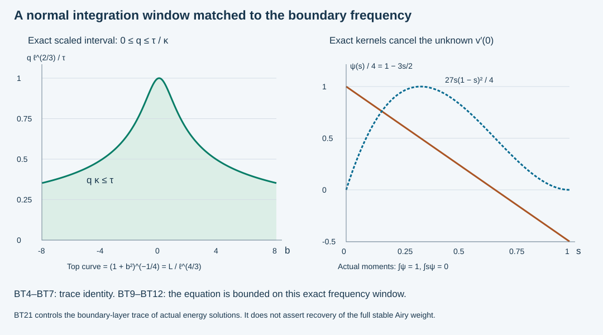

# A frequency-dependent boundary trace estimate

The stable Airy energy weight is the sum of an oscillating contribution and a boundary-layer contribution. [Interior coefficient recovery](../20261010-interior-airy-recovery/interior-airy-coefficient-recovery.md) treats the first mechanism and proves that interior observations alone cannot control the second. Here we prove the boundary-layer trace estimate for actual energy solutions of the variable-coefficient equation.

The argument uses a normal interval whose length depends on tangential frequency. A second-derivative trace identity and direct Fourier-kernel bounds suffice. We then remove the normal cross term by an actual boundary-preserving coordinate map and transport the tangential principal symbol through the existing boundary graph. Every lower term is retained with its \(L^2\) bound.

The primary background is Melrose and Taylor, [*Boundary Problems for Wave Equations With Grazing and Gliding Rays*, §6.3](https://mtaylor.web.unc.edu/wp-content/uploads/sites/16915/2018/04/glide.pdf), which analyzes the thin normal layer. The proof below is independent programme exposition using the exact [stable weights](../20261010-stable-airy-localization/stable-airy-coefficients-and-spatial-localization.md), [boundary graph inverse](../20261008-actual-boundary-inverse/actual-conormal-inverse-and-reflection.md), and [coordinate and weak-space proofs](../20261007-restored-normal-window/boundary-normal-coordinates-and-window-transfer.md). A citation does not replace any step of this estimate.

## 1. The normal scale and its trace space

**H0. Smooth auxiliary frequency functions.** Use SAL:H0 to choose real ordinary symbols \(\ell,m\in S^1\), with \(\ell\asymp\langle\eta\rangle\), \(\ell\ge c>0\), and \((\ell,m)=(\lambda,\mu)\) on the working glancing cone. Here \(\eta=(\mu,\eta',\lambda)\), \(d\ge2\), \(\lambda\ge1\). These are globally smooth auxiliary functions, not extended PDE coefficients. Define

\[
 b=-m\ell^{-1/3},\qquad
 \kappa=\ell^{2/3}\langle b\rangle^{1/2},\qquad
 L=\frac{\ell^2}{\kappa}=\ell^{4/3}\langle b\rangle^{-1/2},
 \qquad \langle b\rangle=(1+b^2)^{1/2}.
 \tag{BT1}
\]

The function \(\kappa\) is a normal frequency scale; it is unrelated to the canonical map denoted by the same letter in some earlier lessons. We denote that map by \(\mathcal C\) below. Directly from BT1 and \(|m|\le C\ell\),

\[
 \kappa^2\ge |m|\ell,\qquad
 \kappa^3\ge\ell^2,\qquad
 c\ell\le L\le C\ell^{4/3},\qquad
 \frac{\ell}{\kappa^2}\le C .
 \tag{BT2}
\]

The first inequality uses \(\langle b\rangle\ge|b|\); the second uses \(\langle b\rangle\ge1\). For the third, \(\langle b\rangle\le C\ell^{2/3}\), after adjusting constants at bounded frequency. The final inequality follows from \(\ell/\kappa^2=\ell^{-1/3}\langle b\rangle^{-1}\) and the positive lower bound for \(\ell\).

**H1. The boundary-layer space.** Define

\[
 \|f\|_{\mathcal H_L}^2=(2\pi)^{-d}
                \int L(\eta)|\widehat f(\eta)|^2\,d\eta .
 \qquad
 H^{2/3}\subset\mathcal H_L\subset H^{1/2}.
 \tag{BT3}
\]

The inclusions follow from BT2. Multiplication by \(L^{1/2}\) in Fourier space identifies this Hilbert space with \(L^2\); its inverse has polynomial growth, so the inverse Fourier transform is a tempered distribution. Compact smooth Fourier functions are dense by truncation followed by ordinary \(L^2\) approximation on each compact set. No Airy representation is assumed in this definition.

## 2. A trace identity that eliminates the unknown normal derivative

**T0. Two moments and an exact remainder.** Put \(\psi(s)=4-6s\) on \([0,1]\). Then
\(\int_0^1\psi=1\), \(\int_0^1s\psi=0\). Taylor's formula with its integral remainder, integrated against \(\psi\), gives for every vector-valued \(v\in H^2(0,h)\)

\[
 v(0)=\int_0^h h^{-1}\psi(t/h)v(t)\,dt
          +\int_0^h h(t/h)(1-t/h)^2v''(t)\,dt .
 \tag{BT4}
\]

Indeed the coefficient of \(v'(0)\) vanishes by the second moment. Interchanging the two remainder integrals produces
\(\int_s^1(4-6t)(t-s)\,dt=-s(1-s)^2\), which moves to the other side with the plus sign in BT4. The identity holds first for smooth functions; approximation in \(H^2\) and the elementary one-dimensional trace continuity give its stated extension. Equivalently, the absolutely continuous representatives of \(v,v'\) give the same Taylor formula directly.

Since \(\int_0^1\psi^2=4\) and \(\int_0^1s^2(1-s)^4=1/105\), Cauchy–Schwarz and \(|a+b|^2\le2|a|^2+2|b|^2\) yield

\[
 |v(0)|^2\le
       \frac8h\int_0^h|v|^2\,dq
       +\frac{2h^3}{105}\int_0^h|v''|^2\,dq .
 \tag{BT5}
\]

In particular, no separate bound on \(v'(0)\) appears.

**T1. Use a different interval at each frequency.** Fix \(Q>0\) and \(0<\tau\le1\) so that \(h(\eta)=\tau/\kappa(\eta)\le Q\) for all \(\eta\). Such a \(\tau\) exists because \(\kappa\) has a positive lower bound. Define the measurable Fourier multiplier

\[
 M_q(\eta)=
       {\bf1}_{\{q\kappa(\eta)\le\tau\}}
                    \frac{\ell(\eta)}{\kappa(\eta)^2},
 \qquad 0<q<Q .
 \tag{BT6}
\]

Apply BT5 to \(\widehat v(q,\eta)\), multiply by \(L(\eta)\), and integrate in \(\eta\). Tonelli's theorem and Plancherel give

\[
 \|v(0)\|_{\mathcal H_L}^2
   \le \frac8\tau\|\ell(D)v\|_{L^2((0,Q)\times\mathbb R^d)}^2
       +\frac{2\tau^3}{105}
                    \|M_q(D)\partial_q^2v\|_{L^2}^2 .
 \tag{BT7}
\]

For the first term we enlarged every integration interval to \((0,Q)\). In the second term the exact variable interval remains in \(M_q\). The sharp indicator is only a bounded multiplier; it will never be differentiated as a symbol.

## 3. Estimate the equation on the selected normal interval

**K0. The Fourier kernels being estimated.** Use left tangential quantization. Suppose a matrix symbol \(a(q,w,\nu)\) has order \(j\), compact \(w\)-support, and ordinary symbol bounds uniform for \(q\in[0,Q]\). Integration by parts in \(w\) gives, for every \(N\),

\[
 |\widehat a(q,\eta-\nu,\nu)|
       \le C_N\langle\eta-\nu\rangle^{-N}\ell(\nu)^j .
 \tag{BT8}
\]

All matrix norms are finite-dimensional operator norms. For a smooth compact-base family, the constants are uniform in \(q\). The Fourier Schur estimate P1:B3 bounds an integral kernel dominated by \(C\langle\eta-\nu\rangle^{-d-1}\) on \(L^2\). We will apply it without any frequency derivative of the indicator in BT6.

The ordinary \(S^1\) bound makes \(m\) globally Lipschitz: \(|m(\nu)-m(\eta)|\le C|\nu-\eta|\). Comparability of \(\ell\) with the Japanese bracket gives
\(\ell(\nu)/\ell(\eta)\le C\langle\eta-\nu\rangle\).
Both inequalities are global, including bounded frequencies.

**K1. The boundary tangential factor.** Let \(c(q,w,\eta)\in S^0\), with the support and uniformity above; positivity is unnecessary in this estimate. The ordering below is part of the assertion:

\[
 \|M_q(D)\operatorname{Op}(c(q))\,m(D)\ell(D)v\|_{L^2_w}
                  \le C\|\ell(D)v\|_{L^2_w}.
 \tag{BT9}
\]

To prove it, set \(z=\ell(D)v\). In Fourier space the kernel applied to \(\widehat z(\nu)\) has the factor
\({\bf1}_{q\kappa(\eta)\le\tau}\ell(\eta)\kappa(\eta)^{-2}\widehat c(q,\eta-\nu,\nu)m(\nu)\).
By the Lipschitz bound and BT2,

\[
 \frac{\ell(\eta)|m(\nu)|}{\kappa(\eta)^2}
 \le\frac{\ell(\eta)|m(\eta)|}{\kappa(\eta)^2}
       +C\frac{\ell(\eta)}{\kappa(\eta)^2}|\eta-\nu|
 \le C\langle\eta-\nu\rangle .
 \tag{BT10}
\]

The kernel is therefore bounded by \(C_N\langle\eta-\nu\rangle^{-N+1}\). Choosing \(N>d+2\) proves BT9 by Schur. It also justifies the extension from test inputs to \(H^1\). The operator \(\operatorname{Op}(c)\) has not been commuted with \(m(D)\) or \(M_q(D)\).

**K2. The normal Taylor remainder.** For \(r_2(q,w,\eta)\in S^2\) with the same support conditions,

\[
 \|M_q(D)\,q\operatorname{Op}(r_2(q))v\|_{L^2_w}
                      \le C\tau\|\ell(D)v\|_{L^2_w}.
 \tag{BT11}
\]

After setting \(z=\ell(D)v\), BT8 bounds the kernel by
\[
 C_N{\bf1}_{q\kappa(\eta)\le\tau}
   \frac{q\ell(\eta)\ell(\nu)}{\kappa(\eta)^2}
            \langle\eta-\nu\rangle^{-N}
 \le C_N\tau
   \frac{\ell(\nu)}{\ell(\eta)}
            \langle\eta-\nu\rangle^{-N}.
 \tag{BT12}
\]

The last step uses \(q\le\tau/\kappa(\eta)\) on the indicator's support and \(\kappa^3\ge\ell^2\). The bracket ratio from K0 and the same Schur estimate prove BT11. No restriction on the input frequency \(\nu\) was imposed; this is why mixing frequencies by variable coefficients causes no omitted term.

**K3. Lower terms and a strong residual.** BT2 makes \(M_q\) uniformly bounded on \(L^2\). An ordinary compact-base order-one operator maps \(H^1\) to \(L^2\), and an order-zero operator maps \(L^2\) to itself, by the already proved ordinary calculus. Consequently

\[
 \|M_q(D)[A_1(q)v+A_0(q)\partial_qv+F]\|_{L^2}
 \le C\bigl(\|v\|_{L^2_qH^1_w}
             +\|\partial_qv\|_{L^2}+\|F\|_{L^2}\bigr),
 \tag{BT13}
\]

where \(A_j\) has ordinary order \(j\), uniformly in \(q\). These may be arbitrary complex matrix operators. Here \(F\) is an actual \(L^2\) distributional equation residual. A natural-dual source in a weak formulation is not identified with \(L^2\) merely by calling it a residual.

## 4. The trace theorem for weak solutions of the normalized equation

**E0. A graph-domain trace estimate.** Suppose \(v\in H^1((0,Q)\times\mathbb R^d;\mathbb C^N)\) and, in the open strip,

\[
 \partial_q^2v
   =\operatorname{Op}(c(q))m(D)\ell(D)v
       +q\operatorname{Op}(r_2(q))v
       +A_1(q)v+A_0(q)\partial_qv+F,\qquad F\in L^2 .
 \tag{BT14}
\]

The symbols have the support and uniform bounds of K0–K3. Signs may be absorbed into the symbols. Then the ordinary value trace satisfies

\[
 v(0)\in\mathcal H_L,\qquad
 \|v(0)\|_{\mathcal H_L}
             \le C\bigl(\|v\|_{H^1}+\|F\|_{L^2}\bigr).
 \tag{BT15}
\]

Indeed K1–K3, integrated over \(q\), bound the second term of BT7 by the right side of BT15 squared. The first term of BT7 is bounded by \(\|v\|_{H^1}^2\). This proves the estimate for smooth inputs.

To justify it for the stated weak solution without assuming a smooth solution approximation, observe first that BT14 puts \(\partial_q^2v\) in \(L^2_qH^{-1}_w\): each order-two term maps \(H^1_w\) to \(H^{-1}_w\), while the lower terms are no worse. On every bounded Fourier ball, \(\widehat v\) and its first two distributional \(q\) derivatives are square integrable. The Hilbert-valued one-dimensional Sobolev theorem, or its scalar Fubini proof with countably many interval tests, therefore shows that \(\widehat v(\,\cdot\,,\eta)\in H^2(0,Q)\) for almost every \(\eta\) in that ball. A countable union of balls covers frequency space.

The boundary values of these representatives equal the Fourier transform of the ordinary trace: \(v\in H^1_qL^2_w\) has a continuous \(L^2_w\) representative, and bounded Fourier projections commute with its interval integral identity. Apply BT5 frequency by frequency, integrate first over a ball, and then increase the ball. The K1–K3 kernel estimates identify \(M_q\partial_q^2v\) as an \(L^2\) function by BT14. Monotone convergence proves BT7 and BT15. This establishes the estimate on the original energy domain and for its actual value trace.

## 5. Transfer to the actual variable-coefficient Airy problem

**G0. Remove the normal cross block by a real coordinate map.** Locally write the scalar principal symbol as
\[
 p(q,y;\rho,\xi)=a\rho^2+2\rho\,b_0^T\xi+\xi^TC_0\xi,\qquad a\ne0 .
 \tag{BT16}
\]

All lower coefficients may be complex matrices. Solve
\(\partial_qY(q,w)=b_0(q,Y)/a(q,Y)\), \(Y(0,w)=w\), and set \(\Phi(q,w)=(q,Y(q,w))\). The smooth parameter-flow proof NW:A0 applies to this smooth vector field on a compact patch. Its variational equation and inverse-matrix equation give a common interval and an invertible \(Y_w\). Thus \(\Phi\) is an actual smooth collar diffeomorphism fixing the boundary. All tangential variables, including a time variable if present, are included in \(w\); we do not assert that time is fixed separately.

Write \(M=Y_w\). The exact covector formulas are
\(\xi=M^{-T}\eta\), \(\rho=\widetilde\rho-(b_0/a)^TM^{-T}\eta\). Completing the square gives

\[
 p\circ T^*\Phi
      =a_\Phi\bigl(\widetilde\rho^2+r_2^\Phi(q,w,\eta)\bigr),
 \quad
 r_2^\Phi=a_\Phi^{-1}\eta^TM^{-1}
              (C_0-b_0b_0^T/a)_\Phi M^{-T}\eta .
 \tag{BT17}
\]

The chain rule for the full differential operator produces all its first-order terms, including derivatives of \(M\) and of the coordinate coefficients. Divide by the smooth nonzero scalar \(a_\Phi\) in the strong distributional equation. The result has the form
\(D_q^2+R_2(q,w,D_w)+B_1(q,w,D_w)+B_0(q,w)D_q\),
with tangential principal symbol \(r_2^\Phi\), and the indicated lower orders. There is no principal normal-tangential cross term.

Smooth substitution and its inverse are bounded on local \(H^1\); bounded Jacobians also give the \(L^2\) source bounds. This follows from the chain rule, substitution formula and weak limits proved in NW:A2, whose argument only needs a smooth boundary-preserving diffeomorphism. Boundary values are unchanged because \(\Phi(0,w)=(0,w)\). No weak boundary condition is introduced or changed in deriving this local value-trace estimate.

**G1. The boundary principal factor is the Airy coordinate \(\mu\lambda\).** Pull the actual CAA phases back by \(\Phi\). At the boundary, \(S\) and \(\zeta_b=-\mu\lambda^{-1/3}\) are unchanged, \(\zeta_y=0\), and \(\zeta_q\ne0\). The boundary eikonal identities have no error there, by CAA:A0 and the boundary-flat construction. For the normalized symbol in BT17, the mixed identity gives \(\theta_q\zeta_q=0\), hence \(\theta_q=0\) at the boundary. The other identity gives

\[
 r_2^\Phi(0,y,S_y(y,\eta))
   =\zeta_b\,\zeta_q(0,y,\eta)^2
   =-\mu\lambda\,c_0(y,\eta),\qquad
 c_0=(\lambda^{-2/3}\zeta_q)^2>0 .
 \tag{BT18}
\]

This is an exact homogeneous principal identity on the working cone. The boundary graph \(\mathcal C\) is
\((w=S_\eta(y,\eta),\eta)\mapsto(y,S_y(y,\eta))\).
Thus the tangential principal symbol transported to its input side equals
\(-\mu\lambda c(w,\eta)\), where \(c=c_0(y(w,\eta),\eta)\in S^0\). Its positive lower bound follows from the actual nonzero normal derivative; positivity is not needed by K1.

**G2. Retain the complete equation error in \(L^2\).** Let \(J=T_{g_b}\) be the actual boundary graph operator, and let \(G\) be a fixed properly localized inverse-graph operator as in ABI:B1–B3. Choose its support inside a slightly larger phase patch and keep it independent of \(q\). If \(U\) is the pulled-back, compactly localized physical field, set \(v(q)=G U(q)\).

The ordinary graph mapping theorem gives
\(\|v\|_{H^1}\le C\|U\|_{H^1}\): apply its order-zero \(L^2\) and \(H^1\) tangential bounds at each \(q\), and use \(\partial_qv=G\partial_qU\). For the principal tangential operator use full FIO composition on the support of \(G\). Matching its scalar principal symbol with the transported symbol gives

\[
 GR_2(q)-\widetilde R_2(q)G=H_1(q),\qquad
 H_1(q):H^1_y\longrightarrow L^2_w,\qquad
 \widetilde R_2(q)=
       -\operatorname{Op}(c)m(D)\ell(D)
                  +q\operatorname{Op}(\widetilde r_2(q))
                  +\widetilde A_1(q).
 \tag{BT19}
\]

Here \(H_1\) is an order-one inverse-graph FIO, with its full smoothing remainder, and \(\widetilde A_1\) is ordinary order one. The coefficient \(\widetilde r_2\) has order two. To obtain the last decomposition, use BT18 at \(q=0\), extend its degree-zero factor smoothly to a compact-base ordinary symbol, and apply Taylor's formula
\(\widetilde r(q)-\widetilde r(0)=q\int_0^1\partial_q\widetilde r(tq)\,dt\).
Ordinary quantization of the exact leading product leaves an order-one remainder, which is \(\widetilde A_1\). All estimates are uniform on the compact \(q\) interval.

Only equality of principal symbols is used to lower the FIO difference to order one; the order-one difference is retained. On the chosen larger phase patch, the equality holds on the whole supported graph, including the support of all cutoff derivatives. Outside that patch the amplitude is zero, and full separated-support composition leaves a smooth kernel. This is why no unsupported order-two edge error is dropped. Proper representatives and compact base cutoffs give uniform bounds for the retained smooth kernels. We need no invariance of the nonordinary weight \(L\) under the graph map.

The strong localized equation now gives BT14 for \(v\), with a sign absorbed into \(c,\widetilde r_2\), and an actual \(L^2\) residual \(F_v\) satisfying

\[
 \|F_v\|_{L^2}
   \le C\bigl(\|U\|_{H^1}+\|P^\Phi U\|_{L^2}\bigr).
 \tag{BT20}
\]

Indeed \(H_1U\), the tangential first-order terms and \(GB_0D_qU\) are all \(L^2\) by their proved orders. The applied source \(G(P^\Phi U)\) is \(L^2\). The term \(\widetilde A_1v\) may be left in BT14 or included in \(F_v\), with its bound. Since \(G\) is independent of \(q\), no commutator with \(D_q^2\) occurs. A physical compact cutoff \(\chi\) produces \([P,\chi]u\), a first-order expression bounded by the local \(H^1\) norm; it is included in BT20.

**G3. The actual boundary trace theorem.** On fixed nested glancing patches, let \(u\in H^1\) and \(Pu\in L^2\) distributionally, with \(P\) the actual scalar-principal CAA system. With the physical cutoffs and localized inverse graph \(G\) just specified,

\[
 G(u|_{q=0})\in\mathcal H_L,\qquad
 \|G(u|_{q=0})\|_{\mathcal H_L}
       \le C\bigl(\|\chi u\|_{H^1}
                         +\|\chi_1 Pu\|_{L^2}\bigr).
 \tag{BT21}
\]

Here \(\chi_1\) equals one on the support of the physical cutoff defining \(U\) and is supported in the coordinate patch. Choose \(\chi=1\) on a neighborhood of its support and of all operator input and cutoff-derivative supports; shrink the actual observation patch once to arrange these finitely many margins. More generally one may keep a separate \(H^1\) norm on the union of those supports, which is the same local statement.

Apply E0 to \(v=GU\), use BT20 and the coordinate bounds in G0, and choose the cutoff defining \(U\) equal to one on the trace input support of \(G\). Its derivative support is covered by \(\chi\). The identity \(v(0)=G(U(0))\) holds for the actual trace because \(G\) is \(L^2\)-bounded and independent of \(q\): it commutes with the continuous \(L^2\) boundary limit. The coordinate map fixes the boundary. This proves BT21 for the original weak energy trace. It requires neither a Dirichlet nor a Robin condition and imposes no commutativity assumption on the lower matrices.

## 6. Localize the new trace space and keep the two weights distinct

**L0. Ordinary input and physical boundary cutoffs.** The weight in BT1 is polynomially moderate. In fact \(|\nabla b|\le C\), since \(m,\ell\in S^1\) and \(\ell\ge c\). Therefore
\[
 \frac{L(\eta)}{L(\nu)}
 \le C\left(\frac{\langle\eta\rangle}{\langle\nu\rangle}\right)^{4/3}
       \left(\frac{\langle b(\nu)\rangle}{\langle b(\eta)\rangle}\right)^{1/2}
 \le C\langle\eta-\nu\rangle^{11/6}.
 \tag{BT22}
\]

The middle bracket ratio follows from
\(\langle b(\nu)\rangle\le C\langle b(\eta)\rangle\langle\eta-\nu\rangle\),
using the Lipschitz bound. Interchanging \(\eta,\nu\) also controls the inverse ratio. The square-root ratio costs at most \(\langle\eta-\nu\rangle^{11/12}\). Thus for a compact-base ordinary \(p\in S^0\), conjugating its Fourier kernel by \(L^{1/2}\) leaves an integrable kernel after using BT8 with \(N>d+2\). Schur proves
\(\operatorname{Op}(p):\mathcal H_L\to\mathcal H_L\), including smooth spatial cutoffs.

For a physical boundary cutoff, ABI:B3 and GE:D10 give
\(G\psi J=\operatorname{Op}(p)+R\) on nested patches, with \(p\in S^0\) and \(R\) smooth. The first term is bounded by the preceding argument. The second maps any fixed coarse \(H^{-N}\) norm into \(H^{2/3}\subset\mathcal H_L\), by WM:W1 and BT3. This is transported localization through the actual graph, not an assertion of canonical invariance for the scalar formula \(L(\eta)\).

**C0. This is the boundary-layer summand of the stable energy norm.** With \(F_\epsilon,c_\epsilon,Z_\epsilon\) as in IAR:S0, the global auxiliary weights satisfy the exact identity

\[
 \|v\|_{\mathcal H_w}^2
   =|c_\epsilon|^{-2}
          \|\ell(D)^{5/6}Z_\epsilon v\|_{L^2}^2
            +\|v\|_{\mathcal H_L}^2,\qquad
 w=\ell^{5/3}|F_\epsilon(b)|^{-2}+L .
 \tag{BT23}
\]

It follows by substituting the exact Fourier multiplier \(Z_\epsilon=c_\epsilon/F_\epsilon(b)\) into the defining integrals; it is valid whenever either side is finite, and as an identity of nonnegative extended integrals otherwise.

BT21 supplies the second kind of regularity for every actual energy solution with \(L^2\) residual. IAR supplies bounded interior extraction and identifies the stable decaying coefficient for represented fields. Combining these into a complete localized \(\mathcal H_w\) reverse estimate still requires controlling the first term in BT23 with the correct input localizations and establishing the general PDE representation. These steps are not consequences of the algebraic identity alone. In particular, the theorem proved here is a boundary-layer trace theorem, not a claim that the full stable trace weight has now been recovered for every solution.

## 7. Three solved exercises

**X1. Reconstruct the trace functional.** Find an affine \(\psi(s)=a+bs\) whose first two moments are \(1,0\), and compute both constants in BT5.

**Solution.** The equations are \(a+b/2=1\), \(a/2+b/3=0\). Their unique solution is \(a=4,b=-6\). Integrating \((4-6s)^2\) gives \(4\). The remainder kernel is \(s(1-s)^2\), whose square integrates to \(1/105\), either by polynomial expansion or repeated integration of monomials. Scaling \(q=hs\) gives squared kernel norms \(4/h\) and \(h^3/105\). The factor two from the sum inequality gives \(8/h\) and \(2h^3/105\), exactly as in BT5.

**X2. Why the equation hypothesis is needed.** Let \(\widehat f_R(\eta)=R^{-1/2}\rho(\eta-(0,\ldots,0,R))\), with fixed nonzero smooth compactly supported \(\rho\). Put \(v_R(q,y)=e^{-Rq}f_R(y)\) on a fixed positive strip. Compare its energy and boundary-layer trace norms.

**Solution.** Plancherel gives \(\|f_R\|_2^2\asymp R^{-1}\) and \(\|\nabla_y f_R\|_2^2\asymp R\). Also \(\int_0^Qe^{-2Rq}\,dq\asymp R^{-1}\). The squared tangential and normal derivative norms of \(v_R\) are therefore bounded above and below by positive constants; its \(H^1\) norm stays bounded. On the frequency packet \(b=O(R^{-1/3})\), so \(L\asymp R^{4/3}\). Hence \(\|v_R(0)\|_{\mathcal H_L}^2\asymp R^{1/3}\), which diverges.

For the affine operator \(P_0=D_q^2-qD_{y_d}^2-D_{y_1}D_{y_d}\), its Fourier residual is
\((-R^2-q\lambda^2-\mu\lambda)e^{-Rq}\widehat f_R\).
Its \(L^2\) norm is comparable to \(R\): on \(0\le q\le1/R\) the \(-R^2\) term dominates the \(O(R)\) other terms, giving the lower bound; direct exponential integration gives the upper bound on the whole strip. Thus this family violates no instance of BT21. An \(H^1\) field without control of its equation residual need not have the enhanced trace.

**X3. A normal change produces a real principal correction and a complex lower term.** Consider
\(P=D_q^2+2qD_qD_{y_1}+D_{y_1}^2-(1+q)D_{y_2}^2\)
and the map \(y_1=w_1+q^2/2,\ y_2=w_2\). Compute the full pullback operator.

**Solution.** The old normal derivative becomes \(D_q-qD_{w_1}\). Squaring it with \(D=-i\partial\) gives
\(D_q^2-2qD_qD_{w_1}+q^2D_{w_1}^2+iD_{w_1}\).
The cross term becomes \(2qD_qD_{w_1}-2q^2D_{w_1}^2\). Therefore the exact transformed operator is
\[
 D_q^2+(1-q^2)D_{w_1}^2-(1+q)D_{w_2}^2+iD_{w_1}.
 \tag{BT24}
\]
The principal cross block has vanished, but the first-order term remains. It maps \(H^1\) to \(L^2\) and belongs in BT20. Dropping it would replace the equation by a different one. The tangential boundary symbol has the glancing directions \(\eta_1=\pm\eta_2\ne0\), and its first normal derivative there is \(-\eta_2^2\), so this example also has a genuine first-order normal variation.

## 8. Read the normal window and the trace kernels

**V0. Exact plotted functions.** The left panel uses the scaled normal coordinate \(q\ell^{2/3}/\tau\). The top of the integration window is exactly \(\langle b\rangle^{-1/2}=(1+b^2)^{-1/4}\), for \(-8\le b\le8\). The same function is \(L/\ell^{4/3}\). The shaded region is the indicator in BT6, after this rescaling; its boundary is not a characteristic ray.

The right panel plots \(\psi(s)/4=1-3s/2\) and \(27s(1-s)^2/4\), for \(0\le s\le1\). The rescalings are stated in the legend so both exact kernels are legible. The actual constants in the proof use the unscaled kernels, whose squared integrals are \(4\) and \(1/105\). The sign change in \(\psi\) is necessary to cancel the unknown first derivative.

Independent exposition, solutions and figure: **CC0-1.0**. Linked components retain their terms. Some prerequisite proofs are external readings linked by the proof index. The boundary trace estimate alone does not represent an arbitrary energy solution by an Airy field.
