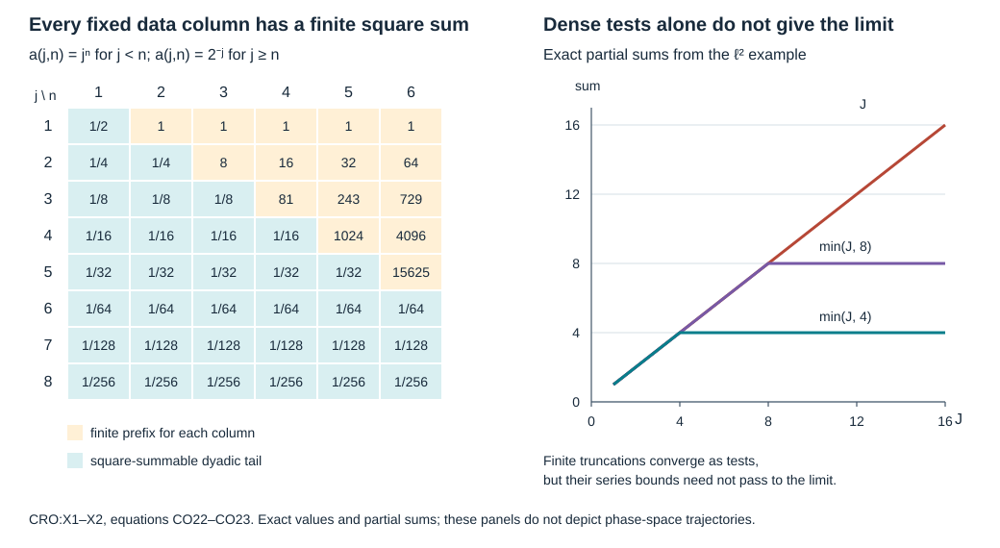

# Compact generalized rays and uniform observation

We assemble the local boundary estimates into one uniform observation estimate on a fixed normalized half-space chart. The proof includes strict diffraction with a stationary projected boundary field, nonunique continuation at infinite contact and stationary normalized rays. Its analytic compactness argument records the full remainders of the operators actually used. A dense list of symbols would not provide that control.

**Independent exposition, proofs, exercises and figure: CC0-1.0.** The antecedent is Lars Hörmander, *The Analysis of Linear Partial Differential Operators III*, Springer 2007 edition, ISBN 978-3-540-49938-1, §24.7, Propositions 24.7.1 and 24.7.1′ and Lemma 24.7.2, printed pages 465–467. The proof map identifies the exact earlier programme proofs, including every local estimate and the closed-set trajectory construction used here.  Human foundation proofs remain explicitly external. Some prerequisite proofs are external readings.

## 1. The chart theorem and its quantifiers

**H0. Full operators and all permitted continuations.** Work on
\[
 X=[0,\infty)_x\times\mathbb R^d_z,\quad d\ge1,\qquad
 P_a=D_x^2+c_aD_x+B_a(x,z,D_z),\quad
 \sigma_2(B_a)=-r_a\in\mathbb R,\quad D=-i\partial .
 \tag{CO1}
\]
The scalar differential coefficients are smooth jointly in the base and a finite-dimensional parameter \(a\) near zero. The full tangential principal symbol is real and quadratic; lower coefficients may be complex. On each compact base set all coefficient derivatives are bounded on a compact parameter neighborhood. This is one fixed normal form for the family. A global manifold with different parameter-dependent normal coordinates is not silently identified with this chart.

Let \(\Gamma_1,\Gamma_2\subset\Gamma\) be open conic subsets of the positive normalized compressed phase space. Assume that every maximally continued compressed generalized characteristic of \(P_0\) in \(\Gamma\) meeting \(\Gamma_1\) also meets \(\Gamma_2\). The assertion concerns **every** permitted continuation at infinite contact. Constant normalized trajectories at radial or zero fields count as trajectories. Let \(K_1\Subset\Gamma_1\) be a compact normalized target set.

Let \(\mathcal B\) be a Banach space continuously embedded in extendible distributions. We estimate smooth compact inputs \(u\in\mathcal B\) with actual value trace zero. When a continuous trace map on \(\mathcal B\) is available, it will preserve the trace on the completion as well. No invariance of \(\mathcal B\) under a coordinate change, multiplier or regularizer is assumed.

**H1. One parameter neighborhood before every target order.** There is \(\delta>0\), depending on the geometric data and coefficient family but not on the target order, with this property. Let \(C_{\ell,a,b}\), \(1\le\ell\le L\), be finitely many bounded full families in \(\Psi_b^m\), with common compact kernel projections and uniform full microsupport in \(K_1\), for \(|a|\le\delta\). The auxiliary index \(b\) need not be differentiable; all complete kernel and off-cone seminorms are uniformly bounded. There are compact scalar boundary operators \(A_f,A_o\), independent of \(a,b\), with finite orders, such that
\[
 \begin{gathered}
 \operatorname{WF}'_b(A_f)\Subset\Gamma,\qquad
 \operatorname{WF}'_b(A_o)\Subset\Gamma_2,\\
 N_a(u):=\sum_{\ell=1}^L\sup_b\|C_{\ell,a,b}u\|_2
 \le \|A_fP_au\|_2+\|A_ou\|_2+C\|u\|_{\mathcal B}.
 \tag{CO2}
 \end{gathered}
\]
The orders and constant may depend on the full target families. The assertion includes the original full residual parts of the targets. It holds for smooth zero-Dirichlet inputs and their actual tested graph completion. The proof also gives the fixed-operator result by taking a constant family.

**G0. Fix the geometric parameter range once.** PRS:S0–S11 proves that, for the compact target \(K_1\), there are compact sets and a parameter range with
\[
 K\Subset\Gamma,\quad K_2\Subset\Gamma_2,\quad \delta_0>0,\quad T<\infty,
 \qquad
 \gamma(0)\in K_1\Longrightarrow
 \gamma(t_*)\in K_2,\quad |t_*|\le T,
 \quad \gamma([0,t_*])\subset K .
 \tag{CO3}
\]
For negative \(t_*\), the last interval means the interval between its endpoints. This holds for every maximal \(P_a\) continuation with \(|a|<\delta_0\), including the stationary exceptions. The proof uses compressed Lipschitz bounds, limits of reflected arcs and the exit-buffer argument; it does not assume a bound on the number of reflections or continuity of first exit times.

Choose \(\delta\) so that the compact parameter ball
\[
                 \mathcal A=\{a:|a|\le\delta\}
                       \Subset\{|a|<\delta_0\}
 \tag{CO4}
\]
lies in the given coefficient domain. All later parameter limits remain in this ball. No later choice of a Sobolev order changes (CO4).

## 2. Full remainders in a finite comparison

**R0. Comparing a bounded family with finitely many elliptic tests.** Suppose a bounded full family \(T_{a,b}\in\Psi_b^m\) has compact uniform microsupport \(K_T\). Let \(E_i\in\Psi_b^M\), \(1\le i\le q\), be fixed scalar operators, elliptic on open sets covering \(K_T\), where the nonnegative integer \(M\) is at least \(m\). A finite conic partition and the full inverse theorem give
\[
 T_{a,b}=\sum_{i=1}^q B_{i,a,b}E_i+R_{a,b},\qquad
 B_{i,a,b}\in\Psi_b^{m-M}\subset\Psi_b^0,\qquad
 R_{a,b}\in\Psi_b^{-\infty}.
 \tag{CO5}
\]
Here is the actual construction. Choose a partition \(\chi_i\) supported where \(E_i\) is elliptic, with sum equal to the identity near \(K_T\). Let \(J_i\) be complete proper inverses there, of order \(-M\). Put \(B_i=T\chi_iJ_i\) and define \(R=T-\sum_iB_iE_i\) by this exact difference. Every term left by the partition, inverse, low-frequency cutoff and proper realization has empty full microsupport. The uniform separated-product theorem gives a bounded family of full residual kernels. The order-zero theorem bounds all \(B_i\) on \(L^2\). Properness, or the difference identity itself, gives fixed compact kernel projections. These are GB:C6,C11 and the full inverse/product arguments used in BSA:E0; principal-symbol division alone would not prove (CO5).

**R1. The equation controls each selected residual family.** Apply ABR:R0–R7 to \(R_{a,b}u\), at a sufficiently negative boundary order. Every child in that finite source tree is still full residual, by ABR:R1–R3 and R6. Compact input sets give the necessary local negative ordinary Sobolev bound from the original \(\mathcal B\) norm. Uniformity holds for \(a\in\mathcal A\), the auxiliary family and every kernel seminorm required by that finite tree. Its \(H^2\) bound in particular controls the \(L^2\) output.

The exact scalar residual factorization SFT:D1–D5, as stated in BSA:E1, dominates the finite bounded list of residual source families by one fixed scalar residual \(F_R\). Consequently
\[
 \sup_b\|R_{a,b}u\|_2
 \le C_R\bigl(\|u\|_{\mathcal B}+\|F_RP_au\|_2\bigr),
 \qquad F_R\in\Psi_b^{-\infty}.
 \tag{CO6}
\]
In particular \(\operatorname{WF}'_b(F_R)=\varnothing\subset\Gamma\). The full residual norm is present in (CO6); empty microsupport has not been used as permission to delete it. Combining (CO5) and (CO6) gives
\[
 \sup_b\|T_{a,b}u\|_2
 \le C\left(\sum_{i=1}^q\|E_i u\|_2+
                \|F_RP_au\|_2+\|u\|_{\mathcal B}\right).
 \tag{CO7}
\]
Every use of this comparison below records its own \(F_R\). We do not seek one residual operator dominating all possible residual kernels.

## 3. Select the actual local estimates countably

**T0. Fixed nested tests.** The normalized phase space of this chart is second countable. In each of finitely many angular coordinate patches use balls with rational centers and radii, and rational base boxes; a countable collection of such patches covers the space. Retain all nested pairs of precompact sets
\[
 U_i\Subset V_i\Subset\Gamma,\qquad i=1,2,\ldots,
 \tag{CO8}
\]
whose smaller interiors form a basis: if \(\rho\in W\subset\Gamma\) is open, one can choose \(\rho\in U_i\) and \(\overline{V_i}\subset W\). Boundary half-boxes give the same property at the face.

Choose one full scalar test \(E_{i,n}\in\Psi_b^n\) for each \(i\) and integer \(n\ge0\), elliptic on \(\overline{U_i}\) and with full microsupport compact in \(V_i\). A smooth base/angular cutoff equal to one near \(\overline{U_i}\), multiplied by the order-\(n\) weight and then fully realized, gives such a test. All proper and low-frequency remainders are part of the fixed operator. This is the proved construction GB:C6,C11; no uniformity in \(i,n\) is needed. The nonnegative integer orders dominate any prescribed finite order in (CO7).

**T1. Local implications with geometry independent of order.** The earlier local estimates have the following common form. An admissible instance has an open parameter neighborhood \(D\), an open output region \(W\Subset\Gamma\) and an open observation region \(V\subset\Gamma\), possibly empty. For every prescribed finite-order bounded target family compactly microsupported in \(W\), it gives
\[
 \|Tu\|_2\le C_T\bigl(\|F_TP_au\|_2+
                   \|O_Tu\|_2+\|u\|_{\mathcal B}\bigr),
 \quad a\in D,\quad
 \operatorname{WF}'_bF_T\Subset\Gamma,\quad
 \operatorname{WF}'_bO_T\Subset V .
 \tag{CO9}
\]
The operators are fixed in \(a\); bounded target families use the corresponding supremum. The same \(D,W,V\) work before every target order. All parameter closures in use lie in slightly larger validity neighborhoods, so the constants for an individual instance are uniform there. The collection includes these cases:

- Full compressed ellipticity, from UES:E3–E7 and BSA:H1, and strict boundary tangential ellipticity with zero Dirichlet value, from UDE:H0–A1. Here \(O_T=0\).
- Interior nonradial propagation from an interior cap, from UIO:N0–C1.
- Transverse reflection from either interior branch, from RSI and ROI with their complete roots and equal initial probes.
- Strict diffraction from either tangent germ, from USD:G0–S2. This includes stationary projected boundary fields.
- Nonradial boundary glancing from a closed incoming window, from UGE and GSI. Its geometry has the uniform two-small-parameter bounds of GSP:C9. Apply BSA:H1 to the complete finite source list at GSI:GI25; this replaces only its final whole-input product-cone domination, and retains every earlier source and residual norm.

All source collars, compressed bands and proper support margins can be chosen inside the prescribed open \(\Gamma\). The output region is then smaller. For the opposite orientation, let \(Jv=\overline v\), apply the same estimate to \(JP_aJ\), and return through \(J\). The identity \(JP_aJ(Ju)=J(P_au)\) retains every lower coefficient and derivative sign. The Fourier antipodal map reverses the Hamilton orientation of the real quadratic principal symbol; conjugation is an \(L^2\) isometry. Thus it produces another instance of (CO9) for the original input and source. This is the complete reversal argument in GSP:C9, not a selfadjointness assumption.

For glancing, the observation region must contain the *whole* closed incoming window, including both characteristic lifts and its outer compressed band, with strict margins. Merely observing its center is not an admissible instance. The estimates may have constants and operator orders depending on the chosen widths and target order.

**T2. A countable subcollection preserves every open implication.** Let \(\mathcal V\) be the countable collection of finite unions of the basis sets in (CO8), including the empty union. For a fixed \(V\in\mathcal V\), consider all admissible instances whose observation region is contained in \(V\). Their open sets \(D\times W\) form a cover of their union in parameter-phase space. Select a countable subcover as follows. Enumerate a basis \(\mathcal Q_j\) of this product space. Whenever some member of the cover contains \(\mathcal Q_j\), select one such member. Every point of the union lies in a basis set contained in one cover member, hence in a selected member. This proves the subcover assertion without compactness of the whole phase space. Perform the selection for every \(V\in\mathcal V\).

The selected instances are countable. For each one, each \(i\) with \(\overline{V_i}\subset W\), and each \(n\ge0\), retain the actual inequality (CO9) with \(T=E_{i,n}\). This is still a countable list. It retains a fixed output region at every order: a point of \(W\) has a single \(U_i\) about it with \(\overline{V_i}\subset W\), and the list includes all \(n\) for this same \(i\).

To check that nothing geometric has been lost, suppose an arbitrary admissible instance has a compact observation neighborhood contained in an open set \(G\subset\Gamma\). Cover that compact set by finitely many basis sets with closures in \(G\), and enlarge their union slightly within \(G\). The local theorem permits this open union as its observation region, since it contains the required closed cap or window with margins. It is one of the sets tested in the preceding selection. Every point of the original \(D\times W\) belongs to a selected \(D'\times W'\) whose observation is still contained in \(G\). The selected list therefore preserves the implication from any such open \(G\) to regularity near the output point. It need not preserve the particular proof or numerical constant that first supplied that implication.

**T3. Close the list under the comparisons it will use.** For every observation operator \(O_T\) just retained, enumerate every finite tuple of indices \(i_1,\ldots,i_q\) for which the \(U_{i_\nu}\) cover its full microsupport, and every integer \(M\ge\max(0,\operatorname{ord}O_T)\). Apply (CO7), with \(E_\nu=E_{i_\nu,M}\), and retain its actual residual source operator \(F_R\). This is countable because finite tuples of integers and integer orders form a countable set.

Do the same for the given target families \(C_{\ell,a,b}\), for every finite tuple covering their common compact microsupport and every integer \(M\ge\max(0,m)\). Their uniform full remainders are bounded families, so R1 applies uniformly in \(a,b\). There are only finitely many values of \(\ell\).

The **source list** consists of every \(F_T\) in the selected local estimates and every \(F_R\) from these comparisons. Enumerate it as \(S_1,S_2,\ldots\). Its members are actual fixed scalar operators of finite orders with full microsupport compact in \(\Gamma\). No common order or seminorm bound for the entire list is asserted. The **observation list** consists of all \(E_{i,n}\) whose full microsupport lies in a \(V_i\Subset\Gamma_2\); enumerate these as \(Q_1,Q_2,\ldots\). Zero operators can fill a finite or empty list.

This construction includes every remainder that will be needed when an observation or the final target is compared with finitely many elliptic tests. It does not use density of a countable symbol set, and does not assert that the whole residual calculus is a countable union of bounded families.

## 4. What failure of the estimate would produce

**D0. A normalized diagonal sequence.** If a finite initial part of the two lists satisfied
\[
 N_a(u)\le C\left(\|u\|_{\mathcal B}
       +\sum_{i\le j}\|S_iP_au\|_2+\sum_{i\le j}\|Q_i u\|_2\right)
 \quad(a\in\mathcal A),
 \tag{CO10}
\]
BSA:H1 would combine each finite list into one fixed scalar operator, with microsupport in \(\Gamma\) or \(\Gamma_2\), respectively. Rescaling these two operators absorbs the finite constant on their norms and gives (CO2). The original Banach term keeps its constant.

Suppose (CO2) fails. Then every (CO10) fails. For its \(j\)-th initial part choose a smooth compact zero-Dirichlet input and parameter, and normalize by its positive \(N_a\), to obtain
\[
 a_j\in\mathcal A,\qquad N_{a_j}(u_j)=1,\qquad
 \|u_j\|_{\mathcal B}
  +\sum_{i\le j}\|S_iP_{a_j}u_j\|_2
  +\sum_{i\le j}\|Q_i u_j\|_2\le2^{-j}.
 \tag{CO11}
\]
Homogeneity of all the norms justifies this normalization. Pass to a subsequence with \(a_j\to a_*\in\mathcal A\), using compactness of the finite-dimensional parameter ball. It remains true that every fixed listed norm, and the Banach norms, are square summable:
\[
 \sum_j\|u_j\|_{\mathcal B}^2<\infty,\qquad
 \sum_j\|S_iP_{a_j}u_j\|_2^2<\infty,\qquad
 \sum_j\|Q_i u_j\|_2^2<\infty\quad(i\text{ fixed}).
 \tag{CO12}
\]
Before taking a subsequence the tail for \(j\ge i\) is bounded by \(\sum_{j\ge i}4^{-j}\); the earlier terms are finite because each individual input and its forcing are smooth and compact and the test has a compact full kernel. Taking a subsequence preserves these sums. No uniform bound in the list index \(i\) is required.

**D1. Define a closed defect set by these tests.** For this sequence put
\[
 G=\bigcup\left\{U_i:
             \sum_j\|E_{i,n}u_j\|_2^2<\infty
                         \text{ for every integer }n\ge0\right\},
 \qquad F=\Gamma\setminus G .
 \tag{CO13}
\]
Thus \(G\) is open and \(F\) is relatively closed in \(\Gamma\). This is a set defined by the chosen series of test norms; it is not being identified with the wavefront set of an unconstructed vector-valued distribution. The same \(U_i\) must work for all \(n\); regularity on an order-dependent neighborhood would not suffice.

We have \(F\cap\Gamma_2=\varnothing\). Indeed a point of \(\Gamma_2\) belongs to some \(U_i\) with \(\overline{V_i}\subset\Gamma_2\), and all its \(E_{i,n}\) occur in the observation list. Equation (CO12) applies to each one.

Also
\[
                         F\cap K_1\ne\varnothing .
 \tag{CO14}
\]
Otherwise a finite collection of the regular \(U_i\) covers \(K_1\). Choose an integer \(M\ge\max(0,m)\) and use the target comparisons already recorded in T3. Equation (CO7), (CO12), and regularity of the finitely many \(E_{i,M}\) imply
\(\sum_j N_{a_j}(u_j)^2<\infty\). To justify summing the finite right sides, use
\((\sum_{\nu=1}^q b_\nu)^2\le q\sum_{\nu=1}^q b_\nu^2\), and the uniform constants in (CO7). The conclusion contradicts \(N_{a_j}(u_j)=1\). Supremums over the bounded auxiliary families cause no problem, since (CO7) is already uniform in those indices.

**D2. Every admissible open implication transfers to this set.** Consider a selected instance with \(a_*\in D\) whose open observation region is contained in \(G\). For each output test, the compact microsupport of its particular \(O_T\) can be covered by finitely many regular \(U_i\). Its recorded comparison in T3 and (CO12) give
\[
                         \sum_j\|O_Tu_j\|_2^2<\infty .
 \tag{CO15}
\]
For any fixed output \(E_{k,n}\) of this instance, the source test \(F_T\) is on the source list. Apply its uniform estimate (CO9) to the tail with \(a_j\in D\). Its right-hand terms are square summable, so the output series is finite. A finite omitted prefix is harmless. Choose \(k\) with \(\overline{V_k}\subset W\) about the output point, and repeat this argument for each integer \(n\). The same \(k\) works at every order, hence the point belongs to \(G\).

T2 now proves the same implication for **every** admissible local instance whose compact cap or window is in \(G\). Constants and source orders may vary with \(n\); each resulting series assertion is a separate finite application of (CO12). This proves the implication without a uniform bound over all orders, all operators, or all selected instances.

## 5. A generalized ray inside the defect set

**P0. The defect is characteristic for the limiting operator.** Apply D2 to the data-only elliptic instances. In the interior it excludes every point with \(p_{a_*}\ne0\). At the boundary, the principal symbol of \(x^2P_{a_*}\) is \(\zeta^2\), so the full elliptic estimate excludes \(\zeta\ne0\). At the remaining equator, UDE excludes \(r_{a_*}(0,z,\eta)<0\). Therefore \(F\) lies in the compressed characteristic set of \(P_{a_*}\).

Lift it by
\[
 \widetilde F=\operatorname{Char}(p_{a_*})\cap\pi^{-1}(F),
 \qquad p_{a_*}=\xi^2-r_{a_*},\qquad \pi(x,z,\xi,\eta)=(x,z,x\xi,\eta).
 \tag{CO16}
\]
At a hyperbolic boundary point both roots are included. On compact normalized boundary patches,
\[
                      |\xi|^2=r_{a_*}(x,z,\eta)\le C|\eta|^2 .
 \tag{CO17}
\]
Thus the lifts of compact subsets are bounded and closed, hence compact in the normalized coordinates. No positive definiteness of the tangential quadratic form was used.

**P1. Ordinary, reflected and strict-diffractive segments.** At an interior nonradial characteristic point, D2 applied to the ordinary cap estimates propagates membership in \(G\) along any sufficiently short ordinary segment, in both directions. Consequently a short segment through a point of \(F\) lies in \(F\). To check the contrapositive precisely, if any nearby point of that segment were in \(G\), its openness would supply the whole compact cap required by the local estimate, forcing the original point into \(G\).

The same argument with the complete transverse reflection estimate shows that a singular boundary point carries both short reflected germs in \(F\). Conversely the open regularity of a boundary neighborhood would make the adjacent interior points regular as well. At strict diffraction use USD from a compact cap on either tangent germ; the conjugated estimate supplies the other orientation. It follows that the entire short tangent segment through a defect point is in \(F\), even if the projected boundary Hamilton field is stationary. Closedness supplies the limiting boundary point of each interior germ. These are exactly the first local hypotheses of the closed-set trajectory theorem GGL:T040–T045 away from nondiffractive glancing.

**P2. The uniform glancing window gives directional witnesses.** Let \(K'\) be a compact set of nondiffractive glancing points in \(\widetilde F\) whose normalized boundary Hamilton field is nonzero. The uniform geometry of UGE and GSP:C9 gives constants \(C_{K'},t_{K'},\epsilon_{K'}>0\) such that the incoming window at signed normalized time \(t\) is admissible whenever
\[
 0<|t|<t_{K'},\qquad C_{K'}|t|\le\epsilon<\epsilon_{K'} .
 \tag{CO18}
\]
Its reduced tangential radius and normal width are bounded by fixed multiples of \(\epsilon|t|\), centered on the gliding flow through the anchor. The slightly larger closed window includes all support margins and both normal lifts.

Suppose that this larger window contained no projected point of \(F\). Its entire characteristic lift is then in \(G\); its remaining compressed points are also in \(G\), by P0. Compactness supplies an open neighborhood contained in \(G\) of the whole outer-band window. Apply D2 to the glancing estimate with that observation neighborhood. It would put the anchor in \(G\), a contradiction. Thus each admissible window contains a point of \(F\).

Choose \(\epsilon=L|t|\) with a fixed \(L>C_{K'}\), and decrease the time bound uniformly. The witness differs in reduced tangential coordinates from the gliding flow by \(O(t^2)\), and has normal position \(O(t^2)\). Its normal root has size \(O(|t|)\), by the characteristic equation and smooth Taylor expansion. The exact conversion in PW:T004–T011 therefore gives, for every \(\varepsilon>0\), a common \(\tau>0\) and witnesses \(q_t\in\widetilde F\) for each \(q\in K'\), satisfying
\[
 q_0=q,\qquad
 \left|\frac{Q(q_t)-Q(q)}t-Q(H_{p_{a_*}}^G(q))\right|<\varepsilon,
 \quad 0<|t|\le\tau .
 \tag{CO19}
\]
Here \(Q\) drops only the normal momentum, as in GGL:GF32. No continuity in the choice of \(q_t\) is needed. The constants are uniform on \(K'\), because they come from the geometric window bounds before any test order is chosen. The countable selection in T2 preserves the implication for each such window; it does not change those geometric bounds. Infinite-order contact is included.

**P3. Maximal continuation and stationary exceptions.** P0–P2 verify every hypothesis of GGL:T040–T045 on each nonstationary normalized clock neighborhood. That theorem constructs an actual generalized arc inside \(\widetilde F\), not merely a characteristic limiting set. In particular it proves signed-root recovery across accumulating reflections and, at higher contact, the estimates
\[
                |\xi(t)|=O(|t-t_0|^2),\qquad
                  x(t)=O(|t-t_0|^3),
 \tag{CO20}
\]
which justify the joining derivative.

At an interior radial Hamilton point the homogeneous flow stays on its positive fiber ray and is stationary after normalization. At a nondiffractive radial gliding point the same assertion holds on the boundary with zero normal position and momentum; homogeneity preserves the sign or zero of \(r_x\) along that ray. A zero field is included. Each such constant normalized arc lies in \(F\). These are the exact exceptional cases in GSP:C10; strict diffraction was already handled by P1.

The continuation proof GSP:C11 now applies to this closed set: compatible positive normalizations have bounded velocity on compact regions; a finite endpoint remaining in a compact subset has a compressed limit in \(F\). The just-proved local existence and joining laws extend the arc from that point, including a stationary continuation when applicable. The endpoint-capacity construction yields a maximally continued generalized arc in \(F\). An infinite-time arc may remain compact; no global monotone clock is asserted.

Choose its initial point in \(F\cap K_1\), supplied by (CO14). Since \(F\cap\Gamma_2=\varnothing\), this maximal \(P_{a_*}\) continuation avoids \(\Gamma_2\). But \(a_*\in\mathcal A\), so (CO3) forces it to meet \(K_2\subset\Gamma_2\). This contradiction proves (CO2). The parameter range was fixed in G0 before the target order or the countable selection. All source and observation operators in the resulting finite estimate are scalar and have the required full microsupports.

## 6. The actual completed graph

**C0. Passage from smooth inputs.** For a fixed \(a\), complete the smooth zero-Dirichlet inputs in
\[
             \|u\|_{\mathcal B}+\|A_fP_au\|_2+\|A_ou\|_2 .
 \tag{CO21}
\]
The injection into distributions and identification of the two tested components are the full-transpose argument of ABR:R8. Namely, transpose a compact boundary operator against a compact interior smooth test. Its input test is compact, smooth and flat at the face; the differential transpose preserves flatness. The Banach flat-test bound identifies each \(L^2\) limit with the tested action on the \(\mathcal B\) limit. If that limit is zero, both \(L^2\) limits vanish on every interior test and hence vanish. Thus the completed graph injects into \(\mathcal B\).

Estimate (CO2) gives convergence of the targets uniformly over the bounded auxiliary indices and extends with its uniform constant. For each fixed test its limit has the actual distributional action, by the same transpose argument. When the original Banach trace is continuous, it remains zero. This proves exactly the stated completed-domain result; density in a larger distributional graph is not inferred from density in \(\mathcal B\).

## 7. Three complete solutions

### Exercise 1. Compute the diagonal tail

For positive integers \(j,n\), put \(a_{j,n}=j^n\) if \(j<n\), and \(a_{j,n}=2^{-j}\) if \(j\ge n\). Compute the square sum of each column. Explain why it does not imply square summability of the sequence with every target norm equal to one.

**Solution.** The prefix is finite and the remaining geometric series gives
\[
 \sum_{j=1}^{\infty}|a_{j,n}|^2
   =\sum_{j=1}^{n-1}j^{2n}+\frac{4^{1-n}}3,\qquad
 n=1,2,3:\quad \frac13,\quad\frac{13}{12},\quad\frac{3121}{48}.
 \tag{CO22}
\]
For \(n=3\), the prefix is \(1+64=65\) and the tail is \(1/48\). Every fixed column is square summable; the constants are not uniform in \(n\). The target sequence satisfies \(\sum_{j=1}^J1^2=J\), so it is not square summable. The proof obtains its contradiction only after propagation and a finite target comparison force that target series to be finite. Columnwise convergence alone would not do this.

### Exercise 2. Dense tests do not control every test

In \(\ell^2(\mathbb N)\), let \(v_j=je_j\), where \(e_j\) is the standard unit vector. Show that the scalar sequence \(\langle v_j,y\rangle\) is square summable for every finitely supported \(y\), but fails for a particular \(y\in\ell^2\). Compute the partial sums for its finite truncations.

**Solution.** A finitely supported \(y\) gives only finitely many nonzero pairings. Set \(y=(1,1/2,1/3,\ldots)\). It lies in \(\ell^2\): for \(j\ge2\), \(1/j^2\le1/(j(j-1))=1/(j-1)-1/j\), so the sum is bounded by \(2\). Nevertheless \(\langle v_j,y\rangle=1\) for every \(j\). For the truncation \(y^{(m)}\),
\[
 \sum_{j=1}^{J}|\langle v_j,y\rangle|^2=J,\qquad
 \sum_{j=1}^{J}|\langle v_j,y^{(m)}\rangle|^2=\min(J,m),
 \qquad \|y-y^{(m)}\|_{\ell^2}\longrightarrow0 .
 \tag{CO23}
\]
The finite tests are dense but their series bounds need not pass to a limit of tests. This is why T3 explicitly includes the residual comparisons that D2 and the final target will require.

### Exercise 3. An exact flat-wave observation region

For \(p=\xi^2+|\eta|^2-\tau^2\) on \(x\ge0\), with tangential base \((t,y)\), use positive normalization by \(|\tau|\). Let the source region be \(|t|<2\), the target satisfy \(|t|\le1/4\), \(0\le x\le R\), \(|y|\le R\), and the observation region be \(1/2<|t|<3/4\). Give explicit compact access sets and a uniform travel-time bound for all generalized rays through the target.

**Solution.** On the characteristic set \(\tau\ne0\), and after normalization
\[
 \dot t=-2\operatorname{sgn}\tau,\qquad
 \dot x=2\xi/|\tau|,\qquad
 \dot y=2\eta/|\tau|,\qquad
 (\xi/|\tau|)^2+|\eta/|\tau||^2=1 .
 \tag{CO24}
\]
Reflection reverses \(\xi\) and retains \(\tau,\eta\). A tangent ray at the flat boundary stays there; its time equation is unchanged. Thus every continuation reaches \(t_*=-\operatorname{sgn}\tau\,5/8\) after positive normalized travel time
\[
 T_*=\frac{5/8+\operatorname{sgn}\tau\,t_0}{2},
 \qquad \frac3{16}\le T_*\le\frac7{16}.
 \tag{CO25}
\]
Throughout this arc \(|t|\le5/8\). Both normal and tangential speeds have magnitude at most \(2\), so \(0\le x\le R+7/8\) and \(|y|\le R+7/8\). Take \(K\) to be the normalized characteristic set with \(|t|\le5/8\), \(0\le x\le R+1\), \(|y|\le R+1\), and \(K_2=K\cap\{|t|=5/8\}\). Their normalized fibers are compact, \(K\Subset\{|t|<2\}\), and \(K_2\) lies in the observation region. The bound \(T=7/16\) works even for gliding rays. This example verifies the geometric hypothesis, rather than assuming a unique ordinary ray through a boundary tangent point.

## 8. The series mechanism and its scope

**F0. Exact interpretation.** The left panel marks the entries \(1\le j\le8\), \(1\le n\le6\) of Exercise 1. Above the diagonal, \(j<n\), only a finite prefix is uncontrolled for each column; below it the displayed values are exactly \(2^{-j}\). The right panel plots the exact partial sums \(J\), \(\min(J,4)\) and \(\min(J,8)\) for \(1\le J\le16\), from Exercise 2. These are series diagrams, not phase-space trajectories. The [figure source](figures/build_figure.py) reproduces every value.

This component proves the compact-ray estimate on its stated fixed normalized half-space chart with \(d\geq1\). The separate [global finite-test observation](../20261017-global-finite-test-observation/global-observation-with-full-source-and-observation-tests.html) treats arbitrary manifolds, and [global scalar assembly and observation](../20261017-angular-output-reserve-assembly/scalar-tests-from-a-missing-tangential-direction.html) gives its full scalar form. The wave application is in [coefficient-uniform wave smoothing](../20261010-wave-parameter-smoothing/wave-smoothing-uniform-in-the-coefficients.html). External human foundations retain their recorded terms.
