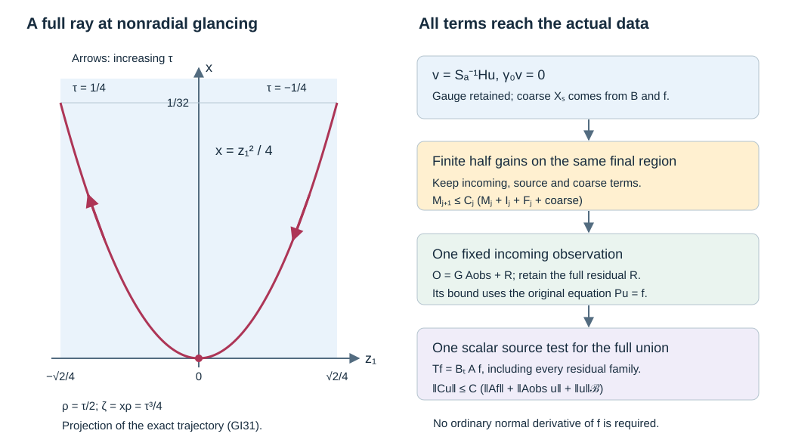

# Glancing with fixed source and observation tests

The uniform glancing estimate gains half a tangential derivative at each step. Its source terms, incoming terms and coarse normal graph must all be measured by the actual data of the observation problem. This lesson supplies that conversion on one local whole-input product patch. It retains the scalar normal gauge, every cutoff error and all residual source terms.

The antecedent is Lars Hörmander, *The Analysis of Linear Partial Differential Operators III*, corrected edition reprinted in 2007, §§18.3, 24.5 and 24.7. The argument uses the programme's [uniform glancing proof](../20261009-uniform-glancing-estimate/uniform-half-order-gain-at-glancing.html), [full mixed calculus and reflection interface](../20261010-reflection-source-interface/reflection-with-admissible-source-and-observation-tests.html), [elliptic source estimate](../20261010-uniform-elliptic-source-estimate/uniform-elliptic-boundary-estimates-with-one-source-test.html), [admissible boundary regularization](../20261009-admissible-boundary-regularization/boundary-regularization-with-source-tests.html) and [exact scalar source domination](../20261009-scalar-fourier-source-tests/scalar-source-tests-from-compact-logarithmic-kernels.html). A source citation is not substituted for any of those proofs.

## 1. A uniform local glancing statement

**H0. The family and the two regions.** On a fixed half-space chart, \(x\ge0\), \(z\in\mathbb R^d\), \(d\ge1\), use \(D=-i\partial\) and
\[
 P_a=D_x^2+c_a(x,z)D_x+B_a(x,z,D_z),\qquad
 \sigma_2(B_a)=-r_a(x,z,\eta)\in\mathbb R .
 \tag{GI1}
\]
The scalar coefficients are smooth jointly with a parameter \(a\) in a compact subset of an open smooth parameter domain. All required coefficient derivatives are uniformly bounded on a fixed larger chart. The tangential principal form can be indefinite; no positive spatial energy is assumed. Let \(\mathcal B\) be a Banach space continuously embedded in extendible distributions.

Take a compact family of boundary glancing anchors, \(r_{a,0}=0\), whose projected normalized boundary Hamilton field is nonzero. Use the common flow boxes, fixed positive widths, regions \(W_{a,\theta}\), \(1/2\le\theta\le1\), and larger closed incoming window of UGE:L3–L10. Its normal width and tangential radius include the strict margins in UGE:L9. Shrink the parameter set once so a fixed compact target neighborhood lies inside every final \(W_{a,1/2}\). A fixed tangential cutoff \(T_0\) is elliptic there. These geometric choices precede any target regularity order.

Choose \(\kappa>0\) and a fixed collar \(0\le x<h\). On the tangential neighborhoods in use let \(|r_a|\le C_*|\eta|^2\), and require
\[
                           h\sqrt{C_*}<\kappa/2 .
 \tag{GI2}
\]
All glancing windows fit inside this collar. In compressed covariables \(\Xi=(\zeta,\eta)\), choose a fixed order-zero scalar cutoff \(H\) whose full symbol is one modulo a residual near all \(W_{a,1}\) and their required support margins when \(|\zeta|\le\kappa|\eta|\). Its full microsupport lies in a slightly larger tangential neighborhood and \(|\zeta|\le2\kappa|\eta|\). Its normal base cutoff is one on a larger interval than all probes. The exact realization is described in L0.

The prescribed observation cone \(\Omega\) contains a compact neighborhood of the **whole compressed lift of the incoming window in the outer band** \(|\zeta|\le2\kappa|\eta|\). This includes the common full microsupports of every incoming test used at any finite iteration. The support descriptions in UGE:L9–L10 are independent of its damping parameter and target order, so this is one geometric hypothesis.

For the source region \(\Gamma\), impose the same actual support condition as in the scalar Fourier theorem: there are angular cones \(F\Subset V\) and one compact smooth input cutoff \(\chi\), equal to one on a neighborhood of all the input projections used below, such that
\[
                   \operatorname{supp}\chi\times\overline V\Subset\Gamma .
 \tag{GI3}
\]
All compact angular projections of \(H\), the targets, and the transition parametrices lie in \(F\). Leave room in \(\{\chi=1\}\) for the incoming observation operator and all proper kernel and parametrix cutoffs. Include the entire input kernels of residual operators. These explicit local hypotheses are not inferred from a principal microsupport condition on an arbitrary global patch.

**H1. The conclusion.** Let \(C_{\ell,a}\), \(1\le\ell\le q\), be a finite bounded smooth family in \(\Psi_b^m\), with fixed compact kernels and full uniform microsupport in the chosen target neighborhood with \(|\zeta|<\kappa|\eta|\). For smooth compact \(u\in\mathcal B\), with \(\gamma_0u=0\), there are fixed compact scalar boundary operators \(A,A_{\rm obs}\), of finite orders, independent of \(a\), such that
\[
 \begin{gathered}
 \operatorname{WF}'_b(A)\Subset\Gamma,\qquad
 \operatorname{WF}'_b(A_{\rm obs})\Subset\Omega,\\
 \sum_{\ell=1}^q\|C_{\ell,a}u\|_{L^2}
 \le C\left(\|AP_au\|_{L^2}
                  +\|A_{\rm obs}u\|_{L^2}+\|u\|_{\mathcal B}\right).
 \tag{GI4}
 \end{gathered}
\]
The constant is uniform in \(a,u\). Orders and constants may depend on the requested target family. The glancing neighborhood, parameter neighborhood, incoming window and cone margins do not shrink as \(m\) increases. The estimate requires no ordinary normal derivative of \(P_au\).

## 2. Retain the normal gauge and the original Banach norm

**G0. Remove the scalar first normal coefficient exactly.** Put
\[
 S_a(x,z)=\exp\left(-\frac i2\int_0^x c_a(t,z)\,dt\right),
 \qquad S_a(0,z)=1,\qquad \partial_xS_a=-\frac i2c_aS_a .
 \tag{GI5}
\]
The integral and chain rules prove smoothness with every base and parameter derivative. The exponential never vanishes. On the compact collar both \(S_a\) and \(S_a^{-1}\), with every fixed number of derivatives, have uniform bounds. Direct multiplication gives
\[
 \widetilde P_a=S_a^{-1}P_aS_a
     =D_x^2-\widetilde R_a,\qquad
 \widetilde R_a=-S_a^{-1}B_aS_a+\frac{c_a^2}{4}
                                      -\frac i2\partial_xc_a .
 \tag{GI6}
\]
Indeed the \(D_x\) coefficient is \(c_a-2iS_a'/S_a=0\), and the remaining normal scalar term in \(\widetilde P_a\) is
\(ic_a'/2-c_a^2/4\). Tangential multiplication by \(S_a\) does not change the degree-two tangential symbol. Thus \(\sigma_2(\widetilde R_a)=r_a\), the glancing geometry is unchanged, and the full transformed family satisfies UGE's normalized hypotheses. Complex lower terms are retained.

For every finite real \(s\), smooth compact multiplication and its derivative obey
\[
 \|S_a^{\pm1}w\|_{\mathcal X_s}\le C_s\|w\|_{\mathcal X_s},
 \qquad
 \|w\|_{\mathcal X_s}^2
    =\|w\|_{L^2_xH^s_z}^2+\|D_xw\|_{L^2_xH^{s-1}_z}^2 .
 \tag{GI7}
\]
The tangential all-real multiplication bound and the exact normal product rule prove this: the extra term is a smooth multiplier times \(w\) in the weaker \(H^{s-1}\) norm. We never assume that multiplication by \(S_a\) preserves the abstract space \(\mathcal B\).

**L0. One complete compressed cutoff.** Realize the symbol of \(H\) in H0 by the full lacunary construction and proper localization in GB:C6 and C11. Retain all resulting residual kernels. Choose the base identity region with room around every tangential source probe and incoming probe. The mixed product theorem RSI:M0 applies because the complete symbol is uniformly rapid outside a bounded compressed band. It includes tangentially smoothing probes and their full proper errors.

Set
\[
                      w=Hu,\qquad v=S_a^{-1}Hu,\qquad f=P_au .
 \tag{GI8}
\]
The full boundary kernel identity gives \(\gamma_0Hu=H_\partial\gamma_0u=0\). Since \(S_a(0)=1\), also \(\gamma_0v=0\). Both are actual smooth inputs on the closed collar. No principal-symbol approximation to the boundary value has been used.

**L1. The coarse graph uses only the original data.** The Banach flat-test argument NGR:B1–B2 gives one integer \(N\) with a localized \(\overline H^{-N}\) bound controlled by \(\|u\|_{\mathcal B}\). Choose even \(K\ge2N+4\), set \(J=(1-\Delta_z)^{K/2}\), and construct a proper tangential parametrix \(T\) so that
\[
                        (JT-I)H=R,\qquad R\in\Psi_b^{-\infty}.
 \tag{GI9}
\]
This is exactly the construction and complete remainder check in RSI:R1: tangential inverse errors become full residuals after \(H\), by RSI:M0. It uses no positive lower bound on \(r_a\), root separation or reflection hypothesis. Here \(TH\in\Psi_b^{-K}\); ABR:R0–R7 applies to it and \(R\) for the original \(P_a\) in (GI1). Consequently, with \(s=2-K\),
\[
 \|v\|_{\mathcal X_s}
 \le C\left(\|u\|_{\mathcal B}
                    +\sum_{\ell}\sup_b\|T_{\ell,a,b}f\|_{L^2}\right).
 \tag{GI10}
\]
The exact identity \(Hu=JTHu-Ru\) gives \(Hu\in L^2H^{2-K}_z\) and \(D_xHu\in L^2H^{1-K}_z\); (GI7) gives the assertion for \(v\). Each sum here and below has finitely many rows. An auxiliary index \(b\) is allowed to range over a bounded family of full kernels; for (GI10) it can be a singleton. The source families keep the complete input supports of (GI3), and their full symbols are uniformly rapid outside \(F\).

## 3. Actual source norms for the gauged equation

**S0. Localized forcing has only elliptic cutoff errors.** Let \(Q_{a,b}\) be any bounded family of proper tangential tests of finite order, with full microsupport compactly inside the region where the base and tangential cutoffs of \(H\) are one. Include a smooth normal cutoff supported in that region. Write \(\mathfrak d\) for the ratio-kernel derivative operation in ABR:R1. The exact equation is
\[
 \begin{aligned}
 \widetilde P_av
   &=S_a^{-1}\bigl((\Theta^2H)f+V_aD_xu+W_au\bigr),\\
 V_a&=2\Theta\mathfrak dH+c_a\Theta H-(\Theta^2H)c_a,\\
 W_a&=\mathfrak d^2H+c_a\mathfrak dH+B_aH-(\Theta^2H)B_a .
 \end{aligned}
 \tag{GI11}
\]
This follows from the actual identity RSI:C0 and the exact gauge equality (GI6). In particular the equation being estimated is the equation of \(S_a^{-1}Hu\), not the ungauged equation applied to the same vector.

For any real \(\beta\), choose a nonnegative integer \(j\ge\beta\). It suffices to estimate the \(L^2\) outputs of \(D_z^\alpha Q_{a,b}\widetilde P_av\), \(|\alpha|\le j\). The terms
\[
                   D_z^\alpha Q_{a,b}S_a^{-1}\Theta^2Hf
 \tag{GI12}
\]
are actual boundary source tests by RSI:M0. Their complete supports satisfy (GI3). For the remaining terms put
\[
 E_{\alpha,a,b}=D_z^\alpha Q_{a,b}S_a^{-1}V_a,\qquad
 F_{\alpha,a,b}=D_z^\alpha Q_{a,b}S_a^{-1}W_a .
 \tag{GI13}
\]
Their orders are finite and uniformly bounded. The complete mixed calculus and the identity region of \(H\) show that their full microsupport lies in
\(\kappa|\eta|\le|\zeta|\le2\kappa|\eta|\). Normal derivatives of the base cutoff lie beyond the probing interval. All off-diagonal and tangentially separated errors remain full boundary residuals.

No sign condition on \(r_a\) is needed for the ellipticity here:
\[
 \zeta^2-x^2r_a
       \ge\zeta^2-x^2C_*|\eta|^2
       \ge\frac34\zeta^2
       \quad\text{on the transition band}.
 \tag{GI14}
\]
The strict margin in (GI2) permits the elliptic enlargement. Move the one input normal derivative outside its regularized output:
\[
 E_{\alpha,a,b}D_xu
    =D_x\bigl((\Theta^{-1}E_{\alpha,a,b})u\bigr)
                -(\mathfrak d\Theta^{-1}E_{\alpha,a,b})u .
 \tag{GI15}
\]
Apply UES:E3–E6 to the three families
\(\Theta^{-1}E_{\alpha,a,b}\),
\(\mathfrak d\Theta^{-1}E_{\alpha,a,b}\), and \(F_{\alpha,a,b}\), retaining its pre-domination source lists. The first is controlled in actual ordinary \(H^2\), so its displayed derivative is controlled. This proves
\[
 \sup_b\|Q_{a,b}\widetilde P_av\|_{L^2H^\beta_z}
 \le C\left(\|u\|_{\mathcal B}
                  +\sum_{\ell}\sup_b\|T_{\ell,a,b}f\|_{L^2}\right).
 \tag{GI16}
\]
The finite source families include all parametrix residual trees and the direct terms (GI12). Their input projections and angular margins remain those of (GI3).

**S1. Auxiliary parameters need bounds, not a new smooth extension.** The preceding argument is uniform also for the auxiliary regularization indices in the glancing proof. We require boundedness in every full-kernel seminorm used, not bounded derivatives in an artificial extension of an auxiliary parameter through zero. Here is why this suffices. The finite source-tree operations of ABR are continuous operations on full kernels. In the elliptic inverse recursion, derivative bounds for the fixed compact coefficient family give uniform denominator bounds; every numerator estimate involves finitely many kernel seminorms of the target family. For the full asymptotic sum, choose its \(j\)-th frequency radius using the supremum over all auxiliary indices of the first \(j\) seminorms. Each supremum is finite, so the same summation proof in GB:C11 gives uniform remainders. Proper-support and side-face estimates are likewise uniform. This proves the bounded-family version of the pre-domination estimate used in (GI16).

SFT:D0 explicitly allows arbitrary parameter sets with bounded full-kernel seminorms. Thus these suprema can be retained until one common scalar source test is chosen. No assertion of smoothness in the regularization parameter at zero is needed.

## 4. A finite chain of actual half-order estimates

**O0. Unroll the half gains.** Fix a target order \(t\ge s\), and choose a positive integer \(k\) with \(s+k/2\ge t\). Use the nested regions with
\[
                  \theta_j=1-\frac{j}{2k},\qquad 0\le j\le k .
 \tag{GI17}
\]
UGE:L7–L10 applies to the normalized family \(\widetilde P_a\) and the actual zero-Dirichlet \(v\). At each stage take a finite family of cutoffs on the smaller region large enough to contain every norm required at the next stage. Proper margins are available between successive \(\theta_j\). Let \(M_j\) be the corresponding finite sum of localized \(\mathcal X_{s+j/2}\) norms. At stage zero they are bounded by the coarse norm in (GI10).

The actual inequality UG26 and the finite data description in UG22 give
\[
 M_{j+1}\le C_j\bigl(M_j+I_j+F_j+\|v\|_{\mathcal X_s}\bigr),
 \qquad 0\le j<k .
 \tag{GI18}
\]
Here \(I_j\) is a finite sum of incoming norms
\(\sup_b\|E_{j,a,b}v\|_{L^2H^{\alpha_j}}\), and \(F_j\) a finite sum of actual source norms
\(\sup_b\|Q_{j,a,b}\widetilde P_av\|_{L^2H^{\beta_j}}\).
The test families have fixed compact supports, bounded full tangential symbols, and finite orders. The \(E\)'s are supported microlocally inside the incoming window. The \(Q\)'s lie in the larger region where (GI16) applies. All value-data terms vanish exactly. Separated tangential errors on \(v,D_xv\) use the retained global coarse \(\mathcal X_s\) norm; separated errors on the source remain among \(F_j\).

This is a finite numerical estimate. It does not invoke an all-orders regularity hypothesis to infer a finite bound. For \(D_j=I_j+F_j+\|v\|_{\mathcal X_s}\), direct induction yields
\[
 M_k\le\left(\prod_{i=0}^{k-1}C_i\right)M_0
       +\sum_{j=0}^{k-1}
            \left(\prod_{i=j}^{k-1}C_i\right)D_j .
 \tag{GI19}
\]
All products are finite. Each \(C_j\) is uniform in \(a\); damping and intermediate cutoffs may depend on \(j,k\), while the final region and incoming window remain fixed. A final local parametrix and the Sobolev inclusion from \(s+k/2\) to \(t\), with their complete residuals bounded at the coarse order, give
\[
 \|T_0v\|_{\mathcal X_t}
 \le C_t\left(\|v\|_{\mathcal X_s}
       +\sum_j I_j+\sum_j F_j\right).
 \tag{GI20}
\]
These are precisely the actual finite terms to be converted.

**O1. Incoming norms become full boundary operator families.** Choose nonnegative integers \(n_j\ge\alpha_j\). Tangential Fourier norm equivalence bounds \(I_j\) by finitely many \(L^2\) outputs of
\[
             O_{j,\gamma,a,b}
                =D_z^\gamma E_{j,a,b}S_a^{-1}H,
                    \qquad |\gamma|\le n_j .
 \tag{GI21}
\]
RSI:M0 proves that these are bounded families of finite-order boundary operators. Their full microsupports lie in the incoming compressed band contained in \(\Omega\) by H0. Every tangentially smoothing error has become a full boundary residual after \(H\). Their complete input projections still satisfy (GI3). Let \(L\) be a common finite order for the union.

**O2. One fixed observation, with its residual controlled through the equation.** Choose an integer \(M_{\rm obs}\ge\max(0,L)\). A compact scalar symbol of order \(M_{\rm obs}\), elliptic on the common incoming microsupport and supported in a slightly larger cone inside \(\Omega\), realizes a fixed \(A_{\rm obs}\in\Psi_b^{M_{\rm obs}}\). Its proper kernel uses input cutoffs inside \(\{\chi=1\}\). Construct a complete microlocal inverse for that fixed operator, then compose each family (GI21) on the left. The ordered full product and parametrix proof gives
\[
           O_{j,\gamma,a,b}
               =G_{j,\gamma,a,b}A_{\rm obs}+R_{j,\gamma,a,b},
 \quad G_{j,\gamma,a,b}\in\Psi_b^0,\quad
       R_{j,\gamma,a,b}\in\Psi_b^{-\infty}.
 \tag{GI22}
\]
The orders of \(G\) can be lower than zero; the order-zero norm bound is sufficient. All families are uniformly bounded by the finite compositions and the common inverse. The complete residual identity defines \(R\), including every low-frequency and proper kernel term. Its input projection is contained in the union of the inputs of \(O\) and \(A_{\rm obs}\), hence in (GI3).

The boundary order-zero bound controls \(GA_{\rm obs}u\). Apply ABR:R0–R7 to every full residual \(R\), for the original \(P_a\) and the original \(\mathcal B\) norm. Thus
\[
                 \sum_j I_j
 \le C\left(\|A_{\rm obs}u\|_{L^2}+\|u\|_{\mathcal B}
                    +\sum_{\ell}\sup_b\|T_{\ell,a,b}f\|_{L^2}\right).
 \tag{GI23}
\]
Empty residual microsupport has not been treated as ordinary boundary smoothing. It is the equation and the finite residual source tree that provide its required bound. Unlike source domination, this observation reduction does not require the observation cone itself to be one whole-input product: its residual acts on \(u\), whose equation is available.

## 5. Return to the original targets and domain

**A0. Recover \(C_{\ell,a}u\).** In (GI20), control the coarse norm by (GI10), the sources by (GI16), and the incoming norms by (GI23). To recover the requested outputs, use the actual identities
\[
 \begin{aligned}
 C_{\ell,a}u&=C_{\ell,a}S_av
                         +C_{\ell,a}(I-H)u,\\
 C_{\ell,a}S_a&=(C_{\ell,a}S_aJ_0)T_0+R'_{\ell,a}.
 \end{aligned}
 \tag{GI24}
\]
Here \(J_0\) is a fixed proper tangential parametrix of \(T_0\) near the common target supports. The first remainder and \(R'_{\ell,a}\) are full boundary residuals: use the full identity region of \(H\), then RSI:M0 for the tangential inverse and all its proper errors. The latter residual acts on \(v\), so as an operator on \(u\) it is \(R'_{\ell,a}S_a^{-1}H\), still fully residual with the required input support. Control both by ABR with their entire source trees.

The family \(C_{\ell,a}S_aJ_0\) has order \(m\) and the same bounded compressed band. RSI:M1 maps \(L^2H^t_z\) into \(L^2\) when \(t\ge m\). Choose \(t\ge\max(s,m)\) in O0. The result is
\[
 \sum_\ell\|C_{\ell,a}u\|_{L^2}
 \le C\left(\|A_{\rm obs}u\|_{L^2}+\|u\|_{\mathcal B}
                    +\sum_{\ell}\sup_b\|T_{\ell,a,b}f\|_{L^2}\right).
 \tag{GI25}
\]
This final list is the actual union from the coarse graph, every half-step source, the incoming observation residuals and both target-recovery residuals.

**A1. Use one source test for the whole union.** The number of rows in (GI25) is finite; the auxiliary index set can be arbitrary as in S1. All rows have a common finite boundary order, bounded full-kernel seminorms, uniform rapid decay outside \(F\), and entire input projections inside (GI3). Apply SFT:D0–D8 once, after forming this union. It gives one fixed compact scalar \(A\), microsupported in \(\Gamma\), and actual uniformly \(L^2\)-bounded factors with
\[
             T_{\ell,a,b}f=B_{\ell,a,b}Af,\qquad
             \sum_\ell\sup_b\|T_{\ell,a,b}f\|_{L^2}
                                      \le C\|Af\|_{L^2}.
 \tag{GI26}
\]
The identity follows from exact right Fourier division of complete logarithmic left symbols, including their positive residual floor. No source residual is omitted or bounded by an assumed untested \(L^2\) norm of \(f\). Substitution proves (GI4).

**A2. Actual completion and remaining scope.** For fixed \(a\), the completion of smooth zero-Dirichlet inputs in
\[
                     \|u\|_{\mathcal B}
                        +\|AP_au\|_{L^2}+\|A_{\rm obs}u\|_{L^2}
 \tag{GI27}
\]
injects into \(\mathcal B\) and retains the actual tested distributional actions. To verify this, transpose each compact boundary operator against an interior compact smooth test. Its input test is smooth, compact and flat at the face by the full side-face estimates. The differential transpose \(P_a^t\) preserves flatness. The Banach flat-test bound therefore identifies the \(L^2\) limits of both tested components with their actions on the \(\mathcal B\) limit. If that limit is zero, both components vanish on every interior test and hence as \(L^2\) functions. The same argument identifies the target limits supplied by (GI4). If \(\mathcal B\) has a continuous value map extending smooth restriction, its value stays zero on this closure. No additional graph-density assertion has been made.

This completes the local glancing source/Banach and fixed-observation conversion, including the scalar normal gauge. It uses the full incoming window and the stated whole-input source product patch. Global scalar assembly across different patches, remaining uniform interior propagation, the compact-ray observation theorem, its wave application, sharp general Airy mapping and the remaining full AN-04 scope still require work. No arbitrary ordinary normal smoothing or internal P514 closure of an export with external human foundation proofs is asserted.

## 6. Three complete solutions

### Exercise 1. A complex normal coefficient

Let \(c=\alpha+i\beta\) be constant, with real \(\alpha,\beta\), and let \(B\) be a constant-coefficient tangential differential operator. Compute the normal gauge, its norm and the transformed operator.

**Solution.** Equations (GI5)–(GI6) give
\[
 S=e^{-icx/2}=e^{\beta x/2}e^{-i\alpha x/2},\qquad
 |S|=e^{\beta x/2},\qquad
 S^{-1}(D_x^2+cD_x+B)S=D_x^2+B-\frac{c^2}{4}.
 \tag{GI28}
\]
On \(0\le x\le h\), both \(|S|\) and \(|S^{-1}|\) are at most \(e^{|\beta|h/2}\). The first-normal coefficient cancels because \(-2iS'/S=-c\). The two remaining normal scalar contributions are \(c^2/4\) and \(-c^2/2\), giving \(-c^2/4\). The value trace stays unchanged since \(S(0)=1\). The tangential principal form is unchanged even when it is indefinite.

### Exercise 2. Count the gains without shrinking the final region

Suppose the Banach bound has \(N=1\), take the minimal even \(K\), and request target order \(t=3/2\). Find the number of half gains and the cutoffs (GI17). Unroll (GI18) in the model \(C_j=2\).

**Solution.** Here \(K=6\), \(s=2-K=-4\), and eleven gains reach \(3/2\):
\[
       k=11,\qquad s+k/2=3/2,\qquad
       \theta_j=1-j/22,\quad 0\le j\le11,\qquad \theta_{11}=1/2 .
 \tag{GI29}
\]
Inductively \(M_{j+1}\le2M_j+2D_j\) gives
\[
                    M_{11}\le2^{11}M_0
                           +\sum_{j=0}^{10}2^{11-j}D_j .
 \tag{GI30}
\]
To check the induction, multiplying the stage-\(n\) expression by two increments every existing power and the new \(2D_n\) is the last summand. The intermediate gaps are \(1/22\). A larger requested order inserts more such intermediate regions between the same endpoints \(1\) and \(1/2\); it changes constants and damping, not the final neighborhood.

### Exercise 3. A full glancing trajectory for an indefinite form

In two tangential dimensions use
\(p=\rho^2-\eta_1^2+(1-x)\eta_2^2\).
At \(x=\rho=z_1=z_2=0\), take
\(\eta_1=\eta_2=1/\sqrt2\).
Solve its Hamilton equations and compute the compressed normal covector.

**Solution.** Hamilton's equations are
\(\dot x=2\rho\), \(\dot\rho=\eta_2^2\),
\(\dot z_1=-2\eta_1\), \(\dot z_2=2(1-x)\eta_2\), and \(\dot\eta=0\).
The exact solution with parameter \(\tau\) is
\[
 x=\tau^2/2,\quad \rho=\tau/2,\quad
 z_1=-\sqrt2\,\tau,\quad
 z_2=\sqrt2(\tau-\tau^3/6),\quad
 \eta=(1,1)/\sqrt2,\quad \zeta=x\rho=\tau^3/4 .
 \tag{GI31}
\]
Substitution gives \(p=\tau^2/4-x/2=0\). The boundary tangential form is \(\eta_1^2-\eta_2^2\); its normalized projected Hamilton field at the anchor is \(\sqrt2(1,-1)\), which is nonzero. For the clock \(N=(z_1-z_2)/(2\sqrt2)\), this boundary field gives \(WN=1\). Thus the anchor is within the nonradial glancing regime, despite the indefinite form.

For \(|\tau|\le1/4\), \(x\le1/32\), \(|\zeta|\le1/256\), and
\[
                  x=z_1^2/4,\qquad
                  |z_1|\le\sqrt2/4 .
 \tag{GI32}
\]
The ray touches the boundary and lies inside the half-space on both sides of the contact. Its \((z_1,x)\) projection is a parabola. It is not a boundary-flow orbit: the displayed nonzero normal motion and the cubic correction in \(z_2\) are part of the full Hamilton trajectory.

## 7. Exact geometry and the retained estimates

**F0. What the panels represent.** The left panel plots exactly (GI32), with arrows in increasing Hamilton parameter \(\tau\). The other coordinates and covectors are given in (GI31); the drawing is a projection of that full ray. The right panel records the actual estimate: gauge and coarse graph, finitely many half gains, one observation with equation-controlled residuals, then one scalar source test for the entire remaining union. No normal derivative of the forcing enters that chain.

The [figure source](figures/build_figure.py), [exact checks](check_models.py), proof map, proof review, source credit and [reader checks](reader-check.json) accompany this independent CC0-1.0 lesson. Earlier components retain their actual terms. Required Lebl foundations are explicit external author-edition dependencies. 
