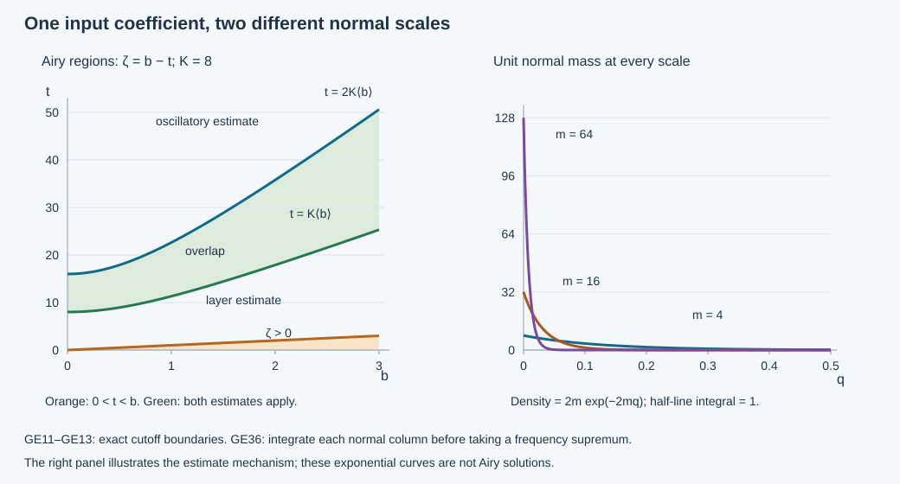

# Weighted energy bounds for the growing Airy kernel

The growing real Airy function requires an exponential weight on its input coefficient. That weight is concentrated at the physical boundary; the same coefficient also produces an oscillatory wave farther inside. We estimate both parts for the actual variable-coefficient phase and matrix amplitudes. Together with the decaying-kernel theorem, this constructs the two-mode parametrix continuously in the original energy space, proves its smooth equation error and identifies its value and conormal traces.

The primary antecedent is Melrose–Taylor, [*Boundary Problems for Wave Equations With Grazing and Gliding Rays*](https://mtaylor.web.unc.edu/wp-content/uploads/sites/16915/2018/04/glide.pdf), §§6.3–6.4 and §7.3. The exact weight was proved for the affine model in [the energy-space lesson](../20261008-airy-energy-spaces/airy-energy-spaces-and-weak-boundary-data.md). Here a normal-integrated Fourier estimate and an explicit split at the Airy turning region handle general phases. The [decaying-kernel estimate](../20261010-airy-collar-mapping/sharp-sobolev-mapping-for-the-decaying-airy-kernel.md), [actual amplitudes](../20261008-coupled-airy-amplitudes/coupled-matrix-airy-amplitudes.md) and [Airy symbol bounds](../20261008-airy-boundary-inverse/zero-free-airy-quotients-and-robin-matching.md) are retained with their exact conventions.

Independent text, proofs, exercises and figure: **CC0-1.0**. The proof map identifies exact earlier proofs, including external human foundations.  This is a bounded construction from the stated weighted coefficients. The forward energy bound does not itself give a reverse weighted estimate or represent every variable-coefficient energy solution.

## 1. The coefficient domain and the receiving operator

**H0. Keep the frequency-side coefficients.** Work on a small collar \(0\le q<Q\), with \(x=(q,y)\), \(y\in\mathbb R^d\), \(d\ge2\). Use the BCP/CAA phases and amplitudes. Thus \(\theta,\zeta\) are real of degrees \(1,2/3\), and

\[
 \theta_b=S(y,\eta),\quad \det S_{y\eta}\ne0,\quad
 k=\lambda^{2/3},\quad b=-\mu\lambda^{-1/3},\quad
 \zeta=b-kq\,d(q,y,\widehat\eta),\quad 0<c\le d\le C.
 \tag{GE1}
\]

The coefficient \(d(q,y,\widehat\eta)\) in GE1 is a smooth positive function, distinct from the fixed dimension. The frequency vector is \(\eta=(\mu,\eta',\lambda)\), \(\lambda\ge1\), on a small convex cone with \(|\eta|\asymp\lambda\), \(|\mu|/\lambda\le\delta\). Its angular cutoff is \(\omega\). The finite matrix amplitudes have ordinary symbol orders \(g\in S^0\), \(h\in S^{-1/3}\), with uniform base derivatives. A fixed smooth output cutoff \(\chi\) has compact tangential support.

Write \(A=\operatorname{Ai}\), \(B=\operatorname{Bi}\), and \(\Psi(t)=2(t_+)^{3/2}/3\). Define

\[
 W_A=\lambda^{5/3},\qquad
 W_B=\lambda^{5/3}
          +\lambda^{4/3}\frac{e^{2\Psi(b)}}{\langle b_+\rangle},
 \qquad
 \|(a,\beta)\|_{\mathcal E}^2=(2\pi)^{-d}
       \int_\Gamma\bigl(W_A|a|^2+W_B|\beta|^2\bigr)\,d\eta .
 \tag{GE2}
\]

Here \(a,\beta\) are measurable frequency-side vector coefficients. Initially take bounded frequency support and set

\[
 U(a,\beta)(x)=\chi(x)(2\pi)^{-d}\int e^{i\theta(x,\eta)}\omega(\eta)
 \{[gA(\zeta)+ihA'(\zeta)]a(\eta)
       +[gB(\zeta)+ihB'(\zeta)]\beta(\eta)\}\,d\eta .
 \tag{GE3}
\]

An arbitrary multiplication in the input base variable is not inserted into this definition. It would convolve the frequency coefficients and has not been proved bounded for the exponential weight GE2. Frequency truncation and bounded frequency multipliers, which preserve that weight directly, will suffice.

**H1. The forward energy theorem.** On one sufficiently small fixed phase patch,

\[
 \|U(a,\beta)\|_{H^1((0,Q)\times\mathbb R^d)}
                       \le C\|(a,\beta)\|_{\mathcal E}.
 \tag{GE4}
\]

The map extends by frequency truncation to the complete Hilbert space in GE2, and the limit is independent of the truncations. For the actual CAA transport amplitudes, on every smaller region where \(\chi=1\), the equation error \(\mathcal P U\) is smooth up to the boundary, with every compact \(C^j\) seminorm bounded by \(C_j\|(a,\beta)\|_{\mathcal E}\). The boundary traces in Section 6 belong to \(H^{1/2}\) and \(H^{-1/2}\) and are the actual weak traces.

No lower estimate on the full coefficient norm is asserted here. In particular the Hilbert-space completeness of the coefficients does not imply injectivity, a closed image or surjectivity onto all energy solutions.

## 2. A Fourier estimate that integrates the normal variable

**S0. The phase and amplitude lemma.** For each \(q\in(0,Q)\), let \(D_q\) be a convex frequency region. Suppose the real phase \(\varphi(q,y,\eta)\) satisfies, on a fixed compact tangential patch and for \(\eta,\nu\in D_q\),

\[
\begin{split}
 |\varphi_y(q,y,\eta)-\varphi_y(q,y,\nu)|
                                      &\ge c_1|\eta-\nu|,\\
 |\partial_y^\alpha[\varphi_y(q,y,\eta)-\varphi_y(q,y,\nu)]|
                                      &\le C_\alpha|\eta-\nu|.
\end{split} \tag{GE5}
\]

Let \(m(q,y,\eta)\) be a matrix amplitude, smooth in \(y\), supported in that compact patch, zero outside \(D_q\), and measurable in its other variables. Suppose, for every multi-index needed below,

\[
 \sup_\eta\int_0^Q
       \sup_y|\partial_y^\alpha m(q,y,\eta)|^2\,dq
                                    \le M_\alpha^2<\infty .
 \tag{GE6}
\]

Then the map
\[
 f\longmapsto (2\pi)^{-d}\int_{D_q}
          e^{i\varphi(q,y,\eta)}m(q,y,\eta)f(\eta)\,d\eta
 \quad\text{is bounded }L^2_\eta\longrightarrow L^2_{q,y}.
 \tag{GE7}
\]

No frequency derivative of \(m\) is required.

**S1. Proof, with the normal integral retained.** First bound the frequency support and restrict to a compact subinterval of \(q>0\). The normal operator in Fourier variables has kernel, up to the fixed Fourier constant,

\[
 K(\eta,\nu)=\int_0^Q\int
 e^{i[\varphi(q,y,\nu)-\varphi(q,y,\eta)]}
           m(q,y,\eta)^*m(q,y,\nu)\,dy\,dq .
 \tag{GE8}
\]

For \(|\eta-\nu|\le1\), tangential support volume and Cauchy–Schwarz in \(q\) bound this kernel by \(CM_0^2\). For larger differences integrate in \(y\) with the vector field
\(\nabla_y(\varphi_\nu-\varphi_\eta)/(i|\nabla_y(\varphi_\nu-\varphi_\eta)|^2)\cdot\partial_y\).
GE5 and the quotient rule bound every derivative of its coefficients by \(C_\alpha|\eta-\nu|^{-1}\). Repeated transposition therefore bounds the integrand by
\[
 C_N|\eta-\nu|^{-N}
       \sum_{|\alpha|+|\gamma|\le N}
       |\partial_y^\alpha m(q,y,\eta)|
       |\partial_y^\gamma m(q,y,\nu)|.
 \tag{GE9}
\]

Integrate in \(y\) over the fixed compact set, and use GE6 and Cauchy–Schwarz in \(q\) for each product. Thus \(|K(\eta,\nu)|\le C_N(1+|\eta-\nu|)^{-N}\). The earlier Schur proof P1:B3, with \(N>d\), bounds this normal operator on \(L^2_\eta\), hence proves GE7. All constants are independent of the initial truncations. Fubini is justified there by GE6; density and monotone exhaustion of the output interval remove the truncations. The same estimate applied to input differences proves convergence. There is no integration by parts in \(q\), and no boundary term has been discarded.

**S2. Verify GE5 by one fixed matrix.** Shrink the base and angular patch so \(\theta_{y\eta}\) is uniformly close to a fixed invertible matrix \(M\). On the convex frequency cone the fundamental theorem along the segment from \(\eta\) to \(\nu\) gives
\[
 \theta_y(\eta)-\theta_y(\nu)
       =M(\eta-\nu)+e,\qquad |e|\le\varepsilon|\eta-\nu|.
 \tag{GE10}
\]

Take \(\varepsilon\) below half the smallest singular value of \(M\). All higher tangential derivatives of \(\theta_{y\eta}\) are uniformly bounded, by homogeneity and the compact angular patch. Thus \(\theta\) satisfies GE5. The same proof will work for the negative Airy phases once their mixed matrices and higher tangential derivatives have been bounded.

## 3. Separate the boundary layer from the oscillations

**P0. Exact frequency and normal cutoffs.** Put \(t=qk\), \(L(b)=\langle b\rangle\). Choose a smooth \(\gamma(b)\) equal to zero for \(b\le-2\) and one for \(b\ge-1\). Choose \(\nu(s)=1\) for \(s\le1\), \(\nu(s)=0\) for \(s\ge2\), with values in \([0,1]\). Fix \(K\ge8/c\). Split the growing kernel amplitude into the layer and oscillatory pieces by

\[
 \ell(q,\eta)=\gamma(b)\nu\!\left(\frac{qk}{K L(b)}\right),
 \qquad o(q,\eta)=1-\ell(q,\eta).
 \tag{GE11}
\]

For estimates write \(o=(1-\gamma)+\gamma(1-\nu)\). The first summand has \(b\le-1\), so \(\zeta=b-kqd\le-1\). The second has \(t\ge K L(b)\); hence
\[
 -\zeta=t\,d-b\ge(c-1/K)t\ge\tfrac78ct,\qquad
 v=\mu/\lambda=-b/k\ge-q/K.
 \tag{GE12}
\]

The first summand has \(v\ge0\). Thus both oscillatory summands are supported inside the convex region
\[
 D_q=\{\eta\text{ in the chosen convex cone}:v>-2q/K\},
 \qquad V=-\zeta/k=v+q\,d\ge\tfrac34cq .
 \tag{GE13}
\]

The region used for the phase can be slightly larger than the amplitude support. Values of the phase outside that region are immaterial. The layer has \(b\ge-2\) and \(0\le t\le2K L(b)\). Every statement is uniform as \(q\downarrow0\).

**P1. The oscillatory phases satisfy the Fourier lemma.** ABQ:B1–B4 give exact decompositions for \(a\le-1\):
\[
 B(a)=\sum_{\epsilon=\pm1}e^{i\epsilon\,2(-a)^{3/2}/3}b_\epsilon(a),
 \quad
 B'(a)=\sum_{\epsilon=\pm1}e^{i\epsilon\,2(-a)^{3/2}/3}c_\epsilon(a),
 \tag{GE14}
\]
with
\(|\partial_a^j b_\epsilon(a)|\le C_j|a|^{-1/4-j}\) and
\(|\partial_a^j c_\epsilon(a)|\le C_j|a|^{1/4-j}\).
Indeed express \(B\) through \(F,\overline F\) using ABQ:AB14 and its following identity, then use the full differentiated symbol expansion ABQ:B2. These are exact symbol factors, not derivatives of an undifferentiated asymptotic error.

The phases are
\[
 \varphi_\epsilon=\theta+\epsilon\tfrac23\lambda V^{3/2}.
 \tag{GE15}
\]

For each \(|\alpha|\ge1\), tangential differentiation of \(V=v+qd\) supplies a factor \(q\), while one frequency differentiation supplies \(\lambda^{-1}\) times a bounded angular derivative. On \(D_q\), each mixed term in
\(\partial_y^\alpha\partial_\eta(\lambda V^{3/2})\)
is bounded by sums of \(q^j V^{1/2-j}\) and \(q^j V^{3/2-j}\), \(j\ge1\). GE13 and the upper bound \(V\le C(\delta+Q)\) make these at most \(C_\alpha\sqrt q\), with constants for the fixed patch. In particular the mixed matrix perturbation from \(\theta\) is \(O(\sqrt Q)\). Choose \(Q\) small enough in S2; convexity of \(D_q\) then proves GE5 uniformly for both phases, including all its higher tangential derivatives. This argument differentiates in frequency only once.

**P2. The oscillatory amplitude has an integrable column norm.** Let \(H_\epsilon=g b_\epsilon(\zeta)+ih c_\epsilon(\zeta)\), with either oscillatory cutoff from P0. Tangential derivatives of \(\zeta\) are \(O(t)\), and on these supports \(|\zeta|\ge c't\), \(|\zeta|\ge1\). The chain rule and GE14 give
\[
 |\partial_y^\alpha H_\epsilon|
                         \le C_\alpha|\zeta|^{-1/4}.
 \tag{GE16}
\]

Here \(\lambda^{-1/3}\sqrt{|\zeta|}\le C\), since \(|\zeta|\le Ck\). One full output derivative of
\(e^{i\varphi_\epsilon}\chi\omega o H_\epsilon\)
has the same phase and an amplitude bounded, with every tangential derivative, by \(C_\alpha\lambda|\zeta|^{-1/4}\). To check this, \(\partial_x\varphi_\epsilon=O(\lambda)\) with all tangential derivatives; a differentiated Airy symbol supplies at most \(k/|\zeta|\le k\le\lambda\). The derivative of the normal cutoff costs \(k/L(b)\le\lambda\). Differentiated \(g,h,\chi\) obey their stated symbol bounds. The same argument after any tangential derivatives uses \(t/|\zeta|\le C\).

Divide the input coefficient by \(\sqrt{W_B}\). Since \(W_B\ge\lambda^{5/3}\), the amplitude for the value or any first derivative satisfies
\[
 |\partial_y^\alpha m_\epsilon(q,y,\eta)|
       \le C_\alpha\lambda^{1/6}|\zeta|^{-1/4}
       \le C_\alpha q^{-1/4}.
 \tag{GE17}
\]

The last majorant has finite squared integral on \((0,Q)\), namely \(2\sqrt Q\) up to its constant. S0–S1 therefore give the full \(H^1\) bound for both oscillatory pieces.

## 4. The exponentially weighted boundary layer

**L0. A uniform normal-column estimate.** On the layer \(b\ge-2\), \(0\le t\le2K L(b)\), retain phase \(\theta\). Let \(H=gB(\zeta)+ihB'(\zeta)\). For the value and each first output derivative, write the differentiated integrand as \(e^{i\theta}J_j\), including \(\chi,\omega,\ell\). We claim
\[
 \int_0^Q\sup_y|\partial_y^\alpha J_j(q,y,\eta)|^2\,dq
       \le C_\alpha\lambda^{4/3}
                    \frac{e^{2\Psi(b)}}{\langle b_+\rangle}
 \quad (j=0,\ldots,d+1).
 \tag{GE18}
\]

We prove the bound uniformly after arbitrary fixed tangential derivatives. Every Airy derivative satisfies
\[
 |B^{(j)}(a)|\le C_j\langle a\rangle^{j/2-1/4}e^{\Psi(a)} .
 \tag{GE19}
\]
This is the positive growing expansion and the negative symbol decomposition already proved in ABQ:B2–B4 and AES:E1, with the compact remaining interval included by continuity.

**L1. The part next to the boundary.** If \(b\) is bounded above, all \(t,\zeta\) in this layer are bounded; the estimates below follow directly from GE19. Suppose \(b\) is large. Split the estimating integral at \(t=b/(2C)\). Below this value,
\[
 b/2\le\zeta=b-td\le b,\qquad
 \Psi(b)-\Psi(\zeta)\ge c_2t\sqrt b .
 \tag{GE20}
\]

Indeed integrate \(\Psi'(s)=\sqrt s\) from \(\zeta\) to \(b\), using \(b-\zeta=td\ge ct\). Each positive tangential derivative of \(\zeta\) supplies \(O(t)\). Thus a chain-rule term with \(j\) Airy derivatives is bounded by
\(C b^{-1/4}(t\sqrt b)^j e^{\Psi(b)-c_2t\sqrt b}\).
For \(hB'\) the extra factor \(\lambda^{-1/3}\sqrt b\) is bounded because \(b\le\delta k\).

After one output derivative, divide \(J_j\) by \(\lambda\). Derivatives of the phase contribute bounded factors. A derivative of the Airy argument contributes \(O(k/\lambda)=O(\lambda^{-1/3})\), paired with one more Airy derivative; its additional factor \(\lambda^{-1/3}\sqrt b\) is again bounded. If it falls on \(hB'\), the possible \(B''\) factor gives \(\lambda^{-2/3}b\le C\). Derivatives of the normal cutoff cost \(k/(\lambda L)\le1\). The same counts persist under tangential derivatives. Therefore, for a finite integer \(M_\alpha\),
\[
 |\partial_y^\alpha(J_j/\lambda)|
    \le C_\alpha b^{-1/4}e^{\Psi(b)}
           (1+t\sqrt b)^{M_\alpha}e^{-c_2t\sqrt b}.
 \tag{GE21}
\]

Squaring and integrating in \(t\), with \(s=t\sqrt b\), gives
\[
 \int_0^{b/(2C)}\sup_y|\partial_y^\alpha(J_j/\lambda)|^2dt
                         \le C_\alpha e^{2\Psi(b)}/b .
 \tag{GE22}
\]

The elementary integral of a polynomial times \(e^{-2c_2s}\) is finite, by repeated integration by parts. The supremum in \(y\) is legitimate because all bounds used the same \(c,C\).

**L2. The rest of the layer is exponentially smaller.** If \(b/(2C)\le t\le2K L(b)\), then
\(\zeta\le(1-c/(2C))b\) and \(|\zeta|\le C_K b\).
Consequently \(\Psi(\zeta)\le\Psi(b)-c_3b^{3/2}\), with a fixed \(c_3>0\); if \(\zeta<0\) its positive part is zero. GE19 and the finite chain rule bound every term in \(J_j/\lambda\) by
\[
 C_\alpha(1+b)^{M_\alpha}
                  e^{\Psi(b)-c_3b^{3/2}} .
 \tag{GE23}
\]

The interval length is \(O(b)\). Any polynomial times \(e^{-2c_3b^{3/2}}\) is bounded by \(C/b\) for \(b\) large, as follows by setting \(s=b^{3/2}\) and maximizing \(s^m e^{-c_3s}\). The integrated square of GE23 is therefore bounded by the right side of GE22. Including bounded \(b\ge-2\), replacing \(b\) by \(\langle b_+\rangle\), and using \(dq=dt/k\), proves GE18:
\(\lambda^2/k=\lambda^{4/3}\).
No derivative was taken of the auxiliary nonsmooth bounding function \(b_+^{3/2}\).

**L3. Apply the Fourier lemma before taking a supremum in frequency.** Divide each \(J_j\) by \(\sqrt{W_B}\). GE18 gives GE6 directly. S2 supplies GE5 for phase \(\theta\), so S0–S1 bound the layer and all its first weak derivatives in \(L^2\). Together with P2,
\[
 \|T_B\beta\|_{H^1}\le
     C\left((2\pi)^{-d}\int W_B|\beta|^2\,d\eta\right)^{1/2}.
 \tag{GE24}
\]

The column norm is integrated in \(q\) for each frequency before any frequency supremum is taken. Reversing that order can give a divergent bound; Exercise X1 computes the failure exactly.

## 5. The two-mode map and its actual equation error

**E0. Complete the coefficient-to-energy construction.** Multiplication of \(a,\beta\) by \(\sqrt{W_A},\sqrt{W_B}\) identifies GE2 isometrically with two vector-valued \(L^2\) spaces. It is therefore complete. Bounded frequency truncations converge there.

For the Ai term, ACM:C1 gives the \(H^{5/6}\)-to-\(H^1\) bound. Its compact input cutoff can be removed for this polynomially weighted coefficient statement as follows. On the compact output and angular patch, every critical input base coordinate of the homogeneous Airy phase is bounded. Choose an input cutoff equal to one on a larger compact set. Outside it the phase frequency gradient differs from the input base variable by a fixed positive amount, and for large input base it has size comparable to that base variable. The differentiated nonstationary integrations in ACM:F2 and RC:C5 give a kernel smooth in the output and rapidly decreasing with all derivatives in that input variable. Its tested action on any global \(H^{5/6}\) input is bounded in every compact output Sobolev norm by Fourier Cauchy–Schwarz, as in WM:W1. The compact-input portion has the ACM bound. Hence
\[
 \|T_Aa\|_{H^1}\le
     C\left((2\pi)^{-d}\int\lambda^{5/3}|a|^2\,d\eta\right)^{1/2}.
 \tag{GE25}
\]

This removal uses a polynomial Sobolev norm, not an invariance assertion for \(W_B\). GE24–GE25 prove GE4. Their difference estimates make the bounded-frequency integrals Cauchy in the actual \(H^1\) norm. The limit and every first weak derivative agree distributionally with their limits on compact tests. This defines GE3 on the entire stated coefficient space, without assuming two separately tempered boundary-normalized coefficients.

**E1. Smooth equation errors for the decaying term.** Now use the actual CAA amplitudes and operator. CAA:A8 gives the full transport residuals as rapidly decreasing symbols plus symbols flat on the attained set \(\zeta\le0\), with all differentiated estimates. Near the caustic, \(z=\zeta/k=-v-qd\) is a valid angular coordinate: \(\partial_vz=-1+O(q)\) stays nonzero. Taylor's formula at \(z=0\), with the other coordinates fixed, gives for a flat residual of order \(m\)
\[
 |r(x,\eta)|\le C_N\lambda^{m-2N/3}\zeta_+^N ,
 \tag{GE26}
\]
and the corresponding bound after any specified derivatives, with their finite order losses. The larger source patch contains the Taylor segments.

Where \(r\ne0\), \(\zeta>0\), and every derivative of \(A(\zeta)\) is a polynomial weight times \(e^{-\Psi(\zeta)}\). This exponential absorbs \(\zeta_+^N\) and every further fixed power. Taking \(N\) arbitrarily large makes every product of a flat residual with an Ai factor rapidly decreasing in \(\lambda\), after all output and frequency derivatives. The rapidly decreasing residual symbols themselves have the same property because Ai derivatives have only polynomial growth elsewhere. Apply the exact operator identity CAA:A1 and A8: the Fourier amplitude of the Ai equation error belongs to \(S^{-\infty}\) uniformly up to \(q=0\). Pairing it with \(a\) by weighted Cauchy–Schwarz proves every compact smooth-output seminorm bound.

**E2. Smooth equation errors for the growing term.** Let \(F=c_0(A-iB)\), \(c_0=\sqrt\pi e^{i\pi/4}\), and let \(K_F,K_{\overline F}\) denote the CAA normalized kernels with the same \(g,h\). The amplitudes are not conjugated when the Airy solution is conjugated. Exactly,
\[
 T_B\beta=\frac1{2i}
 \left[K_{\overline F}\!\left(\overline{F(b)}\,\beta/\overline{c_0}\right)
             -K_F\!\left(F(b)\,\beta/c_0\right)\right].
 \tag{GE27}
\]

Expressions in parentheses are frequency-side inputs. The real-axis bounds ABQ:B4 imply
\[
 \lambda\,|F(b)|^2\le C W_B .
 \tag{GE28}
\]

For \(b\ge0\), divide the left side by the second term of \(W_B\): the ratio is bounded by \(C\lambda^{-1/3}\langle b\rangle^{1/2}\le C\), since \(b\le\delta k\). For \(b<0\), \(|F(b)|^2\le C\), and \(W_B\ge\lambda^{5/3}\). Thus both normalized inputs in GE27 have \(H^{1/2}\) Fourier norm bounded by the coefficient norm. CAA:A10–A11 prove that each normalized equation-error amplitude is rapidly decreasing with all output derivatives. Weighted Fourier Cauchy–Schwarz therefore gives a smooth error and every claimed seminorm bound for GE27, even though its input need not have compact base support.

GE27 is initially an identity at bounded frequencies. GE24 and the rapidly decreasing error bounds let it pass to the energy and error limits. Where an output cutoff is differentiated the complete additional term is \([\mathcal P,\chi]U\); no smoothness is asserted for that term. The smooth-error statement in H1 is on the region where \(\chi=1\).

## 6. Value and conormal traces in the weak problem

**T0. Four exact boundary coefficient bounds.** The Airy estimates and \(|b|\le\delta k\) give
\[
\begin{split}
 \lambda|A(b)|^2+\lambda^{1/3}|A'(b)|^2&\le C W_A,\\
 \lambda|B(b)|^2+\lambda^{1/3}|B'(b)|^2&\le C W_B .
\end{split} \tag{GE29}
\]

For negative \(b\), use \(|A|+|B|\le C\langle b\rangle^{-1/4}\), \(|A'|+|B'|\le C\langle b\rangle^{1/4}\); both terms are at most \(C\lambda^{5/3}\). For positive \(b\), the decaying factors give the first bound. In the growing bound the respective ratios to \(\lambda^{4/3}e^{2\Psi(b)}/\langle b\rangle\) are bounded by \(\lambda^{-1/3}\langle b\rangle^{1/2}\) and \(\lambda^{-1}\langle b\rangle^{3/2}\), both uniformly bounded. Compact \(b\) is included by continuity.

Define
\[
 v_0=A(b)a+B(b)\beta,\qquad
 v_1=A'(b)a+B'(b)\beta .
 \tag{GE30}
\]

Then \(v_0\) has \(H^{1/2}\) Fourier norm and \(v_1\) has \(H^{1/6}\) Fourier norm, bounded by \(C\|(a,\beta)\|_{\mathcal E}\). The squared triangle inequality retains both terms of the coefficient pair.

**T1. The exact boundary row.** First work on the boundary patch where \(\chi=1\) in a collar. Use the actual CAA condition \(h_b=0\) and its intrinsic conormal
\(\mathcal N=\sum_j a^{qj}D_j+R\).
Write \(T_e\) for the ordinary boundary graph integral with phase \(S\) and amplitude \(\omega e\). With the CAA matrices
\[
 d_0=\left[-i\sum_j a^{qj}\partial_jg+Rg\right]_b,\qquad
 c_0^{\,\mathrm{row}}=a^{qq}[\,\partial_qh-i\zeta_qg\,]_b ,
 \tag{GE31}
\]
the exact traces are
\[
 f=U|_b=T_{g_b}v_0,\qquad
 n=\mathcal N U|_b=T_{d_0}v_0+T_{c_0^{\,\mathrm{row}}}v_1 .
 \tag{GE32}
\]

The symbol orders are \(0,0,2/3\). The boundary graph theorem GE:D3–D6 and GE29 therefore give
\[
 \|f\|_{H^{1/2}}+\|n\|_{H^{-1/2}}
                         \le C\|(a,\beta)\|_{\mathcal E}.
 \tag{GE33}
\]

For bounded-frequency coefficients GE32 follows by the complete product-rule calculation CAA:A12, with an arbitrary Airy solution in place of the normalized one. In particular its coefficient \(-i\zeta_qg\) and matrix order are retained. If the output cutoff is present at the boundary, its actual traces are \(\chi_b f\) and \(\chi_b n-i\sum_j a^{qj}(\partial_j\chi)_b f\). The extra term has the same bound by the already proved trace estimate and bounded smooth multiplication; it is not omitted.

**T2. Identify the weak conormal, not just a formal row.** Write the original left-coefficient operator as
\(\mathcal P=\sum a^{ij}D_iD_j I+\sum b^jD_j+c_0\).
For the linear-in-first-slot inner product, its energy form on a compact collar patch is
\[
 \mathfrak q(u,w)=
 \sum_{i,j}(a^{ij}D_ju,D_iw)
 +\sum_j\bigl((b^j-\sum_iD_i a^{ij})D_ju,w\bigr)
 +(c_0u,w).
 \tag{GE34}
\]

This form is continuous on \(H^1\times H^1\) on the fixed patch. For smooth bounded-frequency approximants and smooth tests vanishing near the artificial edges, integration by parts gives
\[
 \mathfrak q(u,w)-i\langle Rf,w|_b\rangle
     =(\mathcal Pu,w)-i\langle n,w|_b\rangle .
 \tag{GE35}
\]

The sign follows directly from
\((D_qv,w)=(v,D_qw)+iv(0)\overline{w(0)}\)
on \(q\ge0\). The subtraction \(\sum_iD_i a^{ij}\) in GE34 restores the original left coefficients. All complex matrix lower terms remain in their displayed order.

Take tests supported where the output cutoff is one. E0 gives convergence in \(H^1\), E1–E2 give convergence of \(\mathcal Pu\) in every compact smooth norm, and T0–T1 give convergence of both boundary expressions in their stated Sobolev norms. Thus every term in GE35 converges. Smooth density and the continuous \(H^{1/2}\) trace NCQ:N3 extend it to all energy tests with those supports.

The graph trace hypotheses also hold directly. Set \(V_i=\sum_j a^{ij}D_ju\). Then \(V_q\in L^2\), and the divergence rewriting used in GE34 gives \(D_qV_q=\mathcal Pu-\sum_{i\ne q}D_iV_i-\text{lower terms}\in L^2_qH^{-1}_y\) on a compact smaller patch. The approximants converge in these two graph norms. WSL:L6 therefore identifies their boundary flux limits with the original graph trace of \(V_q\); adding \(Rf\) gives exactly \(n\). Alternatively GE35 and the explicit trace right inverse in AES:E8 give uniqueness of the same boundary functional. This proves the final assertion of H1.

The proof constructs the parametrix on the original energy space with a controlled smooth equation error. Removing that error, proving a reverse weighted norm, and proving that every general energy solution is represented are additional steps; none follows from GE35 alone.

## 7. Three solved exercises

**X1. Why a pointwise-in-depth bound loses the estimate.** For \(m\ge1\), let \(a_m(q)=\sqrt{2m}\,e^{-mq}\), \(q>0\). Compute its squared normal integral and the supremum of its square over \(m\ge1\). Explain the order of operations in S1.

**Solution.** Direct integration gives
\[
 \int_0^\infty |a_m(q)|^2dq=1,\qquad
 \sup_{m\ge1}|a_m(q)|^2=
 \begin{cases}
   (e q)^{-1},&0<q\le1/2,\\
   2e^{-2q},&q\ge1/2 .
 \end{cases} \tag{GE36}
\]

Indeed differentiation of \(2m e^{-2mq}\) in \(m\) gives its maximum at \(m=1/(2q)\) when that value is allowed, and otherwise at \(m=1\). The supremum is not integrable at zero although every column has integral one. In GE8–GE9 the product of two columns is integrated first and bounded by Cauchy–Schwarz. Replacing both columns by their pointwise supremum would destroy this bound.

**X2. The elliptic boundary-layer scale and the input weight.** In the affine model take \(b=a_0\lambda^{2/3}\) with fixed \(0<a_0<\min(\delta,Q)\), and put \(q=s/\lambda\). Find the leading Airy exponential difference and boundary-layer energy power.

**Solution.** With \(k=\lambda^{2/3}\), \(\zeta=b-kq\), Taylor's formula on a bounded \(s\) interval gives
\[
 \Psi(b)-\Psi(\zeta)=\sqrt{a_0}\,s+O(\lambda^{-1}),\qquad
 B(b)^2\sim\pi^{-1}a_0^{-1/2}\lambda^{-1/3}
                     e^{(4/3)a_0^{3/2}\lambda}.
 \tag{GE37}
\]

The normal width is \(1/(\sqrt{a_0}\lambda)\). The full positive-interval value integral, by the endpoint estimate AES:E1 and its same one-step asymptotic integration, satisfies
\[
 \lambda^2\int_0^{a_0} B(b-kq)^2dq
  \sim\frac{\lambda^{2/3}}{2\pi a_0}
                     e^{(4/3)a_0^{3/2}\lambda}.
 \tag{GE38}
\]

To verify the constant, change to the Airy variable, use
\(B(t)^2\sim\pi^{-1}t^{-1/2}e^{2\Psi(t)}\),
and divide the endpoint amplitude by \((2\Psi)'(b)=2\sqrt b\). The lower endpoint and differentiated remainder are exponentially or algebraically smaller by the split at \(b/2\) from AES:E1. Since \(\lambda^2/k=\lambda^{4/3}\), the leading coefficient is \(\lambda^{4/3}/(2\pi b)\). This is exactly the exponential summand of GE2 up to its fixed constant. It cannot be replaced by a polynomial weight uniformly over the affine family.

**X3. Recover the model conormal row and weak sign.** Let \(P_0=D_q^2-qD_{y_d}^2-D_{y_1}D_{y_d}\), \(g=1,h=0\), and \(R=K\) a constant complex matrix. Compute GE31–GE35.

**Solution.** Here \(\zeta_q=-k\), \(d_0=K\), and \(c_0^{\mathrm{row}}=ikI\). Therefore
\[
 f=\mathcal F^{-1}v_0,\qquad
 n=\mathcal F^{-1}(ikv_1+Kv_0),\qquad
 \mathfrak q_0(u,w)-i\langle Kf,w|_0\rangle
                        =-i\langle n,w|_0\rangle .
 \tag{GE39}
\]

The bulk source is zero for this affine model. Directly,
\(u_q|_0=-k\,\mathcal F^{-1}v_1\), so \(D_qu|_0=ik\,\mathcal F^{-1}v_1\), confirming the row. The zero conormal condition is \(ikv_1+Kv_0=0\) with this sign. GE29 gives the actual trace spaces even when \(K\) is neither Hermitian nor diagonalizable.

## 8. The two scales in the figure

**V0. Exact interpretation.** The left panel uses the affine argument \(\zeta=b-t\), \(t=q\lambda^{2/3}\), \(b\ge0\), and the illustrative constants \(c=C=1,\ K=8\). The lines \(t=b\), \(t=K\langle b\rangle\) and \(t=2K\langle b\rangle\) mark the turning set and the two cutoff boundaries from GE11. The middle band is an overlap of the estimates, not a discontinuity of the kernel. The right panel plots the exact densities \(2m e^{-2mq}\) for \(m=4,16,64\); each integrates to one on the half-line. They illustrate GE36 and are not numerical Airy solutions. The [figure source](figures/build_figure.py) preserves all constants and labels.
