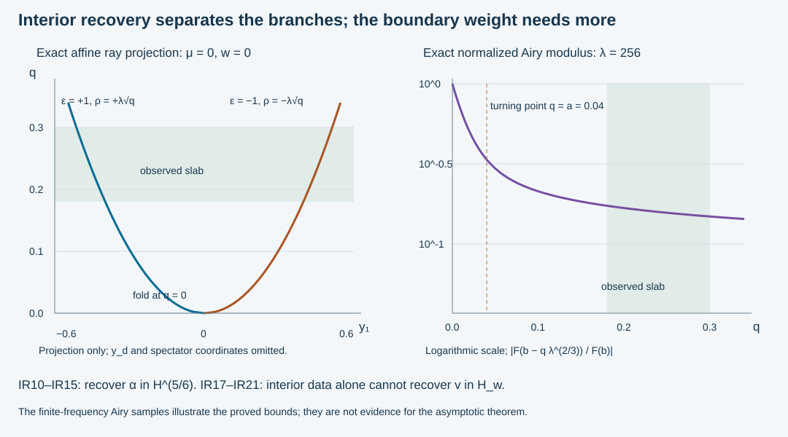

# Interior recovery of the two Airy coefficients

An interior observation separates the two real propagation branches of an Airy field. We construct bounded extraction operators for their coefficients, with the exact one-sixth Sobolev shift, and identify which extraction recovers the stable decaying coefficient. An explicit family of exact solutions then shows why this interior estimate cannot recover the full boundary weight.

The proof uses the actual phases and complex matrix amplitudes of the [coupled Airy construction](../20261008-coupled-airy-amplitudes/coupled-matrix-airy-amplitudes.md), the [sharp decaying-kernel estimate](../20261010-airy-collar-mapping/sharp-sobolev-mapping-for-the-decaying-airy-kernel.md), and the [stable coefficient space](../20261010-stable-airy-localization/stable-airy-coefficients-and-spatial-localization.md). The primary antecedent is Melrose and Taylor, [*Boundary Problems for Wave Equations With Grazing and Gliding Rays*, §§6.3–6.5](https://mtaylor.web.unc.edu/wp-content/uploads/sites/16915/2018/04/glide.pdf). Those sections identify the interior oscillating pieces. The normal inverses, coefficient estimates and example below are proved here.

## 1. The receiving patch and exact coefficient algebra

**H0. Fixed interior and support margins.** Write \(x=(q,y)\), \(q\ge0\), \(y\in\mathbb R^d\), \(d\ge2\), and use input coordinates \(w\in\mathbb R^d\). All coefficients are vectors in a fixed finite-dimensional complex Hermitian space. Set \(\eta=(\mu,\eta',\lambda)\), \(\lambda\ge1\), in the actual glancing cone, where \(|\eta|\asymp\lambda\). We use the GAE:H0 and CAA phase contract:

\[
 \begin{split}
 k&=\lambda^{2/3},\qquad b=-\mu\lambda^{-1/3},\\
 \zeta(q,y,\eta)&=b-kq\,d_0(q,y,\widehat\eta),\qquad 0<c\le d_0\le C,\\
 \theta(0,y,\eta)&=S(y,\eta),\qquad \det S_{y\eta}\ne0 .
 \end{split}
 \tag{IR1}
\]

Here \(\theta\) is real homogeneous of degree one, \(\zeta\) has degree \(2/3\), and \(d_0\) is smooth of degree zero. The classical amplitudes \(g\in S^0_{\rm cl}\), \(h\in S^{-1/3}_{\rm cl}\) are the actual complex matrix amplitudes, with \(g_0|_{q=0}\) invertible and \(h|_{q=0}=0\). Shrink the collar so \(\zeta_q/k\) stays strictly negative. The subscript on \(d_0\) denotes this scalar geometric factor, not a boundary operator.

Choose a small fixed \(q_1>0\), a compact interval \(I\) about \(q_1\) inside the collar, and then an input cone with \(|\mu|/\lambda\ll q_1\). Thus \(-\zeta\asymp\lambda^{2/3}\) on \(I\); constants may depend on \(q_1\). We make no uniform assertion as \(q_1\) tends to zero. All output observations below have compact support strictly inside this interval and a fixed base chart. Use nested input base and conic cutoffs, with the outer cutoffs equal to one on a neighborhood of the inner microsupport. The frequency-zero part has a compact smooth kernel and is retained in the remainders.

An operator called smoothing below has a smooth kernel on these fixed compact base products. Consequently, for every real \(s\) and every \(N\ge0\), its norm from \(H^{-N}\) to \(H^s\) is finite, by WM:W1. This convention includes the whole remainder, not just its principal symbol.

**H1. The two exact modes.** Let \(A=\operatorname{Ai}\), \(B=\operatorname{Bi}\), and
\(c_+=\sqrt\pi e^{i\pi/4}\), \(c_-=\overline{c_+}\). ABQ:B1–B3 proves the exact identities
\(F_\epsilon=c_\epsilon(A-i\epsilon B)\), with \(F_-=\overline{F_+}\). Put

\[
 T_\epsilon v=(2\pi)^{-d}\int
 e^{i\theta(q,y,\eta)}
 \frac{gF_\epsilon(\zeta)+ihF_\epsilon'(\zeta)}{c_\epsilon}
 \widehat v(\eta)\,d\eta,\qquad \epsilon=\pm1 .
 \tag{IR2}
\]

The agreed output, angular and input cutoffs are understood in this formula and are identical for both signs. They are applied linearly to every operator identity. On the interior region these operators act on arbitrary compactly supported distributions. No exponentially weighted input is needed there. Crucially, changing the sign conjugates the scalar Airy solution and its constant; it does not conjugate \(g\) or \(h\).

Let \(T_A,T_B\) have the respective scalar factors \(A,A'\) and \(B,B'\), with the same amplitudes. For physical input distributions \(f,k_0\), set \(f_\pm=f\pm i k_0\). Then

\[
 T_\epsilon=T_A-i\epsilon T_B,\qquad
 U=T_Af+T_Bk_0=\tfrac12(T_+f_++T_-f_-),\qquad
 f=\tfrac12(f_++f_-),\quad k_0=\tfrac1{2i}(f_+-f_-).
 \tag{IR3}
\]

These are exact algebraic identities before any asymptotic expansion. They follow by adding the two scalar mode formulas, and remain identities of distribution kernels after the common cutoffs. Full-collar construction of \(T_Bk_0\) still uses the weighted domain in GAE; only its strictly interior restriction is asserted for arbitrary distributions here.

## 2. Separate the branches and prove their mapping estimates

**B0. Ordinary symbols on the interior slab.** ABQ:B2 gives
\(F_+(-s)=s^{-1/4}e^{2is^{3/2}/3}m(2s^{3/2}/3)\), with \(m=1+S^{-1}\) and every differentiated remainder. Its conjugate gives the other sign. Differentiation with respect to the Airy argument has leading factor \(-i\epsilon\sqrt{s}\). Thus IR2 has the ordinary homogeneous phase and leading amplitude

\[
 \phi_\epsilon=\theta+\epsilon\tfrac23(-\zeta)^{3/2},
 \qquad
 a_{\epsilon,0}
 =c_\epsilon^{-1}(-\zeta)^{-1/4}
       [g_0+\epsilon\sqrt{-\zeta}\,h_0] .
 \tag{IR4}
\]

All remainders are ordinary symbols of successively lower integer orders on this fixed slab. To check the change of scale, \(-\zeta=kV\), where \(V\) is smooth, positive and bounded away from zero. Hence \(2(-\zeta)^{3/2}/3=(2/3)\lambda V^{3/2}\). Every frequency derivative lowers degree by one, while base derivatives cost no degree. The expansion of \(m\) is therefore an ordinary expansion in \(\lambda^{-1}\). The derivative-of-\(s^{-1/4}\) terms have the same property after the leading \(s^{1/4}\) factor is removed. Combining them with \(g,h\) gives \(a_\epsilon\in S^{-1/6}\) with IR4 as principal term.

Write \(z=\zeta/k=-\mu/\lambda-q d_0\). On the chosen slab,

\[
 z_y=O(q_1),\quad z_{y\eta}=O(q_1/\lambda),\quad
 z_\eta=O(\lambda^{-1}),\quad -z\asymp q_1,\qquad
 \phi_{\epsilon,y\eta}=S_{y\eta}+O(\sqrt{q_1}) .
 \tag{IR5}
\]

For the last bound, differentiate \(\lambda(-z)^{3/2}\) once in \(y\), once in \(\eta\). The term containing \(z_yz_\eta/\sqrt{-z}\) is \(O(\sqrt{q_1})\); the other two terms are no larger. The difference \(\theta_{y\eta}-S_{y\eta}\) is \(O(q_1)\). Invertibility follows for sufficiently small fixed \(q_1\). Also \(\lambda^{1/3}h_0=O(q_1)\) and \(g_0\) stays invertible. The bracket in IR4 is an invertible matrix on a smaller patch. Its smallest singular value is uniformly positive there. Each fixed-\(q\) operator is thus an elliptic ordinary graph operator with amplitude order \(-1/6\).

**B1. Genuine output separation.** The difference of the normal covectors is

\[
 \partial_q\phi_+-\partial_q\phi_-
       =-2\sqrt{-\zeta}\,\zeta_q,\qquad
 |\partial_q\phi_+-\partial_q\phi_-|\ge c_I\lambda .
 \tag{IR6}
\]

To exclude intersections involving different input frequencies, use more than this same-frequency calculation. At the central ray the two normalized output covectors are distinct by IR6. The maps from the normalized input patch and \(q\in I\) to output covectors are continuous. Reduce \(I\), the base chart and the angular cone until their compact images lie in disjoint neighborhoods of those two covectors. The fixed-\(q\) graph inverse from B0 supplies the corresponding input coordinates. This establishes disjointness of the full retained images, not merely a pointwise normal gap.

Choose ordinary order-zero operators \(E_\epsilon\) on the full \(x\) variables, with compact interior input and output base support, whose symbols are supported in the respective disjoint neighborhoods. They equal one on a smaller ray piece for every input in a common smaller input patch. They are not asserted to be projections. Full FIO composition and wavefront localization give
\(E_\epsilon T_{-\epsilon}\) smoothing and \(E_\epsilon T_\epsilon\) an ordinary branch operator. The same is true with \(E_\epsilon^*E_\epsilon\). For completeness, the separated products have no critical point in the compact normalized phase support. The phase-gradient integration-by-parts vector field has homogeneous degree minus one there; iteration after every prescribed derivative gives arbitrary frequency decay. Compact supports and a sufficiently large number of iterations give every smooth-kernel seminorm. This also treats cutoff-edge and off-cone terms.

**B2. All real Sobolev shifts, including the adjoint.** On the fixed patch,

\[
 T_\epsilon:H^{r-1/6}_{\rm comp}(\mathbb R^d)
                   \longrightarrow H^r_{\rm comp}(I^\circ\times\mathbb R^d),
 \qquad
 T_\epsilon^*:H^r_{\rm comp}\longrightarrow H^{r+1/6}_{\rm loc},
 \quad r\in\mathbb R .
 \tag{IR7}
\]

Here the displayed compact output is obtained by the fixed cutoffs, so it is interpreted in full space. To prove the first estimate, compose on the left with a supported elliptic Sobolev weight of order \(r\), and on the right with one of order \(-r+1/6\). The full FIO composition and supported inverse construction in ACM:C1 apply to these same ordinary phases. The resulting fixed-\(q\) amplitude has order zero: the three orders add to zero. Every needed symbol seminorm is uniform on the compact \(q\) interval. GE:D3–D4 gives its \(L^2_y\) bound. Integrating the square over \(q\) proves the \(L^2_{q,y}\) bound. Every weight-parametrix remainder is smoothing with the fixed support margins. This proves the first estimate for all real \(r\), including negative ones.

For the adjoint, apply the first estimate with exponent \(-r\): \(T_\epsilon:H^{-r-1/6}\to H^{-r}\). Its kernel adjoint, paired first on compact smooth tests, extends by Hilbert duality to \(H^r\to H^{r+1/6}\). The extended map agrees with the distributional adjoint by density. No restriction of an arbitrary Sobolev distribution to a fixed \(q\) slice is used.

## 3. A positive normal symbol and bounded coefficient extraction

**N0. Integrate a graph Gram matrix.** Put \(G_\epsilon=E_\epsilon T_\epsilon\) and \(N_\epsilon=G_\epsilon^*G_\epsilon\). Then \(N_\epsilon\in\Psi^{-1/3}\). Its principal symbol in the chosen input coordinates is

\[
 n_{\epsilon,0}(w,\eta)=
 \int_I
 \frac{|e_{\epsilon,0}(q,y(q,w,\eta),\xi_\epsilon)|^2}
      {|\det\phi_{\epsilon,y\eta}(q,y(q,w,\eta),\eta)|}
 a_{\epsilon,0}^*a_{\epsilon,0}(q,y(q,w,\eta),\eta)\,dq .
 \tag{IR8}
\]

Here \(w=\phi_{\epsilon,\eta}(q,y,\eta)\), \(\xi_\epsilon=d_x\phi_\epsilon\), and the input/output densities are the Euclidean ones in these coordinates. Other smooth positive densities multiply the integrand by their usual positive ratio and change only the comparison constants.

The product formula can be justified without treating different \(q\)'s as independent input variables. Composition with \(E_\epsilon\) first puts \(G_\epsilon\), modulo a smooth kernel, in the same phase with amplitude \(e_{\epsilon,0}a_{\epsilon,0}\) at leading order. For each fixed \(q\), graph composition GE:D2–D4 gives \(G_\epsilon(q)^*G_\epsilon(q)\in\Psi^{-1/3}\) and the determinant factor in IR8. Integrate these symbols and all remainders over the compact \(q\) support. The full differentiated remainder bounds are uniform there, so integration preserves their orders and smooth remainders. Fubini is initially applied to truncated frequencies and smooth tests. The resulting symbol and kernel estimates justify its distributional limit. This proves the full operator assertion and IR8.

Choose the observation symbol equal to one on a common smaller interval and ray piece. The invertible amplitude and graph matrix in B0 then give

\[
 c\langle\eta\rangle^{-1/3}I
       \le n_{\epsilon,0}(w,\eta)
       \le C\langle\eta\rangle^{-1/3}I
 \tag{IR9}
\]

on the smaller input patch. The lower bound integrates over that common interval of positive length. It uses a positive matrix Gram integral, so complex matrix amplitudes cause no cancellation.

**N1. One extraction operator for every Sobolev order.** Let \(B_0\in\Psi^0\) be a fixed input cutoff, elliptic at the marked input point, with microsupport compactly contained in this elliptic patch. Use the supported matrix parametrix construction GE:D9 and ordinary composition to choose \(M_\epsilon\in\Psi^{1/3}\), with microsupport still inside the elliptic patch, such that
\(B_0M_\epsilon N_\epsilon=B_0+S_\epsilon\), where \(S_\epsilon\) is smoothing. Its leading inverse is the actual matrix inverse of IR8; the lower terms are ordered matrix products.

Define

\[
 \mathcal R_\epsilon
       =2B_0M_\epsilon T_\epsilon^*E_\epsilon^*E_\epsilon,
 \qquad
 \mathcal R_\epsilon:H^r_{\rm loc}(I^\circ\times\mathbb R^d)
                   \longrightarrow H^{r-1/6}_{\rm comp}(\mathbb R^d).
 \tag{IR10}
\]

All observation input supports are inside a fixed compact interior set. The map in IR10 follows from IR7, ordinary order-zero boundedness of \(E_\epsilon\), and the order \(1/3\) of \(M_\epsilon\). The loss is \(1/3-1/6=1/6\). This is a single fixed operator; it is not chosen again for each \(r\).

Insert the exact IR3 decomposition. The own-branch term uses the parametrix identity, and the other term is smoothing by B1. Thus

\[
 \mathcal R_\epsilon U
       = B_0 f_\epsilon
             +S_{\epsilon,+}f_+
             +S_{\epsilon,-}f_- .
 \tag{IR11}
\]

Each \(S_{\epsilon,\tau}\) is a full smoothing operator, with all its compact-support seminorms controlled. This proves an actual recovery identity modulo smooth kernels, not just a leading-symbol inversion.

**N2. Reverse estimates and distributional regularity.** Let \(s=r-1/6\). For every \(N\ge0\), IR10–IR11 imply

\[
 \|B_0 f_+\|_{H^s}+\|B_0 f_-\|_{H^s}
 \le C_r\|\chi U\|_{H^r}
       +C_{r,N}\bigl(\|f_+\|_{H^{-N}}+\|f_-\|_{H^{-N}}\bigr).
 \tag{IR12}
\]

Here \(\chi=1\) on all observation input supports and is supported strictly inside the collar. An arbitrary field error \(e\in H^r\) in the observed field replaces the first term by \(\|\chi(U+e)\|_{H^r}\) and adds \(C_r\|\chi e\|_{H^r}\). Smooth errors are therefore harmless to coefficient wavefront recovery, but their quantitative seminorms are retained.

The parallelogram law in any complex Hilbert space gives

\[
 \|B_0 f_+\|_{H^s}^2+\|B_0 f_-\|_{H^s}^2
       =2\|B_0 f\|_{H^s}^2+2\|B_0 k_0\|_{H^s}^2 .
 \tag{IR13}
\]

Consequently IR12 controls both raw polynomial coefficient norms, with the same coarse terms. For compactly supported distributions one first chooses \(N\) large enough that those terms are finite. If the observed \(U\) is \(H^r\), IR11 then proves \(B_0 f_\pm\in H^s\) directly. The composition identities hold on distributions by their proper kernels; the right side belongs to \(H^s\) by IR10. There is no assumption of the conclusion in a smooth approximation argument. An \(H^{-N}\) norm appearing with an arbitrary fixed \(N\) is only claimed when it is finite.

Conversely, input \(H^s\) regularity on a slightly larger patch implies \(H^r\) regularity of the smaller branch observations, by IR7 and B1. Complementary input microsupports give the full smoothing terms described in H0. Thus the statement is a microlocal equivalence with nested patches, not a global norm equivalence on unrelated input cones.

## 4. Stable coefficients and what has actually been recovered

**S0. The decaying coefficient is one of the branch coefficients.** Fix either physical sign \(\epsilon\) in SAL:C0. In physical input notation its exact conversion is

\[
 f=\alpha+Z_\epsilon v,\qquad
 k_0=-i\epsilon Z_\epsilon v,\qquad
 Z_\epsilon v=\mathcal F^{-1}
       \left(\frac{c_\epsilon}{F_\epsilon(b)}\widehat v\right).
 \tag{IR14}
\]

The weighted coefficient isomorphism proves that \(\alpha\in H^{5/6}\), \(v\in H_w\) give the actual GAE energy field. Its branch coefficients are

\[
 f_{-\epsilon}=\alpha,\qquad
 f_\epsilon=\alpha+2Z_\epsilon v,\qquad
 \mathcal R_{-\epsilon}U=B_0\alpha+\text{smooth remainder}.
 \tag{IR15}
\]

The last identity also applies to any polynomially bounded raw coefficients for which the observed field is \(H^1\); it then recovers the local \(H^{5/6}\) regularity of their combination \(f-i\epsilon k_0\). The remainder is exactly the one in IR11, bounded by the two coarse raw norms in IR12. We have proved coefficient extraction even when that regularity was not known beforehand.

When using noncompact tempered stable inputs in the Fourier construction, insert a larger compact input cutoff around all relevant values of \(\phi_{\tau,\eta}\) on the chosen output patch. Outside it, \(\phi_{\tau,\eta}-w\) is bounded away from zero and grows with \(|w|\). Integration by parts in \(\eta\), after any output derivative, gives a smooth kernel rapidly decreasing in \(w\). Pairing it with \(H^{-N}\) inputs gives the same coarse smooth estimates. SAL:L0 supplies bounded compact localization and conic reprojection of the stable inputs. These are the support reductions used in IR15; no raw exponentially weighted coefficient is multiplied by a spatial cutoff before this reduction is justified.

We do not commute \(B_0\) through \(Z_\epsilon\). The other extraction recovers \(B_0(\alpha+2Z_\epsilon v)\), with this order of operations. On the positive Airy side, multiplication by \(F_\epsilon(b)\) can grow exponentially; an ordinary Sobolev estimate cannot invert \(Z_\epsilon\) in the required boundary space.

**S1. Extraction from an arbitrary observed field.** IR10 defines \(\mathcal R_\pm u\) for every \(u\in H^1\) on the observation region, whether or not \(u\) solves a PDE. Both extracted vectors are in \(H^{5/6}\), and

\[
 \|\mathcal R_\epsilon(u+e)-\mathcal R_\epsilon u\|_{H^{5/6}}
                 \le C\|\chi e\|_{H^1}.
 \tag{IR16}
\]

For fields already represented by IR3 these vectors agree with the specified localized coefficients modulo the proved smooth remainders. For a general energy solution, bounded extraction alone does not prove that reinserting the coefficients reproduces the solution. A PDE argument controlling the residual field and its full boundary data is still required. In particular, neither global injectivity nor a closed range for the full boundary-weighted pair follows from IR12.

## 5. A boundary layer invisible to a fixed interior observation

**O0. Exact affine solutions with a normalized boundary weight.** Take the affine model
\(P_0=D_q^2-qD_{y_d}^2-D_{y_1}D_{y_d}\), \(D=-i\partial\), whose Airy argument is \(b-qk\). Fix \(a>0\) sufficiently small compared with the chosen interior interval, so \(I\subset(2a,\infty)\). Set

\[
 \eta_R=R(-a,0,\ldots,0,1),\qquad
 \widehat v_R(\eta)=R^{-1/2}\rho(\eta-\eta_R),\qquad
 0\ne\rho\in C_c^\infty(\{|\eta|<1\}).
 \tag{IR17}
\]

All sufficiently large \(R\) packets lie in the same admissible glancing neighborhood; \(a\) stays fixed. Define

\[
 u_R(q,y)=(2\pi)^{-d}\int e^{iy\cdot\eta}
       \frac{F_+(b-qk)}{F_+(b)}\widehat v_R(\eta)\,d\eta .
 \tag{IR18}
\]

Each integral has compact frequency support, so it is smooth; differentiating proves \(P_0u_R=0\) exactly and \(u_R|_{q=0}=v_R\). It is the stable pair \(\alpha=0,v=v_R\), with \(g=1,h=0\).

On the packet support, \(b=aR^{2/3}+O(R^{-1/3})\). The exact smooth weight of SAL:H0 is
\(w=\lambda^{5/3}|F_+(b)|^{-2}+\lambda^{4/3}\langle b\rangle^{-1/2}\).
ABQ:B4 gives, uniformly on this support,

\[
 w(\eta)\asymp R,\qquad
 \|v_R\|_{H_w}\asymp1,\qquad
 \|v_R\|_{H^{-N}}\asymp R^{-N-1/2}.
 \tag{IR19}
\]

The exponentially small first term in \(w\) is negligible; the second is asymptotic to \(a^{-1/2}R\). Plancherel and translation of the fixed nonzero \(\rho\) give the stated norms.

For \(q\in I\), \(b-qk\le-c_I R^{2/3}\). Its Airy value has magnitude \(O(R^{-1/6})\), while \(|F_+(b)|\ge cR^{-1/6}e^{c_aR}\), where one may take any fixed \(0<c_a<(2/3)a^{3/2}\) for large \(R\). Every \(q\) derivative of the numerator costs at most one factor \(R\); this follows from ABQ:B2 and its differentiated phase, or inductively from the Airy equation. Tangential derivatives multiply by frequencies \(O(R)\). Thus for any integer \(m\ge0\),

\[
 \|u_R\|_{H^m(I\times\mathbb R^d)}
       \le C_m R^{m-1/2}e^{-c_aR}.
 \tag{IR20}
\]

This integer norm estimate is obtained by integrating the squared Fourier bounds over \(q\); it also holds after a fixed smooth interior cutoff. Every real-order local Sobolev norm is bounded by one of these integer norms. The field therefore tends to zero faster than any power on the fixed interior observation region, despite its order-one boundary weight.

**O1. The precise failed estimate.** For every fixed real \(r\), \(N\ge0\), and constant \(C\), the estimate

\[
 \|v\|_{H_w}
       \le C\bigl(\|\chi K_+v\|_{H^r}+\|v\|_{H^{-N}}\bigr)
 \tag{IR21}
\]

fails for this affine family when \(\chi\) is any fixed smooth cutoff in the observation slab. Here \(K_+\) is exactly the normalized kernel in IR18. IR19–IR20 make the right side tend to zero and keep the left side bounded below. These are actual smooth solutions, so the failure is not a domain or distribution-product issue. It does not contradict IR12: \(Z_+v_R\), which is what the interior branch sees, is exponentially small.

The example leaves open a combined interior-and-boundary reverse estimate. That is the estimate needed for complete energy representation. It also explains why multiplying the recovered interior coefficient by an exponentially large Airy denominator is not a valid continuity argument.

## 6. Three solved exercises

**X1. Which coefficient is measured on which branch?** Work with either \(\epsilon=\pm1\) in IR14. Recover \(\alpha\) and \(Z_\epsilon v\) from the two branch coefficients and check the energy-independent coefficient identity.

**Solution.** Direct substitution gives
\(f_{-\epsilon}=\alpha\) and \(f_\epsilon=\alpha+2Z_\epsilon v\). Therefore

\[
 \alpha=f_{-\epsilon},\qquad
 Z_\epsilon v=\tfrac12(f_\epsilon-f_{-\epsilon}),\qquad
 |f_+|^2+|f_-|^2=2|f|^2+2|k_0|^2 .
 \tag{IR22}
\]

The last formula expands the two squared norms; the opposite imaginary cross terms cancel for any complex vectors. Applying a common linear cutoff and Sobolev weight gives IR13. Neither this identity nor its weighted version authorizes inverting the Fourier multiplier \(Z_\epsilon\) in an unweighted Sobolev norm.

**X2. Compute the affine branch rays and the Gram determinant.** In the model \(\theta=y\cdot\eta\), \(\zeta=-\mu\lambda^{-1/3}-q\lambda^{2/3}\), put \(V=q+\mu/\lambda>0\). Find \(w=\partial_\eta\phi_\epsilon\), the normal covector, and the leading normal Gram symbol for an observation whose symbol on the retained branch is \(e(q)\).

**Solution.** Differentiating
\(\phi_\epsilon=y\cdot\eta+\epsilon(2/3)\lambda V^{3/2}\) gives
\(w_1=y_1+\epsilon\sqrt V\),
\(w_d=y_d+\epsilon[(2/3)V^{3/2}-(\mu/\lambda)\sqrt V]\), and \(w_j=y_j\) for the spectators. The normal covector is \(\epsilon\lambda\sqrt V\); the tangential covector is \(\eta\). Consequently \(\phi_{\epsilon,y\eta}=I\) and the graph determinant is one. Since \(|c_\epsilon|^2=\pi\), \(g=1,h=0\), IR8 becomes
\(n_{\epsilon,0}=\pi^{-1}\lambda^{-1/3}\int_I |e(q)|^2 V^{-1/2}\,dq\).
It is positive and of order \(-1/3\), uniformly on the smaller input cone. The extraction inverse must have order \(1/3\), not zero. This is why the adjoint's one-sixth gain leaves an overall one-sixth loss.

**X3. Can an error be discarded because it is smooth?** Suppose \(\widetilde U=U+e_j\), where each \(e_j\) is smooth, but its \(H^1\) norm is not known uniformly. Does IR11 give a uniform \(H^{5/6}\) reconstruction error?

**Solution.** It gives an error bounded by \(C\|\chi e_j\|_{H^1}\), by IR16. Smoothness says this quantity is finite for each \(j\); it supplies no uniform bound. Take a compact smooth \(e\) with \(\mathcal R_\epsilon e\ne0\), and set \(e_j=je\). Such an \(e\) exists because IR11 has an elliptic identity term, so \(\mathcal R_\epsilon\) is not the zero operator on tests. Then the coefficient error has norm \(j\|\mathcal R_\epsilon e\|_{H^{5/6}}\), which diverges. Full remainder seminorms are therefore essential for a quantitative representation argument, even when qualitative wavefront statements can ignore smooth errors.

## 7. The geometry and the remaining boundary estimate

**V0. Exact coordinates and interpretation.** The left panel uses \(g=1,h=0\), \(\mu=0\), \(\lambda=1\), input \(w=0\), and the exact branch projection \(y_1=-\epsilon\sqrt q\). Spectator coordinates and the accompanying \(y_d\) coordinate from X2 are omitted; this is a projection, not the whole canonical relation. The observed slab is \(0.18\le q\le0.30\), strictly away from the fold \(q=0\). Its branch labels give the actual normal covectors \(\rho=\epsilon\lambda\sqrt q\).

The right panel plots the exact numerical modulus \(|F_+(b-qk)/F_+(b)|\), with \(a=0.04\), \(R=\lambda=256\), \(b=aR^{2/3}\), \(k=R^{2/3}\), and \(0\le q\le0.34\). The turning point is \(q=a\), and the same interior slab is shaded. This finite-frequency illustration is not used to prove IR20; that proof uses the exact differentiated Airy bounds. The drawing retains its reproducible generator and labels the logarithmic vertical scale.

The new extraction estimate supplies the interior half of coefficient recovery. Enhanced boundary-trace recovery, a combined weighted reverse estimate, removal of the equation error with all localized complements, and representation of every general energy solution remain active. All other outstanding AN-04 obligations remain active as well. The 92 human foundation proofs inherited by this dependency chain remain external; this CC0 export does not claim internal P514 closure.

Original exposition, solutions and illustration: CC0-1.0. The linked primary sources and programme components retain their respective terms. 
