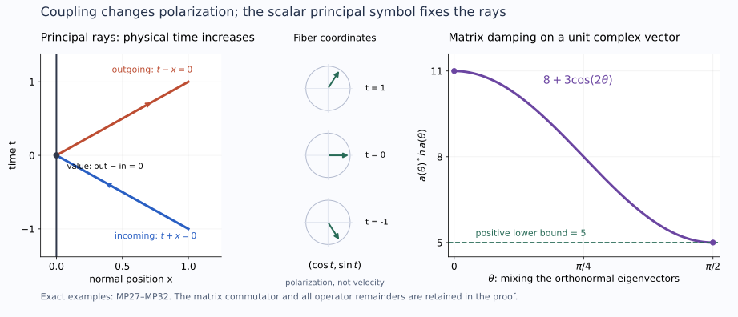

# Boundary propagation with coupled lower-order terms

Independent exposition, proofs, exercises and illustration: GPT-6 Astra (OpenAI), Ultra, 10 October 2026. CC0-1.0.

The principal quadratic form determines the reflected and gliding rays. Lower-order matrices can rotate and amplify a vector solution along those rays. They must remain in the estimates even though they do not change the characteristic set. We prove the general Dirichlet propagation theorem for this coupled problem, including rough intrinsic data, indefinite tangential quadratic forms and infinite-order contact.

The scalar geometric construction is proved in [general boundary propagation](../20261009-general-scalar-boundary/scalar-boundary-propagation-through-general-glancing.html). We reuse its exact windows and characteristic completion, and supply the receiving matrix argument here. The [ordered normal gauge](../20261009-normal-commutator-graph/normal-commutators-on-the-weak-graph-domain.html), [matrix damping](../20261008-uniform-matrix-damping/uniform-matrix-damping-and-robin-defects.html) and [finite-order Dirichlet comparison](../20261009-robin-diffraction-comparison/robin-diffraction-by-dirichlet-comparison.html) are earlier proved components. The proof map records their exact versions and full dependency paths. Human foundation proofs remain external.

## 1. The coupled problem and the conclusion

**H0. A scalar principal symbol, not a scalar equation.** Let \(E\) be a smooth finite-rank complex vector bundle over a smooth manifold \(X\) with boundary, and let \(P:E\to E\) be a second-order differential operator with smooth coefficients. In every local frame,
\[
 \sigma_2(P)(x,\xi)=p(x,\xi)I_N,\qquad
 p\ \hbox{real and quadratic},\qquad p(x,\nu)\ne0\quad(x\in\partial X),
 \qquad Pu=f,\quad \gamma_0u=g .                         \tag{MP1}
\]
Here \(\nu\) is a nonzero conormal to the boundary. All first- and zeroth-order coefficients may be arbitrary complex matrices. No diagonalization, symmetry of those matrices, nondegeneracy of the entire quadratic form, or physical-time coordinate is assumed.

Use the intrinsic class \(\mathcal N\) of EW:D1 in each component. Thus \(u,f\in\mathcal N(E)\), and \(g\) is a boundary distribution. The front \(\operatorname{WF}_b(u)\) is the union of the finitely many component fronts in a local frame. Smooth invertible changes of frame preserve it: the full multiplication calculus gives one inclusion, and applying the inverse multiplication gives the other. The same argument preserves the intrinsic class and its trace. This definition is therefore independent of frame.

Let \(O\) be an open compressed conic region disjoint from the fronts of \(f\) and \(g\). We prove that every point of \(\operatorname{WF}_b(u)\cap O\) lies on a short compressed generalized bicharacteristic of \(p\) contained in that same singular set. At the boundary such points are hyperbolic or glancing. Away from radial interior states and radial nondiffractive gliding states, singular arcs continue through finite endpoints in compact subsets of \(O\). At the exceptional states a stationary normalized ray is allowed. At infinite-order contact we prove existence of a singular continuation, without asserting uniqueness.

Generalized rays and their normalization are exactly GGL:T013–T014,T040–T045. This theorem has a Dirichlet hypothesis. It does not replace an actual Robin row by Dirichlet data, and it is not yet a representation theorem for every Airy energy solution.

## 2. Normalize the whole system and retain its intrinsic domain

**N0. Coordinates, density and the ordered gauge.** Work in a compact coordinate patch. RF:T001–T004 constructs the normal coordinate and the tangential coordinates by the scalar principal form. Its noncharacteristic normal coefficient is invertible on a smaller patch. Dividing by it, and making the actual coordinate and density changes of RF:A1, gives
\[
 P_1=D_x^2+C(x,z)D_x-R_1(x,z,D_z),\qquad
 \sigma_2(R_1)=r(x,z,\eta)I_N,\qquad p_1=\rho^2-r .
                                                               \tag{MP2}
\]
These operations act componentwise on the principal derivatives. The product and chain rules keep all resulting lower matrices in \(C,R_1\). Multiplying an equation by the nonzero scalar normal coefficient changes neither its local solution set nor its data front. On the characteristic set the Hamilton field is multiplied by that coefficient; since both orientations are included, the unparameterized ray statement is unchanged. Smooth positive density factors and smooth bundle transitions are order-zero isomorphisms on all local intrinsic and tangential spaces.

Solve
\[
 S_x=-\tfrac i2 CS,\quad S(0,z)=I_N,\qquad u_1=Sv,\qquad
 S^{-1}P_1S=D_x^2-R,\quad
 R=S^{-1}R_1S-S^{-1}(D_x^2S+C D_xS).                    \tag{MP3}
\]
NCQ:N1 proves the ordered iterated-integral construction, all parameter derivatives, the inverse equation and boundedness of both \(S\) and \(S^{-1}\) on the fixed collar. In \(R_1S\) every tangential derivative acts on the product. Since \(D_xS=-CS/2\), the coefficient \(2S^{-1}D_xS+S^{-1}CS\) of \(D_xv\) vanishes exactly. This verifies NR:N8's identity in the present frame.

Multiplication by \(S,S^{-1}\) acts continuously on the intrinsic test space, its dual and every localized mixed Sobolev space by the full product rule and the previously proved multiplication bounds EW:M1. In the interior it has the displayed differential action, so injectivity of intrinsic restriction gives the same equation there. Its boundary jets are
\[
 \gamma_0u_1=\gamma_0v,\qquad
 \gamma_1u_1=\gamma_1v-\tfrac12 C(0,z)\gamma_0v .          \tag{MP4}
\]
The identities hold first on smooth inputs and then by the continuous intrinsic trace maps EW:J1–J2. Thus smooth value data remain smooth, the coupled source is \(S^{-1}f_1\), and all data and solution fronts are unchanged. We henceforth write \(u\) for \(v\) and \(P=D_x^2-R\). The symbol \(r\) is an arbitrary real quadratic tangential form.

**N1. A finite normal graph order and actual traces.** We need a starting domain before applying a commutator. EW:S1–S2 and A1–A2 apply to finite vector bundles. On a compact patch their pure-normal guard, full tangential smoothing operators and parameter derivatives are uniform after taking the minimum of the finitely many component collars. At a glancing point, shrinking the collar and tangential cone puts all bounded normal lifts of that cone in \(O\): their compressed normal coordinate is \(x\rho\), which tends uniformly to zero when \(|\rho|/|\eta|\) is bounded. The pure-normal guard removes the remaining large normal ratios. Hence localized forcing is smooth up to the boundary on the testing region, and localized value data are smooth. This uses the whole input support and full proper remainders, not only a principal microsupport.

EW:L1 supplies one finite negative Fourier order for a compact localization of the intrinsic distribution. EW:L2–L3 then recovers normal derivatives using the invertible coefficient \(I_N\) of \(D_x^2\). Explicitly its successive restriction-space indices are \((a+j,-j)\), with fixed total \(a\); the first index reaches two after finitely many steps. The proof already allows bundle-valued lower operators of their original orders. It uses neither a scalar lower coefficient nor ellipticity of \(r\). The resulting localized distribution has, for some finite real \(s\),
\[
 \|u\|_{\mathcal X_s}^2
   =\|\Lambda^su\|_2^2+\|\Lambda^{s-1}D_xu\|_2^2<\infty,
 \qquad \Lambda=\langle D_z\rangle .                     \tag{MP5}
\]
The equation gives \(D_x^2u\in L^2_xH^{s-2}_z\). RDC:R1 and LG:L1, valid for every real \(s\), give
\[
 \gamma_0u\in H^{s-1/2},\qquad \gamma_1u\in H^{s-3/2},
 \quad
 \gamma_0(Au)=A(0)\gamma_0u,\quad
 \gamma_1(Au)=A(0)\gamma_1u-iA_x(0)\gamma_0u .             \tag{MP6}
\]
Their Fourier truncation and normal absolute-continuity proof identifies these with the intrinsic traces; no positive-index trace theorem has been applied to a negative-order input. The same two-jet extension \(3u(-x)-2u(-2x)\) on \(x<0\) applies componentwise. Both jets match, so its second distributional derivative has no boundary delta.

## 3. The completion needed at general glancing

**C0. Scalar leading completion with full matrix remainders.** Suppose \(r_0=r|_{x=0}=0\) at the anchor and \(H_{r_0}\) is not radial. GSP:C2 proves that the zero of \(r/\lambda^2\), on a positive homogeneous section \(\lambda>0\), is accessible in a tangential direction. In particular the completion SDC:S3–S6 applies for either sign of \(r_x\). A real scalar quadratic polynomial \(\mathfrak a(\rho)\) with coefficient degrees \(1-j-k\), satisfying \(\mathfrak a=-\psi^2\) on \(\rho^2=r\), admits
\[
 \mathfrak a(\rho)+(\psi_0+\rho\psi_1)^2
                   -h(\rho^2-r)\le0\quad(\rho\in\mathbb R),
 \qquad \deg(\psi_0,\psi_1,h)=(1/2,-1/2,-1).              \tag{MP7}
\]
The earlier proof includes the smooth descent, flat remainder and support cutoff on both sides of \(r=0\). We use its actual functions.

Consider a Hermitian operator array \(\mathcal A_{jk}\), of orders \(1-j-k\), whose leading entries are precisely the real scalar coefficients of \(\mathfrak a\), times \(I_N\). Quantize \(\psi_jI_N\), and use a selfadjoint scalar \(G\in\Psi^{-1}\) with leading symbol \(h\). In the complete ordered array add the norm square of \(\Psi_0u+\Psi_1D_xu\) and subtract the principal form tested against \(Gu\). The entries are those of GSP:GS10, tensor \(I_N\), with the original lower matrix entries retained.

The weighted block symbol is nonpositive on \(\mathbb C^N\oplus\mathbb C^N\): for a pair \((v_0,v_1)\), sum the scalar quadratic inequality for \(((v_0)_j,(v_1)_j)\) over \(j\). The scalar two-by-two inequality holds for complex pairs by SDC:S6. All nonprincipal matrix entries are one lower mixed order. Conjugation by the two Sobolev weights in SDQ:W2 and its matrix sharp Gårding proof therefore bound the full form by \(C\|u\|_{\mathcal X_0}^2\).

For \(u\in H^2\) the source substitution is the actual vector Green identity
\[
 (D_xu,D_xGu)-(Ru,Gu)
       =(Pu,Gu)-i\langle\gamma_1u,G(0)\gamma_0u\rangle .
                                                               \tag{MP8}
\]
SDQ:W3 controls the normal commutator. The difference between \(R\) and the scalar principal divergence-form operator is a matrix tangential operator of order one; paired with \(G\), it has an order-zero \(L^2\) bound. Thus the completion retains the full source pairing and the displayed boundary pairing. This proves the matrix receiving version of GSP:C2. It does not invoke the strict-diffraction assumption of SDQ:W5.

## 4. Damping the noncommuting lower terms

**D0. A positive matrix square root in the correct order.** Fix a real scalar tangential symbol \(q=v^2\) of degree zero, everywhere nonnegative, independent of \(\rho\). Let \(Q=Q^*\in\Psi^0\) have leading symbol \(qI_N\); we choose it scalar componentwise. Suppose \(Z_\epsilon\) is uniformly in \(\Psi^1\) and its Hermitian part is uniformly in \(\Psi^0\). Put
\[
 R_a=\frac{R-R^*}{2i},\qquad
 Z_{\epsilon a}=\frac{Z_\epsilon-Z_\epsilon^*}{2i},\qquad
 k_\epsilon=\sigma_1(R_a+Z_{\epsilon a})=k_\epsilon^* .
                                                               \tag{MP9}
\]
Here \(\sigma_1\) denotes a chosen uniform representative modulo \(S^0\), including the nonhomogeneous regularization dependence. Choose a positive extension of \(\lambda\) comparable to \(\langle\eta\rangle\), and a scalar selfadjoint quantization \(L\). On the fixed supports let \(\|k_\epsilon\|\le K\lambda\). With \(M\ge4K+1\),
\[
 h_\epsilon=MI_N+2k_\epsilon/\lambda>0,\qquad
 s_\epsilon^2=h_\epsilon,\quad s_\epsilon=s_\epsilon^*,
 \qquad
 \mathcal D_\epsilon[u]
   =\operatorname{Re}((ML+2R_a+2Z_{\epsilon a})u,Qu).
                                                               \tag{MP10}
\]
UMD:D1 proves \(s_\epsilon\in S^0\) uniformly with all required normal and tangential derivatives. Its convergent matrix power series differentiates into ordered products; it does not assume that \(k_\epsilon\) commutes with its derivatives.

Quantize \(t_\epsilon=\lambda^{1/2}s_\epsilon v\) to a matrix operator \(T_\epsilon\) of order \(1/2\). The ordered leading product is
\[
 t_\epsilon^*t_\epsilon
       =\lambda v\,s_\epsilon^2v
       =(M\lambda I_N+2k_\epsilon)q,\qquad
 \mathcal D_\epsilon[u]=\|T_\epsilon u\|_2^2
                                  +O(\|u\|_2^2).        \tag{MP11}
\]
The equality of leading symbols suffices here because both full operators have order one, and every composition or adjoint correction has order zero by SY:H7–H10. The constants are uniform in \(\epsilon\). Scalar \(v\) commutes with matrices; no two matrix factors have been interchanged. Consequently \(\mathcal D_\epsilon[u]\ge-C\|u\|_2^2\), irrespective of the sign of \(r\).

## 5. The regularized matrix estimate

**E0. The equation and boundary form before taking a limit.** Work on one fixed parameter region with smooth localized forcing and value data, and assume the finite norm (MP5). Take real scalar symbols \(b,e\) of degree \(1/2\) and \(\psi\) of degree \(1/2\) satisfying
\[
 H_pq+M\lambda q=-\psi^2-b^2+e^2\quad(p=0),
 \qquad q=v^2,\qquad Eu\in L^2_xH^s_z,                  \tag{MP12}
\]
where \(E\) is a full proper scalar tangential operator with symbol \(e\). All supports, including the completion supports, are inside a slightly larger region where (MP5) holds. For a full scalar cutoff \(\chi\) equal to identity there, set
\[
 W_\epsilon=\frac{\Lambda^s}{1+\epsilon^2|D_z|^2},\quad
 w_\epsilon=W_\epsilon\chi u,\quad
 Pw_\epsilon=F_\epsilon+Z_\epsilon w_\epsilon,\quad
 F_\epsilon=W_\epsilon\{\chi Pu+[P,\chi]u\}.              \tag{MP13}
\]
The exact commutator is
\([P,\chi]=-2i\chi_xD_x-\chi_{xx}-[R,\chi]\).
UMD:D6, proved for matrix lower terms, gives
\(Z_\epsilon=[P,W_\epsilon]W_\epsilon^{-1}\in\Psi^1\)
uniformly and \((Z_\epsilon+Z_\epsilon^*)/2\in\Psi^0\).
For fixed positive \(\epsilon\), the weight has order \(s-2\). Thus the value has two tangential derivatives, its first normal derivative has one, and the exact equation gives its second normal derivative in \(L^2\). This proves \(w_\epsilon\in H^2\).

RDC:R3 and LG:L1–L3, with the same full cutoff terms, give
\[
 \|w_\epsilon\|_{\mathcal X_0}
 +\|Pw_\epsilon\|_{L^2H^{-1}}
 +\|\gamma_1w_\epsilon\|_{H^{-3/2}}\le C_s .             \tag{MP14}
\]
The tested value trace is uniformly smooth. Pairings of \(F_\epsilon\) with the commutant and completion tests are uniformly bounded. Indeed the tested original source is smooth. Each cutoff-commutator coefficient is smoothing on the testing microsupport; composing sufficiently many terms of the full tangential expansion bounds its action on \(u,D_xu\) at their known finite orders. Separated proper remainders have the same bound. This is a bound on the localized pairings, not an assertion that \(F_\epsilon\) is uniformly \(L^2\) everywhere.

With inner products linear in the first entry, NR:N3,N5 gives the exact identity
\[
 2\operatorname{Im}(Pw_\epsilon,Qw_\epsilon)
 =2\operatorname{Re}\langle Q(0)\gamma_0w_\epsilon,
                                   \gamma_1w_\epsilon\rangle
    +\mathcal C[w_\epsilon].                            \tag{MP15}
\]
Its boundary pairing is bounded by (MP14) and the smooth value trace. Define \(\mathcal Z_\epsilon[w]=2\operatorname{Im}(Z_\epsilon w,Qw)\). The leading polynomial of
\(\mathcal C-\mathcal Z_\epsilon+\mathcal D_\epsilon+
\|Bw\|^2-\|Ew\|^2\), with \(\sigma(B)=b\), is
\[
 (H_pq)I_N-2qk_\epsilon
       +(M\lambda I_N+2k_\epsilon)q
       +(b^2-e^2)I_N=-\psi^2I_N\quad(p=0).              \tag{MP16}
\]
This cancellation is also entrywise in the normal polynomial: the only order-zero cross entry comes from \(Q_xD_x\), with scalar leading symbol; \(R_a\), \(Z_{\epsilon a}\) and the damping correction enter the order-one value entry. The commutator of a matrix lower coefficient with scalar \(Q\) loses one tangential order. The Hermitian part of \(Z_\epsilon\) also contributes only that lower order. Thus the full array meets C0's hypotheses, without an unaccounted leading matrix cross entry.

Apply C0 to this array. In (MP8) the extra source term obeys
\[
 |(Z_\epsilon w,Gw)|
 \le\|\Lambda^{-1}Z_\epsilon w\|_2\|\Lambda Gw\|_2
 \le C\|w\|_2^2 .                                      \tag{MP17}
\]
The \(F_\epsilon\) and boundary terms were bounded above. Substituting (MP15), using (MP11) and discarding the nonnegative completion square gives
\[
 \|Bw_\epsilon\|_2^2\le\|Ew_\epsilon\|_2^2+C_s.          \tag{MP18}
\]
The incoming norm is bounded: \(EW_\epsilon\chi u
=W_\epsilon\chi Eu+[E,W_\epsilon\chi]u\), and the commutator has uniform order \(s-1/2\). The full separated terms act on the fixed finite-order input. Distributional convergence and UMD:D7's bounded-norm limit argument give \(Bu\in L^2H^s\), after commuting the scalar weight and applying the complete tangential parametrix.

**E1. Recover the normal half-order as well.** Where \(b\) is elliptic, a smaller test gives \(u\in L^2H^{s+1/2}\). For \(w=Ku\) on a still smaller fixed support, the equation and full cutoff commutator imply \(D_x^2w\in L^2H^{s-3/2}\). The \(D_xu\) cutoff term has the old order \(s-1\), which is stronger than required. Apply N1's two-jet extension. Its separate value and second-derivative norms are bounded; matching the old finite-order traces prevents a delta at zero. The Fourier inequality
\[
 2\rho^2\langle\eta\rangle^{2s-1}
 \le\langle\eta\rangle^{2s+1}
                       +\rho^4\langle\eta\rangle^{2s-3} \tag{MP19}
\]
then gives \(D_xw\in L^2H^{s-1/2}\). This proves \(Ku\in\mathcal X_{s+1/2}\). The estimate is for the full vector norm; no component has been treated as a solution of an uncoupled scalar equation.

## 6. One glancing neighborhood at every order

**G0. Use the proved scalar geometry with matrix damping.** On a compact set of nonradial glancing anchors use exactly GSP:C4–C7. In its common flow coordinates \(N,v_j\), put \(\Theta=N-N_{\rm anchor}\), \(\omega=\sum v_j^2\), and
\[
 \phi=-\Theta+\frac{x}{\varepsilon}
                 +\frac{\omega}{\delta\varepsilon^2},\quad
 q_a=\chi_0\!\left(\frac{1+a-\phi/\delta}{A}\right)
          \chi_1\!\left(\frac{\delta-\Theta}{\varepsilon\delta}+a\right),
 \quad 0\le a\le1.                                    \tag{MP20}
\]
Here \(\chi_0(t)=e^{-1/t}\) for \(t>0\) and zero otherwise, and
\(\chi_1(t)=\chi_0(t)/(\chi_0(t)+\chi_0(1-t))\).
The earlier proofs show smoothness of every square root used, full supports and the exact identity (MP12). On the characteristic support, \(\delta<c\varepsilon\) ensures \(H_p\phi\ge\lambda/2\); the estimate includes \(2\rho/\varepsilon\) and both normal roots, for arbitrary real \(r\).

For the \(M\) selected in D0 and at the current Sobolev order choose
\[
 A\ge\max(1,128M\delta),\qquad
 W_a=\{q_a>0\}.                                        \tag{MP21}
\]
The positivity sets \(W_a\) are independent of \(A\). GSP:C6 gives nested closures, ellipticity of the gain symbol on the next smaller set, and a positive remaining square in (MP12). GSP:C7 puts the *whole* incoming support in a window of normal width \(4\varepsilon\delta\) and tangential normalized radius \(C_0\varepsilon\delta\), centered on the boundary gliding flow at time \(\delta\). If a slightly larger closed window has no projected vector singularity, the vector tester criterion and N1's pure-normal guard give \(Eu\in L^2H^m\) for every \(m\). A finite cover handles all components and all proper operator supports.

For a fixed integer \(k\), take \(a_j=1-j/(2k)\), \(0\le j\le k\). N1 gives the starting order on \(W_1\). Choose each commutant parameter strictly between consecutive \(a_j\); the full supports fit in the previous region. E0–E1 gives a half-gain on the next one. Its damping \(M\) and \(A\) may change with the order, but the final region is always \(W_{1/2}\). Finite partitions and complete tangential division control every smaller test. Letting \(k\) increase gives every tangential order on this one region.

The matrix equation recovers every normal derivative there. After \(D_x^2u=Ru+f\), differentiate it and keep the full finite Leibniz sum, in its given matrix order. Smooth tested forcing and the tangentially smoothing jet errors from N1 stay controlled. The all-order Fourier embedding proof of IP:T012, applied to each of the finitely many components with one fixed test, gives smoothness up to the boundary. Thus the anchor is absent from \(\operatorname{WF}_b(u)\).

**G1. Both directions and the quantitative window condition.** All geometric constants above are fixed independently of the later order iteration. GSP:C9's conversion between \(\varepsilon,\delta\) and a normalized window width therefore gives
\[
 0<|t|<t_K,\quad C_K|t|\le\epsilon<\epsilon_K:
 \quad\hbox{a regular window of width }\epsilon|t|
 \quad\Longrightarrow\quad\hbox{a regular anchor}.       \tag{MP22}
\]
For the other direction conjugate the entire vector equation, componentwise. With \(D=-i\partial\), each derivative changes sign; the real quadratic principal symbol is carried to itself by covector reversal. All lower matrices are complex-conjugated in their existing order. The value datum and source are conjugated as well. The Fourier identity \(\widehat{\bar u}(\xi)=\overline{\widehat u(-\xi)}\), component by component, carries their fronts to the antipodal cones and reverses the Hamilton orientation. The transformed operator still satisfies H0. Applying the proved direction and returning proves (MP22) in both directions.

Choose \(\epsilon=L|t|\) with \(L>C_K\). The contrapositive produces singular witnesses within \(O(t^2)\) in tangential and normal position. PW:T004–T011 then supplies the exact first-order tangency condition, including the \(O(|t|)\) normal-root bound. This verifies the nondiffractive glancing input to the geometric ray construction at finite or infinite contact. Only its scalar geometry has been reused; the regularity implication now comes from the coupled estimate.

## 7. The other ray segments concern the same vector front

**P0. Interior, elliptic and transverse points.** At interior elliptic points the full scalar-principal matrix parametrix makes \(u\) smooth when \(Pu\) is smooth. On nonradial interior characteristic intervals, IP:T013–T017 proves propagation for arbitrary complex lower matrices at every real Sobolev order: its complete ordered graph conjugation removes those matrices, and the scalar model evolution then acts componentwise. The inverse and source remainders are retained there. Passing to all orders on one fixed cone gives ordinary smooth wavefront propagation for the present intrinsic input.

At an elliptic boundary point, the principal stable normal root of \(\rho^2-r\) has multiplicity \(N\), and its value map is the scalar nonzero value map tensor \(I_N\). It is an isomorphism. EW:P1–P6 and RDC:R4 apply to the actual matrix lower terms, with N1 supplying their finite normal domain. Their full volume and boundary inverses therefore exclude that boundary point from the vector front.

At a hyperbolic boundary point, start on a regular incoming interior germ. ISE:I2–I6 constructs the ordered two matrix normal factors with scalar principal roots \(\pm\sqrt r\). RDC:R2 identifies their actual finite-order distributional evolutions and traces, at arbitrary negative starting order. The transported positive-root test and smooth value datum in DDB:B3, with the all-real domain extension RDC:R4, give smoothness of the whole vector near the boundary and on the other germ. The argument is local to a transverse strip with \(r>0\); no strict-diffraction sign is used there. Conjugating the full equation treats the opposite germ. Consequently singularity at a hyperbolic boundary point forces both adjacent singular germs, and regularity of either one excludes that boundary singularity. Conversely a regular boundary neighborhood gives regular short germs by the tester criterion and N1.

**P1. Strict diffraction and the closed characteristic lift.** At \(r=0,r_x>0\), RDC:R0–R5 applies to \(P=D_x^2-R\) with exactly the real scalar quadratic principal symbol and arbitrary complex lower matrices specified here. N1 supplies its finite \(\mathcal X_s\) input, actual smooth value trace and tested smooth source. If the incoming tangent germ is regular, it proves smoothness on one neighborhood of the anchor at every order. Conjugation treats the other germ. Ordinary matrix propagation from P0 fills the corresponding short tangent segment. A singular anchor therefore has the required singular tangent segment.

Put \(F=\operatorname{WF}_b(u)\cap O\) and lift it to the characteristic set. By P0 there are no elliptic boundary or interior points in \(F\), and at a hyperbolic face the lift contains both roots. The set is relatively closed. On a compact normalized patch,
\[
 p=0\quad\Longrightarrow\quad
       |\rho|^2=r(x,z,\eta)\le C|\eta|^2 .               \tag{MP23}
\]
Thus its characteristic lifts are compact. The bound needs no positive lower bound for \(r\). G1 supplies the remaining quantitative tangency condition on nondiffractive glancing points with nonradial gliding field. Every analytic hypothesis now concerns this same vector front, rather than the front of one chosen component.

**P2. Assemble and continue singular rays.** PW:T012 and GGL:T040–T045 apply to that closed lifted set. Their polygonal limits, signed-root recovery through accumulating reflections and generalized derivative proof are statements about the scalar principal geometry and a closed set with the just-verified segment and tangency properties. They give the short singular arc in H0.

If the interior Hamilton field is radial, homogeneity keeps its orbit on the positive fiber ray locally. Conicity keeps that orbit in the singular set, and its normalized image is constant. If a nondiffractive gliding field is radial, its boundary orbit likewise stays on its fiber ray with zero normal position and momentum. Homogeneity preserves the relevant sign or zero of \(r_x\); this is the allowed gliding orbit. Zero fields give constant full orbits. These are precisely the exceptional normalized states in H0.

For continuation take a compact phase neighborhood in \(O\) avoiding those exceptional states and choose compatible positive homogeneous normalizations. Their factors and inverses are bounded. GGL:T013–T014 gives a compressed Lipschitz bound through reflections, so any finite endpoint has a unique compressed limit. Closedness puts it in \(F\). The local theorem supplies an outgoing singular arc. Ordinary, transverse, strict-diffractive and strict-gliding joins have their earlier prescribed flow derivatives. At \(G^3\), GGL:T044 gives \(|\rho(s)|=O(|s-s_0|^2)\) and \(x(s)=O(|s-s_0|^3)\), so any supplied outgoing continuation has the required joining derivative even at infinite contact. This extends the arc through the endpoint.

The endpoint-capacity construction of GSR:T6 now supplies maximal continuations on nonexceptional regions, using only local extension and the bounded finite-interval parameter. It does not use that lesson's later physical-time hypothesis. There is no conclusion that all infinite-parameter rays escape compact sets. This completes H0, locally in frames and hence on \(E\).

## 8. What this proves about a residual solution

**R0. A conditional microlocal comparison, with its reachability hypothesis.** Let \(u,v\in\mathcal N(E)\) have smooth difference of their sources and smooth difference of their Dirichlet values on \(O\). Suppose \(u-v\) is microlocally regular on an open region \(\Gamma\subset O\). Fix a point \(a\in O\). Assume every backward generalized characteristic from \(a\), continued while outside \(\Gamma\), reaches \(\Gamma\) in finite normalized time, and its preceding segment stays in a compact subset of \(O\) avoiding the exceptional radial states. The compact subset may depend on the characteristic. Then
\[
 a\notin\operatorname{WF}_b(u-v).                       \tag{MP24}
\]
Indeed \(w=u-v\) remains in the intrinsic class; its source and value fronts are absent in \(O\). If \(a\) were singular, P2 constructs a backward singular continuation. The stated reachability and finite-endpoint continuation force it to enter \(\Gamma\), where \(w\) is regular, a contradiction. Elliptic \(a\) are already regular by P0. This proves (MP24).

This comparison can be used after an Airy field has been matched to an actual solution, provided its full residual, value data and incoming regularity satisfy the stated hypotheses. The theorem by itself does not construct that field, verify reachability for a particular collar, or establish the full weighted trace of an arbitrary solution. The [weighted estimate on the constructed Airy range](../20261010-airy-weighted-reverse/weighted-recovery-of-localized-airy-fields.html) applies to that constructed range. A representation of an arbitrary solution requires the additional hypotheses just stated.

## 9. Three solved exercises

**X1. Why an exponential of an integral is insufficient.** Let
\[
 A=\begin{pmatrix}0&1\\0&0\end{pmatrix},\quad
 B=\begin{pmatrix}0&0\\1&0\end{pmatrix},\quad
 C(x)=2i(A+xB),\quad S'=(A+xB)S,\quad S(0)=I_2.          \tag{MP25}
\]
Find the cubic jet of \(S\), and compare it with \(\exp(xA+x^2B/2)\).

**Solution.** Substitute \(S=I+xS_1+x^2S_2+x^3S_3+O(x^4)\) into the ordered equation. Successive coefficients give \(S_1=A\), \(2S_2=A^2+B\), and \(3S_3=AS_2+BA\). Hence
\[
 S=I+xA+\tfrac{x^2}{2}(A^2+B)
       +x^3\left(\tfrac16 A^3+\tfrac16 AB+\tfrac13 BA\right)+O(x^4).
                                                               \tag{MP26}
\]
The proposed exponential has cubic coefficient \(A^3/6+(AB+BA)/4\). Their difference is \(x^3(BA-AB)/12+O(x^4)\), with \(BA-AB=\operatorname{diag}(-1,1)\ne0\). Here \(A^2=B^2=0\), so the actual cubic diagonal is \(\operatorname{diag}(1/6,1/3)\), whereas the proposed one is \(\operatorname{diag}(1/4,1/4)\). The difference demonstrates why N0 uses the ordered ODE.

**X2. A positive matrix weight whose derivatives do not commute.** At one frequency let
\[
 k/\lambda=\begin{pmatrix}0&1+i\\1-i&-1\end{pmatrix},\quad
 M=9,\quad h=\begin{pmatrix}9&2+2i\\2-2i&7\end{pmatrix}.
                                                               \tag{MP27}
\]
Find a positive square root, and show that a smooth unitary rotation of \(h\) need not commute with its derivative.

**Solution.** The characteristic polynomial of \(k/\lambda\) is
\(t^2+t-2=(t-1)(t+2)\); thus its norm is two and \(M=4\cdot2+1\) is admissible. The eigenvalues of \(h\) are \(11,5\), with orthonormal eigenvectors
\[
 v_+=\frac{(1+i,1)}{\sqrt3},\qquad
 v_-=\frac{(-(1+i),2)}{\sqrt6},\qquad
 s=\frac{h+\sqrt{55}I_2}{\sqrt{16+2\sqrt{55}}}.          \tag{MP28}
\]
Direct multiplication gives \(h^2-16h+55I_2=0\), so \(s^2=h\). On either eigenvector the displayed scalar is positive, proving that \(s\) is the positive root. In particular \(a^*ha\ge5|a|^2\).

Let \(V(t)=\operatorname{diag}(e^{it},1)\), \(h(t)=V(t)hV(t)^*\). At zero,
\[
 [h,h']=
 \begin{pmatrix}-16i&-4+4i\\4+4i&16i\end{pmatrix}\ne0 .
                                                               \tag{MP29}
\]
This follows by differentiating its off-diagonal entry to \(i(2+2i)\) and multiplying the two matrices in both orders. The positive root is still smooth by D0, whose derivative bounds did not require the commutator to vanish.

**X3. Coupling along an exactly reflected pair.** Put
\[
 J=\begin{pmatrix}0&-1\\1&0\end{pmatrix},\quad S(t)=e^{tJ},\quad
 P=(D_x^2-D_t^2)I_2-2iJ D_t-I_2,\quad x\ge0 .
                                                               \tag{MP30}
\]
For real \(\lambda\), verify the equation and actual value and normal traces of
\[
 U_\lambda(x,t)=S(t)\binom10
          \left(e^{i\lambda(t-x)}-e^{i\lambda(t+x)}\right).
                                                               \tag{MP31}
\]

**Solution.** Since \(J^2=-I_2\) and \(S'=JS\), one has
\(S D_tS^{-1}=D_t+iJ\) as an operator on products. Squaring gives
\(S D_t^2S^{-1}=D_t^2+2iJ D_t+I_2\).
Consequently \(P=S(D_x^2-D_t^2)S^{-1}\). Each scalar exponential in (MP31) solves the scalar wave equation, so \(PU_\lambda=0\), retaining both matrix lower terms. At the boundary the two values cancel, while
\[
 \gamma_0U_\lambda=0,\qquad
 \gamma_1U_\lambda=-2\lambda e^{i\lambda t}S(t)\binom10 .
                                                               \tag{MP32}
\]
For \(\lambda>0\) the phase \(t+x\) has positive normal root and is incoming when physical time increases; \(t-x\) has negative normal root and is outgoing. With the time normalization \(-H_p/(2\tau)\), their velocities are \((-1,1)\) and \((1,1)\) in \((x,t)\). Both carry the same rotating polarization \(S(t)(1,0)^{\mathrm t}\). This is an exact smooth wave calculation, not a claim that a single smooth mode has a nonempty wavefront set.

## 10. Rays and the matrix estimate

**V0. Exact plotted data and proof locators.** The left panel plots the two characteristic segments \((x,t)=(-t,t)\), \(-1\le t\le0\), and \((x,t)=(t,t)\), \(0\le t\le1\), from X3. Separate small fiber diagrams show the unit vectors \((\cos t,\sin t)\) at \(t=-1,0,1\); these are polarization coordinates, not spatial velocities. The arrow directions use the stated physical-time normalization. The incoming term in the Dirichlet combination has the minus sign in (MP31), explicitly labeled at the face.

The right panel uses the complex orthonormal eigenvectors in (MP28) and the unit vector \(a(\theta)=\cos\theta\,v_++\sin\theta\,v_-\). Its exact damping energy is \(a(\theta)^*ha(\theta)=11\cos^2\theta+5\sin^2\theta=8+3\cos2\theta\), for \(0\le\theta\le\pi/2\). The graph and endpoints show the positive lower bound five from D0 and X2. It illustrates the finite-dimensional symbol inequality; the full operator remainders and rough-domain limit are proved in C0 and E0–E1.

## Source credit and remaining scope

Lars Hörmander, *The Analysis of Linear Partial Differential Operators III: Pseudo-Differential Operators*, corrected Springer 2007 printing, ISBN 978-3-540-49938-1, §24.5, Proposition 24.5.1, Lemma 24.5.2 and Theorem 24.5.3, printed pp. 455–459, supplies the scalar propagation antecedent.  The ordered matrix extension, receiving-domain checks, coupled damping calculation, comparison corollary, examples and figure here are independently written; the matrix conclusion is not attributed to the scalar statement in that source.

Earlier programme components retain their source credit and component terms. Airy representation and complementary microlocal matching require the hypotheses stated in the corresponding coefficient estimates. The separate scalar observation construction is given by [global scalar assembly](../20261017-angular-output-reserve-assembly/scalar-tests-from-a-missing-tangential-direction.html).
