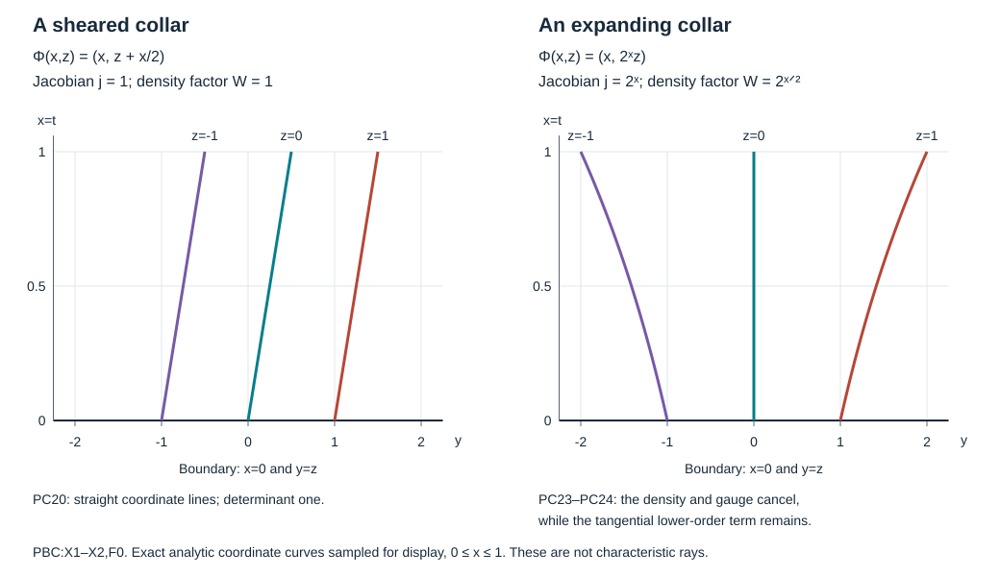

# Parameter-dependent boundary coordinates and full source tests

A boundary normal form changes with the coefficients of the operator. Its density, first-order terms and right-hand side change too. We construct that change on one common collar, compute the complete transformed operator and transfer the actual source and observation tests back to the original chart. The original Banach norm is retained.

**Independent exposition, proofs, exercises and figure: CC0-1.0.** The antecedent is Lars Hörmander, *The Analysis of Linear Partial Differential Operators III*, Springer 2007 eBook, ISBN 978-3-540-49938-1, §§18.3 and 24.7, especially the observation estimates on printed pages 465–467. The earlier programme proofs of normal coordinates, full boundary kernels, flat-test bounds and the local estimates are identified in the proof map. See source credit and [review](proof-review.json). Required human foundation proofs remain external; internal P514 closure of this CC0 export is not claimed. 

## 1. A common collar for the coefficient family

**H0. Exact local hypotheses and notation.** Let \(P_a\) be a smooth finite-dimensional parameter family of scalar differential operators of order two near a compact boundary coordinate patch. Write \(X=(t,y)\), \(t\ge0\), \(D=-i\partial\), and
\[
 P_a=\sum_{i,j=0}^{d} A_a^{ij}(X)D_iD_j+
       \sum_{j=0}^{d} b_a^j(X)D_j+c_a^0(X),\qquad
 A_a^{ij}=A_a^{ji}\in\mathbb R .
 \tag{PC1}
\]
The lower coefficients may be complex. The boundary is noncharacteristic for \(P_0\): \(A_0^{00}\ne0\). This construction works for \(d\ge0\); the scalar chart assembly at the end requires \(d\ge1\). Fix a smooth positive density \(\rho=w(X)\,dX\) for the original \(L^2\) space.

First choose a connected smaller patch and its sign \(\sigma\in\{1,-1\}\) so that \(\widehat P_a=\sigma P_a\) has positive highest normal coefficient. The fixed-operator normal-coordinate construction RF:T001–T004 permits a fixed preliminary coordinate change with
\[
 \widehat A_0^{00}=1,\qquad \widehat A_0^{0j}=0
 \quad(j>0).
 \tag{PC2}
\]
This earlier construction uses noncharacteristicity alone, even when the full quadratic form is degenerate. Fix its coordinate patch from now on. Shrinking the parameter neighborhood once gives \(\widehat A_a^{00}\ge c_*>0\) on a larger compact collar. All statements below concern compactly nested patches in that collar. Multiplying back by \(\sigma\) at the end retains the original equation.

**N0. A base flow preserving the defining function.** Set
\[
 V_a=\partial_t+\sum_{j=1}^{d}
          \frac{\widehat A_a^{0j}}{\widehat A_a^{00}}\partial_{y_j},
 \qquad
 \Phi_a(x,z)=(x,Y_a(x,z)),\qquad
 \partial_xY_a=V_a^y(x,Y_a),\quad Y_a(0,z)=z .
 \tag{PC3}
\]
The complete smooth parameter-flow proof DC:T005 applies on one larger coordinate box. Its Picard construction has a common existence interval because the vector field and its first derivatives are uniformly bounded on the compact parameter/base set. The integral equation for \(D_zY_a\), followed by its successive differentiated equations, gives joint smoothness and bounds for every fixed derivative order. The determinant starts at one and stays positive on a common smaller collar. The inverse function theorem, compactness and the inverse flow give a common smaller product domain and jointly smooth inverses there. No regularity order enters this choice.

Put \(\Psi_a=\Phi_a^{-1}\). Since \(V_at=1\), the first new coordinate is exactly \(x=t\). The other new coordinates are first integrals: \(V_a z_k=0\). For the polarized principal form \(\widehat q_a\),
\[
 \widehat q_a(dt,dz_k)
   =\widehat A_a^{00}V_a z_k=0,\qquad
 \alpha_a(x,z)=\widehat A_a^{00}(\Phi_a(x,z))>0 .
 \tag{PC4}
\]
Thus all normal–tangential principal cross terms disappear. Moreover \(\Phi_0\) is the identity by (PC2). The construction changes neither the chosen boundary coordinates nor the boundary defining function.

**N1. The full coordinate formula.** Let \(F_a u=u\circ\Phi_a\), and put \(J_{ki}=\partial_{X_i}\Psi_a^k\). All coefficients in the next formula are evaluated at \(\Phi_a(x,z)\). The chain rule gives the exact differential operator
\[
 F_a\widehat P_aF_a^{-1}
   =\sum_{k,l}\mathsf A_a^{kl}D_kD_l+
          \sum_k\mathsf b_a^kD_k+\widehat c_a^0\circ\Phi_a,
 \quad
 \begin{cases}
 \mathsf A^{kl}=\displaystyle\sum_{i,j}\widehat A^{ij}J_{ki}J_{lj},\\
 \mathsf b^k=\displaystyle\sum_j\widehat b^jJ_{kj}
       -i\sum_{i,j}\widehat A^{ij}\partial_{X_i}\partial_{X_j}\Psi^k.
 \end{cases}
 \tag{PC5}
\]
Indeed \(D_i(h\circ\Psi)=\sum_kJ_{ki}(D_kh)\circ\Psi\). A second derivative differentiates both \(h\) and \(J\), producing precisely the Hessian term with coefficient \(-i\). Every coefficient multiplies on the left; no divergence-form convention has been inserted. Formula (PC4) says \(\mathsf A^{00}=\alpha\), \(\mathsf A^{0j}=0\). It leaves the complete tangential quadratic form unrestricted.

## 2. Density and gauge, with the actual source

**D0. The unitary density factor.** Define
\[
 j_a=(w\circ\Phi_a)\det D\Phi_a>0,\qquad
 W_a=j_a^{1/2},\qquad U_a=W_aF_a .
 \tag{PC6}
\]
Change of variables proves \(\|U_au\|_{L^2(dx\,dz)}=\|u\|_{L^2(\rho)}\) for inputs supported in these corresponding patches. Its inverse first multiplies by \(W_a^{-1}\) in the new coordinates, then pulls back by \(\Psi_a\): \(U_a^{-1}=F_a^{-1}W_a^{-1}\). These are exact local unitary maps; extending compactly supported functions by zero preserves the norm identity. Positivity and compactness bound \(W_a\), its inverse and every fixed derivative uniformly.

For \(h_k=\partial_k\log W_a\), direct differentiation gives
\[
 W_aD_kW_a^{-1}=D_k+i h_k,\qquad
 (D_k+i h_k)(D_l+i h_l)
   =D_kD_l+i h_lD_k+i h_kD_l+\partial_kh_l-h_kh_l .
 \tag{PC7}
\]
Consequently \(U_a\widehat P_aU_a^{-1}\) has the same \(\mathsf A^{kl}\) as (PC5), first-order coefficient
\[
 \mathsf b_{\rho}^l=\mathsf b^l+2i\sum_k\mathsf A^{kl}h_k,
 \quad
 \mathsf c_{\rho}=\widehat c^0\circ\Phi
   +i\sum_k\mathsf b^k h_k
   +\sum_{k,l}\mathsf A^{kl}(\partial_kh_l-h_kh_l).
 \tag{PC8}
\]
These identities include all density corrections, not just their principal parts.

**D1. Left normalization and the normal first-order term.** Divide on the left by \(\alpha_a\). No derivative falls on this multiplier. The result is
\[
 L_a=\alpha_a^{-1}U_a\widehat P_aU_a^{-1}
       =D_x^2+c_aD_x+B_a(x,z,D_z),\qquad
 c_a=\alpha_a^{-1}\mathsf b_\rho^0,\quad
 \sigma_2(B_a)=-r_a\in\mathbb R .
 \tag{PC9}
\]
The full tangential operator \(B_a\) includes the zeroth-order term \(\alpha_a^{-1}\mathsf c_\rho\). Every coefficient is jointly smooth with uniform bounds for each finite derivative order. No positivity or nondegeneracy of \(r_a\) is required.

**G0. Exact gauge and right-hand side.** Set
\[
 S_a(x,z)=\exp\!\left(-\frac{i}{2}\int_0^x c_a(s,z)\,ds\right).
 \tag{PC10}
\]
Then \(S_a(0,z)=1\), \(S_a'/S_a=-ic_a/2\), and \(S_a\), \(S_a^{-1}\) and all their fixed-order derivatives are uniformly bounded on compact collars. The exponential never vanishes, even for complex \(c_a\). Since \(S^{-1}D_xS=D_x-c_a/2\), the ordered product gives
\[
 \begin{split}
 S_a^{-1}L_aS_a&=D_x^2-R_a,\\
 R_a&=-S_a^{-1}B_aS_a+\frac{c_a^2}{4}
                              -\frac{i}{2}\partial_xc_a,\\
 v_a=S_a^{-1}U_au,\qquad
 (D_x^2-R_a)v_a&=g_a,\qquad
 g_a=\sigma\alpha_a^{-1}S_a^{-1}U_a(P_au).
 \end{split}
 \tag{PC11}
\]
For example, differentiating the multiplier in \((D_x-c/2)^2\) gives \(ic'/2\); this fixes the sign in \(R_a\). The gauge changes tangential lower terms through the full conjugate \(S^{-1}B S\). It preserves the real quadratic tangential principal symbol.

At the boundary \(\det D\Phi_a=1\), because its differential has first row \((1,0)\), tangential block \(I\) and a possibly nonzero lower first column. Therefore
\[
 v_a(0,z)=w(0,z)^{1/2}u(0,z).
 \tag{PC12}
\]
Zero Dirichlet value is preserved exactly. The forcing multiplier in (PC11) is part of every source test; it cannot be suppressed by a principal-symbol argument.

## 3. Complete kernels and fixed geometric margins

**K0. The compressed coordinate map.** For an old covector \((t,y;\xi,\eta)\), pullback by (PC3) gives new components
\[
 \xi_{\rm new}=\xi+(\partial_xY_a)^T\eta,\qquad
 \eta_{\rm new}=(D_zY_a)^T\eta,\qquad
 \zeta_{\rm new}=\zeta+x(\partial_xY_a)^T\eta,\quad \zeta=x\xi .
 \tag{PC13}
\]
This is a smooth invertible map \(\kappa_a\) of compressed covectors, down to \(x=0\). Its inverse uses the inverse transpose of \(D\Phi_a\); its determinant stays bounded away from zero on compact sets. At the boundary it is the identity on \((z;\zeta,\eta)\). At \(a=0\) it is the identity throughout the chart.

Fix a compact normalized set \(K\) inside an open compressed cone \(\Gamma\), with a strict margin. Continuity of \(\kappa_a\) and its inverse on a compact enlargement, followed by a finite cover, gives one parameter ball on which the images and inverse images of a smaller enlargement stay in \(\Gamma\). This choice precedes every operator order. For several compact source, observation and target sets take the finite intersection of their parameter balls.

On the characteristic set, multiplication of a principal symbol by a positive function multiplies its Hamilton field by that function: \(H_{\lambda p}=\lambda H_p+pH_\lambda\). Coordinate pullback carries the Hamilton curves by the cotangent map. The fixed sign \(\sigma\) may reverse orientation, and \(\alpha^{-1}>0\) only changes its speed. Thus the unparameterized generalized rays and both permitted orientations transfer. The boundary root interchange and the gliding/strict signs have the same invariant interpretation, by RF:T001–T004 and GSP:C9–C11. Compact positive speed factors and their inverses preserve the local time bounds after a fixed change of constants.

**K1. Full kernels, including all residuals.** Let \(T_a\) be bounded in the complete boundary calculus, with compact input and output projections in the new coordinate patch. The conjugate \(U_a^{-1}T_aU_a\) is bounded in the same full order on the original patch. Its compressed microsupport is the inverse image under \(\kappa_a\).

Here is the full-kernel justification. Both normal coordinates are unchanged by \(\Phi_a\). On the stretched product the resolved normal variables \(x+y\) and \(x/(x+y)\) are unchanged, while the two tangential variables become \(Y_a(x,z)\) and \(Y_a(y,w)\). This is a smooth diffeomorphism on the whole closed resolved corner, with all derivatives and inverse derivatives uniformly bounded on the compact sets. It preserves the lifted diagonal and each side face. The density factors in (PC6) and the kernel Jacobians are smooth nonvanishing multipliers there. The complete conormal coordinate law, with its finite amplitude remainders, therefore retains the order and all conormal seminorms. A residual kernel remains smooth on that resolved space and flat to every order at both side faces. This uses the actual coordinate and kernel proofs GB:C1–C6, not an assertion just about principal symbols.

Multiplication on either side by \(\alpha^{-1},S^{-1}\) or fixed smooth cutoffs has the same full bounds and does not enlarge microsupport. Their kernels are diagonal, so their actual input/output supports are tracked by ordinary intersection. Families depending on auxiliary bounded indices remain bounded: the coordinate transformations use only fixed finite combinations of the required seminorm bounds. Every full residual is retained.

**B0. One weak norm from the original Banach space.** Let \(\mathcal B\) embed continuously in extendible distributions on the original manifold. Choose a fixed cutoff \(\beta\) supported in the larger new chart. There are an integer \(N\) and a constant independent of \(a\) such that
\[
 \|\beta S_a^{-1}U_au\|_{\overline H^{-N}}\le C\|u\|_{\mathcal B}.
 \tag{PC14}
\]
To prove it, take a smooth test \(\phi\) compactly supported in that chart and flat at \(x=0\). The distributional transpose of \(\beta S_a^{-1}U_a\) is the pullback by \(\Psi_a\) of \(\beta S_a^{-1}W_a\phi\), multiplied by \(|\det D\Psi_a|\), when pairings use coordinate Lebesgue densities. With the original density convention the additional factor \(w^{-1}\) is smooth and positive. All resulting tests are supported in one fixed compact original patch and remain flat at the boundary.

NGR:B1–B2 gives a fixed derivative seminorm \(p_M\) controlling every such pairing by \(\|u\|_{\mathcal B}\). The chain and product rules bound the transformed \(p_M\) by \(C p_M(\phi)\), uniformly in \(a\). Choose \(N>M+(d+1)/2\); the proved Fourier Sobolev inequality then bounds this by \(C\|\phi\|_{H^N}\). The same Hahn–Banach and restriction-infimum argument of NGR:B2 gives (PC14). No linear extension on \(\mathcal B\), nor bounded action of coordinate changes on \(\mathcal B\), has been assumed.

## 4. Transfer the actual local estimate

**T0. The input margin removes cutoff commutators exactly.** First fix nested compact coordinate boxes and a cutoff \(\beta\) equal to one on a neighborhood of the inner box, with all coefficient calculations valid near its support. Choose the integer \(N\) from B0 for this cutoff. Construct the local normalized estimate at that coarse order, using finitely many bounded full target, source and observation families. Require their complete input projections to lie in the inner box and all auxiliary supports to have a common margin in the larger chart. These are conditions on the actual constructed kernels. They keep the choice of the weak norm before the estimate and make \(\beta=1\) near its entire input set.

For smooth original \(u\), extend \(\widetilde v_a=\beta S_a^{-1}U_au\) by zero outside the chart. Extend the normalized coefficients smoothly to a larger halfspace model, leaving them unchanged near \(\operatorname{supp}\beta\). A fixed cutoff blends their tangential and lower coefficients with any fixed smooth model; the highest normal coefficient remains one and the tangential principal symbol remains real. These extensions have uniform bounds on every fixed compact set.

Writing \(\mathcal P_a=D_x^2-R_a\), the exact equation is
\[
 \mathcal P_a\widetilde v_a
    =\beta\,\sigma\alpha_a^{-1}S_a^{-1}U_a(P_au)
       +[\mathcal P_a,\beta]S_a^{-1}U_au .
 \tag{PC15}
\]
The commutator is a differential operator supported where derivatives of \(\beta\) are nonzero. For every actual source test \(T_a\) in the estimate, this region is disjoint from its full input projection. Thus
\[
 T_a\mathcal P_a\widetilde v_a
       =T_a\sigma\alpha_a^{-1}S_a^{-1}U_a(P_au).
 \tag{PC16}
\]
This is an exact support identity, including the residual input projection. Microsupport separation alone would give only a residual and would not prove (PC16).

The weak norm of \(\widetilde v_a\) is bounded by (PC14). The local estimates UES, UDE, UIO, RSI, GSI and USD may therefore use the fixed Banach space \(\overline H^{-N}\) as their coarse space and return to the original \(\mathcal B\) term. They are applied to smooth zero-Dirichlet inputs; a trace map on this auxiliary negative Sobolev space is unnecessary. Their full source lists, source collars and incoming windows must still satisfy their respective stated hypotheses.

**T1. Exact original-coordinate tests.** Put \(m_a=\sigma\alpha_a^{-1}\). If \(C_a,T_a,O_a\) are the actual model target, source and observation tests after the preceding localization, define
\[
 \begin{split}
 C_a^\natural&=U_a^{-1}C_aS_a^{-1}U_a,\\
 T_a^\natural&=U_a^{-1}T_am_aS_a^{-1}U_a,\\
 O_a^\natural&=U_a^{-1}O_aS_a^{-1}U_a.
 \end{split}
 \tag{PC17}
\]
Unitarity, the input margin and (PC16) give exact equalities of the three tested norms. In particular a model estimate transfers to
\[
 \sum_\ell\sup_b\|C_{\ell,a,b}^{\natural}u\|_{L^2(\rho)}
 \le C\left(\|u\|_{\mathcal B}
   +\sum_j\sup_b\|T_{j,a,b}^{\natural}P_au\|_{L^2(\rho)}
   +\sum_k\sup_b\|O_{k,a,b}^{\natural}u\|_{L^2(\rho)}\right).
 \tag{PC18}
\]
Every operator is full, bounded in the corresponding complete family topology and compactly supported in the original patch. K0–K1 put their uniform microsupports in the required original cones, after the single geometric parameter choice. If a prescribed original target \(A_{a,b}\) is wanted, use the model target \(C_{a,b}=U_aA_{a,b}U_a^{-1}S_a\); (PC17) then returns exactly \(A_{a,b}\), with every residual retained.

This proves the local transfer also when the coordinate map and all actual source tests vary with \(a\). The orders and constants may depend on the finite target order. The coordinate domain, cone margins and permissible parameter ball were fixed beforehand.

**C0. Fixed scalar tests in one chart.** If \(d\ge1\), keep all full projections in a single fixed reference chart with room for the disjoint tangential reserve used by BSA:H1. Fixed reference density conjugation identifies its \(L^2\) norm with Lebesgue \(L^2\). Apply that theorem to the entire transferred source list in (PC18), and separately to the entire transferred observation list. It supplies fixed scalar \(A_f,A_o\), independent of \(a\), with
\[
 \operatorname{WF}'_b(A_f)\Subset\Gamma,\qquad
 \operatorname{WF}'_b(A_o)\Subset\Gamma_2,\qquad
 \sum_\ell\sup_b\|A_{\ell,a,b}u\|
       \le \|A_fP_au\|+\|A_ou\|+C_B\|u\|_{\mathcal B}.
 \tag{PC19}
\]
The reserve is chosen in the larger reference chart before the target order; only residual output is relocated. The kernel input margins in T0 and the bounds in B0 are retained. BSA:C0 shows why this scalar assembly does not further shrink the parameter neighborhood.

The actual tested graph completion is handled on the original manifold: ABR:R8 transposes the full tests in (PC19) against compact interior tests, yielding flat compact input tests, and identifies each \(L^2\) limit with the original distributional action. The Banach limit is unique. If \(\mathcal B\) has a continuous value trace extending smooth restriction, it preserves the limiting zero trace. No density in a larger distributional graph is asserted.

This component gives the actual parameter-dependent normal-coordinate, gauge, density and full-source interface. Its chart scalar test does not require every chart of a compact boundary to fit in one reserve box. The separate [global scalar assembly and observation](../20261017-angular-output-reserve-assembly/scalar-tests-from-a-missing-tangential-direction.html) handles arbitrary global tests, and [global finite-test observation](../20261017-global-finite-test-observation/global-observation-with-full-source-and-observation-tests.html) supplies the global analytic estimate. The full wave application is in [coefficient-uniform wave smoothing](../20261010-wave-parameter-smoothing/wave-smoothing-uniform-in-the-coefficients.html).

## 5. Three complete solutions

### Exercise 1. A mixed coefficient that moves the collar

For \(P_a=D_t^2+2aD_tD_y-D_y^2\), use Lebesgue density. Compute the common collar map, complete normal form and compressed cotangent map.

**Solution.** The field is \(V_a=\partial_t+a\partial_y\), so
\[
 \Phi_a(x,z)=(x,z+ax),\quad \alpha_a=1,\quad
 U_a=F_a,\quad
 F_aP_aF_a^{-1}=D_x^2-(1+a^2)D_z^2 .
 \tag{PC20}
\]
Indeed the old derivatives become \(D_t=D_x-aD_z\), \(D_y=D_z\); their full substitution cancels both cross terms and leaves the coefficient \(-1-a^2\). All inverse-coordinate Hessians vanish, \(c_a=0\), and \(S_a=1\). The determinant is one. For old \((\zeta,\eta)\), (PC13) gives \((\zeta_{\rm new},\eta_{\rm new})=(\zeta+ax\eta,\eta)\); it is the identity on the boundary. The formula is valid on any common nested compact boxes for bounded \(a\), with no order-dependent restriction.

### Exercise 2. The density correction and a surviving lower term

Let \(k\) be real and
\[
 P=D_t^2+2kyD_tD_y+(k^2y^2-1)D_y^2 .
 \tag{PC21}
\]
Find the collar, the unitary density factor, the gauge and the complete normalized equation, using Lebesgue density.

**Solution.** The collar is \(\Phi(x,z)=(x,e^{kx}z)\), with \(j=e^{kx}\), \(W=e^{kx/2}\), \(\alpha=1\). If \(D_V=D_t+kyD_y\), differentiating its coefficient gives the exact identities
\[
 D_V^2=D_t^2+2kyD_tD_y+k^2y^2D_y^2-i k^2yD_y,\qquad
 P=D_V^2-D_y^2+i k^2yD_y .
 \tag{PC22}
\]
Consequently
\[
 FPF^{-1}=D_x^2-e^{-2kx}D_z^2+i k^2zD_z,\qquad
 UPU^{-1}=D_x^2+ikD_x-\frac{k^2}{4}
                     -e^{-2kx}D_z^2+i k^2zD_z .
 \tag{PC23}
\]
The normal first-order coefficient is \(c=ik\), so \(S=e^{kx/2}=W\). Formula (PC11) yields
\[
 v=u\circ\Phi,\qquad
 (D_x^2-e^{-2kx}D_z^2+i k^2zD_z)v=(Pu)\circ\Phi .
 \tag{PC24}
\]
The density and gauge happen to cancel here. The tangential term \(ik^2zD_z\) survives and would be lost by transforming only the principal quadratic form. The inverse-coordinate Hessian in (PC5) gives exactly that coefficient.

### Exercise 3. A degenerate quadratic form still has a normal equation

Take \(P=(2D_t+D_y)^2+i(2D_t+D_y)+3\), with Lebesgue density. Compute the exact source multiplier and the gauged zeroth-order term.

**Solution.** The principal form \((2\xi+\eta)^2\) is degenerate, but its normal coefficient is four. The collar is \(\Phi(x,z)=(x,z+x/2)\), and \(2D_t+D_y\) becomes \(2D_x\). Thus
\[
 \alpha=4,\quad L=D_x^2+\frac i2D_x+\frac34,\quad
 S=e^{x/4},\quad
 \left(D_x^2+\frac{13}{16}\right)v
       =\frac14e^{-x/4}(Pu)\circ\Phi,\qquad
 v=e^{-x/4}u\circ\Phi .
 \tag{PC25}
\]
For verification, replacing \(D_x\) by \(D_x-i/4\) gives the constant
\(-1/16+1/8+3/4=13/16\). The source includes both the factor \(1/4\) from left normalization and the gauge inverse. At \(x=0\) the value trace is unchanged. No inverse of the full principal matrix was required.

## 6. The actual collar geometry

**F0. Exact interpretation.** The horizontal coordinate in both panels is the original tangential coordinate \(y\), and the vertical coordinate is \(t=x\). The curves are images of \(z=-1,0,1\), for \(0\le x\le1\). The left uses Exercise 1 with \(a=1/2\); the right uses Exercise 2 with \(k=\log2\). Their formulas are \(y=z+x/2\) and \(y=2^xz\), respectively. The labels \(j=1\) and \(j=2^x\) give the exact Jacobian determinants. These are base coordinate curves, not characteristic rays. The [figure source](figures/build_figure.py) reproduces them.
