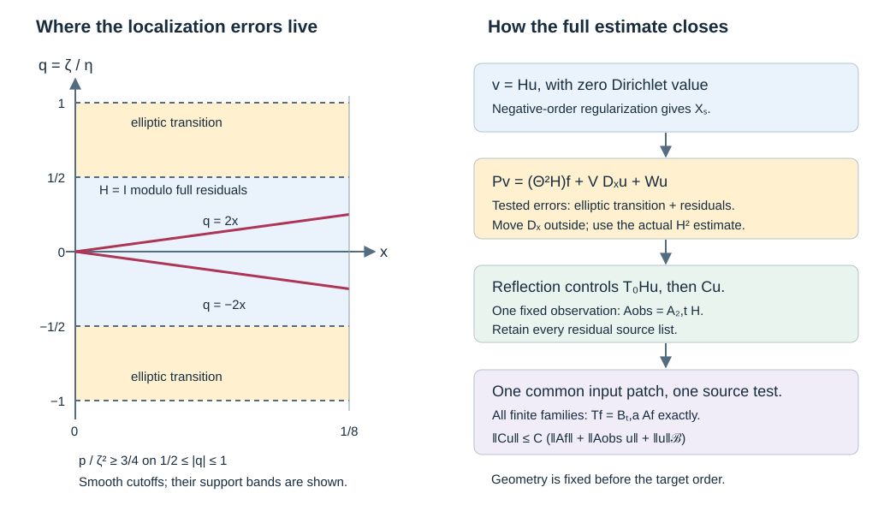

# Reflection with admissible source and observation tests

A transverse reflected ray can be estimated from one observed branch. The earlier reflection proof measured two transported source terms and a coarse mixed norm. Here we control those actual terms by the original Banach norm and one fixed admissible scalar test of the equation. All boundary residuals remain in the proof. The result is local to one whole-input product patch.

The mathematical antecedent is Lars Hörmander, *The Analysis of Linear Partial Differential Operators III*, corrected edition reprinted in 2007, §§18.3, 24.2 and 24.7. This independently written argument uses the programme's complete [strip reflection estimate](../20261009-uniform-transverse-reflection/uniform-transverse-reflection-with-strip-observations.html), [fixed observation estimate](../20261009-reflection-observation-interface/a-fixed-interior-observation-test-for-reflection.html), [boundary regularization](../20261009-admissible-boundary-regularization/boundary-regularization-with-source-tests.html), [elliptic source estimate](../20261010-uniform-elliptic-source-estimate/uniform-elliptic-boundary-estimates-with-one-source-test.html) and [scalar source domination](../20261009-scalar-fourier-source-tests/scalar-source-tests-from-compact-logarithmic-kernels.html). Their precise hypotheses are retained below.

## 1. The local estimate and its geometry

**H0. Fix the whole patch.** Work on \(x\ge0\), \(z\in\mathbb R^d\), \(d\ge1\), with Lebesgue measure and \(D=-i\partial\). Let \(a\) range over a compact smooth parameter family. The scalar differential operators are
\[
 P_a=D_x^2+c_a(x,z)D_x+B_a(x,z,D_z),
 \qquad \sigma_2(B_a)=-r_a(x,z,\eta),
 \qquad c_*|\eta|^2\le r_a\le C_*|\eta|^2
 \tag{RS1}
\]
on a fixed tangential conic neighborhood. Here \(c_*>0\), \(c_a\) is a multiplication operator, and all lower coefficients may be complex. Every coefficient derivative is uniformly bounded on a fixed larger compact chart. Let \(\mathcal B\) be a Banach space continuously embedded in the extendible distributions. The earlier flat-test Banach argument supplies a fixed integer \(N\) controlling a localized ordinary \(\overline H^{-N}\) norm by \(\|u\|_{\mathcal B}\).

Use the full transported tangential tests \(Q_{\pm,a}\), their exactly equal initial operators, and the smaller fixed tangential test \(T_0\) of UTR:R0–R8. The fixed ordinary observation cone \(\Omega\) contains a compact neighborhood of the whole positive root graph on an interior strip, for every \(a\), as specified in ROI:O0. All root tubes and their proper-support margins lie in the given tangential patch. Choose \(T_0\) with normal support in \([0,L_0)\), \(0<L_0<L\), so its extension by zero beyond \(L_0\) is smooth. Its symbol is one on a smaller target neighborhood. Shrinking that neighborhood, the collar and the parameter neighborhood is allowed once, before specifying any regularity order.

Write \(\Xi=(\zeta,\eta)\), where \(\zeta\) is dual to the compressed normal variable. Fix \(\delta>0\) and nested angular neighborhoods containing all the tangential tubes and the bands \(|\zeta|\le2\delta|\eta|\). Retain a slightly larger band for elliptic parametrices. All their angular projections lie in \(F\Subset V\). There is a single compact smooth input cutoff \(\chi\), equal to one on a neighborhood of the entire input projections of the operators constructed below, with room for proper-support and parametrix cutoffs, such that
\[
                 \operatorname{supp}\chi\times\overline V\Subset\Gamma .
 \tag{RS2}
\]
The containment is on the unit cosphere. It includes the inputs of full residual kernels. Choose these margins from the outset; they are stronger than an assertion about the principal symbol alone. Every later realization uses the fixed margins. Only finitely many nonlocal compositions occur; the arbitrarily deep regularization trees compose on the right only with differential operators and do not enlarge input supports.

Shorten the larger collar to \(0\le x<h\), with
\[
                         h\sqrt{C_*}<\delta/2 .
 \tag{RS3}
\]
The reflection and observation strips lie within it. The principal symbol of \(x^2P_a\) is \(\zeta^2-x^2r_a\); hence on \(|\zeta|\ge\delta|\eta|\) it is at least \(3\zeta^2/4\). A small enlargement of the transition band is still uniformly elliptic. Geometry, strips, source cone and parameter neighborhood are now fixed.

**H1. Precise conclusion.** Let \(C_{\ell,a}\), \(1\le\ell\le q\), be any finite bounded smooth family of compact boundary operators of order \(m\). Their full uniform microsupports lie in the smaller target neighborhood where \(T_0\) is elliptic and \(|\zeta|<\delta|\eta|\). All actual kernel supports obey the preceding margins. Uniform microsupport means rapid full-symbol decrease outside the specified cone, uniformly in every required seminorm; all residual kernels are included.

There are fixed compact scalar boundary operators \(A\) and \(A_{\rm obs}\), of finite orders, independent of \(a\), such that
\[
 \begin{gathered}
 \operatorname{WF}'_b(A)\Subset\Gamma,\qquad
 \operatorname{WF}'_b(A_{\rm obs})\Subset\Omega_b,\\
 \sum_{\ell=1}^q\|C_{\ell,a}u\|_{L^2}
 \le C\bigl(\|AP_au\|_{L^2}
             +\|A_{\rm obs}u\|_{L^2}+\|u\|_{\mathcal B}\bigr),
 \qquad u|_{x=0}=0 .
 \tag{RS4}
 \end{gathered}
\]
Here \(\Omega_b\) is the ordinary cone \(\Omega\) in interior compressed coordinates, \(\zeta=x\rho\). The inputs are smooth up to the boundary, compact in the fixed input chart, and belong to \(\mathcal B\). The constant is uniform in \(a,u\). The operators, constants and finite symbol seminorms may depend on \(m\) and the target family. The geometric neighborhood does not shrink with \(m\). The actual kernel of \(A_{\rm obs}\) need not have both variables away from the boundary; its full microsupport satisfies the displayed interior condition.

## 2. Tangential operations on a compressed band

**M0. Full mixed products.** Suppose \(E\in\Psi_b^\mu\) is compact, with full uniform microsupport in \(|\zeta|\le K|\eta|\), away from \(\eta=0\) on the cosphere. For a smooth proper tangential family \(T(x,z,D_z)\in\Psi_{\rm tan}^k\), both \(TE\) and \(ET\) are actual boundary operators of order \(\mu+k\). Their full microsupport is contained in the intersection of that of \(E\) with the lifted tangential microsupport of \(T\). If \(T\) is tangentially residual there, the product is fully boundary residual. All assertions include compact parameter families.

Here are the full-kernel details. Near the lifted diagonal use the ratio \(t=y/x\). The kernel of \(E\) is a smooth \(x\)-family of conormal distributions in \((z-w,t-1)\). In left composition the tangential symbol is evaluated at \(x\); in right composition it is evaluated at \(y=tx\). On a compact neighborhood of \(t=1\), all derivatives of those amplitudes are bounded symbol families. The complete tangential amplitude reduction and the conormal product reduction give the usual finite expansions with actual remainders. On the nonresidual band,
\[
                   \langle\eta\rangle\asymp\langle(\zeta,\eta)\rangle .
 \tag{RS5}
\]
Thus each tangential order loss is a full order loss. To verify the remainder statement, split the intermediate tangential frequency into a region comparable with \(\eta\) and its complement. On the first region Taylor's integral remainder to degree \(J-1\) loses \(J\) full orders by (RS5). On the complement the separated frequencies permit repeated integration by parts in the intermediate tangential base variable. Taking more integrations than the dimension, requested derivative count and absolute symbol orders makes that part of any prescribed negative full order. The rapid part of the symbol of \(E\) absorbs any fixed order of \(T\). This is the same complete amplitude argument as GB:C9 and GT10, with the \(tx\) parameter retained.

Off the tangential diagonal, proper cutoff errors are dealt with by arbitrarily many integrations in \(\eta\); the bounded compressed band turns that into arbitrary full-frequency decay. Off the lifted diagonal the kernel is already smooth. At \(t=0,\infty\), composing with a fixed-order tangential operator and differentiating \(T(tx)\) introduces at most finitely many side-face powers at each seminorm. The original flatness absorbs them, exactly as in ABR:R1. No side-face or proper-support term is dropped. These arguments prove continuous full-kernel seminorm estimates, the microsupport intersection, and the residual assertion. They also prove the statements when one factor has a full residual kernel. A tangential residual alone, without \(E\), would not have this conclusion.

**M1. A mixed norm bounds a localized output.** For such \(E\) and any real \(t\ge\mu\),
\[
                  \|Ev\|_{L^2}\le C_t\|v\|_{L^2_xH^t_z}.
 \tag{RS6}
\]
This does not follow by identifying tangential and ordinary Sobolev spaces. Use the exact logarithmic unitary map
\[
       (\mathcal Uv)(s,z)=e^{s/2}v(e^s,z),\qquad s=\log x .
 \tag{RS7}
\]
SFT:D1–D2 proves that the entire compact resolved kernel, including its residual part, has a complete left symbol in the ordinary uniform symbol calculus on \((s,z)\). Its full symbols are rapidly decreasing outside the compressed band. Multiplication on the right by the tangential Fourier multiplier \(\Lambda_z^{-t}\) therefore gives exactly the left symbol \(e(s,z,\zeta,\eta)\langle\eta\rangle^{-t}\). There is no composition remainder because that multiplier is base independent. On the band its order is \(\mu-t\le0\); off it rapid decrease absorbs the multiplier and every derivative. The proved uniform order-zero bound applies. Since \(\mathcal U\) commutes with tangential multipliers and is unitary in \(L^2(dx\,dz)\), this proves (RS6), including for negative \(t\) when the stated inequality \(t\ge\mu\) holds.

## 3. A regularized input with an actual normal derivative

**R0. Construct one fixed cutoff.** Choose a scalar \(H\in\Psi_b^0\), independent of \(a\), whose complete symbol is one modulo a full residual on a neighborhood of all the reflection tubes with \(|\zeta|\le\delta|\eta|\), and whose uniform microsupport lies in a larger tangential neighborhood with \(|\zeta|\le2\delta|\eta|\). Make its normal base cutoff one on a larger interval than \([0,L]\); leave room to insert smooth source cutoffs supported there. The full lacunary realization and proper localization are those of GB:C6 and C11. They change the specified symbol only by retained full residual terms. Arrange the target supports of H1 inside its identity neighborhood. Set
\[
                              v=Hu .
 \tag{RS8}
\]
The exact boundary kernel formula ABR:R7 gives \(\gamma_0v=H_\partial\gamma_0u=0\). This uses the full boundary action, not just its principal symbol. The input \(v\) is smooth on the closed collar by the actual conormal action theorem.

**R1. Obtain a coarse mixed graph from \(\mathcal B\).** Choose an even integer \(K\ge2N+4\) and put \(J=(1-\Delta_z)^{K/2}\). A properly localized tangential parametrix \(S\) of order \(-K\) can be chosen with
\[
                 (JS-I)H=R,\qquad R\in\Psi_b^{-\infty}.
 \tag{RS9}
\]
For completeness, the elliptic tangential recursion inverts the symbol of \(J\) successively to every order near the compact output support of \(H\). Full summation leaves a tangentially smoothing defect there. Put a proper cutoff equal to one near its diagonal; all its derivative errors are smooth tangential kernels away from that diagonal. Put its output base cutoff equal to one on a neighborhood of the entire output projection of \(H\). Then the remaining identity error vanishes there. M0 makes every resulting defect after right composition with \(H\) fully boundary residual, proving (RS9) for the actual kernels. All input margins remain inside (RS2).

The operator \(SH\) is in \(\Psi_b^{-K}\), by M0. Apply ABR:R0–R7 separately to \(SH\) and \(R\). For \(f=P_au\) this gives
\[
 \|SHu\|_{\overline H^2}+\|Ru\|_{\overline H^2}
 \le C\left(\|u\|_{\mathcal B}
                      +\sum_{T\in\mathcal E_a}\|Tf\|_{L^2}\right),
 \tag{RS10}
\]
where \(\mathcal E_a\) is a fixed finite list of bounded smooth admissible source families. Every input projection satisfies (RS2), and every full symbol is uniformly rapid outside \(F\).

The exact identity \(v=JSHu-Ru\), with \(J\) independent of \(x\), now proves
\[
 \|v\|_{X_s([0,L])}
 \le C\left(\|u\|_{\mathcal B}
                      +\sum_{T\in\mathcal E_a}\|Tf\|_{L^2}\right),
 \quad s=2-K,\qquad
 \|w\|_{X_s}^2=\|w\|_{L^2H^s_z}^2+\|D_xw\|_{L^2H^{s-1}_z}^2 .
 \tag{RS11}
\]
Indeed ordinary \(H^2\) controls \(L^2H^2_z\) and \(D_x\) in \(L^2H^1_z\); applying \(J\) loses exactly \(K\) tangential orders. The residual term embeds in the same spaces. This proves control of an actual first normal derivative. It does not assume that tangential smoothing alone produces one, or that \(Hu\) belongs to \(\mathcal B\).

## 4. The exact equation of the localized input

**C0. Keep the ratio-kernel commutator.** Use the actual operations \(\Theta,\delta\) of ABR:R1, with ratio kernels \(t\kappa\) and \(-i\partial_x\kappa\). To avoid confusing the fixed positive number \(\delta\) with that kernel operation, write the latter as \(\mathfrak d\) below. The exact identity is
\[
 \begin{aligned}
 P_aH-(\Theta^2H)P_a&=V_aD_x+W_a,\\
 V_a&=2\Theta\mathfrak d H+c_a\Theta H-(\Theta^2H)c_a,\\
 W_a&=\mathfrak d^2H+c_a\mathfrak d H+B_aH-(\Theta^2H)B_a .
 \end{aligned}
 \tag{RS12}
\]
Apply the two normal product identities of ABR:R2 and collect the three input jets to check every term. Tangential differential composition is exact on the full kernels. We have \(V_a\in\Psi_b^0\) and \(W_a\in\Psi_b^1\). For the latter use
\[
 B_aH-(\Theta^2H)B_a
       =[B_a,H]+(H-\Theta^2H)B_a .
 \tag{RS13}
\]
The scalar principal symbols in the commutator cancel, leaving order one; \(\Theta^2H-H\) has order minus one by ABR:R1. These estimates include all lower coefficients and residual parts.

**C1. The tested errors are uniformly elliptic.** Extend the \(Q_{\pm,a}\) smoothly to the slightly larger source interval and multiply them on the left by a fixed normal cutoff equal to one on \([0,L]\). Call the resulting tangential families \(\widehat Q_{\pm,a}\). Keep their tangential microsupports inside the region where the base and tangential cutoffs of \(H\) are one. The extensions and their bounds are available on a slightly longer flow collar fixed in H0.

M0 shows that
\[
         E_{\pm,a}=\widehat Q_{\pm,a}V_a,\qquad
         F_{\pm,a}=\widehat Q_{\pm,a}W_a
 \tag{RS14}
\]
are boundary operators of orders zero and one. Where \(|\zeta|<\delta|\eta|\) on their surviving tangential support, \(H=I\) modulo a full residual. The operations in (RS12) take \(I\) to \(V=0,W=0\) exactly and preserve residuals. Thus (RS14) is fully residual there. Outside that tangential support the mixed-product intersection in M0 is residual. Outside the support of \(H\), all its terms are residual as well. Consequently the full uniform microsupport of (RS14) lies in
\[
                      \delta|\eta|\le|\zeta|\le2\delta|\eta| .
 \tag{RS15}
\]
The normal derivative of the base cutoff of \(H\) is outside the support of \(\widehat Q_\pm\). Off-diagonal proper errors in this statement are full residuals, not zero operators. They stay in (RS14). By (RS3), its nonresidual microsupport has a fixed elliptic neighborhood for \(x^2P_a\).

**C2. Estimate every tested source term.** Fix an integer \(t\ge\max(2,m,s)\), and an integer \(j\ge t-1\). The complete equation on \([0,L]\) is
\[
 Q_{\pm,a}P_av
 =Q_{\pm,a}(\Theta^2H)f+E_{\pm,a}D_xu+F_{\pm,a}u .
 \tag{RS16}
\]
Bound its \(L^2H^{t-1}_z\) norm by the sum of the \(L^2\) norms after \(D_z^\alpha\), \(|\alpha|\le j\), using the elementary integer Fourier norm equivalence and Sobolev inclusion. The first terms are actual admissible source tests
\[
                   D_z^\alpha\widehat Q_{\pm,a}\Theta^2H
                         \in\Psi_b^{|\alpha|}.
 \tag{RS17}
\]
M0 proves their complete membership and support assertion.

For the normal-input error put \(G_{\pm,\alpha,a}=D_z^\alpha E_{\pm,a}\). The exact ratio identity moves that derivative outside:
\[
 G_{\pm,\alpha,a}D_xu
 =D_x\bigl((\Theta^{-1}G_{\pm,\alpha,a})u\bigr)
                   -(\mathfrak d\Theta^{-1}G_{\pm,\alpha,a})u .
 \tag{RS18}
\]
Both targets on the right have uniformly elliptic microsupport (RS15), including their full residual parts. So does \(D_z^\alpha F_{\pm,a}\). Apply UES:E3–E6, specifically its estimate NE20 **before** scalar domination, to this finite family. It controls the first output in ordinary \(H^2\), hence its displayed first normal derivative, and the other outputs in \(L^2\), by \(\|u\|_{\mathcal B}\) and a finite bounded family of source norms. The elliptic parametrices use input cutoffs inside \(\{\chi=1\}\); their complete residuals use the finite ABR source trees. Thus all these new source families have entire input support in (RS2), uniformly rapid symbols outside \(F\), and some common finite order.

We obtain, for one finite union \(\mathcal F_a\),
\[
 \sum_{\pm}\|Q_{\pm,a}P_av\|_{L^2([0,L];H^{t-1}_z)}
 \le C\left(\|u\|_{\mathcal B}
                        +\sum_{T\in\mathcal F_a}\|Tf\|_{L^2}\right).
 \tag{RS19}
\]
No ordinary normal derivative of \(f\) occurs. Keeping the pre-domination lists is essential: a collection of scalar tests chosen on unrelated patches has not been silently replaced by one scalar test.

## 5. Recover the target and make both tests fixed

**A0. Apply the proved reflection estimate to \(v\).** It is a smooth zero-Dirichlet input, its coarse \(X_s\) norm is bounded by (RS11), and its two actual source norms are bounded by (RS19). ROI:O0–O3 therefore gives
\[
 \|T_0v\|_{X_t([0,L_0])}
 \le C\left(\|A_{2,t}Hu\|_{L^2}+\|u\|_{\mathcal B}
            +\sum_{T\in\mathcal E_a\sqcup\mathcal F_a}\|Tf\|_{L^2}\right).
 \tag{RS20}
\]
The full initial boundary term vanishes. The scalar \(A_{2,t}\) is fixed and ordinary, with compact interior kernel and microsupport inside \(\Omega\). Define the single fixed scalar boundary operator
\[
                           A_{\rm obs}=A_{2,t}H .
 \tag{RS21}
\]
The complete boundary product calculus proves its membership and
\(\operatorname{WF}'_b(A_{\rm obs})\subset\Omega_b\). No estimate has been used to replace its residual input kernel by an unsupported interior-only assertion.

**A1. Return from \(Hu\) to \(C_{\ell,a}u\).** Complete boundary composition gives
\[
                   C_{\ell,a}u=C_{\ell,a}Hu+R_{\ell,a}u,
 \qquad R_{\ell,a}=C_{\ell,a}(I-H)\in\Psi_b^{-\infty}.
 \tag{RS22}
\]
A fixed proper tangential parametrix \(J_0\) of \(T_0\), on a neighborhood of the target supports, also gives
\[
                  C_{\ell,a}=(C_{\ell,a}J_0)T_0+S_{\ell,a},
                    \qquad S_{\ell,a}\in\Psi_b^{-\infty}.
 \tag{RS23}
\]
To justify the full residual assertion, construct the complete tangential inverse near those supports, retain its tangentially smoothing error, and use M0 on the left with \(C_{\ell,a}\). Off that neighborhood the full microsupports are separated. The proper-support errors are exactly the full residuals in M0. Its support margins permit \(T_0\) to be supported in \([0,L_0)\).

By M1, \(C_{\ell,a}J_0\) maps \(L^2H^t_z\) to \(L^2\). The norm of \(T_0v\) on the whole half-space is its norm on \([0,L_0]\). Applying (RS23) to \(v=Hu\), the remaining term is \(S_{\ell,a}Hu\), an actual full residual boundary operator on \(u\). Apply ABR:R0–R7 to every \(R_{\ell,a}\) and \(S_{\ell,a}H\). Their finite residual source lists obey (RS2), including their entire input kernels. Thus (RS20)–(RS23) imply
\[
 \sum_\ell\|C_{\ell,a}u\|_{L^2}
 \le C\left(\|A_{\rm obs}u\|_{L^2}+\|u\|_{\mathcal B}
                         +\sum_{T\in\mathcal L_a}\|Tf\|_{L^2}\right),
 \tag{RS24}
\]
where \(\mathcal L_a\) is the union of all the finite lists actually constructed.

**A2. One source test, including all residuals.** Pad the lists by zero operators if needed. They form a finite bounded family in \(\Psi_b^M\) for some nonnegative integer \(M\); all full symbols are uniformly rapid outside \(F\), and all actual input projections satisfy (RS2). SFT:D0–D8 therefore constructs one fixed scalar \(A\in\Psi_b^M\), with microsupport in \(\Gamma\), and uniformly \(L^2\)-bounded actual factors \(B_{T,a}\) such that
\[
                  Tf=B_{T,a}Af,\qquad
                  \sum_{T\in\mathcal L_a}\|Tf\|_{L^2}
                                      \le C\|Af\|_{L^2}.
 \tag{RS25}
\]
That earlier construction uses a base-independent Fourier multiplier with a positive residual floor on logarithmic coordinates and exact right division of complete left symbols. Consequently its factors retain the full residual families; no small-remainder absorption requiring \(\|f\|_{L^2}\) occurs. Substitution into (RS24) proves (RS4).

**A3. Completion and scope.** For fixed \(a\), complete the smooth zero-Dirichlet inputs in the norm
\[
                     \|u\|_{\mathcal B}
                       +\|AP_au\|_{L^2}+\|A_{\rm obs}u\|_{L^2}.
 \tag{RS26}
\]
This completion injects into \(\mathcal B\). Indeed the transpose of a compact boundary operator sends each interior compact smooth test to a compact smooth input test flat at the boundary. The full side-face estimates prove this for \(A\) and \(A_{\rm obs}\); applying \(P_a^t\) preserves flatness. The Banach flat-test bound identifies each limiting \(L^2\) component with its actual distributional action on the \(\mathcal B\) limit. If that limit is zero, both components vanish on every interior test and hence vanish as \(L^2\) functions. The same argument identifies the target limits supplied by (RS4). If \(\mathcal B\) has a continuous value map extending smooth restriction, it remains zero on this closure. No density assertion about all vectors with finite tested norms is made.

This proves the local transverse reflection source/Banach interface under the precise whole-input product hypothesis. It fixes both scalar tests uniformly in the coefficient parameter and allows every finite target order on the same geometric neighborhood. Global scalar assembly across different base-angular patches, the remaining glancing and interior interfaces, the full compact-ray observation theorem, its wave application and the remaining AN-04 obligations still require proofs. The full course is not declared complete. External foundational human proofs remain external, so internal P514 closure of the CC0 export is not claimed.

## 6. Three complete solutions

### Exercise 1. Recover the correct coarse exponent

Take \(N=2\), choose the smallest allowed even \(K\), and give the two actual Sobolev norms controlled for \(Hu\). Explain what changes if \(N=3\).

**Solution.** For \(N=2\), \(K=8\), \(s=2-K=-6\). The ordinary \(H^2\) outputs \(SHu,Ru\) in (RS10) give
\[
                  Hu\in L^2_xH^{-6}_z,\qquad
                  D_xHu\in L^2_xH^{-7}_z .
 \tag{RS27}
\]
The second assertion follows by commuting \(D_x\) with the fixed polynomial \(J=(1-\Delta_z)^4\), which has order eight. The first derivative of \(SHu\) is in \(L^2H^1_z\), so the result is \(1-8=-7\), not \(-6\). For \(N=3\), take \(K=10\); the two exponents are \(-8,-9\). Increasing \(N\) changes the coarse order and finite source tree, but neither the compressed cutoff band nor the observed strip.

### Exercise 2. Check the full commutator on a power

Use \(P=D_x^2-c^2D_z^2\), \(Q=xD_x\), and \(H=Q\). This algebraic model is not an order-zero cutoff. Compute (RS12) and verify it on \(u=x^\nu e^{ikz}\), for \(x>0\).

**Solution.** ABR:R1 gives \(\Theta Q=Q-i\), \(\mathfrak d Q=0\), and \(\Theta^2Q=Q-2i\). Since \(Q\) commutes with \(D_z\),
\[
              V=0,\qquad W=-2ic^2D_z^2,\qquad
              PQ-(Q-2i)P=-2ic^2D_z^2 .
 \tag{RS28}
\]
For a direct check, \(Qx^\nu=-i\nu x^\nu\) and
\[
 Px^\nu e^{ikz}
       =[-\nu(\nu-1)x^{\nu-2}-c^2k^2x^\nu]e^{ikz}.
 \tag{RS29}
\]
The \(x^{\nu-2}\) coefficients in \(PQu-(Q-2i)Pu\) cancel. The \(x^\nu\) coefficients give \(-2ic^2k^2\), exactly \(Wu\). Replacing \(\Theta^2H\) by \(H\) would leave a spurious second-normal-input term. The identities concern smooth functions on \(x>0\); no boundary regularity of a nonintegral power is assumed.

### Exercise 3. Locate the transition errors relative to the rays

Let \(P=D_x^2-4D_z^2\), take \(\delta=1/2\), and \(0\le x\le1/8\). On \(\eta>0\), put \(q=\zeta/\eta\). Locate the compressed characteristics and the transition band, and give an exact ellipticity bound there.

**Solution.** The characteristics are \(q=\pm2x\); therefore they remain in \(|q|\le1/4\). A cutoff equal to one for \(|q|\le1/2\) and zero for \(|q|\ge1\) has its nonresidual transition errors in \(1/2\le|q|\le1\). In that band,
\[
 \frac{\zeta^2-4x^2\eta^2}{\zeta^2}
       =1-\frac{4x^2}{q^2}\ge 1-\frac{4(1/8)^2}{(1/2)^2}
       =\frac34 .
 \tag{RS30}
\]
Equality occurs at \(x=1/8\), \(q=\pm1/2\). The margin between the characteristic slopes and transition slopes makes the commutator errors elliptic. For this closed model interval the non-strict version of (RS3) suffices; the proof uses a slightly shorter interval or a slightly enlarged band to retain open support margins.

## 7. The actual localization diagram

**F0. Coordinates and dependencies in the drawing.** The left panel plots precisely the model of Exercise 3: \(x\) horizontally, \(q=\zeta/\eta\) vertically for \(\eta>0\), with characteristic lines \(q=\pm2x\), identity-band edges \(q=\pm1/2\), and outer edges \(q=\pm1\). Shading describes support regions for a smooth cutoff, not a discontinuous symbol. The right panel is a dependency diagram: the coarse graph comes from (RS10), the error graph from ellipticity and (RS18), the reflection estimate from (RS20), and the single source test from (RS25). Every residual source list enters that final union.

The [figure source](figures/build_figure.py), [exact algebra checks](check_models.py), proof map, proof review, source credit and [reader checks](reader-check.json) are included. This independent lesson, exercises and figure are CC0-1.0. Earlier components retain their actual terms. 
