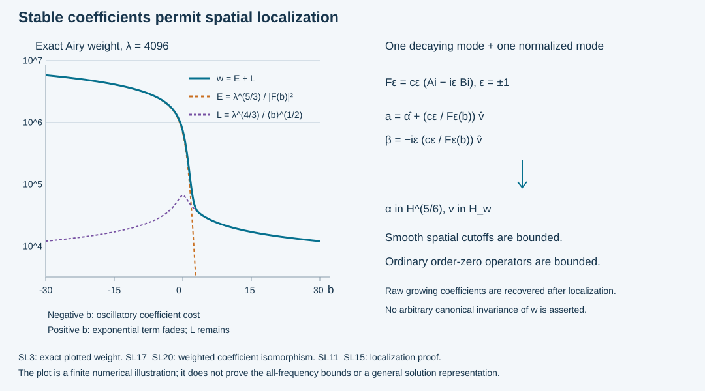

# Stable Airy coefficients and spatial localization

The [growing-kernel estimate](../20261010-growing-airy-energy/weighted-energy-bounds-for-the-growing-airy-kernel.md) constructs finite-energy solutions from a decaying coefficient and an exponentially weighted growing coefficient. Spatial localization of the latter coefficient was deliberately left unjustified. We now change the coefficient basis, prove a smooth polynomially moderate energy weight, and show that spatial cutoffs and ordinary pseudodifferential operators preserve the resulting space.

The stable basis consists of the unnormalized decaying Airy kernel and one boundary-normalized mode. Both coefficients are distributions. This is different from requiring two individually distributional normalized coefficients, which AES:E9 disproves even for the affine equation. The new basis describes exactly the same weighted pairs as the proved construction; it does not by itself establish that every general energy solution has that representation.

The primary antecedent is Melrose–Taylor, [*Boundary Problems for Wave Equations With Grazing and Gliding Rays*](https://mtaylor.web.unc.edu/wp-content/uploads/sites/16915/2018/04/glide.pdf), §§6.3 and 7.3–7.4. Their decomposition into a decaying kernel and normalized boundary terms motivates the receiving question. The weight, localization estimates and coefficient isomorphism below are independently proved from the exact earlier Airy estimates. Independent text, proofs, exercises and illustration are **CC0-1.0**. The proof map retains the external human foundations; internal P514 closure of this export is not claimed.

## 1. A smooth weight on the whole frequency space

**H0. Extend the frequency coordinates, not the equation.** On the GAE cone use \(\eta=(\mu,\eta',\lambda)\), \(\lambda\ge1\), \(|\eta|\asymp\lambda\), and \(b=-\mu\lambda^{-1/3}\). Choose smooth real functions \(\ell,m\) on all frequency space such that
\[
 \ell\asymp\langle\eta\rangle,\quad \ell\ge c>0,\quad
 \ell,m\in S^1,\qquad
 (\ell,m)=(\lambda,\mu)\ \hbox{on the working cone}.
 \tag{SL1}
\]
Here and below ordinary symbol estimates include all derivatives. To construct them choose a smooth cutoff equal to one on that cone, supported in a slightly larger cone where \(\lambda\ge c_0\langle\eta\rangle\), and zero near the origin. Set \(\ell=\chi\lambda+(1-\chi)\langle\eta\rangle\), \(m=\chi\mu\). A transition below the working lower frequency keeps these identities exact. Positivity, comparability and every derivative bound follow from the product rule. This extension is an auxiliary norm; it asserts no extended differential equation.

Put \(b=-m\ell^{-1/3}\) globally. Then
\[
 |b|\le C\ell^{2/3},\qquad
 |\partial_\eta^\gamma b|\le C_\gamma\ell^{2/3-|\gamma|}.
 \tag{SL2}
\]
Use the exact zero-free real-axis solution \(F=c(A-iB)\), where \(A=\operatorname{Ai}\), \(B=\operatorname{Bi}\), \(c=\sqrt\pi e^{i\pi/4}\), as proved in ABQ:B3–B4. Define the positive smooth functions
\[
 f(b)=|F(b)|^{-2},\quad
 E=\ell^{5/3}f(b),\quad L=\ell^{4/3}\langle b\rangle^{-1/2},
 \quad w=E+L,\quad k_w=w^{1/2}.
 \tag{SL3}
\]
The letter \(L\) in SL3 denotes a weight summand, not a graph inverse or a differential operator.

**H1. The weighted space and its exact comparison.** Let
\[
 \|v\|_{\mathcal H_w^s}^2=(2\pi)^{-d}
   \int\langle\eta\rangle^{2s}w(\eta)|\widehat v(\eta)|^2\,d\eta,
 \qquad \mathcal H_w=\mathcal H_w^0 .
 \tag{SL4}
\]
The Airy estimates and SL2 give
\[
 c_1\ell\le w\le C_1\ell^2,\qquad
 H^{s+1}\subset\mathcal H_w^s\subset H^{s+1/2}.
 \tag{SL5}
\]
Indeed \(L\ge c\ell\), while \(L\le C\ell^{4/3}\). For \(b\le0\), ABQ:B4 gives \(f(b)\asymp\langle b\rangle^{1/2}\), so \(E\le C\ell^2\). For \(b\ge0\), it gives \(f(b)\asymp\langle b\rangle^{1/2}e^{-2\Psi(b)}\), where \(\Psi(b)=2(b_+)^{3/2}/3\) on the whole real line; this is bounded, so \(E\le C\ell^{5/3}\).

Multiplication of the Fourier transform by \(\langle\eta\rangle^s k_w\) identifies SL4 isometrically with \(L^2\), proving completeness. The inverse multiplier has polynomial growth by SL5, so it defines a tempered distribution. Smooth compactly supported Fourier functions are dense: truncate first and then approximate in the weighted integral on each compact set, where the weight and its inverse are bounded. Thus every operator estimate below extends from this dense class.

On the original cone the raw weight of GAE is
\[
 W_A=\lambda^{5/3},\qquad
 W_B=\lambda^{5/3}+
       \lambda^{4/3}\frac{e^{2\Psi(b)}}{\langle b_+\rangle}.
 \quad
 \frac{W_B}{|F(b)|^2}\asymp w .
 \tag{SL6}
\]
For \(b\ge0\), the second summand divided by \(|F(b)|^2\) is comparable to \(L\). For \(b\le0\), \(W_B\asymp W_A\), and \(L/E\le C\lambda^{-1/3}\langle b\rangle^{-1}\). These two computations prove SL6, including the compact transition.

## 2. Differentiate the weight through its logarithmic transition

**S0. The real Airy derivative bounds needed here.** The earlier differentiated Airy expansions imply
\[
 \begin{array}{ll}
 |f^{(j)}(b)|\le C_j f(b)\langle b\rangle^{-j},& b\le0,\\
 |f^{(j)}(b)|\le C_j f(b)\langle b\rangle^{j/2},& b\ge0.
 \end{array} \tag{SL7}
\]
Here is why no uncontrolled oscillation survives in these estimates. On the negative ray \(F\) is one oscillatory branch times a symbol of order \(-1/4\). In \(|F|^2\) its scalar phase cancels, giving a positive elliptic symbol of order \(-1/2\). Differentiating its reciprocal inductively gives the first row. On the positive ray, \(|F|^2=\pi(A^2+B^2)\). The full differentiated expansions ABQ:B4 and AES:E1 factor this as \(e^{2\Psi(b)}\langle b\rangle^{-1/2}\) times a positive elliptic symbol of order zero. Differentiation of the reciprocal exponential costs at most \(\langle b\rangle^{1/2}\) per derivative, giving the second row. Nonvanishing and smoothness fill the remaining compact intervals. These are estimates for the exact function, with the differentiated remainders included.

**S1. Exponential suppression bounds the transition loss.** For \(b\ge0\), put \(r=E/L\). Then
\[
 r\le C\ell^{1/3}\langle b\rangle e^{-4b^{3/2}/3},
 \qquad
 \langle b\rangle^{j/2}\min(1,r)
       \le C_j(1+\log(2+\ell))^{j/3}.
 \tag{SL8}
\]
To prove the second inequality split at
\(T=C_0(1+\log(2+\ell))^{2/3}\), with one sufficiently large fixed \(C_0\).
Below \(T\) use \(\min(1,r)\le1\). Above \(T\), absorb \(\ell^{1/3}\langle b\rangle\) into half of the decaying exponential: taking logarithms reduces this to
\((\log\ell)/3+\log\langle b\rangle\le(2/3)b^{3/2}+C\).
This follows from the definition of \(T\) and the elementary domination of a logarithm by a positive power. The remaining exponential absorbs any fixed power \(\langle b\rangle^{j/2}\). Increasing the constants covers bounded \(\ell\). This proves SL8 for every fixed \(j\).

**S2. A uniform derivative scale for every power of the weight.** For every real \(z\) and multi-index \(\gamma\),
\[
 |\partial_\eta^\gamma w^z|
          \le C_{\gamma,z} w^z\ell^{-|\gamma|/4}.
 \tag{SL9}
\]
For \(L\), the chain and product rules in SL2 give the stronger relative bound \(\ell^{-|\gamma|/3}\). For \(E\), a term with \(j\) derivatives of \(f\), \(j\le n=|\gamma|\), is bounded by \(C\ell^{5/3-n+2j/3}|f^{(j)}|\). On \(b\le0\), SL7 bounds it by \(CE\ell^{-n/3}\). On \(b\ge0\), division by \(w\), followed by SL8, bounds it by
\[
 C_n\ell^{-n/3}(1+\log(2+\ell))^{n/3}
                      \le C'_n\ell^{-n/4}. \tag{SL10}
\]
The last inequality follows by maximizing the continuous function consisting of a logarithmic power times \(\ell^{-n/12}\) for \(\ell\ge c\). Thus SL9 holds for \(w\). Repeated differentiation of \(w^z\) gives finite products \(w^{z-j}\prod_{i=1}^j\partial^{\gamma_i}w\), with \(\sum|\gamma_i|=|\gamma|\). Apply the bound just proved to each factor. This proves SL9 for positive, negative and fractional \(z\), with no differentiation of the nonsmooth auxiliary function \(b_+^{3/2}\).

## 3. Spatial cutoffs and ordinary operators are bounded

**M0. Polynomial moderation with an explicit exponent.** For all \(\eta,\nu\),
\[
 \frac{w(\eta)}{w(\nu)}
       \le C\langle\eta-\nu\rangle^4,\qquad
 \frac{k_w(\eta)}{k_w(\nu)}
       \le C\langle\eta-\nu\rangle^2 .
 \tag{SL11}
\]
Set \(R=\langle\nu\rangle\), \(h=|\eta-\nu|\). If \(h\le cR^{1/4}\), the whole segment stays at frequency comparable to \(R\); SL9 bounds \(|\nabla\log w|\) there by \(CR^{-1/4}\). Integrating along the segment gives a bounded ratio. Adjusting constants covers the bounded-frequency case. If \(cR^{1/4}<h\le R/2\), SL5 and comparable frequencies bound the ratio by \(CR\le C'\langle h\rangle^4\). If \(h>R/2\), then both \(R\) and \(\langle\eta\rangle\) are at most \(C\langle h\rangle\); SL5 gives a bound \(C\langle h\rangle^2\), since \(w(\nu)\ge c\). These cases exhaust all pairs. The second assertion is the square root of the first; interchanging the frequencies also controls the inverse ratios.

**M1. Cutoffs and pseudodifferential operators.** If \(\chi\in C_c^\infty(\mathbb R^d)\), multiplication by \(\chi\) is bounded on every \(\mathcal H_w^s\). More generally, a symbol \(p(x,\eta)\) with compact \(x\)-support and the ordinary \(S^m\) bounds gives
\[
 \operatorname{Op}(p):\mathcal H_w^s
                      \longrightarrow\mathcal H_w^{s-m}
 \quad\hbox{bounded, for every real }s,m. \tag{SL12}
\]
Use the left quantization and Fourier convention of GAE. Integrating the Fourier transform of \(p\) in \(x\) by parts gives
\[
 |\widehat p(\xi-\eta,\eta)|
           \le C_N\langle\xi-\eta\rangle^{-N}
                    \langle\eta\rangle^m . \tag{SL13}
\]
The compact support makes each differentiated \(x\)-integral uniformly bounded. Conjugating the Fourier kernel by the input and output norm multipliers in SL4 leaves, by SL11 and
\(\langle\xi\rangle^{t}/\langle\eta\rangle^{t}
\le C_t\langle\xi-\eta\rangle^{|t|}\),
a kernel bounded by
\(C_N\langle\xi-\eta\rangle^{-N+2+|s-m|}\).
Choose \(N>d+2+|s-m|\). Both absolute kernel integrals are uniformly finite; the proved Schur inequality P1:B3 yields SL12. Density from H1 identifies its extension with the distributional operator. Taking \(p(x,\eta)=\chi(x)\) proves the cutoff statement. The constants use finitely many symbol seminorms on the fixed compact set.

**M2. A cutoff commutator gains a positive order.** In addition,
\[
 \langle D\rangle^{1/4}
 [k_w(D),\chi]k_w(D)^{-1}:L^2\longrightarrow L^2
 \quad\hbox{is bounded}. \tag{SL14}
\]
The unweighted Fourier kernel contains
\((k_w(\xi)-k_w(\eta))/k_w(\eta)\).
With \(R=\langle\eta\rangle\), \(h=|\xi-\eta|\), the short-segment argument in M0 and SL9 give \(CR^{-1/4}h\) when \(h\le cR^{1/4}\). Otherwise SL11 gives \(C\langle h\rangle^2\), which is at most \(C'R^{-1/4}\langle h\rangle^3\). Multiplying by \(\langle\xi\rangle^{1/4}\le C R^{1/4}\langle h\rangle^{1/4}\) therefore bounds the full kernel by
\[
 C\langle\xi-\eta\rangle^{13/4}
                          |\widehat\chi(\xi-\eta)|. \tag{SL15}
\]
This is integrable in either variable, since repeated integration by parts makes \(\widehat\chi\) rapidly decreasing. Schur proves SL14. This is a proved lower-order commutator; no invariance of the weight under an arbitrary canonical transformation is assumed.

## 4. Replace the unstable pair by stable distributions

**C0. The exact weighted coefficient isomorphism.** For either sign \(\epsilon=\pm1\), write
\[
 F_\epsilon=c_\epsilon(A-i\epsilon B),\quad
 c_+=c,\ c_-=\bar c,\qquad |F_\epsilon|=|F|.
 \tag{SL16}
\]
Given physical input distributions \(\alpha,v\), define the raw frequency coefficients
\[
 a=\widehat\alpha+\frac{c_\epsilon}{F_\epsilon(b)}\widehat v,
 \qquad
 \beta=-\frac{i\epsilon c_\epsilon}{F_\epsilon(b)}\widehat v .
 \tag{SL17}
\]
The inverse formulas are
\[
 \widehat\alpha=a-i\epsilon\beta,\qquad
 \widehat v=\frac{i\epsilon F_\epsilon(b)}{c_\epsilon}\beta .
 \tag{SL18}
\]
On the fixed cone this is an isomorphism
\[
 H^{5/6}\oplus\mathcal H_w
 \ \longleftrightarrow\
 \left\{(a,\beta):
   \int(W_A|a|^2+W_B|\beta|^2)<\infty\right\}.
 \tag{SL19}
\]
The indicated spaces are restricted to that cone in frequency. Algebra verifies both inverse formulas. Since \(a=\widehat\alpha+i\epsilon\beta\) and \(W_A\le W_B\), the elementary squared triangle inequality in each direction gives
\[
 \tfrac13(W_A|\widehat\alpha|^2+W_B|\beta|^2)
 \le W_A|a|^2+W_B|\beta|^2
 \le3(W_A|\widehat\alpha|^2+W_B|\beta|^2). \tag{SL20}
\]
Now use SL6 and \(|c_\epsilon|^2=\pi\). Integration proves both bounds in SL19. Measurability, truncation and completeness prove surjectivity onto the stated weighted pair space, not onto an as yet uncharacterized space of PDE solutions. Both new coefficients are tempered by SL5. No individual temperedness of the two former normalized coefficients is needed.

**C1. The actual variable-phase kernel in the new basis.** Let \(T_A\) be the decaying kernel and \(K_\epsilon\) the normalized \(F_\epsilon\) kernel, with the actual GAE/CAA phases, the same \(g,h\), angular cutoff and output cutoff. Then
\[
 U(a,\beta)=T_A\alpha+K_\epsilon v,\qquad
 \|T_A\alpha+K_\epsilon v\|_{H^1}
       \le C(\|\alpha\|_{H^{5/6}}+\|v\|_{\mathcal H_w}).
 \tag{SL21}
\]
For bounded frequency support substitute SL17 into the integral. The coefficient of \(\widehat v\) is exactly
\([gF_\epsilon(\zeta)+ihF_\epsilon'(\zeta)]/F_\epsilon(b)\).
The amplitudes have not been conjugated. GAE:E0 and SL19 let the identity pass to the actual H1 limit. GAE:E1–E2 give every compact smooth seminorm of its equation error where the output cutoff equals one. Its full cutoff error remains \([P,\chi]U\). This proves the normalized forward map on its correct weighted domain, not merely on smooth compact input.

**C2. The boundary rows keep their original weak meaning.** Use the CAA matrices \(g_b,d_0,c_0^{\rm row}\) and write \(J=T_{g_b}\), \(D_0=T_{d_0}\), \(C=T_{c_0^{\rm row}}\) for the boundary graph operators. On an inner boundary patch where the output cutoff is one, the actual value and conormal traces are
\[
 \begin{split}
 f_{\rm tr}&=J[A(b)\widehat\alpha+\widehat v],\\
 n_{\rm tr}&=D_0[A(b)\widehat\alpha+\widehat v]
       +C[A'(b)\widehat\alpha+\varphi_\epsilon(b)\widehat v],
 \qquad \varphi_\epsilon=F_\epsilon'/F_\epsilon .
 \end{split} \tag{SL22}
\]
Here a graph operator applied to a bracket means its Fourier-input integral; equivalently insert the inverse Fourier transform of that bracket. Substitution in GAE:T0–T1 proves the identities first at bounded frequency and then in \(H^{1/2}\) and \(H^{-1/2}\). GAE:T2 identifies these limits as the actual weak traces in the signed original energy form. Its complete differentiated cutoff term is retained on patches where the cutoff is not constant.

One useful additional fact is
\[
 w|A(b)|^2\le C\lambda^{5/3}. \tag{SL23}
\]
On \(b\le0\), use \(|A(b)|^2\le C\langle b\rangle^{-1/2}\) in SL3. On \(b\ge0\), use its exponentially decaying bound; both resulting factors are bounded by the right side. Thus \(A(b)\widehat\alpha+\widehat v\) lies in \(\mathcal H_w\) in the auxiliary boundary coordinates. This is a necessary enhanced trace property for the constructed range, stronger than the ordinary H1 trace alone near glancing.

## 5. Localize the stable inputs and the physical boundary data

**L0. Localize and then restore the conic support.** Choose closed nested conic frequency sets \(\Gamma_0\Subset\Gamma_1\) on the unit sphere, within the working phase cone. If \(\alpha,v\) have frequency support in \(\Gamma_0\) above the fixed low-frequency threshold, multiply them by any compact smooth spatial cutoff \(\chi\), and apply a smooth bounded Fourier cutoff \(\omega_1\) supported in \(\Gamma_1\), equal to one near \(\Gamma_0\). Then
\[
 (\alpha,v)\longmapsto
   (\omega_1(D)\chi\alpha,\omega_1(D)\chi v)
 \quad\hbox{is bounded on }H^{5/6}\oplus\mathcal H_w .
 \tag{SL24}
\]
The ordinary Sobolev cutoff proof and M1 give the two multiplication bounds. The Fourier cutoff is bounded directly in both defining integrals. Converting the new pair by SL17 therefore again gives admissible raw coefficients, and C1 gives a new actual H1 kernel with the proved smooth local equation error.

The omitted term \((1-\omega_1(D))\chi v\) is smooth, with every Sobolev norm bounded by a suitable fixed coarse norm of \(v\); the same holds for \(\alpha\). Indeed its Fourier kernel is
\((1-\omega_1(\xi))\widehat\chi(\xi-\eta)\) on the input support. Apart from bounded frequencies, angular separation implies
\[
 |\xi-\eta|\ge c(|\xi|+|\eta|).
 \tag{SL25}
\]
To verify this, failure on normalized pairs would give, by compactness, equal nonzero limiting directions in the two separated closed angular sets. That is impossible. Repeated integration by parts in \(\widehat\chi\) and SL25 then gives arbitrary output decay even after any fixed polynomial input weight; Schur proves every Sobolev estimate. In the bounded remaining region the kernel is smooth with compact frequency support. This accounts for the full conic leakage. No multiplication of the raw exponentially weighted \(\beta\) has been asserted.

**L1. Transport localization through the boundary graph.** Let \(J\) be the elliptic graph operator in C2 and \(G\) its properly localized inverse graph operator from ABI:B1, with \(GJ\equiv I\), \(JG\equiv I\). All identities here have the nested compact base and conic supports from ABI:B3. The physical weighted boundary space is defined by requiring its pulled-back coefficient \(Gf\) to lie in \(\mathcal H_w\), with a fixed coarse distribution norm to control the smooth remainders.

For a compact smooth physical boundary cutoff \(\psi\), the complete graph composition and Egorov proofs give
\[
 G\psi J=\operatorname{Op}(p)+R,\qquad p\in S^0,
 \quad R\hbox{ has a smooth localized kernel}. \tag{SL26}
\]
M1 bounds the first term on \(\mathcal H_w\). For the second, its compact smooth kernel and Fourier integration by parts give a bounded map from any fixed compact \(H^{-N}\) space into \(H^1\); SL5 embeds \(H^1\) into \(\mathcal H_w\). Thus physical localization preserves this transported space, with the stated coarse remainder. The same argument compares two inverse-graph representatives differing by a smooth localized kernel. Frequency cutoffs and leakage are handled by L0. This proves exactly the needed transported assertion; it does not identify \(G\psi J\) with the scalar multiplier \(\psi\), or assert invariance of \(w\) under arbitrary nonlinear canonical changes.

The remaining general representation problem is now precise. One must recover an interior coefficient in \(H^{5/6}\), prove the enhanced pulled-back boundary trace in \(\mathcal H_w\) for the actual solution, and control the equation correction and complementary microlocal terms. C0–L1 make localization of those coefficients legitimate once recovered. They do not supply the reverse estimate or those recovery statements. The full course objective remains active.

## 6. Three solved exercises

**X1. A stable triangular matrix for either time direction.** Compute the coefficient matrix in SL17, its inverse and the determinant. Explain why its entries alone are not the norm comparison.

**Solution.** With \(z=c_\epsilon/F_\epsilon(b)\), the matrices are
\[
 M_\epsilon=\begin{pmatrix}1&z\\0&-i\epsilon z\end{pmatrix},
 \qquad
 M_\epsilon^{-1}=
   \begin{pmatrix}1&-i\epsilon\\0&i\epsilon/z\end{pmatrix},
 \qquad \det M_\epsilon=-i\epsilon z\ne0. \tag{SL27}
\]
Their products are identity because \(\epsilon^2=1\). The second inverse entry can grow exponentially with frequency. SL6 and SL20 compensate that growth by the actual coefficient weights; a uniform unweighted matrix inverse bound would be false. For the negative sign only the scalar Airy solution and its constant are conjugated. The receiving \(g,h\) remain unchanged, even for noncommuting complex lower matrices.

**X2. The raw exponential weight is not polynomially moderate.** Fix \(a_0>0\) strictly inside the elliptic angular part of the cone. Let \(\lambda\to\infty\) and compare the two frequencies with \(\eta'=0\), the same \(\lambda\), and
\(\mu_0=-a_0\lambda\), \(\mu_1=-a_0\lambda-\log\lambda\).
Show why the SL11 proof cannot be used for \(W_B\).

**Solution.** Both frequencies stay in the cone for large \(\lambda\), and their distance is \(\log\lambda\). Their positive Airy arguments differ by \(\lambda^{-1/3}\log\lambda\). Taylor's formula gives
\[
 2\Psi(b_1)-2\Psi(b_0)
   =2\sqrt{a_0}\log\lambda
       +O((\log\lambda)^2/\lambda),\qquad
 \frac{W_B(\eta_1)}{W_B(\eta_0)}
                    \sim\lambda^{2\sqrt{a_0}}. \tag{SL28}
\]
The polynomial summand in \(W_B\) is exponentially smaller, and the bracket denominator ratio tends to one. For every fixed \(N\), \(\lambda^{2\sqrt{a_0}}/(1+\log\lambda)^N\to\infty\); hence no fixed polynomial difference bound is possible for the raw weight. In contrast, SL3 gives \(w(\eta_j)\sim a_0^{-1/2}\lambda\), so their stable-weight ratio tends to one. This establishes the failure of moderation, not a theorem that every individual spatial cutoff is unbounded in the raw space.

**X3. Read the three Sobolev orders from the exact weight.** Evaluate the size of \(w\) on \(b=O(1)\), \(b=-a_0\lambda^{2/3}\), and \(b=a_0\lambda^{2/3}\), with fixed \(a_0>0\).

**Solution.** The exact bounds in H1 give respectively
\[
 w\asymp\lambda^{5/3},\qquad
 w\asymp\lambda^2,\qquad
 w\asymp\lambda .
 \tag{SL29}
\]
Their square-root orders are \(5/6,1,1/2\). The last statement follows because \(E\) is exponentially small and \(L\asymp\lambda\). These are bandwise comparisons, not three interchangeable global Sobolev norms. For example take disjoint fixed-radius smooth Fourier packets centered at \((\mu,\lambda)=(0,4^j)\), with coefficients \(4^{-j/2}/j\). Their squared \(H^{1/2}\) norm is comparable to \(\sum j^{-2}\), while their squared \(\mathcal H_w\) norm contains \(\sum 4^{2j/3}/j^2\) and diverges. Conversely, on a fixed elliptic ray the coefficients \(4^{-j/2}/j\) have finite \(\mathcal H_w\) norm and infinite \(H^{5/6}\) norm. These packet conclusions use the uniform bounds on each small ball and disjoint support, so no pointwise-frequency idealization is required.

## 7. The weight and the localization scale

**V0. Exact interpretation.** The plot uses \(\lambda=4096\), \(b\in[-30,30]\), and the exact weight SL3 with \(|F(b)|^2=\pi(A(b)^2+B(b)^2)\). It shows \(E\), \(L\) and their sum on a logarithmic vertical scale; the values are finite numerical illustrations, while H1–S2 prove the all-frequency bounds. The second panel states the exact coefficient conversion SL17–SL18 and the proved localization implications. The exponent \(1/4\) is a convenient uniform derivative and commutator scale established in SL9 and SL14; no assertion of its optimality is made. The [figure source](figures/build_figure.py) preserves the constants, plotted functions and labels.
