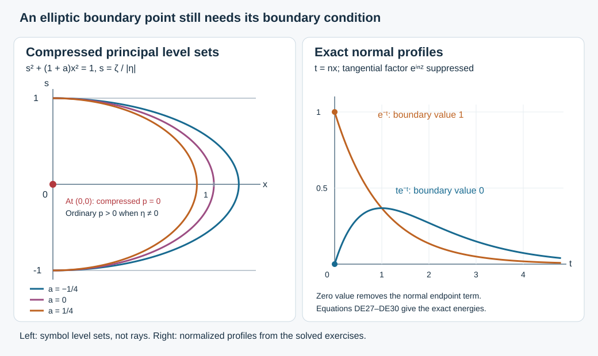

# Uniform Dirichlet estimates in the boundary elliptic region

At a boundary covector where the tangential quadratic form is strictly negative, the normal equation has no real characteristic root. Zero Dirichlet data then give a coercive estimate. This case needs its own proof: the principal symbol of the compressed operator \(x^2P\) still vanishes at the boundary equator. The normal-cap parametrix alone does not cover it.

We prove an actual estimate for compact families of scalar differential operators, retaining complex lower terms, the original Banach norm and every full boundary residual. A finite chain of one-derivative gains supplies any prescribed target order. All forcing norms become one fixed scalar boundary test. The geometry is fixed before the target order. This supplies the strictly elliptic boundary component of the continuing observation argument; it does not assert that the remaining global observation theorem is finished.

This independent exposition, its three solutions and original figure are CC0. The antecedent is Lars Hörmander, *The Analysis of Linear Partial Differential Operators III*, Springer 2007 eBook, ISBN 978-3-540-49938-1: Section 24.2, printed pages 423–424, especially the elliptic identity (24.2.4), and the parameter-uniform observation framework of Section 24.7, printed pages 465–467. Our earlier [elliptic boundary regularity proof](../20261007-elliptic-boundary-wavefront/elliptic-boundary-wavefront.md) and [reflection preparation](../20261007-restored-boundary-reflection/boundary-reflection-preparation.md) establish the qualitative statement. The proof map records the exact current providers for this quantitative argument. Earlier components retain their licences; human foundation proofs remain explicitly external to the CC0 export. 

## 1. The boundary cone and the precise estimate

**H0. Fix the geometry before the order.** Work in \(X=[0,\infty)_x\times\mathbb R^d_z\), \(d\ge1\), with \(D=-i\partial\). On fixed compact supports consider a smooth compact parameter family
\[
 P_a=D_x^2+c_a(x,z)D_x+B_a(x,z,D_z),
 \qquad \sigma_2(B_a)=-r_a(x,z,\eta).
 \tag{DE1}
\]
Here \(c_a\) is multiplication, \(B_a\) is tangential differential of order at most two, and \(r_a\) is a real homogeneous quadratic form. All lower coefficients can be complex. The original Banach space \(\mathcal B\) continuously embeds into extendible distributions. We only use its compact negative-order consequence NGR:B1–B2; neither gauge multiplication nor coordinate invariance of its norm is assumed.

Fix a compact nonzero tangential cone over the boundary on which
\[
                  r_a(0,z,\eta)\le-2c_*|\eta|^2,
                  \qquad c_*>0.
 \tag{DE2}
\]
After taking a common slightly larger base-cone neighborhood \(V\), a collar \(0\le x\le h\) and, when starting from one parameter, a sufficiently small closed parameter neighborhood, continuity gives \(r_a\le-c_*|\eta|^2\) throughout that collar and cone. Also fix a bound \(|r_a|\le C_*|\eta|^2\). Let the open compressed source cone \(\Gamma\) contain the compact boundary cone. Choose \(\kappa>0\), smaller nested base-cone regions and a smaller \(h\), so that their closed compressed lift with \(|\zeta|\le2\kappa|\eta|\) lies in \(\Gamma\), and
\[
                         h\sqrt{C_*}<\kappa/2.
 \tag{DE3}
\]
Compactness and openness justify these simultaneous strict choices. Nested normal supports have room between the final target and the outer collar cutoff. Select a fixed full boundary cutoff \(H\), equal to the identity modulo full residuals on the inner region and \(|\zeta|\le\kappa|\eta|\), supported microlocally in the larger region and \(|\zeta|\le2\kappa|\eta|\). GB:C6,C11 supplies its proper full kernel and fixed support margins. The final target cone \(U\) has closure in that identity region. These choices precede every Sobolev or operator order below.

All actual kernel projections lie in fixed compact sets in this halfspace chart. We may enlarge those sets finitely for proper inverses and compositions. We impose a condition on full microsupport in \(\Gamma\), not a condition that \(\Gamma\) contain a product of every actual input point and every angular direction. The scalar assembly BSA:H1,R2 permits this distinction.

**H1. The conclusion includes full kernels.** Let \(C_{\ell,a,b}\) be finitely many bounded full boundary-operator families of common finite order \(m\), with full microsupport compactly in \(U\). The auxiliary index \(b\) can be any set on which all relevant full-kernel seminorms are bounded. There are a fixed scalar \(A\in\Psi_b^M\), for some finite nonnegative integer \(M\), and a uniform constant \(C\), such that
\[
 \sum_\ell\sup_b\|C_{\ell,a,b}u\|_{L^2}
       \le C\bigl(\|AP_au\|_{L^2}+\|u\|_{\mathcal B}\bigr),
 \qquad \gamma_0u=0.
 \tag{DE4}
\]
The full microsupport of \(A\) is compactly generated in \(\Gamma\). Initially \(u\) is smooth with the prescribed compact support and belongs to \(\mathcal B\). Section 6 proves the extension to the actual completed tested graph. No observation norm is needed in this elliptic region. The order and constant may depend on the target order and bounded family; the parameter neighborhood and final geometric region do not. We do not assert an optimal source order.

## 2. A uniformly coercive tangential completion

**E0. Complete the positive principal symbol.** First consider the gauged expression \(\widetilde P_a=D_x^2-R_a\), whose tangential principal symbol is still \(-r_a\). On a neighborhood of the full tangential microsupport of all probes to be used, \(-r_a\ge c_*|\eta|^2\). Choose a degree-zero cutoff \(0\le\theta\le1\) equal to one on a larger neighborhood of those probes and supported in that strictly positive region. For \(|\eta|\ge1\) put
\[
 \ell_{2,a}(x,z,\eta)
   =\theta(x,z,\eta)(-r_a(x,z,\eta))
                       +(1-\theta(x,z,\eta))|\eta|^2.
 \tag{DE5}
\]
Extend smoothly at low frequency and outside the compact collar. The coefficient extension is constant outside a larger compact base set. Thus \(\ell_{2,a}\ge c_0|\eta|^2\), \(c_0=\min(c_*,1)>0\), at high frequency, uniformly in \(a,x,z\). Quantize it with the full tangential calculus to obtain \(L_a\) of order two. It is enough that its principal symbol agree with \(-r_a\) on the probing region; arbitrary uniformly bounded lower terms are allowed. Set \(\mathcal P_a=D_x^2+L_a\). This is a tangential pseudodifferential completion used in the estimate, not a replacement of the original differential equation.

Here are the coercivity details. Quantize the positive square root of \(\ell_{2,a}\) at high frequency to obtain \(J_a\) of order one. The full adjoint/product theorem gives \(L_a-J_a^*J_a\) of order one. A uniform order-minus-one parametrix of \(J_a\) gives
\(\|w\|_{H^1_z}\le C(\|J_aw\|_{L^2_z}+\|w\|_{L^2_z})\).
The full residual here is bounded on these ordinary tangential Sobolev spaces. The order-one remainder obeys
\( |\langle(L_a-J_a^*J_a)w,w\rangle|
 \le C\|w\|_{H^{1/2}_z}^2\).
This is the order-one map \(H^{1/2}\to H^{-1/2}\) and Fourier duality. The pointwise weight inequality
\(\langle\eta\rangle\le\varepsilon\langle\eta\rangle^2+(4\varepsilon)^{-1}\)
absorbs this term. Hence
\[
 \operatorname{Re}\langle L_aw,w\rangle_z
          \ge c_1\|w\|_{H^1_z}^2-C_1\|w\|_{L^2_z}^2
 \tag{DE6}
\]
for fixed positive \(c_1,C_1\). The full inverse recursion and its supported asymptotic sum use the compact-parameter suprema of each finite list of symbol seminorms. The positive lower bound never changes. Outside a fixed compact tangential base set the completed principal symbol and its square root are constant-coefficient Fourier multipliers. Use their Fourier inverses there and the finite conic partition K:K3–K4 on the remaining compact base and unit directions. The full products retain the partition commutators and give the stated global inverse estimate. Compact-base terms have the finite-seminorm Sobolev bound P1:B4; the exterior Fourier multipliers have their immediate weight bound. All constants are uniform in \(a,x\). These are the ordinary full adjoint/product proofs P2:OP3–OP6 with their complete remainders; no positivity theorem for an unexamined remainder is being invoked.

**E1. The boundary term is exactly zero.** For smooth compact-normal-support \(w\) with \(w(0,z)=0\), integration by parts and (DE6) give
\[
 \|D_xw\|_{L^2}^2+c_1\|w\|_{L^2H^1_z}^2
 \le \operatorname{Re}\langle\mathcal P_aw,w\rangle
                                         +C_1\|w\|_{L^2}^2.
 \tag{DE7}
\]
Tangential Schwartz tails are allowed, by a cutoff limit and the Sobolev bounds just proved. Let \(H^1_0\) here mean the completion of smooth functions vanishing at \(x=0\) in the norm \((\|D_xw\|^2+\|w\|_{L^2H^1_z}^2)^{1/2}\), and let its dual norm be \(\|\cdot\|_{-1,D}\). Cauchy–Schwarz in the dual pairing and \(ab\le\varepsilon a^2+b^2/(4\varepsilon)\) imply
\[
 \|w\|_{H^1}\le C\bigl(\|\mathcal P_aw\|_{-1,D}
                                          +\|w\|_{L^2}\bigr).
 \tag{DE8}
\]
This is an a priori inequality, not a claimed solution operator. In particular
\[
 \|F+D_xG\|_{-1,D}
       \le \|F\|_{L^2H^{-1}_z}+\|G\|_{L^2}.
 \tag{DE9}
\]
To prove it, pair \(F\) tangentially with the test function and move \(D_x\) onto that function in the second term. Its zero boundary value removes the endpoint term. This does not differentiate a zero extension of \(G\), and does not require a trace of \(G\).

## 3. One full derivative with every localization error

**E2. A weak-form commutator avoids a lost normal derivative.** Write \(\Lambda^t=(1-\Delta_z)^{t/2}\), for any real \(t\). Let \(Q,Q_+\) be proper tangential order-zero probes with compact normal supports inside the collar, and with \(Q_+\) equal to the identity modulo tangential residuals on a neighborhood of the full microsupport of \(Q\) and its normal derivatives. Their normal cutoff plateaux have the same strict nesting. The ordinary global Fourier multiplier \(\Lambda^t\) can be used: its off-diagonal kernel and all tails on compact input are smooth with the decay required by the Sobolev bounds. Set
\[
 T=\Lambda^tQ,\quad w=Tv,\quad f_v=\widetilde P_av,
 \qquad \mathfrak dT=-i\partial_xT.
 \tag{DE10}
\]
If \(v(0)=0\), then \(w(0)=0\) exactly, even when \(Q\) depends on \(x\). Expanding the actual kernels gives
\[
 \begin{aligned}
 \mathcal P_aw&=Tf_v+F_av+D_x(Gv),\\
 F_a&=L_aT+TR_a-\mathfrak d^2T,\qquad G=2\mathfrak dT.
 \end{aligned}
 \tag{DE11}
\]
Indeed \([D_x^2,T]=2\mathfrak dT D_x+\mathfrak d^2T\), whereas
\(D_x(2\mathfrak dT v)=2\mathfrak dT D_xv+2\mathfrak d^2T v\).
The principal terms in \(L_aT+TR_a\) cancel because \(\ell_{2,a}=-r_a\) near the full microsupport of \(Q\). Consequently \(F_a\) has tangential order at most \(t+1\), and \(G\) order at most \(t\). All complete off-diagonal and low-frequency terms are included in these actual operators.

Fix any coarse index \(s\le t\). Full factorization through the outer probe gives
\[
 F_a=F'_aQ_++R_{F,a},\qquad
 G=G'Q_++R_G,
 \tag{DE12}
\]
with orders \(t+1,t\) for the primed operators and uniformly tangentially smoothing remainders. To obtain these identities, take a complete inverse of \(Q_+\) on a neighborhood of the inner microsupport, multiply there, and define the remainders by subtraction of the full kernels. Symbolic separation gives every smoothing order; proper-support and separated-input kernels remain in the subtraction. Their normal supports are compact and their normal derivatives are uniformly bounded. Thus
\[
 \begin{aligned}
 \|F_av\|_{L^2H^{-1}_z}+\|Gv\|_{L^2}
  &\le C\bigl(\|Q_+v\|_{L^2H^t_z}
                             +\|v\|_{L^2H^s_z}\bigr),\\
 \|Tv\|_{L^2}
  &\le C\bigl(\|Q_+v\|_{L^2H^t_z}
                             +\|v\|_{L^2H^s_z}\bigr).
 \end{aligned}
 \tag{DE13}
\]
The last line follows from the same full factorization of \(T\). Tangential residuals here act on the retained globally coarse \(v\); they are not discarded. On the source we keep the exact \(Qf_v\), since
\(\|Tf_v\|_{L^2H^{-1}_z}=\|Qf_v\|_{L^2H^{t-1}_z}\).
Equations (DE8)–(DE13) prove
\[
 \|Qv\|_{\mathcal X_{t+1}}
 \le C_t\left(\|Qf_v\|_{L^2H^{t-1}_z}
           +\|Q_+v\|_{L^2H^t_z}+\|v\|_{\mathcal X_s}\right),
 \quad
 \|v\|_{\mathcal X_s}^2
     =\|\Lambda^s v\|^2+\|\Lambda^{s-1}D_xv\|^2.
 \tag{DE14}
\]
The identity \(\partial_x\Lambda^t=\Lambda^t\partial_x\) identifies the two controlled components exactly. In particular no input \(D_xv\) at order \(t\) was assumed to obtain that derivative in the output. For smooth original inputs all integrations are justified directly. The completed graph is treated after the final estimate, so no unsupported regularization or density assertion is hidden here.

**E3. Finite iteration on one fixed final region.** Take an integer \(q\ge\max(0,m)\) and a negative integer coarse index \(s\). Insert \(J=q-s\) nested probes between fixed outer and final inner regions, with \(Q_0\) outer and \(Q_J=T_0\) fixed at the target. All their normal supports lie where the base cutoff of \(H\) is one. At step \(j\), apply (DE14) with \(Q=Q_j\), \(Q_+=Q_{j-1}\), \(t=s+j-1\). Put \(M_j=\|Q_jv\|_{\mathcal X_{s+j}}\). Then
\[
 M_j\le C_j\bigl(M_{j-1}
             +\|Q_jf_v\|_{L^2H^{s+j-2}_z}
             +\|v\|_{\mathcal X_s}\bigr),\qquad
 M_0\le C_0\|v\|_{\mathcal X_s}.
 \tag{DE15}
\]
The second inequality includes \(D_xQ_0\), an order-zero tangential family. Successive substitution is a finite sum with coefficients \(\prod_{i=j}^JC_i\). Therefore
\[
 \|T_0v\|_{\mathcal X_q}
  \le C_q\left(\|v\|_{\mathcal X_s}
          +\sum_{j=1}^J\|Q_jf_v\|_{L^2H^{s+j-2}_z}\right).
 \tag{DE16}
\]
All coefficients are uniform on the original compact parameter neighborhood. Only the intermediate cutoffs, finite number of steps, orders and constants change with \(q\). The final \(T_0\), the outer region, the collar and parameter neighborhood stay fixed.

## 4. The original Banach norm and the actual forcing

**S0. Gauge and coarse localization retain the original equation.** Use the exact multiplication
\[
 S_a(x,z)=\exp\left(-\frac{i}{2}\int_0^x c_a(t,z)\,dt\right),
 \quad S_a(0,z)=1,\quad
 \widetilde P_a=S_a^{-1}P_aS_a=D_x^2-R_a,
 \tag{DE17}
\]
where
\[
 R_a=-S_a^{-1}B_aS_a+\frac{c_a^2}{4}
                                     -\frac{i}{2}\partial_xc_a.
 \tag{DE18}
\]
Differentiating the exponential proves (DE17)–(DE18), including its sign. The full multiplication and its inverse have uniform derivatives on the compact supports. Set \(v=S_a^{-1}Hu\). The full boundary trace law gives \(\gamma_0Hu=H_\partial\gamma_0u=0\); hence \(v\) has the actual zero trace used in (DE7). Smooth multiplication is bounded on each \(\mathcal X_s\), with its normal derivative contributing only a lower component.

For clarity, the coarse argument uses only results already proved for the original normalized differential \(P_a\). Its Banach embedding gives one integer \(N\) in the compact negative-order bound. Choose even \(K\ge2N+4\), set \(s=2-K<0\), and let \(J_z=(1-\Delta_z)^{K/2}\). A proper tangential inverse \(T_z\) has
\( (J_zT_z-I)H=R\) fully boundary residual by RSI:M0. Thus
\(Hu=J_z(T_zHu)-Ru\).
Apply ABR:R0–R7 to \(T_zH\), of order \(-K\), and to \(R\). Their ordinary two-derivative output estimates imply the \(\mathcal X_{2-K}\) bound for this identity: \(J_z\) loses \(K\) tangential orders, while \(H^2\) controls both two tangential derivatives and one normal plus one tangential derivative. Every source in the finite ABR tree is retained. Consequently, with \(f=P_au\),
\[
 \|v\|_{\mathcal X_s}
  \le C\left(\|u\|_{\mathcal B}
                      +\sum_\nu\sup_b\|T_{\nu,a,b}f\|_{L^2}\right).
 \tag{DE19}
\]
The input Banach norm has not been replaced by \(\|S_a^{-1}u\|_{\mathcal B}\). This is precisely the quantitative argument GSI:G0,L0,L1, which uses normalization, bounded \(|r_a|\), and full cutoff calculus. Its proof does not use the later glancing-flow hypothesis.

**S1. Every probed forcing norm is admissible.** The exact ratio-kernel equation for this same \(v\) is
\[
 \begin{aligned}
 f_v&=S_a^{-1}\bigl((\Theta^2H)f+V_aD_xu+W_au\bigr),\\
 V_a&=2\Theta\mathfrak dH+c_a\Theta H-(\Theta^2H)c_a,\\
 W_a&=\mathfrak d^2H+c_a\mathfrak dH+B_aH-(\Theta^2H)B_a.
 \end{aligned}
 \tag{DE20}
\]
Here \(\Theta\) and \(\mathfrak d\) are the exact ratio-kernel operations in ABR:R1 and RSI:C0. This identity preserves the full kernels, including the low-frequency parts. For each probe \(Q_j\) in (DE16), choose a nonnegative integer \(n_j\ge s+j-2\). The direct outputs
\(D_z^\alpha Q_jS_a^{-1}\Theta^2Hf\), \(|\alpha|\le n_j\), are finite-order full boundary tests by RSI:M0. The remaining operators
\(E=D_z^\alpha Q_jS_a^{-1}V_a\), \(F=D_z^\alpha Q_jS_a^{-1}W_a\)
have microsupport only in the transition band \(\kappa|\eta|\le|\zeta|\le2\kappa|\eta|\). The normal base-cutoff derivatives lie outside all probe supports. Complete off-diagonal and separated terms are full residuals.

On that band (DE3) gives
\[
       \zeta^2-x^2r_a\ge\zeta^2-x^2C_*|\eta|^2
                                       \ge\tfrac34\zeta^2.
 \tag{DE21}
\]
The exact identity
\(ED_xu=D_x((\Theta^{-1}E)u)
                   -(\mathfrak d\Theta^{-1}E)u\)
moves the sole input normal derivative outside. Apply the full pre-domination elliptic estimate UES:E3–E6 to \(\Theta^{-1}E\), \(\mathfrak d\Theta^{-1}E\), and \(F\). The first output is in ordinary \(H^2\), which controls its displayed derivative. Its full residual errors are estimated by their ABR source trees, rather than called smooth functions bounded by \(\mathcal B\). This proves
\[
 \sum_{j=1}^J\|Q_jf_v\|_{L^2H^{s+j-2}_z}
  \le C_q\left(\|u\|_{\mathcal B}
                    +\sum_\nu\sup_b\|T_{\nu,a,b}f\|_{L^2}\right).
 \tag{DE22}
\]
This is the calculation GSI:S0–S1 before scalar domination, applied with the present probes. Its algebra and normal-cap ellipticity require no glancing point. No ordinary normal derivative of \(f\) has been introduced. All nonresidual full microsupports lie in the chosen outer cone inside \(\Gamma\); compositions and the ratio operations preserve them, while residual branches have empty microsupport. The actual input projections can enlarge finitely and remain compact in the same chart. This is why the whole-input product condition used by the older final SFT step is unnecessary here: we keep the lists and use BSA in Section 5.

## 5. Recover the target and combine the source tests

**A0. The remainder acts on the correct input.** With the fixed inner \(T_0\) of (DE16), take a complete proper tangential inverse \(J_0\) on a neighborhood of the target projections. Full composition gives
\[
 \begin{aligned}
 C_{\ell,a,b}u&=C_{\ell,a,b}S_av
                              +C_{\ell,a,b}(I-H)u,\\
 C_{\ell,a,b}S_a&=(C_{\ell,a,b}S_aJ_0)T_0
                                     +R'_{\ell,a,b}.
 \end{aligned}
 \tag{DE23}
\]
Both errors are fully boundary residual. This includes the full-kernel inverse error, not just its leading symbol. The second acts on \(v\); as an operator on the original input it is \(R'_{\ell,a,b}S_a^{-1}H\), still fully residual. Apply ABR to these actual operators and retain every source branch. RSI:M1 bounds the first term by \(\|T_0v\|_{L^2H^q_z}\), because \(q\ge\max(0,m)\) and its nonresidual microsupport remains in a bounded compressed band. The same argument and the uniform full-kernel estimates cover the bounded auxiliary index \(b\). Inserting (DE19) and (DE22) into (DE16) yields
\[
 \sum_\ell\sup_b\|C_{\ell,a,b}u\|
  \le C\left(\|u\|_{\mathcal B}
                   +\sum_\nu\sup_b\|T_{\nu,a,b}P_au\|\right).
 \tag{DE24}
\]
The number of source families is finite for each target order. Their orders have a common finite upper bound, their full kernels are bounded, their actual projections are compact and their full microsupports have a common compactly generated enlargement in \(\Gamma\).

**A1. One scalar test, independent of the coefficient parameter.** Apply BSA:H1,R2 to the entire finite list in (DE24). That theorem constructs a fixed scalar \(A\) of finite nonnegative order, supported microlocally in \(\Gamma\), such that
\[
          \sum_\nu\sup_b\|T_{\nu,a,b}f\|\le C\|Af\|.
 \tag{DE25}
\]
Its construction first removes the nonresidual finite orders with a scalar elliptic part, then realizes the full residual floor with an exactly separated output range. It uses the free tangential output room in this positive-dimensional halfspace chart. Its complete identity, including residual input support, is the reason no product-cone hypothesis is needed. The original \(\mathcal B\) estimate is not used to absorb a residual applied to \(f\). Combining (DE24) and (DE25) proves (DE4). We retain the chart and \(d\ge1\) scope of the proved assembly; a general manifold scalar adapter and zero-dimensional boundary case are separate obligations.

## 6. Actual graph completion and the role of Dirichlet data

**G0. Extend only to the domain actually completed.** Fix \(a\). Complete the stated smooth zero-Dirichlet inputs in
\[
                    \|u\|_{\mathcal B}+\|AP_au\|_{L^2}.
 \tag{DE26}
\]
The Banach limit determines an extendible distribution. If that limit is zero and the tested forcing converges in \(L^2\), pairing with a compact smooth test and moving the actual full boundary kernel onto it identifies the limit with zero. The flat transposed kernels and the differential transpose justify the pairing, as in ABR:R8. The same argument identifies each target limit. Hence the completion embeds injectively into the original distributions, and (DE4) passes to it. If the original \(\mathcal B\) norm also makes boundary restriction continuous into distributions, the limiting trace is zero. Otherwise the domain remains this specified completion; we do not assert density in a larger formal zero-trace space.

The strict tangential ellipticity is doing something the normal-cap estimate does not do. At \(x=0\), \(\zeta=0\), the principal symbol \(\zeta^2-x^2r_a\) is zero even under (DE2). The coercive Dirichlet pairing supplies the missing estimate there. It uses the actual boundary condition, not a fictitious invertibility of that compressed symbol. Together with the already delivered local reflection, glancing and interior estimates, this is one more local component for the full observation proof. Its global assembly, the wave application and the remaining full AN-04 obligations stay active.

## 7. Three complete solutions

### Exercise 1. An exact zero-Dirichlet energy identity

**X1.** On \([0,\infty)\times\mathbb T\), use normalized tangential measure and let \(n\) be a positive integer. For \(P=D_x^2+D_z^2\), compute the forcing and energy of \(v_n=xe^{-nx}e^{inz}\).

**Solution.** Differentiating twice gives
\[
 Pv_n=2ne^{-nx}e^{inz},\quad
 \|v_n\|^2=\frac1{4n^3},\quad
 \|D_xv_n\|^2=\|D_zv_n\|^2=\frac1{4n}.
 \tag{DE27}
\]
For example \(\int_0^\infty x^2e^{-2nx}dx=1/(4n^3)\), by two integrations by parts; expanding \((1-nx)^2\) gives the normal derivative norm. Therefore
\[
 \langle Pv_n,v_n\rangle=\frac1{2n}
       =\|D_xv_n\|^2+\|D_zv_n\|^2,
 \qquad \|Pv_n\|_{L^2H^{-1}_z}^2=\frac{2n}{1+n^2}.
 \tag{DE28}
\]
The boundary term vanishes because \(v_n(0)=0\). The exact mixed norm is
\(\|v_n\|_{\mathcal X_1}^2=1/(4n^3)+1/(2n)\).
The half-cylinder computation illustrates the energy identity under its stated boundary condition.

### Exercise 2. Ellipticity survives a complex normal coefficient

**X2.** Let \(|a|\le1/4\), \(\alpha\in\mathbb R\) with \(|\alpha|\le2\), and
\(P_{a,\alpha}=D_x^2+i\alpha D_x+(1+a)D_z^2\).
Compute the gauge and explain the two ellipticity tests.

**Solution.** Here \(r_a=-(1+a)\eta^2\), uniformly at most \(-3\eta^2/4\). Equations (DE17)–(DE18) give
\[
 S_\alpha=e^{\alpha x/2},\qquad
 S_\alpha^{-1}P_{a,\alpha}S_\alpha
        =D_x^2+(1+a)D_z^2+\alpha^2/4.
 \tag{DE29}
\]
Indeed \(S^{-1}D_xS=D_x-i\alpha/2\); expanding its square and adding \(i\alpha(D_x-i\alpha/2)\) cancels the first derivative and leaves \(+\alpha^2/4\). The ordinary principal form \(\xi^2+(1+a)\eta^2\) is bounded below by \(3(\xi^2+\eta^2)/4\). The compressed form is \(\zeta^2+x^2(1+a)\eta^2\), which vanishes at \(x=\zeta=0\) with \(\eta\ne0\). On a normal transition \(|\zeta|\ge\kappa|\eta|\) it is at least \(\kappa^2|\eta|^2\). These are different tests on different regions. On \(0\le x\le h\), both gauge factors are bounded by \(e^h\); the gauge is generally not unitary.

### Exercise 3. Why a nonzero boundary value cannot be ignored

**X3.** In the same half-cylinder model, take \(u_n=e^{-nx}e^{inz}\). Identify the endpoint term and test (DE8) without its zero-boundary hypothesis.

**Solution.** One has \(Pu_n=0\), \(u_n(0,z)=e^{inz}\), and
\[
 \|u_n\|^2=\frac1{2n},\qquad
 \|D_xu_n\|^2+\|D_zu_n\|^2=n,\qquad
 \int_{\mathbb T}\partial_xu_n(0,z)\overline{u_n(0,z)}\,dz=-n.
 \tag{DE30}
\]
Integration by parts for \(-\partial_x^2\) contributes that last term with the displayed plus sign, so \(\langle Pu_n,u_n\rangle=n-n=0\). If (DE8) held for these inputs with a constant independent of \(n\), its square would give \(n+1/(2n)\le C^2/(2n)\), impossible as \(n\to\infty\). Thus the actual Dirichlet condition cannot be dropped from the coercive step. This example tests the energy inequality, not a claimed sharp value of the final source order.

## 8. Geometry and the boundary term

**F0. What is shown.** The left panel plots the exact positive-half-plane level sets \(s^2+(1+a)x^2=1\), \(s=\zeta/|\eta|\), for \(a=-1/4,0,1/4\) and \(|\eta|\ne0\). The marked origin is where the compressed principal form vanishes for every parameter, despite ordinary ellipticity. These are symbol level sets, not bicharacteristics. The right panel plots \(e^{-t}\) and \(te^{-t}\), \(t=nx\). They are the normalized normal profiles of Exercises 3 and 1; the latter equals \(nv_n e^{-inz}\). Their boundary values are respectively one and zero. The exact energy and boundary-term computations are (DE27)–(DE30). The [reproducible figure source](figures/build_figure.py) retains these coordinates and labels.
