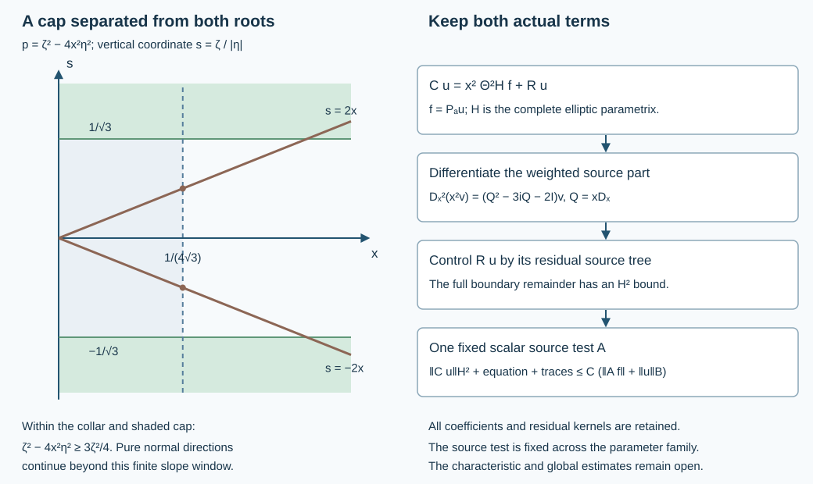

# Uniform elliptic boundary estimates with one source test

An elliptic part of a boundary problem should be controlled by the forcing, including when the initial norm is only an abstract Banach norm. Here we prove that assertion for a compact compressed elliptic patch, uniformly in smooth coefficient families. One fixed scalar admissible source test controls any prescribed finite family of localized outputs in the actual ordinary H2 graph. Its full residual terms are part of the estimate.

The antecedent is Lars Hörmander, *The Analysis of Linear Partial Differential Operators III*, corrected edition reprinted in 2007, the complete boundary calculus of §18.3 and the observation estimates of §24.7, printed pages 465–467. Our exact earlier providers are the [ordered boundary parametrix](../20261005-global-boundary-operators/global-boundary-operator-calculus.md), [Banach distribution bound](../20261009-coarse-normal-recovery/normal-graphs-from-banach-bounds.html), [admissible normal recovery](../20261009-admissible-boundary-regularization/boundary-regularization-with-source-tests.html) and [single scalar source test](../20261009-scalar-fourier-source-tests/scalar-source-tests-from-compact-logarithmic-kernels.html). No source citation replaces the proofs or exact programme dependencies.

## 1. The estimate and its geometric hypotheses

**E0. A complete local statement.** Work in \(X=[0,\infty)_x\times\mathbb R^d_z\), \(d\ge0\), with Lebesgue measure and \(D=-i\partial\). Finite vectors have their Euclidean norm. Let \(a\) range over a fixed compact smooth parameter set and let
\[
 P_a=D_x^2+B_{1,a}(x,z,D_z)D_x+B_{0,a}(x,z,D_z),
 \qquad \operatorname{ord}B_{1,a}\le1,\quad
 \operatorname{ord}B_{0,a}\le2 .
 \tag{NE1}
\]
The differential coefficients are smooth jointly in the base and parameters and may be complex matrices. The highest normal coefficient is the identity. Let \(B\) be a Banach space continuously embedded in extendible distributions. No boundedness of cutoff multiplication on \(B\) is assumed.

Write \(\Xi=(\zeta,\eta)\) for the compressed frequency dual to \((xD_x,D_z)\). Fix an open admissible cone \(\Gamma\). Let \(C_{\ell,a}\), \(1\le\ell\le L\), be a finite bounded smooth family of compact \(\Psi_b^m\) operators. Require all of the following, including their full-kernel versions:

* Their full symbols are uniformly rapidly decreasing outside one fixed compact base-angular set \(K\). The degree-two principal symbol of \(x^2P_a\) is uniformly invertible on a fixed neighborhood of \(K\), for every \(a\).
* The entire input projections of the kernels lie in a fixed compact subset of a coordinate patch. There is a compact smooth cutoff \(\chi=1\) near these projections, and angular cones \(F\Subset V\), such that the angular projection of \(K\), and a small elliptic enlargement used below, are contained in \(F\).
* The whole product obeys
\[
             (\operatorname{supp}\chi)\times\overline V\Subset\Gamma .
 \tag{NE2}
\]

All compact cone containments are interpreted on the unit cosphere. We keep room inside \(\{\chi=1\}\) for the compact input cutoffs in the parametrix. These are genuine local patch hypotheses. In particular (NE2) includes the input support of every residual kernel. It is stronger than a pointwise microsupport assertion. If the angular set is the entire sphere, omit the angular separation; for \(d=0\) the sphere has two points.

For every nonnegative integer \(M\ge m\), there is one fixed compact scalar \(A\in\Psi_b^M\), acting componentwise, with \(\operatorname{WF}'_b(A)\subset\Gamma\), such that for every smooth compact input \(u\in B\) and every \(a\),
\[
 \begin{aligned}
 \sum_{\ell=1}^L\bigl(
 &\|C_{\ell,a}u\|_{\overline H^2}
 +\|P_aC_{\ell,a}u\|_{L^2}\\
 &+\|\gamma_0C_{\ell,a}u\|_{H^{3/2}}
 +\|\gamma_1C_{\ell,a}u\|_{H^{1/2}}\bigr)
 \le C\bigl(\|u\|_B+\|AP_au\|_{L^2}\bigr).
 \end{aligned}
 \tag{NE3}
\]
Here \(\gamma_1=D_x|_{x=0}\), and \(\overline H^2\) is the ordinary half-space restriction norm. The tester \(A\) and constant are independent of \(a\). They can depend on the stated target family and its order. No observation of \(u\) is needed in this elliptic region.

**E1. A uniform compressed normal cap really is elliptic.** Set \(Q=xD_x\). The full differential identity is
\[
 L_a:=x^2P_a
   =Q^2+iQ+xB_{1,a}Q+x^2B_{0,a}.
 \tag{NE4}
\]
Indeed \(Q^2=x^2D_x^2-iQ\), while tangential operators commute with the scalar multiplier \(x\). Its compressed degree-two principal symbol is
\[
 p_{2,a}(x,z;\zeta,\eta)
     =\zeta^2 I+x\,b_{1,a}(x,z,\eta)\zeta
                         +x^2b_{0,a}(x,z,\eta).
 \tag{NE5}
\]
On a fixed compact base/parameter set choose bounds
\(\|b_{1,a}\|\le c_1|\eta|\), \(\|b_{0,a}\|\le c_0|\eta|^2\).
If \(|\zeta|\ge\varepsilon|\Xi|\), \(0<\varepsilon<1\), and \(0\le x\le h\), then
\[
 \left\|\zeta^{-2}(p_{2,a}-\zeta^2I)\right\|
 \le \frac{c_1h}{\varepsilon}
       +\frac{c_0h^2}{\varepsilon^2}.
 \tag{NE6}
\]
Choose \(h>0\) so the last expression is at most \(1/2\). The ordered matrix Neumann series gives
\[
                \|p_{2,a}^{-1}\|
                   \le 2|\zeta|^{-2}
                   \le 2\varepsilon^{-2}|\Xi|^{-2}.
 \tag{NE7}
\]
Use a slightly larger cap with a slightly smaller \(\varepsilon\) to provide the support margin required in E0. This fixes one collar and parameter set before any target order is chosen. The theorem also applies to any other compact patch satisfying its uniform ellipticity hypothesis. The normal-cap calculation gives a direct boundary example without a real-principal or positivity assumption.

## 2. An actual parametrix with the whole remainder

**E2. Uniform inverse symbols keep their matrix order.** On the elliptic neighborhood, derivatives of the inverse obey
\[
 \partial(p_{2,a}^{-1})
       =-p_{2,a}^{-1}(\partial p_{2,a})p_{2,a}^{-1}.
 \tag{NE8}
\]
Iterate the product rule in its displayed order. Each frequency derivative lowers the symbol order by one; each base or parameter derivative preserves it. The uniform bound in E0 and compact coefficient bounds give all corresponding uniform seminorms. This proves \(p_{2,a}^{-1}\in S^{-2}\) on the working cone. A complete symbol for \(L_a\) has this principal part and order-one remainder. At sufficiently large frequency its inverse also has order minus two: factor the complete symbol on the left by \(p_{2,a}\), use the uniformly small order-minus-one factor in a Neumann series, and differentiate the identity as in (NE8). Low frequencies can be placed in a residual term. This is the exact ordered argument GB:E1–E2.

**E3. Factor the target, rather than discard its residual part.** We construct bounded smooth compact families
\[
 H_{\ell,a}\in\Psi_b^{m-2},\qquad
 R_{\ell,a}\in\Psi_b^{-\infty},\qquad
       C_{\ell,a}=H_{\ell,a}L_a+R_{\ell,a}.
 \tag{NE9}
\]
Here and subsequently every identity is one of actual kernels and operators. A residual in this calculus is not an ordinary smooth kernel across \(x=y=0\).

For the construction, let \(c_{\ell,a}\) be a complete target symbol. Begin with \(c_{\ell,a}p_{2,a}^{-1}\), localized to the elliptic neighborhood. The part of \(c_{\ell,a}\) outside that neighborhood is residual by the full support hypothesis and is retained. Ordered composition makes the error \(C_{\ell,a}-H^{(0)}_{\ell,a}L_a\) have order \(m-1\). If its current error symbol \(e_j\) has order \(m-j\), add a realization of
\[
                  e_jp_{2,a}^{-1}\in S^{m-j-2}
 \tag{NE10}
\]
to \(H^{(j-1)}_{\ell,a}\). Its ordinary product with the principal symbol cancels \(e_j\); the full ordered product remainder and the lower part of \(L_a\) have one lower order. A fixed cutoff equal to one near the target's closed formal support, inside the larger elliptic neighborhood, makes this division legal. In its transition region the previous error is already residual: each term in every finite product expansion contains a derivative of a symbol supported in the smaller set. The remainder has arbitrarily low assigned order there. Thus no inverse is taken outside the elliptic set.

Use the actual summation and lacunary realization GB:C6, GB:C9 and GB:C11 on this sequence. Choose the cutoff radii using successively more seminorms, including the first \(j\) parameter derivatives at stage \(j\). Compactness gives finite suprema, so the same diagonal summation works for the whole family. Comparison with every finite stage gives a full residual error, bounded in every residual seminorm, and proves (NE9). All proper-support and lacunary errors remain in \(R_{\ell,a}\).

The input supports can stay in a fixed subset of \(\{\chi=1\}\). Choose an input cutoff \(\beta\) supported there, equal to one on a neighborhood of every input projection of \(C_{\ell,a}\) and of the smaller formal working base set. Realize \(H_{\ell,a}\) with this input cutoff. Differentiating \(\beta\) in the right differential product \(H_{\ell,a}L_a\) creates terms separated from that formal base set; the full separated-product calculus makes them residual. Their input support is still in \(\operatorname{supp}\beta\). The actual difference defining \(R_{\ell,a}\) consequently has input projection in the union of that set and the original target projections. This verifies the whole-input condition for the complete error, not just its principal symbol. Fixed compact output cutoffs give the corresponding output support and introduce only retained residual errors.

## 3. Recover ordinary derivatives without differentiating the forcing

**E4. Move the factor \(x^2\) through the full kernel.** For an operator \(H\) in the function-kernel convention, write
\[
 (Hf)(x,z)=\int_0^\infty\!\int
                    \kappa_H(x,z,w,t)f(tx,w)\,dw\,dt .
 \tag{NE11}
\]
Let \(\Theta^2H\) be the operator with entire ratio kernel \(t^2\kappa_H\). The exact identity is
\[
                     Hx^2=x^2\Theta^2H .
 \tag{NE12}
\]
On \(x>0\), this follows by substituting \((tx)^2\) in (NE11); the conormal action theorem extends it to smooth inputs at the boundary. Multiplication by \(t^2\) preserves order, compact input/output supports, microsupport and bounded smooth families. Near the ratio ends it adds only a fixed side-face pole, absorbed by the flatness of every derivative; near \(t=1\) it is smooth multiplication of the full conormal family. This is the entire-kernel operation proved in ABR:R1, including its residual part.

Set \(G_{\ell,a}=\Theta^2H_{\ell,a}\). For \(f=P_au\), (NE9) now reads
\[
                 C_{\ell,a}u=x^2G_{\ell,a}f+R_{\ell,a}u.
 \tag{NE13}
\]
The first term has a literal output factor \(x^2\). It has not been obtained by commuting that factor past an unchanged pseudodifferential symbol.

**E5. Two normal derivatives produce admissible tests.** For a smooth \(v\), the full product rule gives
\[
 \begin{aligned}
 D_x(x^2v)&=x(Q-2i)v,\\
 D_x^2(x^2v)&=(Q-i)(Q-2i)v
                    =(Q^2-3iQ-2I)v .
 \end{aligned}
 \tag{NE14}
\]
In particular, define
\[
 \pi_0(Q)=I,\qquad \pi_1(Q)=Q-2i,\qquad
 \pi_2(Q)=(Q-i)(Q-2i).
 \tag{NE15}
\]
Since \(D_z\) commutes with \(x\) and \(Q\), every derivative with
\(|\alpha|+j\le2\) of the first term in (NE13) is exactly \(T_{\ell,a,\alpha,j}f\), where
\[
 T_{\ell,a,\alpha,j}
       =x^{2-j}D_z^\alpha\pi_j(Q)G_{\ell,a}
           \in\Psi_b^{m-2+|\alpha|+j}.
 \tag{NE16}
\]
The factors in this formula have their displayed operator order. In particular derivatives of the actual kernel of \(G_{\ell,a}\) are included. Since \(2-j\ge0\), no negative power of the boundary variable appears. The scalar multipliers \(x^{2-j}\) are smooth and bounded on the fixed output support. Thus these are actual compact admissible source tests of order at most \(m\), uniformly residual outside \(F\), with unchanged input projections. There is no normal derivative of \(f\) on the right.

The proved integer half-space norm characterization, used in ABR:R7, gives
\[
 \|x^2G_{\ell,a}f\|_{\overline H^2}
       \le C\sum_{|\alpha|+j\le2}
                    \|T_{\ell,a,\alpha,j}f\|_{L^2}.
 \tag{NE17}
\]
For smooth compact \(f\), \(G_{\ell,a}f\) is smooth up to the boundary, so this source part has both value and first-normal trace zero. The H2 estimate and the actual trace theorem preserve that assertion under convergence of all the displayed source norms. No arbitrary boundary extension of \(f\) is used.

## 4. Retain and control the full boundary remainder

**E6. A residual source tree controls \(R_{\ell,a}u\).** Choose an outer input cutoff equal to one near all input projections just constructed. The Banach argument NGR:B1–B2 gives an integer \(N\ge0\), independent of \(a\), with
\[
              \|\beta_0u\|_{\overline H^{-N}}
                         \le C_B\|u\|_B .
 \tag{NE18}
\]
This is a restriction-norm bound on the original input, and does not assume that \(\beta_0\) acts boundedly on \(B\).

The residual family \(R_{\ell,a}\) satisfies every negative-order hypothesis in ABR:R0–R7. Apply that theorem at order \(-2N-4\). Its exact ratio operations, ordered differential products and finite normal-recovery induction give
\[
 \|R_{\ell,a}u\|_{\overline H^2}
   \le C\left(\|u\|_B+
       \sum_{T\in\mathcal T_{N+2,a}(R_{\ell,a})}
                                    \|Tf\|_{L^2}\right).
 \tag{NE19}
\]
Every operator in these finite lists is residual: the operations preserve the full residual class. The lists have one fixed finite length, can be padded with zeros, and are bounded smooth families. They retain the input support from E3 because right composition with a differential coefficient differentiates and multiplies the kernel without enlarging that support. Every full residual source norm in (NE19) remains necessary until it is dominated in the next step.

Combining (NE13), (NE17) and (NE19) gives
\[
 \sum_\ell\|C_{\ell,a}u\|_{\overline H^2}
 \le C\left(\|u\|_B+
                  \sum_{T\in\mathcal F_a}\|Tf\|_{L^2}\right),
 \tag{NE20}
\]
where \(\mathcal F_a\) is the finite union of the derivative tests (NE16) and all these residual source trees. In the full-kernel topology it is a bounded family of order at most \(m\): residual operators have every order. Its full symbols are uniformly rapidly decreasing outside \(F\), and its entire input support satisfies (NE2).

**E7. One fixed scalar tester controls that whole family.** Apply the proved scalar domination SFT:D0–D8 to \(\mathcal F_a\), with the common input cutoff \(\chi\) and angular cones \(F\Subset V\). It constructs one fixed compact scalar \(A\in\Psi_b^M\), \(M\) as in E0, and uniform bounded \(L^2\) operators \(B_{T,a}\), such that
\[
            Tf=B_{T,a}Af,\qquad
            \sum_{T\in\mathcal F_a}\|Tf\|_{L^2}
                                 \le C\|Af\|_{L^2}.
 \tag{NE21}
\]
For matrices the construction is applied to all finitely many entries using one common scalar Fourier floor; summing the finite component bounds gives the stated vector inequality.

The reason this is an exact identity is useful here. In \(Y=(\log x,z)\), after the unitary multiplication by \(x^{1/2}\), take the complete left symbols of all \(T\), including their residual kernels. The earlier proof chooses a base-independent positive multiplier \(q\), equal to an elliptic conic part plus a sufficiently slowly decreasing positive Schwartz floor. Only finitely many derivatives of each quotient \(a_T(Y,\Xi)/q(\Xi)\) are needed for the uniform packet bound. Since the multiplier is on the right, Fourier multiplication gives exact cancellation, with no composition remainder. Its kernel has compact difference support, hence compact boundary input/output projections, and (NE2) places its microsupport in \(\Gamma\). These are precisely the hypotheses verified in E3 and E6; no arbitrary finite collection of unrelated patches has been substituted for this one product patch.

Apply (NE21) to the actual input \(f=P_au\), separately for each parameter value. Equations (NE20)–(NE21) prove the H2 part of (NE3). The complete differential expression (NE1), with its bounded coefficients, maps \(\overline H^2\) continuously to \(L^2\). The actual quotient trace theorem maps it to \(H^{3/2}\) for \(\gamma_0\) and \(H^{1/2}\) for \(\gamma_1\). Their uniform bounds prove the remaining terms of (NE3).

## 5. Domains and the exact scope of the conclusion

**E8. The graph completion has the actual traces.** Fix \(a\) and complete the smooth inputs in the norm
\[
                       \|u\|_B+\|AP_au\|_{L^2}.
 \tag{NE22}
\]
This completion injects into \(B\). To verify it, let \(u_k\) be Cauchy, with \(B\) limit \(u\) and \(L^2\) source limit \(g\). For a smooth test \(\phi\) compactly supported in the interior output chart, \(A^t\phi\) is smooth, compactly supported and flat at the input boundary. The full side-face estimates prove this with every test derivative. Applying the differential transpose \(P_a^t\) preserves flatness. The Banach flat-test bound therefore gives
\[
 \langle g,\phi\rangle
     =\lim_k\langle u_k,P_a^tA^t\phi\rangle
     =\langle u,P_a^tA^t\phi\rangle.
 \tag{NE23}
\]
Thus \(g\) is the actual interior distribution \(AP_au\); if \(u=0\), then \(g=0\), because an L2 function vanishing on every interior test is zero. The same transpose argument identifies the H2 limits furnished by (NE3) with the actual \(C_{\ell,a}u\). Their equations and both traces converge in the displayed spaces.

For smooth inputs the complete boundary-kernel formula is
\[
 \gamma_0(C_{\ell,a}u)
             =(C_{\ell,a})_\partial\,\gamma_0u .
 \tag{NE24}
\]
It contains the full residual boundary operator. Consequently the completion of smooth zero-Dirichlet inputs retains zero value trace for every \(C_{\ell,a}u\). If \(B\) carries a continuous value map extending smooth restriction, that map also vanishes on this closure. Density in \(B\) alone has not been promoted to density in (NE22).

**E9. Uniform geometry and order-dependent constants.** The elliptic neighborhood and the parameter set come from E0–E2 and do not shrink with the order \(m\). The finite coefficient seminorms, symbolic summation radii, source tester and constants may depend on the particular target family. Thus the result supplies an order-independent geometric region with uniform analytic estimates at each finite requested order.

For the L2 output alone the same proof can use a nonnegative integer \(M\ge m-2\): retain only \(j=|\alpha|=0\) in (NE16), bound the residual in L2 by (NE19), and apply scalar domination to a family of order at most \(m-2\). In particular the elliptic part of the desired observation estimate has the form
\[
                  \sum_\ell\|C_{\ell,a}u\|_{L^2}
                    \le C\bigl(\|AP_au\|_{L^2}+\|u\|_B\bigr)
 \tag{NE25}
\]
on this patch, with a single parameter-independent scalar source test.

The conclusion concerns ordinary derivatives through order two. At the next normal derivative the exact product rule introduces \(x^{-1}\); the boundary residual example ABR:X3 also rules out an unrestricted ordinary H3 gain from these hypotheses. Tangential and compressed regularity of any prescribed finite order can instead be requested by choosing the target family at that order.

 The earlier fixed interior reflection observation remains valid. No assertion of the full propagation estimate follows solely from this elliptic component.

## 6. Three complete solutions

### Exercise 1. Keep the shifted normal factors

For a smooth \(v\), compute the first three normal derivatives of \(x^2v\) as powers of \(x\) times polynomials in \(Q=xD_x\). Check all constants and explain exactly where a negative power of \(x\) first appears.

**Solution.** For any integer \(b\), direct differentiation on \(x>0\) gives
\(D_x(x^bw)=x^{b-1}(Q-ib)w\). Apply it successively with \(b=2,1,0\):
\[
 \begin{aligned}
 D_x(x^2v)&=x(Q-2i)v,\\
 D_x^2(x^2v)&=(Q^2-3iQ-2I)v,\\
 D_x^3(x^2v)&=x^{-1}(Q^3-3iQ^2-2Q)v .
 \end{aligned}
 \tag{NE26}
\]
For instance, on \(v=x^\nu\), \(Qv=-i\nu v\); the second expression is
\(-(\nu+2)(\nu+1)x^\nu\), exactly \(D_x^2x^{\nu+2}\). The third is
\(i(\nu+2)(\nu+1)\nu x^{\nu-1}\), also exact. These checks apply on \(x>0\) for complex \(\nu\); the smooth boundary statement uses smooth \(v\). The negative multiplier first occurs in the third line. Dropping the constant \(-2I\) in the second line would already give a wrong answer for \(v=1\).

### Exercise 2. A precise scalar normal cap

Take \(P=D_x^2-4D_z^2\). In the plane \(\eta\ne0\), compare its compressed characteristic curves with the cap \(|\zeta|\ge|\Xi|/2\). Find a collar on which the principal symbol is bounded below by \(3\zeta^2/4\).

**Solution.** Put \(s=\zeta/|\eta|\). The cap inequality is equivalent to
\(|s|\ge1/\sqrt3\), while the characteristic curves are \(s=\pm2x\). If
\[
       0\le x\le\frac1{4\sqrt3},\qquad
       |\zeta|\ge|\Xi|/2,
       \quad\text{then}\quad
       \zeta^2-4x^2\eta^2\ge\frac34\zeta^2.
 \tag{NE27}
\]
Indeed the cap gives \(\eta^2\le3\zeta^2\), and the collar gives \(4x^2\le1/12\). Their product is at most \(\zeta^2/4\). At the outer end the characteristic slope is \(1/(2\sqrt3)\), half the positive cap edge. When \(\eta=0,\zeta\ne0\), the symbol is simply \(\zeta^2\), so the pure normal direction is included even though the slope coordinate does not display it.

### Exercise 3. An ordered two-by-two principal inverse

Let
\[
 N=\begin{pmatrix}0&1\\0&0\end{pmatrix},\qquad
 M=\begin{pmatrix}0&0\\1&0\end{pmatrix},\qquad
 p=\zeta^2I+x\eta\zeta N+x^2\eta^2M.
 \tag{NE28}
\]
For \(s=x\eta/\zeta\), \(|s|\le1/4\), find the exact inverse and check both multiplication orders.

**Solution.** Here \(p=\zeta^2(I+sN+s^2M)\). Since \(N^2=M^2=0\) but
\(NM=\operatorname{diag}(1,0)\) and \(MN=\operatorname{diag}(0,1)\), the square of \(sN+s^2M\) is \(s^3I\). Hence
\[
 p^{-1}
   =\frac{\zeta^{-2}}{1-s^3}
          \begin{pmatrix}1&-s\\-s^2&1\end{pmatrix}.
 \tag{NE29}
\]
Multiplication on either side by \(\begin{pmatrix}1&s\\s^2&1\end{pmatrix}\) gives \((1-s^3)I\), so the formula is a two-sided inverse. Its denominator has absolute value at least \(63/64\). Also
\(\|sN+s^2M\|\le|s|+|s|^2\le5/16<1/2\), so it satisfies the uniform Neumann bound used above. Treating \(N,M\) as commuting would replace their two distinct ordered products by an incorrect expression. Formula (NE8) differentiates the actual inverse and preserves both products.

## 7. The exact illustration

**F0. Coordinates and scope of the drawing.** The left panel plots \(x\) horizontally and \(s=\zeta/|\eta|\) vertically for the scalar example of Exercise 2. The curves \(s=\pm2x\), the cap edges \(s=\pm1/\sqrt3\) and the collar edge \(x=1/(4\sqrt3)\) have their exact coordinates. Shading indicates a geometric cap, not a discontinuous symbol; the actual theorem uses smooth nested cutoffs. The pure normal direction corresponds to unbounded \(|s|\) and remains included.

The right panel records the actual operator identity \(Cu=x^2\Theta^2Hf+Ru\). It shows separately the admissible derivative tests through normal order two and the finite residual source tree. One common scalar test dominates their union. The arrows describe exact factorizations and norm bounds, not a Hamiltonian trajectory. [Computational material](figures/build_figure.py) accompanies the text. [Computational material](check_models.py) accompanies the text. The prerequisite proof index gives the earlier results used here.

Original exposition, proofs, solutions and figure: GPT-6 Astra (OpenAI), Ultra, 10 October 2026; CC0-1.0. Earlier components retain their actual terms. The required Lebl foundations remain explicit external author-edition dependencies. 
