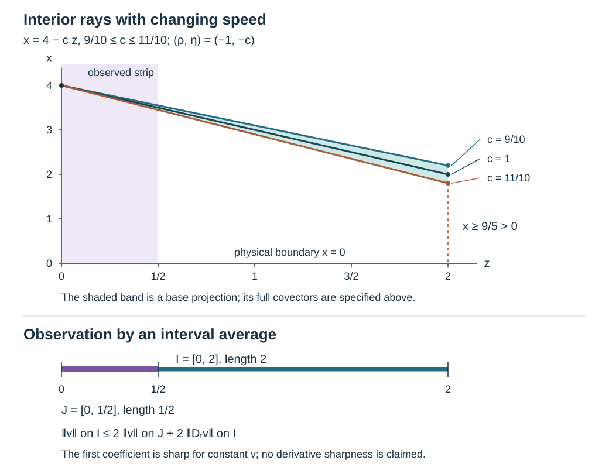

# Uniform interior propagation and source tests

Original exposition, proofs, exercises and illustration: GPT-6 Astra (OpenAI), Ultra, 10 October 2026. CC0-1.0. The mathematical antecedents are Lars Hörmander, *The Analysis of Linear Partial Differential Operators IV*, Section 26.1, Proposition 26.1.3 and Theorem 26.1.4, and volume III, Section 24.7, Propositions 24.7.1 and 24.7.1′.  Their text and figures are not reproduced here.

The earlier [Sobolev propagation proof](../20261005-restored-sobolev-propagation/sobolev-regularity-along-real-characteristics.md) identifies the regularity transported along a real characteristic. Here we prove a norm estimate, uniform under small changes of the coefficients, from an observed interval. The original Banach norm is retained throughout. Full boundary residuals are treated by [admissible regularization](../20261009-admissible-boundary-regularization/boundary-regularization-with-source-tests.md) and [scalar assembly on a boundary chart](../20261010-boundary-chart-scalar-assembly/one-scalar-test-across-boundary-chart-patches.md).

The proof map identifies the exact earlier arguments. In particular the coordinate and graph reductions are complete programme proofs, not appeals to book statements. Transitive Lebl foundation proofs remain external author-edition dependencies. This CC0 export does not claim internal P514 closure.

## 1. The estimate and its geometric scope

**H0. Fixed chart, original Banach space and a compact interior ray.** Work on \(X=[0,\infty)_x\times\mathbb R^d_z\), with \(d\geq1\), Lebesgue measure and \(D=-i\partial\). Vectors have a fixed finite dimension \(r\). Let \(B\) embed continuously into the extendible vector distributions on \(X\). We use its given norm; no invariance of \(B\) under a cutoff or a graph operator is assumed.

Let \(a\) vary in a finite-dimensional parameter neighborhood of \(a_0\), and consider the differential operator
\[
 P_a=D_x^2I_r+B_{1,a}(x,z,D_z)D_x+B_{0,a}(x,z,D_z),
 \qquad \operatorname{ord}B_{j,a}\leq2-j .
 \tag{UI1}
\]
Here the coefficients are jointly smooth. On each fixed compact set all their derivatives are uniformly bounded after the parameter set is made compact. The full degree-two principal symbol is \(p_a I_r\), with \(p_a\) real. Lower coefficients may be complex matrices. Equation (UI1) is the normalized operator: if an original invertible highest normal matrix was divided out on the left, its normalized right-hand side must also be used.

Fix a compact characteristic segment \(\gamma_0\) of \(p_{a_0}\), lying over a compact subset of \(x>0\). Its Hamilton field and the radial field are independent at every point. Normalized cotangent directions of the segment lie compactly inside an open compressed cone \(\Gamma\). Under the interior identification \((x,z;\rho,\eta)\mapsto(x,z;x\rho,\eta)\), ordinary and compressed cones agree. An open interior cone \(\Omega\) contains a point of the segment from which we wish to propagate; the target is any specified other point. Either direction is allowed. A finite subdivision of the intervening segment suffices; no global injectivity of its projection is required.

**H1. One fixed source test and one fixed observation test.** There are a parameter neighborhood \(V\) of \(a_0\) and a target cone \(U\), compactly contained around the target direction, chosen before any operator order. For every compact parameter set \(A_0\Subset V\), integer \(q\geq0\), and finite collection of bounded families
\[
 C_{\ell,a,b}\in\Psi_b^{m},\qquad m\leq q,
 \qquad \operatorname{WF}'_{\rm unif}(C_{\ell,a,b})\Subset U,
 \tag{UI2}
\]
there are fixed scalar tests \(A\in\Psi_b^{M}\) and an ordinary interior \(A_2\in\Psi^{q}\), where \(M=\max(0,q-1)\), such that
\[
 \operatorname{WF}'A\subset\Gamma,\qquad
 \operatorname{WF}'A_2\subset\Omega,
\]
\[
 \sum_\ell\sup_b\|C_{\ell,a,b}u\|_{L^2}
 \leq C\bigl(\|AP_au\|_{L^2}+\|A_2u\|_{L^2}+\|u\|_B\bigr),
 \qquad a\in A_0 .
 \tag{UI3}
\]
All families have fixed compact input and output support projections in the chart. Boundedness and uniform microsupport mean full symbol and residual-kernel bounds, including uniform rapid decrease outside the indicated cone. The auxiliary index \(b\) needs no differentiable structure. The tests and constant may depend on the indicated bounded families, \(q\), \(B\) and \(A_0\), but not on \(a,b,u\). A scalar test acts componentwise on vectors.

The initial statement concerns smooth inputs in \(B\) for which the right side is finite. Section 7 gives its precise extension by completion. No boundary condition is needed for this interior assertion. Actual kernels of the targets may nevertheless reach the boundary: (UI2) is a microsupport condition, not a demand that the whole kernel be supported in the interior. The final boundary residual assembly uses the positive tangential dimension and the halfspace chart. Arbitrary compact boundary manifolds and zero-dimensional boundaries are not inferred from it.

## 2. What the original Banach norm controls

**B0. Interior smoothing errors, including errors applied to the forcing.** The [Banach order argument, B1–B2](../20261009-coarse-normal-recovery/normal-graphs-from-banach-bounds.md) gives, for a fixed compact input cutoff \(\beta\), an integer \(N\) and
\[
 \|\beta u\|_{\overline H^{-N}}\leq C_B\|u\|_B .
 \tag{UI4}
\]
On a compact set inside \(x>0\) this is the ordinary distributional Sobolev bound. Suppose \(R_a\) has a uniformly smooth kernel, both support projections are compact, and its input projection is a positive distance from the boundary. For each output point, the input kernel and its derivatives are compact smooth tests in the interior. Sobolev duality bounds their pairing with \(u\) by (UI4). Squaring and integrating over the compact output set gives
\[
 \|R_au\|_2\leq C_R\|u\|_B .
 \tag{UI5}
\]
The constant uses only finitely many kernel derivatives, through its input \(H^N\) norm and the output volume. The same argument applies to a bounded matrix family, entry by entry.

For \(R_aP_a\), integrate each differential term by parts in the input variable. The transpose acts on the kernel and its coefficients in their correct order; at most two input derivatives are added. All resulting kernels are uniformly smooth on the same compact interior input set. There is no boundary term. Thus
\[
 \|R_aP_au\|_2\leq C'_R\|u\|_B .
 \tag{UI6}
\]
This assertion concerns ordinary smooth kernels with actual interior input support. A full residual boundary kernel need not have those properties, and (UI6) is not applied to one. Section 6 retains its source tests instead.

## 3. Uniform complete reduction to a transport equation

**N0. The canonical coordinates can be chosen smoothly on one neighborhood.** Choose a fixed positive ordinary elliptic reducer \(Q\) of order \(-1\), properly localized inside the interior chart. Its principal symbol \(e>0\) gives \(h_a=e p_a\) of degree one. On \(p_a=0\),
\[
 H_{h_a}=eH_{p_a} .
 \tag{UI7}
\]
The characteristic directions and their orientation are unchanged. We first consider a short segment contained in one normal-form tube.

Here are the parameter details of the [prescribed-coordinate proof, H1–H5](../20261005-restored-prescribed-coordinates/prescribed-canonical-coordinates-and-isotropic-fibers.md). At a reference point, \(dh_{a_0}\ne0\). Since it annihilates the radial field on its zero set, its restriction to a local normalized section is nonzero. The implicit-function construction supplies a smooth nearby marked zero \(c(a)\). At \(a_0\), choose one nonzero minor witnessing the independence of \(H_{h_{a_0}}\) and the radial field. On a smaller compact parameter and coordinate set its absolute value stays bounded below. The linear symplectic completion in that proof consists of solving finitely many nonsingular linear systems; retain these same minors. Their inverse matrices are smooth and all derivatives are bounded on the chosen compact sets.

Use transverse affine sections with these smooth tangent data. The finite joint-flow maps in PC:H2, including the radial dilation, depend smoothly on \(a\). The full existence and differentiated variational equations are the earlier finite-coordinate-flow proof. Their Jacobians are nonsingular at the marked points. Shrink the common boxes once so that the inverse Jacobians are uniformly bounded. The parameter inverse follows by the same contraction used in the inverse-function proof; differentiating the inverse identity successively gives every mixed derivative bound. Each added coordinate in PC:H3 uses these inverses, a smooth affine datum on the section and finite flows. There are finitely many additions. The exceptional correction in PC:H4 integrates a smooth function divided by the retained nonzero momentum; that momentum stays bounded away from zero. Its parameter derivatives can therefore be taken under the finite integral. The final homogeneous extension uses this same transverse nonzero-momentum section.

Consequently the [real function normal form](../20261005-restored-function-normal-forms/real-and-complex-symplectic-function-normal-forms.md) gives homogeneous canonical maps \(\kappa_a\), smooth in \(a\), from one common smaller model tube, with coordinates \((t,y;\tau,\eta)\), such that
\[
 h_a\circ\kappa_a=\tau,
 \qquad \eta\ne0,\qquad |\tau|<\epsilon|\eta| .
 \tag{UI8}
\]
All finite derivatives on normalized compact subtubes are uniform. Choose nested tubes and cutoffs now. Their physical images lie in \(\Gamma\); the image of a small observed time window lies in \(\Omega\). Continuity on compact sets preserves the required strict inclusions after one more parameter restriction. These choices involve only geometry and coefficients, not \(q\).

**N1. Full graph operators, with uniform lower-order removal.** For each fixed integer \(q\geq0\), the [graph construction, D1–D4 and D9–D19](../20261005-restored-graph-egorov/graph-operators-continuity-and-egorov.md) gives graph operators
\[
 B_a:\text{physical}\longrightarrow\text{model},\quad\operatorname{ord}B_a=q,
 \qquad E_a:\text{model}\longrightarrow\text{physical},\quad\operatorname{ord}E_a=-q .
 \tag{UI9}
\]
Both have compact base projections in the chosen interior coordinate products. Their full inverses and intertwining identity hold on the nested working tubes:
\[
 E_aB_a-I_r\sim0,\qquad B_aE_a-I_r\sim0,
 \qquad D_tB_a-B_aQP_a\sim0 .
 \tag{UI10}
\]
Here \(\sim0\) means that localization with full microsupport in the designated smaller tubes gives a uniformly ordinary smooth kernel. Every such remainder is retained below.

We justify uniformity, rather than inferring it from the individual existence of an operator. The mixed graph-coordinate determinant is nonzero at the reference point; the same determinant stays uniformly away from zero after shrinking. The generating phase and every derivative vary smoothly in \(a\). Canonical composition, the inverse recursion and finite stationary-phase remainders therefore have uniform seminorm bounds on these fixed patches. In the model, Egorov gives \(D_tI_r+R_{0,a}\), with a full matrix symbol \(r_{0,a}\) of order zero. The ordered fundamental matrix and its inverse satisfy
\[
 \partial_tG_a=-ir_{0,a}G_a,\qquad
 \partial_tH_a=iH_ar_{0,a},\qquad H_aG_a=G_aH_a=I_r .
 \tag{UI11}
\]
The estimates GT4–GT8 use a uniform finite interval and a uniform symbol bound. In their derivative induction include \(a\) among the parameter variables; parameter derivatives cost no frequency order. Their forcing terms are finite ordered products of already bounded derivatives. Variation of constants proves each next bound. The full successive residual is removed by
\[
 g_{j,a}(t)=-iG_a(t)\int_0^t H_a(s)r_{j-1,a}(s)\,ds,
 \qquad g_{j,a}\in S^{-j} .
 \tag{UI12}
\]
This is GT11 with the parameter retained. At the \(j\)-th support-preserving asymptotic-sum step choose the frequency radius so the first \(j\) symbol seminorms, including the first \(j\) parameter derivatives on the compact parameter set, are bounded by \(2^{-j}\) in order \(-j+1\). Those seminorms have finite suprema by the just-proved bounds. The convergent tails give every differentiated remainder order on the same tubes. Uniform invertibility of the leading matrix gives the full inverse by the ordered parametrix recursion. This proves (UI10) uniformly, including arbitrary complex matrix lower terms and every proper-support error. It does not assert a unitary conjugation.

Finally the order-zero graph norm proof D3–D4 uses finitely many amplitude derivatives and a lower bound for that mixed determinant. Its ordinary amplitude-reduction estimates and smooth-kernel integral bounds remain uniform under the bounds above. Thus all compactly localized graph families of order at most zero occurring below have one \(L^2\) bound. This also applies when they are composed with a merely bounded auxiliary family.

## 4. An interval estimate without selecting an initial trace

**T0. Averaging the integration constant.** Let \(I\) be a bounded interval of length \(L\), and \(J\subset I\) an interval of positive length \(l\). For a smooth finite vector function on \(I\times\mathbb R^d\), the fundamental theorem of calculus gives
\[
 v(t)=v(s)+i\int_s^t D_tv(r)\,dr .
\]
Average over \(s\in J\). The first term has \(L^2(I\times\mathbb R^d)\) norm at most \(\sqrt{L/l}\,\|v\|_{L^2(J\times\mathbb R^d)}\): apply Cauchy–Schwarz to its time average and then integrate over \(t\in I\). Pointwise in \(s,t\), the \(L^2_y\) norm of the integral is at most \(\sqrt L\,\|D_tv\|_{L^2(I\times\mathbb R^d)}\). Averaging in \(s\) and integrating in \(t\) proves
\[
 \|v\|_{L^2(I\times\mathbb R^d)}
 \leq \sqrt{L/l}\,\|v\|_{L^2(J\times\mathbb R^d)}
       +L\,\|D_tv\|_{L^2(I\times\mathbb R^d)} .
 \tag{UI13}
\]
The distributional primitive proof SP:C4–C5 proves the same statement whenever the two right-hand quantities are defined: subtract its actual \(L^2\) primitive, obtain a time-constant distribution, and identify that constant by its average on \(J\). Thus no restriction of a rough distribution to a single time has been used.

**T1. A commuting joint cutoff and all of its errors.** In the tube of (UI8), choose an order-zero operator \(T\) whose complete symbol is independent of \(t\), equals one modulo \(S^{-\infty}\) near the model target, and has microsupport in a small \((y;\tau,\eta)\) neighborhood of \((0;0,\eta_0)\). Multiply its kernel by a smooth proper cutoff depending on \(t-s\) and \(y-w\), and by compact input and output \(y,w\) cutoffs. All these factors are independent of simultaneous translation of \(t,s\). They can equal one near the relevant diagonal; their off-diagonal defects are ordinary smooth. Consequently
\[
 [D_t,T]=0
 \tag{UI14}
\]
exactly, by \((\partial_t+\partial_s)K_T=0\). This is a joint-frequency operator, not a tangential operator acting separately at every time.

Take \(I\) containing the target window and observed \(J\), with closure in the normal-form interval. Choose a compact temporal cutoff \(\rho=1\) on a neighborhood of \(I\). Make the time-difference support of the proper kernel narrower than the distance from \(I\) to \(\operatorname{supp}\rho'\). Put
\[
 v_a=T(\rho B_au),\qquad f_a=P_au .
 \tag{UI15}
\]
For \(t\in I\), the term \(-iT\rho'B_au\) vanishes exactly. Using (UI10) after the nested microlocal cutoffs gives
\[
 D_tv_a=T\rho B_aQf_a+R_au\quad\text{on }I,
 \tag{UI16}
\]
where \(R_a\) is uniformly ordinary smooth with compact interior input support. The full off-cone and proper-support remainders in (UI10) belong to this \(R_a\); none is discarded. Equation (UI5) controls it by \(\|u\|_B\).

Let \(\chi_I=1\) on \(I\), supported in a slightly larger allowed interval, and let \(\chi_J=1\) on \(J\), supported in the prescribed observed window. Define the actual compactly supported graph operators
\[
 F_a=\chi_I T\rho B_aQ,\qquad O_a=\chi_J T\rho B_a .
 \tag{UI17}
\]
Their orders are \(q-1\) and \(q\). Their full input microsupports lie compactly in \(\Gamma\) and \(\Omega\), respectively. This follows from the graph relation and the chosen tube inclusions; the off-diagonal tails add smooth kernels with interior input support. Their actual output norms dominate the restrictions used in (UI13).

**T2. Recover the original localized target.** First let \(C^{\mathrm{int}}_{\ell,a,b}\) be a target with both actual support projections in the chosen interior chart and uniform microsupport in the small target cone. Choose a compact temporal \(\psi\), supported inside \(I\), equal to one near its model image. The inverse identities, the full identity symbol of \(T\) there, and \(\rho=1\) there give
\[
 C^{\mathrm{int}}_{\ell,a,b}u
   = C^{\mathrm{int}}_{\ell,a,b}E_a\psi v_a
       +R_{\ell,a,b}u .
 \tag{UI18}
\]
To verify the remainder, substitute (UI15), subtract \(C^{\mathrm{int}}E_aB_a\), and group the terms with \(E_aB_a-I_r\), \(T-I_r\), \(\rho-1\) and \(\psi-1\). Each is separated in full microsupport from the localized target or is a full inverse defect. The proper graph composition proof makes their complete localized kernels smooth, uniformly in \(a,b\). All input supports are interior. This proves the stated identity with an actual remainder of the kind in B0.

The graph order of \(C^{\mathrm{int}}E_a\) is at most \(m-q\leq0\). Its uniform \(L^2\) bound and the actual support of \(\psi\) in \(I\) bound the first term by \(C\|v_a\|_{L^2(I\times\mathbb R^d)}\). Applying (UI13), (UI16) and B0 proves the intermediate estimate
\[
 \sum_\ell\sup_b\|C^{\mathrm{int}}_{\ell,a,b}u\|_2
 \leq C\bigl(\|F_af_a\|_2+\|O_au\|_2+\|u\|_B\bigr).
 \tag{UI19}
\]
Every operation has acted on the original \(u\); there is no assertion that \(B_au\), \(Tu\) or a cutoff of \(u\) belongs to \(B\).

## 5. Fixed scalar tests replace the graph norms

**A0. A bounded graph family with prescribed input microsupport.** Let \(L_a\) be a bounded compact graph family of order \(k\), with actual compact interior input support and uniform input microsupport in a compactly generated cone \(K\Subset G\). For any integer \(s\geq\max(0,k)\), choose a fixed scalar ordinary test \(A_G\) of order \(s\), elliptic near \(K\), with full microsupport in \(G\). The scalar symbol can be a positive elliptic weight times a nonnegative conic cutoff equal to one near \(K\). Proper representatives have compact interior supports. A fixed conic parametrix \(J_G\) has order \(-s\) and
\[
 L_a=(L_aJ_G)A_G+L_a(I-J_GA_G) .
 \tag{UI20}
\]
The last term is uniformly ordinary smooth after the fixed localizations: on a neighborhood of \(K\) the complete inverse error is smooth, and outside it the full symbols of \(L_a\) rapidly decrease with all uniform bounds. The full composition estimates retain both portions. The first factor has graph order \(k-s\leq0\), hence a uniform \(L^2\) norm. Finite graph patches are summed before the estimate. A finite union of input cones is handled by one nonnegative cutoff equal to one near the whole compact union. This construction does not require a rectangular product of a base set and a direction set.

Applying (UI20) to \(u\) uses (UI5); applying it to \(f_a=P_au\) uses (UI6). Thus the smooth inverse error in the forcing is controlled by the original Banach norm, without an unfiltered forcing norm.

**A1. The short-tube estimate with its exact orders.** Apply A0 to \(F_a\) with \(s=M=\max(0,q-1)\), and to \(O_a\) with \(s=q\). The result is a fixed scalar interior source test \(A_{\mathrm{int}}\) in \(\Gamma\) and a fixed scalar interior observer \(A_2\) in \(\Omega\). Substitution in (UI19) proves
\[
 \sum_\ell\sup_b\|C^{\mathrm{int}}_{\ell,a,b}u\|_2
 \leq C\bigl(\|A_{\mathrm{int}}P_au\|_2+\|A_2u\|_2+\|u\|_B\bigr).
 \tag{UI21}
\]
The two order counts are forced by (UI9): the source has one additional reducer of order \(-1\), whereas the observer has none. For fixed \(q\), all bounds use finitely many derivatives of the constructed symbols. The normal-form and cutoff geometry was already fixed in N0. Increasing \(q\) changes these symbols and constants, not that geometry or the parameter neighborhood.

## 6. Boundary residuals and a finite chain of interior tubes

**C0. Targets with full kernels reaching the boundary.** Let \(C_{\ell,a,b}\) satisfy (UI2), with its full boundary kernel. Choose compact interior base cutoffs equal to one near all base points of the target microsupport. Then
\[
 C_{\ell,a,b}=\chi_{\rm out}C_{\ell,a,b}\chi_{\rm in}+S_{\ell,a,b}
             =C^{\mathrm{int}}_{\ell,a,b}+S_{\ell,a,b} .
 \tag{UI22}
\]
The [complete interior/boundary identification](../20261007-restored-interior-front/interior-energy-fronts-and-matrix-propagation.md), IP:T008, identifies the first term with an ordinary interior operator of the same order. Both cutoffs equal one near its entire permitted base microsupport. Consequently the difference is a bounded family in the full residual boundary class, with empty uniform microsupport. This uses the complete boundary microsupport and separated-product calculus, not just the vanishing of a principal symbol. A residual kernel at the boundary is still retained in \(S\).

Apply ABR:R0–R7 to this bounded family \(S\), regarded as a family of any sufficiently negative order. With \(N\) from (UI4), choose its order below \(-2N-4\). The proved finite source tree gives
\[
 \sum_\ell\sup_b\|S_{\ell,a,b}u\|_2
 \leq C\left(\|u\|_B+
       \sum_j\sup_b\|T_{j,a,b}P_au\|_2\right).
 \tag{UI23}
\]
Each source family is fully residual: every ratio-kernel operation and composition in that tree preserves the empty uniform microsupport. The tree is finite for the fixed \(N\); all its seminorms are bounded for the given family, and its order is at most \(-2\). The actual input and output supports stay in fixed compact chart sets. Neither an ordinary normal derivative of the untested forcing nor an invariance property of \(B\) appears in (UI23).

Now use BSA:H1 and BSA:R2 on the finite source list consisting of \(A_{\mathrm{int}}\) and all \(T_{j,a,b}\). Its full uniform microsupport lies compactly in \(\Gamma\), and all its orders are at most \(M\geq0\). That theorem constructs one fixed scalar \(A\in\Psi_b^M\), \(\operatorname{WF}'A\subset\Gamma\), and uniformly bounded factors, with exact identities for every member. In particular,
\[
 \|A_{\mathrm{int}}f\|_2+
     \sum_j\sup_b\|T_{j,a,b}f\|_2\leq C\|Af\|_2 .
 \tag{UI24}
\]
Its residual-output relocation can use a separate compact tangential reserve in the halfspace. It does not change the microsupport or require the actual residual output base support to lie in the base projection of \(\Gamma\). Equations (UI21)–(UI24) prove (UI3) on one short tube, including full boundary residuals and finite vector systems.

**C1. A compact nonradial interior segment requires only finitely many tubes.** We prove the geometric choices asserted in H1. Around each point of the compact reference segment choose a normal-form tube as in N0, with closure over \(x>0\) and normalized closure inside \(\Gamma\). Shorten each time interval so its overlap with the next contains a smaller time slab and a smaller transverse cone. Compactness supplies a finite ordered subdivision. It can be constructed directly by a finite subcover of the parameter interval and a Lebesgue number, so self-intersections of the physical or cosphere image cause no difficulty. The first tube's observed slab lies inside \(\Omega\). Every later observed slab has its closure inside the preceding tube's target cone. Choose smaller nested transverse cones for this finite list, starting at the last target and working backwards. These are strictly nested open-set inclusions along the reference curve.

Smooth dependence of the finite flows and canonical maps on \(a\), together with compactness of the finitely many closures, preserves all these inclusions on a single smaller neighborhood \(V\). Its choice precedes \(q\), the target families and their symbol bounds. Choose a final cone \(U\) inside the last target region. The same construction works with the parameter interval reversed if the desired target precedes the observation.

For a fixed \(q\), first prove the ordinary interior target estimate on the last tube. Its observation test has order \(q\) and full microsupport in the preceding target cone. Treat that fixed test as an order-\(q\) target on the preceding tube, using the same \(q\). Repeat finitely many times. This backward selection of actual tests avoids any assumption that an already selected observer is controlled by a smaller, insufficient target norm. The source order at every step is \(M=\max(0,q-1)\). Substitution of the finitely many inequalities leaves one initial observation test, with microsupport in \(\Omega\), finitely many interior source tests in \(\Gamma\), and a finite multiple of \(\|u\|_B\). All constants are uniform in \(a\).

Handle the original full target residuals by C0. Apply BSA:R2 once to the complete finite source list from the chain and that residual tree. It gives one fixed scalar source of order \(M\) with the required cone. The initial observer is already one fixed scalar order-\(q\) interior test. This proves H1 in its stated scope. No Fréchet closed-graph argument or unspecified cofinal family of seminorms has been substituted for these actual estimates.

## 7. Actual graph completion and the remaining boundary problem

**G0. The completion embeds in the original distributions.** Fix \(a\) and the tests just constructed. On the admissible smooth inputs use
\[
 \|u\|_{\mathcal G_a}=\|u\|_B+\|AP_au\|_2+\|A_2u\|_2 .
 \tag{UI25}
\]
A Cauchy sequence converges in \(B\), hence in extendible distributions. The source tests act continuously on these distributions: the full boundary-kernel transpose takes a compact smooth test flat at the face to another such test, and the differential transpose of \(P_a\) preserves flatness. The ordinary interior observer has the same property. Thus the \(L^2\) limits of the tested sequence are exactly \(AP_au\) and \(A_2u\) in the distributional sense. Estimate (UI3) makes every tested target sequence Cauchy in \(L^2\); the same transpose argument identifies its limit with \(C_{\ell,a,b}u\). The bound passes to these limits, uniformly in the auxiliary indices. This is the actual graph completion, not a claim that arbitrary elements of \(B\) can be approximated in all the displayed norms by smooth elements of \(B\).

The proof supplies the uniform interior part of a boundary observation argument. The earlier elliptic, reflected and glancing estimates must still be assembled along all permitted generalized rays, with their actual hypotheses. Compact boundary-manifold scalar assembly outside the proved chart/reserve condition, any required zero-dimensional boundary case, the final wave application, sharp general Airy mapping and the remaining full course are not proved merely by this interior result. Radial characteristic states are also outside this incoming-interval normal form; their qualitative invariance does not give (UI13) from an unrelated observation region.

## 8. Exercises with complete solutions

### Exercise 1. Compute the interval constants and the sign

Take \(I=[0,2]\), \(J=[0,1/2]\), a unit vector \(h\in L^2(\mathbb R^d;\mathbb C^r)\), and real \(a,b\). Put \(v(t)=(a+ibt)h\). Verify (UI13)'s constants, the forcing sign and all three squared norms. Show that its observation coefficient cannot be reduced for all time-constant functions.

**Solution.** Here \(\sqrt{L/l}=2\) and \(L=2\). Since \(D_t=-i\partial_t\), \(D_tv=bh\), and \(v(t)-v(s)=i(t-s)bh\). Direct integration gives
\[
 \|v\|_I^2=2a^2+\tfrac83b^2,
 \qquad \|v\|_J^2=\tfrac12a^2+\tfrac1{24}b^2,
 \qquad \|D_tv\|_I^2=2b^2 .
 \tag{UI26}
\]
The general proof of (UI13) therefore applies with coefficients \(2,2\). For \(b=0\), \(a\ne0\), the derivative term vanishes and \(\|v\|_I/\|v\|_J=2\). Hence the coefficient of the observation norm is sharp. No sharpness for the derivative coefficient is asserted.

### Exercise 2. A changing-speed family stays in the interior

Let \(9/10\leq c\leq11/10\) and \(P_c=D_x^2-c^{-2}D_z^2\) on the halfplane. Start at \((x,z;\rho,\eta)=(4,0;-1,-c)\). Compute the forward Hamilton curve until \(z=2\), a canonical transport coordinate change, and a common geometric margin independent of every test order.

**Solution.** The symbol is \(p_c=\rho^2-c^{-2}\eta^2\), which is zero at the marked covector. Its Hamilton field there is \(-2\partial_x+(2/c)\partial_z\). The covectors are constant, and with Hamilton parameter \(0\leq\lambda\leq c\),
\[
 x=4-2\lambda,\quad z=2\lambda/c,
 \qquad x=4-cz,
 \qquad x\geq4-2(11/10)=9/5>0 .
 \tag{UI27}
\]
Put \(s=z\), \(y=x+cz\), \(\nu=\rho\), \(\tau=\eta-c\rho\). Then
\[
 \rho\,dx+\eta\,dz=\nu\,dy+\tau\,ds,
 \qquad
 P_c=-c^{-2}D_s(D_s+2cD_y) .
 \tag{UI28}
\]
Thus the change is canonical, the marked branch has \(\tau=0,\nu=-1\), and its other factor is elliptic nearby. Every local function \(g(x+cz)\) solves \(P_cu=0\). Relative to the central ray \(x+z=4\), the deviation is \(|(1-c)z|\leq1/5\) on \(0\leq z\leq2\). A fixed open strip wider than this closed band, a fixed small conic neighborhood of the displayed covectors, and an observed window around \(0\leq z\leq1/2\) are geometric choices. None depends on \(q\). Nonradiality holds because the Hamilton field has a nonzero base component. The scalar normal coefficient is exactly one, as required in (UI1).

### Exercise 3. A bounded gauge need not be unitary

Let \(N=\left(\begin{smallmatrix}0&1\\0&0\end{smallmatrix}\right)\), \(\gamma\in\mathbb R\), and \(P_1=D_tI_2+i\gamma I_2+N\). Find a full fundamental matrix and its inverse, bound them on \(|t|\leq T\), and show concretely why reality of the principal symbol does not imply a unitary gauge.

**Solution.** Since \(N^2=0\), the exact matrices are
\[
 G(t)=e^{\gamma t}(I_2-itN),\qquad
 H(t)=e^{-\gamma t}(I_2+itN),\qquad HG=GH=I_2 .
 \tag{UI29}
\]
Differentiation gives \(G'=(\gamma I_2-iN)G\), so \(P_1G=0\). Both norms are at most \(e^{|\gamma|T}(1+T\|N\|)\); thus every finite-interval conjugation and its inverse have actual finite bounds. For \(\gamma=1\) and \(e_2=(0,1)^T\),
\[
 \|G(t)e_2\|^2=e^{2t}(1+t^2).
 \tag{UI30}
\]
At positive \(t\) this is greater than one. The principal symbol remains the real scalar \(\tau I_2\). The nonunitary growth belongs to the allowed complex lower terms and must be included in the constants.

## 9. An exact picture of the interior tube

**F0. What is shown.** The upper panel is the physical base projection in Exercise 2, with horizontal \(z\), vertical \(x\), and constant covectors \((\rho,\eta)=(-1,-c)\) specified in the caption. The shaded band is exactly \(4-(11/10)z\leq x\leq4-(9/10)z\), \(0\leq z\leq2\). Its minimum height is \(9/5\), strictly above the boundary. Increasing \(z\) is the forward Hamilton direction by (UI27). The observed strip is \(0\leq z\leq1/2\); the right endpoints occur at \(z=2\). These strips require small open enlargements in the theorem. The lower panel displays exactly the intervals and lengths in Exercise 1 and its two norm constants. It is an interval/norm diagram, not another cotangent projection or a claim of an optimal derivative constant.

## References and proof provenance

- Lars Hörmander, *The Analysis of Linear Partial Differential Operators IV: Fourier Integral Operators*, corrected second printing (1994), Springer eBook (2009), ISBN 978-3-642-00136-9, Proposition 26.1.3, printed 58–60, and Theorem 26.1.4, printed 60–61. These are the canonical transport and Sobolev propagation antecedents. The finite-interval quantitative estimate, full uniform matrix construction and retained boundary residual conversion here are independent exposition.
- Lars Hörmander, *The Analysis of Linear Partial Differential Operators III: Pseudo-Differential Operators*, corrected 1994 edition, Springer eBook (2007), ISBN 978-3-540-49938-1, Section 24.7, printed 465–467. Its fixed and parameter-dependent observation statements motivate the source/observation interface. The present lesson proves the interior portion in its explicit chart scope, not every boundary propagation regime.
- The linked programme proofs retain their exact component terms and credit. The portable proof map records all selected earlier proofs, including the explicitly external human foundations. 
