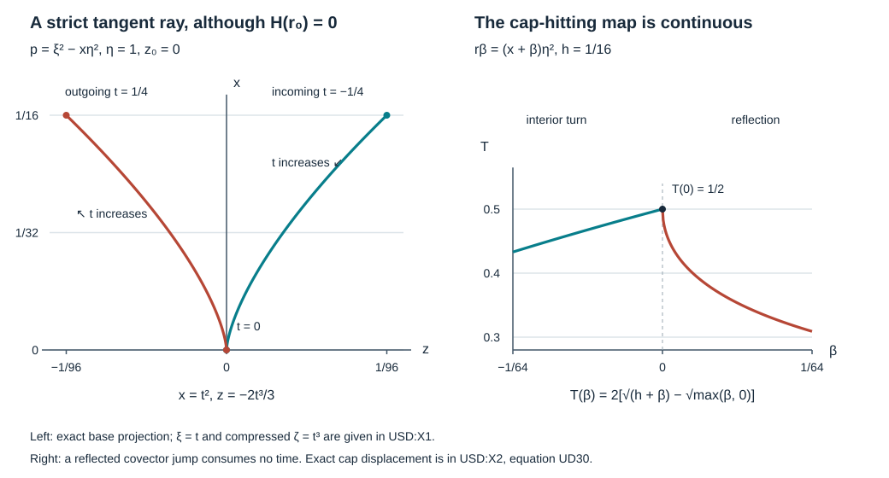

# Uniform strict diffraction with an interior observation

A strict diffractive ray touches the boundary and returns to the interior. Its projected boundary Hamilton field can be zero. We prove a uniform estimate that includes this case. An observation on the incoming interior cap, the actual equation and the original Banach norm control every prescribed finite order near the tangency. The geometric region and coefficient neighborhood are chosen before that order.

**Independent exposition, proofs, exercises and figure: CC0-1.0.** The antecedent is Lars Hörmander, *The Analysis of Linear Partial Differential Operators III*, Springer 2007 edition, ISBN 978-3-540-49938-1, §24.4, especially the accessible-region argument and Lemma 24.4.7, printed pages 448–451, and the uniform observation framework of §24.7. The proof map identifies the complete earlier programme arguments used below.  Required human foundation proofs remain explicitly external. 

## 1. Geometry before regularity

**H0. The operator, source cone and cap.** On one fixed half-space chart, with positive tangential dimension, write
\[
 X=[0,\infty)_x\times\mathbb R^d_z,\quad d\ge1,\quad
 P_a=D_x^2+c_aD_x+B_a(x,z,D_z),\quad
 \sigma_2(B_a)=-r_a\in\mathbb R,\quad D=-i\partial .\tag{UD1}
\]
The scalar differential coefficients are smooth in the base and in a parameter \(a\) near \(a_0\), with all derivatives bounded on compact subsets. The lower coefficients may be complex. At the reference normalized covector,
\[
 r_{a_0}(0,z_0,\eta_0)=0,\quad
 \partial_xr_{a_0}(0,z_0,\eta_0)>0,\quad |\eta_0|=1 .\tag{UD2}
\]
There is **no** hypothesis that the normalized tangential boundary Hamilton field is nonzero. Let \(\mathcal B\) be a Banach space continuously embedded in extendible distributions. Initially \(u\) is smooth, compactly supported and belongs to \(\mathcal B\), with actual trace \(\gamma_0u=0\).

Choose a short incoming cap around a point of the negative-normal-covector branch of the tangent ray, on an interior slice \(x=h_1>0\). The prescribed ordinary observation cone \(\Omega\) contains a compact neighborhood of this cap, including a positive-width interior strip and its proper localization margins. Shrink the base box and the parameter neighborhood once. They have compact closures in larger boxes and satisfy
\[
 \partial_xr_a\ge c_*|\eta|^2>0,\qquad
 |r_a|\le C_*|\eta|^2,\qquad
 0\le x<h,\qquad h\sqrt{C_*}<\kappa/2 .\tag{UD3}
\]
All short arcs used below, and the cap strip, lie in this larger box. The conic source region \(\Gamma\) contains the full outer compressed band \(|\zeta|\le2\kappa|\eta|\) over it, with positive support margins; \(\zeta=x\xi\) is the compressed normal covariable. Compact actual kernel projections are retained. No whole-input product-cone hypothesis is imposed.

**H1. The asserted estimate.** There is a fixed compressed target neighborhood \(U\) of the reference boundary equator and a fixed compact parameter neighborhood \(A\) of \(a_0\). For every finite collection of bounded full families \(C_{\ell,a,b}\in\Psi_b^m\), with common compact kernels and full uniform microsupport compactly inside \(U\), there are fixed scalar operators \(A_f,A_o\), of finite orders and independent of \(a,b\), such that
\[
 \begin{gathered}
 \operatorname{WF}'_b(A_f)\Subset\Gamma,\qquad
 \operatorname{WF}'_b(A_o)\Subset\Omega,\\
 \sum_\ell\sup_b\|C_{\ell,a,b}u\|_{L^2}
 \le C\bigl(\|A_fP_au\|_{L^2}+\|A_ou\|_{L^2}
                         +\|u\|_{\mathcal B}\bigr),\qquad a\in A .\tag{UD4}
 \end{gathered}
\]
An ordinary interior operator is regarded here as a boundary operator on its compact interior support. The constant and orders may depend on the target families. \(A,U,\Gamma,\Omega\), the collar and cap are fixed before \(m\). We prove the assertion for smooth zero-Dirichlet inputs and then for their actual tested graph completion. Neither a sharp source order nor an estimate for an arbitrary global manifold is asserted.

## 2. One accessible region for the whole parameter family

**G0. Uniform cap access through a tangency.** Set \(p_a=\xi^2-r_a\). Along its Hamilton flow,
\[
 \dot x=2\xi,\qquad \dot\xi=\partial_xr_a,
 \qquad \ddot x=2\partial_xr_a>0 .\tag{UD5}
\]
Work on fixed short normalized arcs; homogeneity and the coefficient bounds keep tangential covector lengths comparable. The flow and every finite derivative depend smoothly on the initial point and \(a\), by the earlier smooth-flow proof. The section \(\xi=0\) is transverse because \(\dot\xi>0\). Using this section as time zero, the normal coordinate has the exact representation
\[
 x(t)=\mu+t^2 b(t),\qquad
 b(t)=\int_0^1(1-v)\ddot x(vt)\,dv,\qquad
 0<c_1\le b(t)\le c_2 .\tag{UD6}
\]
All quantities also depend smoothly on the minimum-section initial point and parameter. Taylor's integral formula proves (UD6), including its bounds.

For \(\mu>0\) the arc turns in the interior. For \(\mu=0\) it has one strict tangency. For \(\mu<0\) the physical arc reaches \(x=0\) transversally; reflection replaces \(\xi\) by \(-\xi\), retaining the base and tangential covector. Its two hit times have magnitude at most \(\sqrt{|\mu|/c_1}\). The normal covectors at the hits tend to zero with that bound, and all tangential displacements tend to zero as well. Thus the broken cap-hitting map is continuous across \(\mu=0\). Away from a tangency each hitting map is smooth by transversality. The uniform bounds in (UD6) make these continuity statements uniform on compact parameter sets. This is the complete local continuity argument of DDB:B1, now with \(a\) included among its parameters; differentiability across tangency is not needed.

In the total parameter space \((a,x,z,\eta/|\eta|)\), let \(\mathscr W_0\) consist of the points in the chosen larger box for which **both** real characteristic lifts, when present, run backward to the chosen cap through the box, with at most one reflection or tangency. Include the points where \(r_a<0\). Use compactly contained cap endpoints and arcs with positive margins. The continuous hitting map and a finite cover of each compact arc show that \(\mathscr W_0\) is open. At a point with \(r_a=0\), the two roots converge to zero; the same argument covers both lifts and the adjacent region without real roots. A glancing boundary point on one of these paths itself belongs to \(\mathscr W_0\): its two germs have the same cap access. A negative-root lift followed backward stays in the interior, its normal covector becomes more negative, and it reaches the cap without a boundary event.

The reference point belongs to this open set. Choose \(A\) and a fixed relatively compact parameter target \(V_0\) so that
\[
                  A\times\overline{V_0}\Subset\mathscr W_0 .\tag{UD7}
\]
Choose \(U\) above \(V_0\), in the inner compressed band. This choice precedes every Sobolev order. During a finite proof we may use compact subsets of \(\mathscr W_0\) that depend on that order. We will not intersect infinitely many shrinking neighborhoods of the reference point.

## 3. An actual incoming norm from a strip observation

For the moment use a gauged operator \(\widetilde P_a=D_x^2-R_a\), with real principal symbol \(r_a\), and a smooth zero-Dirichlet input \(v\). Write \(g=\widetilde P_av\) and
\[
 \|v\|_{\mathcal X_s}^2
 =\|\Lambda^sv\|_{L^2}^2+\|\Lambda^{s-1}D_xv\|_{L^2}^2,
 \qquad\Lambda=\langle D_z\rangle .\tag{UD8}
\]
All actual input supports below lie in a fixed compact spatial set. Fix any coarse order \(s_0\in\mathbb R\). A *finite data expression* means a finite sum of bounded-family norms \(\|Qg\|_{L^2_xH^j_z}\), with actual proper tangential probes compactly supported in the larger box, ordinary norms \(\|Ov\|_{L^2}\) with full microsupport in \(\Omega\), and \(\|v\|_{\mathcal X_{s_0}}\). There are only finitely many finite real orders \(j\) in any such expression. Every full residual is retained.

**I0. Complete roots and transported probes.** Let a compact family of tangential probes have microsupport in \(\mathscr W_0\cap\{r_a>0\}\), with a positive uniform root gap on that compact set. The negative graphs through these supports have finitely many closed tubes to the cap, by G0 and compactness. They need not extend across a turning point; only the actual negative-root tubes are used.

ISE:I1–I3 construct, on slightly larger tubes, full tangential roots and a transported probe with
\[
 \begin{gathered}
 A_-=-A_+,\quad \sigma_1(A_+)=\sqrt{r_a},\quad
 P_e=(D_x-A_-)(D_x-A_+)+S,\\
 S=A_+^2-i\partial_xA_+-R_e\in\Psi_{\rm tan}^{-\infty},
 \qquad [D_x-A_-,Q]\in\Psi_{\rm tan}^{-\infty}.\tag{UD9}
 \end{gathered}
\]
Here \(P_e-\widetilde P_a\) is tangentially smoothing on the selected tubes. The positive extension \(R_e\) is only an auxiliary operator there. At each recursive step, divide the remaining degree by \(2\sqrt{r_a}\); its positive gap is uniform on the compact family. Transport all lower terms of \(Q\) along the negative graph, with their exact initial values. The ordered ordinary differential equations in ISE:I3 include all subprincipal coefficients. Full symbol sums are chosen by controlling the first \(n\) base, frequency and parameter seminorms of the \(n\)-th tail by \(2^{-n}\). Thus the sums and all residuals are bounded uniformly on this compact family. No constants are claimed uniform as the selected root gap tends to zero.

For \(w=Q(D_x-A_+)v\), the equation is the actual identity
\[
 (D_x-A_-)w
 =Qg+Q(P_e-\widetilde P_a)v-QSv
             +[D_x-A_-,Q](D_x-A_+)v=:G .\tag{UD10}
\]
At any fixed output order the last three terms are bounded by \(C\|v\|_{\mathcal X_{s_0}}\). Tangential smoothing acts on \(v,D_xv\); it is not being treated as smoothing in the normal variable. The probes are chosen elliptic on the full transported compact sets, so tangential division recovers the requested incoming outputs, with the same type of residuals.

**I1. Average the observation, rather than choosing a trace.** Let \(I\) be a fixed tube interval and \(J\Subset I\) a positive-width cap strip. The complete first-order evolution of ISE:I4, with \(D_x=-i\partial_x\), gives
\[
 w(x)=E_-(x,y)w(y)+i\int_y^x E_-(x,t)G(t)\,dt .\tag{UD11}
\]
The earlier energy proof bounds \(E_-\) on \(H^j_z\), uniformly for \(x,y\in I\) and the compact coefficient family. Cauchy–Schwarz and averaging the resulting squared inequality over \(y\in J\) give
\[
 \|w\|_{L^2(I;H^j)}
 \le C_j\left(\sqrt{|I|/|J|}\,\|w\|_{L^2(J;H^j)}
                      +|I|\,\|G\|_{L^2(I;H^j)}\right).\tag{UD12}
\]
For example, before taking the square root the two terms have coefficients at most \(2C_j^2|I|/|J|\) and \(2C_j^2|I|^2\). This proves the assertion without postulating a bounded trace map at a preselected interior slice.

Choose an ordinary cutoff \(\Theta\) inside \(\Omega\), equal to one near the entire negative graph in a slightly larger strip, and separated from pure normal covectors. The complement is elliptic for \(D_x-A_-\). The complete joint tangential-weight parametrix ROI:M0–M4, now with the negative root, yields
\[
 \|w\|_{L^2(J;H^j)}
 \le C_j\left(\|O_{j,a}v\|_{L^2}
       +\|\chi G\|_{L^2(I;H^{j-1})}
       +\|v\|_{\mathcal X_{s_0}}\right),\quad
 \operatorname{ord}O_{j,a}=j+1,\quad
 \operatorname{WF}'(O_{j,a})\Subset\Omega .\tag{UD13}
\]
Specifically the observed part is the proper ordinary part of
\(\Lambda^j\Theta\chi_0\Psi Q(D_x-A_+)\), where \(\Psi\) is a larger tangential probe and \(\chi_0=1\) on \(J\). Its order is \(j+1\), because the normal derivative is kept in the full product. The away-root part has a right inverse of joint tangential order \(-1\), including arbitrarily large normal frequencies. Derivatives of larger normal cutoffs are separated from \(J\); full parametrix errors and tangential separation errors act on the coarse pair \(v,D_xv\). These are precisely the estimates proved in ROI:M3–M4 and O1–O2, whose proofs allow either real root. Insert (UD10) into (UD12)–(UD13). Every requested finite incoming norm is bounded by a finite data expression. The observation remains on the original cap.

## 4. A uniform local half-order inequality

**L0. Uniform symbols at every strict anchor.** Fix a compact family of boundary points in \(\mathscr W_0\) with \(r_a=0\), and a real order \(s\). At each such point the two SDC:S8 commutants are available. Their construction uses
\[
 w=x^2+|z-z_*|^2+|\eta/\lambda-\eta_*|^2,
 \quad\phi=w+\xi/\lambda,
 \quad H_{p_a}\phi\ge a_*\lambda>0 .\tag{UD14}
\]
The positive constant is uniform on a compact normalized anchor family after choosing small coordinate patches. This uses \(r_x>0\), not a nonzero tangential boundary field. Extend the explicit coefficient formulas to nearby centers; estimates are uniform when restricted back to the closed set of actual glancing centers. No assumption that this set itself is a smooth manifold is needed.

For the damping constant \(M_s\) furnished by UMD:D1 and D6–D7, choose one sufficiently small \(\delta_s\) on each compact patch. The explicit SDC conditions include
\[
 9M_s\delta_s/a_*\le\tfrac12,\qquad
 R_{\delta_s/2}-R_{\delta_s}>0,
 \quad R_\delta=\frac1{2\delta}
                  +\frac{2M_s-b_*}{2(a_*-M_s\delta)} .\tag{UD15}
\]
In this formula at an individual normalized anchor \(a_*=r_x\) and \(b_* =\{r,\lambda^{-1}\}\); use their uniform lower and upper bounds when choosing \(\delta_s\). The determinant of the two weighted rows is bounded away from zero on a smaller neighborhood. All extensions, divisions and sums in SDC:S1–S8 preserve compact parameter seminorm bounds. Each incoming support has a positive root gap, at least the corresponding \(\delta_s^2\lambda^2\) or \((\delta_s/2)^2\lambda^2\). Its whole support is in \(\mathscr W_0\). I0–I1 apply to it. These gaps, intermediate neighborhoods and constants may depend on \(s\).

**L1. Retain the norms in the energy proof.** Choose a proper tangential cutoff \(\chi\), microlocally one near every selected commutant and incoming support and compactly inside \(\mathscr W_0\). Set \(v_\epsilon=W_\epsilon\chi v\), where
\[
 W_\epsilon=\frac{\langle D_z\rangle^s}{1+\epsilon^2|D_z|^2},\qquad
 \widetilde P_av_\epsilon
 =W_\epsilon\chi g+W_\epsilon[\widetilde P_a,\chi]v
       +[\widetilde P_a,W_\epsilon]W_\epsilon^{-1}v_\epsilon .\tag{UD16}
\]
The actual trace of \(v_\epsilon\) is zero. LG:L1–L6 and RDC:R1–R3 prove this energy argument for every real \(s\). In their proof every constant formerly denoted by a bound for the input is a quadratic form in finitely many of the following norms: larger localized \(\mathcal X_s\) norms of \(v\); localized \(L^2H^s\) norms of \(g\); the two entire incoming \(L^2H^s\) norms; and \(\|v\|_{\mathcal X_{s_0}}\) for separated residuals. Here is the accounting that makes the quantitative assertion precise.

The commutator \([\widetilde P_a,\chi]\) is
\(-2i\chi_xD_x-\chi_{xx}-[R_a,\chi]\). Its direct coarse bound uses the larger localized pair at orders \(s,s-1\). When paired with a commutant or completion operator, tangential separation makes its coefficients smoothing. Moving only tangential adjoints bounds these pairings by the indicated coarse norms. The regularizer commutator has order one, purely imaginary scalar leading term and Hermitian part of order zero. UMD's retained positive damping controls it with the same \(M_s\). The localized source pairs with an order-zero operator on the coarse pair, so its bound is a product of a displayed source norm and input norm. The incoming term is bounded by the corresponding product. Apply \(2ab\le a^2+b^2\) in each case. Normal boundary terms reduce to the nonpositive square \(-\|T\gamma D_xv_\epsilon\|^2\); the zero value kills the two remaining boundary pairings exactly. Lower-order trace remainders have the bound proved in LG:L1 and RDC:R1. Their bound follows from (UD16) and the same norms, so no positive-order normal trace has been assumed.

The full two-row inverse and every derivative of it are uniform on the selected compact patch. After absorbing lower orders, taking square roots, and removing \(\epsilon\) by weak \(L^2\) bounds as in LG:L6, we obtain
\[
 \|Kv\|_{\mathcal X_{s+1/2}}
 \le C_s\left(\sum_\nu\|\chi_\nu v\|_{\mathcal X_s}
       +\sum_\nu\|Q_\nu g\|_{L^2H^s}
       +\sum_{\alpha=1}^2
            \|\phi_\alpha(D_x-A_{+,\alpha})v\|_{L^2H^s}
       +\|v\|_{\mathcal X_{s_0}}\right).\tag{UD17}
\]
The elliptic \(K\), the finitely many larger probes and their full errors have compact microsupport in \(\mathscr W_0\). If a particular realization gives bounded auxiliary families, replace its norm by the corresponding supremum; the preceding seminorm estimates are uniform. There is no additive constant independent of \(v,g\): all terms before estimation are quadratic and homogeneous in the input. This proves a linear norm inequality. Substituting I1 removes the incoming terms in favor of finite data expressions.

## 5. Finite induction on the same open region

**B0. Quantitative neighboring regimes.** The other points of \(\mathscr W_0\) require the following precise estimates. All are local on compact sets with the indicated strict margins.

At a boundary point with \(r_a<0\), the weak-form calculation UDE:E0–E2 gives
\[
 \|Qv\|_{\mathcal X_{s+1}}
 \le C_s\left(\|Q'g\|_{L^2H^{s-1}}
          +\|Q^+v\|_{L^2H^s}+\|v\|_{\mathcal X_{s_0}}\right).\tag{UD18}
\]
It uses the actual zero boundary value and the exact exterior normal derivative in the commutator. \(Q',Q^+\) are slightly larger probes in \(\mathscr W_0\). This part of UDE precedes its Banach/source conversion and needs no root gap or normal derivatives of \(g\).

At a boundary point with \(r_a>0\), first use I0–I1 to control the negative branch. The complete factorization, matching initial probes and zero-value transmission in UTR:R3–R8, or equivalently the symmetric minus-branch version of ROI:O3, control the outgoing branch and hence \(\mathcal X_t\) at any prescribed finite \(t\). To see the data explicitly, (UD10) supplies the first-order negative branch with forcing consisting of a probe of \(g\) and tangential residuals on \(v,D_xv\). At \(x=0\), the two transported full probes have the same initial operator, and
\(Q_+(0)(D_x-A_-)v-Q_-(0)(D_x-A_+)v=0\), since \(v(0)=0\). The outgoing first-order energy estimate then has zero boundary discrepancy. Inversion of \(A_+-A_-\), whose order-one principal symbol is \(2\sqrt{r_a}>0\), recovers \(v,D_xv\). Thus the only required norms are finitely many localized source norms through order \(t-1\), an incoming strip norm at order \(t-1\), and \(\mathcal X_{s_0}\). I1 puts that strip norm on the original cap. All constants are uniform on compact hyperbolic patches.

For an interior point, an ordinary propagation estimate on a compact characteristic segment follows from UIO:N0–T2 with the actual source and initial observation terms retained. These characteristic points are nonradial: when \(\xi\ne0\), \(H_px=2\xi\ne0\); when \(\xi=0\), \(H_p\xi=r_x>0\), whereas the fiber Euler field has zero \(\xi\) component there. Its ordinary smoothing errors are bounded by \(\mathcal X_{s_0}\): transfer all normal derivatives of \(\widetilde P_a\) to their smooth compact input kernels, and apply the tangential dual weight \(\Lambda^{-s_0}\). UIO:A0 first factors each actual graph source operator through an ordinary source test, retaining its full smoothing error on \(g\); the preceding transpose argument bounds that error on \(v\). These ordinary source tests are supported away from pure normal directions and map \(L^2H^j_z\) to ordinary \(L^2\) at the corresponding finite order by ROI:M0–M2. Thus this use of interior propagation requires only finite data expressions, plus its actual initial ordinary \(H^t\) tests. It does not require ordinary normal derivatives of \(g\).

Finally, ordinary \(H^t\) estimates at all characteristic lifts over an interior parameter patch give a tangential \(\mathcal X_t\) estimate there, with one lower-order localized pair. Here \(t=s+1/2\). The complete large-normal parametrix in DDB:B4 has order \(-2\). For \(v_1=\chi v\),
\[
 \widetilde P_av_1=\chi g+[\widetilde P_a,\chi]v,
 \qquad E_{\rm hi}v_1=B_{-2}\widetilde P_av_1+Rv_1 .\tag{UD19}
\]
The commutator is bounded in \(L^2H^{s-1}\) by larger localized \(\mathcal X_s\) norms. The full Fourier-Schur proof DDB:B4 maps an ordinary operator of order \(-k\) from \(L^2H^j_z\) to \(L^2H^{j+k}_z\); its normal derivative has order \(-k+1\). Hence the high-normal part gains one full mixed derivative. On the remaining finite-normal cone,
\[
 (\langle\eta\rangle^t+|\xi|\langle\eta\rangle^{t-1})
       \mathbf1_{|\xi|\le C\langle\eta\rangle}
 \le C_{t,C}\langle\xi,\eta\rangle^t .\tag{UD20}
\]
The ratio of the two weights is bounded above and below, so this holds for negative as well as positive \(t\). Full ordinary elliptic estimates handle the noncharacteristic part; the assumed characteristic \(H^t\) tests handle the rest. Finite partitions and full residuals give the asserted mixed norm. Conversely a localized \(\mathcal X_t\) norm controls every smaller ordinary \(H^t\) test on this finite-normal cone, by the same weight comparison and complete calculus. These are quantitative versions of DDB:B4 and RDC:R4; every source and coarse term has been retained.

**B1. The induction has finite depth.** Let \(\mathsf E(s)\) mean: every bounded compact family of proper tangential order-zero tests in \(\mathscr W_0\) has its \(\mathcal X_s\) output bounded by a finite data expression, uniformly on its compact total parameter support. The coarse norm proves \(\mathsf E(s_0)\). Suppose \(\mathsf E(s)\) is known.

At each glancing boundary point, apply (UD17) on a compact neighborhood in \(\mathscr W_0\). The finitely many outer input norms are covered by \(\mathsf E(s)\); I1 supplies the incoming terms. At each elliptic boundary point, (UD18) and \(\mathsf E(s)\) give the stronger full gain. At each hyperbolic boundary point, the preceding transmitted-root estimate supplies the desired order directly. These estimates persist on neighborhoods in the **total** parameter space. At a glancing point this follows from the strict symbol and two-row determinant margins just proved; nearby parameter values may be elliptic or hyperbolic at the central boundary covector.

For an interior characteristic lift, follow its G0 path backward. If there is no boundary event, use interior propagation from the cap. At a transverse reflection, use the just-described hyperbolic estimate. At a tangency, use the newly proved boundary \(\mathcal X_{s+1/2}\) estimate at that tangent point, convert it to an ordinary \(H^{s+1/2}\) test on a short outgoing interior germ, then propagate to the target along its remaining compact interior arc. Every tangent point encountered is in \(\mathscr W_0\). This step uses the boundary conclusion already proved at this induction level, not the interior conclusion being proved. B0 recovers the mixed norm at the interior target, including its high-normal part.

For a prescribed compact family of target tests, the neighborhoods just constructed have a finite subcover. Take a smooth partition in the total parameter and normalized phase variables, realize it by proper tangential operators, and use the complete elliptic inverses. The resulting identity has finitely many order-zero coefficients and a tangentially smoothing remainder. Differentiating once in \(x\) differentiates those coefficients and adds the same type of residual; the weaker normal Sobolev weight is sufficient. For parameter-only partitions, no operator differentiates the parameter. All seminorms on the compact cover are bounded. Hence the target norm is bounded by a finite sum of the local norms and \(\mathcal X_{s_0}\). Each local norm at this level requires only finitely many earlier \(\mathsf E(s)\) norms. We have proved
\[
 \mathsf E(s)\Longrightarrow\mathsf E(s+\tfrac12),\qquad
 \mathsf E(s_0+J/2)\quad(J=0,1,2,\ldots).\tag{UD21}
\]
For a requested finite \(q\), take \(J\ge\max(0,\lceil2(q-s_0)\rceil)\). Expanding the finite sums recursively gives a finite tree of depth \(J\), whose leaves are actual source/observation tests and the coarse norm. Constants are products and finite sums of the local constants. The compact covers may depend on \(q\), but (UD7) and \(A\) do not. This proves every order on one fixed region without an infinite intersection, a countable-test compactness assertion, or an unproved closed-graph step.

## 6. Original data and fixed scalar tests

**S0. Gauge, coarse norm and actual forcing.** Choose one full compressed cutoff \(H\) equal to the identity on the inner band over the box used in G0, with its transition in \(\kappa|\eta|\le|\zeta|\le2\kappa|\eta|\). Its normal base plateau contains all probes and tubes. Its full proper realization and all residuals are those of GSI:L0. Put
\[
 S_a=\exp\left(-\frac i2\int_0^x c_a(t,z)\,dt\right),\quad
 v=S_a^{-1}Hu,\quad f=P_au,\quad
 \widetilde P_a=S_a^{-1}P_aS_a=D_x^2-R_a,\quad
 R_a=-S_a^{-1}B_aS_a+c_a^2/4-i\partial_xc_a/2 .\tag{UD22}
\]
Both \(S_a^{\pm1}\) and their fixed derivatives are uniformly bounded, and \(S_a(0)=1\). The complete boundary kernel identity gives \(\gamma_0Hu=0\), hence \(\gamma_0v=0\). The principal \(r_a\) is unchanged. Smooth multiplication is bounded on each \(\mathcal X_s\), by tangential multiplication and the one-normal-derivative product rule; no multiplier invariance of \(\mathcal B\) is assumed.

The original Banach embedding supplies a local \(\overline H^{-N}\) bound, by NGR:B1–B2. Choose even \(K\ge2N+4\). A proper inverse \(T\) of \(J_z=(1-\Delta_z)^{K/2}\) gives
\[
 (J_zT-I)H=R_{\rm full}\in\Psi_b^{-\infty},\quad
 Hu=J_zTHu-R_{\rm full}u,\quad s_0=2-K .\tag{UD23}
\]
GSI:L1, using the complete admissible regularizer tree ABR:R0–R7, proves
\(\|v\|_{\mathcal X_{s_0}}\le C(\|u\|_{\mathcal B}+\sum\sup_b\|T_{j,a,b}f\|)\), with finitely many actual full source families of finite orders and microsupport compact in \(\Gamma\). This proof does not use a nonradial glancing hypothesis.

Every probed \(g=\widetilde P_av\) in the finite tree B1 is handled by the exact GSI:S0–S1 identity
\[
 g=S_a^{-1}\bigl((\Theta^2H)f+V_aD_xu+W_au\bigr),\quad
 \begin{cases}
 V_a=2\Theta\mathfrak dH+c_a\Theta H-(\Theta^2H)c_a,\\
 W_a=\mathfrak d^2H+c_a\mathfrak dH+B_aH-(\Theta^2H)B_a .
 \end{cases}\tag{UD24}
\]
Here \(\Theta\) is the full ratio-kernel operation implementing movement of \(x^{-1}\), and \(\mathfrak d\) is its normal derivative operation; these are the exact operations defined and proved in ABR:R1 and GSI:S0, not principal-symbol multipliers. After each actual tangential probe and its finite derivatives are applied, the direct term is an admissible full boundary test of \(f\). The other full microsupports lie in the compressed transition band; normal base derivatives are separated from the probes and give residuals. On that band,
\[
 \zeta^2-x^2r_a\ge\zeta^2-x^2C_*|\eta|^2
                                  \ge\tfrac34\zeta^2 .\tag{UD25}
\]
The exact identity \(ED_xu=D_x((\Theta^{-1}E)u)-(\mathfrak d\Theta^{-1}E)u\) puts the normal derivative outside. Apply the pre-domination normal-cap estimates UES:E3–E6 to these full operators. Their ordinary \(H^2\) bound controls that derivative. All residual source branches use ABR again and are retained. This gives a finite list of actual source families for every forcing norm in B1; it asks for no ordinary normal derivative of \(f\). UDE:S1 proves this same conversion without the older product-cone restriction, using scalar assembly only at the final step. All full kernel projections stay in their fixed compact chart sets.

**S1. Recover the targets and cap observations.** Choose a fixed tangential \(T_0\) elliptic on \(V_0\). For an integer \(q\ge\max(0,m)\), B1 controls \(T_0v\) in \(\mathcal X_q\). The full mixed calculus RSI:M0–M1 and an actual inverse of \(T_0\) give
\[
 C_{\ell,a,b}u
   =(C_{\ell,a,b}S_aJ_0)T_0v+R'_{\ell,a,b}v
                          +C_{\ell,a,b}(I-H)u .\tag{UD26}
\]
The first operator is bounded from \(L^2H^q_z\) to \(L^2\) on the band. The residual acting on \(v\) is rewritten as \(R'_{\ell,a,b}S_a^{-1}Hu\), a full boundary residual on the original input. The last term is also full residual, because \(H=I\) on a neighborhood of the full target microsupport. Apply ABR to both. Uniformity in the auxiliary bounded families is retained.

Each ordinary cap test \(Ov\) becomes \(OS_a^{-1}Hu\). On a fixed interior neighborhood of its microsupport, the complete calculus separates its proper ordinary part, with microsupport in \(\Omega\), from a full boundary residual. Retain the residual and apply ABR. This separation is obtained by inserting an interior cutoff equal to one on a slightly larger ordinary microlocal neighborhood before completing the full product; all off-neighborhood products have empty full microsupport. It does not assert that an arbitrary proper boundary residual has a compact interior input support. Consequently B1, S0 and (UD26) give
\[
 \sum_\ell\sup_b\|C_{\ell,a,b}u\|
 \le C\left(\|u\|_{\mathcal B}
       +\sum_j\sup_b\|F_{j,a,b}f\|
       +\sum_k\sup_b\|O_{k,a,b}u\|\right),\quad
 \operatorname{WF}'_bF_{j,a,b}\Subset\Gamma,\quad
 \operatorname{WF}'_bO_{k,a,b}\Subset\Omega .\tag{UD27}
\]
All sums are finite, all orders are finite, and all full residuals have been accounted for. No normal smoothing of a merely tangential residual has been used.

**S2. Two fixed scalar operators finish the estimate.** Apply BSA:H1 and R2 separately to the two bounded finite lists in (UD27). That theorem constructs one fixed scalar operator dominating each list exactly: a full elliptic factor handles its principal part; a fixed scalar residual floor dominates every residual; an output translation in the positive-dimensional tangential chart separates the two scalar outputs, so their squared norms add. The output reserve is compact, normal coordinates are unchanged, and full side-face flatness is preserved. Thus no cancellation is concealed in a sum of scalar tests. The source and observation operators have respectively full microsupport in \(\Gamma\) and \(\Omega\), as required. They may have residual outputs outside those cones; full microsupport, rather than kernel support, is the asserted condition. This proves (UD4), without a whole-input product restriction. The proof retains the stated half-space chart and \(d\ge1\) scope.

**C0. Extend to the domain that was actually completed.** Complete the smooth zero-Dirichlet inputs in
\[
 \|u\|_{\mathcal B}+\|A_fP_au\|_{L^2}+\|A_ou\|_{L^2}.\tag{UD28}
\]
For each fixed \(a\), a Cauchy sequence has a limit in \(\mathcal B\) and hence in distributions. The full boundary operators and their differential products have flat smooth transposes on compact test functions, by ABR:R8 and NGR:B1–B2. The two \(L^2\) limits therefore agree with the tested distributional expressions. If the \(\mathcal B\) limit is zero, both tested limits are zero, so the completed graph injects into distributions. Inequality (UD4) makes every target converge and extends with the same uniform constant. If \(\mathcal B\) has a continuous boundary trace, the limit trace is zero. No density claim for a larger rough graph is made.

## 7. Three complete solutions

### Exercise 1. A stationary boundary field with strict diffraction

Let \(r=x\eta^2\) in one tangential dimension and take \(\eta=1\). Find the tangent characteristic through \((x,z,\xi)=(0,z_0,0)\), its compressed normal covector and its two cap points at \(x=h>0\). Compare the boundary field with the full Hamilton flow.

**Solution.** The equations are \(\dot\xi=1\), \(\dot x=2\xi\), \(\dot z=-2x\), \(\dot\eta=0\). With \(t=0\) at tangency,
\[
 \xi=t,\quad x=t^2,\quad z=z_0-\tfrac23t^3,\quad
 \zeta=x\xi=t^3,\quad
 (\xi,z)_{x=h}=\left(\pm\sqrt h,z_0\mp\tfrac23h^{3/2}\right).\tag{UD29}
\]
Substitution gives \(p=\xi^2-x=0\) and every differential equation. The minus sign is the incoming cap. On the boundary \(r_0=0\) identically, so its tangential Hamilton field is identically zero. Nevertheless \(r_x=\eta^2>0\); the full ray has a strict tangency and is not stationary. At \(h=1/16\), the cap shifts are \(\pm1/96\), the normal covectors \(\pm1/4\), and the compressed normal covectors \(\pm1/64\). This is a case that the nonradial boundary-flow hypothesis cannot cover.

### Exercise 2. Uniform cap access across three regimes

Put \(r_\beta=(x+\beta)\eta^2\), \(\eta=1\), \(h=1/16\) and \(|\beta|\le1/64\). Compute the time and tangential displacement from the incoming cap to the outgoing cap, using the physical reflected path when required.

**Solution.** Along a characteristic \(x=\xi^2-\beta\), \(d\xi/dt=1\) and \(dz/dt=-2\xi^2\). The minimum is \(x=-\beta\). For \(\beta<0\) the ray turns in the interior; for \(\beta=0\) it is tangent; for \(\beta>0\) it reflects at \(x=0\), jumping from \(-\sqrt\beta\) to \(+\sqrt\beta\) with no Hamilton time or tangential displacement assigned to that jump. Integrating on the actual arcs yields
\[
 T(\beta)=2\left(\sqrt{h+\beta}-\sqrt{\beta_+}\right),\qquad
 \Delta z(\beta)=-\tfrac43\left((h+\beta)^{3/2}-\beta_+^{3/2}\right),
 \quad\beta_+=\max(\beta,0).\tag{UD30}
\]
Both are continuous across zero. \(T(0)=1/2\) and \(\Delta z(0)=-1/48\), agreeing with the two cap points of Exercise 1. The positive-side derivative of \(T\) is unbounded at zero, so a differentiable hitting map must not be assumed. The cap remains uniformly transverse because \(|\xi|=\sqrt{h+\beta}\ge\sqrt3/8\). Also \(r_x=1\) throughout. These strict bounds, rather than a derivative of the broken hitting map at zero, give the uniform geometry.

### Exercise 3. The two rows and their incoming gaps

In the model of Exercise 1 choose \(\lambda=\eta>0\), \(M=2\) and \(\delta=1/64\). Calculate the two normalized SDC row slopes and their incoming gaps.

**Solution.** At the anchor, \(a_*=1\) and \(b_*=0\). Thus
\[
 \Psi_\delta^2=62/e,\quad \Psi_{\delta/2}^2=126/e,\quad
 R_\delta=\frac{1056}{31},\quad
 R_{\delta/2}=\frac{4160}{63},\quad
 R_{\delta/2}-R_\delta=\frac{62432}{1953}>0 .\tag{UD31}
\]
The determinant of the two rows is
\(\Psi_\delta\Psi_{\delta/2}(R_{\delta/2}-R_\delta)>0\). The flat-cutoff positivity condition is \(9M\delta=9/32\le1/2\). The incoming supports have \(r/\lambda^2\ge1/4096\) and \(1/16384\), respectively. These are positive gaps for these selected commutants; they are not uniform over all regularity orders, since the damping constant and \(\delta_s\) may change. The fixed region in B1 does not require such a uniform gap.

## 8. Exact geometry and remaining scope

**F0. What the figure proves and what it depicts.** The left panel uses Exercise 1 with \(z_0=0\): \(x=t^2\), \(z=-2t^3/3\), \(-1/4\le t\le1/4\). Its coordinates are the actual base projection, not an independent Hamilton flow on the boundary. The incoming and outgoing caps are \(z=1/96\) and \(-1/96\), at \(x=1/16\). The right panel plots the exact \(T(\beta)\) of (UD30) on \([-1/64,1/64]\), with its tangency value \(1/2\). The square-root corner is continuous. The [reproducible figure source](figures/build_figure.py) retains these constants; the omitted covectors and tangential displacement are given exactly in (UD29)–(UD30).

This is the local uniform strict-diffraction observation estimate, including a stationary projected boundary field. [Global scalar assembly](../20261017-angular-output-reserve-assembly/scalar-tests-from-a-missing-tangential-direction.html) treats whole-manifold testing. The local estimate does not by itself give sharp general Airy mapping.
