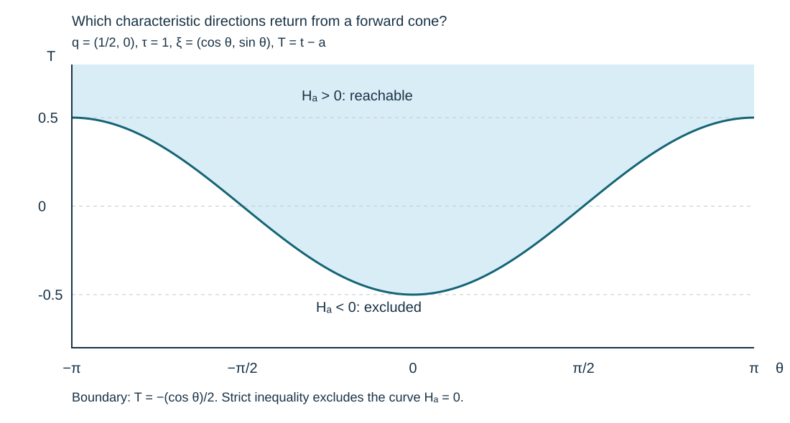
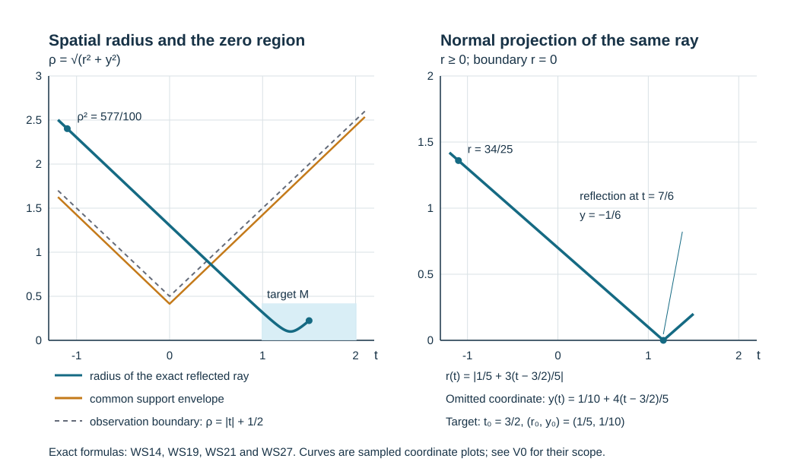

# Wave smoothing uniform in the coefficients

A wave may be singular outside a forward cone while remaining smooth well inside it. We prove that the interior smoothness persists uniformly for a smooth family of operators approaching a constant spatial metric, including all coefficient-parameter derivatives and points on a Dirichlet boundary. The proof uses the full boundary observation estimate. Its observation operators act only where the solution is zero, including their residual kernels.

**Independent exposition, proofs, exercises and figure: CC0-1.0.** The antecedent is Lars Hörmander, *The Analysis of Linear Partial Differential Operators III*, Springer 2007 eBook, ISBN 978-3-540-49938-1, Lemmas 17.5.12–17.5.14 and the application in §24.7, printed pages 56–61 and 467–469. The proof map identifies the complete earlier programme arguments. See source credit and [review](proof-review.json). Required human foundation proofs remain external; internal P514 closure of this CC0 export is not claimed. 

## 1. The family and the conclusion

**H0. A precise receiving statement.** Write \(X=(r,y)\in\mathbb R^n_+\), \(n\ge1\), with \(r\ge0\), and let \(a\) range near a compact set \(K_0\) in the face \(a_q=0\) of a finite-dimensional parameter half-space. A smooth map \(c(a)\in\partial\mathbb R^n_+\) specifies the spatial center. Suppose
\[
 L_a=\partial_t^2+P_a(X,D_X),\qquad
 P_a=\sum_{i,j=1}^n A_a^{ij}(X)D_iD_j+
               \sum_{i=1}^n b_a^i(X)D_i+c_a^0(X),\quad D=-i\partial,
 \tag{WS1}
\]
where \(A_a\) is real, symmetric and positive definite. All coefficients extend smoothly to an open parameter neighborhood of \(K_0\), with uniform bounds on compact sets. The lower coefficients may be complex. At every \(a\in K_0\), the matrix \(A_a(X)\) is independent of \(X\). Let \(d_a\) be the spatial length distance for the positive metric \(A_a^{-1}\), with paths in the closed half-space.

For \(a_q>0\), let \(u_a\) be jointly smooth in \((a,t,X)\), up to the spatial boundary, for \(|t|<3\). Assume
\[
 L_au_a=0,\qquad u_a(t,0,y)=0,\qquad
 \operatorname{supp}u_a(0,\cdot)\cup
 \operatorname{supp}\partial_tu_a(0,\cdot)
       \subset\{X:d_a(X,c(a))\le2/5\}.
 \tag{WS2}
\]
For every parameter multiindex \(\alpha\), assume the family \(\partial_a^\alpha u_a(t,\cdot)\) is bounded in extendible spatial distributions, locally uniformly in \(t\in(-3,3)\) and in \(a\) near \(K_0\). More explicitly, for each compact spatial test set and compact time interval there are a finite derivative seminorm \(p_{N_\alpha}\) on tests smooth and flat at \(r=0\), and \(C_\alpha<\infty\), such that
\[
 |\langle\partial_a^\alpha u_a(t,\cdot),\phi\rangle|
                   \le C_\alpha p_{N_\alpha}(\phi).
 \tag{WS3}
\]
A uniformly bounded set of distributions of a fixed finite order, as in the antecedent, has this property. The orders may increase with \(\alpha\).

Then there is **one** relative parameter neighborhood \(K'\) of \(K_0\), independent of derivative order, such that for every \(\alpha,j,\beta\) there is a finite constant with
\[
 \sup_{\substack{a\in K',\ a_q>0,\ 1\le t\le2\\
                         d_a(X,c(a))\le2/5}}
 |\partial_a^\alpha\partial_t^j\partial_X^\beta u_a(t,X)|
                              \le C_{\alpha j\beta}.
 \tag{WS4}
\]
The constants need not be bounded as the derivative order grows. No bound on the number of boundary reflections, no finite-contact hypothesis and no selfadjointness of the full operator is added. The proof below gives the assertion on a slightly larger spatial-time neighborhood of the displayed target. It does not assert smoothness on the entire surrounding backward cone.

## 2. Fixed geometric margins and finite propagation

**F0. Reduce a reference spatial metric to the identity.** Fix \(a^0\in K_0\). Translate by \(c(a)\), retaining the parameter dependence of this translation. Choose a fixed linear map \(B\) preserving the spatial half-space with
\[
 B^T A_{a^0}^{-1}B=I,
 \qquad B^{-1}A_{a^0}B^{-T}=I .
 \tag{WS5}
\]
To construct it, take an \(A_{a^0}^{-1}\)-orthonormal basis of the boundary tangent plane and its inward unit metric normal; use the latter as the first column. The columns form a basis, the first column has positive normal component, and the other columns have zero normal component. This proves both identities and the half-space property. The corresponding distance becomes Euclidean at \(a^0\). Smooth change of variables preserves (WS3): transpose onto the test, retain its Jacobian, and use the finite chain rule. We henceforth use these coordinates and center zero.

On the fixed spatial ball \(|X|\le10\), shrink the parameter neighborhood so that
\[
 A_a\le c_*^2 I,\qquad c_*=101/100,
 \tag{WS6}
\]
as quadratic forms, and retain a uniform positive lower bound. Each fixed coefficient derivative is bounded there. A path of metric length at most \(2/5\) cannot leave the unit ball: its portion reaching that sphere would have length at least \(1/c_*>2/5\). On paths remaining in this ball, metric length is at least Euclidean displacement divided by \(c_*\). Taking approximating paths in the distance infimum therefore gives
\[
 d_a(X,0)\le2/5\quad\Longrightarrow\quad
                         |X|\le(2/5)c_*=101/250.
 \tag{WS7}
\]
For the closed endpoint, first use paths of length \(2/5+\varepsilon<1/c_*\), then let \(\varepsilon\downarrow0\). This argument also excludes a putative shortcut that travels outside the region of coefficient control.

**F1. The common zero region comes from energy.** In the working spatial ball \(|X|<5\), finite propagation for (WS1) gives
\[
 u_a(t,X)=0\quad\hbox{if}\quad
            |X|>c_*(2/5+|t|),\qquad |t|<3.
 \tag{WS8}
\]
Here is the full domain-of-dependence use. Fix such a point and choose \(c'>c_*\) close enough that \(|X|>2c_*/5+c'|t|\). Its backward spatial cone to the plane \(t=0\), with radius \(c'\) times the remaining time, has a base disjoint from both initial supports in (WS2). Intersect the cone with the half-space. The conormal of its shrinking spherical side is \(c'\,dt+d|X-X_*|\); its principal square is at least \((c')^2-c_*^2>0\), with future orientation. The artificial-face positivity DC:T008–T014 and the shrinking-ball proof DC:T032 show that weighted energy inside this cone is bounded by the initial energy, the forcing and the prescribed boundary value, all zero. In particular the solution vanishes at its tip, by taking nested cones with tips slightly beyond the chosen point. The physical boundary contributes the nonnegative zero-Dirichlet flux; no condition is imposed on an artificial timelike side. Corners and the radial center are handled by the monotone cutoff argument preceding DC:T014. The full complex lower terms are absorbed by its exponential weight.

All these cones lie in \(|X|<9\) when \(|X_*|<5\), \(|t|<3\) and \(c'\) is close to \(c_*\); thus (WS6) suffices and no behavior at spatial infinity is assumed. For negative time use the past-directed inward multiplier of DC:T015, or repeat this argument after changing \(t\) to \(-t\). This proves (WS8). A bounded family of the already smooth solutions needs no limiting argument here.

## 3. Normalize before differentiating the parameter

**N0. A time-preserving common normal form.** Apply PBC:N0–G0 to \(L_a\), using \(r\) as the normal variable and \((t,y)\) as tangential variables. Since (WS1) has no mixed time-spatial principal coefficients, the flow that removes the normal cross terms leaves \(t\) unchanged. Write its spatial part as
\[
 \Phi_a(r,z)=(r,Y_a(r,z)),\quad Y_a(0,z)=z,
 \qquad \partial_rY_a^j=
              (A_a^{1j}/A_a^{11})(r,Y_a),\quad j>1.
 \tag{WS9}
\]
The reference cross coefficients vanish. On the ball of radius ten they are uniformly small for \(a\) close to \(a^0\). The Picard construction and differentiated flow equations in PBC:N0 therefore work for \(0\le r\le5\), with a larger tangential buffer, not merely for an unspecified infinitesimal collar. For instance, a bound \(1/500\) on the Euclidean norm of the right-hand side gives displacement at most \(1/100\) over this interval. Further shrinking gives common inverse domains and
\[
                 |\Phi_a(q)-q|\le1/100
 \tag{WS10}
\]
on the compact working boxes. In dimension \(n=1\) this flow is the identity. All fixed-order derivatives of the maps and their inverses are uniformly bounded.

Retain the full density factor \(W_a\), the complex scalar normal gauge \(S_a\), and the positive leading coefficient \(\lambda_a\) from PBC:D0–G0. With \(F_au=u(t,\Phi_a(q))\), put
\[
 v_a=S_a^{-1}W_a F_au_a,
 \qquad \mathcal P_a=S_a^{-1}\lambda_a^{-1}
             W_a F_a L_a F_a^{-1}W_a^{-1}S_a
                  =D_r^2-R_a(r,t,z,D_t,D_z).
 \tag{WS11}
\]
The operator \(R_a\) is a **tangential differential operator of order at most two**, with all lower terms retained and real quadratic principal symbol. The preceding coordinate, density and gauge formulas are exact full-operator formulas. Thus \(\mathcal P_av_a=0\), and \(v_a|_{r=0}=0\). There is no hidden source in (WS11).

The transformed target in (WS4) has \(|q|\le207/500\) by (WS7)–(WS10). It lies in the interior, relative to the half-space, of the fixed compact set
\[
 M=\{99/100\le t\le201/100,\ |q|\le21/50,\ r\ge0\}.
 \tag{WS12}
\]
By (WS8) and (WS10), \(v_a\) vanishes on the common open set
\[
 O=\{(t,q): |q|>|t|+1/2\}
 \tag{WS13}
\]
within the working box. Indeed its possible support there satisfies
\[
 |q|\le c_*(2/5+|t|)+1/100
              \le |t|+111/250<|t|+1/2\qquad(|t|<3).
 \tag{WS14}
\]
The last gap is \(7/125\). Multiplication by \(S_a^{-1}W_a\) changes neither zero sets nor supports.

**N1. Parameter derivatives retain an admissible weak bound.** Set \(w_{\alpha,a}=\partial_a^\alpha v_a\). Differentiating (WS11) gives the exact triangular system
\[
 \mathcal P_aw_{\alpha,a}=f_{\alpha,a},\qquad
 f_{\alpha,a}=\sum_{0<\beta\le\alpha}
   {\alpha\choose\beta}(\partial_a^\beta R_a)
                               w_{\alpha-\beta,a},\qquad f_{0,a}=0.
 \tag{WS15}
\]
Every \(\partial_a^\beta R_a\) is tangential. In particular, it is a full boundary differential operator of order at most two. Ordinary \(D_r^2\) does not appear in this sum. Differentiation also gives \(w_{\alpha,a}|_{r=0}=0\) and \(w_{\alpha,a}=0\) on \(O\).

For completeness, each \(w_{\alpha,a}\) has a uniform local negative restricted Sobolev bound. Apply the finite parameter chain rule to \(S_a^{-1}W_a u_a(t,\Phi_a(q))\), including the preliminary translation. This gives finitely many coefficient multiples of spatial derivatives of \(\partial_a^\gamma u_a\), with \(|\gamma|\le|\alpha|\), pulled back by the same map. Transpose onto a flat test. The map preserves the boundary, its Jacobian and all relevant derivatives are uniformly bounded, and differentiation preserves flatness. Equation (WS3) therefore bounds the pairing by one finite seminorm on that test. Integrate over a compact time interval to obtain the same bound for spacetime tests. NGR:B1–B2, including its Fourier Sobolev inequality and Hahn–Banach restriction argument, now gives, for each fixed cutoff \(\beta_0\),
\[
      \|\beta_0 w_{\alpha,a}\|_{\overline H^{-N_\alpha}}
                                    \le C_\alpha .
 \tag{WS16}
\]
For the finitely many indices \(|\alpha|\le k\), take their largest order and enlarge their constants. No invariance of the original distribution family under coordinate changes, and no common order for infinitely many \(\alpha\), has been assumed.

## 4. Observation means actual input support

**O0. An input-supported version of the chart estimate.** In CRO:H0–H1 suppose the observation cone satisfies \(\Gamma_2\subset T_b^*O\setminus0\), where \(O\) is open in the base. The scalar observation test \(A_o\) can be chosen with its **entire input projection compactly contained in \(O\)**. Consequently \(A_o w=0\) whenever \(w=0\) on \(O\).

To prove this refinement, make the following choices in that proof. For every nested test \(E_{i,n}\) whose full microsupport is contained in \(V_i\Subset\Gamma_2\), choose a right base cutoff \(\chi_i\in C_c^\infty(O)\) equal to one near the base projection of \(\overline{V_i}\), and a proper realization with complete input projection in its support. This retains ellipticity on \(U_i\) and the required full microsupport. Keep these exact tests as the observation list in CRO:T3. All comparisons with the local observation operators retain their actual full residuals and the separate source tests of CRO:R0–R1. Thus the defect-set argument CRO:D0–P3, including the parameter limit, is unchanged.

At its conclusion only finitely many \(E_{i,n}\) occur. In the BSA:E0 comparison choose the common elliptic test \(Q\) with a right cutoff in \(O\), equal to one near the union of their compact microsupports. The exact remainders \(E_i-B_iQ\) have input projections in the union of the inputs of \(E_i\) and \(Q\). That union is compact in \(O\). In BSA:E1 choose the residual right cutoff \(\chi\) in \(O\), equal to one on this union. The scalar assembly is \(A_o=Q+US\). Its relocation \(U\) acts on the **output** alone, so it does not change these input supports. This proves the asserted support, with every residual included. It is stronger than a microsupport statement: a residual kernel could otherwise read the solution far outside \(O\).

**O1. Full localization and tangential sources.** Fix a compact cutoff \(\beta_0\), equal to one on a neighborhood of an inner working box containing all rays and all actual input projections used below. Choose the coarse order in (WS16) first. Realize the chart estimates with their complete input projections in that inner box, as in PBC:T0. Coefficients can be smoothly extended to a larger half-space model while keeping the normal coefficient equal to one. For any resulting full source test \(T\),
\[
 T\mathcal P_a(\beta_0w_{\alpha,a})=T f_{\alpha,a},
 \qquad A_o(\beta_0w_{\alpha,a})=0.
 \tag{WS17}
\]
The first identity holds because \(T\) has no input where a derivative of \(\beta_0\) is nonzero. The second follows from O0. Targets with inputs in the same box similarly act on \(w_{\alpha,a}\) itself. The estimate is applied to smooth compact zero-Dirichlet inputs in the fixed Banach space \(\overline H^{-N}\). No density assertion for a larger graph domain is needed.

Moreover, for each summand of (WS15),
\[
 T(\partial_a^\beta R_a)\in\Psi_b^{\operatorname{ord}T+2},
 \qquad \operatorname{WF}'_b\bigl(T\partial_a^\beta R_a\bigr)
                         \subset\operatorname{WF}'_bT .
 \tag{WS18}
\]
This is an actual full composition, including all residual terms. Tangential differentiation is a polynomial boundary symbol; the full composition and proper-support theorem GB:C6 applies. On the compact parameter set these operators form a bounded family in every fixed full-kernel seminorm. The differential factor does not enlarge the input projection. These facts are precisely what permits the source norm in (WS17) to use estimates already proved for lower parameter derivatives.

## 5. A compact family of backward rays

### Which covectors can return from a forward cone?

**G3. The exact flat reachability criterion.** Use the flat symbol
\(p=|\xi|^2-\tau^2\), with spatial point \(q=(r,y)\), \(r\ge0\).
Fix a real time shift \(a\). Let \(W_a\) be the characteristic covectors
obtained by following every reflected ray backward from the open cone
\(t_0>a+|q_0|\). Only nonzero characteristic covectors are under discussion:
\(|\xi|=|\tau|\ne0\). Then
\[
 (t,q,\tau,\xi)\in W_a
 \quad\Longleftrightarrow\quad
 H_a(t,q,\tau,\xi):=
       \tau\langle q,\xi\rangle+(t-a)\tau^2>0.
 \tag{WS33}
\]
The assertion includes tangent rays and the compressed identification of
the two normal roots at the boundary.

First work in the full spatial space. A future vertex \((t_0,q_0)\)
lies on the characteristic line through the given covector precisely when
\[
 q_0=q+(t-t_0)\xi/\tau,
 \qquad t_0>t.
 \tag{WS34}
\]
Put \(T=t-a\), \(T_0=t_0-a\), and
\(b=\tau q+T\xi\). The forward-cone condition is
\[
 |q_0|<T_0,
 \quad T_0>0
 \quad\Longleftrightarrow\quad
 |b-T_0\xi|^2<T_0^2\tau^2
 \quad\Longleftrightarrow\quad
 |b|^2<2T_0\langle b,\xi\rangle .
 \tag{WS35}
\]
Here the middle equivalence retains \(T_0>0\), and uses
\(|\xi|^2=\tau^2\). Such a \(T_0\) exists if and only if
\(\langle b,\xi\rangle>0\): necessity follows directly from the strict
inequality; for sufficiency choose
\(T_0>\max(0,T,|b|^2/(2\langle b,\xi\rangle))\).
This also guarantees the required future orientation. Since
\(\langle b,\xi\rangle=H_a\), the criterion is proved in full space.
It implies \(t>a-|q|\) by Cauchy--Schwarz. Every characteristic covector
over \(t>a+|q|\) satisfies it strictly. Equality \(H_a=0\) does not
give a vertex in the open forward cone.

For the half-space, unfold the normal coordinate of a ray across \(r=0\).
Simultaneously reflecting \(q_1,\xi_1\) preserves both the characteristic
condition and \(H_a\). A full-space future vertex with negative normal
coordinate becomes a permitted half-space vertex on reflection, with
the same norm. Conversely, unfolding any physical reflected segment
produces exactly (WS34), possibly with that reflected vertex. At a hit
\(r=0\), the normal term in \(\langle q,\xi\rangle\) is zero, so
(WS33) descends to the compressed root identification. A tangent ray
has zero normal velocity and remains in the boundary: its zero normal
acceleration and the integrated normal equations force this continuation.
Thus unfolding and the criterion apply to all flat generalized rays.

### An open cone with genuine observation access

**G4. The three base regions and the whole characteristic access.** In
\(Q=\{|t|<3,r\ge0\}\), put \(a=1/2\) and
\[
 \Omega_1=\{t>a+|q|\}\cap Q,\qquad
 \Omega_2=\{|q|>|t|+a\}\cap Q,\qquad
 \Omega_3=\{t>a-|q|\}\cap Q.
 \tag{WS36}
\]
All cotangent cones below omit the zero section and use compressed
covectors at the face. With \(\Sigma=\{p=0\}\), define
\[
 \Gamma_j=T_b^*\Omega_j\setminus0\ (j=1,2),\qquad
 \Gamma=\bigl((T_b^*\Omega_3\setminus0)\setminus\Sigma\bigr)
                 \ \cup\ W_a.
 \tag{WS37}
\]
This agrees with adjoining the whole cone over \(\Omega_1\), since all
its characteristic points belong to \(W_a\). In the interior, the
complement of \(\Gamma\) relative to \(T_b^*\Omega_3\setminus0\)
is \(\Sigma\cap\{H_a\le0\}\), a closed set. At a boundary point,
lift to its ordinary quadratic characteristic roots. Their compact
normalized lifts vary continuously as an unordered pair; at a repeated
root they coincide. A sequence of excluded compressed covectors
therefore has a convergent excluded root lift, and at the face (WS33)
has the same value on both representatives. This proves relative
closedness there as well. Thus \(\Gamma\) is an open conic set, rather
than merely a relatively open part of the characteristic set.

Direct inequalities give \(\Omega_2\subset\Omega_3\) and
\(\Omega_3\cap\{t\le0\}=\Omega_2\cap\{t\le0\}\).
A characteristic covector over \(\Omega_2\) need not lie in \(W_a\).
Accordingly the observation cone
used for the access theorem is precisely
\(\Gamma_2^{\rm obs}=\Gamma\cap(T_b^*\Omega_2\setminus0)\),
which is open, lies in \(\Gamma\), and still reads only the zero region.

Every flat ray through a point \((t_0,q_0)\in\Omega_1\) stays in
\(\Gamma\) as it is followed backward to \(s=-1\).
Indeed physical time is a global ray parameter since \(\tau\ne0\);
\(H_a\) is constant between hits, continuous at each hit and unchanged
on tangent segments. It remains positive, so the ray stays over
\(\Omega_3\). The explicit unfolded straight line and reflection give
\[
 |q(s)|\ge t_0-s-|q_0|>a-s=|s|+a
                   \qquad(-3<s\le0).
 \tag{WS38}
\]
Hence the ray reaches \(\Gamma_2^{\rm obs}\) already at \(s=-1\).
No finite exit inside \(\Gamma\) can precede that time: the displayed
flat formula supplies its continuation. This verifies the maximal-ray
access condition, including every reflected and tangent continuation.
Only the cone \(\Gamma\) is used; no smoothness on all of \(\Omega_3\)
is inferred. The later compact construction uses smaller neighborhoods
of these rays, with the explicit positive margins in G0--G2.

**V1. Read this covector slice.** The horizontal coordinate is
\(\theta\in[-\pi,\pi]\), with \(\tau=1\) and
\(\xi=(\cos\theta,\sin\theta)\); the fixed spatial point is
\(q=(1/2,0)\). The vertical coordinate is \(T=t-a\).
The boundary curve is exactly \(T=-\cos\theta/2\); the blue region
above it satisfies \(H_a>0\). The curve itself is excluded. This is a
two-dimensional covector-direction slice, not a physical ray diagram.
Above \(T=1/2\) every displayed direction is admitted; below
\(T=-1/2\) none is. The generator samples only this analytic curve
for drawing; (WS33)--(WS35) prove the exact strict condition.

**G0. Exact reference geometry, including reflection.** At \(a^0\) the principal wave operator is flat. In physical time, an unfolded characteristic from \((t_0,r_0,y_0)\) with spatial velocity \(e=(e_r,e_y)\), \(|e|=1\), is
\[
 r(s)=|r_0+(s-t_0)e_r|,\qquad
 y(s)=y_0+(s-t_0)e_y .
 \tag{WS19}
\]
At an interior starting point either signed normal velocity is allowed; at \(r_0=0\) both root representatives give the same reflected path with the corresponding tangential velocity. If \(e_r=0\) and \(r_0=0\), (WS19) is the gliding path. The flat glancing equation has no other continuation: its normal acceleration and all contact derivatives vanish, and the integrated generalized-flow equations give \(r=0\), while the tangential motion is the displayed line. This is also the zero-comparison case PRS:S6.

Reflection preserves Euclidean norm. The reverse triangle inequality therefore gives, for \(s\le t_0\),
\[
 |q(s)|\ge t_0-s-|q(t_0)| .
 \tag{WS20}
\]
For every target in \(M\), at \(s=-11/10\) the right side exceeds \(|s|+1/2\) by at least
\[
              99/100-21/50-1/2=7/100.
 \tag{WS21}
\]
The same margin holds at \(s=-1\). The entire segment from the target to \(s=-6/5\) lies in \(|q|\le21/50+201/100+6/5=363/100<4\). These are bounds for all directions, including tangency, not samples of selected rays.

Let \(K_M\) be the complete unit compressed cotangent sphere over \(M\). Let \(K^0\) be its union with every characteristic backward segment from its characteristic part down to \(t=-1\). This set is compact. One proof uses the explicit formula (WS19) and compact unit directions, with the two reflected representatives identified by compression. Equivalently PRS:S2–S7 gives closedness of limits of all the bounded arcs. Noncharacteristic points of \(K_M\) contribute no arcs.

**G1. Fix a parameter set before choosing derivatives.** Choose an ambient open compressed cone \(\Gamma^0\) in a slightly larger working box, containing \(K^0\) and all the preceding segments down to \(-6/5\). The reference paths from \(K^0\) to \(t=-11/10\) have positive support and observation margins by (WS21). The continuous flat reflected flow, or the compactness and exit-buffer proof PRS:S3–S10, gives an open neighborhood of \(K^0\) from which every characteristic reaches \(O\) backward while staying in \(\Gamma^0\). Take two compactly nested smaller neighborhoods and call the inner one \(T_1\). The closure of \(T_1\) is a fixed compact normalized target set for CRO:H1.

There is a compact parameter neighborhood \(Z_0\) of \(a^0\), chosen now and independently of any derivative order, such that all backward characteristic segments from \(K_M\), down to \(t=-1\), stay in \(T_1\) for \(a\in Z_0\), and their endpoints lie in \(O\) with a uniform positive margin. To verify this stronger segment assertion, suppose otherwise and choose convergent parameters and initial states. Normalize characteristic covectors by \(|\tau|=1\). Spatial positive definiteness bounds every spatial component, and the physical-time component of the normalized Hamilton field is bounded away from zero. Thus physical time is a valid common parameter. On the larger compact box, PRS:S2–S7 supplies compactness and continuation; a first attempted exit is ruled out by its positive buffer. A subsequence would limit to a flat segment violating either the chosen neighborhood or (WS21), a contradiction. This also supplies the slight backward extension needed to reach \(-11/10\) and proves the ray-access hypothesis used for \(T_1\).

Shrink \(Z_0\) once more to the geometric parameter range in CRO:H1 for target \(\overline{T_1}\), ambient cone \(\Gamma^0\) and observation in \(O\). Equations (WS16)–(WS17), with zero source for \(v_a\), then give
\[
 \sup_{a\in Z_0,\ a_q>0}\sup_b\|C_{a,b}v_a\|_2<\infty
 \quad\text{if}\quad
 \operatorname{WF}'_b C_{a,b}\Subset T_1,
 \tag{WS22}
\]
for every prescribed bounded full family of finite order with the stated input margins. The finite norm bound depends on that family. In wave spacetime the tangential dimension is \(n\ge1\), even for one spatial dimension, so the scalar assembly used here has its required positive-dimensional reserve. This does not invoke a scalar assembly theorem on an arbitrary compact boundary manifold.

## 6. Parameter differentiation on nested cones

**G2. Nested neighborhoods for a fixed coefficient value.** Fix \(a^*\in Z_0\). Let \(K^*\) consist of \(K_M\) and all backward \(\mathcal P_{a^*}\) segments from its characteristic part to \(t=-1\). The preceding compactness argument proves that \(K^*\) is compact and lies in \(T_1\); its section at \(t=-1\) is compact in \(O\). It is closed under all further backward continuations until that plane. Indeed concatenating any such continuation with the segment from \(K_M\) is another permitted generalized characteristic; the endpoint law and compact continuation are the ones proved in GSP:C11 and PRS:S7. No unique continuation at infinite contact is selected.

Given a precompact open \(T_\nu\) containing \(K^*\), the compact section at \(t=-1\) has a positive buffer in \(T_\nu\cap T_b^*O\). Uniform velocity bounds permit every endpoint continuation down to \(-1-\varepsilon\) in that buffer, for some \(\varepsilon>0\). Before \(t=-1\), all the continuations lie in \(K^*\). The limit-arc and exit-buffer argument therefore gives a neighborhood \(T_{\nu+1}\) with
\[
 K^*\subset T_{\nu+1}\Subset T_\nu,
 \quad\text{every maximal ray in }T_\nu
 \text{ meeting }T_{\nu+1}\text{ meets }T_\nu\cap T_b^*O.
 \tag{WS23}
\]
Here is the contradiction step explicitly. If arbitrarily near initial states could leave \(T_\nu\) before the observation plane, take a subsequence converging to a state of \(K^*\). The bounded time interval, the nonzero physical-time velocity and PRS:S3–S7 give a limiting arc starting there. It lies in \(K^*\) to \(t=-1\), then in the endpoint buffer to \(t=-1-\varepsilon\). Cover this compact limiting arc by finitely many smaller buffers inside \(T_\nu\); uniform convergence and the local lifetime bound rule out the proposed exits. The same argument rules out missing \(O\) at the final plane. Take \(T_{\nu+1}\) sufficiently small that its starting times are above \(-1-\varepsilon/2\). Noncharacteristic starting states require no access assertion. This proves (WS23).

Choose the closure of \(T_{\nu+1}\) inside the open access neighborhood just obtained. Apply CRO:H1 at the reference value \(a^*\), with that larger access neighborhood as its open target region, compact target \(\overline{T_{\nu+1}}\), ambient cone \(T_\nu\), and observation \(T_\nu\cap T_b^*O\). Thus its compact target is strictly inside its open target region, as required. Use the observation refinement O0. The parameter radius is independent of the order or full target family. Only finitely many such applications will be used for any specified parameter derivative.

**I0. The finite parameter induction.** We claim that for every integer \(k\ge0\), all \(|\alpha|\le k\) and every bounded full target family with microsupport compact in \(T_{k+1}\),
\[
 \sup_{\substack{a\text{ in a neighborhood of }a^*\\a\in Z_0,\ a_q>0}}
                       \sup_b\|C_{a,b}w_{\alpha,a}\|_2<\infty.
 \tag{WS24}
\]
The neighborhood may depend on \(k\), but can be chosen independently of target order. For \(k=0\) this is (WS22). Assume it for \(k-1\), and take \(|\alpha|=k\). Apply the chart estimate from \(T_k\) to \(T_{k+1}\), in a parameter neighborhood also contained in that of the induction hypothesis. Its coarse term is bounded by (WS16); its observation is zero by (WS17). Its source is the finite sum \(A_f(\partial_a^\beta R_a)w_{\alpha-\beta,a}\). Each composed family in (WS18) has microsupport compact in \(T_k\), is uniformly bounded in a finite full order, and retains the input margin. The induction hypothesis bounds its actual norm, including its residual. There are finitely many multiindices at order \(k\), so one parameter neighborhood and one finite coarse order work for all of them. Lower derivatives retain their bounds on the smaller cone. This proves (WS24).

The same reasoning applies to arbitrary bounded target families, rather than merely to one fixed test: that is part of CRO:H1. It is needed here because the coefficient derivatives in (WS15) vary with \(a\). No countable density assertion about all residual kernels is used.

## 7. Recover ordinary derivatives and keep one parameter neighborhood

**J0. Tangential differential tests and normal recovery.** Fix a finite parameter order \(k\). The full compressed sphere over \(M\) lies in \(K^*\subset T_{k+1}\). Compactness of that sphere gives a base neighborhood of \(M\) whose entire compressed sphere is still in \(T_{k+1}\). Choose finitely many nested cutoffs there. For each tangential multiindex \(\gamma\), the actual operator \(\chi D_{t,z}^\gamma\) is a compact boundary differential test of finite order, with microsupport in that sphere neighborhood. Thus (WS24) bounds every tangential derivative of every \(w_{\alpha,a}\), \(|\alpha|\le k\), in local \(L^2\). These are polynomial differential symbols, not an unjustified assertion that an arbitrary tangential pseudodifferential symbol belongs to the full boundary class at large normal frequency.

The full normal-recovery proof MH:R1–R2 now supplies the first two ordinary normal derivatives. For any integer \(s\ge2\), use its indices
\[
 (r_1,q_1)=(0,s),\qquad (r_2,q_2)=(2,s-2),
                       \qquad (a,b)=(2,s-2).
 \tag{WS25}
\]
The seed is \(w_\alpha\in L^2_rH^s_{t,z}\). Its source \(f_\alpha\) belongs to \(L^2_rH^{s-2}_{t,z}\) by (WS15) and the just-proved tangential bounds for lower parameter derivatives. All three recovery inequalities are satisfied, with total order \(s\). The receiving proof uses finitely many nested cutoffs and continuous coefficient multipliers, so its norm constants are uniform for the compact coefficient family. The integer-jet equivalence MH:N2 yields \(D_rw_\alpha\in L^2H^{s-1}\) and \(D_r^2w_\alpha\in L^2H^{s-2}\), with uniform bounds. It also treats the interior parts of these patches.

Higher ordinary normal derivatives follow without a new microlocal theorem. Since \(D_r^2=-\partial_r^2\), differentiate the exact equation to obtain
\[
 \partial_r^{j+2}w_\alpha
 =-\sum_{h=0}^j {j\choose h}
          (\partial_r^h R_a)\partial_r^{j-h}w_\alpha
                         -\partial_r^j f_\alpha .
 \tag{WS26}
\]
For the finite collection \(|\alpha|\le k\), suppose all normal derivatives up to order \(j+1\), with arbitrary fixed tangential derivatives, have been bounded. Every term on the right of (WS26) involves at most \(j\) normal derivatives of this same collection, because (WS15) is tangential. Smooth coefficient derivatives are uniformly bounded. Hence the next normal derivative is bounded as well. Starting with orders zero, one and two proves any requested finite ordinary jet. Only finitely many nested cutoffs are used for that jet, all around the same compact \(M\).

Finally the Fourier Sobolev estimate from NGR:B2 converts sufficiently high local ordinary Sobolev norms into uniform pointwise bounds, including the boundary. In the restricted norm choose a whole-space extension within twice the infimum; the whole-space estimate bounds its continuous derivatives. Their restrictions agree with the smooth interior derivatives, hence with the boundary limits. Taking the infimum proves the asserted local bound independently of the extension. This proves all the required mixed \((a,t,q)\) derivatives on \(M\).

**J1. A finite cover for each derivative order.** For a specified mixed derivative, J0 supplies a parameter neighborhood of each \(a^*\in Z_0\) and a bound there. These open neighborhoods cover the same compact \(Z_0\). Choose a finite subcover and take the maximum of its finitely many constants. This gives a bound on all of \(Z_0\), for that derivative. Repeat for each derivative order. The set \(Z_0\) is never replaced by an intersection of the shrinking neighborhoods in (WS24).

Return through the exact inverse of (WS11), the fixed linear map and the parameter-dependent translation. The chain rule uses only finitely many of the derivatives just bounded, and all its coefficient and inverse-Jacobian derivatives are uniformly bounded. By (WS7), (WS10) and (WS12), the target in (WS4) is always mapped into the interior of \(M\). Thus the original derivatives have the same type of uniform bound.

Repeat the initial geometric construction at finitely many \(a^0\) covering \(K_0\). Choose a relative neighborhood \(K'\) of \(K_0\) with closure in the union of the resulting compact parameter neighborhoods. These geometric choices preceded every derivative order. The maximum of the finitely many patch constants gives (WS4) on this one \(K'\). This completes the coefficient-uniform wave smoothing statement, including the case \(n=1\).

## 8. Three examples with complete solutions

**X1. A reflected ray and its observation margin.** Take \(n=2\), target \(t_0=3/2\), \(r_0=1/5\), \(y_0=1/10\), and unfolded unit velocity \(e=(3/5,4/5)\). Find the boundary hit and the point at observation time \(-11/10\).

**Solution.** The normal affine coordinate is \(1/5+3(t-3/2)/5\), so its zero is \(t=7/6\). At that hit the tangential coordinate is \(-1/6\). The compressed curve is continuous, with normal momenta interchanged and tangential velocity unchanged. At \(t=-11/10\), the time difference is \(-13/5\), and
\[
              r=34/25,\qquad y=-99/50,\qquad
                         |q|^2=577/100.
 \tag{WS27}
\]
This is strictly outside the observation threshold \(|t|+1/2=8/5\), whose square is \(64/25\). The target has \(|q_0|=\sqrt5/10<21/50\). The uniform margin \(7/100\) in (WS21) applies to every target and direction in the stated compact set; this particular ray has a larger margin.

**X2. Why differentiating after normalization matters.** Consider
\[
 L_a=\partial_t^2-\partial_r^2-2a\partial_r\partial_y
                                      -(1+a^2)\partial_y^2.
 \tag{WS28}
\]
Find a parameter-dependent coordinate change that removes all parameter dependence from the equation. Compare its parameter derivative with the derivative in the original coordinates.

**Solution.** Its spatial principal matrix is
\(A_a=\left(\begin{smallmatrix}1&a\\a&1+a^2\end{smallmatrix}\right)=B_aB_a^T\),
where \(B_a=\left(\begin{smallmatrix}1&0\\a&1\end{smallmatrix}\right)\).
It is positive definite, with determinant one. Put \(y=z+ar\). The Jacobian is one, and the transformed full operator is
\[
       D_r^2-D_t^2+D_z^2=D_r^2-R,
                         \qquad R=D_t^2-D_z^2.
 \tag{WS29}
\]
There is no density or gauge correction in this constant-coefficient example. If \(v_a(t,r,z)=u_a(t,r,z+ar)\), then
\[
 \partial_a v_a=(\partial_a u_a+r\partial_yu_a)(t,r,z+ar).
 \tag{WS30}
\]
The normalized equation for this derivative has zero source because \(\partial_aR=0\). Direct differentiation of the original equation instead produces the mixed normal-tangential term \(2\partial_r\partial_yu_a+2a\partial_y^2u_a\). Formula (WS30) accounts for exactly the additional coordinate derivative. For a fixed flat wave \(w\), \(u_a(t,r,y)=w(t,r,y-ar)\) gives \(v_a=w\), so the cancellation is immediate and exact. The metric distance from zero is \(\sqrt{r^2+(y-ar)^2}\), since the shear is a half-space isometry for \(A_a^{-1}\). Both initial and target metric balls therefore become the same Euclidean balls.

**X3. One spatial dimension and the differentiated source sign.** Let \(L_c=\partial_t^2-c^2\partial_r^2\), with \(99/100\le c\le101/100\). For smooth odd \(g\) supported in \([-2/5,2/5]\), set
\[
 u_c(t,r)=\tfrac12\{g(r+ct)+g(r-ct)\},\qquad r\ge0.
 \tag{WS31}
\]
Check the boundary condition, the empty interior-cone region and the normalized parameter equation.

**Solution.** Oddness gives \(u_c(t,0)=0\), direct differentiation gives \(L_cu_c=0\), and the initial velocity is zero. If \(1\le t\le2\), \(0\le r\le2/5\), both arguments have absolute value at least \(99/100-2/5=59/100>2/5\), so the function and all its \(c,t,r\) derivatives vanish there. For this example the support and target are specified in fixed Euclidean coordinates; its initial metric radius is at most \(2/(5c)\). The general metric-radius theorem above is not needed for this direct calculation.

Dividing by \(c^2\) gives \(\mathcal P_c=D_r^2-c^{-2}D_t^2\), so \(R_c=c^{-2}D_t^2\). Thus
\[
          \mathcal P_c\partial_cu_c=-2c^{-3}D_t^2u_c.
 \tag{WS32}
\]
The sign agrees with (WS15). Physical time is the sole tangential coordinate, so the chart still has positive tangential dimension. This explains why the observation assembly used for the general proof also includes one spatial dimension.

## 9. Read the geometry in the figure



**V0. Exact interpretation.** The left curve is the radius of the full two-dimensional ray in (WS19) with the data of X1. Reflection leaves that radius unchanged. The orange support envelope is \(c_*(2/5+|t|)+1/100\), including the coordinate displacement bound; the dashed observation boundary is \(|t|+1/2\). The blue rectangle is the radial projection of \(M\), not a set through which all rays pass. The right panel is only the normal projection \(r(t)\); its omitted tangential coordinate is exactly \(y(t)=1/10+4(t-3/2)/5\). The boundary hit and the observation sample are computed in (WS27). Analytic curves are sampled for rendering; the estimates and reflection law are proved above.

This proves the wave smoothing application on its full parameter and spatial-derivative scope. General manifold scalar-test assembly, any remaining general-observation dimension case, sharp general Airy mapping and the remaining HIII21/23/24 and HIV25/26 obligations continue separately. External human proof dependencies remain explicit.
