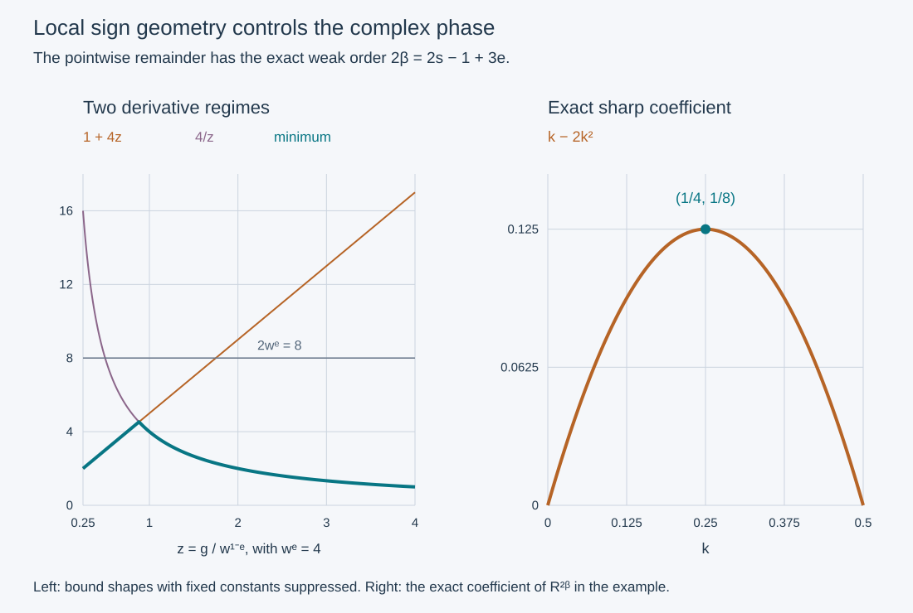

# Local sign geometry and the phase of a complex cutoff

The real-cutoff energy proof uses a cancellation that fails for a complex cutoff. We isolate the surviving operator term and prove that its principal symbol can be absorbed by the favorable imaginary symbol with exactly the weak Sobolev order in the printed estimate. The geometric estimate is sharp on shrinking supports. An operator positivity step is necessary; [the adaptive-root companion](../20261011-complex-cutoff-energy/adaptive-square-roots-and-complex-cutoff-energy.html) supplies it. A pointwise inequality is not substituted for that step.

The antecedent is Hörmander IV, Proposition 26.6.1′ and its proof, printed page 120 of the 2009 edition. The printed statement does not repeat the real-valued assumption used in the preceding proof. Our [real-cutoff lesson](../20261011-shrinking-cutoff-energy/shrinking-cutoffs-and-left-regularized-energy.html) proves that case with the actual measured data. This companion proves the local derivative estimate, the exact complex commutator reduction and the pointwise absorption bound. Its geometric estimates are inputs to [the unrestricted complex-cutoff proof](../20261011-complex-cutoff-energy/adaptive-square-roots-and-complex-cutoff-energy.html).

The proof map pins the earlier metric calculus, operator bounds, real-cutoff argument and elementary Taylor proofs. Original expression, exercises and figure are CC0-1.0. The human foundations are external readings linked by the proof map.

## 1. Keep the exact shrinking-support hypotheses

**H0. Symbols, sign and the weak order.** Put \(x=(t,y)\), \(\xi=(\tau,\eta)\), \(w=\langle\xi\rangle\), and

\[
 0\le e\le\tfrac14,\qquad \rho=1-e,\quad\delta=e,
 \quad\kappa=1-2e,
 \qquad\beta=s+(3e-1)/2. \tag{CA1}
\]

Let \(f\) be a real ordinary symbol of order one, and let \(C_1\in S^0_{1-e,e}\) have compact base support, with \(f\le0\) on its support at high frequencies. Let \(q\in S^s_{1-e,e}\) be complex and assume \(C_1=1\) near \(\operatorname{supp}q\). We use the ordinary derivative bounds \(|\partial_x^\alpha\partial_\xi^\gamma f|\le C_{\alpha\gamma}w^{1-|\gamma|}\). The sign is not assumed on a fixed conic neighborhood.

Write \(g=-f\) on the sign region. Low frequencies are omitted from the pointwise estimates below; after a fixed smooth frequency cutoff they give bounded operators and are included in the already controlled low-frequency terms of SCE:H0. All constants below are uniform on bounded symbol families with the stated common cutoff bounds. The bracket is \(\{a,b\}=\partial_\xi a\cdot\partial_xb-\partial_xa\cdot\partial_\xi b\).

**G0. A uniform small sign ball around every cutoff point.** Fix a high-frequency point \(X=(x,\xi)\) with \(C_1(X)=1\), and use the dimensionless increments

\[
 Z=(z,\zeta)\longmapsto X+ (z,w\zeta),\qquad
 |Z|\le r_0w^{-e}. \tag{CA2}
\]

Choose \(r_0\) small enough that the frequencies along each such segment have weights between \(w/2\) and \(2w\). The derivative bounds for \(C_1\), expressed in \(Z\), are at most \(Aw^e\). The fundamental theorem of calculus then gives \(|C_1(X+(z,w\zeta))-1|\le A' r_0\). Choose \(A'r_0<1/2\). Every point of this ball has \(C_1\ne0\), so it lies in the sign region. This argument also covers a complex \(C_1\); no sign of that cutoff itself is needed.

In these coordinates the first and second derivatives of \(g=-f\) are bounded by \(Mw\), with one constant independent of the center. This follows directly from the ordinary symbol bounds: a frequency derivative is accompanied by its factor \(w\), and the weights remain comparable. Thus \(g\ge0\) on a ball of radius \(r=r_0w^{-e}\), its gradient is bounded by \(Mw\), and its Hessian is bounded by \(Mw\). These are the three inputs used next.

## 2. A derivative bound at precisely the required scale

**G1. Taylor's inequality on a finite sign interval.** Suppose a nonnegative twice differentiable function \(G\) is defined on a ball of radius \(r\) about zero and has Hessian norm at most \(M\). Let \(G_0=G(0)\). For any unit direction \(v\) and \(0<h<r\), Taylor's integral remainder in the direction opposite to \(\partial_vG(0)\) gives

\[
 0\le G_0-h|\partial_vG(0)|+\tfrac12Mh^2,
 \qquad
 |\partial_vG(0)|\le G_0/h+Mh/2. \tag{CA3}
\]

If \(G_0=0\), let \(h\downarrow0\) to get a zero derivative. Otherwise choose \(h\) comparable to \(\min(r,\sqrt{G_0/M})\); when \(M=0\), take \(h\uparrow r\). If the minimum is the square-root scale, (CA3) is bounded by a constant times \(\sqrt{MG_0}\). If it is \(r\), then \(Mr\le G_0/r\). Consequently

\[
 |\nabla G(0)|\le C\bigl(\sqrt{MG_0}+G_0/r\bigr). \tag{CA4}
\]

One can obtain the norm bound directly by choosing the gradient direction; when the gradient vanishes it is automatic. Thus the constant does not conceal a separate directional hypothesis. The finite-radius term is essential: nonnegativity on a shrinking ball does not give the unrestricted square-root estimate by itself.

**G2. Combine the finite-radius bound with the ordinary gradient bound.** Apply G1 to G0's normalized ball. At its center,

\[
 |\nabla_Zg|\le C\bigl(\sqrt{gw}+gw^e\bigr),
 \qquad |\nabla_Zg|\le Cw. \tag{CA5}
\]

If \(0\le g\le w^{1-e}\), square the first inequality and use
\(gw\le gw^{1+e}\) and \(g^2w^{2e}\le gw^{1+e}\).
If \(g\ge w^{1-e}\), square the second inequality and use \(w^2\le gw^{1+e}\). Thus both regimes give

\[
 |\nabla_Zg|^2\le Cg w^{1+e},\qquad
 |\partial_x f|\le C\sqrt g\,w^{(1+e)/2},\qquad
 |\partial_\xi f|\le C\sqrt g\,w^{(-1+e)/2}. \tag{CA6}
\]

The last frequency bound includes the factor \(w^{-1}\) from (CA2). At a zero of \(g\), both derivatives vanish. The switching scale is \(g=w^{1-e}\), not \(w^{1-2e}\). Keeping the ordinary first-derivative bound in addition to the local Taylor bound is what gives the exponent \(1+e\).

## 3. The exact complex phase and its pointwise absorption

**P0. The bracket has a square-root factor.** At points where \(q\) or its derivatives can be nonzero, \(C_1=1\). At points outside its support all derivatives vanish. Combining (CA6) with the symbol bounds for \(q\) gives

\[
 |\{q,f\}|
 \le C\sqrt g\,w^{s-1/2+3e/2}
 =C\sqrt g\,w^\beta. \tag{CA7}
\]

Indeed \(\partial_\xi q\,\partial_x f\) has order
\(s-1+e+(1+e)/2=\beta\), and the other contraction has order
\(s+e+(-1+e)/2=\beta\). Finite summation over coordinates only changes the constant.

For \(q=a+ib\) with real \(a,b\), the surviving real symbol is

\[
 T(q,f)=\operatorname{Re}\bigl(-i\overline q\{q,f\}\bigr)
       =a\{b,f\}-b\{a,f\}. \tag{CA8}
\]

It vanishes for real \(q\), but not for a general complex cutoff. For every \(0<\varepsilon<1\), (CA7) and the elementary inequality \(uv\le\varepsilon u^2+v^2/(4\varepsilon)\) imply

\[
 |T(q,f)|\le\varepsilon g|q|^2+C_\varepsilon w^{2\beta},
 \qquad
 f|q|^2+T(q,f)
 \le-(1-\varepsilon)g|q|^2+C_\varepsilon w^{2s-1+3e}. \tag{CA9}
\]

This is the exact weak-order remainder in the desired energy estimate. The argument uses the shrinking sign neighborhood supplied by the actual cutoff, not an added conic sign margin.

**R0. What the complete operator calculus gives.** Retain the properly supported order-one operator \(P=A+iB\) and the left regularizer from SCE:R0, with \(A,B\) self-adjoint and \(B\)'s ordinary principal symbol \(f\). For a complex time-independent cutoff \(c\), put

\[
 Q_\nu=R_\nu M_{v_0}\operatorname{Op}(c),\qquad
 r_\nu=(1+\nu|\xi|^2)^{-1},\quad v_0=e^{-\Lambda t}\chi(t),
 \qquad q_{0,\nu}=r_\nu v_0c. \tag{CA10}
\]

Here \(\Lambda\) is the fixed time-weight parameter; it is distinct from a frequency coordinate. The full left symbol of \(Q_\nu\) is \(q_{0,\nu}+S^{s-1+e}_{1-e,e}\), uniformly for \(0<\nu\le1\). SCE:C0 proves the complete mixed expansion, so

\[
 [Q_\nu,B]=\operatorname{Op}(-i\{q_{0,\nu},f\})
                  +\Psi^{s-1+2e}_{1-e,e}. \tag{CA11}
\]

The error includes both the mixed second remainder and the bracket of the lower term in \(Q_\nu\). Commuting with the ordinary order-zero part of \(B\) is of still lower order. The adjoint symbol of \(Q_\nu\) is \(\overline{q_{0,\nu}}+S^{s-1+2e}_{1-e,e}\). Compose it with (CA11). The leading commutator has order \(s+e\); each next exotic product or adjoint term loses \(\kappa=1-2e\). All errors therefore have order at most \(2s-1+3e=2\beta\). Changing to Weyl quantization has the same loss. Taking the symmetric part gives the **full operator identity**

\[
 \tfrac12\bigl(Q_\nu^*[Q_\nu,B]+[Q_\nu,B]^*Q_\nu\bigr)
   =\operatorname{Op}^w(T(q_{0,\nu},f))+E_\nu,
 \qquad E_\nu\in\Psi^{2\beta}_{1-e,e}. \tag{CA12}
\]

All remainders are uniform for fixed \(\Lambda\), with every required differentiated bound. SCE:C0 and the exact metric \(L^2\) theorem give
\(|(E_\nu u,u)|\le C_\Lambda\|u\|_{H^\beta}^2\).
No reality assumption on \(c\) was used. The family \(q_{0,\nu}\) also satisfies P0 uniformly for fixed \(\Lambda\): ordinary derivatives of \(r_\nu\) and fixed smooth derivatives of \(v_0\) preserve its symbol class and support.

**R1. The remaining operator inequality is explicit.** For fixed \(\nu>0\), the actual regularized domains in SCE:E0 make the energy identity legitimate. The real-part commutator, incoming measurement, outgoing nonnegative square with its two-order defect, and convergence on distributions all remain valid for complex \(c\); their proofs do not use its reality. Inserting (CA12) leaves the following needed bound, uniform as \(\nu\downarrow0\):

\[
 (BQ_\nu u,Q_\nu u)
 +\bigl(\operatorname{Op}^w(T(q_{0,\nu},f))u,u\bigr)
 \le K\|Q_\nu u\|_2^2+C_\Lambda\|u\|_{H^\beta}^2. \tag{CA13}
\]

The constant \(K\) must be chosen independently of \(\Lambda\); the lower-order constant may depend on that fixed weight. With (CA13), the absorption and weak-limit proof SCE:E0–U0 would prove the full complex version with exactly the stated measured data. This implication follows by substituting (CA13) in that same energy identity, choosing \(\Lambda>K+2\), and applying its proved Young estimates and weak-limit argument.

We have proved (CA9) and (CA12), **not** (CA13). In particular, \((BQ_\nu u,Q_\nu u)\) is an actual operator form, not simply the quantization of \(f|q_{0,\nu}|^2\). Its product corrections must be retained. Even applying the generic metric Fefferman–Phong theorem to an arbitrary nonnegative symbol of order \(2s+1\) would leave order \(2s+1-2\kappa=2s-1+4e\), which exceeds \(2\beta\) by \(e\) when \(e>0\). Thus a bare appeal to pointwise positivity or to that generic remainder does not finish the required estimate. The joint operator form needs a sharper factorization or positivity argument using its structure.

## 4. Sharpness and three complete checks

**S0. A uniformly admissible family near a shrinking sign boundary.** Work in one transverse pair \((y,\eta)\), with \(f=-y\eta\). Fix smooth cutoffs \(\psi,\theta,\omega\) that equal one near zero, with \(\operatorname{supp}\psi\subset[-1/4,1/4]\), \(\operatorname{supp}\theta\subset[-1/8,1/8]\), and \(\operatorname{supp}\omega\subset[-1,1]\). For \(R\ge3\), define a time-independent complex symbol

\[
 q_R(y,\tau,\eta)=R^s\psi(R^e y-2)
 \theta\!\left(\frac{\eta-R}{R^{1-e}}\right)\omega(\tau/R)
 \left[kR^{-1+2e}-i\frac{\eta-R}{R^{1-e}}\right],
 \qquad k>0. \tag{CA14}
\]

For H0 use \(q=\chi_0(t)q_R\), where \(\chi_0\) is a fixed compact time cutoff equal to one near a marked time. The symbol \(q_R\) itself is the time-independent measured cutoff. All center calculations below take place at that marked time. Its support has \(y>0,\eta>0\), \(w\asymp R\), and bounded base coordinates. Each position derivative costs at most \(R^e\); each \(\eta\)-derivative loses \(R^{1-e}\); each \(\tau\)-derivative loses \(R\). The bracketed factor and all its rescaled derivatives are uniformly bounded because \(-1+2e<0\). Hence this family is bounded in \(S^s_{1-e,e}\).

Take slightly larger cutoffs equal to one near these three supports, with position radius less than \(1/2\) about the rescaled center two and frequency radius less than \(1/4\) about the rescaled center zero. Multiply also by a fixed compact time cutoff equal to one on the time interval under consideration. They define a uniformly bounded \(C_{1,R}\) equal to one near the measured symbol, with \(f\le0\) on its support. The resulting family meets the exact sign-neighborhood conditions. Ordinary bounds for \(f=-y\eta\) hold on a fixed base neighborhood containing all supports, which is all that the localized estimates require.

**X1. Why the switching scale cannot be lowered.** At the point \(y=2R^{-e},\eta=R,\tau=0\), compute \(g\), the ordinary position derivative, and their quotient.

**Solution.** Here \(g=y\eta=2R^{1-e}\) and \(\partial_y g=R\), so

\[
 \frac{|\partial_y g|^2}{g}=\tfrac12R^{1+e}. \tag{CA15}
\]

The sign ball has radius a fixed multiple of \(R^{-e}\). Thus (CA6)'s power \(1+e\) is attained up to a constant by a family satisfying all hypotheses. Replacing it uniformly by any smaller power would contradict (CA15) as \(R\to\infty\). The Hessian of \(g\) is harmless here; it is the finite distance to the sign boundary that matters.

**X2. The full permitted pointwise remainder is attained.** For the same family and center, calculate \(f|q_R|^2+T(q_R,f)\) and choose \(k\) to make it positive.

**Solution.** All cutoff derivatives vanish at the center. Thus
\(q_R=kR^{s-1+2e}\), \(\partial_\eta q_R=-iR^{s-1+e}\), and \(\partial_yq_R=0\). Since \(\partial_yf=-R\), the bracket is \(iR^{s+e}\). Therefore

\[
 T(q_R,f)=kR^{2s-1+3e},\qquad
 f|q_R|^2=-2k^2R^{2s-1+3e},\qquad
 f|q_R|^2+T(q_R,f)=(k-2k^2)R^{2\beta}. \tag{CA16}
\]

The choice \(k=1/4\) gives \(R^{2\beta}/8>0\). Consequently the right side in the nonnegative-remainder version of (CA9) cannot be replaced uniformly by order \(2\beta-\delta\) for any \(\delta>0\). This is a sharpness statement for the **pointwise bound**, not a claim about operator lower bounds or a counterexample to the desired propagation theorem.

**X3. Check both endpoints of the metric range.** Find the weak Sobolev order, the sharp pointwise remainder order, and the generic metric positivity remainder at \(e=0\) and \(e=1/4\).

**Solution.** At \(e=0\), these are \(\beta=s-1/2\), \(2\beta=2s-1\), and \(2s-1+4e=2s-1\). At \(e=1/4\), they are \(\beta=s-1/8\), \(2\beta=2s-1/4\), and \(2s\). The latter generic order is a quarter-order too large. The two contributions to (CA7) both have exponent \(\beta\); neither requires a derivative of the measured forcing. Agreement of the two remainder orders at \(e=0\) alone still does not justify replacing the actual operator form by its principal symbol.

## 5. The two derivative regimes and the sharp phase remainder

**V0. Exact quantities in the figure.** The left panel divides the two squared derivative estimates by \(gw\), writing \(z=g/w^{1-e}>0\). Up to their fixed constants, they read \(1+zw^e\) and \(w^e/z\). We plot these two exact algebraic shapes for \(w^e=4\); their minimum stays below a constant multiple of \(w^e\), as G2 proves uniformly. The right panel plots the exact coefficient \(k-2k^2\) from (CA16) on \([0,1/2]\), marking its value \(1/8\) at \(k=1/4\). The first panel illustrates the bounds after constants are suppressed, while the second is an exact coefficient, not an unspecified estimate.

[Figure source](figures/build_figure.py), [finite checks](model-check.json), source credit, [proof review](proof-review.json) and [reader checks](reader-check.json) accompany the argument. [Adaptive square roots and complex-cutoff energy](../20261011-complex-cutoff-energy/adaptive-square-roots-and-complex-cutoff-energy.html) proves the joint operator inequality CA13 with the full quantization errors and a leading constant independent of the time weight. The present companion supplies the local geometric and pointwise estimates, rather than substituting them for operator positivity.
