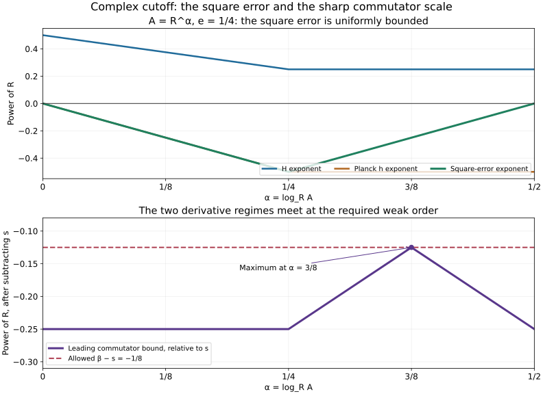

# Adaptive square roots and complex-cutoff energy

A complex cutoff carries a phase. The favorable imaginary part of the differential operator absorbs that phase, but pointwise absorption alone does not prove an operator inequality. We construct a square root on each frequency band, control its full operator square and both commutators, and then sum the bands. The resulting estimate uses exactly the measured forcing and incoming data of the real-cutoff theorem.

The mathematical antecedent is Hörmander IV, Proposition 26.6.1′, printed page 120 of the 2009 edition. The [real-cutoff proof](../20261011-shrinking-cutoff-energy/shrinking-cutoffs-and-left-regularized-energy.html) and [local phase analysis](../20261011-complex-cutoff-absorption/local-sign-geometry-and-complex-cutoff-phase.html) remain useful. The joint operator inequality CA13 is proved here with the full operator form. Our metric extension and the proof organization below are independent exposition. Original text, exercises and figure are CC0-1.0; earlier components retain their recorded terms. Human foundations remain external, so this export does not claim internal P514 closure.

## 1. The statement and the operator form to estimate

**H0. The full complex-cutoff statement.** Use the notation and hypotheses of SCE:H0, except that the time-independent symbol \(c\in S^s_{1-e,e}\) may be complex. Thus \(P=A+iB\) is properly supported, \(A,B\) are self-adjoint, its principal symbol is \(\tau+if\), and \(f\le0\) on the support of the actual cutoff \(C_1\). Keep the same compact time cutoffs, plateau condition and measured operators. Put

\[
 0\le e\le\tfrac14,\qquad \kappa=1-2e,
 \qquad \beta=s-\tfrac12+\tfrac32e.
 \tag{CE1}
\]

The conclusion to prove is

\[
 u\in H^\beta_{\mathrm{comp}},\quad
 \chi CPu\in L^2,\quad \chi_-Cu\in L^2
 \quad\Longrightarrow\quad \chi Cu\in L^2,
 \qquad C=\operatorname{Op}(c).
 \tag{CE2}
\]

No derivative of the measured forcing is assumed. The base localizations, fixed-compact smoothing estimates, symbol extensions and low-frequency conventions are those proved in SCE:H0. All constants below may depend on these fixed localizations. The inner product is linear in its first argument.

For \(Q=R_\nu M_{e^{-\Lambda t}\chi}C\), define

\[
 J_B(Q,u)=\operatorname{Re}(QBu,Qu).
 \tag{CE3}
\]

On smooth vectors this is exactly
\((BQu,Qu)+\operatorname{Re}([Q,B]u,Qu)\). We shall prove
\(J_B(Q,u)\le K\|Qu\|^2+C_\Lambda\|u\|_\beta^2\), with \(K\) independent of \(\Lambda\) and \(\nu\). This estimates the whole imaginary-part form before splitting it into its phase and remainder. CCA:R0 then identifies the same estimate with CA13, up to an already controlled \(H^\beta\) form.

**C0. The exact calculus used below.** WY:W10 is the full two-metric Weyl product theorem, including every differentiated finite remainder. MP:B7 gives the uniform Hilbert-space operator bound for order-zero symbols in a slowly varying symplectically temperate metric satisfying the uncertainty inequality. SCE:C0 gives the ordinary/exotic mixed expansion and all-real Sobolev bounds. These are complete earlier proofs, not just principal-symbol rules.

For a pair of scalar symbols, the zeroth terms in the two ordered products cancel in their commutator. A one-term remainder therefore estimates the full commutator; a two-term remainder estimates the error after its Poisson bracket. For a scalar symbol multiplied by itself, the first Poisson correction vanishes. We shall use exactly these finite-remainder consequences, always with their actual two-metric parameter.

## 2. A global metric for a local square root

**G0. Freeze one frequency band.** Fix \(R\ge16\), and write

\[
 E=R^e,\quad B_*=\sqrt R,\quad
 D=R/E^2=R^{1-2e},\qquad
 Z=(x,\xi/R),\quad |dZ|^2=|dx|^2+R^{-2}|d\xi|^2.
 \tag{CE4}
\]

Here \(B_*\) is a positive number, not the operator \(B\). Let \(q\) have frequency support in a fixed annulus comparable to \(R\), have base support in the fixed localization, and satisfy
\(|\partial_Z^\alpha q|\le C_\alpha R^sE^{|\alpha|}\). Its support is contained in the plateau \(C_1=1\). The constants describing \(q\) may depend on \(\Lambda\); the constants describing \(f,C_1\) do not.

Choose a real smooth band cutoff equal to one on a larger annulus and put \(g_R=-f\) times that cutoff. Enlarge the annuli by fixed factors as needed. The ordinary bounds on \(f\) imply, globally in \(Z\),
\(|\partial_Z^\alpha g_R|\le C_\alpha R\). Choose an open set \(\Omega\) containing all points needed for the square-root cutoff, with \(\operatorname{Re}C_1>1/2\) and frequencies in the larger annulus. Then \(g_R\ge0\) there. Every point of \(\Omega\) has a sign ball of radius \(r/E\), for a fixed \(r>0\): use the first derivative bound on \(C_1\), as in CCA:G0, and the still larger frequency cutoff. Shrinking \(\Omega\)'s allowed cutoff supports by fixed margins achieves this uniformly.

On \(\Omega\) set \(a=(1+g_R)^{1/2}\). There is a fixed \(M\ge1\) with \(1\le a\le M B_*\). CCA:G1, applied with Hessian bound \(CR\) and radius \(r/E\), gives

\[
 |d_Zg_R|\le C(aB_*+a^2E).
 \tag{CE5}
\]

The global Hessian bound and Taylor's formula consequently imply, for any \(X,Y\in\Omega\),

\[
 a(Y)\le C\{a(X)+(B_*+Ea(X))|Z_Y-Z_X|\}.
 \tag{CE6}
\]

Indeed expand \(g_R(Y)\) at \(X\), bound its linear term by (CE5) and its quadratic remainder by \(CR|Z_Y-Z_X|^2\), add one, and compare with the square of the right side. The segment need not remain in the sign set: the Hessian bound is global. This observation is essential for extending the metric across holes in that set.

**G1. An infimum of cones extends the weight.** If the band contains no cutoff points, there is nothing to estimate. Otherwise define on the entire phase space

\[
 A_R(Y)=\min\left(MB_*,\
 \inf_{X\in\Omega}\bigl[a(X)+(B_*+Ea(X))|Z_Y-Z_X|\bigr]\right).
 \tag{CE7}
\]

This is a positive finite function. It satisfies \(1\le A_R\le MB_*\), and (CE6), together with the choice \(X=Y\), gives \(C^{-1}a\le A_R\le a\) on \(\Omega\). No minimizing point is assumed to exist.

For any two points of the full phase space, put \(d=|Z_Y-Z_X|\). The triangle inequality and an arbitrarily close infimum candidate give

\[
 |A_R(Y)-A_R(X)|
 \le \bigl(B_*+E\min(A_R(X),A_R(Y))\bigr)d.
 \tag{CE8}
\]

To verify this, start at the point with smaller value. If its value equals the cap, both values equal the cap. Otherwise choose a cone within \(\epsilon\) of that value. Its vertex value is no larger than its value at the starting point. Its slope is therefore at most \(B_*+E(A_R+\epsilon)\). Use that cone at the other point and let \(\epsilon\downarrow0\). In particular \(A_R\) is continuous. The weight and the metric need not be differentiable; the earlier metric calculus does not require that.

**G2. Slow variation, uncertainty and temperateness.** Write

\[
 H=\max(E,B_*/A_R),\qquad
 G=H^2|dZ|^2,\qquad
 G^\sigma=R^2H^{-2}|dZ|^2,\qquad h=H^2/R.
 \tag{CE9}
\]

The symplectic dual follows by the diagonal coordinate calculation in WY:W1–W3. Since \(E\le H\le B_*\), we have \(h\le1\). If \(H(X)d\le1/8\), (CE8) gives
\(3A_R(X)/4\le A_R(Y)\le5A_R(X)/4\). Taking maxima in the definition of \(H\) gives uniform comparison of the two metrics. Thus \(G\) is slowly varying.

Here are explicit global bounds. Put \(L=RH(X)^{-1}d=G_X^\sigma(Y-X)^{1/2}\). Equation (CE8) gives
\(A_R(Y)/A_R(X)\le1+2H(X)d\le1+2L\).
For the reverse ratio, it suffices to consider \(A_R(Y)<A_R(X)/2\). If \(A_R(X)\le B_*/E\), then \(H(X)=B_*/A_R(X)\), (CE8) forces \(d\ge A_R(X)/(4B_*)\), and hence \(L\ge A_R(X)^2/4\). As \(A_R(Y)\ge1\), the reverse ratio is at most \(2\sqrt L\). If \(A_R(X)>B_*/E\), (CE8) instead forces \(d\ge1/(4E)\). Consequently
\(L\ge R/(4E^2)\ge\sqrt R/4\), where the last inequality uses \(e\le1/4\). The reverse ratio is then at most \(M\sqrt R\le4ML\). Together these cases prove

\[
 \max\left(\frac{A_R(Y)}{A_R(X)},\frac{A_R(X)}{A_R(Y)},
 \frac{H(Y)}{H(X)},\frac{H(X)}{H(Y)}\right)
 \le C(1+L).
 \tag{CE10}
\]

The two estimates for \(H\) follow directly from its maximum formula and the estimates for \(A_R\). Squaring proves symplectic temperateness of \(G\), with distance based at \(X\); exchanging the points gives the other convention. Every fixed real power product of \(A_R,H,h\) is a locally continuous temperate weight. All structural constants are independent of \(R\).

Also set \(G_0=E^2|dZ|^2\). This is a constant metric. The pair \(G_0,G\) meets every cross condition in WY:W10: the condition for the constant metric is immediate, and the condition for \(G\) follows from (CE10) because \(G_0^\sigma\ge G^\sigma\). The mean metric is uniformly comparable with \(G\). The cross parameter is

\[
 t_R=EH/R\le h\le1.
 \tag{CE11}
\]

The weight \(R^s\) is constant, and \(A_R\) is temperate for the mean. Thus both the one-metric and the two-metric full remainder theorems apply with uniform structural constants.

## 3. The square and both commutators

**S0. A square root with a uniformly bounded square error.** Choose a real cutoff \(\zeta\), equal to one near \(\operatorname{supp}q\), supported in \(\Omega\), with \(|\partial_Z^\alpha\zeta|\le C_\alpha E^{|\alpha|}\). It is a fixed smooth function of \(\operatorname{Re}C_1\) times the larger band cutoff; the exact bump construction is U001:U001-A4. Put \(b=\zeta a\), extended by zero, and \(\mathcal A=b^w\).

On \(\Omega\), (CE5) gives \(|d_Zg_R|\le Ca^2H\). Every derivative of order \(k\ge2\) is at most \(C_kR\le C_ka^2H^k\), because \(H\ge1\) and \(a^2H^2\ge cR\). Repeated differentiation of \(a^2=1+g_R\), or the ordinary chain rule with its finite product expansion, therefore gives \(|\partial_Z^\alpha a|\le C_\alpha aH^{|\alpha|}\). The cutoff has smaller derivative scale. Consequently \(b\in S(A_R,G)\), with uniform seminorms.

Since \(b\) is real and scalar, \(\{b,b\}=0\). The full two-term Weyl expansion gives

\[
 \mathcal A^2=(b^2)^w+\mathcal R,
 \qquad \mathcal R\in\operatorname{Op}^w S(A_R^2h^2,G),
 \qquad A_R^2h^2
 =\max(A_R^2E^4/R^2,A_R^{-2})\le\max(M^2,1).
 \tag{CE12}
\]

The last bound uses \(e\le1/4\). MP:B7 proves \(\|\mathcal R\|_{L^2\to L^2}\le C\), uniformly in \(R\). This is a full operator square identity. The constant depends on the fixed sign cutoff and the ordinary symbol, not on \(q\). For each fixed band \(\mathcal A\) is a bounded self-adjoint operator; its norm may grow like \(\sqrt R\).

**S1. The first commutator has exactly the permitted order.** Write \(Q=q^w\). Then

\[
 [Q,\mathcal A]\in\operatorname{Op}^w S(R^\beta,G),
 \qquad \|[Q,\mathcal A]v\|_2\le C_qR^\beta\|v\|_2.
 \tag{CE13}
\]

We check both the leading bracket and the full error. On the support of every derivative of \(q\), \(\zeta=1\), so cutoff derivatives in the bracket vanish. If \(a^2\le D\), the bounds above and one \(G_0\)-derivative on \(q\) give, with all further \(G\)-derivatives,
\(R^s aEH/R\le C R^{s-1/2+e}\le C R^\beta\). Uniform comparability between \(a\) and \(A_R\) permits fixed constant changes in the threshold.

For \(a^2\ge D\), \(H\) is comparable with \(E\). Every positive-order \(E\)-normalized derivative of \(a\) has the stronger bound
\(C_ka\min(1,R^{1-e}/a^2)\). When the ratio is at least one this is the preceding root bound. Otherwise differentiate the square root: every positive-order derivative of \(g_R\) in these units is at most \(C_kR^{1-e}\); each finite product in the chain rule has at least one such ratio, and higher powers are smaller. Thus the bracket and all its \(G\)-derivatives are at most

\[
 C R^{s-1+2e}\min(a,R^{1-e}/a)
 \le C R^{s-1/2+3e/2}=C R^\beta.
 \tag{CE14}
\]

The inequality holds for every positive \(a\), with maximum at \(a=R^{(1-e)/2}\). This treats the transition region too.

For the full remainder, use the two distinct metrics, not two copies of \(G\). WY:W10 through degree one gives an error in \(S(R^sA_Rt_R^2,G)\), and

\[
 A_Rt_R^2
 =\max(A_RE^4/R^2,E^2/(A_RR))
 \le M R^{-3/2+4e}+R^{-1+2e}
 \le C R^{-1/2+3e/2}.
 \tag{CE15}
\]

Both exponent comparisons hold on the entire interval \(0\le e\le1/4\). This proves (CE13) for the complete commutator, with all symbol derivatives. In particular the argument does not infer an operator bound from (CE14) alone.

**S2. The second commutator and bounded errors.** Apply the one-metric first-remainder theorem to the symbol of \([Q,\mathcal A]\) and to \(b\). Their scalar zeroth terms cancel. Since

\[
 A_Rh=\max(A_RE^2/R,A_R^{-1})\le M+1,
 \tag{CE16}
\]

we obtain \([[Q,\mathcal A],\mathcal A]\in\operatorname{Op}^wS(R^\beta,G)\), with the same kind of \(L^2\) bound. Further, if \(\mathcal E=d^w\), \(d\in S(1,G)\) has fixed uniform seminorms, the two-metric first-remainder theorem gives
\([Q,\mathcal E]\in\operatorname{Op}^wS(R^st_R,G)\). As \(H\le\sqrt R\), this is contained in \(\operatorname{Op}^wS(R^{s-1/2+e},G)\), hence in \(\operatorname{Op}^wS(R^\beta,G)\). The constants in \(\|\mathcal E\|\) are independent of \(q\); those in its commutator may depend on \(q\)'s seminorms.

**E0. Complete the square on a frequency band.** Let \(B_R\) be the self-adjoint band extension of the imaginary part, with real Weyl symbol \(-g_R+b_{0,R}\), where \(b_{0,R}\) has uniform ordinary order-zero bounds in the band. Its extension can be chosen with \(|\partial_Z^\alpha b_{0,R}|\le C_\alpha\). Equations (CE12) and \(b^2=\zeta^2(1+g_R)\) give the exact decomposition

\[
 B_R=I-\mathcal A^2+\mathcal E+\mathcal L,
 \quad \mathcal E=\mathcal R+b_{0,R}^w,
 \quad \mathcal L=\bigl[-(1-\zeta^2)(1+g_R)\bigr]^w.
 \tag{CE17}
\]

Here \(\mathcal E\in\operatorname{Op}^wS(1,G)\) is uniformly bounded. The symbol of \(\mathcal L\) vanishes near \(\operatorname{supp}q\). Use the constant metric \(G_0\) for this last localization: \(\mathcal L\)'s symbol has weight \(R\), and its product with \(q\) has every finite expansion coefficient zero. Its \(N\)-term remainder has \(L^2\) norm at most \(C_{q,N}R^{s+1-N\kappa}\). Choose \(N\) with \(s+1-N\kappa\le\beta\). No uniform Euclidean support gap is assumed.

The exact algebraic identity

\[
 Q\mathcal A^2=\mathcal A^2Q+
 2\mathcal A[Q,\mathcal A]+[[Q,\mathcal A],\mathcal A]
 \tag{CE18}
\]

now completes the argument. Put \(d=[Q,\mathcal A]v\). The first two terms in the real form are
\(\|\mathcal A Qv\|^2+2\operatorname{Re}(d,\mathcal A Qv)\ge-\|d\|^2\).
The double commutator contributes at most \(C_qR^\beta\|v\|\|Qv\|\). In \(Q\mathcal E\), move \(\mathcal E\) to the left of \(Q\) and apply S2. Bound \(Q\mathcal L\) as just proved. Young's inequality with a fixed coefficient for each mixed term yields

\[
 \operatorname{Re}(QB_Rv,Qv)
 \le K_0\|Qv\|^2+C_qR^{2\beta}\|v\|^2.
 \tag{CE19}
\]

The constant \(K_0\) depends only on the fixed symbol, sign cutoff, band conventions and \(e,s\). It is independent of \(R\) and of \(q\)'s seminorms. Those seminorms enter only \(C_q\). This remains true for arbitrary bounded families of complex \(q\); no reality or constant phase was used.

## 4. Sum the bands without changing the measured data

**L0. The frequency partition and its full localization error.** Choose real ordinary Fourier cutoffs \(\psi_j\), \(j\ge0\), with \(\sum_j\psi_j^2=1\), bounded overlap, \(\psi_0\) in a fixed ball, and \(\psi_j\) supported where \(|\xi|\asymp2^j\). Start with smooth annular bumps covering frequency space and divide each by the positive square root of the sum of their squares. The exact bump and chain-rule providers prove the derivative bounds \(|\partial_\xi^\alpha\psi_j|\le C_\alpha2^{-j|\alpha|}\). Plancherel gives, for every real \(r\),
\(\sum_j2^{2jr}\|\psi_j(D)u\|^2\asymp\|u\|_r^2\), with the low-frequency convention \(2^0=1\).

If \(T\in\Psi^m_{1-e,e}\), its quadratic form has the exact partition identity, first on smooth vectors,

\[
 \sum_j( T\psi_j(D)u,\psi_j(D)u)-(Tu,u)
 =\tfrac12\sum_j([\psi_j(D),[T,\psi_j(D)]]u,u),
 \quad \sum_j[\psi_j(D),[T,\psi_j(D)]]\in\Psi^{m-2+2e}_{1-e,e}.
 \tag{CE20}
\]

The algebra follows by expanding the double commutator and using \(\sum\psi_j^2=I\). Here is the full symbol justification of the sum. A commutator with an ordinary frequency cutoff differentiates that cutoff at least once; its mixed expansion loses \(1-e\). The second commutator loses another \(1-e\). Each retained differential coefficient is supported in the band of a derivative of \(\psi_j\), so their sum has bounded overlap and the stated order, with every differentiated bound. Take the mixed expansions through arbitrarily many further terms. On a frequency band neighboring \(2^j\), the remainder has the corresponding arbitrary power loss, by SCE:C0. Away from that band the separated-frequency kernel has arbitrary power decay in the larger frequency: in left quantization its Fourier kernel is \(\widehat t(\eta-\xi,\xi)\); integration by parts in the localized base variable gives
\(|\widehat t(\eta-\xi,\xi)|\le C_N\langle\xi\rangle^{m+Ne}(1+|\eta-\xi|)^{-N}\).
When one frequency is in the band and the other is outside its fixed enlargement, \(|\eta-\xi|\) is comparable to their maximum. Choosing \(N\) larger than the desired power and both integration dimensions makes the corresponding weighted row and column integrals summable. The elementary Schur bound follows by Cauchy–Schwarz in the kernel integral and Fubini, and gives the same statement for every Sobolev conjugation. The fixed proper-support/base reductions and their arbitrary smoothing bounds are SCE:H0. Thus the remainders sum with every symbol derivative and every prescribed smoothing bound. This proves the asserted full operator order, not just a sum of formal coefficients. Density and the Sobolev estimates extend the form identity whenever its two sides are used below.

Apply (CE20) to
\(T=\tfrac12(\widetilde Q^*\widetilde Q B+B\widetilde Q^*\widetilde Q)\), of order \(2s+1\). Its error has order \(2s-1+2e\le2\beta\). Applied to \(\widetilde Q^*\widetilde Q\), its error has order \(2s-2+2e\le2\beta\). Consequently

\[
 J_B(\widetilde Q,u)
 =\sum_j J_B(\widetilde Q,\psi_j(D)u)+O(\|u\|_\beta^2),
 \qquad
 \sum_j\|\widetilde Q\psi_j(D)u\|^2
 =\|\widetilde Qu\|^2+O(\|u\|_\beta^2).
 \tag{CE21}
\]

The constants in these lower-order terms may depend on \(\widetilde Q\). They do not alter a leading constant multiplying \(\|\widetilde Qu\|^2\).

**L1. From a supported symbol to the global estimate.** Suppose first that \(\widetilde Q=\widetilde q^w\), with \(\widetilde q\in S^s_{1-e,e}\) supported in the plateau of \(C_1\). Put \(u_j=\psi_j(D)u\) and \(R=2^j\). Insert a slightly larger ordinary frequency cutoff equal to one on the support of \(\psi_j\). The full product and quantization expansions through degree \(N\) produce a Weyl symbol \(q_j\), supported in an enlarged annulus and in the same sign plateau. It satisfies G0's bounds uniformly. On \(u_j\), replacing \(\widetilde Q\) by \(q_j^w\) has an error with norm at most \(C_N R^{s-N\kappa}\|u_j\|\). The same estimate with one extra power \(R\) holds when the input is \(Bu_j\), after replacing \(B\) by its self-adjoint ordinary band extension \(B_R\). Separated-frequency errors have arbitrary negative powers, by the explicit kernel estimate in L0. Every finite coefficient remains supported in the original plateau because differentiating a supported smooth symbol does not enlarge its support.

For completeness these norm comparisons are also valid for negative \(s\): conjugate with the Fourier power on the input band, apply the order-zero bound, and estimate separated frequencies as in L0. The principal operators on that band have norms at most \(C R^s\) and \(CR\), respectively. Hence the error in the joint quadratic form is at most \(C_N R^{2s+1-N\kappa}\|u_j\|^2\); that in the norm square is at most \(C_N R^{2s-N\kappa}\|u_j\|^2\). Choose a single \(N\) with \(N\kappa\ge2-3e\), and, if necessary, enlarge it to absorb all separated-frequency errors. Both are bounded by \(C R^{2\beta}\|u_j\|^2\). The low band is handled directly by the localized smoothing bounds.

Use (CE19), sum with Plancherel, and use (CE21). We obtain

\[
 J_B(\widetilde Q,u)
 \le K_0\|\widetilde Qu\|^2+C_{\widetilde Q}\|u\|_\beta^2.
 \tag{CE22}
\]

The sign cutoff for every band is constructed by the same fixed scalar functions of \(C_1\), so \(K_0\) is uniform. The full finite-remainder errors only change the lower-order constant.

**L2. Restore the actual left-regularized operator.** The full Weyl symbol of \(Q_\nu=R_\nu M_{e^{-\Lambda t}\chi}C\) has a finite expansion whose coefficients are supported where \(\chi c\) is supported. This follows from the complete products and quantization conversions in SCE:C0 and SCE:R0. Truncate sufficiently far to write
\(Q_\nu=\widetilde Q_\nu+E_\nu\), where \(\widetilde Q_\nu\) has exactly the supported symbol required in L1 and \(E_\nu\in\Psi^m_{1-e,e}\), uniformly for fixed \(\Lambda\), with

\[
 m+1\le\beta,\qquad m+s+e\le2\beta.
 \tag{CE23}
\]

Arbitrarily negative \(m\) is available because \(\kappa>0\). This truncation is only in the proof; the measured forcing operator is not replaced.

Expand \(J_B(\widetilde Q+E,u)-J_B(\widetilde Q,u)\). The terms containing \(EBu\), \(BEu\) and \(Eu\) are bounded using \(m+1\le\beta\). For the other cross term use \(\widetilde QBu=B\widetilde Qu+[\widetilde Q,B]u\). The commutator has order \(s+e\), so its pairing with \(Eu\) is bounded by \(C\|u\|_\beta^2\) by the second inequality in (CE23). Thus the difference is bounded by
\(C\|u\|_\beta\|\widetilde Qu\|+C\|u\|_\beta^2\).
Young's inequality and \(\|Eu\|\le C\|u\|_\beta\) replace \(\widetilde Q\) by the actual \(Q\) in the leading norm. The resulting leading constant depends only on \(K_0\) and fixed numerical Young constants. We have proved

\[
 J_B(Q_\nu,u)\le K\|Q_\nu u\|^2+C_\Lambda\|u\|_\beta^2,
 \qquad 0<\nu\le1,
 \quad K\text{ independent of }\Lambda,\nu.
 \tag{CE24}
\]

All estimates are first on smooth vectors. For each fixed \(\nu>0\), the exact improved orders in SCE:E0 make every actual term continuous on the stated \(H^\beta\) domain. Approximation there gives (CE24) for the distributions in H0. Constants remain uniform as \(\nu\downarrow0\).

## 5. Finish the measured-data energy argument

**P0. Absorption and the weak limit.** The exact energy identity SCE:E0 now reads
\(\operatorname{Im}(Q_\nu Pu,Q_\nu u)=J_B(Q_\nu,u)+\operatorname{Im}([Q_\nu,A]u,Q_\nu u)\).
The proof of SCE:A0, including the two-order outgoing-square error SCE:O0, never used the reality of \(c\). Insert (CE24) there and choose \(\Lambda=\max(K,0)+3\). The same fixed Young inequalities give

\[
 \|Q_\nu u\|^2\le C\bigl(
 \|e^{-\Lambda t}\chi CPu\|^2+
 \|e^{-\Lambda t}\chi_-Cu\|^2+\|u\|_\beta^2\bigr).
 \tag{CE25}
\]

The left ordering of \(R_\nu\) makes the first two bounds exact contractions of the given data, as proved in SCE:R0. SCE:U0 proves convergence of \(R_\nu\) on the relevant Sobolev distribution and extraction of a weak \(L^2\) subsequence. Their limits agree, so \(e^{-\Lambda t}\chi Cu\in L^2\). Multiplication by the bounded inverse weight on the compact time support proves (CE2). This completes the unrestricted complex-cutoff version, including \(e=1/4\), with exactly the original weak input and measured data.

For the invariant geometric direction, read [intrinsic directed propagation](../20261011-intrinsic-directed-propagation/intrinsic-orientation-and-entering-regularity.html). For exact solutions with a prescribed finite concave index, read [the positive-packet construction](../20261011-prescribed-concave-regularity/positive-packets-and-prescribed-concave-regularity.html). The linked human foundations are external readings.

## 6. Three solved checks and the actual scales

**X1. Check the square error at both extremes.** Compute \(A_R^2h^2\) at \(A_R=1\) and at \(A_R=\sqrt R\), and identify the endpoint restriction.

**Solution.** At one, \(H=\sqrt R\), \(h=1\), and the product equals one. At \(\sqrt R\), \(H=E\), so the product is \(R^{-1+4e}\). It is uniformly bounded precisely for this extreme when \(e\le1/4\). Thus the proof does not require the Planck function to tend to zero at every point. It uses a bounded full square remainder at the points where \(h=1\).

**X2. Why two different metrics are needed.** Compare the second remainder with two adaptive factors and with one ordinary exotic factor at \(A_R=1\).

**Solution.** There \(h=1\). A one-metric second remainder would only give weight \(R^sA_Rh^2=R^s\), which is too large. The actual first factor has the smaller derivative metric \(G_0\), so \(t_R=R^{-1/2+e}\), and the two-metric remainder is \(R^{s-1+2e}\). Its difference below \(R^\beta\) is the positive exponent \((1-e)/2\). This is a full-remainder gain, not a cancellation of a single displayed term.

**X3. Check the weight-independent leading constant.** Identify every place where \(\Lambda\)-dependent derivatives occur and explain why none fixes the leading \(K\).

**Solution.** They enter the symbol seminorms of \(q\), the commutator bounds, finite truncation errors and the dyadic lower-order errors. Each of these multiplies a weak input norm, or a product of that norm with \(\|Qu\|\), which is split by a fixed Young coefficient. The square-root operator, its bounded square error and the order-zero imaginary part depend only on \(f,C_1\) and fixed band cutoffs. Their uniform \(L^2\) bounds determine \(K_0\). The later replacement of \(\widetilde Q\) by \(Q\) changes the leading coefficient by fixed multiples and fixed Young coefficients. Thus \(K\) can be chosen before \(\Lambda\); only then is \(\Lambda=\max(K,0)+3\) selected. No circular choice is present.

**V0. What the figure records.** Take \(e=1/4\) and write \(A_R=R^\alpha\), \(0\le\alpha\le1/2\). The upper panel shows the exact exponents of \(H\), \(h\) and \(A_R^2h^2\) from (CE9) and (CE12). The square-error exponent never exceeds zero. The lower panel shows the leading commutator exponent relative to \(s\): the small-root bound is \(-1/2+e\), followed by \(\alpha-1+2e\), then \(e-\alpha\). Its maximum is \(\beta-s\), attained at \(\alpha=(1-e)/2\). These are bounds on symbol seminorms; they are not claims that an operator norm attains equality.

[Figure source](figures/build_figure.py), [finite checks](model-check.json), proof map, source credit, [proof review](proof-review.json) and [reader checks](reader-check.json) accompany this lesson.
