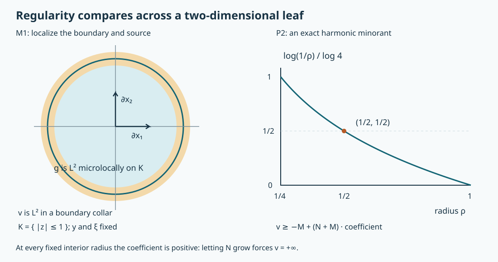

# Complex involutive normal forms and regularity propagation

An elliptic equation in two directions has more freedom than transport along a real curve. Its homogeneous solutions are holomorphic along two-dimensional characteristic leaves. The appropriate restriction on their regularity is therefore a harmonic comparison principle. This lesson constructs the complete scalar operator normal form, proves that comparison principle and deduces propagation of the smooth wavefront set.

The mathematical antecedent is Lars Hörmander, *The Analysis of Linear Partial Differential Operators IV*, the 2009 edition, Section 26.2, Theorem 26.2.1 and Corollary 26.2.2, printed pages 74–76. This independently written lesson uses the earlier programme proofs identified in its proof map. In particular, FN:I0–I10 supplies the exact homogeneous geometric normal form, GE:D7–D11 supplies Sobolev continuity and inverse canonical graph operators, and WCR:C0–C1 supplies weak holomorphic regularity and the planar fundamental kernel. Ordinary symbol composition, summation and elliptic inversion are P2:OP3–OP6 and K:K1–K3. These are proof dependencies, with their precise versions recorded; the book citation does not replace any proof below.

The current export still has external human foundation providers. Its dependency map records them explicitly. Original expression, the three solutions and the reproducible figure are CC0-1.0.  [Weighted Cauchy–Riemann estimates](../20261011-weighted-cauchy-riemann/weighted-cauchy-riemann-estimates-and-holomorphic-peaks.html) provide the analytic input. [Prescribed superharmonic regularity](../20261011-prescribed-superharmonic-regularity/prescribed-superharmonic-regularity.html) constructs solutions with a specified index on the complex leaf.

## 1. The geometric and regularity statements

**H0. Exact scalar hypotheses.** Let \(P\in\Psi^m_{1,0}(X)\) act on scalar half densities, with smooth degree-\(m\) principal symbol \(p\) and remainder of order \(m-1\). In a conic neighborhood of the characteristic point under discussion, suppose
\[
 N=\{p=0\},\qquad d\operatorname{Re}p,d\operatorname{Im}p\text{ independent},
 \qquad\{\operatorname{Re}p,\operatorname{Im}p\}|_N=0,
 \qquad H_{\operatorname{Re}p},H_{\operatorname{Im}p},R\text{ independent on }N.
 \tag{CI1}
\]
Here \(R\) is cotangent dilation. All conclusions are local in this open nonradial involutive region; no assertion is made at its radial or symplectic boundary. The coisotropic geometry proved in FN:I0 gives two-dimensional characteristic leaves, tangent to the span of the two Hamilton fields. FN:I10 gives a nonvanishing multiplier \(a\) of degree \(1-m\) and a homogeneous canonical map \(\chi\), from model coordinates to original coordinates, such that
\[
 (ap)\circ\chi=\xi_1+i\xi_2,\quad
 \chi^{-1}N=\{\xi_1=\xi_2=0\},\quad
 (x,\xi)=(0,e_n)\text{ at the mark},\quad n\ge3.
 \tag{CI2}
\]
Write \(z=x_1+ix_2\), \(y=(x_3,\ldots,x_n)\), and
\[
 D_j=-i\partial_{x_j},\qquad
 \bar\partial=\tfrac12(\partial_{x_1}+i\partial_{x_2}),\qquad
 L=D_1+iD_2=-2i\bar\partial.
 \tag{CI3}
\]
On a model leaf, \(y,\xi\) are fixed and \(z\) varies. The complex structure is specified intrinsically by \(H_p h=0\): in (CI2) this is the usual holomorphic equation. Indeed \(H_{ap}=aH_p\) on \(N\), and a canonical change carries Hamilton fields to the corresponding Hamilton fields. Thus the two null equations agree after a nonzero complex factor. Transition functions between leaf coordinates obey the Cauchy–Riemann equation and have nonzero real Jacobian. WCR:C0 makes them holomorphic, with nonzero complex derivative. Their inverses are holomorphic by the chain rule.

**H1. What will be proved.** For a distribution \(u\), set
\[
 s_u^*(q)=\sup\{t\in\mathbb R:u\text{ is microlocally }H^t\text{ at }q\}.
 \tag{CI4}
\]
Microlocally \(H^t\) means that a properly supported order-zero operator elliptic at the point sends \(u\) to \(H^t\) locally. The elliptic parametrix and Sobolev mapping theorems make this equivalent to using any sufficiently small cutoff supported in the regular region. The sets \(\{s_u^*>t\}\) are open: at each such point one can select an actually attained exponent greater than \(t\) and keep the same elliptic cutoff on a neighborhood. Compactly supported distributions have polynomially bounded Fourier transforms, by their finite test-function order; integrating a sufficiently negative power of \(\langle\xi\rangle\) proves local Sobolev lower bounds. Thus \(s_u^*\) is lower semicontinuous, locally bounded below and homogeneous of degree zero. A supremum need not itself be an attained Sobolev exponent.

We use the comparison definition of a superharmonic function: it is a lower semicontinuous function with values in \((-\infty,+\infty]\), locally bounded below, which lies above every harmonic function continuous on a closed disk whenever it does so on that disk's boundary. The identically infinite function is allowed. Section 4 proves the needed comparison facts, including equivalence with the circle mean inequality.

If \(Pu=f\), \(\Gamma\) is an open part of a leaf and \(s\) is superharmonic there with \(s_f^*\ge s\), then
\[
 \min\{s_u^*,s+m-1\}\text{ is superharmonic on }\Gamma.
 \tag{CI5}
\]
Moreover \((N\cap\operatorname{WF}(u))\setminus\operatorname{WF}(f)\) is saturated by the leaves of \(N\setminus\operatorname{WF}(f)\). This refers to connected leaf pieces avoiding the source wavefront set.

## 2. Remove the full lower-order operator

**N0. An actual planar solver with all symbol estimates.** WCR:C1 proves \(\bar\partial(1/(\pi z))=\delta_0\). Consequently
\[
 E(z)=\frac{i}{2\pi z},\qquad LE=\delta_0,\qquad
 Tg(z,y,\xi)=\int_{\mathbb C}E(z-w)g(w,y,\xi)\,dA(w).
 \tag{CI6}
\]
Suppose \(g\in S^d_{1,0}\) is supported in a fixed compact set of the base variables. This locally integrable convolution is well defined; \(LTg=g\). Differentiation in \(z\) can be transferred to the smooth compactly supported factor \(g\), by distributional integration by parts. Derivatives in \(y,\xi\) pass under the integral. For a fixed disk containing the \(w\)-support, the integral of \(|z-w|^{-1}\) over that disk is bounded uniformly in \(z\): near the disk it is bounded by the integral over a fixed larger disk, and far away it is bounded by its area divided by the distance. Therefore
\[
 |\partial_z^\alpha\partial_y^\beta\partial_\xi^\gamma Tg|
 \le C_{\alpha\beta\gamma}\langle\xi\rangle^{d-|\gamma|}.
 \tag{CI7}
\]
Here \(\partial_z^\alpha\) denotes real derivatives in the two planar coordinates. Each constant is controlled by finitely many symbol seminorms of \(g\). The result has the same compact \(y\)-support and decays as \(|z|^{-1}\) at infinity, with the analogous estimates for its differentiated source. This one operator works at every order and for every parameter; its domain never shrinks with the recursion.

**N1. The leading scalar gauge.** Choose an elliptic \(Q\in\Psi^{1-m}\) with principal symbol \(a\). GE:D9–D11 quantizes \(\chi\) by an elliptic order-zero graph operator \(A_1\) with inverse \(B_1\). Ordered Egorov gives
\[
 B_1QPA_1=L+\operatorname{Op}(q)\pmod{\Psi^{-\infty}},\qquad q\in S^0.
 \tag{CI8}
\]
Choose nested base and angular neighborhoods once. Extend a full symbol \(q\), with compact base support and an angular cutoff, so that it agrees on the inner neighborhood. Low frequencies are extended smoothly. This is the ordinary fixed-neighborhood extension used in GE:D12; proper kernel cutoffs change the operators there only by smooth kernels. Work first in full left quantization on the extended space.

Put \(v=T(-q)\) and \(a_0=e^v\). By (CI7), both \(a_0\) and \(a_0^{-1}\) are in \(S^0\), with uniform positive lower bound for \(|a_0|\). To check every symbol derivative, repeated chain and product rules express it as \(e^v\) times a finite product of derivatives of \(v\); each frequency derivative contributes its own inverse power. Also \(\operatorname{Re}v\) is bounded. Scalar commutativity gives
\[
 La_0+qa_0=0,\qquad
 \mathcal L(b):=Lb+q\#b,\qquad
 \mathcal L(a_0)=q\#a_0-qa_0\in S^{-1}.
 \tag{CI9}
\]
The exact differential commutator is \([L,\operatorname{Op}(b)]=\operatorname{Op}(Lb)\). The ordinary product theorem proves the last order gain, with every differentiated remainder estimate. This construction is scalar; a matrix exponential would not justify the same step.

**N2. Every correction on the same neighborhood.** Suppose \(b_{j-1}=a_0+\cdots+a_{j-1}\) has full residual \(r_{j-1}=\mathcal L(b_{j-1})\in S^{-j}\). The residual is compactly supported in the fixed base support of \(q\). Initially this follows from (CI9): the full left symbol of a product with left factor \(q\) vanishes outside that factor's output support. The same observation applies at each later step. Set
\[
 a_j=a_0T(-a_0^{-1}r_{j-1})\in S^{-j},\qquad
 (L+q)a_j=-r_{j-1},\qquad
 \mathcal L(b_{j-1}+a_j)=q\#a_j-qa_j\in S^{-j-1}.
 \tag{CI10}
\]
The input to \(T\) is compactly supported, so (CI7) proves all parameter and frequency estimates. Product differentiation proves the middle identity, including its sign. The last residual again has the same compact output support. No homogeneous expansion of \(q\) is required.

The ordinary symbol summation theorem K:K1 gives \(b\sim a_0+\sum_{j\ge1}a_j\), keeping \(a_0\) unchanged and all base derivatives in the seminorms. Explicitly, multiply \(a_j\) by high-frequency cutoffs with radii growing fast enough that the first \(j\) seminorms at order \(-j+1\) are at most \(2^{-j}\). Each fixed derivative series then converges and its tail has the specified lower order. Since \(\mathcal L:S^d\to S^d\) is continuous in these seminorms, (CI10) implies \(\mathcal L(b)\in S^{-\infty}\). With proper representatives on the retained cone,
\[
 (L+\operatorname{Op}(q))A_2-A_2L\in\Psi^{-\infty},\qquad
 A_2=\operatorname{Op}(b),\qquad b=a_0+S^{-1}.
 \tag{CI11}
\]
At large frequencies \(|a_0^{-1}(b-a_0)|<1/2\). K:K2–K3 therefore constructs a two-sided order-zero inverse \(C_2\), with smoothing defects. Smoothing operators remain smoothing after proper finite-order composition, by applying the composition bounds at arbitrarily negative orders.

**N3. Return to the original equation.** Define
\[
 \mathcal A=A_1A_2,\qquad \mathcal B=C_2B_1,\qquad
 \mathcal C=C_2B_1Q.
 \tag{CI12}
\]
The first two operators have inverse canonical graphs and order zero, and \(\mathcal A\mathcal B=I\), \(\mathcal B\mathcal A=I\), modulo smooth kernels on matched cones. Multiplying (CI8) and (CI11) in their displayed order gives \(\mathcal C P\mathcal A=L\) modulo smoothing. Multiplication on the right by \(\mathcal B\) then proves \(L\mathcal B=\mathcal C P\) modulo smoothing. All cutoffs were chosen on nested cones before composition; pieces separated from the relevant graph have smooth kernels by the graph support and proper inverse proofs GE:D8–D9. Thus for \(v=\mathcal Bu\), \(g=Lv\),
\[
 s_v^*=s_u^*\circ\chi,\qquad
 s_g^*=s_f^*\circ\chi+m-1.
 \tag{CI13}
\]
Indeed \(g=\mathcal Cf\) plus a smooth function microlocally, and \(\mathcal C\) is elliptic of order \(1-m\). GE:D7 gives one Sobolev inequality, and its elliptic graph inverse gives the reverse inequality, for every real exponent. Taking suprema proves (CI13), without assuming endpoint attainment. This is the complete scalar normal form, including the lower-order terms.

## 3. A microlocal disk principle

**M0. Compact support makes the fundamental kernel usable.** If \(w\) is a compactly supported distribution on \(\mathbb R^n\), then
\[
 w=(E\otimes\delta_y)*(Lw).
 \tag{CI14}
\]
Convolution is legitimate because one factor is compactly supported, and derivatives commute with it. The identity follows by transferring \(L\) to \(E\). If \(Lw\in L^2\), it too has compact support. On any fixed compact output set, replace \(E\) by its restriction to a sufficiently large disk without changing the convolution there. Since
\[
 \int_{|z|<R}|E(z)|\,dA(z)=R,
 \tag{CI15}
\]
the convolution bound gives local \(L^2\) control, uniformly in \(y\). For completeness, the bound follows from
\( |\int k(t)h(x-t)dt|^2\le\|k\|_1\int|k(t)||h(x-t)|^2dt \), followed by integration and translation invariance. Compact support of \(w\) then gives global \(L^2\). No globally bounded \(L^2\) inverse for convolution with \(1/z\) on the entire plane has been asserted.

**M1. Localize the data and the boundary separately.** Let \(K\) be a closed planar disk. Fix \(y_0\) and a nonzero spectator covector \(\eta_0\). Suppose \(Lv=g\), \(g\) is microlocally \(L^2\) at every \((z,y_0;0,\eta_0)\), \(z\in K\), and \(v\) is microlocally \(L^2\) on the corresponding boundary circle. Then \(v\) is microlocally \(L^2\) on the entire disk.

First make \(v\) compactly supported by a cutoff equal to one on a larger product neighborhood. Errors from its derivatives have support separated from the smaller output set; after frequency localization their kernels are smooth there. Choose \(\chi_1(z)=1\) near \(K\), with its derivatives in a thin boundary collar; choose \(\chi_2(y)=1\) near \(y_0\); and take an order-zero frequency cutoff \(\chi_3(\xi)\), equal to one at large frequencies near the ray \((0,\eta_0)\). Compactness and the open microlocal regularity neighborhoods allow one collar, one \(y\)-neighborhood and one angular cone for all the required points. They ensure both terms on the right below are compactly supported \(L^2\) functions, including the smooth separated errors:
\[
 w=\chi_1\chi_2\chi_3(D)v,\qquad
 Lw=\chi_1\chi_2\chi_3(D)g+(L\chi_1)\chi_2\chi_3(D)v.
 \tag{CI16}
\]
Here \(L\chi_2=0\) and \([L,\chi_3(D)]=0\) exactly. M0 gives \(w\in L^2\); the cutoff is elliptic on the chosen disk, proving the claim. Smooth low-frequency terms are harmless by their compact frequency kernels. This argument acts on ambient distributions; it never restricts a distribution to a leaf.

## 4. Harmonic comparison facts with proofs

**P0. Holomorphic tests suffice.** A real harmonic function \(h\) on a disk has a harmonic conjugate there. The one-form \(-h_{x_2}dx_1+h_{x_1}dx_2\) is closed because \(\Delta h=0\). On a star-shaped disk its radial line integral has this differential: differentiate the integral, use closedness to replace cross derivatives, and integrate the derivative of \(t\) times the coefficient from zero to one. Calling the resulting function \(k\), the equations \(k_{x_1}=-h_{x_2}\), \(k_{x_2}=h_{x_1}\) show that \(\psi=h+ik\) is holomorphic. WCR:C0 supplies smoothness and mean values.

If \(\psi\) is holomorphic on a neighborhood of a closed disk centered at zero, choose a compact planar cutoff \(\theta\), equal to one on a slightly larger disk and supported where \(\psi\) is defined. The fundamental-kernel identity for the compact function \(\theta\psi\) gives, inside that larger disk,
\[
 \psi(z)=\frac1\pi\int\frac{(\bar\partial\theta)(w)\psi(w)}{z-w}\,dA(w),
 \qquad \frac1{z-w}=-\sum_{j=0}^\infty\frac{z^j}{w^{j+1}}.
 \tag{CI17}
\]
The source is in a compact annulus with \(|z|<|w|\); the geometric series and each differentiated series converge uniformly on the closed inner disk. Integration therefore gives holomorphic polynomial approximations, uniformly there, including every fixed number of derivatives. Translation handles a different center. If \(h\) is only continuous on the closed disk and harmonic inside, its inward dilations converge uniformly to it and are harmonic on neighborhoods of the closed disk. Hence strict comparison against real parts of holomorphic polynomials implies comparison against every such \(h\): approximate with error less than a prescribed margin, subtract that margin, and let it decrease to zero.

**P1. Comparison on domains and the mean inequality.** Disk comparison implies comparison on any relatively compact bounded planar domain. To prove it, subtract the proposed harmonic minorant and call the result \(u\). If \(u\ge0\) at the boundary but \(u\) is negative somewhere inside, then for sufficiently small \(\varepsilon>0\), \(u(z)-\varepsilon|z|^2\) attains a finite minimum strictly below its boundary minimum at an interior point \(z_0\). On a small circle of radius \(r\) about that point,
\[
 u(z)\ge u(z_0)+2\varepsilon\operatorname{Re}(\bar z_0(z-z_0))+\varepsilon r^2.
 \tag{CI18}
\]
The right side is harmonic in \(z\), so comparison at the center contradicts \(\varepsilon r^2>0\). Lower semicontinuity and compactness justify attainment; the value is finite because there is a negative point. Subtracting a harmonic function preserves disk comparison.

Here is also the connection with the usual circle mean definition. On a circle a lower semicontinuous function \(v\), bounded below by \(-M\), is an increasing limit of continuous minorants: take
\(v_j(t)=\min\{j,\inf_s(v(s)+j\,d(s,t))\}\), with \(j>M\) and arc distance \(d\). Each is Lipschitz, the sequence increases, and its limit is \(v\). The last assertion follows by compactness: an almost-minimizing sequence staying away from \(t\) incurs unbounded distance cost, while a sequence approaching \(t\) is controlled by lower semicontinuity. If all values are infinite the assertion is immediate. For continuous boundary data \(b\), the Poisson integral in a disk of radius \(R\) is harmonic and extends continuously to \(b\). To verify these claims directly, its kernel is
\(1+2\sum_{k\ge1}(r/R)^k\cos(k\vartheta)\), obtained by summing two geometric series, hence harmonic and of mean one for \(r<R\). It is positive, and its mass away from any fixed angular interval tends to zero as \(r\uparrow R\), by the formula \((1-r^2/R^2)/(1-2(r/R)\cos\vartheta+r^2/R^2)\). Uniform continuity of \(b\) now proves the boundary limit. Apply comparison to the Poisson integrals of \(v_j\) and evaluate at the center. Monotone convergence after adding \(M\) proves the circle mean inequality for \(v\). Conversely, that inequality gives harmonic comparison: at a negative interior minimum of \(v-h-\varepsilon|z|^2\), (CI18) makes the circle average strictly greater than the central value, a contradiction. Thus the comparison definition used here is exactly the mean-inequality definition.

The minimum of two superharmonic functions is superharmonic: a harmonic boundary minorant lies below each function inside. This includes taking a minimum with a constant. Adding a real constant preserves superharmonicity. A holomorphic coordinate change preserves it as well. For smooth harmonic tests the chain rule gives \(\Delta(h\circ F)=|F'|^2(\Delta h)\circ F\); the real Cauchy–Riemann equations cancel the mixed terms and imply \(\Delta F=0\). Pull tests to the corresponding domains and use the domain comparison just proved. Apply the same argument to the inverse coordinate map. This proves coordinate independence of (CI5).

**P2. An infinite open region fills a connected leaf.** Suppose \(v\) is superharmonic on a connected planar domain and equals \(+\infty\) on a nonempty open subset. Let \(\overline{D(a,R)}\) lie in the domain and suppose \(v=+\infty\) on \(\overline{D(a,r)}\), \(0<r<R\). A lower bound \(-M\) on the larger closed disk exists. For \(N>-M\), compare \(\min(v,N)\) on the annulus with
\[
 H_N(z)=-M+(N+M)\frac{\log(R/|z-a|)}{\log(R/r)}.
 \tag{CI19}
\]
Differentiation in polar coordinates gives \(\Delta\log|z-a|=0\) away from \(a\). The boundary values are \(N\) and \(-M\), so P1 gives \(v\ge H_N\). At every interior annular point the coefficient of \(N+M\) is positive. Letting \(N\to\infty\) proves \(v=+\infty\) throughout \(D(a,R)\). Overlapping disks carry this conclusion along any path. Every connected open planar set is path connected: the points reachable by polygonal paths from one point form an open set whose relative complement is also open, using small disks. Compactness of a path gives a finite disk chain. The same local argument works on a connected leaf by coordinate charts.

## 5. Variable Sobolev orders without a new symbol calculus

**V0. Local ordinary estimates for a holomorphic weight.** Let \(\psi\) be a holomorphic polynomial, \(h=\operatorname{Re}\psi\), and let \(\chi\) be a compact base cutoff equal to one near the leaf disk. Set
\[
 a(x,\xi)=\chi(x)\langle\xi\rangle^{\psi(z)},\qquad
 b(x,\xi)=\chi(x)\langle\xi\rangle^{-\psi(z)}.
 \tag{CI20}
\]
On a small base neighborhood of \(x_0\), choose any \(\delta>0\) and shrink until \(|h(x)-h(x_0)|<\delta/4\). Repeated differentiation shows that a base derivative inserts powers of \(\log\langle\xi\rangle\), while a frequency derivative decreases order by one, with bounded smooth coefficients from \(\psi\) and its derivatives. For each fixed integer \(k\), \((\log t)^k\le C_{k,\epsilon}t^\epsilon\), \(t\ge1\): writing \(t=e^r\), the maximum of \(r^ke^{-\epsilon r}\) is finite. Therefore on this neighborhood \(a\in S^{h(x_0)+\delta/2}\) and \(b\in S^{-h(x_0)+\delta/2}\), for all derivative orders with constants depending on the order. Globally on compact base supports they have some finite ordinary orders.

Ordinary composition, localized to this smaller neighborhood, gives
\[
 \operatorname{Op}(b)\operatorname{Op}(a)\chi=I+R_\delta,\qquad
 R_\delta\in\Psi^{-1+\delta}\quad\text{microlocally where }\chi=1.
 \tag{CI21}
\]
The pointwise leading product is \(\chi^3=1\), and the remainder order is the sum of the two local orders minus one. To use local rather than global orders, insert an intermediate cutoff equal to one on a smaller base neighborhood; the separated part is smoothing by off-diagonal kernel estimates. This proves (CI21) for each point and arbitrarily small \(\delta\), with nested fixed cutoffs for that application. For \(0<\delta<1\), \(I+R_\delta\) has a microlocal inverse of order zero: sum the decreasing-order series \(I-R_\delta+R_\delta^2-\cdots\) by symbol summation, with gain \(1-\delta\) at each step, and compose at every finite order. This also proves that it preserves the exact regularity index.

**V1. Harmonic comparison for the model equation.** Suppose \(Lv=g\) and \(s_g^*\ge s\) on a closed model leaf disk, where \(s\) is superharmonic on a neighborhood of it. Assume
\[
 \min(s_v^*,s)>h\quad\text{on the boundary},\qquad h=\operatorname{Re}\psi.
 \tag{CI22}
\]
Lower semicontinuity and compactness give a strictly positive uniform boundary margin. Since \(s\) is superharmonic, comparison with \(h\) plus half that margin gives \(s>h\) on the whole disk. Define \(U=\operatorname{Op}(a)(\chi v)\), with (CI20) and a cutoff supported in the coordinate patch. Since \(L\langle\xi\rangle^{\psi(z)}=0\), the exact differential commutator gives
\[
 LU=\operatorname{Op}(a)(\chi g)+\text{a smooth function}
 \quad\text{microlocally near the disk}.
 \tag{CI23}
\]
The derivative of the output cutoff vanishes there; the derivative of the input cutoff is separated and hence gives a smooth kernel after output localization. For each boundary point, choose an actually attained Sobolev exponent for \(v\) strictly greater than \(h\) there. The local order bound V0 and ordinary Sobolev continuity then give \(U\in L^2\) microlocally on the boundary. The same argument applied to \(g\), using \(s_g^*\ge s>h\), gives \(LU\in L^2\) on the whole disk. M1 implies \(U\in L^2\) throughout it.

At a point \(q\) of the disk, the local operator \(\operatorname{Op}(b)\) now yields \(H^{h(q)-\delta}\) regularity for every \(\delta>0\). Equation (CI21) and its order-zero inverse imply \(s_v^*(q)\ge h(q)-\delta\), hence \(s_v^*(q)\ge h(q)\). Also \(s(q)>h(q)\). Thus \(\min(s_v^*,s)\ge h\) on the disk. For a non-strict boundary minorant, subtract a positive constant from it and let that constant decrease to zero. P0 extends the result from polynomial real parts to all harmonic tests. Lower semicontinuity and the local lower bound follow from H1 and the same properties of \(s\). Consequently \(\min(s_v^*,s)\) is superharmonic.

**V2. Transfer the result and propagate smoothness.** Apply V1 to (CI13), taking the model barrier \(s\circ\chi+m-1\). H0 and P1 identify its superharmonicity with that on the original leaf. Equation (CI13) then proves (CI5).

It remains to justify the wavefront assertion, which requires an open microlocal neighborhood. Let a compact path in one characteristic leaf avoid \(\operatorname{WF}(f)\), and suppose its initial point is outside \(\operatorname{WF}(u)\). Smooth microlocality is open, so a finite chain of foliation charts around this path can be chosen inside the smooth region for \(f\), with a small initial product neighborhood smooth for \(u\). In each chart use \(s=+\infty\) in (CI5). P2 propagates the infinite index from the initial open leaf disk to the connected disk chain, on each sufficiently nearby leaf as well. At a chart transition shrink the transverse open set so that nearby starting disks still lie in the region just reached; finitely many transitions leave an open transverse set. This construction depends on the finite path and the open smooth source region, not on a Sobolev exponent.

We obtain a relatively open part of \(N\) around the terminal point where \(s_u^*=+\infty\). Choose an ambient neighborhood whose intersection with \(N\) stays in that part and on which \(f\) is microlocally smooth. Away from \(N\), \(P\) is elliptic; its parametrix proves \(u\) smooth there. Thus every point of this ambient neighborhood has infinite regularity index. Fix one proper order-zero test operator with compact base/angular microsupport inside it, elliptic at the terminal point. For each real \(t\), cover this compact microsupport by finitely many neighborhoods with an attained Sobolev exponent greater than \(t\). A smooth partition and the ordinary composition and mapping estimates show that the same fixed test sends \(u\) to \(H^t\). It therefore sends it to a smooth function: Fourier inversion and Cauchy–Schwarz make each derivative continuous once \(t\) exceeds that derivative order by \(n/2\), after spatial localization. Hence the terminal point is outside \(\operatorname{WF}(u)\). Reversing a leaf path gives saturation. An infinite index at an isolated point was never substituted for this fixed-neighborhood argument.

## 6. Three exercises with complete solutions

**X1. Check the scalar gauge sign.** For the model \(P=L+c\), with constant \(c\in\mathbb C\), find a nonzero local multiplication operator \(A\) such that \(PA=AL\).

**Solution.** Since \(\bar\partial\bar z=1\), \(L\bar z=-2i\). Set \(v=-ic\bar z/2\) and \(A=e^v\). Then \(Lv=(-2i)(-ic/2)=-c\), so \(L(e^v)+ce^v=0\). The product rule gives \((L+c)(e^v w)=e^v Lw\) exactly for every smooth \(w\), and hence for distributions by duality. On each fixed compact base set, \(e^v\) and \(e^{-v}\) and every derivative are bounded. Thus this multiplication is elliptic of order zero locally. It is not necessary to claim uniform ellipticity over an unbounded plane.

**X2. Which variable orders commute?** Compare weights \(\langle\xi\rangle^{\alpha+\beta z}\) and \(\langle\xi\rangle^{|z|^2}\), for constants \(\alpha,\beta\in\mathbb C\).

**Solution.** The first exponent is holomorphic, so its \(L\)-derivative vanishes. The exact left-quantization commutator is zero before cutoffs. The real Sobolev threshold is \(\operatorname{Re}(\alpha+\beta z)\), a harmonic function. For the second weight, \(\bar\partial|z|^2=z\), so
\[
 L\langle\xi\rangle^{|z|^2}
 =-2iz\log\langle\xi\rangle\,\langle\xi\rangle^{|z|^2}.
 \tag{CI24}
\]
This extra term has no order-one improvement and does not disappear near an arbitrary disk. It cannot be treated as the smooth cutoff error in (CI23). Holomorphicity is exactly what permits the comparison argument.

**X3. Quantify the infinite-value propagation.** In (CI19) take \(r=1/4\), \(R=1\). Find the bound at radius \(1/2\), and explain the limit as \(N\to\infty\).

**Solution.** The logarithmic coefficient is \(\log2/\log4=1/2\), so \(v\ge(N-M)/2\) at that radius. At any fixed radius \(\rho\in(1/4,1)\), the coefficient \(\log(1/\rho)/\log4\) is strictly positive; the bound tends to infinity. At \(\rho=1\) the coefficient is zero, so this comparison by itself gives only the outer lower bound. The extension to a larger open region uses overlapping disks whose closures stay in the domain, as P2 proves.

## 7. See the localization and the comparison barrier

**F0. Exact plotted objects.** The first panel shows the model leaf disk \(|z|\le1\) at fixed \(y,\xi\), with a boundary collar where the input regularity is used. Its arrows denote the two coordinate tangent directions, not propagation along a single real Hamilton curve. The second panel is the exact coefficient \(\log(1/\rho)/\log4\), \(1/4\le\rho\le1\), in (CI19). Its marked value at \(\rho=1/2\) is \(1/2\). The displayed collar radii are a choice of localization geometry; the proof permits sufficiently small collars determined by the open regularity neighborhoods.

The proof locators are M1 for the disk and its two data regions, and P2/X3 for the logarithmic barrier.  The finite checks confirm signs and explicit identities; the operator estimates and propagation theorem are proved above.
