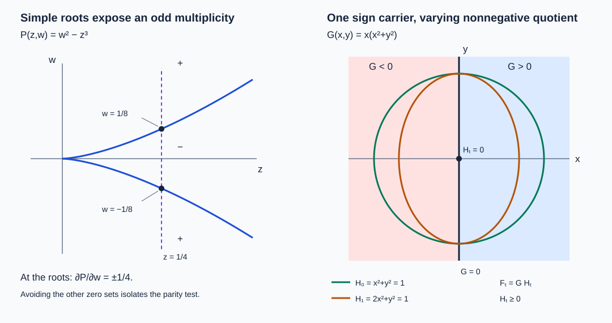

# Condition (P) and the geometry of characteristic saturation

The imaginary part of a complex principal symbol can vanish along an interval without its transverse differential vanishing everywhere on that interval. Condition (P) controls this transition. We prove that the characteristics reached from the rank-two part form a smooth coisotropic manifold, even where the two real Hamilton fields become dependent. We then obtain homogeneous normal forms on maximal rank-one intervals and identify the characteristics which can reach noncharacteristic points.

The antecedent is Lars Hörmander, *The Analysis of Linear Partial Differential Operators IV*, Springer 2009 eBook, ISBN 978-3-642-00136-9, Section 26.5, Definition 26.5.1 through Proposition 26.5.6 and their accompanying discussion.  The exposition, proofs, exercises and figure here are independently written. Our final exercise also checks the generality of the Hessian-transport assertion on printed page 116; it does not import that assertion as a theorem.

Exact earlier proofs are recorded in the proof map. In particular, [PSG](../20261011-condition-psi-geometry/condition-psi-and-complex-characteristic-tubes.html) proves the sign-test equivalences and the compact complex normal form; [PSN](../20261011-condition-psi-necessity/condition-psi-necessity-and-approximate-adjoint-solutions.html) proves necessity of condition Ψ. The [submanifold lesson](../20261005-restored-submanifolds/homogeneous-submanifold-normal-forms.html) and its [flow and leaf companion](../20261005-restored-submanifolds/flows-constant-rank-and-leaves.html) supply the exact foliation and uniqueness results. Human foundation dependencies remain external.

## 1. A sign restriction in both directions

**H0. The domain and the sign condition.** Work on an open conic subset \(U\subset T^*X\setminus0\), with a smooth complex symbol \(p\) homogeneous of a real degree \(m\). Our convention is

\[
 H_r=\sum_j(r_{\xi_j}\partial_{x_j}-r_{x_j}\partial_{\xi_j}),
 \qquad \{r,s\}=H_rs. \tag{CP1}
\]

A semibicharacteristic is a regular integral curve of \(H_{\operatorname{Re}(qp)}\) in \(\operatorname{Re}(qp)=0\), where \(q\) is smooth, complex and nonzero near the curve. The multiplier need not be homogeneous. A one-dimensional bicharacteristic is a regular characteristic curve \(\gamma\) with

\[
 p\circ\gamma=0,\qquad H_p(\gamma(t))=c(t)\gamma'(t),\qquad c(t)\ne0. \tag{CP2}
\]

Condition **(P)** means that \(\operatorname{Im}(qp)\) does not take both strict signs on any semibicharacteristic contained in \(U\), for every such \(q\). Equivalently, both \(p\) and \(\bar p\) satisfy Ψ. Indeed conjugation reverses the imaginary sign while leaving the real Hamiltonian unchanged, and PSG:E1 permits arbitrary smooth multipliers in the definition of Ψ. The two prohibited orientations together prohibit both signs in either order. Multiplying \(p\) by a nonzero smooth function preserves this definition by absorbing that function into \(q\). A symplectic coordinate change preserves it because it transports the defining Hamilton fields and their zero levels exactly.

All curves and their extensions below stay in the specified open domain. Assertions about a compact arc permit shrinking its transverse neighborhood. A regular autonomous orbit has no stationary point, by flow uniqueness. A repeated point on such an orbit yields a periodic orbit; any two specified points on it can consequently be joined by a simple subarc. We use embedded arcs when applying a compact tube theorem.

**H1. Differential solvability forces both sign restrictions.** Suppose a scalar differential operator is weakly locally solvable on a base neighborhood in the sense of PSN:C1. Its principal polynomial has integer degree \(m\), and PSN:C1 gives Ψ on the corresponding punctured cotangent neighborhood. The antipodal map \(s(x,\xi)=(x,-\xi)\) is anti-symplectic and

\[
 p\circ s=(-1)^m p,\qquad
 H_{r\circ s}(s z)=-ds_zH_r(z)\quad(r\text{ real}). \tag{CP3}
\]

The second identity follows directly from (CP1): base derivatives keep their sign under composition, while momentum derivatives acquire a minus sign. Suppose \(r=q\bar p\) violated Ψ on a compact interval \([a,b]\). Put \(\widetilde q=(-1)^m\overline{q\circ s}\). Then \(\widetilde q p=\overline{r\circ s}\). The curve \(s\gamma(a+b-t)\) has the correct forward Hamilton orientation for its real part, by (CP3), and lies in its real zero level. Its imaginary value is the negative of the old imaginary value in reversed time. Thus it still goes from strictly negative to strictly positive. It violates Ψ for \(p\), a contradiction. Hence differential weak local solvability requires (P). Both covector signs are available on the base neighborhood. This parity argument does not impose an antipodal symmetry on a general pseudodifferential symbol.

## 2. From a regular zero to an entire tube

Write

\[
 N=\{p=0\},\qquad
 N_2=\{z\in N:d\operatorname{Re}p(z),d\operatorname{Im}p(z)
                  \text{ are real-linearly independent}\}. \tag{CP4}
\]

**T0. The rank-two set is coisotropic.** The implicit-function theorem U001:P3 gives a smooth codimension-two submanifold \(N_2\). At any of its points, \(H_{\operatorname{Re}p}\operatorname{Im}p\) must vanish: a nonzero derivative would give both signs on a sufficiently short real bicharacteristic through that point. Consequently

\[
 \{\operatorname{Re}p,\operatorname{Im}p\}=0\quad\hbox{on }N_2. \tag{CP5}
\]

Both Hamilton fields are tangent to both defining zero sets. Their independent span is the symplectic orthogonal of \(TN_2\), by SN:L1, and is contained in \(TN_2\). This is precisely coisotropy. Homogeneity makes \(N_2\) conic. Replacing \(p\) by a nonzero multiplier preserves this rank on \(N\), because the differential of that product there is \(q\,dp\).

**T1. Sign-preserving factorization on a compact ordinary tube.** Take an embedded semibicharacteristic \(\gamma:[a,b]\to U\) whose initial point lies in \(N_2\). PSG:I0 gives ordinary canonical coordinates \((t,z;\tau,\zeta)\) on one neighborhood of the whole arc, in which

\[
 qp=\tau+i f(t,z,\tau,\zeta),\qquad
 \gamma(t)=(t,0;0,0). \tag{CP6}
\]

Let \(u=(z,\zeta)\) and \(g(u)=f(a,z,0,\zeta)\). Equation (CP5) says \(f_t=0\) at the initial point. Independence of \(df\) and \(d\tau\) there therefore implies \(dg(0)\ne0\). Shrink the transverse neighborhood so \(dg\ne0\) throughout. Extend the central real orbit slightly beyond the endpoints and choose one product neighborhood of that compact interval.

For each fixed \(u\), the line \((t,u,\tau=0)\) is a real characteristic of \(\tau\). Condition (P) says that its imaginary values have the weak sign of \(g(u)\). At a point with \(g=0\), use the implicit-function coordinates \((g,v)\). Approaching from \(g>0\) and \(g<0\) proves that \(f(t,g=0,v,0)=0\). The fundamental theorem in the \(g\) coordinate gives

\[
 f(t,u,0)=g(u)h(t,u),\qquad
 h(t,g,v)=\int_0^1\partial_g f(t,sg,v,0)\,ds. \tag{CP7}
\]

This is smooth on one common product. For \(g\ne0\), its quotient interpretation gives \(h\ge0\); continuity gives the same inequality on \(g=0\). At \(t=a\), the identity \(f=g\) gives \(h=1\). In particular the central arc is characteristic for its entire length, including rank drops. On \(\tau=g=0\),

\[
 df=f_\tau d\tau+h\,dg. \tag{CP8}
\]

The real rank is two exactly where \(h>0\), and is one where \(h=0\). At a characteristic point with \(g\ne0\), (CP7) instead forces \(h=0\). A smooth nonnegative function has zero differential at each zero (test each coordinate line), so there too \(df=f_\tau d\tau\).

**T2. A semibicharacteristic meeting \(N_2\) stays characteristic.** Join the rank-two point to any specified point of its regular real orbit by a compact simple subarc. If the time direction is reversed, replace the real Hamiltonian by its negative. T1 applies and proves \(p=0\) at every point of the subarc. This argument also handles periodic orbits by taking a simple part of a period. Thus every semibicharacteristic meeting \(N_2\) lies in \(N\). Away from \(N_2\), (CP8) makes its tangent span the complex Hamilton line; it is a one-dimensional bicharacteristic on each rank-one subinterval. No assumption about the density of rank-two points is needed.

## 3. The saturation is a manifold, not just a union of curves

**S0. An exact local description of the saturation.** Define \(S=N_2^e\) as the union of semibicharacteristics meeting \(N_2\). In a slightly smaller tube from T1 we claim

\[
 S=\{\tau=0,\ g(u)=0\}. \tag{CP9}
\]

Every point on the right can be joined to the slice \(t=a\) by a vertical real characteristic; that slice is rank two because \(h(a,u)=1\). This proves one inclusion.

Here are the continuation details for the other inclusion. Enlarge the retained tube a little, so both its time faces and its transverse boundary lie inside the original coordinate neighborhood. Suppose a regular semibicharacteristic from \(N_2\) reaches a point of this tube with \(g\ne0\). It is characteristic by T2, hence has \(\tau=0\), \(h=0\), and \(df=f_\tau d\tau\) there. For any multiplier \(Q\), on this part of the curve,

\[
 H_{\operatorname{Re}(Q(\tau+i f))}
       =\operatorname{Re}\bigl(Q(1+i f_\tau)\bigr)\partial_t. \tag{CP10}
\]

Thus its transverse coordinate is fixed and its time coordinate is strictly monotone on each connected part with \(g\ne0\). It cannot enter this product through a transverse face: the fixed transverse value of interior points also gives the boundary limit and is strictly inside that face. It cannot enter from the time side containing \(a\), because at \(a\) its imaginary value is \(g\ne0\). Nor can its initial rank-two point lie in this part, by T1. It must therefore enter from the other time side and move toward \(a\). The case where the chosen point is on the other side of \(a\) has the reversed orientation and the same argument.

To continue the geometric vertical line to \(a\), do not assume that the original multiplier remains regular forever. On a short terminal portion of its characteristic curve the coefficient in (CP10) has one strict sign. Choose the real multiplier \(+1\) or \(-1\) with that sign. A smooth convex interpolation of the old multiplier to this real multiplier still has that strict real coefficient. Hence the interpolated multiplier is nonzero and its flow follows the same vertical characteristic germ. Make it the constant real multiplier afterward; its real Hamilton field is exactly \(\pm\partial_t\) throughout the remaining tube, including any noncharacteristic part.

This interpolation can be made as a smooth multiplier on a neighborhood of the concatenated arc: select a simple incoming arc, make the modification after its last entry through the appropriate time face, and take small disjoint neighborhoods of its earlier compact portion and of the future vertical segment, except for the common terminal germ. Local flow uniqueness excludes a transverse intersection of the earlier characteristic portion with this rank-one germ; deleting a completed loop gives a simple incoming representative if needed. A cutoff on the common regular germ performs the stated interpolation, with the old multiplier retained elsewhere. All values there remain nonzero by the strict-coefficient test. The resulting semibicharacteristic meets \(N_2\) and reaches \(t=a\), where \(f=g\ne0\). This contradicts T2 and proves (CP9).

**S1. Global geometric consequences.** Every point of \(S\) lies on a compact subarc starting in \(N_2\), so S0 supplies a local defining pair everywhere. It follows that \(S\) is a locally closed embedded codimension-two submanifold of \(U\). Here locally closed means closed in some open neighborhood of each of its points, not necessarily closed in \(U\). In (CP9), \(g\) is independent of \(t\), and therefore \(\{\tau,g\}=0\). The two independent defining Hamilton fields are tangent to their common zero set, proving coisotropy as in T0. Formula (CP8) shows that the two real Hamilton fields of \(p\) are tangent to \(S\), even at a rank drop. It also shows that \(dp\ne0\) throughout \(S\) and that \(N_2\) is open in \(S\).

Positive fiber dilation carries a semibicharacteristic to a semibicharacteristic after a positive reparametrization and a corresponding multiplier change. To verify this, dilation scales the symplectic form by its dilation factor; pull back the Hamiltonian, use homogeneity of \(p\), and absorb the resulting nonzero scalar and pulled-back multiplier into \(q\). Since \(N_2\) is conic, its saturation is conic as well.

**L0. The two-dimensional leaves and their rank-one intervals.** The symplectic normal distribution \((TS)^\omega\) has rank two and lies in \(TS\). SN:C1 and SN:F3 construct its local plaques and unique maximal connected immersed leaves, with full leaf topology and flow continuation. Call these leaves two-dimensional bicharacteristics. Each is either conic or everywhere transverse to the radial field. The complex field \(H_p\) is tangent to every leaf because \(p\) vanishes on \(S\).

If a smooth function \(w\) on a leaf satisfies \(H_pw=0\), then on a rank-one curve (CP2) gives \(c(t)(w\circ\gamma)'=0\). Thus \(w\) is constant on that curve. One can consequently define the set \(B_0\) of semibicharacteristic arcs in a leaf whose endpoints are in \(N_2\), and identify points connected by rank-one curves. This observation only defines the reduced set. Its Riemann surface structure is the later Section 26.7 problem and is not inferred from an arbitrary leaf-space quotient here.

## 4. Homogeneous normal forms at a maximal interval

**M0. The cosphere projection is embedded.** Let \(\gamma:I\to N\) be a compact nontrivial regular one-dimensional bicharacteristic which cannot be continued as such past at least one of its two endpoints. This is the meaning of failure of continuation at both ends simultaneously. All endpoints are inside \(U\) and regular for \(p\).

At a radial point, homogeneity makes the full positive ray locally characteristic with its complex Hamilton line radial. A nonzero real Hamilton field tangent to the given curve is also tangent to that ray. Flow uniqueness makes the curve lie on the ray. Continuation along a compact piece of that ray would extend it at both ends, a contradiction. Thus its cosphere projection is regular.

If the projection revisits a point, the projected homogeneous Hamilton line and local uniqueness identify the two curve germs. PSG:M1 gives the precise arclength argument: an opposite-orientation return would continue to a midpoint where a unit tangent equals its negative. A same-orientation return yields a closed projected leaf. Its positive conic lift is characteristic, and the nonzero Hamilton line on it extends a compact lifted arc beyond both endpoints. This again contradicts the assumed endpoint. Hence the projected compact interval is injective and regular. PSG:N0–N2 now give a homogeneous canonical map and a nonzero multiplier of degree \(1-m\) such that, with \(\eta\) the remaining momenta and \(e\) a fixed nonzero last-momentum mark,

\[
 ap=\tau+i f(t,z,\eta),\qquad \deg f=1,\qquad
 f=df=0\text{ on }J=\{(t,0;0,e):t\in I\}. \tag{CP11}
\]

The coordinate \(t\) retains the prescribed parameter, and \(f\) is independent of \(\tau\). The complete complex division and its common transverse domain are in the cited provider, not assumed anew.

**M1. Factorization inside the saturation.** Suppose in addition that \(\gamma(I)\subset S\). The tangency in S1 and flow uniqueness SN:F0 keep the slightly extended central \(\partial_t\) orbit in \(S\), hence characteristic. If \(df\) vanished at every point of that extension near a nonextendible endpoint, it would itself be a longer rank-one curve. Therefore some arbitrarily nearby central time \(t_1\) is rank two. At that time \(g(z,\eta)=f(t_1,z,\eta)\) has nonzero transverse differential. Repeat T1 along the extended time interval, now using the independence of \(\tau\). It gives

\[
 f(t,z,\eta)=g(z,\eta)h(t,z,\eta),\qquad
 dg\ne0,\quad h\ge0,\quad \deg g=1,\quad\deg h=0. \tag{CP12}
\]

For the degrees, first divide on the positive last-momentum-one slice and extend the quotient by degree zero. Both \(f\) and \(g\) have degree one, so the identity holds on its conic extension. The quotient is smooth across \(g=0\) by the integral formula, and it agrees with the quotient off that hypersurface, making this extension unique. The common compact-time transverse neighborhood supplied by T1 remains valid after taking a smaller conic slice.

There is also a point version. Let a regular point of \(S\) belong to no nontrivial one-dimensional bicharacteristic. Choose a complex multiplier whose real Hamilton direction is not radial. Such a direction must exist: if the nonzero complex Hamilton line were entirely radial, homogeneity and uniqueness would provide a characteristic ray through the point. FN:D5 supplies (CP11) locally at the point. Its real flow remains in \(S\). If it were rank one on a whole interval about the mark, that interval would contradict the point hypothesis. Hence a nearby time is rank two, and the same division proves (CP12).

**M2. A fixed weak sign outside the saturation.** Suppose instead \(\gamma(I)\cap S=\varnothing\), with the endpoint hypothesis of M0. In the common homogeneous tube (CP11), if \(f(t,0,e)\) were zero on a slightly larger interval, that entire interval would be characteristic. It could not meet \(N_2\), since the same vertical semibicharacteristic would then put the original interval in \(S\). Thus it would have rank one everywhere and extend the given interval, a contradiction. There is therefore a nearby time \(t_1\) with \(f(t_1,0,e)\ne0\). Continuity fixes its strict sign for all transverse parameters in a small common neighborhood. Condition (P) on each vertical line forces

\[
 f\ge0\quad\hbox{throughout the retained tube},
 \qquad\hbox{or}\qquad f\le0\quad\hbox{throughout it}. \tag{CP13}
\]

The imaginary part is independent of \(\tau\), so this holds on the full tube, not just its real zero hypersurface. The point version, when a regular characteristic point outside \(S\) lies on no nontrivial rank-one interval, follows in the same way from FN:D5: an entire characteristic central interval would be rank one, while a radial Hamilton line would already provide such an interval. Thus a nonradial normal form exists and its central imaginary part has a nonzero nearby value.

## 5. Which rank-one characteristics can leave the zero set?

**C0. The escaping and persistent parts.** Put \(N_1=N\setminus S\). Define \(N_{11}\subset N_1\) to consist of the characteristic points lying on a semibicharacteristic with a noncharacteristic endpoint. Such a curve never meets \(N_2\), by T2. On each of its characteristic subintervals it consequently has rank one. Take the connected component of its zero set in the time interval that contains the specified point. It is a closed interval, possibly a point. An endpoint in the interior of the original regular orbit cannot admit a rank-one continuation: uniqueness would force that continuation to coincide with the original real orbit, contradicting the maximal zero interval. Compact subintervals ending at such an endpoint therefore satisfy M2 and have a definite weak sign normal form. A singleton has the point version.

At a regular point of \(N_1\setminus N_{11}\), every semibicharacteristic stays characteristic by the definition of \(N_{11}\). None meets \(N_2\), so each is rank one. These characteristics can be continued within the regular locus by successive smooth nonzero real Hamilton fields. A finite endpoint remaining in a compact regular coordinate neighborhood has an ODE continuation; thus no such endpoint is terminal. This geometric continuation statement does not assert completeness of a particular arbitrarily scaled vector field, nor extension through a singular point where \(dp=0\), nor continuation outside \(U\).

This separates three mechanisms. Rank-two points generate the coisotropic saturation \(S\); its leaves may contain whole rank-one intervals. The set \(N_{11}\) consists of rank-one zeros that can communicate with a nonzero symbol value along a semibicharacteristic. The remaining regular zeros support persistent rank-one motion. The quadratic and affine analysis of the latter set remains a separate obligation.

## 6. Three complete calculations

**X1. A flat interval inside a coisotropic leaf.** On \(T^*\mathbb R^2\) with coordinates \((t,x;\tau,\xi)\), work on \(\xi>0\). Define

\[
 E(s)=\begin{cases}e^{-1/s^2},&s>0,\\0,&s\le0,\end{cases}
 \quad h(t)=E(t-1)+E(-t-1),\qquad p=\tau+i h(t)x\xi. \tag{CP14}
\]

Determine its saturation, its escaping set, and a function constant on the collapsed intervals of a two-dimensional leaf.

**Solution.** PSG:X2 proves smoothness and flatness of \(E\) at zero. Thus \(h\ge0\), with zero set exactly \([-1,1]\). The real part is \(\tau\), and its imaginary values along every vertical line have the weak sign of the fixed number \(x\xi\). This verifies both orientation tests for the multiplier one on every neighborhood of a characteristic point and every compact rank-one interval. Its real field is everywhere nonzero. PSG:E1, including its compact-interval test, therefore gives (P), not merely a pointwise version of it.

The full Hamilton field is

\[
 H_p=\partial_t+i\bigl(hx\partial_x-h'x\xi\partial_\tau-h\xi\partial_\xi\bigr).
 \tag{CP15}
\]

At a characteristic point outside the plateau, \(x=0\) and the differential of the imaginary part is \(h\xi\,dx\ne0\). On the plateau, all its first derivatives vanish. Consequently

\[
 N_2=\{\tau=x=0,\ |t|>1,\ \xi>0\},\qquad
 S=\{\tau=x=0,\ \xi>0\}. \tag{CP16}
\]

For a direct check of the second equality, (CP15) and its multiplier versions are tangent to \(\{\tau=x=0\}\). Uniqueness preserves this set, and every point of it is joined vertically to \(N_2\). The remaining characteristic points have \(|t|\le1\) and \(x\ne0\). Their vertical real curves reach noncharacteristic times outside the plateau, so they are exactly \(N_{11}\). The surface \(S\) has one two-dimensional characteristic leaf: its restricted symplectic form is zero, and it is connected.

Let \(\rho=\log\xi\), \(A(t)=\int_0^t h(s)\,ds\) and \(w=\rho+iA(t)\). On \(S\),

\[
 H_p=\partial_t-i h(t)\partial_\rho,\qquad H_pw=i h-i h=0. \tag{CP17}
\]

The function \(A\) is zero on \([-1,1]\), strictly increasing off it, and has range \(\mathbb R\), since \(h(t)\) tends to one at both infinite ends. Thus \(w\) identifies exactly the plateau interval at each fixed \(\rho\) and is otherwise one-to-one. This explicit model illustrates the reduced set in L0; it does not prove the general Riemann surface theorem.

**X2. Why one sign orientation is weaker.** On the cone \(\xi>0\), take \(p=\tau-it\xi\). Verify Ψ and exhibit failure of (P).

**Solution.** The imaginary part decreases strictly along every \(\partial_t\) line. The good multiplier one satisfies the point and compact-interval criterion PSG:E1; hence Ψ holds in this cone. The line \(x=0,\tau=0,\xi=1\) has positive imaginary value at \(t=-1\) and negative value at \(t=1\), so (P) fails. Equivalently, \(\bar p\) violates Ψ. The principal polynomial has the antipodal symmetry in H1, but Ψ fails in the opposite cone \(\xi<0\); there is no contradiction with the necessity statement on a whole punctured base neighborhood.

**X3. A semidefinite Hessian can change rank.** On \(T^*\mathbb R^3\), use base variables \((t,x,y)\), covectors \((\tau,\eta,\kappa)\), and the cone \(\kappa>0\). Let

\[
 G=x^2+t^2y^2+y^4,\qquad p=\tau+i\kappa G,
 \qquad \gamma(t)=(t,0,0;0,0,1). \tag{CP18}
\]

Show that (P) holds and calculate the transverse Hessian along \(\gamma\). Can all of these Hessians become scalar multiples of the one at zero under invertible linear transport?

**Solution.** Nonnegativity and the fourth-power term give \(G=0\) exactly when \(x=y=0\). Thus \(N=\{\tau=x=y=0,\kappa>0\}\), with \(t,\eta,\kappa\) free. This is a smooth submanifold. On it, \(d(\kappa G)=0\), \(dp=d\tau\), and \(H_p=\partial_t\). For every smooth multiplier \(q\),

\[
 H_{\operatorname{Re}(qp)}|_N=\operatorname{Re}(q)|_N\,\partial_t. \tag{CP19}
\]

This field is tangent to \(N\), so its local flow preserves \(N\) by SN:F0. A connected integral curve that meets \(N\) remains in it: the preimage of \(N\) is closed in its parameter interval because \(N\) is closed in the cone, and open there by local flow uniqueness. If the imaginary part of \(qp\) took both signs on a real zero-level arc with \(q\ne0\), continuity would give a point with \(qp=0\), hence a point of \(N\). The entire arc would then be in \(N\), contradicting its strict imaginary values. This proves (P) directly for all multipliers.

There are no rank-two points, hence \(S\) is empty. The same invariance shows \(N_{11}\) is empty. The curve \(\gamma\) is a rank-one characteristic with \(c=1\). At each of its points, \(\ker dp/\mathbb R H_p\) is the four-dimensional real symplectic space with coordinates \((\delta x,\delta y,\delta\eta,\delta\kappa)\). The Hessian of \(\operatorname{Im}p\) restricted to this quotient is

\[
 Q_t=2\,d x^2+2t^2\,d y^2. \tag{CP20}
\]

It has rank one at \(t=0\) and rank two for \(t\ne0\); it is nonzero and semidefinite everywhere. Complexification has the same ranks. If \(L_t\) is any invertible complex linear transport, the matrix of its pullback is \(L_t^{T}Q_tL_t\), of rank \(\operatorname{rank}Q_t\). It cannot equal \(a(t)Q_0\) for \(t\ne0\), since that matrix has rank at most one. This conclusion applies in particular to invertible symplectic transport. There is also an endpoint obstruction to an exact factorization with a nonvanishing quotient. Take \(I=[0,1]\) and write \(z=(x,y,\eta,\kappa)\), \(z_0=(0,0,0,1)\), and \(f(t,z)=\kappa G(t,x,y)\). This is real analytic on \(\kappa>0\), and the ordinary homogeneous sign factorization \(f=\kappa\,G\) has a degree-one time-independent factor and a nonnegative degree-zero factor. Suppose there were another factorization \(f(t,z)=g(z)h(t,z)\) with both factors twice continuously differentiable and \(h(0,z_0)h(1,z_0)\ne0\). Since \(f(0,z_0)=d_zf(0,z_0)=0\), the product rule first gives \(g(z_0)=0\) and \(d_zg(z_0)=0\). Differentiating twice, at either endpoint \(j=0,1\), gives \(D_z^2f(j,z_0)=h(j,z_0)D_z^2g(z_0)\). Both endpoint Hessians would therefore have the same rank. Their actual ranks are one and two by (CP20), a contradiction. In particular, no nonnegative quotient can be positive at both endpoints, even though both endpoints lie in \(N_{12}\). For normalized representatives this obstruction is intrinsic: replacing \(p\) by \(qp\) and dividing at a characteristic point by its nonzero multiplier value leaves the imaginary Hessian on \(\ker dp\) unchanged, since every additional second-product-rule term contains \(dp\) on one of its arguments. Its restriction descends to \(\ker dp/\mathbb R H_p\); a real canonical change acts there by invertible congruence, preserving rank. Any exact normal form with a time-independent factor and nonzero endpoint quotients would have equal endpoint ranks by the same product calculation. Thus real analyticity and membership of the endpoints in \(N_{12}\) do not suffice for that stronger factorization. The exact given-factorization descent and the separate semidefinite propagation theorem retain their own hypotheses; this example makes no assertion against either conclusion.

The source uses \(N_{12}\) for persistent rank-one points with a nonzero transverse imaginary Hessian; its superscript e denotes extension along their rank-one curves. In that notation this entire curve lies in \(N_{12}\) and its extension \(N_{12}^e\), but not in the indefinite subset \(N_{12}^{ie}\). Printed page 115 introduces the affine discussion for the indefinite subset; page 116 states Hessian proportionality and prints Proposition 26.5.8 using the larger notation. The calculation above prevents using the stated proportionality on the whole semidefinite stratum. It does not deny that a curve admits arbitrary affine coordinates. [The indefinite affine construction](../20261011-quadratic-affine-geometry/indefinite-quadratic-division-and-affine-parameters.html) and [the semidefinite remainder proof](../20261011-semidefinite-quadratic-division/semidefinite-division-with-a-nonnegative-quotient.html) give the respective quadratic results.

## 7. Read the characteristic sets in coordinates

**V0. Exact sets and sampled curves.** The top panel plots the smooth coefficient in (CP14); its graph is numerically sampled, while its zero interval is exact. The middle panel is the slice \(\tau=0,\xi=1\) of the characteristic set. The horizontal line \(x=0\) is the entire saturation; only its two outer pieces have rank two. The vertical strip \(|t|\le1\) is characteristic, but its points with \(x\ne0\) are in \(N_{11}\), outside the saturation. The bottom panel shows the two nonzero-possible eigenvalues of (CP20), \(2\) and \(2t^2\). The rank statement uses the exact formula, not plot resolution.

The [figure generator](figures/build_figure.py) retains the formulas, plotting ranges, coordinate labels and exact set boundaries. The [finite checks](model-check.json) verify the Hamilton-field and Hessian calculations; the analytic arguments above prove the set and sign statements. Definitions 26.5.1 and 26.5.4, Lemma 26.5.2 and Propositions 26.5.3, 26.5.5 and 26.5.6 are proved here. [Indefinite quadratic division and the affine clock](../20261011-quadratic-affine-geometry/indefinite-quadratic-division-and-affine-parameters.html) and [semidefinite division with a nonnegative quotient](../20261011-semidefinite-quadratic-division/semidefinite-division-with-a-nonnegative-quotient.html) treat the quadratic alternatives. [The sign-based energy estimate](../20261011-one-direction-propagation/one-direction-propagation-and-characteristic-strata.html) connects this geometry to directed propagation. The rank-changing semidefinite obstruction retains its stated scope.

Original expression: CC0-1.0. Linked components retain their own terms. 
## 8. Analytic sign factorization on a compact characteristic interval

**AF0. Analytic sign factorization on a compact interval.** Let \(J\) be an open real interval, let \(I\subset J\) be a compact interval, and let \(V\) be a connected neighborhood of zero in \(\mathbb R^d\). Suppose that \(F\) is real analytic on \(J\times V\) and that

\[
 F(t,y)F(s,y)\ge0\qquad(t,s\in J,\ y\in V). \tag{AF1}
\]

There are a neighborhood \(V_1\) of zero, an open interval \(J_1\) containing \(I\) with \(J_1\subset J\), and real analytic functions \(G(y)\), \(H(t,y)\) such that

\[
 G\not\equiv0,\qquad F(t,y)=G(y)H(t,y),\qquad H(t,y)\ge0
 \quad(t\in J_1,\ y\in V_1). \tag{AF2}
\]

Here \(d\) is any finite nonnegative integer. An identically zero time slice is allowed. Neither \(dG(0)\ne0\) nor \(H(t,0)>0\) is asserted. In particular, (AF2) has the ordinary sign-factorization meaning, distinct from the positive-endpoint premise discussed in X3.

The analytic factorization assertion concerns the normal-form function on Hörmander IV, printed 114. For holomorphic preparation, division and factorization of germs, see Jiří Lebl, [*Tasty Bits of Several Complex Variables*, version 3.4](https://www.jirka.org/scv/scv-3.4.pdf), Theorems 6.2.3, 6.2.5 and 6.4.2. The real-coefficient arguments needed here are given next. They use ordinary completeness, finite-dimensional calculus and compactness from the [earlier prerequisite contracts](../20261004-free-stationary-phase/proof-map.html#F0-COMP). No complex zero-set theorem is needed.

**A1. Absolutely convergent series.** A real analytic germ in \(n\) variables is represented by a power series converging absolutely on some polydisc about zero; two representatives define the same germ if they agree on a smaller neighborhood. Write \(\mathcal A_n\) for this ring, with \(\mathcal A_0=\mathbb R\). For a positive radius vector \(r\), let

\[
 \|a\|_r=\sum_{\alpha\in\mathbb N_0^n}|a_\alpha|r^\alpha,
 \qquad \mathcal B_r=\{a:\|a\|_r<\infty\}. \tag{AF3}
\]

This is a complete normed algebra. Indeed, a Cauchy sequence is Cauchy in each weighted coefficient, hence has coefficient limits. Every finite coefficient sum of a difference is bounded by the Cauchy bound; taking the supremum over finite sums proves both that the limit has finite norm and that the sequence converges to it in norm. The coefficient convolution satisfies

\[
 \|ab\|_r\le\|a\|_r\|b\|_r. \tag{AF4}
\]

To see this, sum the absolute values of the finitely many products contributing to each coefficient, then take increasing finite sums; the resulting nonnegative double sum is bounded by the product of the two absolutely convergent sums. This also justifies rearrangement of every product used below.

On a strictly smaller polydisc, every differentiated series converges uniformly and absolutely. For a fixed derivative order the new coefficients are bounded by a polynomial in \(|\alpha|\); the ratio of the smaller to the larger radii gives a geometric factor, which dominates that polynomial. For example \(m^kq^m\) is bounded for \(0<q<1\): its successive ratio tends to \(q\), so its tail is bounded by a geometric sequence. To identify the differentiated sums, let \(S_N,T_N\) be finite partial sums and their formal derivatives along one coordinate segment. The fundamental theorem of calculus gives \(S_N(x+h)-S_N(x)=\int_0^hT_N(x+s)\,ds\). Uniform convergence permits passage to the limit: the integral error is at most \(|h|\) times the uniform error in \(T_N\). Its uniform limit is continuous, since one approximating continuous partial sum controls the two end errors and its own variation. The fundamental theorem of calculus then identifies the limit as the actual derivative. Repeating this argument gives every derivative. Expanding each monomial about a new center is legitimate whenever the center's absolute coordinates plus the new radii lie strictly inside the original radii: the binomial theorem and the same absolute bound permit regrouping. Thus these series define analytic functions at every interior point, with their coefficients equal to the corresponding derivatives divided by factorials.

If \(v(0)=0\), its norm becomes smaller than one after shrinking all radii. The series \(\sum_{j\ge0}(-v)^j\) then converges in \(\mathcal B_r\), and multiplication of its partial sums by \(1+v\) leaves a remainder tending to zero. Consequently a germ is a unit exactly when its constant coefficient is nonzero. A product of two nonzero germs is nonzero: their lowest nonzero homogeneous parts multiply to a nonzero polynomial. The last assertion follows by taking the highest lexicographic monomial in each of these finite homogeneous polynomials; its product has nonzero coefficient and cannot cancel. Hence \(\mathcal A_n\) is an integral domain.

We will also use the analytic identity principle over the reals. If an analytic function vanishes on a nonempty open subset of a connected domain, consider the set of points where every partial derivative vanishes. It is closed by continuity, open by the convergent Taylor expansion, and nonempty by the given open subset. Connectedness makes it the whole domain. The coordinate boxes used here are connected: a separation into two relatively open and closed nonempty parts would pull back along a segment joining the parts to such a separation of \([0,1]\). The part containing zero would be compact, have a largest point smaller than one, and also contain points just beyond that point by relative openness, a contradiction. In particular, the zero set of a nonzero germ has empty interior on a sufficiently small connected representative neighborhood. A finite union of such zero sets also has empty interior: inside any nonempty open set, successively choose a nonempty smaller open set avoiding each of the finitely many closed zero sets.

**A2. Division by a regular germ.** Use variables \((z,w)\), where \(w\) is one real variable. Suppose a nonzero germ \(f\) is regular of order \(e\ge1\) in \(w\), meaning

\[
 f(0,w)=c w^e+O(w^{e+1}),\qquad c\ne0.
\]

Divide by the constant \(c\), so that \(f=w^e+v\). On series define the linear operator

\[
 Q_e\Bigl(\sum_{\alpha,j}a_{\alpha j}z^\alpha w^j\Bigr)
   =\sum_{\alpha,j\ge e}a_{\alpha j}z^\alpha w^{j-e}.
 \tag{AF5}
\]

With transverse radii \(s\) and last radius \(r\), it has norm at most \(r^{-e}\). We can choose these radii so that

\[
 \|v\|_{s,r}<\varepsilon r^e,\qquad 0<\varepsilon<1/3. \tag{AF6}
\]

First make \(r\) small: the pure \(w\) terms of \(v\) have degree greater than \(e\), so their norm divided by \(r^e\) tends to zero. With this \(r\) fixed, make every radius in \(s\) small. Every remaining term contains a positive transverse degree and tends to zero. Its sum tends to zero as well: bound the tail by an arbitrarily small tail of the absolutely convergent series at fixed larger transverse radii, then shrink \(s\) to control its finite head. This proves (AF6), including low powers of \(w\) multiplied by transverse variables.

Given an analytic germ \(a\), repeat this radius choice inside a convergence polydisc for \(a\), first choosing \(r\) and then choosing \(s\). Thus (AF6) still holds and \(a\) has finite norm. Let \(M_v\) denote multiplication by \(v\) and put \(T=Q_eM_v\). Then \(\|T\|<\varepsilon\), and completeness proves that

\[
 q=\sum_{j=0}^{\infty}(-T)^jQ_ea,\qquad R=a-fq \tag{AF7}
\]

are convergent series. The geometric norm bound makes the first series Cauchy. Multiplication by \(1+T\) telescopes to \(Q_ea\), so \(Q_eR=0\). Thus

\[
 a=fq+R,\qquad R(z,w)=\sum_{j=0}^{e-1}R_j(z)w^j, \tag{AF8}
\]

with analytic coefficients. The quotient and remainder are unique as germs. For any two proposed divisions, shrink radii so that both quotients and remainders have finite norm and (AF6) holds. Applying \(Q_e\) to their difference gives \((1+T)(q-\widetilde q)=0\). Its Neumann inverse gives equal quotients, then equal remainders. For the original unnormalized \(f\), divide its normalized quotient by \(c\). All coefficients remain real. Regularity of order zero is the unit case and has quotient \(a/f\), remainder zero.

**A3. Preparation and its uniqueness.** Apply (AF8) with \(a=w^e\). Since \(Q_ew^e=1\), (AF7) gives

\[
 \|q-1\|_{s,r}\le\frac{\varepsilon}{1-\varepsilon}<1.
\]

The unit argument in A1 therefore gives \(q^{-1}\). On \(z=0\), the identity \(w^e=f(0,w)q(0,w)+R(0,w)\) forces \(R(0,w)=0\), since its degree is less than \(e\) and both other terms are divisible by \(w^e\). We have proved

\[
 f=UP,\qquad U=q^{-1},\qquad
 P=w^e+\sum_{j<e}b_j(z)w^j,\qquad b_j(0)=0, \tag{AF9}
\]

with \(U\) a real analytic unit. A polynomial \(P\) of this form is called prepared. Constant normalization restores the original coefficient \(c\) in the unit.

Suppose \(f=UP=\widetilde U\widetilde P\) are two such preparations of the same degree. Divide \(\widetilde P\) by \(P\). Its polynomial division is quotient one and remainder \(\widetilde P-P\), of degree less than \(e\). Its analytic division is quotient \(U/\widetilde U\), remainder zero. A2 gives uniqueness, so \(\widetilde P=P\) and \(\widetilde U=U\). This argument also handles degree zero by setting \(P=1\).

Every nonzero nonunit germ becomes regular in one coordinate after an invertible real linear change. Its first nonzero homogeneous polynomial is nonzero at some real vector. To justify that assertion, a nonzero polynomial in one variable has at most its degree many roots, by division by a linear factor and induction. Induction on the number of variables, viewing a polynomial as a polynomial in its last variable, then shows that a real polynomial vanishing everywhere has all coefficients zero. Choose a vector where the homogeneous polynomial does not vanish, take that vector as the last basis vector, and restrict the germ to that coordinate line. Its first nonzero coefficient gives regularity.

**A4. Polynomial factorization over a factorial coefficient ring.** A domain is factorial if each nonzero nonunit has a finite factorization into irreducibles, unique up to order and multiplication of the factors by units. In such a domain every irreducible is prime: comparing the two finite factorizations of a product shows that an irreducible dividing that product divides one of its factors. Greatest common divisors of a finite nonzero list are obtained by taking the minimum of each irreducible exponent. These statements follow directly from the stipulated uniqueness.

Let \(R\) be factorial and let \(K\) be its fraction field. Fractions are pairs \(a/b\) with \(b\ne0\), identified by cross multiplication; addition by a common denominator and multiplication of numerators and denominators give the field laws, and \(a/b\ne0\) has inverse \(b/a\). A polynomial over \(R\) is primitive if its coefficients have no common nonunit factor. The product of two primitive polynomials is primitive. For any irreducible \(\pi\in R\), reduce modulo \(\pi\). Since \(\pi\) is prime, the quotient is a domain; the two reduced polynomials are nonzero, and the product of their leading nonzero coefficients is nonzero. Thus \(\pi\) cannot divide every coefficient of the product. This holds for every irreducible and proves the assertion.

Every nonzero polynomial over \(K\) is a scalar in \(K\) times a primitive polynomial over \(R\): clear finitely many denominators and remove the greatest common divisor of the coefficients. If two primitive \(R\)-polynomials differ by the scalar \(a/b\), with \(a,b\in R\) having no common irreducible, then every irreducible dividing \(b\) would divide every coefficient of the second polynomial. Hence \(b\) is a unit; primitivity of the first polynomial then makes \(a\) a unit too. The scalar is therefore a unit of \(R\).

Polynomial division over the field \(K\) is obtained by subtracting the leading multiple of the divisor repeatedly, reducing the degree at each subtraction. The Euclidean algorithm consequently produces a greatest common divisor and expresses it as a polynomial combination of the two inputs. An irreducible polynomial is prime by this identity: if it does not divide one factor, its greatest common divisor with that factor is one, and the polynomial combination proves divisibility of the other factor. Induction on degree supplies factorizations; primality supplies uniqueness. Thus \(K[w]\) is factorial.

Factor a primitive polynomial in \(K[w]\), and replace each factor by a scalar times a primitive \(R\)-polynomial. The product of the latter polynomials is primitive. The preceding scalar argument shows that their total scalar differs from the original primitive polynomial by a unit of \(R\). A primitive nonconstant factor irreducible over \(K\) is irreducible over \(R\): a positive-degree factorization would persist over \(K\), and a constant nonunit factor would divide every coefficient. It is also prime over \(R\). Indeed if such a primitive polynomial divides an \(R\)-polynomial over \(K\), write the quotient as a scalar times a primitive polynomial. Comparing contents as above shows that this scalar belongs to \(R\); thus the quotient already has coefficients in \(R\). Apply its primality over \(K\) to any product. Constant irreducibles of \(R\) are prime in \(R[w]\) by reduction modulo that irreducible. Factoring the content and primitive part now proves that \(R[w]\) is factorial.

**A5. Unique factorization of real analytic germs.** We prove by induction that \(\mathcal A_n\) is factorial. The assertion for \(n=0\) is the field case. Given a nonzero nonunit in \(\mathcal A_n\), use A3 to choose a regular coordinate and write it as a unit times a prepared polynomial over \(\mathcal A_{n-1}\). By induction and A4 that polynomial has a finite factorization in \(\mathcal A_{n-1}[w]\). Its leading coefficient is one, so the leading coefficients of all its polynomial factors are units. Normalize each factor to be monic. Reducing at \(z=0\) factors \(w^e\) into monic real polynomials. Unique factorization over \(\mathbb R\), already included in A4, shows that each reduced factor is a power of \(w\). Every positive-degree factor is therefore prepared and is a nonunit germ.

A prepared polynomial irreducible in \(\mathcal A_{n-1}[w]\) is irreducible as an analytic germ. For if it were a product of two nonunit germs, both restrictions to the regular coordinate line would be nonzero and both would have positive order. Prepare these two factors. Their product is a unit times a product of two positive-degree prepared polynomials. Uniqueness in A3 would then give a polynomial factorization of the original prepared polynomial, a contradiction.

Finally, any factorization of the original germ into analytic irreducibles has every factor regular in the same coordinate: a product of one-variable restrictions is nonzero, so no restriction is identically zero. Preparing all factors and using uniqueness in A3 turns it into a factorization of the same prepared polynomial. A prepared analytic irreducible is polynomially irreducible, since any polynomial factorization of a monic prepared polynomial into nonunits can be made monic, and reduction at zero makes both positive-degree factors nonunit germs. Polynomial uniqueness therefore gives analytic uniqueness. This proves the induction, and hence the primality of irreducible analytic germs as well.

**A6. Sign change forces a parity constraint.** Let \(p\in\mathcal A_d\) be irreducible and take both strict signs arbitrarily near zero. Suppose nonzero germs \(A,B\) satisfy \(AB\ge0\) near zero. If their respective multiplicities of \(p\) are \(m,n\), then

\[
 m\equiv n\pmod2. \tag{AF10}
\]

Here multiplicity zero is allowed. Write \(A=p^ma\), \(B=p^nb\), where \(p\) does not divide \(ab\), by primality in A5. We prove that there is a regular real zero of \(p\), arbitrarily close to zero, where \(ab\ne0\).

Choose a regular coordinate for \(p\) and prepare \(p=uP\), of degree \(e\). Its polynomial \(P\) is irreducible over the fraction field of \(\mathcal A_{d-1}\), by A4–A5. Divide \(ab\) by \(P\) using A2; its remainder \(R\) is nonzero and has degree less than \(e\). Otherwise \(p\) would divide \(ab\). Over the fraction field both pairs \((P,\partial_wP)\) and \((P,R)\) have greatest common divisor one. The derivative has smaller degree and is nonzero in characteristic zero, and \(P\) is irreducible.

For completeness, the resultant test used here is finite linear algebra. For polynomials \(P,S\) of degrees \(e,k\) over a field, form the square linear map

\[
 (C,D)\longmapsto CP+DS,
 \qquad \deg C<k,\quad\deg D<e,
 \quad \deg(CP+DS)<e+k. \tag{AF11}
\]

Its determinant is the resultant. If the polynomials are relatively prime, a kernel vector gives \(P\mid DS\), hence \(P\mid D\), so \(D=C=0\); the determinant is nonzero. If they have a nonconstant common divisor \(L\), the pair \((S/L,-P/L)\) is a nonzero kernel vector with the required degree bounds. The equivalence between injectivity and nonzero determinant follows by elimination over the field: a nonzero pivot clears its column by invertible row operations; either all pivots occur, giving a triangular invertible matrix, or a free variable gives a nonzero kernel vector. The constant nonzero \(S\) case has resultant \(S^e\).

The determinants

\[
 \Delta(z)=\operatorname{Res}(P,\partial_wP),\qquad
 E(z)=\operatorname{Res}(P,R) \tag{AF12}
\]

are therefore nonzero analytic germs in the transverse variables. Where \(\Delta E\ne0\), every real root of \(P(z,\cdot)\) is simple and is not a zero of \(R(z,\cdot)\). Indeed a common root would make evaluation at that root annihilate every polynomial in the image of (AF11), contradicting surjectivity because the constant polynomial one belongs to the target.

To find a real root at such a parameter, work in an arbitrarily small prepared coordinate box. Choose a positive nonzero \(w_+\) inside it. Since \(P(0,w_+)=w_+^e>0\), this value remains positive for \(z\) sufficiently small. The unit \(u\) has one fixed sign, so sign change of \(p\) implies sign change of \(P\). There is a point \((z_*,w_-)\) still closer to zero, with \(w_-<w_+\), where \(P<0\). Keeping \(w_-\) fixed gives a nonempty open set of parameters on which the two values at \(w_-\) and \(w_+\) have opposite signs. A1 lets us choose such a parameter away from the zero sets of \(\Delta\) and \(E\). Continuity then gives a real root between those values. Explicitly, the nonempty closed set where the polynomial is nonpositive in this compact interval has a largest point smaller than \(w_+\); continuity makes its value zero. At the chosen parameter this root is simple and \(R\ne0\), hence \(ab\ne0\). If there is no transverse parameter, an irreducible one-variable germ is a unit times \(w\), and \(p\nmid ab\) gives \(ab(0)\ne0\) directly.

Near that simple root, vary only \(w\). The derivative of \(p\) is nonzero, so \(p\) takes opposite signs on its two sides; \(ab\) retains one strict sign. If \(m+n\) were odd, \(AB=p^{m+n}ab\) would take both strict signs there. This contradicts its nonnegativity and proves (AF10).

**A7. Extract the time-independent factor.** If every slice \(F(t,\cdot)\) is the zero germ, every derivative in \(y\) at zero vanishes for every \(t\). Differentiating these identically zero functions of \(t\) shows that every joint Taylor coefficient vanishes. Joint analyticity therefore makes \(F\) zero near \(J\times\{0\}\). Set \(G=1,H=0\).

Otherwise choose \(t_0\in J\) with a nonzero slice and factor its germ by A5:

\[
 F(t_0,y)=u(y)\prod_{i=1}^N p_i(y)^{m_i}, \tag{AF13}
\]

where \(u\) is a unit, the irreducibles \(p_i\) are pairwise nonassociate, and \(m_i\ge1\). An empty product is allowed. For each \(i\), take the minimum multiplicity of \(p_i\) among all nonzero time slices:

\[
 k_i=\min_{\substack{t\in J\\F(t,\cdot)\ne0}}
             \operatorname{ord}_{p_i}F(t,\cdot),
 \qquad 0\le k_i\le m_i. \tag{AF14}
\]

This minimum exists because it is a nonempty set of nonnegative integers. Define \(G=\sigma\prod_i p_i^{k_i}\), with a sign \(\sigma\in\{1,-1\}\) to be fixed. Every time slice is divisible by this germ; the identically zero slices pose no exception.

For each \(p_i\) that changes sign as a germ, (AF1) and A6 give the same parity for its multiplicity in every nonzero slice and in the marked slice. Therefore \(m_i-k_i\) is even. Every other \(p_i\) has a fixed weak sign on some neighborhood: failure to take both strict signs arbitrarily near zero means precisely that one of those signs is absent on a smaller neighborhood. The unit also has a fixed strict sign. Consequently \(F(t_0,\cdot)/G\) has a fixed weak sign; choose \(\sigma\) so it is nonnegative. Wherever \(F(t_0,y)\ne0\), it is strictly positive, so \(G(y)\) and \(F(t_0,y)\) have the same sign.

**A8. The quotient is jointly analytic on one common neighborhood.** It remains to justify division in the parameter \(t\), rather than just division of separate slice germs. If \(G\) is a unit, use \(H=F/G\) directly. Otherwise prepare \(G\), after one fixed real linear change of \(y\), as \(UP\). At any \(t_*\in I\), divide the joint analytic function \(F\) by \(P\) using A2, treating \(t-t_*\) as one more transverse parameter. Its remainder is polynomial in the regular coordinate, with coefficients analytic jointly in the time and remaining transverse coordinates.

For every real \(t\) close to \(t_*\), slice divisibility from A7 and uniqueness in A2 make that slice remainder zero as a transverse germ. Each coefficient is analytic on one common connected transverse coordinate box; A1 makes it zero throughout that box. The joint remainder is therefore zero on the time-coordinate box. Its quotient divided by \(U\) gives a joint analytic \(H\) there.

Finitely many such time boxes cover \(I\). Shrink the transverse neighborhood to a common smaller ball where \(G\), its chosen sign, and all quotients are defined. On overlaps, the quotients agree wherever \(G\ne0\), since both equal \(F/G\). This set is dense by A1. Continuity gives agreement on the whole overlap. The quotients thus glue to an analytic function on a neighborhood of \(I\times\{0\}\). A finite interval cover of a compact interval contains a slightly larger interval \(J_1\) with closure in \(J\); retain a common transverse ball \(V_1\) as above.

On the dense subset of \(V_1\) where \(F(t_0,y)\ne0\), (AF1) and the sign choice in A7 give \(F(t,y)/G(y)\ge0\) for every \(t\in J_1\). Continuity of the joint quotient extends this inequality to every \(y\in V_1\). This proves (AF2). When \(d=0\), the same argument has no irreducibles: one nonzero slice determines the common weak sign of the real numbers \(F(t)\), and \(G=1\) or \(-1\) gives the assertion. The compact interval may be a single point because it is contained in the open sign-coherence interval \(J\).

**A9. Homogeneous form and examples.** In a positive homogeneous momentum chart suppose the degree-one normal-form function is jointly real analytic and has the expression \(f(t,\rho,z)=\rho F(t,z)\), with \(\rho>0\) and \(z\) the normalized transverse coordinates. Apply AF0 to \(F\) and set

\[
 g(\rho,z)=\rho G(z),\qquad h(t,\rho,z)=H(t,z). \tag{AF15}
\]

Then \(f=gh\), the first factor is independent of time and has degree one, and the second is nonnegative of degree zero. The conclusion uses analyticity in this chart; an arbitrary smooth change of coordinates is not an assertion that analyticity is preserved. No positivity of the quotient on the central characteristic, regular zero set of \(g\), or canonical uniqueness of the factors is part of (AF15).

For a two-variable example, on any bounded time interval take

\[
 F(t,x,y)=x(x^2+y^2)\bigl((1+t^2)x^2+y^2\bigr). \tag{AF16}
\]

The common weak sign is that of \(x\), and one exact choice is \(G=x(x^2+y^2)\), \(H=(1+t^2)x^2+y^2\). At \(t_0=0\), the marked slice is \(x(x^2+y^2)^2\). The two factors \(x\) and \(x^2+y^2\) are irreducible real analytic germs: the first has order one; if the second were a product of nonunit germs, its order two would force two real linear lowest terms, whose product cannot be the positive definite quadratic form. For \(t\ne0\), the other positive definite quadratic factor is not divisible by \(x^2+y^2\), since divisibility of two order-two germs would make their quadratic forms constant multiples, contrary to their coefficients. Thus (AF14) gives exactly the displayed common factor when \(J\) contains zero and a nonzero time. Its odd sign-changing factor cannot disappear, while the nonnegative factor may occur with different multiplicity. The quotient vanishes at the origin at every time.

An identically zero slice is visible in \(F(t,x,y)=(t-1/2)^2x(x^2+y^2)\). Here \(G=x(x^2+y^2)\), \(H=(t-1/2)^2\) work across \(t=1/2\); slice-wise division is not allowed to discard that time. If \(F\equiv0\), the choice in A7 covers the whole interval. These examples illustrate ordinary sign factorization without imposing the endpoint condition excluded by X3.

In the left panel, \(P(z,w)=w^2-z^3\) has the two simple roots \(w=\pm1/8\) on the marked fiber \(z=1/4\), with derivatives \(\partial_wP=\pm1/4\). The signs on the three intervening vertical intervals are positive, negative, positive. In the right panel the vertical zero line of the factor in (AF16) separates its two strict sign regions; the nonnegative quotient has only the origin as a zero. The contours of the quotient at times zero and one are respectively \(x^2+y^2=1\) and \(2x^2+y^2=1\). The [figure source](figures/build_analytic_sign_figure.py) specifies these exact equations and marked coordinates; curve traces are samples of the stated equations. The arguments A1–A8 supply the analytic and compact-interval conclusions.
