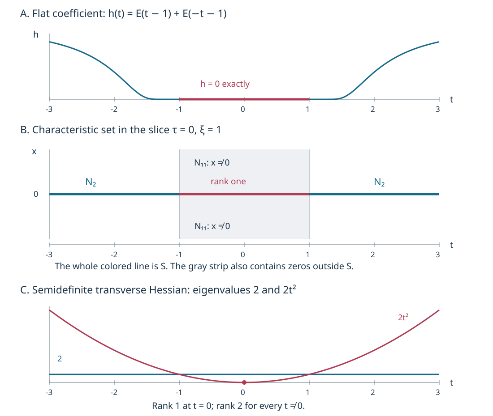

# Condition (P) and the geometry of characteristic saturation

The imaginary part of a complex principal symbol can vanish along an interval without its transverse differential vanishing everywhere on that interval. Condition (P) controls this transition. We prove that the characteristics reached from the rank-two part form a smooth coisotropic manifold, even where the two real Hamilton fields become dependent. We then obtain homogeneous normal forms on maximal rank-one intervals and identify the characteristics which can reach noncharacteristic points.

The antecedent is Lars Hörmander, *The Analysis of Linear Partial Differential Operators IV*, Springer 2009 eBook, ISBN 978-3-642-00136-9, Section 26.5, Definition 26.5.1 through Proposition 26.5.6 and their accompanying discussion.  The exposition, proofs, exercises and figure here are independently written. Our final exercise also checks the generality of the Hessian-transport assertion on printed page 116; it does not import that assertion as a theorem.

Exact earlier proofs are recorded in the proof map. In particular, [PSG](../20261011-condition-psi-geometry/condition-psi-and-complex-characteristic-tubes.html) proves the sign-test equivalences and the compact complex normal form; [PSN](../20261011-condition-psi-necessity/condition-psi-necessity-and-approximate-adjoint-solutions.html) proves necessity of condition Ψ. The [submanifold lesson](../20261005-restored-submanifolds/homogeneous-submanifold-normal-forms.html) and its [flow and leaf companion](../20261005-restored-submanifolds/flows-constant-rank-and-leaves.html) supply the exact foliation and uniqueness results. Human foundation dependencies remain external.

## 1. A sign restriction in both directions

**H0. The domain and the sign condition.** Work on an open conic subset \(U\subset T^*X\setminus0\), with a smooth complex symbol \(p\) homogeneous of a real degree \(m\). Our convention is

\[
 H_r=\sum_j(r_{\xi_j}\partial_{x_j}-r_{x_j}\partial_{\xi_j}),
 \qquad \{r,s\}=H_rs. \tag{CP1}
\]

A semibicharacteristic is a regular integral curve of \(H_{\operatorname{Re}(qp)}\) in \(\operatorname{Re}(qp)=0\), where \(q\) is smooth, complex and nonzero near the curve. The multiplier need not be homogeneous. A one-dimensional bicharacteristic is a regular characteristic curve \(\gamma\) with

\[
 p\circ\gamma=0,\qquad H_p(\gamma(t))=c(t)\gamma'(t),\qquad c(t)\ne0. \tag{CP2}
\]

Condition **(P)** means that \(\operatorname{Im}(qp)\) does not take both strict signs on any semibicharacteristic contained in \(U\), for every such \(q\). Equivalently, both \(p\) and \(\bar p\) satisfy Ψ. Indeed conjugation reverses the imaginary sign while leaving the real Hamiltonian unchanged, and PSG:E1 permits arbitrary smooth multipliers in the definition of Ψ. The two prohibited orientations together prohibit both signs in either order. Multiplying \(p\) by a nonzero smooth function preserves this definition by absorbing that function into \(q\). A symplectic coordinate change preserves it because it transports the defining Hamilton fields and their zero levels exactly.

All curves and their extensions below stay in the specified open domain. Assertions about a compact arc permit shrinking its transverse neighborhood. A regular autonomous orbit has no stationary point, by flow uniqueness. A repeated point on such an orbit yields a periodic orbit; any two specified points on it can consequently be joined by a simple subarc. We use embedded arcs when applying a compact tube theorem.

**H1. Differential solvability forces both sign restrictions.** Suppose a scalar differential operator is weakly locally solvable on a base neighborhood in the sense of PSN:C1. Its principal polynomial has integer degree \(m\), and PSN:C1 gives Ψ on the corresponding punctured cotangent neighborhood. The antipodal map \(s(x,\xi)=(x,-\xi)\) is anti-symplectic and

\[
 p\circ s=(-1)^m p,\qquad
 H_{r\circ s}(s z)=-ds_zH_r(z)\quad(r\text{ real}). \tag{CP3}
\]

The second identity follows directly from (CP1): base derivatives keep their sign under composition, while momentum derivatives acquire a minus sign. Suppose \(r=q\bar p\) violated Ψ on a compact interval \([a,b]\). Put \(\widetilde q=(-1)^m\overline{q\circ s}\). Then \(\widetilde q p=\overline{r\circ s}\). The curve \(s\gamma(a+b-t)\) has the correct forward Hamilton orientation for its real part, by (CP3), and lies in its real zero level. Its imaginary value is the negative of the old imaginary value in reversed time. Thus it still goes from strictly negative to strictly positive. It violates Ψ for \(p\), a contradiction. Hence differential weak local solvability requires (P). Both covector signs are available on the base neighborhood. This parity argument does not impose an antipodal symmetry on a general pseudodifferential symbol.

## 2. From a regular zero to an entire tube

Write

\[
 N=\{p=0\},\qquad
 N_2=\{z\in N:d\operatorname{Re}p(z),d\operatorname{Im}p(z)
                  \text{ are real-linearly independent}\}. \tag{CP4}
\]

**T0. The rank-two set is coisotropic.** The implicit-function theorem U001:P3 gives a smooth codimension-two submanifold \(N_2\). At any of its points, \(H_{\operatorname{Re}p}\operatorname{Im}p\) must vanish: a nonzero derivative would give both signs on a sufficiently short real bicharacteristic through that point. Consequently

\[
 \{\operatorname{Re}p,\operatorname{Im}p\}=0\quad\hbox{on }N_2. \tag{CP5}
\]

Both Hamilton fields are tangent to both defining zero sets. Their independent span is the symplectic orthogonal of \(TN_2\), by SN:L1, and is contained in \(TN_2\). This is precisely coisotropy. Homogeneity makes \(N_2\) conic. Replacing \(p\) by a nonzero multiplier preserves this rank on \(N\), because the differential of that product there is \(q\,dp\).

**T1. Sign-preserving factorization on a compact ordinary tube.** Take an embedded semibicharacteristic \(\gamma:[a,b]\to U\) whose initial point lies in \(N_2\). PSG:I0 gives ordinary canonical coordinates \((t,z;\tau,\zeta)\) on one neighborhood of the whole arc, in which

\[
 qp=\tau+i f(t,z,\tau,\zeta),\qquad
 \gamma(t)=(t,0;0,0). \tag{CP6}
\]

Let \(u=(z,\zeta)\) and \(g(u)=f(a,z,0,\zeta)\). Equation (CP5) says \(f_t=0\) at the initial point. Independence of \(df\) and \(d\tau\) there therefore implies \(dg(0)\ne0\). Shrink the transverse neighborhood so \(dg\ne0\) throughout. Extend the central real orbit slightly beyond the endpoints and choose one product neighborhood of that compact interval.

For each fixed \(u\), the line \((t,u,\tau=0)\) is a real characteristic of \(\tau\). Condition (P) says that its imaginary values have the weak sign of \(g(u)\). At a point with \(g=0\), use the implicit-function coordinates \((g,v)\). Approaching from \(g>0\) and \(g<0\) proves that \(f(t,g=0,v,0)=0\). The fundamental theorem in the \(g\) coordinate gives

\[
 f(t,u,0)=g(u)h(t,u),\qquad
 h(t,g,v)=\int_0^1\partial_g f(t,sg,v,0)\,ds. \tag{CP7}
\]

This is smooth on one common product. For \(g\ne0\), its quotient interpretation gives \(h\ge0\); continuity gives the same inequality on \(g=0\). At \(t=a\), the identity \(f=g\) gives \(h=1\). In particular the central arc is characteristic for its entire length, including rank drops. On \(\tau=g=0\),

\[
 df=f_\tau d\tau+h\,dg. \tag{CP8}
\]

The real rank is two exactly where \(h>0\), and is one where \(h=0\). At a characteristic point with \(g\ne0\), (CP7) instead forces \(h=0\). A smooth nonnegative function has zero differential at each zero (test each coordinate line), so there too \(df=f_\tau d\tau\).

**T2. A semibicharacteristic meeting \(N_2\) stays characteristic.** Join the rank-two point to any specified point of its regular real orbit by a compact simple subarc. If the time direction is reversed, replace the real Hamiltonian by its negative. T1 applies and proves \(p=0\) at every point of the subarc. This argument also handles periodic orbits by taking a simple part of a period. Thus every semibicharacteristic meeting \(N_2\) lies in \(N\). Away from \(N_2\), (CP8) makes its tangent span the complex Hamilton line; it is a one-dimensional bicharacteristic on each rank-one subinterval. No assumption about the density of rank-two points is needed.

## 3. The saturation is a manifold, not just a union of curves

**S0. An exact local description of the saturation.** Define \(S=N_2^e\) as the union of semibicharacteristics meeting \(N_2\). In a slightly smaller tube from T1 we claim

\[
 S=\{\tau=0,\ g(u)=0\}. \tag{CP9}
\]

Every point on the right can be joined to the slice \(t=a\) by a vertical real characteristic; that slice is rank two because \(h(a,u)=1\). This proves one inclusion.

Here are the continuation details for the other inclusion. Enlarge the retained tube a little, so both its time faces and its transverse boundary lie inside the original coordinate neighborhood. Suppose a regular semibicharacteristic from \(N_2\) reaches a point of this tube with \(g\ne0\). It is characteristic by T2, hence has \(\tau=0\), \(h=0\), and \(df=f_\tau d\tau\) there. For any multiplier \(Q\), on this part of the curve,

\[
 H_{\operatorname{Re}(Q(\tau+i f))}
       =\operatorname{Re}\bigl(Q(1+i f_\tau)\bigr)\partial_t. \tag{CP10}
\]

Thus its transverse coordinate is fixed and its time coordinate is strictly monotone on each connected part with \(g\ne0\). It cannot enter this product through a transverse face: the fixed transverse value of interior points also gives the boundary limit and is strictly inside that face. It cannot enter from the time side containing \(a\), because at \(a\) its imaginary value is \(g\ne0\). Nor can its initial rank-two point lie in this part, by T1. It must therefore enter from the other time side and move toward \(a\). The case where the chosen point is on the other side of \(a\) has the reversed orientation and the same argument.

To continue the geometric vertical line to \(a\), do not assume that the original multiplier remains regular forever. On a short terminal portion of its characteristic curve the coefficient in (CP10) has one strict sign. Choose the real multiplier \(+1\) or \(-1\) with that sign. A smooth convex interpolation of the old multiplier to this real multiplier still has that strict real coefficient. Hence the interpolated multiplier is nonzero and its flow follows the same vertical characteristic germ. Make it the constant real multiplier afterward; its real Hamilton field is exactly \(\pm\partial_t\) throughout the remaining tube, including any noncharacteristic part.

This interpolation can be made as a smooth multiplier on a neighborhood of the concatenated arc: select a simple incoming arc, make the modification after its last entry through the appropriate time face, and take small disjoint neighborhoods of its earlier compact portion and of the future vertical segment, except for the common terminal germ. Local flow uniqueness excludes a transverse intersection of the earlier characteristic portion with this rank-one germ; deleting a completed loop gives a simple incoming representative if needed. A cutoff on the common regular germ performs the stated interpolation, with the old multiplier retained elsewhere. All values there remain nonzero by the strict-coefficient test. The resulting semibicharacteristic meets \(N_2\) and reaches \(t=a\), where \(f=g\ne0\). This contradicts T2 and proves (CP9).

**S1. Global geometric consequences.** Every point of \(S\) lies on a compact subarc starting in \(N_2\), so S0 supplies a local defining pair everywhere. It follows that \(S\) is a locally closed embedded codimension-two submanifold of \(U\). Here locally closed means closed in some open neighborhood of each of its points, not necessarily closed in \(U\). In (CP9), \(g\) is independent of \(t\), and therefore \(\{\tau,g\}=0\). The two independent defining Hamilton fields are tangent to their common zero set, proving coisotropy as in T0. Formula (CP8) shows that the two real Hamilton fields of \(p\) are tangent to \(S\), even at a rank drop. It also shows that \(dp\ne0\) throughout \(S\) and that \(N_2\) is open in \(S\).

Positive fiber dilation carries a semibicharacteristic to a semibicharacteristic after a positive reparametrization and a corresponding multiplier change. To verify this, dilation scales the symplectic form by its dilation factor; pull back the Hamiltonian, use homogeneity of \(p\), and absorb the resulting nonzero scalar and pulled-back multiplier into \(q\). Since \(N_2\) is conic, its saturation is conic as well.

**L0. The two-dimensional leaves and their rank-one intervals.** The symplectic normal distribution \((TS)^\omega\) has rank two and lies in \(TS\). SN:C1 and SN:F3 construct its local plaques and unique maximal connected immersed leaves, with full leaf topology and flow continuation. Call these leaves two-dimensional bicharacteristics. Each is either conic or everywhere transverse to the radial field. The complex field \(H_p\) is tangent to every leaf because \(p\) vanishes on \(S\).

If a smooth function \(w\) on a leaf satisfies \(H_pw=0\), then on a rank-one curve (CP2) gives \(c(t)(w\circ\gamma)'=0\). Thus \(w\) is constant on that curve. One can consequently define the set \(B_0\) of semibicharacteristic arcs in a leaf whose endpoints are in \(N_2\), and identify points connected by rank-one curves. This observation only defines the reduced set. Its Riemann surface structure is the later Section 26.7 problem and is not inferred from an arbitrary leaf-space quotient here.

## 4. Homogeneous normal forms at a maximal interval

**M0. The cosphere projection is embedded.** Let \(\gamma:I\to N\) be a compact nontrivial regular one-dimensional bicharacteristic which cannot be continued as such past at least one of its two endpoints. This is the meaning of failure of continuation at both ends simultaneously. All endpoints are inside \(U\) and regular for \(p\).

At a radial point, homogeneity makes the full positive ray locally characteristic with its complex Hamilton line radial. A nonzero real Hamilton field tangent to the given curve is also tangent to that ray. Flow uniqueness makes the curve lie on the ray. Continuation along a compact piece of that ray would extend it at both ends, a contradiction. Thus its cosphere projection is regular.

If the projection revisits a point, the projected homogeneous Hamilton line and local uniqueness identify the two curve germs. PSG:M1 gives the precise arclength argument: an opposite-orientation return would continue to a midpoint where a unit tangent equals its negative. A same-orientation return yields a closed projected leaf. Its positive conic lift is characteristic, and the nonzero Hamilton line on it extends a compact lifted arc beyond both endpoints. This again contradicts the assumed endpoint. Hence the projected compact interval is injective and regular. PSG:N0–N2 now give a homogeneous canonical map and a nonzero multiplier of degree \(1-m\) such that, with \(\eta\) the remaining momenta and \(e\) a fixed nonzero last-momentum mark,

\[
 ap=\tau+i f(t,z,\eta),\qquad \deg f=1,\qquad
 f=df=0\text{ on }J=\{(t,0;0,e):t\in I\}. \tag{CP11}
\]

The coordinate \(t\) retains the prescribed parameter, and \(f\) is independent of \(\tau\). The complete complex division and its common transverse domain are in the cited provider, not assumed anew.

**M1. Factorization inside the saturation.** Suppose in addition that \(\gamma(I)\subset S\). The tangency in S1 and flow uniqueness SN:F0 keep the slightly extended central \(\partial_t\) orbit in \(S\), hence characteristic. If \(df\) vanished at every point of that extension near a nonextendible endpoint, it would itself be a longer rank-one curve. Therefore some arbitrarily nearby central time \(t_1\) is rank two. At that time \(g(z,\eta)=f(t_1,z,\eta)\) has nonzero transverse differential. Repeat T1 along the extended time interval, now using the independence of \(\tau\). It gives

\[
 f(t,z,\eta)=g(z,\eta)h(t,z,\eta),\qquad
 dg\ne0,\quad h\ge0,\quad \deg g=1,\quad\deg h=0. \tag{CP12}
\]

For the degrees, first divide on the positive last-momentum-one slice and extend the quotient by degree zero. Both \(f\) and \(g\) have degree one, so the identity holds on its conic extension. The quotient is smooth across \(g=0\) by the integral formula, and it agrees with the quotient off that hypersurface, making this extension unique. The common compact-time transverse neighborhood supplied by T1 remains valid after taking a smaller conic slice.

There is also a point version. Let a regular point of \(S\) belong to no nontrivial one-dimensional bicharacteristic. Choose a complex multiplier whose real Hamilton direction is not radial. Such a direction must exist: if the nonzero complex Hamilton line were entirely radial, homogeneity and uniqueness would provide a characteristic ray through the point. FN:D5 supplies (CP11) locally at the point. Its real flow remains in \(S\). If it were rank one on a whole interval about the mark, that interval would contradict the point hypothesis. Hence a nearby time is rank two, and the same division proves (CP12).

**M2. A fixed weak sign outside the saturation.** Suppose instead \(\gamma(I)\cap S=\varnothing\), with the endpoint hypothesis of M0. In the common homogeneous tube (CP11), if \(f(t,0,e)\) were zero on a slightly larger interval, that entire interval would be characteristic. It could not meet \(N_2\), since the same vertical semibicharacteristic would then put the original interval in \(S\). Thus it would have rank one everywhere and extend the given interval, a contradiction. There is therefore a nearby time \(t_1\) with \(f(t_1,0,e)\ne0\). Continuity fixes its strict sign for all transverse parameters in a small common neighborhood. Condition (P) on each vertical line forces

\[
 f\ge0\quad\hbox{throughout the retained tube},
 \qquad\hbox{or}\qquad f\le0\quad\hbox{throughout it}. \tag{CP13}
\]

The imaginary part is independent of \(\tau\), so this holds on the full tube, not just its real zero hypersurface. The point version, when a regular characteristic point outside \(S\) lies on no nontrivial rank-one interval, follows in the same way from FN:D5: an entire characteristic central interval would be rank one, while a radial Hamilton line would already provide such an interval. Thus a nonradial normal form exists and its central imaginary part has a nonzero nearby value.

## 5. Which rank-one characteristics can leave the zero set?

**C0. The escaping and persistent parts.** Put \(N_1=N\setminus S\). Define \(N_{11}\subset N_1\) to consist of the characteristic points lying on a semibicharacteristic with a noncharacteristic endpoint. Such a curve never meets \(N_2\), by T2. On each of its characteristic subintervals it consequently has rank one. Take the connected component of its zero set in the time interval that contains the specified point. It is a closed interval, possibly a point. An endpoint in the interior of the original regular orbit cannot admit a rank-one continuation: uniqueness would force that continuation to coincide with the original real orbit, contradicting the maximal zero interval. Compact subintervals ending at such an endpoint therefore satisfy M2 and have a definite weak sign normal form. A singleton has the point version.

At a regular point of \(N_1\setminus N_{11}\), every semibicharacteristic stays characteristic by the definition of \(N_{11}\). None meets \(N_2\), so each is rank one. These characteristics can be continued within the regular locus by successive smooth nonzero real Hamilton fields. A finite endpoint remaining in a compact regular coordinate neighborhood has an ODE continuation; thus no such endpoint is terminal. This geometric continuation statement does not assert completeness of a particular arbitrarily scaled vector field, nor extension through a singular point where \(dp=0\), nor continuation outside \(U\).

This separates three mechanisms. Rank-two points generate the coisotropic saturation \(S\); its leaves may contain whole rank-one intervals. The set \(N_{11}\) consists of rank-one zeros that can communicate with a nonzero symbol value along a semibicharacteristic. The remaining regular zeros support persistent rank-one motion. The quadratic and affine analysis of the latter set remains a separate obligation.

## 6. Three complete calculations

**X1. A flat interval inside a coisotropic leaf.** On \(T^*\mathbb R^2\) with coordinates \((t,x;\tau,\xi)\), work on \(\xi>0\). Define

\[
 E(s)=\begin{cases}e^{-1/s^2},&s>0,\\0,&s\le0,\end{cases}
 \quad h(t)=E(t-1)+E(-t-1),\qquad p=\tau+i h(t)x\xi. \tag{CP14}
\]

Determine its saturation, its escaping set, and a function constant on the collapsed intervals of a two-dimensional leaf.

**Solution.** PSG:X2 proves smoothness and flatness of \(E\) at zero. Thus \(h\ge0\), with zero set exactly \([-1,1]\). The real part is \(\tau\), and its imaginary values along every vertical line have the weak sign of the fixed number \(x\xi\). This verifies both orientation tests for the multiplier one on every neighborhood of a characteristic point and every compact rank-one interval. Its real field is everywhere nonzero. PSG:E1, including its compact-interval test, therefore gives (P), not merely a pointwise version of it.

The full Hamilton field is

\[
 H_p=\partial_t+i\bigl(hx\partial_x-h'x\xi\partial_\tau-h\xi\partial_\xi\bigr).
 \tag{CP15}
\]

At a characteristic point outside the plateau, \(x=0\) and the differential of the imaginary part is \(h\xi\,dx\ne0\). On the plateau, all its first derivatives vanish. Consequently

\[
 N_2=\{\tau=x=0,\ |t|>1,\ \xi>0\},\qquad
 S=\{\tau=x=0,\ \xi>0\}. \tag{CP16}
\]

For a direct check of the second equality, (CP15) and its multiplier versions are tangent to \(\{\tau=x=0\}\). Uniqueness preserves this set, and every point of it is joined vertically to \(N_2\). The remaining characteristic points have \(|t|\le1\) and \(x\ne0\). Their vertical real curves reach noncharacteristic times outside the plateau, so they are exactly \(N_{11}\). The surface \(S\) has one two-dimensional characteristic leaf: its restricted symplectic form is zero, and it is connected.

Let \(\rho=\log\xi\), \(A(t)=\int_0^t h(s)\,ds\) and \(w=\rho+iA(t)\). On \(S\),

\[
 H_p=\partial_t-i h(t)\partial_\rho,\qquad H_pw=i h-i h=0. \tag{CP17}
\]

The function \(A\) is zero on \([-1,1]\), strictly increasing off it, and has range \(\mathbb R\), since \(h(t)\) tends to one at both infinite ends. Thus \(w\) identifies exactly the plateau interval at each fixed \(\rho\) and is otherwise one-to-one. This explicit model illustrates the reduced set in L0; it does not prove the general Riemann surface theorem.

**X2. Why one sign orientation is weaker.** On the cone \(\xi>0\), take \(p=\tau-it\xi\). Verify Ψ and exhibit failure of (P).

**Solution.** The imaginary part decreases strictly along every \(\partial_t\) line. The good multiplier one satisfies the point and compact-interval criterion PSG:E1; hence Ψ holds in this cone. The line \(x=0,\tau=0,\xi=1\) has positive imaginary value at \(t=-1\) and negative value at \(t=1\), so (P) fails. Equivalently, \(\bar p\) violates Ψ. The principal polynomial has the antipodal symmetry in H1, but Ψ fails in the opposite cone \(\xi<0\); there is no contradiction with the necessity statement on a whole punctured base neighborhood.

**X3. A semidefinite Hessian can change rank.** On \(T^*\mathbb R^3\), use base variables \((t,x,y)\), covectors \((\tau,\eta,\kappa)\), and the cone \(\kappa>0\). Let

\[
 G=x^2+t^2y^2+y^4,\qquad p=\tau+i\kappa G,
 \qquad \gamma(t)=(t,0,0;0,0,1). \tag{CP18}
\]

Show that (P) holds and calculate the transverse Hessian along \(\gamma\). Can all of these Hessians become scalar multiples of the one at zero under invertible linear transport?

**Solution.** Nonnegativity and the fourth-power term give \(G=0\) exactly when \(x=y=0\). Thus \(N=\{\tau=x=y=0,\kappa>0\}\), with \(t,\eta,\kappa\) free. This is a smooth submanifold. On it, \(d(\kappa G)=0\), \(dp=d\tau\), and \(H_p=\partial_t\). For every smooth multiplier \(q\),

\[
 H_{\operatorname{Re}(qp)}|_N=\operatorname{Re}(q)|_N\,\partial_t. \tag{CP19}
\]

This field is tangent to \(N\), so its local flow preserves \(N\) by SN:F0. A connected integral curve that meets \(N\) remains in it: the preimage of \(N\) is closed in its parameter interval because \(N\) is closed in the cone, and open there by local flow uniqueness. If the imaginary part of \(qp\) took both signs on a real zero-level arc with \(q\ne0\), continuity would give a point with \(qp=0\), hence a point of \(N\). The entire arc would then be in \(N\), contradicting its strict imaginary values. This proves (P) directly for all multipliers.

There are no rank-two points, hence \(S\) is empty. The same invariance shows \(N_{11}\) is empty. The curve \(\gamma\) is a rank-one characteristic with \(c=1\). At each of its points, \(\ker dp/\mathbb R H_p\) is the four-dimensional real symplectic space with coordinates \((\delta x,\delta y,\delta\eta,\delta\kappa)\). The Hessian of \(\operatorname{Im}p\) restricted to this quotient is

\[
 Q_t=2\,d x^2+2t^2\,d y^2. \tag{CP20}
\]

It has rank one at \(t=0\) and rank two for \(t\ne0\); it is nonzero and semidefinite everywhere. Complexification has the same ranks. If \(L_t\) is any invertible complex linear transport, the matrix of its pullback is \(L_t^{T}Q_tL_t\), of rank \(\operatorname{rank}Q_t\). It cannot equal \(a(t)Q_0\) for \(t\ne0\), since that matrix has rank at most one. This conclusion applies in particular to invertible symplectic transport.

The source uses \(N_{12}\) for persistent rank-one points with a nonzero transverse imaginary Hessian; its superscript e denotes extension along their rank-one curves. In that notation this entire curve lies in \(N_{12}\) and its extension \(N_{12}^e\), but not in the indefinite subset \(N_{12}^{ie}\). Printed page 115 introduces the affine discussion for the indefinite subset; page 116 states Hessian proportionality and prints Proposition 26.5.8 using the larger notation. The calculation above prevents using the stated proportionality on the whole semidefinite stratum. It does not deny that a curve admits arbitrary affine coordinates. [The indefinite affine construction](../20261011-quadratic-affine-geometry/indefinite-quadratic-division-and-affine-parameters.html) and [the semidefinite remainder proof](../20261011-semidefinite-quadratic-division/semidefinite-division-with-a-nonnegative-quotient.html) give the respective quadratic results.

## 7. Read the characteristic sets in coordinates

**V0. Exact sets and sampled curves.** The top panel plots the smooth coefficient in (CP14); its graph is numerically sampled, while its zero interval is exact. The middle panel is the slice \(\tau=0,\xi=1\) of the characteristic set. The horizontal line \(x=0\) is the entire saturation; only its two outer pieces have rank two. The vertical strip \(|t|\le1\) is characteristic, but its points with \(x\ne0\) are in \(N_{11}\), outside the saturation. The bottom panel shows the two nonzero-possible eigenvalues of (CP20), \(2\) and \(2t^2\). The rank statement uses the exact formula, not plot resolution.

The [figure generator](figures/build_figure.py) retains the formulas, plotting ranges, coordinate labels and exact set boundaries. The [finite checks](model-check.json) verify the Hamilton-field and Hessian calculations; the analytic arguments above prove the set and sign statements. Definitions 26.5.1 and 26.5.4, Lemma 26.5.2 and Propositions 26.5.3, 26.5.5 and 26.5.6 are proved here. [Indefinite quadratic division and the affine clock](../20261011-quadratic-affine-geometry/indefinite-quadratic-division-and-affine-parameters.html) and [semidefinite division with a nonnegative quotient](../20261011-semidefinite-quadratic-division/semidefinite-division-with-a-nonnegative-quotient.html) treat the quadratic alternatives. [The sign-based energy estimate](../20261011-one-direction-propagation/one-direction-propagation-and-characteristic-strata.html) connects this geometry to directed propagation. The rank-changing semidefinite obstruction retains its stated scope.

Original expression: CC0-1.0. Linked components retain their own terms. 
