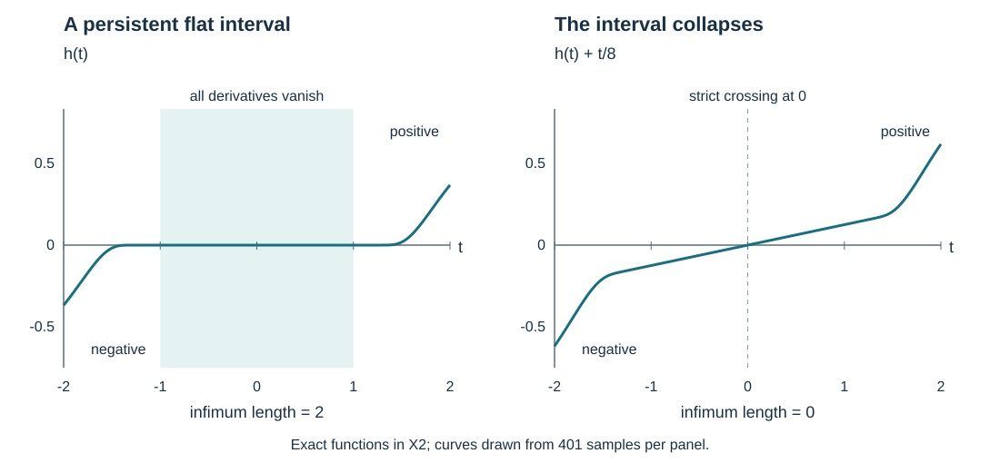

# Condition Ψ and complex characteristic tubes

A negative value followed by a positive value can be separated by an entire interval of zeros. At such a transition every derivative may vanish. This lesson develops the geometry that keeps these transitions visible under changes of symbol and canonical coordinates. It also constructs one complex normal form along a whole compact characteristic interval.

The mathematical antecedent is Lars Hörmander, *The Analysis of Linear Partial Differential Operators IV*, admitted 2009 edition, Section 26.4, Definitions 26.4.6 and 26.4.9, Lemmas 26.4.10–26.4.11, Theorem 26.4.12 and Proposition 26.4.13, printed pages 96–102. We prove the closed-set flow step directly, including its Lipschitz version. The analytic nonsolvability theorem 26.4.7 requires a subsequent construction of approximate adjoint solutions; it is not asserted here.

We use the exact [coordinate and flow proofs](../20261005-restored-prescribed-coordinates/prescribed-canonical-coordinates-and-isotropic-fibers.html), PC:O0–O2, compact homogeneous tube, TUBE:D0–I3, and [smooth complex division](../20261005-restored-function-normal-forms/real-and-complex-symplectic-function-normal-forms.html), FN:D0–D5. The [solvability lesson](../20261011-local-solvability-equivalences/local-solvability-equivalences-and-adjoint-estimates.html), LSE:M1 and D0–D2, supplies the precise invariance and estimate used in [the analytic necessity argument](../20261011-condition-psi-necessity/condition-psi-necessity-and-approximate-adjoint-solutions.html).

This independent exposition, its three complete solutions and original illustration are CC0-1.0. Linked components retain their terms. The proof map records exact dependencies. Human foundational providers remain external; internal export P514 closure is unclaimed.

## 1. The directed sign condition

**H0. Symbols, directions and the condition.** Use \(\omega=\sum d\xi_j\wedge dx_j\), \(\iota_{H_r}\omega=-dr\), and \(\{r,s\}=H_rs\). Thus \(H_{\xi_1}=\partial_{x_1}\). For a real function \(r\), a bicharacteristic is an integral curve of \(H_r\) contained in \(r=0\). A forbidden transition of a real function \(g\) means two points on such a curve, in increasing flow time, with

\[
 g(\gamma(a))<0<g(\gamma(b)),\qquad a<b. \tag{PG1}
\]

No assertion about the number, isolation or order of the intervening zeros is implicit in (PG1).

Let \(p\) be a smooth complex positively homogeneous function on \(T^*Y\setminus0\). It satisfies **condition Ψ** if (PG1), with \(g=\operatorname{Im}(qp)\), never occurs on a bicharacteristic of \(\operatorname{Re}(qp)\) on which \(q\ne0\), for any smooth complex positively homogeneous multiplier \(q\). Its degree is not prescribed. All curve intervals considered in this lesson remain in the stated open domain.

**H1. One-dimensional complex characteristics.** A regular curve \(\gamma\) is a one-dimensional bicharacteristic of \(p\) if

\[
 p(\gamma(t))=0,\qquad 0\ne\gamma'(t)=c(t)H_p(\gamma(t)) \tag{PG2}
\]

for a complex scalar \(c(t)\); the right side is real. In particular the real and imaginary Hamilton fields span a single real line along the curve. Whenever one of their real combinations is nonzero, the curve is locally a reparametrized integral curve of that smooth real field. Local flow coordinates prove this: the transverse flow coordinates have derivative zero along the given curve, so are constant. A regular smooth parametrization is then available. For a compact interval, finitely many such coordinates give the same smooth unparametrized curve. Multiplication by a nonzero complex function preserves this line on \(p=0\), because \(H_{qp}=qH_p\) there.

## 2. A complete comparison principle for forward flows

**F0. Lipschitz flows and closed-set normals.** In a coordinate ball a locally Lipschitz field \(v\) has a bounded restriction with Lipschitz constant \(L\). On a small closed time interval, the integral map \(u\mapsto x+\int_0^t v(u(s))\,ds\) maps the closed ball of continuous paths into itself and contracts when the time length times \(L\) is less than one. Successive differences form a geometric series; completeness gives a solution. Applying the same estimate on successive small intervals gives uniqueness and continuous dependence. More explicitly, the difference bound is \(|u(t)-\widetilde u(t)|\le e^{L|t|}|u(0)-\widetilde u(0)|\), by the integral inequality proved in FN:W3. Finite continuation gives the local flow and its composition law. This uses no differentiability of the vector field.

For a relatively closed set \(F\) in a coordinate domain, call \(\eta=x-y\) a *nearest-point normal* at \(y\in F\) when \(y\) minimizes the Euclidean distance from some nearby \(x\) to \(F\). The zero normal is allowed. We work in nested compact coordinate balls so minimizers exist and lie in the coordinate domain.

The following criterion is exact and local:

\[
 F\text{ is forward invariant under }v
 \quad\Longleftrightarrow\quad
 \langle\eta,v(y)\rangle\le0
 \text{ for every such normal.} \tag{PG3}
\]

Here invariance means for as long as the orbit stays in the domain. Necessity follows from \(|x-\Phi_h(y)|^2\ge|x-y|^2\), for \(h\ge0\), by its right derivative at zero.

For sufficiency, let \(x(t)\) solve the equation and let \(y\) be nearest to \(x(t)\). In a fixed smaller ball, boundedness and Lipschitz continuity give \(x(t+h)=x(t)+h v(x(t))+O(h^2)\), uniformly. Consequently, with \(d(t)=\operatorname{dist}(x(t),F)\),

\[
 d(t+h)^2\le(1+2Lh)d(t)^2+C h^2. \tag{PG4}
\]

Indeed use \(y\) as a competitor at time \(t+h\), expand the square, and split \(\langle x(t)-y,v(x(t))\rangle\) into its nonpositive normal term at \(y\) and a term at most \(L d(t)^2\). For an orbit beginning in \(F\), iterate (PG4) on \(N\) equal subintervals of a fixed sufficiently short time \(T\). The resulting bound is \(d(T)^2\le C T(T/N)e^{2LT}\), which tends to zero. Thus the orbit stays in \(F\) for this time. Reapply in overlapping smaller coordinate balls along any compact orbit interval. This proves (PG3) on the manifold and avoids an unproved differentiability assertion for the distance function.

**F1. Transfer of a one-sided sign condition.** Let \(f\in C^1(M)\) on a \(C^2\) manifold, and let \(v,w\) be locally Lipschitz fields. Suppose no forward \(v\)-orbit has \(f<0\) followed by \(f>0\). Assume

\[
 w f\le0\text{ when }f=0,\qquad
 w=v\text{ when }f=0\text{ and }df=0. \tag{PG5}
\]

Then no forward \(w\)-orbit has that transition either.

To prove this, let \(F\) be the relative closure of all points reachable by forward \(v\)-orbits from \(f<0\), with each connecting orbit in the domain. It contains \(\overline{\{f<0\}}\) and is contained in \(\{f\le0\}\). Continuous dependence and the flow composition law show local forward invariance: a short orbit from a limit point is the limit of short extensions of reaching orbits. Thus the normal inequality in (PG3) holds for \(v\).

At a boundary point of \(F\), \(f=0\). If \(df\ne0\), the implicit-function theorem identifies \(F\) locally with \(\{f\le0\}\): both inclusions follow from the preceding containments and the density of \(f<0\) on that side. A nearest-point normal annihilates every tangent direction of \(f=0\), by differentiating the nearest-point inequality along boundary curves. Testing a curve pointing inward then gives \(\eta=\lambda df\), \(\lambda\ge0\), using Euclidean identification of covectors and vectors. Its pairing with \(w\) is nonpositive by (PG5). If \(df=0\), the same inequality follows from \(w=v\). At an interior point of \(F\) the only nearest-point normal is zero. Criterion (PG3) now makes \(F\) forward invariant for \(w\). Every starting point with \(f<0\) belongs to \(F\), where \(f\le0\), proving the claim.

The agreement at singular zeros is essential. If \(f(t)=t^3\), \(v=0\) and \(w=\partial_t\), the first inequality of (PG5) holds at the sole zero, but the conclusion fails.

## 3. Invariance under an orientation-preserving change of two symbols

**I0. A compact ordinary Hamiltonian tube.** Suppose a real Hamilton field is nonzero along an embedded compact bicharacteristic interval. There are ordinary canonical coordinates near the entire interval in which its Hamiltonian is \(\tau\) and the interval is \((t,0;0,0)\). Here the last zero is an ordinary momentum mark, not a punctured-cotangent requirement.

For completeness, start with the prescribed-coordinate theorem PC:O0–O2 at one interior point. On the transverse slice \(t=t_0\), transport this chart by the actual Hamilton flow for time \(t-t_0\). Finitely many ODE charts along a slightly extended compact interval give one transverse neighborhood on which every transport is defined smoothly, as in TUBE:D1. The transported Hamiltonian remains \(\tau\). The flow preserves the symplectic form on each time slice; pairing the new time vector \(H_r\) with a transverse vector gives \(-dr\), exactly as the model pairing with \(\partial_t\) gives \(-d\tau\). Hence the full map is symplectic and locally invertible. If it failed to be injective after every transverse shrinking, pairs of colliding points would have limits on the central interval. Embeddedness forces the two limiting time values to coincide. The inverse-function neighborhood at that point excludes these collisions. A final shrinking therefore gives a single canonical diffeomorphism. A point needs only the initial local chart.

**I1. The triangular case.** Write \(p=p_1+i p_2\) with real \(p_j\), and put \((f_1,f_2)^T=A(p_1,p_2)^T\), where \(A=(a_{jk})\) is a smooth real matrix with positive determinant. Near a characteristic point or compact one-dimensional interval \(\Gamma\), assume both \(H_{p_1}\) and \(H_{f_1}\) are nonzero. If \(a_{12}=0\), the zero hypersurfaces of \(f_1\) and \(p_1\) agree. On that hypersurface,

\[
 H_{f_1}=a_{11}H_{p_1},\qquad f_2=a_{22}p_2,
 \qquad a_{11}a_{22}>0. \tag{PG6}
\]

The coefficients have the same fixed sign after shrinking along the connected interval. If positive, time orientation and sign are both preserved. If negative, both reverse: a negative-to-positive transition for \(f_2\) in its forward time still gives a negative-to-positive transition for \(p_2\) in its forward time. Thus absence of forbidden transitions is preserved. The term \(a_{21}p_1\) has no effect on this hypersurface.

**I2. The general two-symbol change.** Assume the no-transition property for \((p_1,p_2)\) on a neighborhood of \(\Gamma\). At any common zero in that neighborhood,

\[
 \{p_1,p_2\}\le0,\qquad
 \{f_1,f_2\}=(\det A)\{p_1,p_2\}. \tag{PG7}
\]

A positive first derivative along the \(p_1\)-flow would itself give the prohibited transition. The second identity follows by the product rule: all differentiated matrix coefficients have a factor \(p_1\) or \(p_2\) at a common zero.

Use I0 to set \(p_1=\tau\). Choose a constant vector \(T\) with \(d\tau(T)=1\) and \(df_1(T)\ne0\) on \(\Gamma\). At a point this is possible because two nonzero covectors cannot exclude the entire affine hyperplane \(d\tau(T)=1\). On a nontrivial interval, (PG2) gives \(dp_2=\lambda(t)d\tau\) there. Consequently \(df_1=(a_{11}+a_{12}\lambda)d\tau\ne0\), and \(T=\partial_\tau\) works on the whole interval.

Let \(\pi(x)=x-\tau(x)T\) and define \(q_2=p_2\circ\pi\). Then \(Tq_2=0\), and the fundamental theorem in the \(T\)-direction writes \(q_2=p_2+\phi p_1\), with \(\phi\) smooth. Set

\[
 b=a_{11}-a_{12}\phi,\qquad c=a_{12}/b,
 \qquad q_1=p_1+cq_2. \tag{PG8}
\]

On \(\Gamma\), \(b=df_1(T)\ne0\); shrink to make it nonzero. Then \(f_1=bq_1\), and the matrix expressing \((f_1,f_2)\) through \((q_1,q_2)\) is triangular with determinant \(\det A>0\). I1 first shows that \((p_1,q_2)\) has the original no-transition property, and finally will transfer the property from \((q_1,q_2)\) to \((f_1,f_2)\).

It remains to compare the hypersurfaces \(X=\{p_1=0\}\) and \(Z=\{q_1=0\}\). Since \(Tq_1=1\) on \(\Gamma\), projection \(\pi:Z\to X\) is a diffeomorphism on suitably small neighborhoods of the compact interval. The local implicit inverse is unique on each projection fiber; compactness gives a common neighborhood and glues these inverses. On \(Z\) take

\[
 v=(\pi|_Z)^{-1}_*H_{p_1},\qquad w=H_{q_1},\qquad f=q_2|_Z. \tag{PG9}
\]

The function \(q_2\) is constant on projection fibers, so \(v\) has the required no-transition property. At \(f=0\) on \(Z\), both \(p_1,p_2\) vanish, and \(wf=\{q_1,q_2\}=\{p_1,p_2\}\le0\). If also \(d_Zf=0\), then \(dq_2\) is a multiple of \(dq_1\); evaluation on \(T\) makes this multiple zero. Thus \(dq_2=0\) and \(H_{q_1}=H_{p_1}\) there. Moreover \(d\pi(H_{p_1})=H_{p_1}\), so \(w=v\). Apply F1 on \(Z\), then I1. This proves the full orientation-preserving two-symbol invariance on some neighborhood of \(\Gamma\).

**I3. Complex multipliers.** Replacing a complex symbol by \(q p\) acts on its two real components by the matrix

\[
 \begin{pmatrix}\operatorname{Re}q&-\operatorname{Im}q\\
 \operatorname{Im}q&\operatorname{Re}q\end{pmatrix},
 \qquad\det=|q|^2. \tag{PG10}
\]

Consequently, near a characteristic point or an embedded compact one-dimensional interval, if one nonvanishing multiplier with nonzero real Hamilton field gives absence of transitions, every other such multiplier does so on a possibly smaller neighborhood. Apply I2 to the ratio of the two multipliers. This argument needs no homogeneity and applies on any symplectic manifold. It is the exact local multiplier-invariance statement.

## 4. Locate the smallest persistent transition

**M0. A point or a completely flat interval.** In a Hamiltonian tube write the real part as \(\tau\), and write the imaginary part restricted to \(\tau=0\) as \(h(t,z)\), where \(z\) lists all transverse coordinates. Suppose \(h(a,0)<0<h(b,0)\), with the tube defined beyond the closed interval. By continuity the same strict endpoint signs hold for all small \(z\). Define

\[
 L(z)=\inf\{t-s:a<s<t<b, h(s,z)<0<h(t,z)\},
 \qquad L_0=\liminf_{z\to0}L(z). \tag{PG11}
\]

The sets are nonempty because the strict endpoint signs persist slightly inside the endpoints. Thus \(0\le L_0\le b-a\). For every sufficiently small \(\delta>0\), choose a neighborhood \(V_\delta\) of zero, of diameter at most \(\delta\), on which \(L(z)>L_0-\delta/2\). The definition of the lower limit supplies \(z_\delta\in V_\delta\) and endpoints \(s_\delta<t_\delta\) with strict opposite signs and \(t_\delta-s_\delta<L_0+\delta/2\).

For \(s_\delta+\delta<t<t_\delta-\delta\), the function \(h(t,z)\) is identically zero on a neighborhood of \(z_\delta\). Indeed shrink that neighborhood so the two endpoint signs persist. A nonzero value at time \(t\) would produce a forbidden pair either before or after \(t\), of length less than \(L_0-\delta/2\), contradicting the lower bound throughout \(V_\delta\). In particular every transverse derivative vanishes at \((t,z_\delta)\).

Take a sequence \(\delta\downarrow0\) for which the endpoints converge to \(a_0,b_0\). Their difference is \(L_0\). If \(L_0=0\), the opposite signs and continuity force \(h(a_0,0)=0\). If \(L_0>0\), passage to the limit shows that every transverse derivative of \(h\) vanishes on \((a_0,b_0)\times\{0\}\). Differentiate these zero functions in \(t\), and then use continuity at the endpoints. Thus **all** derivatives of the restricted function \(h\) vanish along the closed interval. This is not yet a claim about derivatives in the omitted variable \(\tau\).

In the positive-length case \(dp_2=\partial_\tau p_2,d\tau\) along the interval, so it is a one-dimensional complex bicharacteristic. In either case, every neighborhood of the resulting point or interval contains a whole sign-changing arc: the approximating endpoints converge to its endpoints and \(z_\delta\to0\). It is this persistent failure, rather than the value of \(L(0)\) alone, that matters.

**M1. The projected limiting interval is embedded.** Suppose the original symbol \(p\) is homogeneous but the multiplier used to find the transition is arbitrary smooth. Apply M0 to \(q p\), whose real flow is nonzero along the transition: a zero of an autonomous field cannot lie on a nonconstant orbit, by uniqueness. If the original arc is periodic, choose a simple subarc shorter than one period with the same strict transition. I0 and M0 therefore apply.

If the resulting positive-length interval \(\Gamma\) were radial at a point, homogeneity would make the whole positive ray through that point characteristic with complex Hamilton line radial. The field \(H_{\operatorname{Re}(qp)}\) is tangent to that ray wherever \(p=0\), even though \(q\) is not homogeneous. Uniqueness would keep the original orbit on the ray throughout its interval, contradicting its strict nonzero imaginary endpoint values. Thus the projection of \(\Gamma\) to the cosphere bundle is regular.

Here is also why it has no repeated point. On the characteristic set along \(\Gamma\), homogeneity makes the projected Hamilton line independent of positive covector scale. Locally choose a homogeneous complex multiplier making its real field nonzero. Its projected smooth field has unique integral curves. Hence any two projected portions through a common point agree as unparametrized curve germs. Parametrize the projected interval by arclength. If it revisited a point with opposite tangent, local uniqueness would give \(\gamma(s_1+u)=\gamma(s_2-u)\). This identity continues up to \(u=(s_2-s_1)/2\): the set of continuation times is closed, and local uniqueness extends it at every endpoint. Differentiation at the midpoint would give a unit tangent equal to its negative, impossible.

A return with the same tangent instead produces a closed leaf. One can take the first positive return: a compact regular curve has a uniform locally injective time length, so positive returns cannot accumulate at zero. Local uniqueness identifies the two end germs and makes this first-return image an embedded circle. Its positive conic lift is a characteristic surface, and \(H_{\operatorname{Re}(qp)}\) is tangent to it. Local flow uniqueness, continued along the compact original time interval, keeps that orbit in the lift, again contradicting the strict endpoint values. These are the only two possible tangent orientations at a return. The projection of \(\Gamma\) is therefore injective and regular.

## 5. Two exact alternative formulations

**E0. Homogeneous extension along an interval.** Let \(\Gamma\) be an embedded one-dimensional characteristic interval whose cosphere projection is injective and regular, and prescribe a smooth nonzero complex value \(c(t)\) along a smooth parametrization. For any real degree \(d\) there is a smooth homogeneous function \(q\) of degree \(d\) taking those values on \(\Gamma\). To construct it, choose a positive smooth covector norm \(r\) near the compact interval. On its unit slice the prescribed value is \(c(t)/r(\gamma(t))^d\). In local coordinates flattening the embedded projected interval, extend this value constantly in the transverse coordinates; a finite partition of unity glues the extensions without changing their values on the interval. At endpoints extend the smooth curve and its data slightly first. Multiply by a cutoff equal to one near the interval, and then extend by \(r^d\) along positive rays. Zero extension outside the cutoff domain gives a global smooth homogeneous multiplier if needed. It is nonzero on a neighborhood of \(\Gamma\), although no nonvanishing assertion away from it is required.

For (PG2), taking \(q(\gamma(t))=c(t)\) gives \(H_{qp}=\gamma'\) on \(\Gamma\), so its real Hamilton field is nonzero and its imaginary Hamilton field vanishes there. At a characteristic point with \(H_p\ne0\), at least one of \(q=1\) and \(q=i\) gives a nonzero real Hamilton field; a positive degree adjustment does not change that fact.

**E1. Equivalence of the three sign tests.** The following three conditions on a smooth homogeneous \(p\) are equivalent:

1. Condition Ψ of H0, using homogeneous multipliers.
2. The same absence of transitions for **every smooth multiplier**, without a homogeneity restriction.
3. For each characteristic point with \(H_p\ne0\), and each compact one-dimensional interval with injective regular cosphere projection, there is a nonzero smooth multiplier on a neighborhood, with nonzero real Hamilton field there, for which no forbidden transition occurs in that neighborhood.

Condition 2 implies 1 by restriction. Condition 1 implies 3 by E0: choose a homogeneous multiplier whose real field is nonzero along the specified compact set, then shrink its neighborhood. The defining condition applies to every curve in that neighborhood.

To prove 3 implies 2, suppose 2 fails. M0 extracts a characteristic point or one-dimensional interval near which sign-changing arcs occur in every neighborhood. The real Hamilton field of the offending multiplier is nonzero there. M1 supplies exactly the cosphere hypothesis in condition 3 when the interval is nontrivial. Condition 3 gives a good multiplier; I3 transfers its absence of transitions to the offending one on a smaller neighborhood, contradicting the persistent arcs of M0. This proves the equivalence, with no finite-order assumption at a zero. In the point test the choice can be confined to \(1\) or \(i\), choosing a nonzero real field and then applying I3.

## 6. A complex normal form on one common conic neighborhood

**N0. Fix the curve, its parameter and its degree.** Let \(p\) have degree \(m\), and let a smooth regular one-dimensional characteristic \(\gamma:I\to T^*X\setminus0\) be given on a nontrivial compact interval. Assume its cosphere projection is injective. This already implies regularity of that projection. Indeed, at a radial point choose a local homogeneous multiplier of degree \(1-m\) making its real Hamilton field nonzero. On a short characteristic subinterval that field spans the tangent line. Its projected field is smooth and vanishes at the radial point; uniqueness would make the projected subinterval constant, contradicting injectivity. The scalar \(c\) in (PG2) is smooth: on each neighborhood divide one nonzero component of \(\gamma'\) by the corresponding component of \(H_p\); the quotients agree. Use E0 with degree \(1-m\). Then

\[
 \gamma'=H_{\operatorname{Re}(qp)}\text{ on }\Gamma,
 \qquad d\operatorname{Im}(qp)=0\text{ on }\Gamma. \tag{PG12}
\]

Apply the exact compact homogeneous tube TUBE:D0–I3 to the degree-one real part. In its model coordinates \((t,z;\tau,\eta)\), with last covector component positive, this gives

\[
 (qp)\circ\chi=\tau+i g(t,z,\tau,\eta),\qquad
 g=dg=0\text{ on }J=\{(t,0;0,e):t\in I\}, \tag{PG13}
\]

and \(\chi(t,0;0,e)=\gamma(t)\) exactly. Nonradiality implies dimension at least two, so the temporal momentum and the positive last momentum are distinct.

**N1. Division and patching without changing the temporal variable.** Divide \(\tau\) by \(\tau+i g\), using the proved complex division FN:D0–D4. Work first on the slice of last momentum one, treating \(\tau\) as the division variable. Local solutions extend homogeneously; a finite partition of unity depending only on \(t\) patches them over the compact interval. Restrict all transverse domains to a common sufficiently small neighborhood. This yields

\[
 \tau=h(\tau+i g)+r(t,z,\eta),\qquad
 \deg h=0,\quad\deg r=1,\quad\partial_\tau r=0. \tag{PG14}
\]

The partition sums to one on a neighborhood of \(I\), so the identity is exact. At every point of \(J\), differentiation of (PG14) in \(\tau\) gives \(h=1\); its value and all other first derivatives then give \(r=dr=0\). Thus \(h\) remains nonzero on a common smaller conic neighborhood. Write \(r=r_1+i r_2\).

Set \(y_1=t\), \(\sigma=\tau-r_1\). Their bracket is \(\{\sigma,t\}=1\). On \(t=t_0\) prescribe the remaining coordinates to be \((z,\eta)\), and transport them constantly along \(H_\sigma\). This field has time component one; its transverse equations are independent of \(\tau\), since \(r_1\) is. Finite ODE continuation along \(J\), where \(dr_1=0\), provides one neighborhood for the entire interval. The transverse coordinates therefore remain independent of \(\tau\). Their brackets with \(\sigma\) vanish by construction, those with \(t\) vanish by that independence, and their mutual canonical brackets are transported unchanged from the initial slice by the Jacobi identity. Hence these are full canonical coordinates. Invertibility also follows directly by recovering the initial transverse data from its unique flow and recovering \(\tau\) from \(\sigma\). Degree-one homogeneity of \(\sigma\) makes its flow commute with dilations, so the coordinates have the required position and momentum degrees. The central interval and its parameter are fixed.

**N2. The resulting normal form and the flat case.** In the final model coordinates the multiplied symbol is

\[
 \widetilde\chi^*(a p)=\sigma+i f(y,\eta),\qquad
 \partial_\sigma f=0,\qquad \deg f=1,\qquad
 \deg a=1-m. \tag{PG15}
\]

Indeed (PG14) gives \(h(\tau+i g)=\sigma-i r_2\). Since \(\{r_2,t\}=\partial_\tau r_2=0\), the new imaginary part \(f=-r_2\) is independent of \(\sigma\). The multiplier on the original space is \(a=q(h\circ\chi^{-1})\); both factors are nonzero along the curve and hence nearby. The new canonical map is the composition of \(\chi\) with the inverse of the canonical coordinates just constructed. It sends \((t,0;0,e)\) to the original \(\gamma(t)\), with its prescribed parameter.

If the restriction \(g|_{\tau=0}\) is flat on \(J\), then the new \(f\) is flat there in **all** variables. Evaluating (PG14) at \(\tau=0\) gives \(r=-i h|_{\tau=0}g|_{\tau=0}\); all transverse and temporal jets of this product vanish. Independence of \(\tau\) supplies the remaining jets, and composition with a smooth diffeomorphism preserves flatness by repeated chain rules. One may apply this division directly to the real-part tube used in M0, without first making \(dg=0\): there \(dg=\lambda(t)d\tau\), so \(\partial_\tau(\tau+i g)=1+i\lambda\ne0\). The same division gives \(h=(1+i\lambda)^{-1}\) and \(dr=0\) on \(J\); every subsequent coordinate argument is unchanged. Thus the restricted flatness in M0 becomes full flatness in the complex normal form without an intervening change of the real zero hypersurface. Absence, or persistent presence, of sign-changing arcs is carried through the nonzero multipliers by I3, and through canonical maps by their exact transport of Hamilton fields.

## 7. Three exercises with complete solutions

**X1. Which real matrix preserves the direction test?** In a symplectic plane set \(p_1=\tau\), \(p_2=-t\). Rotate the pair by a constant angle \(\theta\). Determine the derivative of the second component along a zero characteristic of the first. Then replace \(p_2\) by its negative.

**Solution.** The rotated pair is \(f_1=(\cos\theta)\tau+(\sin\theta)t\), \(f_2=(\sin\theta)\tau-(\cos\theta)t\). Direct differentiation gives \(\{f_1,f_2\}=-(\cos^2\theta+\sin^2\theta)=-1\). Thus the second component strictly decreases along every forward characteristic, for every angle, including the angles where \(\cos\theta=0\). There is no forbidden transition. Conjugation gives \((\tau,t)\), whose bracket is \(+1\), and along \(\tau=0\) the function \(t\) crosses from negative to positive. Its real matrix has determinant \(-1\); the positive-determinant hypothesis cannot be dropped.

**X2. A flat gap can persist or collapse.** Define \(E(s)=0\) for \(s\le0\) and \(E(s)=e^{-1/s^2}\) for \(s>0\). Let \(h(t)=-E(-t-1)+E(t-1)\) on \((-2,2)\). Compute the shortest transition length, first for the family independent of a transverse parameter, then for \(h(t)+\varepsilon t\).

**Solution.** Every right derivative of \(E\) is a polynomial in \(1/s\) times \(e^{-1/s^2}\). It tends to zero as \(s\downarrow0\): for any required power, the positive exponential series gives \(e^u\ge u^k/k!\) with a larger integer \(k\). Induction and the fundamental theorem identify the zero extensions of these derivatives. Thus \(E\) is smooth and flat at zero. The function \(h\) is negative for \(t<-1\), zero on \([-1,1]\), and positive for \(t>1\). Its infimal transition length is exactly two, approached by endpoints converging to \(-1\) and \(1\). If the transverse family is constant, \(L_0=2\). But for every \(\varepsilon>0\), \(h(t)+\varepsilon t\) is negative for every \(t<0\) and positive for every \(t>0\). Its infimal transition length is zero. Consequently the lower limit for the two-sided smooth parameter family is \(L_0=0\), even though the central member has a zero interval of length two. This is why M0 uses nearby trajectories as well as the central one.

**X3. Compute a compact complex tube exactly.** In \(T^*\mathbb R^2\), with coordinates \((t,z;\tau,\rho)\) and \(\rho>0\), let \(p=(1+i\kappa)\tau+i z^2\rho\), where \(\kappa\) is real. Construct (PG15) along \((t,0;0,1)\) for an arbitrary fixed compact time interval.

**Solution.** Put \(a_0=\kappa/(1+\kappa^2)\). The exact canonical map from \((t,Z;\sigma,H)\) is

\[
 z=\frac{Z}{1-a_0tZ},\qquad
 \rho=H(1-a_0tZ)^2,\qquad
 \tau=\sigma-a_0Z^2H. \tag{PG16}
\]

Choose one neighborhood with \(|a_0tZ|<1/2\) for every time in the compact interval; if \(a_0=0\) there is no restriction from this inequality. The inverse is \(Z=z/(1+a_0tz)\), \(H=\rho(1+a_0tz)^2\), \(\sigma=\tau+a_0z^2\rho\). Direct differentiation gives \(\tau\,dt+\rho\,dz=\sigma\,dt+H\,dZ\), proving canonicity with the exact primitive. The map is homogeneous and fixes the entire central interval. Finally

\[
 \frac{p\circ\widetilde\chi}{1+i\kappa}
 =\sigma+i\frac{Z^2H}{1+\kappa^2}. \tag{PG17}
\]

This verifies the multiplier, the independence of the temporal momentum and the preservation of the whole parameterized curve, not only a normal form at one point.

## 8. See the persistent interval and its collapse

**V0. The exact functions behind the picture.** The left panel plots the function \(h\) in X2, with its entire zero interval marked. The right panel plots \(h(t)+t/8\). Both use the same time and value scales; plotted vertices are numerical samples of these stated exact smooth functions. The interval lengths two and zero are proved in X2 and M0, not inferred from the samples. The figure is reproducible from its accompanying script.

The source record, [proof review](proof-review.json), [finite checks](model-check.json) and [reader checks](reader-check.json) accompany the lesson. The [necessity companion](../20261011-condition-psi-necessity/condition-psi-necessity-and-approximate-adjoint-solutions.html) uses these tubes and sign equivalences to prove necessity of condition Psi. The [solvability companion](../20261011-local-solvability-equivalences/local-solvability-equivalences-and-adjoint-estimates.html) supplies the exact adjoint estimate used in that argument.
