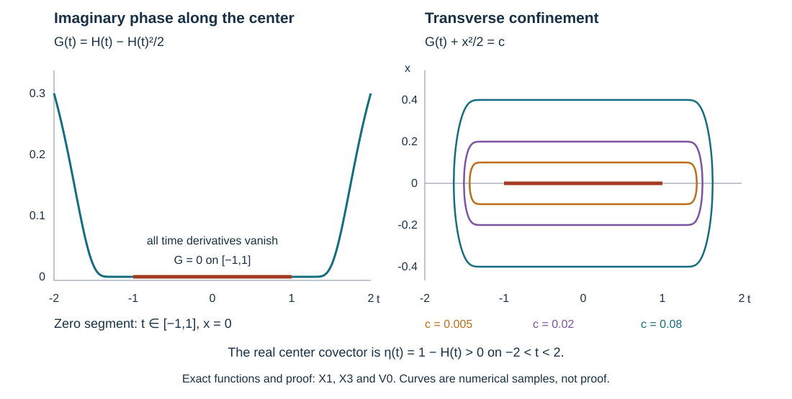

# Why local solvability requires condition Ψ

Solvability gives an estimate for test functions in terms of their adjoint images. We construct test functions concentrated near a forbidden sign change whose adjoint images are too small for that estimate to hold. The construction works when the sign change is infinitely flat or separated by a whole interval of zeros.

The mathematical antecedent is Lars Hörmander, *The Analysis of Linear Partial Differential Operators IV*, admitted 2009 edition, Section 26.4, Theorem 26.4.7 and its reduced form, Corollary 26.4.8, and Lemmas 26.4.14–26.4.16, printed pages 96 and 102–110. The proof below uses the established [condition Ψ geometry](../20261011-condition-psi-geometry/condition-psi-and-complex-characteristic-tubes.html), PSG:F1, M0–M1, E1 and N0–N2; the exact [solvability estimate](../20261011-local-solvability-equivalences/local-solvability-equivalences-and-adjoint-estimates.html), LSE:D0–D2; and the [complex nonstationary proof](../20261005-restored-positive-ideals/complex-stationary-contract.html), PI:CS0. The ordinary and graph calculus, finite-dimensional flows and smooth division are linked through the exact proof map.

The exposition, three solved exercises and original figure are independent expression, CC0-1.0. Referenced components retain their terms. The proof map retains the external human foundations explicitly; internal export P514 closure is unclaimed.

## 1. The theorem and the exact estimate to contradict

**H0. A forbidden oriented transition obstructs solvability.** Let \(P\) be a scalar classical properly supported pseudodifferential operator of real order \(m\) on a smooth manifold \(X\), with homogeneous principal symbol \(p\). Suppose a smooth homogeneous complex multiplier \(q\) is nonzero along a compact bicharacteristic interval \(\gamma:[a,b]\to T^*X\setminus0\) of \(\operatorname{Re}(qp)\), and

\[
 \operatorname{Im}(qp)(\gamma(a))<0<
 \operatorname{Im}(qp)(\gamma(b)). \tag{PN1}
\]

Here a bicharacteristic means an integral curve of \(H_{\operatorname{Re}(qp)}\) lying in \(\{\operatorname{Re}(qp)=0\}\). Then \(P\) is not microlocally solvable at the closed cone generated by that interval. In the terminology of LSE:M0, for every proposed integer forcing threshold there is a forcing term of that local Sobolev regularity for which no distributional solution has a smooth residual on the entire cone. A finite-order assumption at an intervening zero is unnecessary.

After the reductions below, assumed solvability would give fixed nonnegative integers \(N,\nu\), an operator \(A\) of finite order whose operator wavefront avoids the relevant compactly generated cone \(\Gamma\), and

\[
 \|v\|_{H^{-N}}\le C\bigl(\|P^*v\|_{H^\nu}
            +\|v\|_{H^{-N-n}}+\|Av\|_{L^2}\bigr),
 \qquad v\in C_c^\infty(Y). \tag{PN2}
\]

Here \(n=\dim X\), and \(Y\) is a fixed relatively compact base neighborhood. This is precisely LSE:D0–D2. Increasing \(\nu\) if needed makes it nonnegative. The functions constructed below have one compact support in \(Y\); their constants may depend on these fixed integers, but not on their frequency \(\lambda\to+\infty\).

## 2. Retain the full symbol while reducing the geometry

**R0. From the original interval to a point or flat interval.** Multiply by an elliptic operator with symbol \(q\) near the given curve, then by a positive homogeneous symbol making the principal degree one. On the real zero set a positive factor \(r\) changes \(H_{\operatorname{Re}(qp)}\) to \(rH_{\operatorname{Re}(qp)}\); imaginary signs and the forward orientation are unchanged. LSE:M1 preserves microlocal solvability under these operations.

The degree-one real Hamilton field descends to the cosphere bundle. A stationary projected orbit would be a ray, on which homogeneity makes the imaginary sign constant, contrary to (PN1). If the projected orbit is periodic, retain a simple arc shorter than a period with the same strict transition. The compact homogeneous tube TUBE:D0–I3 and its full elliptic graph realization TUBE:M1–M5, with LSE:M1, make the real symbol \(\xi_t\). PSG:M0 then extracts a characteristic point or a compact one-dimensional interval \(\Gamma\) with persistent sign-changing nearby arcs. In the nontrivial interval case all derivatives of the imaginary symbol restricted to \(\xi_t=0\) vanish along \(\Gamma\).

Apply PSG:N1–N2 directly to this real-part tube; at a point use FN:D5. This gives model coordinates \((t,x;\xi_t,\xi)\), \(x\in\mathbb R^{n-1}\), in which

\[
 p=\xi_t+i f(t,x,\xi),\qquad f\text{ real of degree one},
 \quad\Gamma=\{(t,0;0,e):a_0\le t\le b_0\}. \tag{PN3}
\]

The vector \(e\ne0\) is a fixed transverse covector. If \(a_0<b_0\), \(f\) is flat in all variables along \(\Gamma\). In every neighborhood of \(\Gamma\) some interval at fixed \((x,\xi)\) has \(f<0\) followed by \(f>0\). This last assertion follows from the contrapositive of PSG:I3, not from assuming that a complex multiplier preserves each particular trajectory. The limiting cone is a subcone of the original interval's cone before transformation, so its solvability would follow from the assumed solvability. The nonradial tube forces \(n\ge2\).

**R1. Remove the temporal momentum from every lower term.** The entire classical symbol, not just its principal part, can be put in the form

\[
 P=D_t+iF(t,x,D_x)\quad\text{microlocally near }\Gamma,\qquad
 F\sim f+F_0+F_{-1}+\cdots . \tag{PN4}
\]

The lower coefficients may be complex. To verify this, suppose the degree \(1-j\) residual still depends on \(\xi_t\). The common-neighborhood complex division FN:D0–D4, patched in time exactly as in PSG:N1, writes it as
\(a_{-j}p+r_{1-j}(t,x,\xi)\), with degrees \(-j\) and \(1-j\). Left multiplication by \(I-\operatorname{Op}(a_{-j})\) removes its temporal dependence at that degree. All differentiated product terms have at least one lower order, by P2:OP3. Iterate. Fixed angular/base cutoffs and the the symbol-summation construction proved in FCM:N2 give one elliptic order-zero multiplier with the resulting full series. The common domain in the division theorem is fixed before the numerator, so this recursion does not shrink away the retained interval. Every omitted residual is of arbitrarily negative order on that cone.

Choose Lebesgue density in these coordinates, absorbing any positive density change into an elliptic multiplier. The adjoint of (PN4) is tangential as well. Write it as
\(Q=D_t+B(t,x,D_x)\), with principal tangential symbol \(b_1=-if\). The equality with \(P^*\) here is microlocal. On a smaller cone containing \(\Gamma\), \(|\xi|\) is comparable to \(|(\xi_t,\xi)|\). A tangential symbol, independent of \(\xi_t\), then has the ordinary full-variable symbol bounds. Insert a full-frequency cutoff in this cone when using ordinary composition. The complementary frequencies are separated from the packet directions below; their localized Fourier transforms decrease faster than every power by W0. The composition expansion on the retained cone is P2:OP3, with all parameter derivatives. Thus agreement of the complete symbols there makes the difference act rapidly on those packets. This proves precisely the reduction needed for (PN2), without claiming that an arbitrary tangential operator is an ordinary operator at the temporal covector axis. For the remaining off-diagonal tangential kernel, the kernel is smooth in the transverse variables. The transverse phase gradient is nonzero wherever its imaginary part vanishes. Integration by parts using PI:CS0 makes this kernel contribution rapidly small, uniformly with every time derivative. Proper base cutoffs retain fixed compact output supports.

## 3. The norm and localization facts used by the construction

**W0. Complex oscillations away from their real critical covectors.** Let

\[
 v_\lambda(z)=e^{i\lambda w(z)}
       \sum_{j=0}^J\lambda^{-j}\phi_j(z),
 \qquad \operatorname{Im}w\ge0,\quad d\operatorname{Re}w\ne0, \tag{PN5}
\]

where the smooth amplitudes have a common compact support in \(\mathbb R^n\). Set
\(K_0=\{z\in\bigcup\operatorname{supp}\phi_j:\operatorname{Im}w(z)=0\}\), and let \(\Lambda_0\) be the positive cone over \(\{(z,dw(z)):z\in K_0\}\). At a zero of the nonnegative imaginary part its differential is zero, so these covectors are real and nonzero.

For any open neighborhood \(U\) of \(\{dw(z):z\in K_0\}\), with compact closure avoiding zero, and any \(L\),

\[
 |\widehat v_\lambda(\zeta)|
 \le C_L(1+\lambda+|\zeta|)^{-L}
 \quad\text{when }\zeta\notin\lambda U. \tag{PN6}
\]

Enlarge \(U\) slightly if necessary before fixing its closure. Here is the uniform argument. Normalize the Fourier phase by \(s=\lambda+|\zeta|\):
\(\Phi=(\lambda w-z\cdot\zeta)/s\). Its parameters \((\lambda/s,\zeta/s)\) range in a compact set. Wherever \(\operatorname{Im}\Phi=0\), its differential can vanish only when \(\zeta/\lambda=dw(z)\). When \(\lambda/s=0\), its differential is a nonzero unit covector. Compactness therefore gives \(|d\Phi|^2+\operatorname{Im}\Phi\ge c>0\) on the excluded frequency parameters. The full nonstationary estimate PI:CS0 applies uniformly and proves (PN6). The amplitude powers are bounded with every derivative. The same proof after any compact spatial localization proves rapid Fourier decay on every closed cone disjoint from \(\Lambda_0\).

In particular \(v_\lambda\) tends to zero faster than every power as a distribution: pair its Fourier transform with a Schwartz test function, use (PN6) below a fixed multiple of \(\lambda\), and use the test function's arbitrarily rapid tail at larger frequencies, together with the uniform compact-amplitude \(L^2\) bound. The proper-kernel Fourier estimates in SMP:A0 now show

\[
 \operatorname{WF}(A)\cap\Lambda_0=\varnothing
 \quad\Longrightarrow\quad Av_\lambda=O(\lambda^{-L})
 \text{ in every }C^k\text{ seminorm, for every }L,k. \tag{PN7}
\]

This uses both the rapid distribution pairing and the rapid localized Fourier bounds; a wavefront inclusion for a single function would not suffice. Smoothing remainders in the graph and ordinary calculus have the same rapid action.

**W1. Upper and lower Sobolev bounds.** For every nonnegative integer \(M\), (PN6) and Plancherel give

\[
 \|v_\lambda\|_{H^{-M}}\le C_M\lambda^{-M}. \tag{PN8}
\]

On \(\lambda U\), the Sobolev weight is bounded by \(C\lambda^{-2M}\), and the unweighted \(L^2\) norm is bounded. Outside it, integrate (PN6) with an exponent exceeding both the dimension and the requested power.

If \(\operatorname{Im}w(z_0)=0\) and \(\phi_0(z_0)\ne0\), then

\[
 \|v_\lambda\|_{H^{-M}}\ge c_M\lambda^{-M-n/2}
 \quad\text{for all sufficiently large }\lambda. \tag{PN9}
\]

Translate \(z_0\) to zero. For a fixed compactly supported smooth \(\psi\), change variables \(z=Z/\lambda\) in the pairing with \(\psi(\lambda z)\). After removal of the unit complex factor \(e^{i\lambda w(0)}\), the pairing multiplied by \(\lambda^n\) tends to
\(\phi_0(0)\int e^{i Z\cdot dw(0)}\overline{\psi(Z)}\,dZ\).
Choose \(\psi\) so this is nonzero. Taylor's formula on its fixed support and dominated convergence justify the limit. Direct derivative scaling gives \(\|\psi(\lambda\,\cdot)\|_{H^M}\le C\lambda^{M-n/2}\). Sobolev duality KS:S4 proves (PN9). No nondegeneracy of the full imaginary Hessian was used.

## 4. Exclude a positive bracket near the putative estimate

**G0. An exact adjoint packet for the simple model.** For \(L=D_t+i tD_s\), write \(z=(t,y,s)\), with \(y\in\mathbb R^{n-2}\), and define

\[
 Z=s+i t^2/2,\qquad
 w=Z+\frac{i}{2}\bigl(|y|^2+Z^2\bigr).
 \tag{PN10}
\]

The field \(\partial_t-it\partial_s\) annihilates \(Z\) and every component of \(y\), so \(L^*e^{i\lambda w}=0\). Moreover

\[
 \operatorname{Im}w=\frac{|z|^2}{2}-\frac{t^4}{8}
 \ge\frac{|z|^2}{4}
 \quad\text{on a sufficiently small ball}. \tag{PN11}
\]

For a cutoff \(\chi=1\) near zero in that ball, \(u_\lambda=\chi e^{i\lambda w}\) has \(L^*u_\lambda=O(\lambda^{-L})\) in every derivative norm: every differentiated cutoff is away from the only imaginary zero. Its limiting covector is the positive \(s\)-ray.

For every real \(s_0\), there are positive constants with

\[
 \|u_\lambda\|_{H^{s_0}}\asymp
                  \lambda^{s_0-n/4}. \tag{PN12}
\]

To check both sides, write \(u_\lambda(z)=e^{i\lambda s}V_\lambda(\sqrt\lambda z)\). Formula (PN10) gives
\(V_\lambda(Z)=\chi(Z/\sqrt\lambda)e^{-|Z|^2/2+Z_t^4/(8\lambda)-i Z_s Z_t^2/(2\sqrt\lambda)}\).
On its support the modulus is bounded by \(e^{-|Z|^2/4}\). Every derivative has a uniform polynomial times this bound, and on bounded sets the derivatives converge to those of \(e^{-|Z|^2/2}\). Splitting into a bounded set and its Gaussian tail proves convergence in every Schwartz seminorm. Fourier scaling centers the transform at \(\lambda e_s\), with width \(\sqrt\lambda\) and squared volume factor \(\lambda^{-n/2}\). On \(|\zeta|\le\sqrt\lambda/2\), the rescaled Sobolev weight divided by \(\lambda^{2s_0}\) tends to one and has a polynomial majorant. On the complement, uniform Schwartz decay absorbs every polynomial loss, also for negative \(s_0\). Dominated convergence proves (PN12), including a strictly positive limiting constant.

**G1. Transfer this contradiction at any positive-bracket point.** We are now working with an order-one operator. At a characteristic point where \(\{\operatorname{Re}p,\operatorname{Im}p\}>0\), FN:S2 and the full classical normalization FCM:N0–N3 give \(C P D=L\) modulo smoothing, with both elliptic graph factors of order zero. Their inverses and every-real Sobolev bounds are GE:D7–D9. Transfer the model adjoint packet by \(C^*\); a compact cutoff equal to one near the receiving point makes a test function \(v_\lambda\) in \(Y\). Outside that point the transferred packet is rapidly smooth, by W0's localized Fourier estimates and the graph action proved in SMP:A0. Thus cutoff commutators and all smoothing errors are rapid.

The inverse graph bound gives the lower inequality in \(\|v_\lambda\|_{H^s}\asymp\lambda^{s-n/4}\); the direct bound gives the upper inequality, with the rapid errors absorbed. The identity \(D^*P^*C^*=L^*\) and the inverse of \(D^*\) give \(P^*v_\lambda\) rapidly small in every norm. If the receiving point avoids \(\operatorname{WF}(A)\), (PN7) gives the same for \(Av_\lambda\). The weak term in (PN2) is smaller than its left side by \(\lambda^{-n}\). This contradicts (PN2).

Therefore, on a sufficiently small neighborhood of \(\Gamma\) disjoint from \(\operatorname{WF}(A)\), the estimate can only remain possible if

\[
 f(t,x,\xi)=0\quad\Longrightarrow\quad
                  \partial_t f(t,x,\xi)\le0. \tag{PN13}
\]

Indeed the characteristic points of (PN3) have \(\xi_t=0=f\), and their bracket is \(\partial_t f\). We may henceforth use (PN13); if it fails, the contradiction is already complete.

## 5. A positive complex phase near the flat interval

**P0. The finite phase equations.** Fix an integer \(M\ge2\). Seek a polynomial in the transverse displacement \(X=x-y(t)\):

\[
 w(t,x)=w_0(t)+X\cdot\eta(t)
              +\sum_{2\le|\alpha|\le M}\frac{w_\alpha(t)}{\alpha!}X^\alpha,
 \qquad y,\eta\text{ real}. \tag{PN14}
\]

Write its complex symmetric quadratic matrix as \(W=A+iB\), with \(A,B\) real and \(B>0\). The expression \(f(t,x,w_x)\) is interpreted by its finite Taylor polynomial in covectors at the real point \(\eta(t)\), never by an assumed holomorphic extension of \(f\). Match coefficients of \(X\) through degree \(M\) in

\[
 w_t-i\sum_{|\beta|\le M}
       \frac{f_\xi^{(\beta)}(t,x,\eta)}{\beta!}(w_x-\eta)^\beta
       =O(|X|^{M+1}). \tag{PN15}
\]

The constant equation is \(w_0'=y'\cdot\eta+i f(t,y,\eta)\). The linear equation is
\(\eta'-W y'=i(f_x+W f_\xi)\), with derivatives evaluated at \((t,y,\eta)\). Separating its two real parts gives the explicit system

\[
 y'=-B^{-1}(f_x+A f_\xi),\qquad
 \eta'=A y'-B f_\xi. \tag{PN16}
\]

For \(2\le|\alpha|\le M\), the coefficient of \(X^\alpha/\alpha!\) in \(w_t\) is
\(w_\alpha'-\sum_k y_k'w_{\alpha+e_k}\), with coefficients beyond degree \(M\) set to zero. Equating this with the finite coefficient from the right side of (PN15) determines \(w_\alpha'\). These equations, together with (PN16), form a smooth finite-dimensional ODE on the open set \(B>0\). They retain all mixed derivatives and do not assume a triangular equation for the phase coefficients. Every unknown derivative has been solved for explicitly; all remaining expressions use only the current finite coefficient vector and derivatives of the given smooth \(f\).

**P1. One interval of existence and a real center flow.** At \(t_0=(a_0+b_0)/2\), prescribe \(W=iI\) and all coefficients of degree greater than two to be zero. Take \((y(t_0),\eta(t_0))\) close to \((0,e)\). If \(a_0<b_0\), flatness of \(f\) makes the central solution constant throughout \([a_0,b_0]\). Every derivative of the ODE right side with respect to the center variables vanishes there. The exact finite continuation and parameter-dependence proofs G2:NF1–NF7 therefore give solutions on one slightly extended interval, for all initial centers in one neighborhood. Their quadratic imaginary matrices satisfy \(B>I/2\). The Jacobian of the center map is the identity along the central interval, so it remains uniformly close to the identity on a smaller product neighborhood.

For \(a_0=b_0\), ordinary local existence gives the same assertions on a sufficiently short interval about \(t_0\), because the initial center Jacobian is the identity and \(B(t_0)=I\). In either case the map

\[
 (t,y_0,\eta_0)\longmapsto(t,y(t),\eta(t)) \tag{PN17}
\]

is a diffeomorphism on a product of an interval and a small convex ball. Indeed a transverse derivative within norm \(1/2\) of the identity gives
\(|F_t(u)-F_t(v)|\ge|u-v|/2\) by integrating along the segment; the inverse-function theorem gives the smooth local inverse, and this inequality gives global injectivity on the ball. Shrink the extended time interval and ball to obtain that uniform derivative bound. Denote the image field of \(\partial_t\) by \(V\). It is smooth, its time component is one, and (PN16) implies \(V=\partial_t\) wherever \(f=df=0\).

**P2. Force an interior minimum of the imaginary phase.** Apply PSG:F1 to the function \(f(t,x,\xi)\), with first field \(V\) and second field \(\partial_t\). Condition (PN13) supplies the inequality at zeros, and P1 supplies agreement at singular zeros. If no \(V\)-orbit had a negative-to-positive transition, no vertical orbit could have one. But R0 gives a vertical transition in every neighborhood of \(\Gamma\). Hence some center orbit from (PN17), as close to \(\Gamma\) as desired, has
\(f(t_-,y(t_-),\eta(t_-))<0<f(t_+,y(t_+),\eta(t_+))\).

Solve the constant phase equation from P0 along this orbit. Its imaginary part satisfies

\[
 h'(t)=f(t,y(t),\eta(t)),\qquad h=\operatorname{Im}w_0. \tag{PN18}
\]

The strict derivative signs at the two endpoints ensure that the minimum of \(h\) on this interval is below both endpoint values and is attained inside. Subtract that minimum as an imaginary constant from \(w_0\). Thus \(h\ge0\), its minimum is zero at an interior point \(t_*\), and both endpoint values are positive. Since \(B>I/2\), a uniform small transverse neighborhood gives

\[
 \operatorname{Im}w(t,x)\ge h(t)+\tfrac18|x-y(t)|^2. \tag{PN19}
\]

The cubic and higher polynomial terms are absorbed by shrinking that neighborhood on the compact time interval. At an imaginary zero, \(x=y(t)\) and \(h'(t)=f(t,y,\eta)=0\). The constant equation gives \(w_t(t,y)=if=0\), while \(w_x(t,y)=\eta\). Consequently all real critical covectors of the phase lie in an arbitrarily small neighborhood of \(\Gamma\) disjoint from \(\operatorname{WF}(A)\). Also \(\eta\) remains nonzero, so \(d\operatorname{Re}w\ne0\) throughout a smaller base neighborhood. This proves the full positive-phase construction, including the degenerate time direction.

## 6. The symbol action with quantitative remainders

**A0. A direct packet estimate for an arbitrary symbol order.** In \(d\) transverse variables suppose \(w_x(y)=\eta\ne0\) is real and
\(\operatorname{Im}w(x)-\operatorname{Im}w(y)\ge c|x-y|^2\) on a compact amplitude support, with \(\operatorname{Im}w(y)\ge0\). Let \(a(x,\xi)\in S^\mu\). For every positive integer \(K\),

\[
 a(x,D)(\phi e^{i\lambda w})=
 \sum_{|\beta|<K}\frac{\partial_\xi^\beta a(x,\lambda\eta)}{\beta!}
          (D-\lambda\eta)^\beta(\phi e^{i\lambda w})
       +O(\lambda^{\mu-K/2}). \tag{PN20}
\]

The error is uniform on compact output sets. A fixed number \(\ell\) of output or smooth parameter derivatives costs at most \(\lambda^\ell\); uniform versions require the corresponding finite phase, symbol, support and positive-Hessian bounds. These hold on the compact time interval in P2.

Here is a proof with the dimensional factors retained. Put \(x=y+Z/\sqrt\lambda\), remove the factors \(e^{i\lambda w(y)}\) and \(e^{i\sqrt\lambda Z\cdot\eta}\), and call the remaining function \(b_\lambda(Z)\). Its modulus has a Gaussian bound. The first derivative of its residual phase is
\(\sqrt\lambda(w_x(y+Z/\sqrt\lambda)-\eta)=O(|Z|)\); each higher derivative is uniformly bounded by a polynomial in \(Z\). Repeated differentiation and (PN19) therefore bound every Schwartz seminorm of \(b_\lambda\) uniformly. Away from a small neighborhood of \(y\), strict positivity of the imaginary part gives the same conclusion after a partition; on a compact support its positive minimum absorbs all derivatives. Fourier scaling and the earlier Fourier inversion proof give

\[
 |\widehat{\phi e^{i\lambda w}}(\zeta)|
 \le C_L\lambda^{-d/2}
       (1+|\zeta-\lambda\eta|/\sqrt\lambda)^{-L},\qquad
 \int |\zeta-\lambda\eta|^K|\widehat{\phi e^{i\lambda w}}(\zeta)|\,d\zeta
 \le C_K\lambda^{K/2}. \tag{PN21}
\]

The factor \(e^{-\lambda\operatorname{Im}w(y)}\le1\) has been discarded. In the Fourier integral for \(a(x,D)\), restrict first to \(|\zeta-\lambda\eta|<c_0\lambda\), with \(c_0\) less than half the lower bound for \(|\eta|\). Taylor's remainder for the symbol there is at most
\(C\lambda^{\mu-K}|\zeta-\lambda\eta|^K\). Its integral is \(O(\lambda^{\mu-K/2})\) by (PN21). In the complementary region arbitrary Schwartz exponents in (PN21) absorb the symbol's polynomial growth and give every requested negative power, including the polynomial Taylor terms extended to that region. Fourier inversion of each retained monomial gives precisely (PN20). This proves the estimate without an unaccounted volume factor.

For derivatives in \(x\) or a parameter, differentiate this finite Taylor identity and its integral remainder. An output derivative of the oscillatory Fourier factor costs at most one power of \(\lambda\) in the concentrated region; in the complement increase the Schwartz exponent. A parameter derivative of the phase costs one power, and differentiating the moving center or the symbol Taylor factors obeys the same bound by the chain rule and the symbol estimates. Induction proves the stated \(\lambda^\ell\) loss. This is the quantitative form of the symbol-action lemma needed here.

**A1. A finite amplitude system, with every term controlled.** Apply (PN20) to the classical tangential symbol of \(Q\) from R1, after truncating its homogeneous expansion. In a homogeneous term of degree \(1-l\), a Taylor monomial of length \(|\beta|\) has coefficient \(\lambda^{1-l-|\beta|}\). Expanding \((D-\lambda\eta)^\beta(\phi e^{i\lambda w})\) by the product rule gives finitely many powers of \(\lambda\). After removal of the exponential, its top power is \(\lambda^{|\beta|}(w_x-\eta)^\beta\phi\). Thus the total leading coefficient is the finite eikonal expression in P0. Its error is \(O(|X|^{M+1})\) when the symbol Taylor depth exceeds \(M\).

The coefficient of power zero is an operator

\[
 T\phi=D_t\phi+\sum_k c_k(t,x)D_{x_k}\phi+c_0(t,x)\phi. \tag{PN22}
\]

The coefficients are smooth finite Taylor expressions: \(c_k\) comes from the covector derivative of \(b_1=-if\); \(c_0\) includes the degree-zero symbol and the second phase derivatives. No evaluation of a merely smooth symbol at an actual complex covector is needed. More generally the coefficient of \(\lambda^{-j}\) is a differential operator \(B_j\) of order at most \(j+1\). To verify this bound, if a product-rule term contains \(r\) phase factors, at least \(r\) of the \(|\beta|\) derivatives have fallen on the exponential. At power \(-j\) one has \(|\beta|-r=j+1-l\), so no more than \(j+1\) derivatives can remain on \(\phi\). All coefficients are determined by the fixed finite truncations and are bounded with every needed derivative.

For \(v_\lambda=e^{i\lambda w}\sum_{j=0}^J\lambda^{-j}\phi_j\), equate the coefficient at each power \(\lambda^{-j}\):

\[
 T\phi_j+R_j=O(|X|^{M+1}),\qquad
 R_0=0,\qquad R_j=\sum_{l<j}B_{j-l}\phi_l. \tag{PN23}
\]

Take each \(\phi_j\), before cutoff, to be a polynomial in \(X\) of degree at most \(M\). Matching the coefficients of degrees zero through \(M\) in (PN23) is a finite linear inhomogeneous ODE for its coefficients. In particular \(D_t\) supplies \(-i\phi_{j,\alpha}'\); differentiating \(X=x-y(t)\) and the spatial terms only couples the current finite coefficients, with coefficients beyond degree \(M\) set to zero. There is no unsolved highest spatial jet. The earlier \(\phi_l\)'s determine the inhomogeneous term. Linear ODE existence on the whole compact interval, G2:NF2–NF3, therefore constructs these polynomials successively. At the minimum point \(t_*\), choose the degree-zero initial coefficient of \(\phi_0\) to be one and its other initial coefficients zero. Thus \(\phi_0(t_*,y(t_*))=1\).

Multiply every amplitude by a common cutoff equal to one near the compact set of imaginary zeros. Place its time transitions where \(h>0\), and its transverse transitions where \(|X|\) has a fixed positive lower bound. Formula (PN19) gives a strictly positive imaginary part on every differentiated-cutoff support. All such errors are exponentially small with every derivative. The amplitudes now have one fixed compact support in \(Y\).

**A2. Choose finite orders that meet the actual adjoint estimate.** For clarity the following deliberately generous choices suffice. Given \(N,\nu,n\) in (PN2), set

\[
 R=N+n+2,\quad J=R+\nu+2,\quad
 M=2(R+\nu+3),\quad K=2(M+J+3). \tag{PN24}
\]

Construct the phase through degree \(M\), use Taylor depth \(K\) in A0, and retain the homogeneous symbol terms through \(l=J+1\), leaving a symbol of order \(-J-1\). Regroup the finite product through amplitude index \(J\) as in A1. All further coefficients have powers at most \(\lambda^{-J-1}\) and smooth bounded factors.

A smooth factor vanishing to order \(k\) in \(X\), multiplied by the exponential, has supremum at most \(C\lambda^{-k/2}\), because \(|X|^k e^{-c\lambda|X|^2}\) has that bound. Each derivative in all variables costs at most a further \(\lambda\): differentiating the vanishing factor costs only \(\lambda^{1/2}\), and differentiating the exponential costs \(\lambda\). The eikonal error, including its leading factor \(\lambda\), is therefore bounded in derivatives through order \(\nu\) by \(C\lambda^{1-(M+1)/2+\nu}\). The amplitude-jet errors are no larger than \(C\lambda^{-(M+1)/2+\nu}\). The symbol Taylor error is bounded by \(C\lambda^{1-K/2+\nu}\) using A0. The omitted symbol and the remaining finite product powers are bounded by \(C\lambda^{-J-1+\nu}\); the order-\(-J-1\) packet bound follows from A0 with that symbol order. Every one of these exponents is strictly less than \(-R\) for (PN24).

On the fixed compact output set, derivative bounds through the integer \(\nu\) control the \(H^\nu\) norm, by the finite-chart derivative norm and Plancherel. R1 and W0 make all microlocal comparison and proper cutoff errors rapidly small. Hence the actual operator satisfies

\[
 \|P^*v_\lambda\|_{H^\nu}=O(\lambda^{-R}),
 \qquad \|Av_\lambda\|_{L^2}=O(\lambda^{-L})
 \text{ for every }L. \tag{PN25}
\]

Only finite ODE systems and finite truncations were needed for each fixed estimate. Their coefficients, supports and constants may depend on that estimate; none depend on \(\lambda\).

## 7. Finish the contradiction and the base-space consequence

**C0. Necessity on the entire specified cone.** Apply W1 to the constructed family at \((t_*,y(t_*))\). The nonzero leading amplitude and zero imaginary value give a lower bound \(c\lambda^{-N-n/2}\). Meanwhile the weak term in (PN2) is \(O(\lambda^{-N-n})\), and (PN25) gives \(O(\lambda^{-N-n-2})\) for the adjoint term and arbitrary decay for the remaining term. Dividing (PN2) by \(\lambda^{-N-n/2}\) would give

\[
 c\le C\bigl(\lambda^{-n/2-2}
                    +\lambda^{-n/2}+o(1)\bigr), \tag{PN26}
\]

which is impossible. This proves nonsolvability in the reduced setting (PN3), including a point and an infinitely flat interval. If (PN13) failed, G1 had already supplied the contradiction. R0 and LSE:M1 transport the conclusion back to the original cone, proving H0 in its full stated scope.

**C1. Weak base solvability forces Ψ on a neighborhood.** Suppose the classical scalar \(P\) is weakly solvable at a compact base set \(K\), in the sense of LSE:H0. Its proved equivalent conditions give an open neighborhood \(Y\) of \(K\) and one Sobolev threshold such that every forcing term admits a distributional solution modulo a smooth residual on \(Y\). Thus \(P\) is microlocally solvable at every compactly generated cone in \(T^*Y\setminus0\). If condition Ψ failed in \(Y\), its defining transition would contain a compact interval with strict endpoint signs and nonzero multiplier. H0 would contradict solvability at the cone generated by that interval. Hence \(p\) satisfies condition Ψ throughout \(Y\). This is the full neighborhood consequence, not only a pointwise bracket condition.

The result proved is necessity. No inference of solvability from the sign condition is used in this lesson.

## 8. Three exercises with complete solutions

**X1. Check the moving-center signs.** In one transverse variable take \(f(t,x,\xi)=a(t)\xi\), and use a constant quadratic coefficient \(W=i\). Let \(H'=a\). Find a phase with real center zero and verify the eikonal equation exactly.

**Solution.** Equations (PN16) give \(y'=0\) and \(\eta'=-a\), so choose \(\eta=1-H\). Put \(Z=x+iH(t)\) and

\[
 w=Z+i Z^2/2,\qquad
 \operatorname{Im}w=H-H^2/2+x^2/2,\qquad
 w_x=1-H+i x. \tag{PN27}
\]

The identity \(w_t=i a(t)w_x\) is immediate by differentiating \(Z\). Thus \(w_t-if(t,x,w_x)=0\), where this linear symbol has an actual complex evaluation. At the center \(w_0=i(H-H^2/2)\), and \(\operatorname{Im}w_0'=a(1-H)=f(t,0,\eta)\), exactly as in (PN18). Reversing the sign of \(\eta'\) would break both identities.

**X2. Retain the scalar transport correction.** For \(D=-i\partial_x\), expand \(D^2(\phi e^{i\lambda w})\) completely. Identify the term that would be missed by keeping only the principal value and amplitude derivative.

**Solution.** Two product rules give

\[
 D^2(\phi e^{i\lambda w})=e^{i\lambda w}
 \left[\lambda^2(w')^2\phi
       +\lambda\bigl(2w'D\phi-i w''\phi\bigr)
       +D^2\phi\right]. \tag{PN28}
\]

The term \(-i\lambda w''\phi\) is the scalar phase-Hessian correction. For a symbol of degree one its corresponding contribution is part of \(c_0\) in (PN22), at transport order. It cannot be omitted from the amplitude ODE. For the polynomial symbol \(\xi^2\), the Taylor expansion in (PN20) at depth three is exact, so this identity also checks its factorial and derivative conventions.

**X3. An exact infinitely flat obstruction.** Use the smooth flat function \(E\) proved in PSG:X2, and set

\[
 H(t)=E(t-1)+E(-t-1),\qquad
 P=D_t+i H'(t)D_x,
 \qquad -2<t<2. \tag{PN29}
\]

Show that the forbidden transition survives although every bracket derivative vanishes on the central characteristic interval, and construct exact approximate adjoint solutions near that interval.

**Solution.** The function \(H\) is zero on \([-1,1]\), positive outside, and less than one on the stated interval. Its derivative is negative to the left and positive to the right, with all derivatives zero on the closed central interval. The principal symbol \(\xi_t+iH'(t)\xi\) therefore has the required transition along \(\xi_t=0,\xi=1,x=0\), but \(\partial_t f=H''\xi\) and all its derivatives vanish on \([-1,1]\). At a zero of \(f\) near \(\xi=1\), that derivative is zero, so the simple positive-bracket test alone detects nothing.

Take the phase (PN27). Its imaginary part is nonnegative and vanishes exactly when \(x=0\) and \(-1\le t\le1\); its transverse imaginary Hessian is one. Also \(w_x=1-H+ix\) stays nonzero on a sufficiently small transverse neighborhood. Since \(P^*=D_t-iH'(t)D_x\), the exponential solves the adjoint equation exactly before cutoff. Choose a compact cutoff equal to one near the whole imaginary-zero segment, with transitions only where the imaginary part is positive. Then \(v_\lambda=\chi e^{i\lambda w}\) has rapidly small adjoint image, and W0–W1 give exactly the remaining estimates used in C0. This supplies the infinitely flat obstruction with no formal remainder and no finite-order contact assumption.

## 9. The flat beam and the nonzero covector it carries

**V0. Read the exact phase rather than a schematic tube.** The figure uses the functions in X3. Its first panel is \(G(t)=H(t)-H(t)^2/2\). Its second panel shows the zero segment and the contours \(G(t)+x^2/2=c\) of the exact imaginary phase at the labelled positive levels. The real transverse covector at the center is \(1-H(t)>0\). Both the long zero segment and the positive transverse confinement are visible. Curves are sampled from the stated formulas; the contour identities and zero-set conclusions are proved in X1 and X3.

The source record, [proof review](proof-review.json), [finite checks](model-check.json) and [reader checks](reader-check.json) accompany the complete necessity argument. Together with the earlier solvability and geometry lessons, this supplies the receiving content of Section 26.4. Later Chapter 26 sections, the other course obligations and internal foundation closure remain active.
