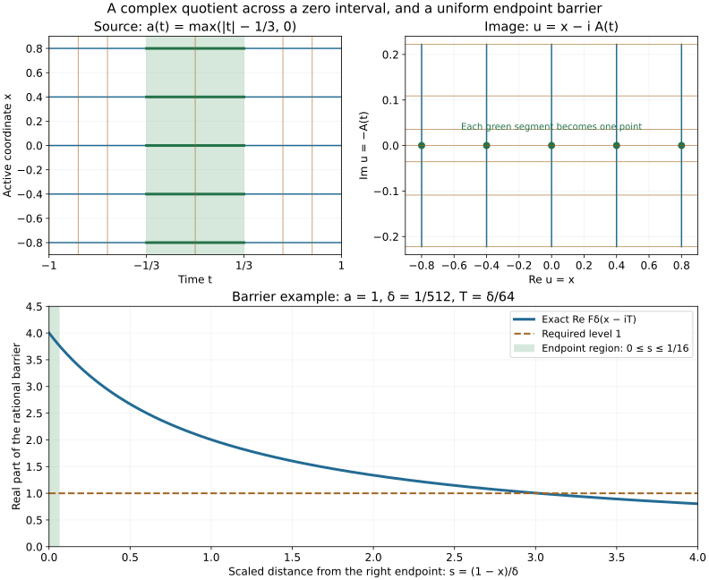

# Boundary barriers and degenerate analytic quotients

A zero coefficient can collapse an entire characteristic interval to one point of a complex coordinate. The quotient still has genuine complex charts when there is activity on both sides of that interval. We prove this by a monotone change of real coordinate, then prove that every homogeneous solution factors holomorphically through the quotient. A separate rational construction gives uniform boundary barriers. The final application supplies the intrinsic analytic structure on reduced two-dimensional bicharacteristics and the affine structure on their conic ray quotients.

The antecedents are Hörmander IV, Corollary 26.7.8 and Theorems 26.7.10–11, printed pages 131–134 of the admitted 2009 edition. The earlier [uniform-solvability lesson](../20261011-degenerate-cr-solvability/uniform-solvability-and-degenerate-complex-coordinates.html) supplies Lemmas 26.7.1–5, Theorem 26.7.6 and Corollaries 26.7.7 and 26.7.9. Together the two lessons give the full numbered results of Section 26.7. Here the topology, common domains in the positive perturbation, and the limiting holomorphic argument are proved explicitly.

Original expression, exercises and figure are CC0-1.0. The proof map pins exact earlier proofs and preserves the external human foundation dependencies. Internal export P514 closure is not claimed. 

## 1. The coordinate and the exact solution class

**H0. The operator and the existing coordinate.** Write \(D=-i\partial\), \(x=(x_1,x')\), and

\[
 P_a=D_t+i a(t,x)D_1,\qquad a\ge0.
 \tag{DQ1}
\]

The coefficient is continuous in \(t\), with every spatial derivative continuous and bounded. For the barrier assertion it ranges over a bounded family in this class. DCR:C1 constructs, on one common strip, functions \(u,w\) with

\[
 P_a u=0,\qquad u_{x_1}=e^w,\qquad
 u_t=-ia e^w,\qquad P_aw=-a_{x_1}.
 \tag{DQ2}
\]

All spatial derivatives of \(u,w,u_t,w_t\) have uniform bounds on a smaller strip. A local solution below means a function with continuous first time derivative and continuous spatial derivatives of every order locally. The equation gives the corresponding spatial derivatives of its first time derivative. With smooth coefficients these are exactly the usual smooth solutions, by DCR:S0's induction. No time differentiability of the coefficient is added in the continuous-time statements.

## 2. A uniform barrier with all three regions

**B0. Normalize a uniformly controlled graph.** Multiply \(u-u(0)\) by \(e^{-w(0)}\) and replace \(w\) by \(w-w(0)\). The equations and uniform bounds persist. Choose an arbitrarily small \(r>0\), within the common strip, such that \(|w(0,s,0)|\le1/8\) for \(|s|\le r\), uniformly over the coefficient family. Set \(\gamma(s)=u(0,s,0)\) and \(z_\pm=\gamma(\pm r)\). The elementary exponential bounds give

\[
 \operatorname{Re}\gamma'(s)\ge\tfrac12,
 \qquad |\gamma'(s)|\le2.
 \tag{DQ3}
\]

Fix one \(M\ge1\) bounding the relevant first derivatives in a slightly larger box; thus
\(|u(t,s,x')-\gamma(s)|\le M(|t|+|x'|)\).
The higher derivative bounds remain uniform as well. All choices in this paragraph depend only on the bounded coefficient family and the chosen neighborhood size.

**B1. A rational function with quantitative margins.** For \(\delta>0\), define

\[
 F_\delta(z)=4\delta\left(
 \frac1{\delta+z-z_-}+\frac1{\delta+z_+-z}\right).
 \tag{DQ4}
\]

If \(|z-\gamma(s)|\le\delta/4\), both denominators have real part at least \(3\delta/4\), since the real part of \(\gamma\) is increasing. Hence \(F_\delta\) is holomorphic on a neighborhood of this tube and its real part is positive there. If \(|z-z_-|\le\delta/4\), put \(q=(z-z_-)/\delta\). Then

\[
 \operatorname{Re}\frac4{1+q}
 =\frac{4(1+\operatorname{Re}q)}{|1+q|^2}
 \ge\frac{48}{25}>1.
 \tag{DQ5}
\]

The analogous bound holds for the second fraction near \(z_+\); the other fraction has positive real part. If \(|s|\le r/2\), both endpoint real-part distances from \(\gamma(s)\) are at least \(r/4\). In the same tube each denominator therefore has modulus at least \(r/4\). It follows that

\[
 |F_\delta(z)|\le32\delta/r
 \quad\text{when }|s|\le r/2,
 \ |z-\gamma(s)|\le\delta/4.
 \tag{DQ6}
\]

These lower denominator bounds also control every derivative of the rational function. They hold uniformly for all curves in B0; no qualitative proximity assertion substitutes for a denominator estimate.

**B2. Choose the neighborhoods and prove the derivative bounds.** Given \(\varepsilon>0\), put \(\varepsilon_0=\min(\varepsilon,1)\). Choose

\[
 0<\delta<\varepsilon_0r/128,\qquad
 \eta=\delta/(16M),\qquad
 \sigma=T=\delta/(64M),
 \tag{DQ7}
\]

decreasing \(\delta\) also to keep the boxes inside the coordinate strip. Use the nested open neighborhoods

\[
 \begin{aligned}
 V_2&=\{|x_1|<r,\ |x'|<2\sigma\},\\
 V_1&=\{|x_1|<r-\eta,\ |x'|<\sigma\},\\
 V_0&=\{|x_1|<r/2,\ |x'|<\sigma\sqrt{\varepsilon_0}/4\},
 \end{aligned}
 \qquad U=F_\delta(u)+2|x'|^2/\sigma^2.
 \tag{DQ8}
\]

In zero parameter dimension the conditions on \(x'\) are automatic and that last summand is zero. The inequalities in (DQ7) give \(\eta<r/2\), so the displayed nesting is strict. On \((-T,T)\times V_2\), the distance to \(\gamma(x_1)\) is at most \(3\delta/64<\delta/4\). Thus \(\operatorname{Re}U>0\) throughout this box. Outside \(V_1\), either \(|x'|\ge\sigma\), giving the real summand at least two, or \(x_1\) is within \(\eta\) of an endpoint. In the latter case

\[
 |u-z_\pm|\le M\eta+M(T+2\sigma)
 =7\delta/64<\delta/4,
 \tag{DQ9}
\]

so (DQ5) gives \(\operatorname{Re}U>1\). On \(V_0\), (DQ6) and (DQ7) bound the rational term by \(\varepsilon_0/4\); the real summand is less than \(\varepsilon_0/8\). Consequently \(\operatorname{Re}U<\varepsilon\) there.

The chain rule and (DQ2) show \(P_aF_\delta(u)=0\); the operator does not differentiate \(x'\), so \(P_aU=0\). For fixed \(\varepsilon,r,\delta\), every spatial derivative of \(U\) is a finite sum of derivatives of \(u\) times powers of denominators bounded away from zero by \(3\delta/4\), plus a derivative of the displayed polynomial. Their bounds are independent of the coefficient chosen in the family. The equation also gives the same conclusion for every spatial derivative of \(U_t=-iaU_{x_1}\). Since \(r\) and then \(\delta\) can be arbitrarily small, this proves the complete uniform boundary-barrier assertion.

## 3. Exact fibers and a quotient chart

**Q0. Compact zero intervals and two-sided activity.** For this section suppress the inactive parameters and write \(x\) for the active variable. Let \(\Omega\) be the coordinate strip and set

\[
 \Omega_0=\{(t,x)\in\Omega:
  a(t_-,x)>0,\ a(t_+,x)>0
  \text{ for some }-1<t_-<t<t_+<1\}.
 \tag{DQ10}
\]

This is open: the same two positive witnesses persist for all nearby \((t,x)\). Every point is equivalent to itself. Two distinct points \((t,x)\) and \((s,x)\) are equivalent precisely when \(a(\tau,x)=0\) for every time between them; denote the quotient by \(Q\). At a point with \(a>0\) the class is a singleton. At a zero point its class is the maximal closed zero interval \(I\times\{x_0\}\); the two positive witnesses make it compact and contained strictly inside the time strip.

Nonnegativity implies \(a_x=0\) wherever \(a=0\), by the elementary derivative test for a minimum. On a zero interval, (DQ2) therefore gives \(u_t=w_t=0\). Every other solution also has \(v_t=-ia v_x=0\) there. In particular \(u,w,v\) are constant on each class. At a positive point the following construction simply uses a small ordinary rectangle.

**Q1. Use the real part as the transverse coordinate.** Around a compact zero class first choose a slightly larger closed rectangle, with spatial interval \([x_0-r,x_0+r]\), such that a constant rotation of \(u\) makes

\[
 p=\operatorname{Re}u_x\ge m>0
 \quad\text{throughout the rectangle}.
 \tag{DQ11}
\]

The continuous function \(w\) is constant on the compact interval \(I\). Choose a spatial neighborhood and small extensions at both time ends on which its variation is small. Rotation by the phase of \(e^w\) on \(I\) gives (DQ11). For the moment the time faces need not have positive coefficient. Denote their times by \(s_-<s_+\).

The function \(\operatorname{Re}u(t,x_0)\) is constant on \(I\), with value \(X_0\). Choose the outer time faces still closer, if necessary, so its drift over \([s_-,s_+]\) is less than \(mr/4\). The mean value bound from (DQ11) gives an open real interval \(J\), containing \(X_0\), which lies in every image of \((x_0-r,x_0+r)\) under \(x\mapsto\operatorname{Re}u(t,x)\). For \(X\in J\) there is a unique solution

\[
 \operatorname{Re}u(t,x(t,X))=X.
 \tag{DQ12}
\]

Existence follows from the intermediate value theorem and uniqueness from the lower derivative bound. The same bound gives continuity of the inverse, uniformly on compact subsets. Difference quotients in (DQ12) give its first derivatives; repeated spatial differentiation gives all derivatives in \(X\). This also proves the parameter version used below. Put \(q=\operatorname{Im}u_x\) and \(Y(t,X)=\operatorname{Im}u(t,x(t,X))\). The equations give the exact identities

\[
 x_t=-a q/p,\qquad
 Y_t=-a(p^2+q^2)/p\le0.
 \tag{DQ13}
\]

All coefficients here are evaluated at \((t,x(t,X))\). Only first time derivatives have been used. On \(I\), the inverse at \(X_0\) is exactly \(x_0\). There is a time between \(s_-\) and the left endpoint of \(I\) where \(a(t,x(t,X_0))>0\): otherwise (DQ13) would make \(x(t,X_0)\) identically \(x_0\) on that whole extension, contradicting the maximality of the original zero interval. The same argument applies on the right. Choose such times \(t_-\) and \(t_+\), and shrink \(J\) once. Continuity now gives \(a(t_\pm,x(t_\pm,X))>0\) for every \(X\in\overline J\). These are the positive time faces used below. This order of choices avoids imposing a common positive-width condition before the inverse coordinate has been constructed.

**Q2. The image and its fibers.** Let

\[
 W=\{(t,x(t,X)):t_-<t<t_+,\ X\in J\},\qquad
 V=\{X+iy:X\in J,\ Y(t_+,X)<y<Y(t_-,X)\}.
 \tag{DQ14}
\]

The endpoint functions are continuous. Their strict separation follows because \(a>0\) near both time faces and \(p>0\). Hence \(V\) is open. For each fixed \(X\), the continuous nonincreasing function \(Y(t,X)\) takes every value between its endpoint values, so \(u(W)=V\). Every point of this domain has activity on both sides on its original fixed-spatial-coordinate line: if the coefficient vanished on that whole line from the point to a time face, its real coordinate would be constant there, so uniqueness in (DQ12) would put its endpoint on the positive face with the same zero coefficient. This is impossible. Thus the domain is contained in the active set (DQ10).

If two distinct times have the same \(Y\), the integral of the nonnegative continuous function \(a(p^2+q^2)/p\) between them is zero. That function vanishes throughout the interval. Then \(a=0\), (DQ13) gives \(x_t=0\), and the two points belong to exactly the zero interval of Q0. Conversely (DQ2) makes \(u\) constant on every such interval. Thus its fibers are precisely the prescribed equivalence classes. The set \(W\) is saturated in \(\Omega_0\): a zero class cannot cross a time face on which \(a>0\), and it cannot cross a lateral face with a different value of \(\operatorname{Re}u\).

For each compact \(K\subset V\), its preimage in \(W\) is compact. Indeed any sequence of preimages lies in the closed original rectangle. A convergent subsequence cannot reach a lateral boundary because the real parts in \(K\) remain interior to \(J\), nor a time face because its image there is one of the endpoint graphs excluded by \(K\). Its limit is therefore in \(W\). This proves the required properness directly.

**Q3. The topology is the actual quotient topology.** The continuous map \(u:W\to V\) induces a continuous bijection \(W/{\sim}\to V\). It has continuous inverse. To see this without presupposing a leaf-space theorem, let \(F\subset W\) be closed and saturated, and let \(z_n\in u(F)\) converge to \(z\in V\). The set consisting of this sequence and its limit is compact. Q2 gives a convergent subsequence of preimages in \(F\); its limit maps to \(z\). Thus \(u(F)\) is closed. By the definition of quotient topology the induced bijection is closed, hence a homeomorphism.

Because \(W\) is saturated and open, this is a chart on the original quotient \(Q\), rather than on a different local relation. Such neighborhoods can be chosen arbitrarily close to their compact central class. The quotient is Hausdorff: for two distinct compact classes choose the first chart neighborhood avoiding the second, and then a closed disk inside that chart containing the first image point in its interior. Its preimage is compact by Q2, closed in \(\Omega_0\), and saturated. The quotient of the preimage of the open disk and the quotient of the complement of the closed-disk preimage are disjoint open neighborhoods of the two classes. Finally \(\Omega_0\) is second countable. A cover by the saturated chart neighborhoods has a countable subcover: choose for each member of a countable basis contained in some covering set one such set. The countably many planar chart bases give a countable basis for \(Q\). This proves the topological surface assertion in full.

## 4. Every solution descends holomorphically

**A0. Positive perturbations on a common neighborhood.** Let \(v\) be any local solution near the compact class. Q0–Q3 give a continuous factor \(f\) on a quotient chart with \(v=f(u)\). We prove that it is holomorphic.

The parameter-extension theorem DCR:C2 applies locally around the whole compact time interval, not just one of its points. To justify its global hypotheses, choose a slightly larger closed rectangle in the original solution neighborhood. Multiply the functions by smooth cutoffs equal to one there, extend by zero, and do the same to \(a\) with a nonnegative cutoff. A positive affine rescaling of time puts the desired closed interval strictly inside \((-1,1)\); the new coefficient is the old coefficient times that positive time scale. All resulting spatial derivatives and first solution time derivatives are bounded. The functions still solve the equation on the needed strip. Thus DCR:C2 applies after this rescaling.

Use the extra spatial parameter \(e\) and the coefficient \(a(t,x)+\vartheta(e)^2\), where \(\vartheta\) is smooth, bounded with all derivatives bounded, and equals \(e\) near zero. The harmless positive time scale is included if time was rescaled. Extend both \(u\) and \(v\) by DCR:C2 and intersect their two resulting strips. Analyticity is local at the central class, so now construct the chart Q1 inside this common strip, choosing its time faces after the inverse coordinate as prescribed there. The whole compact interval \(I\) remains inside it. We obtain

\[
 P_{a+e^2}u_e=P_{a+e^2}v_e=0,\qquad
 u_0=u,\quad v_0=v,
 \tag{DQ15}
\]

in the original coordinates near that rectangle. All functions and their first time and spatial derivatives converge uniformly on its compact subsets as \(e\to0\). This is a consequence of their joint continuity in the added parameter. After a further fixed shrink, \(\operatorname{Re}(u_e)_x\ge m/2\). The construction of Q1–Q2 applies on a common interval \(J\); its endpoint graphs \(Y_e(t_\pm,X)\) converge uniformly on compact subintervals of \(J\) to the unperturbed graphs. To verify this last assertion, (DQ11) bounds the difference of the inverses \(x_e(t,X)\) by a constant times \(\sup|\operatorname{Re}u_e-\operatorname{Re}u|\); then use uniform convergence and uniform continuity of the imaginary parts.

For \(e\ne0\), (DQ13) is strictly negative. Therefore \(u_e\) is a \(C^1\) diffeomorphism onto the open region \(V_e\) between its endpoint graphs. Put \(f_e=v_e\circ u_e^{-1}\). The real Jacobian of \(u_e\), with input order \((t,x)\), is \((a+e^2)|(u_e)_x|^2>0\). The complex chain rule for \(v_e=f_e(u_e)\), together with \((\partial_t+i(a+e^2)\partial_x)u_e=0\), gives

\[
 0=2i(a+e^2)\overline{(u_e)_x}\,
       (\partial_{\bar z}f_e)(u_e).
 \tag{DQ16}
\]

Thus \(\partial_{\bar z}f_e=0\). These initially \(C^1\) functions are smooth holomorphic functions by the complete weak holomorphic regularity argument WCR:C0.

**A1. Convergence across a collapsed interval.** Let \(K\) be any compact subset of \(V\). Uniform convergence of the endpoint graphs shows \(K\subset V_e\) for all sufficiently small nonzero \(e\). We claim

\[
 \sup_{z\in K}|f_e(z)-f(z)|\longrightarrow0.
 \tag{DQ17}
\]

If not, choose a sequence \(e_j\to0\) and \(z_j\in K\) witnessing a fixed positive difference. After subsequences, \(z_j\to z\in K\), and the preimages under \(u_{e_j}\) converge in the closed common rectangle. Their limit cannot lie on a time face or lateral boundary, by the same endpoint-graph argument as Q2. It is a point \(y\in W\) with \(u(y)=z\). Uniform convergence of \(v_e\) gives \(f_{e_j}(z_j)\to v(y)=f(z)\), while continuity of the unperturbed quotient factor gives \(f(z_j)\to f(z)\). This contradiction proves (DQ17). Uniqueness of a preimage at \(e=0\) was never assumed.

For any compactly supported smooth test function in \(V\), integration by parts and (DQ17) pass \(\partial_{\bar z}f_e=0\) to the distributional equation \(\partial_{\bar z}f=0\). The continuous function \(f\) is locally square integrable. WCR:C0 therefore gives a smooth holomorphic representative; it equals \(f\) everywhere by continuity. This proves holomorphic descent without an unproved compactness or normal-family step.

**A2. The analytic atlas and both directions of the function statement.** On the overlap of two quotient charts, the second coordinate is a homogeneous solution in the first chart. A1 makes the transition holomorphic; exchanging the charts proves its inverse holomorphic. They define an analytic structure on \(Q\). Every local solution descends to a holomorphic function by A1. Conversely, if \(f\) is holomorphic, the chain rule gives \(P_a f(u)=f'(u)P_a u=0\); composition also preserves the stated local solution class. The functions agree on chart overlaps, so this proves both directions globally in the local sense. It proves Theorem 26.7.10 with exactly the two-sided-activity restriction (DQ10).

## 5. Intrinsic complex leaves and the conic affine quotient

**I0. Transfer the construction to a characteristic leaf.** CPG:L0 supplies the smooth two-dimensional leaves of the characteristic saturation under condition (P), with their maximal rank-one intervals. Near a compact such interval, CPG:M1 gives a nonzero multiplier and homogeneous canonical coordinates with

\[
 p=\tau+i h(t,z,\eta)g(z,\eta),\qquad
 h\ge0,\quad dg\ne0,
 \quad H_p|_{\{\tau=g=0\}}=\partial_t+i h H_g.
 \tag{DQ18}
\]

The full earlier normal-form proof includes the common neighborhood of the interval. The field \(H_g\) is independent of \(t\), nonzero and tangent to the leaf. Its real flow gives a coordinate \(x\) with \(H_g=\partial_x\); the flow and inverse proofs are SN:F0 and U001:P3. The independent \(\partial_t\) flow commutes with it because \(g\) is independent of \(t\). Consequently the leaf equation becomes \((\partial_t+i a(t,x)\partial_x)v=0\), with \(a=h\ge0\). Rank two is precisely \(a>0\); the reduced set defined in CPG:L0 is exactly the two-sided-active quotient of Q0 in these coordinates.

Apply Q0–A2. On overlaps, the function characterization makes every coordinate change holomorphic with holomorphic inverse. Changing the nonzero multiplier has no effect: on \(p=0\), \(H_{qp}=qH_p\). A canonical change transports the same equation by the Hamilton chain rule. Thus the analytic structure is intrinsic. The topological separation argument Q3 applies to each compact class in the original Hausdorff leaf; the countable-chart argument applies in its leaf topology. This proves the first assertion of Theorem 26.7.11, including the exact local characterization of analytic functions by \(H_pv=0\).

**I1. A conic leaf gives real-affine transition functions.** Suppose the leaf is conic. In the homogeneous chart (DQ18), its central part is parametrized by \((t,\rho)\), with \(\rho>0\) the positive dilation variable. The radial field belongs to the tangent plane. Since \(H_g\) has no \(t\) component, it is a nonzero multiple of that radial field along the central ray. Homogeneity makes the multiple independent of \(\rho\). The degree-zero function \(h\) is also independent of \(\rho\) there. Hence

\[
 H_p|_B=\partial_t+i b(t)\rho\partial_\rho,
 \qquad b(t)=\kappa h(t),\quad\kappa\in\mathbb R\setminus\{0\}.
 \tag{DQ19}
\]

The coefficient has a fixed weak sign. Its zeros are exactly the rank-one times, with activity on both sides of each class under consideration. Define

\[
 \beta(t)=\int_{t_*}^t b(s)\,ds,\qquad
 z=\beta(t)+i\log\rho.
 \tag{DQ20}
\]

Then \(H_pz=b+i b\,i=0\). The function \(\beta\) is strictly monotone after exactly its zero intervals have been collapsed; the proof is the nonnegative integral argument of Q2, with the sign reversed if necessary. Together with \(\log\rho\), it gives a genuine complex coordinate on the reduced leaf. To verify membership in the intrinsic analytic atlas, use the real coordinate \(s=\operatorname{sign}(\kappa)\log\rho\). The leaf operator is then \(\partial_t+i|b|\partial_s\), and the derivative of \(z\) with respect to \(s\) is the constant \(i\operatorname{sign}(\kappa)\ne0\). After a constant rotation, Q0–A2 apply to this coordinate itself. Their two-way transition argument gives its compatibility with I0, including holomorphic inverse transitions. Dilation by \(\lambda>0\) acts by \(z\mapsto z+i\log\lambda\), so the real coordinate on the further ray quotient is \(\operatorname{Re}z=\beta\).

Here is the full rigidity needed for its transition maps. If a holomorphic \(F\) has real part independent of the imaginary coordinate, then

\[
 0=\partial_y\operatorname{Re}F
   =-\operatorname{Im}F'(z).
 \tag{DQ21}
\]

The holomorphic derivative is real valued. The Cauchy–Riemann equations for that derivative make both of its real partial derivatives zero. It is constant on each connected chart, so \(F(z)=Az+C\), with \(A\in\mathbb R\). For a coordinate change \(A\ne0\). Thus two conic coordinates induce precisely the transitions

\[
 \beta\longmapsto A\beta+\operatorname{Re}C,
 \qquad A\in\mathbb R\setminus\{0\}.
 \tag{DQ22}
\]

These give the natural affine structure on the ray quotient. A locally affine real function is the real part of the homogeneous solution \(Az+C\), and its real part is constant along rays. Conversely every radially constant real part of a homogeneous solution has this form by (DQ21). Constant functions correspond to \(A=0\). Overlapping charts permit nontrivial global affine holonomy; no global primitive is asserted. This completes the second assertion of Theorem 26.7.11.

## 6. Three complete examples and the exact figure

**X1. A collapsed interval and an essential restriction.** Let \(a(t)=\max(|t|-1/3,0)\) on \([-1,1]\), extended continuously and boundedly outside. Find the quotient coordinate and decide whether the activity restriction can be removed.

**Solution.** Put \(A(t)=\int_0^t a(s)\,ds\) and \(u(t,x)=x-iA(t)\). Then \(u_x=1\), \(u_t=-ia\), so \(P_a u=0\). The primitive is zero on \([-1/3,1/3]\), equals \((t-1/3)^2/2\) for \(t>1/3\), and equals \(-(t+1/3)^2/2\) for \(t<-1/3\). Every vertical zero interval at fixed \(x\) is collapsed to one point, and all other points have distinct images. On an open rectangle inside the two active time endpoints the quotient is the open image strip in Q2. In contrast, if \(a\equiv0\) everywhere, every full vertical interval is collapsed and the quotient is one dimensional. Here \(\Omega_0\) is empty. Omitting its two-sided activity would falsely assert a complex surface.

**X2. Check the barrier at a time-dependent complex argument.** Take \(a=1\), \(u=x-it\), \(r=M=1\), \(\varepsilon=1/2\), and \(\delta=1/512\). Show that the endpoint and central estimates work for all \(|t|<T=\delta/64\).

**Solution.** The endpoint values are \(z_\pm=\pm1\). With \(d_-=1+\delta+x\) and \(d_+=1+\delta-x\), direct rationalization gives

\[
 \operatorname{Re}F_\delta(x-it)
 =4\delta\left(\frac{d_-}{d_-^2+t^2}
                   +\frac{d_+}{d_+^2+t^2}\right)>0
 \quad (|x|<1).
 \tag{DQ23}
\]

If \(1-|x|\le\eta=\delta/16\), its distance from the relevant endpoint is at most \(\eta+T=5\delta/64<\delta/4\). Therefore (DQ5) gives a value greater than one. If \(|x|\le1/2\), (DQ6) gives at most \(32\delta=1/16<\varepsilon/4\). In the presence of inactive parameters, add the nonnegative term in (DQ8). All inequalities are analytic bounds for the whole regions, not samples from the plot.

**X3. The signed conic coordinate.** On the cone \(\xi>0\), let \(p=\tau+i h(t)x\xi\), where \(h\ge0\) is smooth, has one zero interval and is positive on both sides. On the leaf \(x=\tau=0\), find the affine coordinate on the ray quotient.

**Solution.** The full Hamilton calculation from CPG:X1 restricts to \(H_p=\partial_t-i h(t)\xi\partial_\xi\). Thus \(b=-h\), not \(h\), in (DQ19). With \(A(t)=\int_0^t h(s)\,ds\), the coordinate is \(z=-A(t)+i\log\xi\), and \(H_pz=-h+(-ih)i=0\). Its real part \(-A(t)\) is constant on each ray and collapses precisely the zero interval. Reversing its sign is an allowed real-affine coordinate change. The earlier coordinate \(\log\xi+iA(t)\) equals \(-iz\); it is a valid complex coordinate, but its real part is not the radial-invariant affine parameter. This distinguishes the two roles without changing the Hamilton sign.

**V0. What the figure proves and what it illustrates.** The first two panels use the exact primitive in X1. The source panel displays the zero strip \(|t|\le1/3\); the image panel maps each fixed-\(x\) zero segment to the single point \(x\) on the real axis. Sampled grid curves illustrate the map, while the formulas in X1 establish its exact fibers. The last panel uses the distinct constant-coefficient example X2, with \(t=T\) and horizontal coordinate \(s=(1-x)/\delta\). The marked interval \(0\le s\le1/16\) is the endpoint part of the barrier. Its value greater than one follows from (DQ5), not numerical resolution.

The [figure generator](figures/build_figure.py), [exact checks](model-check.json), source credit, [proof review](proof-review.json) and [reader checks](reader-check.json) accompany the complete proofs. [Uniform degenerate solvability](../20261011-degenerate-cr-solvability/uniform-solvability-and-degenerate-complex-coordinates.html) gives the nonvanishing complex coordinate used here. The [frequency-localized estimates](../20261012-localized-principal-estimates/frequency-localized-estimates-and-sobolev-indices.html) use these uniform barriers in the propagation argument.
