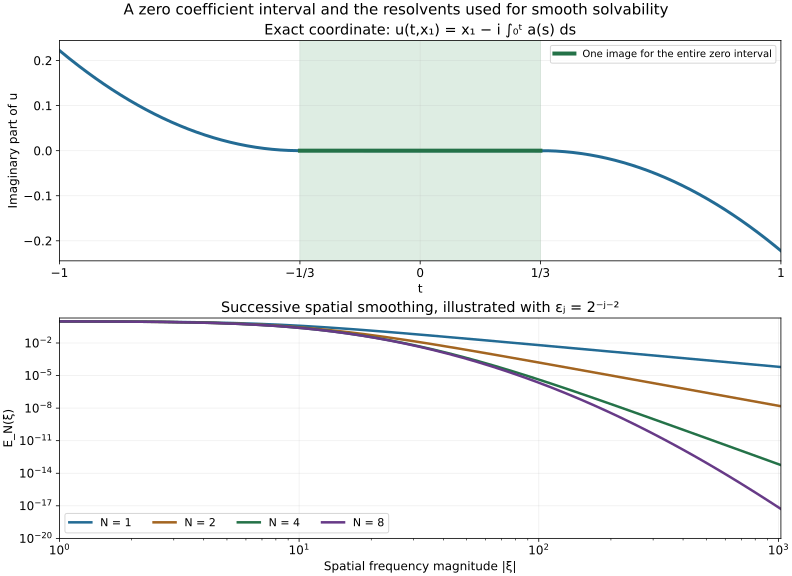

# Uniform solvability and degenerate complex coordinates

The coefficient of a Cauchy–Riemann operator may vanish, and its dependence on the distinguished time variable may be only continuous. Nevertheless one can solve the equation with every spatial derivative bounded, uniformly over bounded coefficient and forcing families. The proof uses a half-derivative energy, successively chosen spatial resolvents and a single duality argument in an infinite-weight Hilbert space. It also constructs a homogeneous solution whose derivative in the active spatial direction never vanishes.

The antecedents are Hörmander IV, Lemmas 26.7.1–5, Theorem 26.7.6 and Corollaries 26.7.7 and 26.7.9, printed pages 124–132 of the admitted 2009 edition. We give independent proofs, including the exact resolvent identities, all six auxiliary commutator bounds, the infinite-weight construction, the time-continuity argument and the bounded parameter factorization. The boundary barrier and quotient analytic structure, Corollary 26.7.8 and Theorem 26.7.10, remain subsequent obligations.

Original expression, exercises and figure are CC0-1.0. Exact earlier providers are pinned in the proof map; linked components retain their terms. The human foundations remain external, so internal export P514 closure is not claimed.

## 1. Coefficients with no controlled time derivatives

**H0. The uniform statement.** Let \(\mathcal B^\infty(\mathbb R^{1+k})\) consist of continuous functions whose derivatives of every order in \(x\in\mathbb R^k\) are continuous and bounded. Its seminorms are \(\sup_{t,x}|\partial_x^\alpha u|\). Uniform limits of each derivative are compatible by the fundamental theorem of calculus in each spatial coordinate, so this is a complete Fréchet space. No time-derivative seminorm occurs.

Write \(D=-i\partial\), \(x=(x_1,x')\), and consider

\[
 P=D_t+i a(t,x)D_1+i b(t,x),\qquad a\ge0,
 \quad a,b\text{ in fixed bounded subsets of }\mathcal B^\infty.
 \tag{DS1}
\]

The coefficient \(b\) may be complex. There is a number \(c_1>0\), depending only on the coefficient bounds, such that every forcing family bounded in \(\mathcal B^\infty\) has solutions satisfying

\[
 Pu=f\quad (|t|<1,\ |x_1|<c_1),
 \qquad u,\partial_tu\text{ in a common bounded subset of }\mathcal B^\infty.
 \tag{DS2}
\]

The functions are defined on all of \(\mathbb R^{1+k}\); the equation is required on the displayed strip. All solutions are obtained on the same strip for a bounded coefficient family. The spatial smoothness is global after extension; full smoothness in time will follow wherever the data and coefficients themselves are smooth.

**C0. Parameterwise calculus and norms.** Let \(\Lambda=(1+|D_x|^2)^{1/2}\), and let \(A=(1+D_1^2)^{1/2}\), acting only in \(x_1\). Norms without a subscript mean \(L^2(dt\,dx)\); write \(\|u\|_{(r)}=\|\Lambda^ru\|\). The full ordinary composition, adjoint and commutator estimates in SCE:C0 apply in the spatial variables with \(t\) as a parameter. Their constants use only finitely many spatial symbol derivatives. Integrating the uniform bounds in \(t\), and in inactive spatial parameters when using the one-dimensional calculus, therefore needs no time derivatives. P3:L1–L3 and P3:M3–M6 supply the full Fourier, product integration and density arguments.

The energy arguments first use smooth rapidly decreasing test functions with support in \(|t|<1\). The coefficients need only be continuous in time, since integration by parts differentiates the test function and the chosen time weight. All pseudodifferential operations below are spatial.

## 2. A half derivative and a small support

**E0. Uniform half-derivative energy.** For \(k=1\), and then with inactive parameters by integration, one has

\[
 \|v\|+\|\sqrt a\,A^{1/2}v\|
 \le C\bigl(\|Pv\|+\|A^{-1}v\|\bigr),
 \qquad \operatorname{supp}v\subset\{|t|\le1\}.
 \tag{DS3}
\]

Choose a real smooth function \(h_-\) equal to one for \(\xi_1\le-2\), zero for \(\xi_1\ge-1\), and put \(Q=e^{-\lambda t}h_-(D_1)\). The exact identity is
\(\operatorname{Im}(QPv,Qv)=\operatorname{Re}((aD_1+b)Qv,Qv)+\operatorname{Im}([Q,P]v,Qv)\).
Because every positive derivative of \(h_-\) is supported in a fixed compact frequency set, the full ordinary expansion gives \([h_-(D_1),aD_1+b]\) in every negative order, uniformly in the parameters. Every retained term is supported in that compact set and every remainder can be taken to arbitrary order. Thus
\([Q,P]=-i\lambda Q+T_\lambda\), with \(\|T_\lambda v\|\le C_\lambda\|A^{-1}v\|\).

Compare the first form with \(-\|e^{-\lambda t}\sqrt a A^{1/2}h_-(D_1)v\|^2\). The operator
\(A^{1/2}aA^{1/2}+aD_1+b\) has principal symbol \(a(\sqrt{1+\xi_1^2}+\xi_1)\), which has order minus one on the negative tail; its complete remainder has order zero. Split off a fixed frequency cutoff containing the negative tail. Its order-zero part is bounded on \(L^2\), and the product of the remaining positive-frequency order-one part with \(h_-(D_1)\) is smoothing by the full disjoint-support expansion. Hence, with \(K\) independent of \(\lambda\),

\[
 (\lambda-K)\|Qv\|^2+
 \|e^{-\lambda t}\sqrt a A^{1/2}h_-(D_1)v\|^2
 \le \|Qv\|\bigl(\|QPv\|+C_\lambda\|A^{-1}v\|\bigr).
 \tag{DS4}
\]

Choose \(\lambda>K+2\), use Young's inequality, and remove the bounded positive time weight on \([-1,1]\). Reflect both \(t\) and \(x_1\) and multiply the equation by minus one to obtain the same estimate for \(h_+(\xi_1)=h_-(-\xi_1)\). The reflected coefficient of \(D_1\) is still nonnegative and the reflected lower coefficient has the same bounds. Finally \(h_0=1-h_--h_+\) has compact frequency support, so both \(h_0(D_1)\) and \(\sqrt a A^{1/2}h_0(D_1)\) are bounded by the \(A^{-1}\) norm. The triangle inequality proves (DS3). Integrating this proof with the other coordinates fixed proves its parameter version, with exactly the same constants.

**E1. Absorb the weak norm on a narrow strip.** If \(v=0\) for \(|x_1|\ge c\), Cauchy–Schwarz in that interval gives \(|\widehat v(t,\xi_1,x')|^2\le2c\int|v(t,x_1,x')|^2dx_1\). Since \((2\pi)^{-1}\int(1+\xi_1^2)^{-1}d\xi_1=1/2\), partial Plancherel yields

\[
 \|A^{-1}v\|\le\sqrt c\,\|v\|.
 \tag{DS5}
\]

Choose \(c\) with \(C\sqrt c\le1/2\) in (DS3). Then

\[
 \|v\|\le C_0\|Pv\|,
 \qquad \operatorname{supp}v\subset\{|t|<1,\ |x_1|<c\}.
 \tag{DS6}
\]

The same product integration proves this bound in every parameter dimension.

## 3. Small resolvents and all six commutators

**R0. The exact spatial resolvent identity.** Put

\[
 F_\epsilon=(1+\epsilon^2|D_x|^2)^{-1},\qquad 0<\epsilon<1.
 \tag{DS7}
\]

It commutes with \(D_t\) and every constant spatial derivative. For multiplication by \(\phi\), the identity \([\phi,H^{-1}]=-H^{-1}[\phi,H]H^{-1}\), with \(H=1-\epsilon^2\Delta_x\), gives

\[
 [\phi,F_\epsilon]=\epsilon^2F_\epsilon
 \left(\Delta\phi-2i\sum_jD_j\phi_j\right)F_\epsilon,
 \qquad \phi_j=\partial_j\phi.
 \tag{DS8}
\]

Products such as \(D_j\phi_j\) mean differentiation after multiplication. Expanding them on a smooth test proves the signs in (DS8). The Fourier inequalities \(\|F_\epsilon\|\le1\), \(\|\epsilon F_\epsilon D_j\|\le1\), and \(\|\epsilon^2F_\epsilon D_jD_l\|\le1\) follow directly from their multipliers.

**R1. The commutator controlled by the energy.** The useful refined estimate is

\[
 \|[P,F_\epsilon]v\|
 \le C\sqrt\epsilon\bigl(\|PF_\epsilon v\|+\|F_\epsilon v\|\bigr),
 \qquad \operatorname{supp}v\subset\{|t|\le1\}.
 \tag{DS9}
\]

Nonnegativity and the bounded second derivatives of \(a\) imply \(|a_j|\le C\sqrt a\). To prove this, apply the one-dimensional Taylor inequality along the \(j\)-th coordinate with arbitrary signed increment and minimize its quadratic upper bound; at zero curvature let the increment tend to infinity. This is also the unrestricted-radius case of CCA:G1.

Multiply (DS8), with \(\phi=a\), on the right by \(D_1\). Move that derivative through the coefficients. The term with two derivatives on the left is \(-2i\epsilon^2\sum_jF_\epsilon D_jD_1a_jF_\epsilon\); every other term is \(\epsilon^2F_\epsilon L_1F_\epsilon\), for a first-order spatial differential operator \(L_1\) with uniformly bounded coefficients and derivatives. Such terms are bounded by \(C\epsilon\|F_\epsilon v\|\).

In the two-derivative term insert
\(a_j=A^{-1/2}(a_jA^{1/2}+[A^{1/2},a_j])\). The multiplier \(\epsilon^{3/2}F_\epsilon D_jD_1A^{-1/2}\) is uniformly bounded: its absolute value is at most \(\epsilon^{3/2}|\xi|^{3/2}/(1+\epsilon^2|\xi|^2)\). Also \(D_1A^{-1/2}[A^{1/2},a_j]\) is uniformly bounded in the one-dimensional ordinary calculus, since its orders are \(1/2\) and \(-1/2\). Treating the other variables as parameters proves the full \(L^2\) bound. We obtain
\(\|[aD_1,F_\epsilon]v\|\le C\sqrt\epsilon\|\sqrt a A^{1/2}F_\epsilon v\|+C\epsilon\|F_\epsilon v\|\).
The commutator with \(b\) is bounded by \(C\epsilon\|F_\epsilon v\|\) directly from (DS8). Apply (DS3) to \(F_\epsilon v\), whose time support is unchanged, and use \(\|A^{-1}F_\epsilon v\|\le\|F_\epsilon v\|\). This proves (DS9) with no time derivative of a coefficient.

**R2. A fixed product norm and its six bounds.** Fix positive numbers \(\epsilon_1,\ldots,\epsilon_N\), and define

\[
 E_N=\prod_{j=1}^NF_{\epsilon_j},\qquad
 |v|_N=\|E_Nv\|,\qquad E_0=I.
 \tag{DS10}
\]

For fixed \(N\) these norms are equivalent to \(\|v\|_{(-2N)}\). Indeed each positive factor \(1+\epsilon_j^2|\xi|^2\) is bounded above and below by constant multiples of \(1+|\xi|^2\). Constants may depend on the fixed factors. Let \(L_\phi=D_j\phi\), with the same composition convention as in R0; \(D_j\) may also be omitted. For \(\phi,\psi\) in bounded subsets of \(\mathcal B^\infty\), the following six estimates hold uniformly in \(0<\epsilon<1\):

\[
 \begin{aligned}
 \|E_NF_\epsilon\phi v\|&\le C\|E_NF_\epsilon v\|,\\
 \|E_N[\phi,F_\epsilon]v\|&\le C\epsilon\|E_NF_\epsilon v\|,\\
 \|E_N[L_\phi,F_\epsilon]v\|&\le C\|E_NF_\epsilon v\|,\\
 \|E_N[L_\phi,[\psi,F_\epsilon]]v\|&\le C\epsilon\|E_NF_\epsilon v\|,\\
 \|[L_\phi,E_N]F_\epsilon v\|&\le C\|E_NF_\epsilon v\|,\\
 \|[F_\epsilon,[L_\phi,E_N]]v\|&\le C\epsilon\|E_NF_\epsilon v\|.
 \end{aligned}
 \tag{DS11}
\]

Here is a complete proof of all six. Conjugation of an ordinary spatial operator of order \(l\) by the fixed elliptic multiplier \(E_N\) preserves that order with uniform parameter bounds. This is the full ordinary product theorem, since \(E_N^{-1}\) is an exact finite differential multiplier of order \(2N\). If \(T_l\) has order \(l=0,1,2\), write it as \(\Lambda^l(\Lambda^{-l}T_l)\). The second factor is bounded, and \(\|\epsilon^lF_\epsilon\Lambda^l\|\le C_l\). These facts justify each following operator product, including its remainder.

For the second estimate, use (DS8), commute \(E_N\) through \(F_\epsilon\), and insert \(E_N^{-1}E_N\) after its first-order middle factor. The resulting \(\epsilon^2F_\epsilon T_1\) is \(O(\epsilon)\). For the third, use the same inverse identity with \(L_\phi\) instead of \(\phi\); its commutator with \(1-\epsilon^2\Delta\) is \(\epsilon^2\) times a second-order differential operator, so the bound is \(O(1)\). The first follows by writing \(F_\epsilon\phi=\phi F_\epsilon+[F_\epsilon,\phi]\) and using the bounded operator \(E_N\phi E_N^{-1}\).

For the fourth, commute \(L_\phi\) through the three factors in (DS8). The two outer commutators have the form \(\epsilon^4F_\epsilon T_2F_\epsilon T_1F_\epsilon\) or its reverse; the middle commutator has the form \(\epsilon^2F_\epsilon T_1F_\epsilon\). Commutators of two first-order scalar differential operators have order one, which gives the latter order. Insert the fixed conjugations between these factors. Their norms are respectively \(O(\epsilon^4\epsilon^{-2}\epsilon^{-1})\) and \(O(\epsilon^2\epsilon^{-1})\), proving the stated \(O(\epsilon)\) bound.

For the fifth, \([L_\phi,E_N]E_N^{-1}\) has order zero by the full ordinary commutator expansion. For the sixth put \(K=[L_\phi,E_N]\). The exact inverse identity gives
\([F_\epsilon,K]=\epsilon^2F_\epsilon[K,|D_x|^2]F_\epsilon\).
The symbol of \([K,|D_x|^2]E_N^{-1}\) has order one, since \(K\) has order \(-2N\). Commuting the two Fourier multipliers now gives the required \(O(\epsilon)\) bound. If \(D_j\) is omitted, every order can only improve. This finishes all six estimates without a hidden time-regularity assumption.

**I0. Add one resolvent without losing the fixed strip limit.** Suppose
\(|v|_N\le C_N|Pv|_N\) for tests supported in \(|t|<1, |x_1|<c_N\). Fix \(C_{N+1}>C_N\) and \(0<c_{N+1}<c_N\). Then, for all sufficiently small \(\epsilon>0\),

\[
 |F_\epsilon v|_N\le C_{N+1}|F_\epsilon Pv|_N,
 \qquad \operatorname{supp}v\subset\{|t|<1,\ |x_1|<c_{N+1}\}.
 \tag{DS12}
\]

Choose a smooth \(\eta(x_1)\) supported in \((-c_N,c_N)\), equal to one on \([-c_{N+1},c_{N+1}]\), and put \(w=\eta F_\epsilon v\). Since \(\eta v=v\), the second estimate in (DS11) bounds \(F_\epsilon v-w\) by \(C\epsilon|F_\epsilon v|_N\). Apply the assumed estimate to \(w\). The exact expansion
\(Pw=F_\epsilon Pv+[P,F_\epsilon]v+[\eta,F_\epsilon]Pv+[P,[\eta,F_\epsilon]]v\)
and the second and fourth bounds in (DS11) control the last two terms by \(C\epsilon(|F_\epsilon Pv|_N+|F_\epsilon v|_N)\). In the fourth bound the time derivative commutes exactly with \([\eta,F_\epsilon]\).

For the remaining term, commute \(E_N\) through \([P,F_\epsilon]\). The Jacobi identity, the sixth estimate in (DS11), and (DS9) applied to \(E_Nv\) give
\(|[P,F_\epsilon]v|_N\le C\epsilon|F_\epsilon v|_N+C\sqrt\epsilon(\|PF_\epsilon E_Nv\|+|F_\epsilon v|_N)\).
To estimate its last operator, expand
\(PF_\epsilon E_N=E_NF_\epsilon P+E_N[P,F_\epsilon]+[P,E_N]F_\epsilon\).
The third and fifth bounds in (DS11) bound the latter two terms by \(C|F_\epsilon v|_N\). Write \(aD_1=D_1a+i a_1\) to put every spatial part of \(P\) in the allowed form. Thus

\[
 (1-C\sqrt\epsilon)|F_\epsilon v|_N
 \le C_N(1+C\sqrt\epsilon)|F_\epsilon Pv|_N.
 \tag{DS13}
\]

The constants depend on the already fixed product and cutoff, not on the new \(\epsilon\). Choosing it small enough makes the quotient at most \(C_{N+1}\), proving the induction step.

## 4. One duality argument produces every spatial derivative

**D0. The adjoint has the same estimates.** Direct spatial integration by parts gives
\(P^*=D_t-i aD_1-a_1-i\overline b\). Reflect \(x_1\) to \(-x_1\). The coefficient of \(iD_1\) becomes the reflected nonnegative \(a\); the new lower coefficient is the reflection of \(i a_1-\overline b\). It remains in a bounded subset of \(\mathcal B^\infty\). The strip and the multipliers \(E_N\) are invariant under this reflection. Therefore E1 and I0 apply uniformly to \(P^*\) itself.

Fix \(0<c_0<c\), and prescribe

\[
 c_N=c_0+\frac{c-c_0}{N+1},\qquad
 C_N=C_0\left(2-\frac1{N+1}\right).
 \tag{DS14}
\]

The spatial strip limit \(c_0\) depends only on the coefficient family. Suppose first that the forcing functions are supported in a fixed compact box; translates of that box in the inactive parameters are allowed. Their spatial derivatives then have uniformly bounded \(L^2\) norms. Let \(F_0\) bound their \(L^2\) norms. Choose the successive resolvents using I0, and at each step decrease the new \(\epsilon_j\) further so that \(\epsilon_j<\min(\epsilon_{j-1},2^{-j})\) and

\[
 \|E_Nv\|\le C_N\|E_NP^*v\|\quad
 (\operatorname{supp}v\subset\{|t|<1,\ |x_1|<c_N\}),
 \qquad \|E_N^{-1}f\|\le F_0\left(2-\frac1{N+1}\right).
 \tag{DS15}
\]

The second requirement is possible because the exact inverse recursion gives
\(E_{N+1}^{-1}f=E_N^{-1}f-\epsilon_{N+1}^2\Delta E_N^{-1}f\).
The triangle inequality bounds its increment by \(\epsilon_{N+1}^2\|\Delta E_N^{-1}f\|\), uniformly over the forcing family. The strictly increasing prescribed bound leaves a positive margin. If \(F_0=0\), every forcing function is zero and the zero solution suffices. The chosen sequence works for the entire coefficient and forcing families; only its values, not the limiting strip, depend on the forcing bounds.

**D1. The infinite multiplier and Hahn–Banach.** Define

\[
 E_\infty(\xi)=\prod_{j=1}^\infty(1+\epsilon_j^2|\xi|^2)^{-1}.
 \tag{DS16}
\]

It is positive at every finite \(\xi\): the sum of the logarithms is bounded by \(|\xi|^2\sum\epsilon_j^2<\infty\). It is at most \(E_N\) for every \(N\), so \(|\xi|^lE_\infty(\xi)\) is bounded for every integer \(l\). Dominated convergence gives \(E_N(D)z\to E_\infty(D)z\) in \(L^2\) for each \(z\in L^2\).

For a test \(v\) supported in \(U=\{|t|<1,|x_1|<c_0\}\), (DS15) gives

\[
 |(f,v)|=|(E_N^{-1}f,E_Nv)|
 \le4C_0F_0\|E_NP^*v\|
 \longrightarrow4C_0F_0\|E_\infty P^*v\|.
 \tag{DS17}
\]

Define the linear functional \(E_\infty P^*v\mapsto(v,f)\) on its range in \(L^2(dt\,dx)\). The bound shows that it is well defined even if the map has a kernel. CE:H1 proves norm-preserving complex Hahn–Banach from an arbitrary normed subspace, and CT:T1 proves Hilbert representation. They give \(z\in L^2\), \(\|z\|\le4C_0F_0\), representing that functional. Put \(u=E_\infty(D)z\). Since the multiplier is real and self-adjoint, the representation says exactly \((u,P^*v)=(f,v)\). Hence \(Pu=f\) in \(U\), and

\[
 \|\partial_x^\alpha u\|\le
 \sup_\xi|\xi^\alpha E_\infty(\xi)|\,4C_0F_0
 \quad\text{for every }\alpha.
 \tag{DS18}
\]

This is one solution with all derivative bounds, not separate solutions chosen for separate Sobolev orders. No continuous linear choice of solutions is needed or asserted.

**D2. Joint continuity, time derivatives and extension.** Choose a spatial cutoff \(\eta(x_1)\) supported in \((-c_0,c_0)\), equal to one on a smaller interval. On \((-1,1)\), every spatial derivative of \(\eta u\) and its distributional time derivative is in \(L^2\), uniformly: use (DS18), the equation \(D_tu=f-iaD_1u-ibu\), and the spatial product rule. Thus \(\eta u\in H^1((-1,1);H^l_x)\) for every integer \(l\).

The Hilbert-valued fundamental theorem gives a continuous representative on \([-1,1]\), with \(\sup_t\|v(t)\|_H\le C(\|v\|_{L^2_tH}+\|v_t\|_{L^2_tH})\). To see the full statement directly, mollify in time on smaller intervals; Cauchy–Schwarz gives \(\|v(t)-v(s)\|_H\le|t-s|^{1/2}\|v_t\|_{L^2_tH}\), and choose one time with norm bounded by its mean-square norm. The approximants are uniformly Cauchy in this bound, yielding the continuous representative and then the endpoint limits. The Hilbert integration and approximation used here are CE:H5 and CE:H10–H11.

For \(l>|alpha|+k/2\), Fourier Cauchy–Schwarz makes \(\int|\xi^\alpha\widehat v(\xi)|d\xi\) bounded by \(C\|v\|_{H^l}\), since the remaining squared frequency weight is integrable. Fourier inversion and dominated convergence therefore give bounded jointly continuous spatial derivatives. The equation now gives the same property for every spatial derivative of \(u_t\) in the smaller strip. At the time endpoints this remains true: bounded coefficient derivatives act strongly continuously on each spatial Sobolev space by dominated convergence and the finite product rule. The compact-support forcing has the same continuity. Thus both \(u\) and \(u_t\) have the needed endpoint limits.

A bounded \(C^1\) extension in time is explicit. Near \(t=1\), extend \(v\) by \(3v(2-t)-2v(3-2t)\). Its value and first derivative match at one because \(3-2=1\) and \(-3+4=1\). Use the reflected formula near minus one and fixed smooth cutoffs outside slightly larger intervals. This works for every spatial derivative simultaneously. Multiply also by the chosen \(x_1\) cutoff. The resulting global function and its time derivative belong to a uniformly bounded subset of \(\mathcal B^\infty\), and the equation is unchanged on \(|t|<1, |x_1|<c_1\), with any fixed sufficiently small \(c_1>0\).

**S0. Remove support restrictions and recover full smoothness where available.** For a general bounded forcing family first multiply by fixed cutoffs equal to one on the required time and \(x_1\) strip. In the parameters \(x'\), choose translated compact bumps \(\chi_g\) with uniformly bounded derivatives, bounded overlap and \(\sum_g\chi_g^2=1\). Such a family is obtained from lattice translates of one positive-on-a-cell bump by dividing by the square root of their locally finite sum of squares. Apply D0–D2 to \(f_g=\chi_gf\). Their support measures and every spatial derivative norm are uniformly bounded, independent of the lattice point. Obtain \(Pu_g=f_g\) on the same strip and sum \(u=\sum_g\chi_gu_g\). The sum is locally finite with bounded overlap. Since \(P\) differentiates only \(t,x_1\), it commutes with each \(\chi_g\), so \(Pu=\sum_g\chi_g^2f=f\). All asserted global bounds and joint continuity persist. This proves (DS2).

Where \(a,b,f\) are fully smooth, the equation expresses one time derivative of \(u\) in terms of spatial derivatives and the data. Differentiate this identity repeatedly, inducting on the number of time derivatives. All spatial derivatives have already been established, so this proves full smoothness and the corresponding uniform local bounds whenever the coefficient and forcing bounds include those time derivatives.

## 5. A nonvanishing complex coordinate and parameter extension

**C1. Construct a homogeneous solution with nonzero spatial derivative.** Apply S0 with \(b=0\) to solve

\[
 (D_t+iaD_1)w=-a_1.
 \tag{DS19}
\]

Both \(w,w_t\) have uniform \(\mathcal B^\infty\) bounds on one fixed smaller strip. Put \(v=e^w\). The product rule gives \((D_t+iaD_1)v+a_1v=0\); in particular \(v\ne0\). Define

\[
 u(t,x)=\int_0^{x_1}v(t,r,x')\,dr
       -i\int_0^t(a v)(s,0,x')\,ds.
 \tag{DS20}
\]

The equation for \(v\) is \(v_t=-i\partial_1(av)\). Differentiate (DS20) to obtain \(u_1=v=e^w\) and \(u_t=-iav\). Hence \((D_t+iaD_1)u=0\). The finite integrals and all their spatial derivatives have uniform bounds on a fixed smaller strip; the same extension as D2 gives global \(u,u_t,w,w_t\) in bounded subsets of \(\mathcal B^\infty\). Only their values on the strip are used. This proves the nonvanishing-coordinate assertion with its actual signs.

The lower-order term can also be removed. Solve \((D_t+iaD_1)w=-ib\). Then \(P(e^wv)=e^w(D_t+iaD_1)v\), directly by the product rule. The exponential never vanishes and has the required uniform spatial bounds on the strip.

**C2. Preserve a prescribed solution on the parameter slice.** Let \(u_0(t,x_1)\), with \(u_0,(u_0)_t\in\mathcal B^\infty(\mathbb R^2)\), solve the homogeneous equation for \(a(t,x_1,0)\) on a strip. Put
\(F=i(a(t,x)-a(t,x_1,0))D_1u_0\). It is globally in \(\mathcal B^\infty\), vanishes at \(x'=0\), and equals \((D_t+iaD_1)u_0\) on that strip.

We need a bounded factorization, not the unbounded multipliers \(x_j\). Set \(h_j(x')=x_j/\sqrt{1+|x'|^2}\), for \(j\ge2\). Near zero, the fundamental theorem gives \(F=\sum_{j\ge2}x_j\int_0^1\partial_jF(t,x_1,\theta x')d\theta\). Away from zero use \(F=\sum_{j\ge2}x_j(x_jF/|x'|^2)\). Blend the two identities by a fixed smooth cutoff equal to one near zero. Multiplying the coefficient functions by \(\sqrt{1+|x'|^2}\) gives

\[
 F=\sum_{j=2}^k h_jF_j,\qquad F_j\in\mathcal B^\infty.
 \tag{DS21}
\]

The near-zero coefficients have compact parameter support and bounded derivatives by differentiation under the finite integral. In the far coefficients, \(\sqrt{1+|x'|^2}x_j/|x'|^2\) and all its derivatives are bounded away from zero. Thus the claimed global bounds are proved. Solve \((D_t+iaD_1)v_j=F_j\) using S0 and put \(u=u_0-\sum h_jv_j\). The multipliers commute with the operator and vanish on the parameter slice. Consequently \((D_t+iaD_1)u=0\) and \(u(t,x_1,0)=u_0(t,x_1)\) on a common smaller strip, with the required spatial and first-time-derivative bounds. When \(k=1\) the assertion is simply \(u=u_0\).

## 6. Three complete checks and an explicit degenerate coordinate

**X1. An exact coordinate for a merely continuous coefficient.** Take \(a=a(t)\ge0\) continuous and bounded, and \(b=0\). Find the homogeneous coordinate and describe what happens on an interval where \(a=0\).

**Solution.** Formula (DS20) with \(w=0\) gives \(u(t,x_1)=x_1-i\int_0^ta(s)ds\). Thus \(u_1=1\), \(u_t=-ia(t)\), and the equation holds without differentiating \(a\). On a zero interval the primitive is constant, so the entire vertical segment at each fixed \(x_1\) has the same image. If the integral of \(a\) between two times is positive, their images at fixed \(x_1\) differ. This is an exact example, not yet the general quotient theorem.

**X2. Check the complete inverse-product norm increment.** For a smooth spatial function \(g\), compute the square of \(\|(1-\epsilon^2\Delta)g\|\).

**Solution.** Spatial integration by parts, or Plancherel, gives

\[
 \|(1-\epsilon^2\Delta)g\|^2
 =\|g\|^2+2\epsilon^2\|\nabla g\|^2
             +\epsilon^4\|\Delta g\|^2.
 \tag{DS22}
\]

The identity also holds after integration in \(t\), and extends by density when the displayed norms are finite. Both correction terms are needed. D0 uses the simpler valid triangle bound, which tends to the old norm uniformly on the forcing family and is sufficient to choose the next parameter.

**X3. Check the adjoint reflection.** Write the reflected coefficient of the lower-order term in \(P^*\), and explain why no coefficient time derivative appears.

**Solution.** Since \((aD_1)^*=D_1a=aD_1-ia_1\), one has \(P^*=D_t-iaD_1-a_1-i\overline b\). Reflection of \(x_1\) reverses \(D_1\), so the new nonnegative coefficient is \(a(t,-x_1,x')\), and the new coefficient after the factor \(i\) is \(i a_1(t,-x_1,x')-\overline b(t,-x_1,x')\). Only a spatial derivative appears. The time coefficient of \(D_t\) is the constant one, so its adjoint creates no derivative of \(a\) or \(b\).

**V0. Exact quantities in the figure.** In the upper panel take \(a(t)=\max(|t|-1/3,0)\) on \([-1,1]\). Its primitive is zero on \([-1/3,1/3]\), equals \((t-1/3)^2/2\) for \(t>1/3\), and equals \(-(t+1/3)^2/2\) for \(t<-1/3\). The plot shows the imaginary part of the exact coordinate in X1 and the collapsed interval. Extend \(a\) continuously and boundedly outside this interval if a global coefficient is desired. The lower panel plots \(E_N(\xi)\) for the illustrative choice \(\epsilon_j=2^{-j-2}\) and \(N=1,2,4,8\). This displays successively stronger spatial smoothing; these sample parameters are not claimed to be the sequence chosen for an arbitrary coefficient family in D0.

[Figure source](figures/build_figure.py), [finite checks](model-check.json), source credit, [proof review](proof-review.json) and [reader checks](reader-check.json) accompany the proof. The boundary barrier and the general reduced analytic structure remain the next Section 26.7 obligations. The full course goal stays active.
