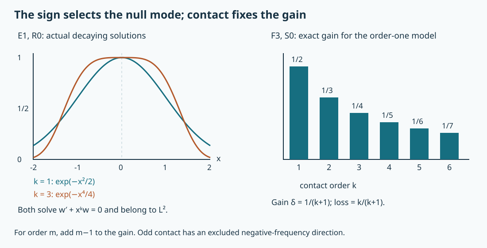

# Finite contact: complex models, regularity and isolated singularities

A complex characteristic can behave differently in the two directions of a covector ray. In one direction the equation forces extra Sobolev regularity. In the other, a decaying transverse solution can carry a singularity at a single point. We prove both conclusions, including the full operator reduction that makes the model apply to variable coefficients.

The mathematical antecedent is Lars Hörmander, *The Analysis of Linear Partial Differential Operators IV*, 2009 edition, Section 26.3, Proposition 26.3.1 through Theorem 26.3.6, printed pages 81–86. The geometric reductions are already proved in [real and complex normal forms](../20261005-restored-function-normal-forms/real-and-complex-symplectic-function-normal-forms.md), FN:S2 and K0–K4. The [graph-operator lesson](../20261005-restored-graph-egorov/graph-operators-continuity-and-egorov.md), GE:D7–D11, supplies full Sobolev continuity, graph inverses and Egorov reduction. Exact Fourier, measure, ordinary-symbol and compactness providers are identified in the proof map.

The exposition, compactness proof, solutions and reproducible illustration are independently written and CC0-1.0. Linked components retain their terms. Human foundation proofs remain external in this export. [The symplectic model companion](../20261011-symplectic-model-parametrices/symplectic-model-projectors-and-solvability.html) constructs the projectors and inverse identities, proves their mapping properties and gives the microlocal solvability criterion. [Global symplectic assembly](../20261011-global-symplectic-parametrix/global-symplectic-parametrix-and-hermitian-projectors.html) treats proper patching and Hermitian normalization.

## 1. What is being reduced, and which direction matters

**H0. Exact hypotheses and conclusions.** Let \(n\ge2\), \(k\ge1\) be an integer, and use \(D_j=-i\partial_{x_j}\). Our model and gain are
\[
 L_k=D_1+i x_1^kD_n,\qquad
 \ell_k=\xi_1+i x_1^k\xi_n,\qquad
 \delta=\frac1{k+1}.
 \tag{FC1}
\]
Let \(P\) be a scalar classical pseudodifferential operator of order \(m\) on a smooth manifold. Assume a nonzero homogeneous multiplier \(a\) of degree \(1-m\) and a homogeneous canonical map \(\kappa\), from a neighborhood of \((0,\pm e_n)\) to a neighborhood of a characteristic point \(c\), satisfy \(\kappa^*(ap)=\ell_k\). All lower classical terms of \(P\) are retained.

There are elliptic graph operators \(\mathcal A\) of order zero and \(\mathcal B\) of order \(1-m\), and an order-zero two-sided microlocal inverse \(\mathcal A^{-1}\), such that
\[
 \mathcal B P\mathcal A=L_k,\qquad
 L_k\mathcal A^{-1}=\mathcal B P
 \quad\text{modulo smooth kernels on matched smaller cones}.
 \tag{FC2}
\]
The normal form will imply a gain \(m-1+\delta\) for \(P\) at the positive mark, and at either mark when \(k\) is even. For odd \(k\) at the negative mark, every real Sobolev threshold can occur in a solution with smooth forcing and wavefront consisting of that one positive covector ray.

FN:S2 supplies the model when \(p(c)=0\) and \(\{\operatorname{Re}p,\operatorname{Im}p\}(c)\ne0\), with \(k=1\) and the mark determined by the bracket sign. More generally, FN:K0–K4 applies when \(H_{\operatorname{Re}p}(c)\ne0\) and, in a flow box on \(\{\operatorname{Re}p=0\}\), **every nearby real Hamilton curve has a zero of exactly the same finite order \(k\)** for \(\operatorname{Im}p\). This includes existence of the zero on every curve. For odd \(k\), a change from negative to positive gives the positive mark; a change from positive to negative gives the negative mark. For even \(k\) either leading sign is allowed. A finite-order condition solely on one curve is not the hypothesis used here.

## 2. Remove every lower term on one fixed neighborhood

**N0. Realizing the parameter jets.** Write \(t=x_1\), and let \(z\) denote all remaining normalized base and frequency variables. Given smooth jets \(g_j(z)\) on a slightly larger compact patch, extend them with a fixed cutoff and form
\[
 b(t,z)=\sum_{j\ge0}\chi(t/\varepsilon_j)\frac{t^j}{j!}g_j(z),
 \qquad \partial_t^j b(0,z)=g_j(z).
 \tag{FC3}
\]
Here \(\chi=1\) near zero and has compact support. Keep the finitely many first radii fixed. For large \(j\), each derivative of total order \(r<j\) of its summand is bounded by \(C_{jr}\varepsilon_j^{j-r}\). Choose \(\varepsilon_j\downarrow0\) so these bounds are at most \(2^{-j}\) for every \(r\le j/2\). Every fixed derivative series converges uniformly after finitely many terms. The sum is smooth, and termwise evaluation at zero gives exactly its stated jets: near zero the cutoff has no derivatives, and a monomial contributes only to its own jet. This proves the required parameter Borel construction on one fixed patch, including every parameter derivative.

**N1. A flat numerator can be divided by the complex model.** On a cone with \(|\xi_n|\) comparable to \(|\xi|\), use \(|\xi_n|=1\) as frequency section and fix its sign. The Hamilton field is
\[
 H_{\ell_k}=\partial_{x_1}+i x_1^k\partial_{x_n}
                  -i kx_1^{k-1}\xi_n\partial_{\xi_1}.
 \tag{FC4}
\]
For smooth \(p_0,R\), the equation
\[
 F=-iH_{\ell_k}b+p_0b+R
       \text{ is flat on }x_1=0
 \tag{FC5}
\]
can be solved with any prescribed smooth value of \(b\) there. Indeed \(\partial_{x_1}^jF|_{x_1=0}=0\) determines the next jet \(\partial_{x_1}^{j+1}b\) from the earlier jets and their parameter derivatives; its coefficient is \(-i\). N0 realizes all those jets simultaneously.

Set \(F/\ell_k=0\) on \(x_1=0\). This is a smooth flat extension. On the normalized section,
\[
 |\ell_k|\ge |x_1|^k,
 \qquad |D^\beta F|\le C_{\beta N}|x_1|^N
       \quad\text{for every }N.
 \tag{FC6}
\]
Every derivative of the quotient is a finite sum with a bounded polynomial numerator and a finite power of \(\ell_k\) in the denominator. Choose \(N\) larger than that power times \(k\), with any further desired margin. All derivatives tend to zero uniformly as \(x_1\to0\), including at \(\xi_1=0\). The extension is smooth by the coordinate fundamental theorem, inductively for every derivative, and is flat there. If \(F\) is homogeneous of degree \(r\), this quotient has degree \(r-1\). The normalized proof extends homogeneously to the whole smaller cone.

**N2. The full classical recursion.** First consider \(P_0\) of order one with full symbol \(\ell_k+p_0+p_{-1}+\cdots\). Seek scalar order-zero classical operators \(A,C\), with leading symbols both \(a_0\), for which
\[
 P_0A-CL_k\in\Psi^{-\infty}.
 \tag{FC7}
\]
The order-zero residual is
\[
 -iH_{\ell_k}a_0+p_0a_0
                 +\ell_k(a_{-1}-c_{-1}).
 \tag{FC8}
\]
Use N1 with initial value \(a_0=1\) on \(x_1=0\), and set \(a_{-1}-c_{-1}=-F/\ell_k\). The residual vanishes to this order, and \(a_0\) is nonzero after one shrink.

At the next stage, and inductively at order \(-j\), the residual is
\(-iH_{\ell_k}a_{-j}+p_0a_{-j}+R_{-j}+\ell_k(a_{-j-1}-c_{-j-1})\).
Here \(R_{-j}\) is known: the previously fixed difference \(a_{-j}-c_{-j}\) is substituted before collecting terms. The ordinary product formula leaves the displayed first commutator and multiplication by \(p_0\) as the only unknown order-\(-j\) terms; higher symbol derivatives involve earlier coefficients. Choose the initial value of \(a_{-j}\) to be zero, apply N1, and define the next difference by flat division. All degrees are exact.

All equations are solved on the same normalized patch. Extend each resulting homogeneous coefficient using fixed base/angular cutoffs equal to one on a retained smaller patch. Ordinary composition P2:OP3 and symbol summation CH:T2 realize these classical series. For clarity, the latter construction cuts the term of order \(-j\) on at frequencies \(R_j\to\infty\); choosing \(R_j\) large makes its first \(j/2\) lower-order seminorms summably small. Differentiating the radial cutoffs has the same order bounds. The tail after any fixed truncation has exactly the next order, with every derivative. Thus the full product remainder belongs to every negative order on the one retained cone. This proves (FC7), rather than only a formal identity. Both \(A,C\) are elliptic, since their common leading symbol is nonzero. The full two-sided ordinary parametrix gives \(C^{-1}P_0A=L_k\) modulo smooth kernels.

**N3. Exact graph orders and transfer.** Let \(U\) be an elliptic order-zero quantization of \(\kappa\), and \(V\) its order-zero two-sided inverse. Let \(E_a\) be an elliptic operator of order \(1-m\) with principal symbol \(a\). The full Egorov and composition results give \(P_0=VE_aPU\) with principal symbol \(\ell_k\). Apply N2 and put
\[
 \mathcal A=UA,\qquad
 \mathcal B=C^{-1}VE_a,\qquad
 \mathcal A^{-1}=A^{-1}V.
 \tag{FC9}
\]
These have the orders in H0 and prove the first identity (FC2). Compose it with the actual two-sided inverse to prove the second. The elliptic inverse of \(\mathcal B\) has order \(m-1\). All operators can be properly supported and confined to arbitrarily small matched cones. Ordinary separated-support composition makes the discarded errors smooth on a retained smaller cone, in both variables. Consequently the identities act on arbitrary distributions, and every real Sobolev order and wavefront set transfers through the indicated elliptic graph operators. Choosing the unknown-side graph operator of order zero will preserve the exact threshold in Section 6.

The alternative order convention in Proposition 26.3.1 follows as well. Choose an elliptic model reducer \(J\) of order \(1-m\), with symbol \(|\xi_n|^{1-m}\) on the retained cone. Extend it as an ordinary symbol outside a larger cone and use proper cutoffs. There its symbol is independent of \(x\) and \(\xi_1\), so the full composition formula gives \([L_k,J]\in\Psi^{-\infty}\) microlocally; every possible commutator derivative vanishes. With its full elliptic inverse set \(A'=\mathcal A J\), \(B'=J^{-1}\mathcal B\). Their orders are \(1-m\) and zero, \(B'PA'=L_k\) modulo smooth kernels, and \(B'A'\) is an elliptic ordinary operator of order \(1-m\). This gives the same full normal form with the source's stated orders.

## 3. A coercive one-dimensional estimate with its sign

**E0. The identity and a compactness proof.** For \(v\in C_c^\infty(\mathbb R)\), put \(T_kv=v'-x^kv\). Integration by parts in the real part of the cross term gives, for complex-valued \(v\),
\[
 \|T_kv\|_2^2=\|v'\|_2^2+\|x^kv\|_2^2
                       +k\int x^{k-1}|v|^2\,dx.
 \tag{FC10}
\]
For \(k\ge1\), the elementary bound \(k|x|^{k-1}\le\tfrac12|x|^{2k}+C_k\) implies
\[
 \|v'\|_2^2+\tfrac12\|x^kv\|_2^2
                    \le \|T_kv\|_2^2+C_k\|v\|_2^2.
 \tag{FC11}
\]
We claim \(\|v\|_2\le C\|T_kv\|_2\). Otherwise choose \(\|v_j\|_2=1\) and \(T_kv_j\to0\) in \(L^2\). Equation (FC11) bounds both \(v_j'\) and \(x^kv_j\). The sequence has an \(L^2\)-convergent subsequence, as follows directly. Outside \([-R,R]\), its squared norm is at most \(C R^{-2k}\). On that interval, replace each function by its average on cells of length at most \(h\). The fundamental theorem and Cauchy–Schwarz give squared error at most \(h^2\|v_j'\|_2^2\). The cell averages form a bounded subset of a finite-dimensional space, so admit a convergent subsequence. Successively choose \(R\to\infty\), \(h\to0\), and nested subsequences; the diagonal subsequence is Cauchy in \(L^2\) by the two uniform error bounds. Completeness gives a limit \(v\) of norm one.

Distributional convergence gives \(v'=x^kv\). Multiplication by \(e^{-x^{k+1}/(k+1)}\) makes its derivative zero, so
\(v=c e^{x^{k+1}/(k+1)}\). To justify the constant assertion for distributions, every compact test of integral zero is the derivative of its compactly supported primitive; a distribution with zero derivative annihilates all such tests and is a constant multiple of integration. The displayed exponential is not in \(L^2\): it grows at both ends for odd \(k\), and at the positive end for even \(k\). Thus \(c=0\), a contradiction. Combining the claim with (FC11) proves
\[
 \|v'\|_2^2+\|x^kv\|_2^2+\|v\|_2^2
                       \le C_k\|v'-x^kv\|_2^2.
 \tag{FC12}
\]
For \(k=0\) the direct identity \(\|v'-v\|_2^2=\|v'\|_2^2+\|v\|_2^2\) supplies the corresponding assertion without compactness.

**E1. Scaling and the excluded direction.** In (FC12) change variables by \(y=|\tau|^\delta x\). For \(\tau>0\),
\[
 \|v'\|_2^2+\tau^2\|x^kv\|_2^2
          +|\tau|^{2\delta}\|v\|_2^2
                 \le C_k\|v'-\tau x^kv\|_2^2.
 \tag{FC13}
\]
The three powers agree because \(1-k\delta=\delta\); the common Jacobian cancels. For even \(k\), reflection \(x\mapsto-x\) changes \(\tau\) to \(-\tau\) without changing norms, so (FC13) also holds for negative \(\tau\).

For odd \(k\), \(w_k(x)=e^{-x^{k+1}/(k+1)}\) is a nonzero Schwartz function and \(w_k'+x^kw_k=0\). This follows by direct differentiation; every derivative is a polynomial times the same decaying exponential. Multiply it by a cutoff equal to one on \([-R,R]\) and supported in \([-2R,2R]\). The residual is the cutoff derivative times \(w_k\), which tends to zero in \(L^2\), while the function tends to \(w_k\) in \(L^2\). Therefore no estimate controlling its \(L^2\) norm by that residual holds in the opposite sign. The sign distinction is already present before microlocalization.

## 4. From the line estimate to full microlocal regularity

**F0. The Fourier estimate.** Fourier transform in \(x_n\), keeping \(x_1\) and the other variables as parameters. The transformed equation is \(-i(\partial_{x_1}-\tau x_1^k)U=F\). Apply (FC13), then integrate in the other variables and in the favorable \(\tau\)-half-line. Plancherel gives control of \(|D_n|^\delta u\) in that half-line by \(\|L_ku\|_2\). Hence, for any smooth multiplier \(b(\xi)\) supported where \(|\xi|\le K|\xi_n|\) and the sign is favorable, with \(|b(\xi)|\le C|\xi_n|^\delta\),
\[
 \|b(D)u\|_2\le C_b\|L_ku\|_2,
                       \qquad u\in C_c^\infty(\mathbb R^n).
 \tag{FC14}
\]
A symbol equal to a positive multiple of \(|\xi|^\delta\) on any smaller high-frequency cone gives the desired gain there. Smooth low frequencies are harmless. No restriction is made on the spectator Fourier variables beyond the displayed cone condition.

**F1. The estimate applies to rough compact inputs.** Suppose \(u,L_ku\in L^2\) and \(u\) is compactly supported. Regularize by a compact smooth convolution kernel \(\rho_\varepsilon\), of integral one. Its Fourier multiplier is \(r_\varepsilon(\xi)=\widehat\rho(\varepsilon\xi)\), with the normalization chosen so \(r_\varepsilon(0)=1\). The support of \(u_\varepsilon\) stays in one compact set. The commutator with \(L_k\) has the exact finite symbol
\[
 -\sum_{j=1}^k \frac{i^{1-j}}{j!}
       (\partial_{\xi_1}^j r_\varepsilon)(\xi)
       (\partial_{x_1}^j x_1^k)\xi_n.
 \tag{FC15}
\]
There are no further terms, since \(x_1^k\) is a polynomial and \(D_1\) commutes with convolution. After a fixed compact output cutoff, these symbols are uniformly bounded in \(S^0_{1,0}\): every frequency derivative is a sum bounded by
\(C\varepsilon^{j+|\beta|}|\xi|(1+\varepsilon|\xi|)^{-N}\), or the corresponding term with the derivative of \(\xi_n\). On \(|\xi|\ge1\), this is at most \(C_\beta|\xi|^{1-j-|\beta|}\); on bounded frequencies it is uniformly bounded. All base derivatives are bounded on the fixed support. The ordinary finite-seminorm \(L^2\) theorem therefore bounds the commutator uniformly. Thus \(L_ku_\varepsilon\) is bounded in \(L^2\), and (FC14) bounds \(b(D)u_\varepsilon\). Their Fourier transforms converge pointwise to that of \(b(D)u\); Fatou proves the same bound and actual \(L^2\) membership for \(u\). The argument also applies when only local \(L^2\) is initially given, after a spatial cutoff: \([L_k,\chi]\) is multiplication by a smooth function on its compact support.

**F2. Bootstrap on nested cones, including the endpoint.** Suppose \(L_ku=f\), with \(f\in H^s\) microlocally at a point where \(\xi_n>0\), or where \(\xi_n<0\) and \(k\) is even. A compactly localized distribution belongs initially to some \(H^{-N}\). If \(u\in H^t\) on a suitable cone, put \(r=\min(t,s)\) and choose a compactly localized proper operator \(Q\) of order \(r\), elliptic on a smaller cone. Then
\(v=Qu\in L^2\) and \(L_kv=Qf+[L_k,Q]u\in L^2\): the commutator has order \(r\), while separated microsupport errors have smooth compact kernels and act on the original distribution. F1 gives \(v\in H^\delta\) on a still smaller favorable cone, and the elliptic parametrix gives \(u\in H^{r+\delta}\) there. Finitely many iterations reach
\[
 L_ku\in H^s\text{ at }q
 \quad\Longrightarrow\quad
 u\in H^{s+\delta}\text{ at }q
 \quad(\xi_n>0\text{, or }k\text{ even and }\xi_n<0).
 \tag{FC16}
\]
Choose the finite chain of cones within the known source and initial regularity neighborhoods; all input and output compact supports are retained by properness. The final step uses order \(r=s\), so (FC16) includes its stated endpoint. If \(f\) is microlocally smooth on an open region, carry out the finite argument for each requested order between one fixed outer region and one fixed smaller compact microlocal cutoff. That same final cutoff has every Sobolev order and hence is smooth by Fourier embedding. This proves microhypoellipticity on the favorable region.

**F3. The invariant gain for the original operator.** Apply (FC2) to \(v=\mathcal A^{-1}u\). The transformed source \(\mathcal Bf\) has order \(s+m-1\). Therefore
\[
 Pu\in H^s\text{ at }c
 \quad\Longrightarrow\quad
 u\in H^{s+m-1+1/(k+1)}\text{ at }c.
 \tag{FC17}
\]
The order-zero elliptic graph pair preserves the solution regularity, and the order-\(1-m\) source operator gives precisely the displayed shift. For a positive simple bracket, \(k=1\), the gain is \(m-1/2\). For fixed higher contact it is \(m-k/(k+1)\), under the exact favorable-sign hypotheses of H0. Elliptic points retain the full gain \(m\) by the ordinary parametrix.

## 5. Why the gain cannot be increased in a uniform estimate

**S0. An explicit family at the favorable mark.** Choose nonzero \(v\in C_c^\infty(\mathbb R)\) and a compact smooth spectator cutoff \(\chi(x_2,\ldots,x_n)\), supported in an arbitrarily small neighborhood of zero. Set
\[
 u_\lambda(x)=\lambda^{\delta/2}
             v(\lambda^\delta x_1)\chi(x_2,\ldots,x_n)e^{i\lambda x_n},
                     \qquad\lambda\to\infty.
 \tag{FC18}
\]
Its \(L^2\) norm is a fixed positive constant. Acting by \(L_k\) gives a leading term with factor \(\lambda^\delta\), profile \(-iv'+it^kv\), and the same spectator factor. The additional term differentiating \(\chi\) has factor \(\lambda^{-k\delta}\) and profile \(t^kv\). The exact Fourier transform is a constant times
\(\lambda^{-\delta/2}\widehat v(\xi_1/\lambda^\delta)\widehat\chi(\xi'-\lambda e_n')\).
Both profile transforms decrease faster than every power. Since \(\delta\le1/2\), change of variables and the weight inequality give, for every fixed real \(r\),
\[
 \|u_\lambda\|_{H^r}\asymp\lambda^r,\qquad
 \|L_ku_\lambda\|_{H^r}=O(\lambda^{r+\delta}).
 \tag{FC19}
\]
For the upper bound split the shifted Fourier variables into a ball of radius a fixed fraction of \(\lambda\), where the total frequency is comparable to \(\lambda\), and its complement, where the Schwartz tails absorb every power and every negative Sobolev weight. The lower bound uses a fixed bounded set in the rescaled variables on which the product of transforms has positive \(L^2\) mass. The same estimates show rapid decrease in every cone separated from \(+e_n\).

Choose the cutoff support inside an elliptic microlocal test equal to one near the mark. Its discarded part is \(O(\lambda^{-M})\) in every fixed Sobolev norm for every \(M\), by the separated symbol calculus and the explicit Fourier tails. An estimate gaining any \(g>\delta\) from \(L_ku\), even with an additional fixed negative Sobolev norm of \(u\), would give \(\lambda^g\le C(\lambda^\delta+\lambda^{-N})\), a contradiction. The sharp quantitative gain in the model is thus \(\delta\). Inverse graph operators transport this obstruction to the normal-form class with the exact orders in (FC17).

## 6. An isolated ray with any prescribed Sobolev threshold

**R0. Construct a true homogeneous solution in the opposite sign.** Suppose \(k\) is odd, put \(d=n-2\), and write \(x''=(x_2,\ldots,x_{n-1})\). For \(d=0\), omit that factor. Choose \(\vartheta\in C^\infty(\mathbb R)\), zero on \(( -\infty,1]\) and one on \([2,\infty)\). For real \(\alpha\), define
\[
 u_\alpha(x)=\int_0^\infty e^{-i\lambda x_n}
    e^{-\lambda x_1^{k+1}/(k+1)}e^{-\lambda|x''|^2}
                  \lambda^\alpha\vartheta(\lambda)\,d\lambda.
 \tag{FC20}
\]
This defines a tempered distribution. Against a Schwartz test, integration by parts in \(x_n\) supplies any inverse power of \(\lambda\); the remaining exponential is bounded by one and the polynomial amplitude is then integrable. The same argument permits differentiation under the distributional integral. The two terms of \(L_k\) cancel exactly: \(D_1\) contributes \(i\lambda x_1^k\), and \(i x_1^kD_n\) contributes \(-i\lambda x_1^k\). Thus \(L_ku_\alpha=0\) on all of \(\mathbb R^n\).

The distribution is smooth except possibly at zero, and all its derivatives decrease rapidly outside any neighborhood of zero. Where \(x_1\) or \(x''\) stays away from zero, the real exponential makes the integral and every derivative absolutely convergent. Where \(x_n\ne0\), integrate repeatedly in \(\lambda\). There are no endpoint terms because \(\vartheta\) is flat at its lower endpoint and a temporary upper cutoff can be removed after sufficiently many integrations. Derivatives of \(e^{-\lambda A}\), where \(A=x_1^{k+1}/(k+1)+|x''|^2\ge0\), are controlled by \(A^j e^{-\lambda A}\le C_j\lambda^{-j}\). This proves convergence after all spatial derivatives uniformly on the retained region. The same integrations give arbitrary inverse powers of \(|x_n|\); exponential bounds in the other variables supply rapid decrease there. A finite partition between these regions proves the stated joint estimates.

**R1. Exact Fourier scales and wavefront direction.** Let \(w_k(t)=e^{-t^{k+1}/(k+1)}\) and use unitary Fourier transforms. Its transform \(\widehat w_k\) is Schwartz: every derivative and polynomial multiple of \(w_k\) is integrable, so repeated integration by parts gives every Schwartz seminorm. Also \(\widehat w_k(0)>0\). Fourier transformation of (FC20), first against tests and then by scaling and the Gaussian identity, gives
\[
 \widehat u_\alpha(\xi_1,\xi'',-\lambda)
   =C_n\lambda^{\alpha-\delta-d/2}
      \widehat w_k(\xi_1/\lambda^\delta)
      e^{-|\xi''|^2/(4\lambda)}\vartheta(\lambda),
 \qquad \lambda>0,
 \tag{FC21}
\]
and zero for \(\xi_n\ge0\), with a fixed positive constant \(C_n\). Thus the natural transverse frequency scales are \(\lambda^\delta\) and \(\lambda^{1/2}\), both smaller than \(\lambda\). In any cone separated from the negative last-coordinate ray, at least one transverse frequency is a fixed fraction of the total frequency, so the Schwartz or Gaussian factor gives arbitrary decay. This remains true after a spatial cutoff: convolution with its Schwartz transform preserves the estimate on a smaller separated cone, by splitting the convolution into small relative displacements and their complement. Combined with smoothness away from zero, this proves
\[
 \operatorname{WF}(u_\alpha)
          \subset\{(0;0,0,-\lambda):\lambda>0\}.
 \tag{FC22}
\]

**R2. The endpoint is determined by an actual integral.** In (FC21), change variables \(\xi_1=\lambda^\delta\eta_1\) and \(\xi''=\lambda^{1/2}\eta''\). For every real \(t\), the weighted integral in the \(\eta\) variables is bounded above and below by positive constants times \(\lambda^{2t}\). The upper bound follows from Schwartz decay and \(\langle\xi\rangle/\lambda\le C\langle\eta\rangle\), with the reverse lower bound \(\langle\xi\rangle/\lambda\ge1\) used when \(t<0\). For a lower estimate integrate over a fixed small \(\eta\)-ball where \(\widehat w_k\) is nonzero; there \(\langle\xi\rangle/\lambda\) has two uniform positive bounds. Consequently the high-frequency part of the squared Sobolev norm is comparable to
\[
 \int_2^\infty
     \lambda^{2\alpha-\delta-d/2+2t}\,d\lambda.
 \tag{FC23}
\]
Low frequencies are finite. Given any \(s\in\mathbb R\), choose
\[
 \alpha=-s-\tfrac12+\tfrac\delta2+\tfrac d4.
 \qquad
 u_\alpha\in H^t(\mathbb R^n)\ \Longleftrightarrow\ t<s.
 \tag{FC24}
\]
Indeed the integrand becomes \(\lambda^{2(t-s)-1}\), whose integral converges exactly for \(t<s\); at \(t=s\) it diverges logarithmically. R0 shows that removing a neighborhood of zero leaves a Schwartz function. Hence the same threshold holds locally at zero. In particular the distribution is not smooth there, so the wavefront inclusion (FC22) is equality: a nonempty closed conic subset of that one ray is the whole ray.

**R3. Transfer the isolated singularity to the original operator.** Multiply \(u_\alpha\) by a compact cutoff equal to one near zero. Its model forcing is smooth, because the commutator is supported away from the only singular point. Confine \(\mathcal A\) in (FC9) to the chosen matched cones and compact output support, and set \(u=\mathcal A(\chi u_\alpha)\). Its wavefront is exactly the ray through \(c\), by ellipticity and the inverse graph pair; its local Sobolev threshold is unchanged because \(\mathcal A\) has order zero. Formula (FC2) and ellipticity of \(\mathcal B\) show that \(Pu\) is smooth near that ray. Outside the ray it is smooth by ordinary pseudolocality. Proper cutoffs have smooth errors on the ray, so \(Pu\in C^\infty(X)\), and
\(u\in H^t_{\mathrm{loc}}(X)\) exactly when \(t<s\). This proves the full opposite-sign assertion for every fixed odd-contact operator in H0, not just for the constant-coefficient normal direction.

## 7. Three exercises with complete solutions

**X1. Check the commutator sign before using positivity.** For \(k=1\), prove that \(\|v'-xv\|_2^2=\|v'\|_2^2+\|xv\|_2^2+\|v\|_2^2\), and identify the null mode for the opposite sign.

**Solution.** The cross term is \(-\int x\partial_x|v|^2\,dx=\int|v|^2\,dx\), since \(v\) is compactly supported. This gives the identity, including for complex \(v\). For \(w=e^{-x^2/2}\), direct differentiation gives \(w'+xw=0\); \(w\) is square integrable. Compact cutoffs of \(w\) have residual tending to zero and norm tending to \(\|w\|_2>0\). Thus a sign error would reverse the actual coercivity conclusion.

**X2. Check all powers for a cubic contact.** Take \(k=3\), \(n=4\), and a desired threshold \(s=2\). Determine \(\delta\), the gain for an operator of order \(m=2\), the amplitude exponent \(\alpha\), and the high-frequency Sobolev integrand.

**Solution.** We have \(\delta=1/4\), so the gain in (FC17) is \(2-1+1/4=5/4\). There are \(d=2\) spectator variables, and (FC24) gives \(\alpha=-2-1/2+1/8+1/2=-15/8\). The exponent in (FC23) is \(2\alpha-\delta-d/2+2t=2t-5\). Its integral converges for \(2t-5<-1\), exactly \(t<2\), and has logarithmic divergence at \(t=2\). The Fourier widths are \(\lambda^{1/4}\) in the first direction and \(\lambda^{1/2}\) in each spectator direction, while the last frequency is \(-\lambda\).

**X3. Why contact on one curve does not suffice.** In dimension at least three, consider the homogeneous symbol \(p=\xi_1+i(x_1^3+x_2)\xi_n\) near \((0,e_n)\). Explain why the central curve has cubic contact but the fixed cubic-contact theorem does not apply on a neighborhood.

**Solution.** The real Hamilton field is \(\partial_{x_1}\); all other coordinates stay fixed. On the curve \(x_2=0\), the imaginary part is \(x_1^3\xi_n\), with exactly cubic contact at zero. On a nearby curve with \(x_2\ne0\), its nearby real root is \(x_1=(-x_2)^{1/3}\ne0\), and the first derivative there is \(3x_1^2\xi_n\ne0\). Those roots are simple. Thus there is no neighborhood in which every nearby curve has a zero of exactly order three. This violates H0 even though the central third derivative is nonzero.

## 8. The sign and the scale in one illustration

**V0. Exact profiles and gain.** The left panel plots the actual decaying null modes \(e^{-x^2/2}\) and \(e^{-x^4/4}\), for \(-2\le x\le2\). They solve the opposite-sign equations \(w'+x^kw=0\) for \(k=1,3\). The right panel shows the exact model gains \(1/(k+1)\) for \(k=1,\ldots,6\). The original order-\(m\) gain is obtained by adding \(m-1\), as in (FC17). These are analytic formulas sampled for display; no numerical experiment is used as a proof.

The proof locators are E0–E1 for the sign, F0–F3 and S0 for the gain and its sharpness, and R0–R3 for the isolated singularity and exact threshold.  [The symplectic model companion](../20261011-symplectic-model-parametrices/symplectic-model-projectors-and-solvability.html) constructs the projectors and inverse identities, proves their mapping properties and gives the microlocal solvability criterion. [Global symplectic assembly](../20261011-global-symplectic-parametrix/global-symplectic-parametrix-and-hermitian-projectors.html) treats proper patching and Hermitian normalization.
