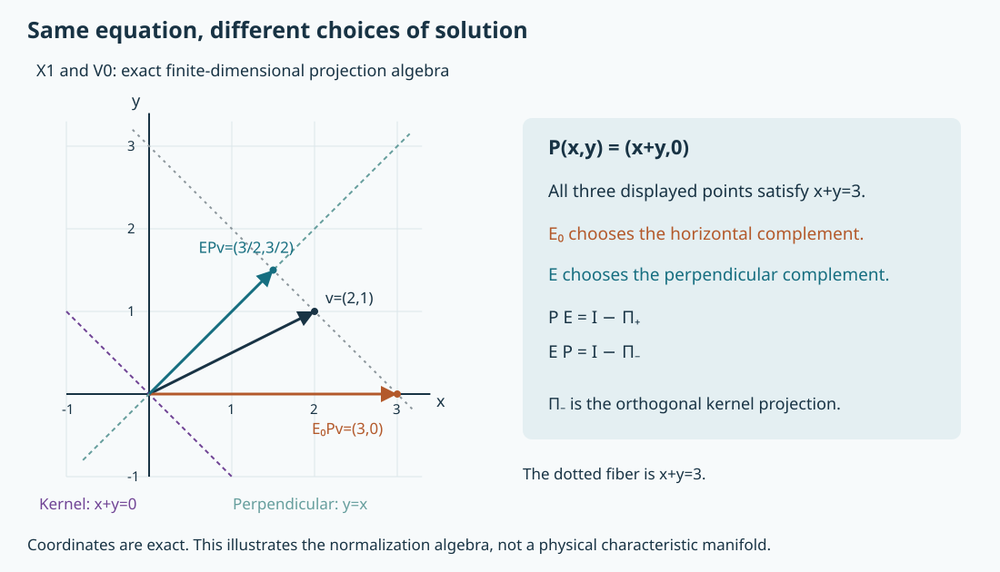

# A global symplectic parametrix with Hermitian projectors

The local complex model has an inverse modulo two projections. To assemble it over a manifold, we must place the partition of unity on different sides in the two characteristic regions. To obtain a canonical answer, we must then make the projections self-adjoint. This lesson proves both operations, including the regularity of the inverse used in that normalization.

The mathematical antecedent is Lars Hörmander, *The Analysis of Linear Partial Differential Operators IV*, 2009 edition, Section 26.3, final paragraph on printed page 91. The [model-parametrix lesson](../20261011-symplectic-model-parametrices/symplectic-model-projectors-and-solvability.html), SMP:S2, supplies the full local operators. The [endpoint companion](../20261005-restored-complex-fios/endpoint-half-order-bound.html), CX:E0–E4, supplies the proved finite-seminorm packet estimate and dyadic summation. The [global graph companion](../20261005-restored-graph-egorov/global-inverses-and-periodic-multipliers.html), GE:G0, supplies locally finite conic partitions with proper kernel supports. We prove the additional commutator and inverse assertions required here.

The exposition, three solved exercises and exact illustration are independent expression, CC0-1.0. The proof map identifies the actual earlier proofs. Human foundations remain external in this export. The [finite-contact reduction](../20261011-finite-contact-complex-model/finite-contact-complex-models-and-regularity.html) and [symplectic model projectors](../20261011-symplectic-model-parametrices/symplectic-model-projectors-and-solvability.html) supply the local constructions. The [solvability companion](../20261011-local-solvability-equivalences/local-solvability-equivalences-and-adjoint-estimates.html) develops the related uniform solution and finite-obstruction criteria.

## 1. The theorem and the operator class

**H0. Hypotheses and precise global conclusion.** Let \(X\) be a smooth Hausdorff second-countable manifold, equipped with a smooth positive density. Let \(P\) be a scalar properly supported classical pseudodifferential operator of real order \(m\), with homogeneous principal symbol \(p\). Assume

\[
 \Sigma=\{(x,\xi)\in T^*X\setminus0:p(x,\xi)=0\},
 \qquad \{\operatorname{Re}p,\operatorname{Im}p\}\ne0
       \quad\hbox{on }\Sigma. \tag{GS1}
\]

Write \(\Sigma_+\) and \(\Sigma_-\) for the positive and negative bracket parts. They are disjoint relatively closed subsets of \(\Sigma\). On each compact cosphere patch they have disjoint neighborhoods. No uniform lower bound on the bracket over a noncompact manifold is assumed.

There are properly supported pseudolocal operators \(E,\Pi_+,\Pi_-\) such that, modulo properly supported smooth kernels,

\[
 PE=I-\Pi_+,\quad EP=I-\Pi_-,\quad
 \Pi_\pm^2=\Pi_\pm=\Pi_\pm^*,\quad
 \Pi_+P=P\Pi_-=0. \tag{GS2}
\]

Their local Sobolev mappings and exact twisted wavefront relations are

\[
 E:H^s_{\rm comp}\longrightarrow H^{s+m-1/2}_{\rm loc},\quad
 \Pi_\pm:H^s_{\rm comp}\longrightarrow H^s_{\rm loc},
 \quad s\in\mathbb R, \tag{GS3}
\]

\[
 \operatorname{WF}'(E)=\Delta',\qquad
 \operatorname{WF}'(\Pi_\pm)=\Delta'|_{\Sigma_\pm}. \tag{GS4}
\]

The triple is unique modulo smooth kernels among properly supported pseudolocal triples with (GS2) and projector relations contained in the indicated characteristic diagonals. Hermitian projection here is an identity modulo smooth kernels. On a noncompact manifold we do not assert boundedness on one global \(L^2\) space, or exact orthogonal projection onto a global nullspace.

**A0. The calculus used in the proof.** For a properly supported pseudolocal operator \(T\), write \(T\in\mathcal B^d\) when every compact input/output localization is bounded \(H^s\to H^{s-d}\) for every real \(s\). We retain the usual seminorm estimates for families. Require its full kernel wavefront to be contained in the nonzero twisted diagonal; in particular neither zero-covector axis occurs. Composition then adds the indices, adjunction preserves the index, and properly supported smooth kernels form a two-sided ideal \(\mathcal R\).

These statements follow from the localized Fourier action proved in SMP:A0. For composition, proper support confines the intermediate variable to a compact set. Split the two intermediate frequency integrals into comparable regions and separated cones. On the separated parts one factor has arbitrarily rapid decay; on comparable parts the Sobolev bounds give the asserted continuous composition. The same argument proves the wavefront inclusion and permits the distributional cutoff limit. For a smooth factor, all parameter derivatives of its compactly supported columns remain bounded in every Sobolev norm. Applying the other operator's continuous mappings proves smoothness in both variables; the opposite order follows by adjunction. Thus all subsequent algebra takes place in the quotient by the genuine smoothing ideal \(\mathcal R\), not by a finite-order error.

Every diagonal kernel can be given proper support modulo a smooth kernel by GE:D8. Countable local constructions use the precompact base cover and locally finite conic partitions of GE:G0. A compact set meets only finitely many retained base supports, and each product has both variables in the same enlarged compact chart. Hence the sums are actual proper kernels and all local estimates are finite sums. This also explains why no global uniform constants are needed.

## 2. A half-order commutator estimate for the local projections

**C0. The Gaussian projection in Weyl coordinates.** At a simple complex characteristic the model is \(L=D_r+i rD_t\), with spectator variables \(z\). For positive \(\tau\), its cokernel projection has normal kernel
\((\tau/\pi)^{1/2}\exp[-\tau(r^2+a^2)/2]\).
Its exact Weyl symbol, with normal covector \(\rho\), is

\[
 q_+(r,z,t;\rho,\zeta,\tau)
   =2\mathbf1_{\tau>0}\exp(-\tau r^2-\rho^2/\tau).
 \tag{GS5}
\]

Indeed, substitute \(r+v/2,r-v/2\) in the kernel and Fourier transform in \(v\). The Gaussian integral is \(2\sqrt{\pi/\tau}\exp(-\rho^2/\tau)\), which gives the factor two in (GS5). The negative-frequency kernel projection has the same expression with \(\tau\) replaced by \(|\tau|\) and the opposite indicator. Spectator identity kernels introduce no further symbol factor.

Microlocalize where \(\pm\tau\geq c|\xi|>0\) and \(|\tau|\geq1\). On a shell \(|\tau|\asymp\lambda\), every symbol derivative obeys

\[
 |\partial_x^\alpha\partial_\xi^\beta q_\pm|
       \leq C_{\alpha\beta}\lambda^{(|\alpha|-|\beta|)/2}.
 \tag{GS6}
\]

For the normal variables this is differentiation of a Gaussian in \(\sqrt\lambda r\) and \(\rho/\sqrt\lambda\); every resulting polynomial is absorbed by a slightly weaker Gaussian. Derivatives in \(\tau\) cost \(\lambda^{-1}\), and the other derivatives vanish before localization. Smooth shell, cone and compact base cutoffs obey the weaker displayed bounds as well. Regions separated from the model characteristic set are smoothing by SMP:W0 and T0. This applies on every smaller retained cone.

**C1. A bounded-symbol commutator with one slow factor.** If \(a,b\) have bounded derivatives of all orders on phase space, the Weyl product is the oscillatory integral

\[
 (a\# b)(Z)=\pi^{-2n}\iint e^{-2i\sigma(U,V)}
           a(Z+U)b(Z+V)\,dU\,dV. \tag{GS7}
\]

It follows directly from inserting the two Weyl kernels and making the invertible midpoint changes of variables; inserting compact cutoffs first makes every interchange legitimate. Repeated integration by parts then removes those cutoffs in distributions. More precisely, apply powers of \(1-\Delta_U/4\) and \(1-\Delta_V/4\), transferring them to the amplitudes and the previously introduced weights. These operators applied to the exponential produce respectively \(1+|V|^2\) and \(1+|U|^2\). After expanding the transferred derivatives, every term is bounded by a constant times an integrable product of negative powers of \(\langle U\rangle\) and \(\langle V\rangle\), provided the two powers are chosen larger than \(2n+2\). Increasing them covers any prescribed derivative in \(Z\). This proves a bounded-symbol product estimate involving finitely many derivatives.

For the commutator, interchange \(U,V\) in the second product and replace \(V\) by \(-V\). Its integrand contains

\[
 a(Z+U)\bigl(b(Z+V)-b(Z-V)\bigr)
   =a(Z+U)\int_{-1}^{1}db(Z+\theta V)[V]\,d\theta. \tag{GS8}
\]

The same integrations by parts absorb the one extra factor \(|V|\), uniformly for \(-1\leq\theta\leq1\). Thus every fixed output derivative is bounded by finitely many derivatives of \(a\) times finitely many derivatives of \(b\) of strictly positive order. This is an exact estimate, not a truncated asymptotic expansion.

The complete packet estimate used in CX:E1 bounds the operator norm of a left symbol by finitely many bounded derivatives, without a support-volume factor. It also bounds the Weyl symbols just obtained. To verify this last step, convert a Weyl kernel to a left symbol by
\((2\pi)^{-n}\iint e^{-iy\cdot\eta}c(x+y/2,\xi+\eta)\,dy\,d\eta\).
The preceding two-variable integrations by parts give all bounded left-symbol seminorms from finitely many bounded derivatives of \(c\). Kernel insertion identifies the operators. Consequently the norm of the commutator in (GS8) has the same positive-derivative bound.

**C2. Shell scaling and the full Sobolev estimate.** Let \(B\in\Psi^d\) be an ordinary scalar operator and let \(Q\) be either model projection, properly localized in a retained cone as in C0. Then

\[
 [Q,B]\in\mathcal B^{d-1/2}. \tag{GS9}
\]

Here are the summation details. Use smooth dyadic cutoffs in \(|\tau|\), and slightly larger cutoffs in total frequency inside the retained cone. Comparable shells have total frequency comparable to \(\lambda\). Conjugate by the exact unitary dilation \(u(x)\mapsto\lambda^{n/4}u(\sqrt\lambda x)\), as in CX:E1. It sends the Weyl symbol to its value at \((x/\sqrt\lambda,\sqrt\lambda\xi)\). Formula (GS6) gives uniform bounded derivatives of the dilated projection symbol. The dilated ordinary symbol, after division by \(\lambda^d\), has every derivative of positive total order bounded by \(C\lambda^{-1/2}\): each base derivative contributes \(\lambda^{-1/2}\), and each frequency derivative contributes \(\sqrt\lambda/\lambda\). The shell and cone cutoffs have the same property. C1 therefore bounds each comparable-shell commutator by \(C\lambda^{d-1/2}\).

The model projection preserves \(\tau\) and the spectator Fourier variables exactly. For noncomparable input/output \(\tau\)-shells, the intervening ordinary operator has, after compact base localization, Fourier kernel bounded by
\(C_N\langle\eta\rangle^d(1+|\xi-\eta|)^{-N}\).
This follows by integrating its compact base Fourier transform by parts \(N\) times. The last-frequency separation is at least a fixed multiple of the sum of the two shell sizes. The cone cutoffs confine their frequency volumes to polynomial-size balls. The two Schur integrals are therefore bounded by arbitrary negative powers of the shell separation after increasing \(N\); the bounded projection fibers do not change this conclusion. Extra compact base cutoffs have rapidly decreasing Fourier kernels and obey the same estimate. Low-frequency pieces in a retained nonzero-last-covector cone are smoothing after full conic localization; their remaining compact-frequency kernels have all derivatives.

Multiply input and output blocks by the appropriate powers \(\mu^s\) and \(\lambda^{s-d+1/2}\). Comparable blocks are uniformly bounded, and the remote blocks remain summable after increasing \(N\) for the fixed real \(s,d\). Finite overlap and the square-sum/Schur summation proved in CX:E2–E3 now give (GS9), with a finite number of ordinary symbol seminorms. This proof is uniform for bounded symbol families, including regularizers. It treats every real Sobolev order, not only \(L^2\).

**C3. Graph transport and stability of the commutator bound.** Each local projection in SMP:S2 is an elliptic graph conjugate \(T^{-1}QT\), where \(T\) has a fixed real order. Full Egorov, GE:D10, makes \(TBT^{-1}\) an ordinary order-\(d\) operator modulo smoothing, on smaller matched cones. Thus
\([T^{-1}QT,B]=T^{-1}[Q,TBT^{-1}]T\) modulo smoothing. The two graph orders cancel, so (GS9) holds for the transported projection. Adjunction preserves it as well. Multiplication on either side by ordinary order-zero cutoffs preserves it, since their commutators with \(B\) have order \(d-1\).

Adding an arbitrary \(R\in\mathcal B^{-1/2}\) also preserves the bound: both \(RB\) and \(BR\) lie in \(\mathcal B^{d-1/2}\). Finite products of order-zero operators satisfying (GS9) satisfy it by \([UV,B]=U[V,B]+[U,B]V\). All these statements retain finite-seminorm uniformity and diagonal wavefront. They will apply to the assembled, initially non-Hermitian projections.

## 3. Assemble the two sides before normalizing

**G0. A proper inverse with the correct sign-dependent partitions.** At each characteristic point, SMP:S2 gives a local inverse \(E_j\in\mathcal B^{-m+1/2}\) and order-zero projections \(Q_{j,+},Q_{j,-}\). Near \(\Sigma_+\), \(E_jP=I\); near \(\Sigma_-\), \(PE_j=I\). On elliptic patches take an ordinary two-sided parametrix.

Choose the locally finite compact-chart conic partition \(\{A_j\}\) of A0, with \(\sum A_j=I\) modulo \(\mathcal R\), subordinate to positive, negative and elliptic patches. Each retained microsupport lies inside a larger patch on which the corresponding identities hold. Insert larger proper cutoffs equal to one near that retained microsupport on every unused side. Set

\[
 E_0=\sum_{j\,+}A_jE_j+
       \sum_{j\,-}E_jA_j+
       \sum_{j\,e}A_jE_j, \tag{GS10}
\]

with those larger cutoffs understood. The sums are locally finite proper kernels. On the positive characteristic region the partition is on the left, so \(E_0P=I\). On the negative region it is on the right, so \(PE_0=I\). Commutators with the larger cutoffs are supported away from the retained microsupport and are smoothing after composition, by diagonal wavefront. On an elliptic overlap, all local inverses equal the ordinary elliptic inverse modulo smoothing; hence both identities hold there regardless of the side of the partition.

Define

\[
 Q_+=I-PE_0,\qquad Q_-=I-E_0P. \tag{GS11}
\]

Their wavefront relations are contained respectively in \(\Delta'|_{\Sigma_+}\) and \(\Delta'|_{\Sigma_-}\). They belong to \(\mathcal B^0\). Indeed near the positive region,
\(Q_+=\sum A_jQ_{j,+}-\sum[P,A_j]E_j\), modulo smoothing. The first sum is order zero in the stated Sobolev sense, while the second has index \((m-1)+(-m+1/2)=-1/2\). The analogous negative-region expression is
\(Q_-=\sum Q_{j,-}A_j-\sum E_j[A_j,P]\).
They vanish microlocally in the complementary characteristic region and are smoothing off the characteristic set. C3 proves (GS9) for both assembled projections.

**G1. The full generalized-inverse algebra.** The two expressions
\(PQ_-=Q_+P=P-PE_0P\) are equal. Their wavefront relations lie in disjoint characteristic diagonals, so this common operator is smoothing. Thus, in the quotient by \(\mathcal R\),

\[
 PE_0P=P,\quad Q_\pm^2=Q_\pm,\quad
 Q_+P=PQ_-=0. \tag{GS12}
\]

Furthermore \(E_0Q_+=Q_-E_0\). The first expression has wavefront in the positive diagonal, the second in the negative diagonal. Hence both vanish in the quotient, giving \(E_0PE_0=E_0\). These arguments use the diagonal relation of \(E_0\); they would not justify discarding an arbitrary operator that carries a positive characteristic point to a different negative one.

## 4. The inverse needed for Hermitian normalization

**I0. A local positive inverse preserves every Sobolev space.** Let \(Q\in\mathcal B^0\) be either assembled projection. Put \(K=Q-Q^*\), and choose a real compact base cutoff \(\chi\) equal to one on a neighborhood of a retained patch. Localize both kernel variables and work in a coordinate chart, conjugating by the square root of the density if necessary. The skew-adjoint bounded operator \(K_\chi=\chi K\chi\) has compact input/output support and satisfies (GS9). Define

\[
 A_\chi=I+K_\chi^*K_\chi=I-K_\chi^2.
 \qquad \langle A_\chi u,u\rangle\geq\|u\|_2^2. \tag{GS13}
\]

This bounded self-adjoint operator is bijective on \(L^2\): the inequality implies closed range and zero kernel, while the orthogonal complement of the range is the kernel of its adjoint, also zero. The Hilbert projection argument in SMP:D1 justifies the closed-range conclusion. Its inverse has norm at most one.

It preserves \(H^s\) for every real \(s\). For a positive target order use
\(B_\varepsilon=\langle D\rangle^s(1+\varepsilon\langle D\rangle)^{-N}\), with a fixed \(N>s\). These are bounded on \(L^2\) for each \(\varepsilon>0\), and form a uniformly bounded ordinary \(S^s\) family; differentiating the scalar factor verifies this directly. If \(A_\chi u=f\), then

\[
 A_\chi B_\varepsilon u
   =B_\varepsilon f+[A_\chi,B_\varepsilon]u,
 \qquad
 \|B_\varepsilon u\|_2
 \leq C_s\bigl(\|f\|_{H^s}+\|u\|_{H^{s-1/2}}\bigr). \tag{GS14}
\]

The last inequality follows from (GS13), C3 and Cauchy–Schwarz. All constants are independent of \(\varepsilon\). Starting with \(u\in L^2\), take targets successively at most one half-order higher. Fatou on the Fourier integral as \(\varepsilon\downarrow0\) gives the claimed space and bound at each step. Every positive real target is reached in finitely many steps. Negative orders follow by duality, since the inverse is self-adjoint on \(L^2\); density gives a consistent inverse on every negative Sobolev space. The identities with \(A_\chi\) extend there because it is bounded on each such space. This proves the full inverse estimate without assuming that arbitrary order-zero pseudolocal operators are inverse closed.

**I1. The local inverse is pseudolocal, with uniform smoothing off the diagonal.** Suppose \(u=A_\chi^{-1}f\) and \(f\) is microlocally smooth on a fixed open cone. For a proper ordinary cutoff \(B\) inside that cone,
\(A_\chi Bu=Bf+[A_\chi,B]u\).
Choose a larger cutoff \(B'\) equal to one near the microsupport of \(B\). Diagonal wavefront gives
\([A_\chi,B](I-B')\in\mathcal R\). The remaining commutator gains one half-order by C3. Applying the all-real inverse bound of I0 therefore improves the regularity of \(Bu\) by one half-order whenever \(B'u\) has the preceding order. Begin with a global negative Sobolev order for a compact input, and iterate through finitely many nested cones for each target order. Use one fixed smaller final cone and compact output support for all targets. This proves microlocal smoothness there.

The same estimates are uniform when the input is localized in a closed cone disjoint from the target cone. They give every bound \(H^{-M}\to H^N\) for the separated operator. Its compactly localized kernel is smooth: apply it to the Fourier modes of the input variable, differentiate those modes as needed, and choose \(M,N\) successively large. The resulting Fourier coefficients decrease to every order in both variables, so their differentiated series converge uniformly. This is the delta-column reconstruction already used for graph and evolution kernels. This proves the nonzero-direction off-diagonal assertion. The axes require one more uniform argument. Let \(B_\lambda\) be a compact output cutoff to a frequency annulus of size \(\lambda\), and let \(C_\lambda\) cut the input to frequencies at most a small fixed fraction of \(\lambda\). Choose finitely many nested, slightly larger output annuli. The kernel of \(A_\chi\) has the exact diagonal relation, so a compact Fourier transform decreases to every order where input and output frequencies differ by such a fixed relative amount. This gives uniformly rapid remainders when \([A_\chi,B_\lambda]\) is restricted outside the next annulus. Inside that annulus its half-order gain gives the bound \(C\lambda^{-1/2}\) on \(L^2\), since its input frequencies have size \(\lambda\). Applying \(A_\chi^{-1}\) on \(L^2\) to the localized equation yields
\(\|B_\lambda A_\chi^{-1}C_\lambda\|\leq C\lambda^{-1/2}\|B'_\lambda A_\chi^{-1}C_\lambda\|+O(\lambda^{-M})\).
The source term is rapidly small by its separated frequency supports and compact-cutoff Fourier decay. For each desired power choose enough nested annuli, all separated from the same low input ball. Iteration, ending with the bounded global inverse, gives every inverse power of \(\lambda\). The adjoint gives the reversed separation. Compact Fourier testing absorbs the finite frequency-volume factors and proves rapid decay of the kernel transform near both axes. Together these estimates give the full diagonal kernel relation; mere boundedness on every Sobolev space has not been used as a substitute for this axis argument.

Outside the compact support of \(\chi\), the equation in (GS13) is simply \(u=f\). Hence \(A_\chi^{-1}-I\) has compact output support; self-adjointness gives compact input support as well. The inverse is therefore proper. It belongs to \(\mathcal B^0\) with the required kernel and parameter continuity.

**I2. A global proper inverse modulo smooth kernels.** Set \(A=I-(Q-Q^*)^2\) globally. The localized positive operator \(A_\chi\) agrees with \(A\) on each smaller retained cone where \(\chi=1\), since all factors have diagonal wavefront. I0–I1 supply a local two-sided inverse there. Two such inverses \(B_i,B_j\) agree modulo smoothing on an overlap:

\[
 B_i-B_j=B_i(I-AB_j)+(B_iA-I)B_j. \tag{GS15}
\]

Use the locally finite proper conic partition of A0 to assemble these inverses, with larger input/output cutoffs. On each retained cone every summand meeting it agrees with one fixed local inverse, so their sum agrees with that inverse because the partition sums to identity. Both global inverse identities follow. The actual kernel sum is proper and belongs to \(\mathcal B^0\). Denote it by \(A^{-1}\); this notation means a two-sided inverse modulo \(\mathcal R\). Since \(A=A^*\), the adjoint is another such inverse, and (GS15) shows \((A^{-1})^*=A^{-1}\) modulo \(\mathcal R\).

## 5. Normalize and prove uniqueness

**N0. An idempotent can now be orthogonalized in the quotient.** Let \(Q^2=Q\) modulo \(\mathcal R\), and use the inverse from I2. Elementary ordered multiplication gives

\[
 A=I-(Q-Q^*)^2=QQ^*+(I-Q^*)(I-Q),\quad
 AQ=QA=QQ^*Q,
 \quad R=QQ^*A^{-1}. \tag{GS16}
\]

All equalities in this section are in the quotient. Adjunction gives commutation with \(Q^*\), so \(A^{-1}\) commutes with both. It follows that

\[
 R^*=R,\quad R^2=R,\quad RQ=Q,\quad QR=R. \tag{GS17}
\]

For idempotence use \(AQQ^*=QQ^*QQ^*\). For \(RQ=Q\) use \(QQ^*Q=AQ\); the other identity is immediate from \(Q^2=Q\). These formulas identify the same range algebraically. They are valid for noncommuting factors and do not divide by a possibly vanishing scalar symbol. Since the leading factor contains \(Q\), the relation of \(R\) remains confined to that of \(Q\); I2 introduces no additional relation.

**N1. Normalize the two different ranges.** Apply N0 to \(Q_-\) and to \(Q_+^*\), respectively. With \(A_\pm=I-(Q_\pm-Q_\pm^*)^2\), set

\[
 \Pi_-=Q_-Q_-^*A_-^{-1},\qquad
 \Pi_+=Q_+^*Q_+A_+^{-1},\qquad
 E=(I-\Pi_-)E_0(I-\Pi_+). \tag{GS18}
\]

The adjoint on the plus side is essential: the cokernel corresponds to the adjoint nullspace. Equations (GS12), (GS16) and (GS17) give
\(P\Pi_-=0\), \(\Pi_+P=0\), \(\Pi_-Q_-=Q_-\), and \(Q_+\Pi_+=Q_+\). Consequently
\(PE=(I-Q_+)(I-\Pi_+)=I-\Pi_+\) and
\(EP=(I-\Pi_-)(I-Q_-)=I-\Pi_-\).
This proves every identity in (GS2). All factors except \(E_0\) belong to \(\mathcal B^0\), so (GS3) follows with the exact gain \(m-1/2\). Properness and the smoothing remainder statements follow from A0.

**N2. The relations are equalities.** We already have the inclusions in (GS4). At any point of \(\Sigma_+\), SMP:S2 supplies a compact source of any prescribed finite Sobolev regularity that has no microlocal solution. If \(\Pi_+\) had no kernel wavefront at the corresponding diagonal covector, its diagonal relation and SMP:A0 would make \(\Pi_+f\) smooth there for every compact source. But \(PE=I-\Pi_+\) would then give a microlocal solution, a contradiction. Thus every positive characteristic diagonal covector occurs. Apply the same argument to \(P^*\) at \(\Sigma_-\): its bracket changes sign, and the adjoint of \(EP=I-\Pi_-\) gives its right inverse modulo \(\Pi_-\). This proves equality for both projectors.

Finally \(PE=I-\Pi_+\) forces the wavefront of \(E\) to contain every diagonal covector outside \(\Sigma_+\). The bracket condition implies independence of \(d\operatorname{Re}p\) and \(d\operatorname{Im}p\), so \(\Sigma\) is a codimension-two submanifold and has empty interior. Hence that complement is dense in the diagonal. Closedness of wavefront proves equality for \(E\). If a sign region or the entire characteristic set is empty, the corresponding projector is smoothing and the same argument applies.

**N3. Uniqueness has an explicit class and an actual proof.** Suppose \((F,R_+,R_-)\) is another triple in the class of H0. Since \(P\Pi_-=0\), the identity \(FP=I-R_-\) gives \(R_-\Pi_-=\Pi_-\). Taking adjoints and interchanging the triples proves both \(\Pi_-R_-=\Pi_-\) and \(\Pi_-R_-=R_-\), so \(\Pi_-=R_-\). On the plus side use \(\Pi_+P=0\) and \(PF=I-R_+\), then the same adjoint argument. Thus the two projector pairs agree modulo smoothing.

For \(D=E-F\), we now have \(PD=DP=0\). Hence

\[
 D=(I-FP)D=\Pi_-D,\qquad
 D=D(I-PF)=D\Pi_+,\qquad D=\Pi_-D\Pi_+. \tag{GS19}
\]

The last product is smoothing because \(D\) is pseudolocal and the positive and negative characteristic sets are disjoint. This proves the asserted uniqueness. Without the diagonal relation restriction, an operator connecting a cokernel mode to a kernel mode could be added; Hermitian projectors alone would not exclude it. The hypothesis is part of the global microlocal parametrix class and is therefore retained in the theorem.

## 6. Three exercises with complete solutions

**X1. Normalize an oblique inverse without changing its equation.** Let \(a\in\mathbb R\),
\(P=\begin{pmatrix}1&a\\0&0\end{pmatrix}\), and
\(E_0=\begin{pmatrix}1&0\\0&0\end{pmatrix}\).
Compute the two initial defects, their Hermitian replacements and the corrected inverse.

**Solution.** Multiplication gives
\(Q_+=\begin{pmatrix}0&0\\0&1\end{pmatrix}\) and
\(Q_-=\begin{pmatrix}0&-a\\0&1\end{pmatrix}\).
For \(Q_-\), the matrix \(I-(Q_--Q_-^*)^2\) is \((1+a^2)I\). Thus

\[
 \Pi_+=\begin{pmatrix}0&0\\0&1\end{pmatrix},\quad
 \Pi_-=\frac1{1+a^2}\begin{pmatrix}a^2&-a\\-a&1\end{pmatrix},\quad
 E=\frac1{1+a^2}\begin{pmatrix}1&0\\a&0\end{pmatrix}. \tag{GS20}
\]

Direct multiplication proves \(PE=I-\Pi_+\) and \(EP=I-\Pi_-\). The kernel of \(P\) is spanned by \((-a,1)\), and \(\Pi_-\) is its Euclidean orthogonal projection. The corrected inverse chooses a solution perpendicular to that kernel; the original inverse chose a different complement.

**X2. Why is the side of the partition important?** Near a positive characteristic, suppose \(E_jP=I\). Compare \(\sum A_jE_j\) with \(\sum E_jA_j\), where \(\sum A_j=I\), and compute the residual of each left-inverse identity.

**Solution.** The left-partitioned expression satisfies
\((\sum A_jE_j)P=\sum A_j=I\).
For the right-partitioned expression,
\((\sum E_jA_j)P=I+\sum E_j[A_j,P]\).
There is no general cancellation of the latter sum. Each term has Sobolev index \((-m+1/2)+(m-1)=-1/2\); it improves one half-order, but it need not be smoothing. A finite-order improvement cannot replace the exact local inverse identity. Near a negative characteristic the right partition instead preserves the right inverse, which explains (GS10).

**X3. State the uniqueness obstruction when pseudolocality is dropped.** Suppose the exact algebraic identities (GS2) hold. Let \(T\) be any operator for which the following products exist. Show that \(E+\Pi_-T\Pi_+\) has the same two inverse identities and explain why N3 nevertheless proves uniqueness in its stated class.

**Solution.** Multiplying the added term on the left by \(P\) or on the right by \(P\) gives zero, since \(P\Pi_-=0\) and \(\Pi_+P=0\). The inverse identities alone therefore permit it. If \(T\) is pseudolocal, its diagonal relation cannot carry a point of \(\Sigma_+\) to \(\Sigma_-\), so the added term is smoothing. A nonlocal kernel can connect those distinct characteristic regions. N3 uses the diagonal relation exactly at this last step, so its uniqueness conclusion has neither a hidden global-nullspace assumption nor an unstated restriction on arbitrary kernels.

## 7. An exact finite-dimensional picture of normalization

**V0. Different complements, the same equation.** In X1 take \(a=1\) and the input vector \(v=(2,1)\). The oblique reconstruction is \(E_0Pv=(3,0)\), while the normalized reconstruction is \(EPv=(3/2,3/2)\). Both have image \((3,0)\) under \(P\). The second is perpendicular to the kernel line \(\mathbb R(-1,1)\). The illustration plots these exact vectors and the corresponding differences; it is a diagram of the projection algebra, not a physical characteristic manifold.

The [finite-contact reduction](../20261011-finite-contact-complex-model/finite-contact-complex-models-and-regularity.html) and [symplectic model projectors](../20261011-symplectic-model-parametrices/symplectic-model-projectors-and-solvability.html) supply the local constructions. The [solvability companion](../20261011-local-solvability-equivalences/local-solvability-equivalences-and-adjoint-estimates.html) develops the related uniform solution and finite-obstruction criteria.
