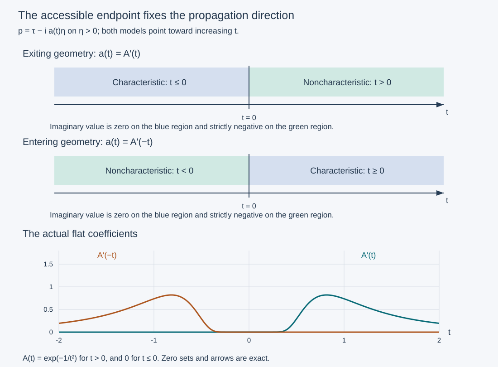

# Intrinsic orientation and regularity entering the characteristic set

The favorable direction of propagation is a property of a complex characteristic curve. It must survive multiplication of the symbol and a change of canonical coordinates. A compact piece on which the symbol is locally real does not, by itself, distinguish the two directions: the choice comes from an endpoint at which the characteristic curve can reach a nonzero symbol value.

We prove the intrinsic orientation, propagation from a negative noncharacteristic point, and propagation from a regular starting point on an oriented characteristic interval. The antecedents are Hörmander IV, Theorem 26.6.2, Definition 26.6.3 and Theorem 26.6.4, printed 120–121 in the 2009 edition. All operator and geometry steps used here have exact programme proofs. The neighboring [complex-cutoff theorem](../20261011-complex-cutoff-energy/adaptive-square-roots-and-complex-cutoff-energy.html) treats Proposition 26.6.1′; the three invariant results here use the ordinary sign estimate.

Use the [characteristic geometry](../20261011-condition-p-geometry/condition-p-and-characteristic-saturation.md), [complex homogeneous tubes](../20261011-condition-psi-geometry/condition-psi-and-complex-characteristic-tubes.md), [graph operators and Egorov](../20261005-restored-graph-egorov/graph-operators-continuity-and-egorov.md), and [ordinary propagation](../20261011-one-direction-propagation/one-direction-propagation-and-characteristic-strata.md). The proof map pins their actual current sources and locators. External human foundations remain explicit; internal export P514 closure is not claimed.

## 1. The curves and their endpoint data

**H0. Fixed conventions and the escaping rank-one set.** Let \(P\) be a scalar properly supported classical pseudodifferential operator of order \(m\) on a smooth manifold \(X\), with homogeneous principal symbol \(p\). Work in an open conic domain where the characteristic curves under discussion are regular. Write

\[
 N=\{p=0\},\qquad S=N_2^e,\qquad N_1=N\setminus S,
 \qquad r=s+m-1. \tag{IP1}
\]

Here \(N_2\) is the locus where the two real differentials of \(p\) are independent, and \(S\) is its semibicharacteristic saturation. CPG:T0–S1 prove that \(S\) is a locally closed coisotropic submanifold, including its rank drops. A semibicharacteristic is a regular orbit of \(H_{\operatorname{Re}(qp)}\) in the real zero level, for a smooth nonzero complex multiplier \(q\). It need not be homogeneous. We use \(D=-i\partial\), \(\omega=\sum d\xi_j\wedge dx_j\), and \(H_\tau=\partial_t\).

Assume condition (P): \(\operatorname{Im}(qp)\) never takes both strict signs on any such orbit. CPG:H0 and PSG:E1 prove this formulation, including arbitrary smooth multipliers, its invariance under nonzero multipliers, and its canonical invariance. Let \(N_{11}\subset N_1\) be the points connected to a noncharacteristic point by a semibicharacteristic. On a characteristic subinterval of such an orbit the real Hamilton fields span a single line. Indeed a rank-two point would force the entire orbit to remain characteristic, by CPG:T2.

By a one-dimensional characteristic interval we mean a regular curve in \(N\) whose tangent is the nonzero complex Hamilton line. An interval **maximal at an endpoint** cannot be extended through that endpoint as a one-dimensional characteristic interval, while staying in the regular domain. This is not a statement about completeness of one arbitrarily rescaled vector field.

**G0. Carry a compact interval to an accessible endpoint.** Every compact one-dimensional interval in \(N_{11}\) can be included in a compact one-dimensional interval maximal at at least one endpoint and disjoint from \(S\). To verify the endpoint assertion, start at any one point and choose its defining semibicharacteristic to a noncharacteristic point. The connected component of its characteristic times containing that point is a closed interval, possibly with one endpoint at the starting time. At the end toward the noncharacteristic point it has a finite endpoint inside the regular domain. A characteristic continuation there would have to coincide with the original real orbit by flow uniqueness, contradicting maximality of that component. CPG:C0 supplies this argument also when the zero component is a singleton.

For a nontrivial given characteristic interval, the common Hamilton line identifies it locally with the characteristic portion of this orbit. Uniqueness glues their overlapping intervals. Continuing from their common point toward the accessible endpoint and including the given compact portion therefore gives the required larger interval. A loop cannot intervene: a repeated projected germ would give a closed projected characteristic leaf whose conic lift extends through both ends, contradicting the accessible endpoint. The detailed return and radial arguments are CPG:M0 and PSG:M1. In particular the resulting cosphere projection is embedded and regular. This also proves that no radial characteristic or periodic projected characteristic belongs to such an interval.

All these statements concern the regular domain. An endpoint on its boundary, or a point where \(dp=0\), is not silently included.

**G1. One normal form through the accessible endpoint.** CPG:M0, CPG:M2 and PSG:N0–N2 now give, on a common neighborhood of that larger compact interval, a nonzero homogeneous multiplier \(a\) of degree \(1-m\) and a homogeneous canonical map \(\kappa\) such that

\[
 (ap)\circ\kappa=\tau+i f(t,y,\eta),\qquad
 \partial_\tau f=0,\quad \deg f=1,
 \qquad f=df=0\text{ on }J=\{(t,0;0,\eta_0):t\in I\}. \tag{IP2}
\]

The map sends the marked line to the original interval with its prescribed smooth parameter. The imaginary part has one weak sign on the whole tube, and is nonzero at central points arbitrarily near the nonextendible endpoint on its extending side. Here are the features of CPG:M2 that matter. If the extended central line remained characteristic on a full extra interval, it could not meet \(N_2\), since CPG:T2 would then put the original interval in \(S\). It would remain rank one and extend the given interval, a contradiction. A nearby nonzero central value has a strict sign on a transverse open set. Condition (P) on every vertical line fixes that sign throughout a smaller common product neighborhood. Independence of \(\tau\) makes it a sign on the full tube.

If this sign is positive, replace the multiplied symbol by its negative and use the canonical change \((t,\tau)\mapsto(-t,-\tau)\). Thus we can arrange

\[
 f\le0\text{ on the full tube},\qquad
 f(t_j,0,\eta_0)<0\text{ at points approaching an accessible endpoint}. \tag{IP3}
\]

There is also a point version. If a characteristic zero component of a regular semibicharacteristic is a singleton, no nontrivial one-dimensional characteristic interval can pass through that point: uniqueness would force it into the same orbit. CPG:M2's point construction gives (IP2) on a neighborhood of that point, with a fixed weak sign and arbitrarily nearby nonzero central values. The parameter direction at the point can be prescribed to agree with the original nonzero real field.

## 2. The multiplier does not choose a new orientation

**O0. An exact calculation on the real zero surface.** Work first in the favorable normal form (IP2)–(IP3). Another multiplier \(q\) on the original space has ratio

\[
 z=(q/a)\circ\kappa=A+iB. \tag{IP4}
\]

On the marked characteristic line, \(d f=0\) and \(p=0\), so

\[
 H_{\operatorname{Re}(z(\tau+i f))}=A\,\partial_t\quad\text{on }J. \tag{IP5}
\]

A regular real field there therefore has \(A\ne0\). Its sign is constant on each connected compact interval. If \(A>0\), shrink the neighborhood so this inequality persists. On its real zero surface,

\[
 A\tau-Bf=0\quad\Longrightarrow\quad
 \operatorname{Im}\bigl(z(\tau+i f)\bigr)
       =\frac{A^2+B^2}{A}\,f\le0. \tag{IP6}
\]

The ratio can depend on \(\tau\); the equality is still exact, evaluated at a point on that surface. The surface itself is a graph \(\tau=h(t,y,\eta)\) near \(J\). Indeed its \(\tau\)-derivative on \(J\) is \(A\ne0\), so the implicit-function theorem applies; compactness gives one common neighborhood. Since \(f\) is independent of \(\tau\), its value on this graph is precisely the same \(f(t,y,\eta)\).

If instead \(A<0\), (IP6) has the opposite weak sign. At a sequence from (IP3), the corresponding graph points tend to the endpoint and have strictly positive imaginary part. Thus a multiplier with \(A<0\) cannot have nonpositive imaginary part on its real zero surface throughout any neighborhood of the interval **including that endpoint**.

This proves both directions: multipliers giving the same direction as \(\partial_t\) preserve the favorable sign, and multipliers giving the opposite direction are excluded by the endpoint's nonzero values. No continuity-of-sign argument across possibly identically zero families is needed.

**O1. The intrinsic orientation and its restriction.** Give an endpoint-maximal characteristic interval in \(N_{11}\) the orientation of \(H_{\operatorname{Re}(qp)}\) when that field is nonzero there and \(\operatorname{Im}(qp)\le0\) near the interval in \(\operatorname{Re}(qp)=0\). Existence follows from G1; O0 proves uniqueness for all such multipliers. Canonical changes preserve the calculation because they transport the real Hamilton fields and zero surfaces exactly.

A shorter compact subinterval inherits this orientation. The inheritance is independent of the chosen accessible endpoint. If two endpoint-maximal extensions overlap, uniqueness of the rank-one line places their union on the same characteristic leaf. The relevant union of compact portions is again a compact interval with an accessible endpoint and regular embedded cosphere projection, by G0. Apply G1 on it. If both accessible ends are present, condition (P) makes their nearby nonzero central values have the same sign on the extended vertical orbit. Formula (IP6) then forces both proposed orientations to agree with the same favorable normal form. The case with only one endpoint is already O0. Restricting proves the claim on every overlap.

A compact subinterval on which the symbol is locally real may admit both signs of a multiplier in its own small neighborhood. That does not contradict uniqueness: the definition uses an endpoint-maximal extension, then restricts its orientation. Exercise X3 exhibits this distinction.

## 3. Transfer the estimate with the correct Sobolev order

**F0. The full operator reduction.** Suppose (IP2)–(IP3) hold near a compact model interval. Choose an elliptic ordinary operator \(E\) of order \(1-m\), with principal symbol \(a\). On a graph patch choose a proper elliptic order-zero graph FIO \(T\) from the model to the original domain, quantizing \(\kappa\), and its order-zero inverse \(V\). GE:D1–D2, D8–D11 provide their construction, proper support and both smoothing inverse errors. If several patches are needed, compactness gives a finite ordered subdivision of the model interval, with each closed subinterval inside one patch and successive subintervals overlapping. Perform the following argument successively there; no single global Maslov frame is presumed. On smaller matched cones,

\[
 VT-I,\ TV-I\text{ are smoothing},\qquad
 L=VEPT\in\Psi^1,\qquad \sigma_1(L)=\tau+i f. \tag{IP7}
\]

The symbol formula is the full ordered Egorov theorem GE:D10. The graph factors are inverses, so their contracted scalar symbol product is one. The lower-order terms of \(L\) are retained; the ordinary propagation theorem allows them. No assertion that principal-symbol transport removes them is used.

Put \(v=Vu\). Proper distributional action and the smoothing inverse error give

\[
 Lv=VEPu+\text{a distribution smooth on the retained cone},\qquad
 u=Tv+\text{a distribution smooth on the original cone}. \tag{IP8}
\]

For the first identity expand \(TVu=u+(TV-I)u\). A proper finite-order operator preserves microlocal smoothness at the relevant points, and the graph wavefront relation transports the residual away from the model cone. These are the exact smoothing and support conclusions of GE:D7–D10 and P2:OP4–OP6. Cutoffs are chosen on slightly larger matched cones before these compositions, so separated pieces have no relevant wavefront.

The order bookkeeping is

\[
 Pu\in H^s\ \Longrightarrow\ EPu\in H^{s-(1-m)}=H^r,
 \qquad V,T:H^r\longrightarrow H^r,
 \qquad r=s+m-1. \tag{IP9}
\]

Every order is real; GE:D7 and CE:G1 prove the indicated local estimates. The two inverse identities make the equivalence of microlocal \(H^r\) for \(u\) and \(v\) two-sided. If \(v\) is initially \(H^r\), the full ordinary theorem ODP:H0–B0 therefore propagates it along the retained model subinterval, and (IP8) returns that regularity to its image. The regularity neighborhood at an overlap supplies the initial condition for the next patch. Finite induction proves the conclusion on the whole compact interval.

## 4. Regularity entering from a nonzero symbol value

**E0. Entering theorem.** Let \(\gamma:[a_0,a_1]\to T^*X\setminus0\) be a regular semibicharacteristic of \(\operatorname{Re}(qp)\), with \(q\ne0\) near it and

\[
 \operatorname{Im}(qp)(\gamma(a_0))<0,\qquad
 Pu\in H^s\text{ at every point of }\gamma([a_0,a_1]). \tag{IP10}
\]

Then

\[
 u\in H^{s+m-1}\text{ along the whole curve};
 \qquad p\ne0\Longrightarrow u\in H^{s+m}. \tag{IP11}
\]

The second conclusion is the exact ordinary elliptic parametrix K:K2–K3, with the order-\(m\) Sobolev mapping. It applies at all noncharacteristic points, independently of the sign. Condition (P) and the incoming strict negative value also give \(\operatorname{Im}(qp)\le0\) along the entire given orbit.

Fix a characteristic time \(t_0\). The connected component \(I=[\alpha,\beta]\) of the zero set containing it is compact, with \(\alpha>a_0\), since the initial value is strictly negative. The component can be a singleton. There are noncharacteristic times approaching \(\alpha\) from the left; otherwise a left interval would belong to the same zero component. Their imaginary values are negative, since the real part is zero and condition (P) forbids positivity. No rank-two point can occur on the orbit, by CPG:T2. The nontrivial component is consequently a one-dimensional characteristic interval outside \(S\), maximal at its left endpoint. For a singleton use G1's point version.

**E1. Select the sign and an elliptic starting point on the new line.** Apply G1 to this component with the parameter direction inherited from \(\gamma\), initially allowing either weak sign for the new \(f\). The construction preserves that direction: on the component, the original field has a positive coefficient in (IP5). Hence \(A=\operatorname{Re}((q/a)\circ\kappa)>0\) on a neighborhood after shrinking. The original orbit's noncharacteristic points just before \(\alpha\) lie in this neighborhood and in the real zero surface of \(q p\). Formula (IP6), which is valid whichever sign \(f\) has, shows that \(f\) takes a strictly negative value there. Its fixed weak sign must therefore be the favorable one, \(f\le0\), throughout a smaller tube. This argument does not assert that the new central line coincides with the original semibicharacteristic outside its characteristic component.

The new central line has nonzero points arbitrarily close to \(\alpha\) on the left. If it were characteristic on a whole left interval, it could not become rank two without placing \(I\) in \(S\). It would extend as a rank-one curve; uniqueness for the original nonzero real field would then extend the original zero component, a contradiction. These nonzero central values are negative by the sign just selected.

The forcing is microlocally \(H^s\) on an open neighborhood of the compact original component: take a finite cover by its regularity neighborhoods. The new central point can thus be chosen sufficiently close to \(\alpha\) to remain in this same forcing neighborhood. At that point the original operator is elliptic, so \(u\in H^{s+m}=H^{r+1}\) there. In particular the transformed unknown is initially \(H^r\). Use F0 and ordinary propagation on the extended central segment from this point through \(I\). Its image lies in the forcing neighborhood by shrinking the tube and the added segment. This proves \(H^r\) at the chosen time \(t_0\), including \(\alpha\) itself.

Applying this argument to each characteristic time, and the elliptic argument to the remaining times, proves (IP11). The zero set may have infinitely many components; none were assumed isolated or finite in number. Microlocal regularity is open, so the resulting neighborhoods cover the compact curve and admit a finite subcover. If the original orbit revisits points, the construction is made on a simple local component and its small extension; G0 excludes a closed projected characteristic component with an accessible endpoint. Thus no global injectivity of the entire semibicharacteristic is being imposed.

## 5. Propagation along an oriented characteristic interval

**P0. The starting-point theorem.** Let \(\Gamma\) be a compact one-dimensional characteristic interval in \(N_{11}\), with the intrinsic orientation O1. If

\[
 Pu\in H^s\text{ on }\Gamma,\qquad
 u\in H^{s+m-1}\text{ at its oriented starting point}, \tag{IP12}
\]

then \(u\in H^{s+m-1}\) throughout \(\Gamma\).

Extend \(\Gamma\) geometrically to an accessible endpoint by G0. Use its favorable normal form from G1 and then restrict it to a neighborhood of the original compact interval. O1 makes increasing model time agree with the specified orientation. The geometry may use a farther endpoint; no regularity of \(Pu\) at that farther endpoint is assumed or needed. The open forcing neighborhood of the original compact interval contains a smaller model tube, and the initial regularity gives the required initial neighborhood in that tube. F0 and ODP:H0–B0 prove the conclusion.

The direction in E0 is consistent with O1 wherever its orbit enters a characteristic component. E1 showed that the original increasing parameter has positive coefficient in the favorable normal form. Thus the entering theorem and the starting-point theorem use the same intrinsic direction. They make no general assertion in the reverse direction.

**S0. One fixed smooth cone.** Both theorems have smooth-wavefront versions: replace the forcing and, in P0, initial Sobolev regularity by smooth microlocal regularity. In E0 the initial value on the added segment is smooth by ellipticity. Choose the geometry and conic neighborhoods once inside these smooth regularity neighborhoods. The fixed-cone conclusion ODP:B1 makes the transformed unknown smooth on a fixed smaller neighborhood of the entire model segment. The graph wavefront and inverse statements then give a fixed smooth neighborhood of its image. In E0 take a finite subcover of the compact orbit as above. This is stronger than merely choosing a different cone for each Sobolev exponent, and is the actual wavefront conclusion.

## 6. Three solved checks

**X1. A rotating multiplier and its real zero surface.** On \(\eta>0\) take

\[
 p=e^{i\theta(t)}(\tau-i a(t)\eta),\qquad a\ge0,
 \qquad q=(2+it)e^{-i\theta(t)}. \tag{IP13}
\]

Assume \(a=0\) on a characteristic interval and \(a>0\) arbitrarily close to an accessible endpoint. Find the orientation and the imaginary part on the real zero surface of \(qp\).

**Solution.** Direct multiplication gives \(\operatorname{Re}(qp)=2\tau+t a\eta\), so the real zero surface is \(\tau=-t a\eta/2\). There,

\[
 \operatorname{Im}(qp)=t\tau-2a\eta
       =-\frac{4+t^2}{2}a\eta\le0. \tag{IP14}
\]

At a zero of the nonnegative smooth \(a\), its derivative is zero. Thus the real Hamilton field on the characteristic interval is \(2\partial_t\). The orientation is increasing \(t\), independently of the phase \(\theta\). Replacing \(q\) by \(-q\) reverses the field and gives a positive imaginary value near the endpoint, so it fails the favorable-sign requirement. The multiplier \(i e^{-i\theta}\) is not an alternative regular orientation: its real part is \(a\eta\), whose differential vanishes on this interval, so its real Hamilton field is zero there.

Condition (P) in this example follows from PSG:E1's local interval test: the multiplier \(e^{-i\theta}\) gives the nonzero real field \(\partial_t\) and the globally nonpositive imaginary part on the cone. For \(\bar p\), use \(e^{i\theta}\); the imaginary part is globally nonnegative. Neither admits a forbidden transition. These two tests hold near every characteristic point and interval, proving Ψ for both symbols and hence (P) by CPG:H0.

**X2. Check a non-unit order.** Let \(\Lambda\) be a positive elliptic ordinary order-one operator, and consider, microlocally on the same cone,

\[
 P=\Lambda^{m-1}(D_t-i a(t)D_y),\qquad m\in\mathbb R. \tag{IP15}
\]

Here the powers mean ordinary elliptic order reducers with principal symbols \(w^{m-1}\); an exact spectral functional calculus is not assumed. Determine the forcing and propagated orders.

**Solution.** A left parametrix of \(\Lambda^{m-1}\) has order \(1-m\), so \(Pu\in H^s\) gives the reduced forcing in \(H^{s+m-1}\), up to a smoothing error. Order-zero graph changes preserve that order. Hence \(H^{s+m-1}\) propagates in the favorable direction, while elliptic points give \(H^{s+m}\). For \(m=2,s=0\) these are \(H^1\) and \(H^2\); for \(m=0\) they are \(H^{s-1}\) and \(H^s\). The positive principal factor \(w^{m-1}\) preserves the characteristic orientation after order reduction.

**X3. Why the endpoint is part of the definition.** Put \(A(t)=e^{-1/t^2}\) for \(t>0\) and zero otherwise, and define

\[
 a_{\mathrm{out}}(t)=A'(t),\qquad a_{\mathrm{in}}(t)=A'(-t),\qquad
 p_\bullet=\tau-i a_\bullet(t)\eta,\qquad \eta>0. \tag{IP16}
\]

Describe the zero intervals and their orientation. Can a compact interval strictly inside their real region determine the direction from a local sign test alone?

**Solution.** The complete flatness proof CPG:X1 gives smoothness at zero; both coefficients are nonnegative. The first is zero for \(t\le0\) and positive for \(t>0\); the second has the reverse support. The corresponding central characteristic intervals are therefore \(t\le0\) and \(t\ge0\), with accessible endpoint zero. Both have favorable multiplier one, so both are oriented toward increasing \(t\). For the first, that direction leaves the characteristic interval; for the second, it enters it from the noncharacteristic region. The entering theorem applies to the second geometry from a negative initial imaginary value.

Inside the open zero region the symbol is just \(\tau\). Both multipliers \(+1\) and \(-1\) have zero imaginary part locally, while their real fields point in opposite directions. Thus the compact interior interval alone cannot choose between them. Extending to the endpoint restores uniqueness: \(-1\) has a strictly positive imaginary value arbitrarily near zero on the noncharacteristic side. The exact solution ODP:X2 further shows that the first geometry can have singular incoming points and smooth outgoing points with zero forcing. This proves that the one-direction restriction is substantive.

## 7. The endpoint chooses the arrow

**V0. Exact regions, not a schematic zero set.** The panels show the two exact half-line zero sets in X3, their common positive-time orientation, and the strict negative imaginary region on the complementary half-line. The last panel samples the actual coefficients \(2t^{-3}e^{-1/t^2}\) for \(t>0\) and its reflected copy. No scale or direction is inferred from the drawing; (IP16) and the preceding proofs determine them.

The [figure source](figures/build_figure.py), [finite checks](model-check.json), [proof review](proof-review.json), [reader checks](reader-check.json), and source credit accompany this lesson. The [ordinary sign estimate](../20261011-one-direction-propagation/one-direction-propagation-and-characteristic-strata.html) is the operator input for the invariant results here. The [complex-cutoff theorem](../20261011-complex-cutoff-energy/adaptive-square-roots-and-complex-cutoff-energy.html) treats shrinking measurements, and [positive Fourier packets](../20261011-prescribed-concave-regularity/positive-packets-and-prescribed-concave-regularity.html) realize prescribed concave indices with their exact wavefront ray.

Original expression: CC0-1.0. Linked components retain their terms. 
