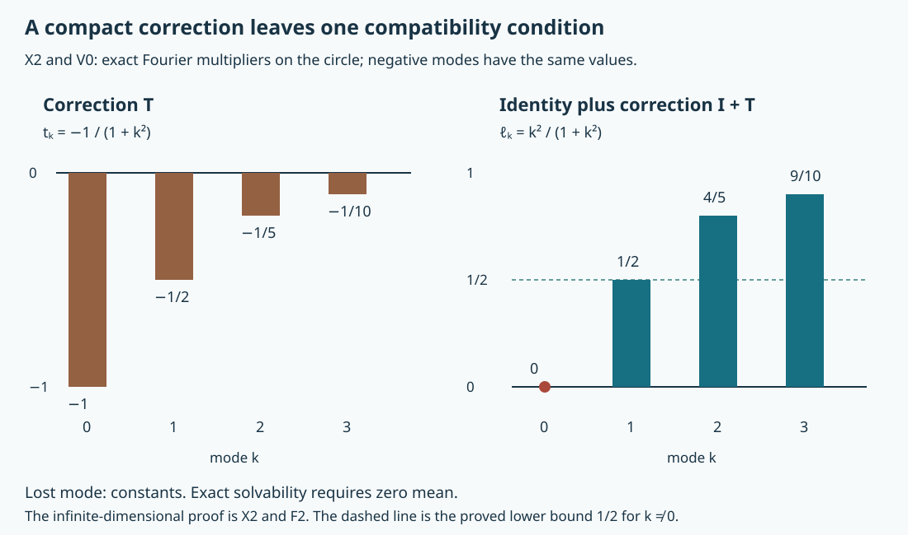

# Weak local solvability, uniform estimates and finite obstructions

A local existence statement can initially allow a different neighborhood and a different distribution order for every forcing term. This lesson proves that these choices can be made uniform. It also proves that gaining just one derivative in the residual is enough to recover exact solvability subject to finitely many compatibility conditions. The same argument leads to the adjoint estimate used to test microlocal solvability.

The mathematical antecedent is Lars Hörmander, *The Analysis of Linear Partial Differential Operators IV*, admitted 2009 edition, Section 26.4, Definitions 26.4.1 and 26.4.3, Theorem 26.4.2, Proposition 26.4.4 and Lemma 26.4.5, printed pages 92–95. We retain all five solvability conditions, both directions of graph invariance and the precise weak norm in the adjoint estimate. The [geometric companion](../20261011-condition-psi-geometry/condition-psi-and-complex-characteristic-tubes.html) gives the sign equivalences. [The necessity argument](../20261011-condition-psi-necessity/condition-psi-necessity-and-approximate-adjoint-solutions.html) uses the uniform adjoint estimate to exclude forbidden sign transitions, including flat transitions.

The earlier [test-space companion](../20261004-free-tangent-zoom/prerequisites/complete-test-spaces.html), TG:B1–B3, supplies complete-metric Baire and the original seminorm topology. The fixed-support companion, KS:S1–S4, supplies actual Hilbert spaces, compact embeddings and dual pairings. The [Hilbert companion](../20261004-free-canonical-composition/compactness-and-essential-norms.html), CT:T1, proves representation and compact-adjoint facts. The [graph lesson](../20261005-restored-graph-egorov/graph-operators-continuity-and-egorov.html), GE:D7–D10, supplies the complete graph calculus. We use these precise results and prove the additional functional-analytic steps below.

This exposition, its three solved exercises and its illustration are independent expression, CC0-1.0. Referenced components retain their own terms. The proof map records exact providers; human foundations remain external, so internal P514 closure is unclaimed.

## 1. Five conditions, with all quantifiers retained

**H0. The complete equivalence.** Let \(X\) be a smooth Hausdorff second-countable manifold, with a positive smooth density, and let \(P\) be a properly supported pseudodifferential operator of finite real order. Let \(K\subset X\) be compact. Write \(H^s_{\mathrm{loc}}\) for the local Sobolev space. The following conditions are equivalent; integers denoted by \(N\) may be increased and need not agree between conditions.

1. There is a subspace of finite algebraic codimension in \(C^\infty(X)\) such that every forcing term in it equals \(Pu\) near \(K\), for some \(u\in\mathcal D'(X)\). The neighborhood and \(u\)'s order may initially depend on the forcing term.
2. There are an integer \(N\geq0\) and an open neighborhood \(Y\) of \(K\) such that every \(f\in H^N_{\mathrm{loc}}(X)\) admits \(u\in H^{-N}_{\mathrm{loc}}(X)\) with \(Pu-f\in C^\infty(Y)\).
3. There is an integer \(N\geq0\) such that every \(f\in H^N_{\mathrm{loc}}(X)\) admits a distribution \(u\) with \(Pu-f\) smooth on some neighborhood of \(K\).
4. There is an integer \(N\geq0\) such that every \(f\in H^N_{\mathrm{loc}}(X)\) admits a distribution \(u\) with \(Pu-f\in H^{N+1}_{\mathrm{loc}}\) on some neighborhood of \(K\).
5. There are an integer \(N\geq0\), one open neighborhood \(Y\) of \(K\), and a subspace \(W\subset H^N_{\mathrm{loc}}(X)\) of finite codimension such that every \(f\in W\) equals \(Pu\) in \(Y\), for some \(u\in H^{-N}_{\mathrm{loc}}(X)\).

The proof produces \(W\) closed in the local Sobolev topology and permits the solutions in conditions 2 and 5 to have one fixed compact support. These are conclusions, not extra assumptions in condition 1. We call condition 1 weak solvability at \(K\). If \(K\) is empty all conditions hold with an empty neighborhood; assume otherwise below.

The immediate implications are \(2\Rightarrow3\Rightarrow4\) and \(5\Rightarrow1\). For the last, the inverse image of \(W\) in \(C^\infty(X)\) has codimension at most that of \(W\); smooth functions belong to every local Sobolev space. It remains to prove \(1\Rightarrow2\) and \(4\Rightarrow5\).

**F0. The actual complete spaces and approximation.** For a compact set \(M\), let

\[
 H^s_M=\{u\in H^s_{\mathrm{loc}}(X):\operatorname{supp}u\subset M\}.
 \tag{SE1}
\]

Use finite compact chart cutoffs and the sum of the squared Euclidean Fourier-weight norms. KS:S3 proves completeness and equivalence of those norms. A bounded set in \(H^{s+1}_M\) is relatively compact in \(H^s_M\), including negative \(s\). No boundary regularity of \(M\), or density of smooth functions with support in \(M\), is assumed.

The topology of \(C^\infty(X)\) is complete and metrizable. To check the manifold version explicitly, take a countable precompact chart exhaustion and all uniform derivative seminorms on its compact subsets. A Cauchy sequence has uniformly convergent derivatives on each such subset. The fundamental-theorem argument of TG:B3 identifies the derivatives of the limits; uniqueness makes the local limits agree on overlaps. They give a global smooth limit in every original seminorm. TG:B2 supplies the complete seminorm metric, and TG:B1 applies to it.

Smooth functions are dense in \(H^s_{\mathrm{loc}}(X)\). Indeed use a locally finite partition in precompact charts, extend each compactly supported chart component by zero, convolve it with a smooth approximate identity, and retain a slightly larger compact cutoff. The Fourier dominated-convergence proof gives convergence in every fixed \(H^s\) norm. Choose the smoothing parameters successively so that the finitely many components meeting the first \(j\) compact sets have error below \(2^{-j}\); the resulting smooth sums converge on each compact set. This does not assert approximation within an arbitrary fixed support. KS:S1 also proves that every compact distribution has some finite negative Sobolev order and that a sufficiently high Sobolev norm controls each prescribed finite family of smooth seminorms.

**F1. Bounded Hilbert sequences have the weak subsequences used here.** For a bounded sequence \(z_j\) in a Hilbert space, apply Gram–Schmidt to its countable list and obtain an orthonormal sequence spanning the closure of its linear span. If this span is finite-dimensional the same argument terminates. A successive subsequence selection makes every scalar coefficient converge. For every finite initial segment the squared sum of the limit coefficients is bounded by the common squared norm bound. Hence their orthogonal series converges to a vector \(z\). Approximate any vector in that closed span by a finite linear combination to prove \(z_j\rightharpoonup z\) along the diagonal subsequence; pairings with the orthogonal complement are zero. Finite partial sums also give

\[
 \|z\|\leq\liminf_j\|z_j\|.
 \tag{SE2}
\]

This applies to each of the finite Hilbert products below. Weak convergence in \(H^s_M\) implies distributional convergence, since pairing with any test function is continuous by KS:S1. Support is retained by pairing with tests outside \(M\). An equation involving \(P\) passes to the limit by pairing with \(P^*v\); proper support makes that a compactly supported smooth test when \(v\) is one. Thus bounded solution sets give closed sets of forcing terms in the arguments below. Only sequential closure is needed, since the forcing spaces are metrizable.

**F2. The finite obstruction of identity plus a compact operator.** Let \(T:H\to H\) be compact on a Hilbert space and put \(L=I+T\). The kernel of \(L\) is finite-dimensional: otherwise it contains an orthonormal sequence, on which \(T=-I\), contradicting compactness. On \((\ker L)^\perp\) there is a constant \(c>0\) with

\[
 \|Lh\|\geq c\|h\|.
 \tag{SE3}
\]

If not, choose unit vectors in that orthogonal complement with \(Lh_j\to0\). A subsequence of \(Th_j\) converges, hence \(h_j=Lh_j-Th_j\) converges to a unit vector in both \(\ker L\) and its orthogonal complement, a contradiction. Estimate (SE3) proves that the range is closed: remove the kernel component from preimages of a convergent range sequence, then those preimages are Cauchy. Its orthogonal complement is \(\ker L^*\), directly by the definition of adjoint. CT:T1 proves compactness of \(T^*\), so the same orthonormal-sequence argument makes that kernel finite-dimensional. Consequently

\[
 \operatorname{ran}(I+T)\text{ is closed and has finite codimension.}
 \tag{SE4}
\]

No smallness of \(\|T\|\), Neumann series, or compactness of the identity is required.

## 2. From individual smooth solutions to one uniform Sobolev statement

**A0. Fix supports before applying Baire.** Choose decreasing precompact neighborhoods \(Y_j\) forming a neighborhood basis of \(K\), with \(\overline Y_{j+1}\subset Y_j\). Proper support gives a compact set \(Z\) such that the kernel of \(P\), restricted to output in \(\overline Y_1\), only uses input in \(Z\). Choose \(\phi\in C_c^\infty(X)\) equal to one near \(Z\) and put \(M=\operatorname{supp}\phi\). Then

\[
 P(\phi u)=Pu\quad\hbox{in }Y_1,
 \qquad u\in\mathcal D'(X).
 \tag{SE5}
\]

Choose smooth representatives \(f_1,\ldots,f_r\) for the finite-dimensional algebraic quotient in condition 1. For every smooth \(f\), that condition gives

\[
 Pu=f+\sum_{i=1}^r a_i f_i\quad\hbox{in some }Y_j,
 \qquad u\in H^{-q}_M
 \tag{SE6}
\]

for some integers \(j,q\) and scalars \(a_i\), after replacing \(u\) by \(\phi u\). The sign of the coefficients is immaterial because they are unrestricted. No continuity of the original quotient map is used.

**A1. A closed countable cover yields a uniform bound.** For positive integers \(j,q,R\), let \(F_{j,q,R}\) consist of smooth \(f\) for which (SE6) holds in \(Y_j\) with

\[
 \|u\|_{H^{-q}_M}^2+\sum_i|a_i|^2\leq R^2.
 \tag{SE7}
\]

These sets cover \(C^\infty(X)\). They are convex and balanced. They are closed: for a convergent sequence of forcing terms, F1 gives a weak subsequence of the bounded solution pairs, the equation passes against compact tests in \(Y_j\), and (SE2) retains the bound. Baire therefore gives one such set with nonempty interior. Balance and convexity give an interior neighborhood of zero: if \(f_0+V\subset F\) with \(V\) balanced, average \(f_0+v\) and \(-(f_0-v)\) to obtain \(v\in F\).

This neighborhood contains a finite-seminorm neighborhood. Enlarge a compact smooth cutoff \(\chi\) to equal one both on the compact sets of those seminorms and near \(\overline Y_j\). Sobolev embedding on those finite charts gives an integer \(t\geq0\) and \(\delta>0\) such that

\[
 f\in C^\infty(X),\quad\|\chi f\|_{H^t}\leq\delta
 \quad\Longrightarrow\quad f\in F_{j,q,R}.
 \tag{SE8}
\]

We may choose a smaller \(\delta\) to replace a strict inequality by the displayed closed ball. All quantities \(j,q,R,t,\chi,\delta\) are now independent of \(f\).

**A2. Extend to rough forcing without losing the equation.** Let \(f\in H^t_{\mathrm{loc}}(X)\). By F0 choose smooth \(f_k\to f\) locally in \(H^t\). The numbers \(\|\chi f_k\|_{H^t}\) are bounded. Scale them all by one sufficiently large constant and apply (SE8), then scale the solutions back. This gives solution pairs bounded in the same \(H^{-q}_M\times\mathbb C^r\). F1 again supplies a weak limit, and local Sobolev convergence of the forcing identifies its distributional limit. Thus (SE6) holds for this \(f\) in the same \(Y_j\). Its residual is a finite linear combination of fixed smooth functions. Taking \(N\geq\max(q,t)\) proves condition 2, including fixed compact support of the solution. This proves \(1\Rightarrow2\).

## 3. One derivative of residual gain produces exact finite-codimension solvability

**B0. Put the residual in a fixed compact Hilbert space.** Assume condition 4 with its integer \(N\). Keep the neighborhoods and the cutoff for the solution from A0. Put \(H=H^N_{\overline Y_1}\). For each \(f\in H\), condition 4 gives a solution whose residual is \(H^{N+1}_{\mathrm{loc}}\) near \(K\). Shrink to one \(Y_j\) and multiply the residual by a compact cutoff supported inside that neighborhood and inside \(Y_1\), equal to one near a smaller \(Y_j\). Consequently every \(f\in H\) satisfies

\[
 Pu=f+g\quad\hbox{in some }Y_j,\qquad
 u\in H^{-q}_M,\quad g\in H^{N+1}_{\overline Y_1}
 \tag{SE9}
\]

for some \(q\). For integers \(j,q,R\), impose the squared product-norm bound \(\|u\|_{-q}^2+\|g\|_{N+1}^2\leq R^2\). The resulting sets of forcing terms are convex, balanced and closed in \(H\), by F1, and cover \(H\). Baire on this complete Hilbert space gives fixed \(j,q\) and a constant \(C\) such that every \(f\in H\) has a solution pair satisfying

\[
 \|u\|_{-q}^2+\|g\|_{N+1}^2\leq C^2\|f\|_N^2.
 \tag{SE10}
\]

To obtain this bound, take a zero-centered ball in one closed set and rescale a nonzero \(f\) into a smaller ball; choose the zero pair for \(f=0\). This avoids any assumption that a particular closed ball was initially contained in a solution set.

**B1. A minimum-norm solution makes the correction linear.** In the Hilbert product \(\mathcal H=H^{-q}_M\times H^{N+1}_{\overline Y_1}\), define

\[
 \mathcal N=\{(u,g):Pu-g=0\text{ in }Y_j\}.
 \tag{SE11}
\]

It is closed because the equation is continuous into distributions. For each \(f\), the solution set of (SE9) is a nonempty closed affine translate of \(\mathcal N\). The orthogonal projection theorem KS:S4 gives a unique member \((U f,Tf)\) in \(\mathcal N^\perp\), with minimum norm. Uniqueness shows that both components depend linearly on \(f\): sums and scalar multiples retain both the equation and orthogonality. Estimate (SE10) bounds these linear maps. In particular

\[
 T:H^N_{\overline Y_1}\longrightarrow H^{N+1}_{\overline Y_1}
 \text{ is bounded},\qquad P U f=f+Tf\text{ in }Y_j.
 \tag{SE12}
\]

The inclusion of the target into \(H\) is compact by KS:S3. Thus \(T\), now viewed as an operator on \(H\), is compact. This is the exact reason one derivative of residual improvement suffices.

**B2. Transfer the finite obstruction back to local Sobolev forcing.** F2 makes \(R=\operatorname{ran}(I+T)\) a closed subspace of finite codimension in \(H\). Every \(h\in R\) has \(Pu=h\) in \(Y_j\), with \(u\in H^{-q}_M\), by (SE12). Choose \(\theta\in C_c^\infty(Y_1)\) equal to one near \(K\), and shrink the final neighborhood \(Y\subset Y_j\) into \(\{\theta=1\}\). For \(L\geq\max(N,q)\), set

\[
 W=\{f\in H^L_{\mathrm{loc}}(X):\theta f\in R\}.
 \tag{SE13}
\]

The cutoff map into \(H\) is continuous. Its composition with the finite-dimensional quotient \(H/R\) has kernel \(W\), so \(W\) is closed and has finite codimension. If \(f\in W\), solve for \(h=\theta f\); then \(Pu=f\) in \(Y\), and \(u\in H^{-L}_{\mathrm{loc}}\). This proves condition 5 and finishes the entire equivalence in H0.

## 4. Perturbations and the size of the nonsolvable set

**C0. Sufficiently low-order perturbations preserve weak solvability.** Use the closed finite-codimension space in condition 5 with integer \(N\). Smooth functions are dense in \(H^N_{\mathrm{loc}}\) by F0; their image in its finite-dimensional Hausdorff quotient is therefore all of that quotient. Indeed it is a dense linear subspace of a finite-dimensional space, and every such subspace is closed. Choose smooth representatives \(e_1,\ldots,e_d\). Every \(f\in H^N_{\mathrm{loc}}\) can therefore be written as a member of \(W\) plus \(\sum a_i e_i\). Solve for that member to get \(Pu-f\) smooth and \(u\in H^{-N}_{\mathrm{loc}}\), in the common neighborhood.

If \(Q\) is properly supported of order at most \(-2N-1\), its ordinary Sobolev mapping gives

\[
 Qu\in H^{N+1}_{\mathrm{loc}},\qquad
 (P+Q)u-f\in H^{N+1}_{\mathrm{loc}}.
 \tag{SE14}
\]

Thus \(P+Q\) satisfies condition 4 and hence is weakly solvable at \(K\). The integer \(N\) comes from the uniform solvability statement; this does not assert stability under an arbitrary lower-order perturbation.

**C1. Failure is witnessed by a dense residual set of smooth forcing terms.** Suppose \(P\) is not weakly solvable at \(K\), and fix a finite-dimensional subspace \(V\subset C^\infty(X)\). The set of smooth \(f\) for which \(Pu=f+v\) near \(K\), with \(v\in V\), is a countable union of the closed bounded-solution sets in A1, using a fixed basis of \(V\). If any had interior, A1–A2 would prove condition 2, hence weak solvability, a contradiction. Each is therefore nowhere dense. The attainable set is meagre, and its complement is a dense countable intersection of open sets, by complete-metric Baire.

For countably many pairs \((K_j,V_j)\) with nonsolvability at each \(K_j\), intersect these complements. The intersection is still dense and nonempty. Every forcing term in it fails all the indicated local equations modulo all the specified finite-dimensional spaces. This is a statement about actual smooth forcing terms, not merely about distributions with prescribed singularities.

**C2. A positive complex bracket gives a base-point obstruction.** Let \(p\) be the scalar principal symbol and let \(\rho=(x,\xi)\) satisfy \(p(\rho)=0\) and \(\{\operatorname{Re}p,\operatorname{Im}p\}(\rho)>0\). The previously proved SMP:S2 constructs, for every finite \(s\), compact forcing in \(H^s\) for which no distribution solves the equation microlocally at \(\rho\). If weak solvability held at \(\{x\}\), condition 3 would apply to one fixed \(H^N_{\mathrm{loc}}\); choose that nonsolvable forcing with \(s\geq N\). A smooth residual near \(x\) would be microlocally smooth at \(\rho\), a contradiction.

Let \(S\) be the base projection of all such positive-bracket points. In each member of a countable base of open sets that meets \(S\), select one point of \(S\). C1 supplies a smooth forcing term nonsolvable near all these selected points simultaneously. Any open set meeting \(S\) contains a base member meeting \(S\), hence contains its selected point; a solution on that open set would contradict the selection. Thus there are smooth forcing terms with no distributional solution on any open set meeting \(S\).

## 5. Microlocal solvability and changes of canonical coordinates

**M0. Definition and its exact relation to base solvability.** Cones here are closed in the nonzero cotangent bundle. For such a cone \(\Gamma\subset T^*X\setminus0\) with compactly contained base projection, call \(P\) solvable at \(\Gamma\) if some integer \(N\) has the property

\[
 \forall f\in H^N_{\mathrm{loc}}(X)\quad
 \exists u\in\mathcal D'(X):\quad
 \Gamma\cap\operatorname{WF}(Pu-f)=\varnothing.
 \tag{SE15}
\]

A compactly generated cone means that its intersection with a fixed cosphere bundle is compact. The closed, compactly based cones used here have this property: their cosphere sections are closed subsets of the compact sphere bundle over the closure of the base projection. This compactness is used in the uniform estimate below. Solvability passes to any smaller closed cone. It depends only on \(P\) modulo operators microlocally smoothing near \(\Gamma\): their properly supported kernels applied to any distribution have no wavefront there, by the earlier kernel action proof.

For a compact \(K\subset X\), weak solvability at \(K\) is equivalent to (SE15) at the full nonzero cotangent bundle over \(K\). One direction is condition 3. Conversely, the compact cosphere over \(K\) has a neighborhood disjoint from the closed wavefront of the residual. A finite conic cover and compactness give a base neighborhood on which every nonzero direction is absent; the Fourier characterization of smoothness then makes the residual smooth there. Its neighborhood may depend on \(f\), precisely as condition 3 allows.

**M1. Full graph invariance, with the correct forcing order.** Let \(\kappa\) map a conic neighborhood of \(\Gamma'\subset T^*Y\setminus0\) symplectically and homogeneously to one of \(\Gamma\), with \(\kappa(\Gamma')=\Gamma\). Let \(A:Y\to X\) and \(B:X\to Y\) be properly supported elliptic graph Fourier integral operators of real orders \(a,b\), respectively, on these cones. Retain sufficiently small graph neighborhoods so the full composition is an ordinary pseudodifferential operator microlocally there. Then

\[
 P\text{ solvable at }\Gamma
 \quad\Longleftrightarrow\quad BPA\text{ solvable at }\Gamma'.
 \tag{SE16}
\]

The exact graph inverses of GE:D9 give \(C=B^{-1}:Y\to X\) of order \(-b\) and \(D=A^{-1}:X\to Y\) of order \(-a\), with all four inverse errors smoothing on the respective cones. Suppose (SE15) holds for \(P\) at order \(N\). For \(g\in H^{N-b}_{\mathrm{loc}}(Y)\), set \(f=Cg\in H^N_{\mathrm{loc}}(X)\), using the all-real graph estimate GE:D7. Choose \(u\) with \(Pu-f\) smooth on \(\Gamma\), and put \(v=Du\). The inverse errors and the full graph wavefront relation give

\[
 Av-u\text{ smooth on }\Gamma,\qquad
 BPAv-g=B(PAv-f)+(BC-I)g\text{ smooth on }\Gamma'.
 \tag{SE17}
\]

Properness makes all actions on distributions defined. Choose an integer at least \(\max(0,N-b)\) to fit (SE15). Conversely apply this established direction to \(BPA\), with right factor \(D\) and left factor \(C\). The resulting operator \(CBPAD\) equals \(P\) microlocally on \(\Gamma\), so M0 completes the converse. This includes multiplication by elliptic factors. The forcing threshold in the forward direction depends on the order of the left factor \(B\); the right factor changes the unknown.

## 6. Solvability forces a uniform adjoint estimate

**D0. The estimate and a bound for each fixed forcing term.** Let \(\dim X=n\geq1\), let \(\Gamma\) be compactly generated, and assume (SE15) with integer \(N\). Choose \(Y\Subset X\) containing its base projection. We prove that some integer \(\nu\geq0\), a properly supported ordinary operator \(A\) with operator microsupport disjoint from \(\Gamma\), and a constant \(C\) satisfy

\[
 \|v\|_{H^{-N}}\leq C\bigl(
       \|P^*v\|_{H^\nu}
       +\|v\|_{H^{-N-n}}+\|Av\|_{L^2}\bigr),
 \qquad v\in C_c^\infty(Y).
 \tag{SE18}
\]

All norms are fixed finite-chart norms on compact supports. Proper support confines the support of \(P^*v\) to one compact set, independent of \(v\). The same convention applies to the other properly localized operators. No assertion is made that \(A\) is of order zero.

Choose \(Z\Subset X\) containing \(\overline Y\) in its interior and let \(H=H^N_{\overline Z}\). Fix \(f\in H\). Microlocal solvability and the proper cutoff of A0 give a compact distribution \(u\) such that \(g=f-Pu\) is compact and has wavefront disjoint from \(\Gamma\). Compact generation lets us choose a proper order-zero conic cutoff \(B_2\), equal to the identity microlocally near \(\operatorname{WF}(g)\), whose microsupport misses \(\Gamma\). Take \(B_1=I-B_2\). Then \(B_1g\) is smooth, and

\[
 (f,v)=(u,P^*v)+(B_1g,v)+(g,B_2^*v).
 \tag{SE19}
\]

The first term is bounded by \(C_f\|P^*v\|_{H^r}\) for some integer \(r\), because \(u\) has a finite negative Sobolev order. The smooth second term is bounded by \(C_f\|v\|_{H^{-N-n}}\). Choose \(\mu\) with \(g\in H^{-\mu}\). An ordinary elliptic order reducer \(\Lambda^\mu\) and its full parametrix, on the relevant compact sets, give

\[
 \|B_2^*v\|_{H^\mu}\leq C_f\bigl(
   \|\Lambda^\mu B_2^*v\|_2+\|v\|_{H^{-N-n}}\bigr).
 \tag{SE20}
\]

Indeed apply the order-\(-\mu\) parametrix to the first term; its smoothing remainder maps the displayed weak space into every Sobolev space. The operator \(A_f=\Lambda^\mu B_2^*\) has microsupport disjoint from \(\Gamma\). Thus for each \(f\), (SE19) has the form of the right side of (SE18), but with a constant, order and operator depending on \(f\). The next steps remove that dependence.

**D1. A countable family detects the entire complementary cone.** In the cosphere bundle over the fixed compact input support, exhaust the complement of \(\Gamma\) by compact sets \(E_j\), chosen so each lies in the interior of the next. Such an exhaustion follows from a countable precompact chart cover and positive distance from the closed set \(\Gamma\). Choose proper ordinary operators \(A_j\) of order \(j\), elliptic on \(E_j\), with microsupport in the complement of \(\Gamma\). Smooth conic cutoffs supported in a slightly larger \(E_{j+1}\), followed by an elliptic order reducer, give them.

For any proper finite-order \(A_f\) whose microsupport misses \(\Gamma\), its microsupport over that compact input set lies in some \(E_j\); increase \(j\) above its order. The ordinary elliptic parametrix on a slightly larger conic set writes
\(A_f=C_j A_j+R_j\) on inputs supported in \(\overline Y\), with \(C_j\) of order at most zero and \(R_j\) smoothing. Hence

\[
 \|A_fv\|_2\leq C_f\bigl(\|A_jv\|_2+\|v\|_{H^{-N-n}}\bigr).
 \tag{SE21}
\]

The same construction controls any finite initial family \(A_1,\ldots,A_j\) by one later \(A_\nu\). All remainder estimates are on fixed compact input/output sets. In particular the seminorms
\(q_j(v)=\|v\|_{-N-n}+\sum_{k=0}^j\|P^*v\|_{H^k}+\sum_{k=1}^j\|A_kv\|_2\)
are increasing and capture every fixed-forcing bound obtained in D0. A finite number of arbitrary complementary-cone operators is not assumed to control their whole uncountable family in advance.

**D2. Baire in the forcing space and exact Sobolev duality.** For integers \(j,R\geq1\), let

\[
 F_{j,R}=\{f\in H: |(f,v)|\leq Rq_j(v)
                      \text{ for every }v\in C_c^\infty(Y)\}.
 \tag{SE22}
\]

Each is a closed convex balanced set in \(H\): for every fixed test \(v\), its pairing is continuous on \(H\). D0–D1 show that these sets cover \(H\). Baire, the zero-neighborhood argument of A1 and rescaling therefore give fixed \(j,C\) with
\(|(f,v)|\leq C\|f\|_{H^N}q_j(v)\) for all \(f\in H\) and all tests \(v\). D1 and monotonicity of Sobolev norms replace the finite sum by one \(A_\nu\), one \(\|P^*v\|_{H^\nu}\), and the weak term.

Finally the supremum of \(|(f,v)|\) over the unit ball of \(H^N_{\overline Z}\) controls \(\|v\|_{H^{-N}}\), up to a fixed constant. To see the lower bound rather than only its converse, use the Fourier dual representation KS:S1 in each finite chart, then multiply the representing \(H^N\) tests by compact cutoffs supported in \(Z\), equal to one near \(\overline Y\). The pairings with \(v\) are unchanged; multiplication bounds their norms by a fixed constant. Sum the finite chart representations. This proves (SE18). We have proved the needed uniformity directly, without leaving a separate-continuity theorem unproved.

## 7. Three exercises with complete solutions

**X1. A smooth forcing term that is nowhere solvable.** For the Lewy operator
\(P=D_1+iD_2+i(x_1+ix_2)D_3\) on \(\mathbb R^3\), use the convention
\(\{a,b\}=\partial_\xi a\cdot\partial_x b-\partial_x a\cdot\partial_\xi b\).
Find its positive-bracket characteristic set and deduce an actual smooth nonsolvability statement.

**Solution.** Its real and imaginary symbols are
\(a=\xi_1-x_2\xi_3\) and \(b=\xi_2+x_1\xi_3\). Direct differentiation gives \(\{a,b\}=2\xi_3\). Thus the positive-bracket set is
\(\xi_1=x_2\xi_3,\ \xi_2=-x_1\xi_3,\ \xi_3>0\), whose base projection is all of \(\mathbb R^3\). C2 and C1 produce a dense residual set of smooth \(f\) for which \(Pu=f\) has no distribution solution in any nonempty open set. This is an existence and category conclusion; it does not assert that an arbitrary smooth function has that property or supply a closed formula for one.

**X2. A compact correction of norm one.** On the circle use Fourier coefficients \(h_k\), \(k\in\mathbb Z\), and define \((Th)_k=-h_k/(1+k^2)\). Determine the exact range of \(I+T\) in \(H^N\), and explain the role of compactness.

**Solution.** Use the exact norm \(\|h\|_{H^N}^2=\sum_k(1+k^2)^N|h_k|^2\), with the orthonormal circle basis proved in GE:G1. For our nonnegative integer \(N\), Parseval and the binomial formula identify this norm with \(\sum_{j=0}^N\binom Nj\|D^jh\|_2^2\). The product rule and a finite smooth partition identify its completion with the usual chart Sobolev space; smooth approximation is F0. The weighted Fourier norm shows that \(T:H^N\to H^{N+2}\) has norm one. Truncating to \(|k|\leq J\) gives finite-rank operators with remainder norm on \(H^N\) at most \(1/(1+(J+1)^2)\), so \(T\) is compact there. Yet \(\|T\|=1\), attained on the constant mode. The coefficients of \(I+T\) are

\[
 \ell_k=\frac{k^2}{1+k^2},\qquad
 \ell_0=0,\quad \frac12\leq\ell_k<1\ (k\ne0).
 \tag{SE23}
\]

Its kernel is exactly the constants. Its range consists exactly of functions with zero mean: necessity is the zero coefficient, and for any such forcing divide the other coefficients by \(\ell_k\), a multiplier bounded by two in \(H^N\). Hence the range is closed of codimension one. Compactness allowed this finite obstruction; it did not make \(I+T\) invertible.

**X3. Track the forcing threshold through both graph factors.** Suppose \(P\) is microlocally solvable for every forcing term in \(H^N_{\mathrm{loc}}\). In M1 take \(A\) of order \(3/2\) and \(B\) of order \(-2\). Give a sufficient forcing order for \(BPA\), and the order shift in transferring a known threshold \(M\) back to \(P\).

**Solution.** The inverse \(C=B^{-1}\) has order \(2\), so \(Cg\in H^N\) when \(g\in H^{N+2}\). Thus \(N+2\) is a sufficient forward threshold. The unknown becomes \(Du\), with \(D=A^{-1}\) of order \(-3/2\), but no Sobolev order was prescribed for the distributional unknown. In the reverse transfer the left factor is \(C\) of order \(2\); a known integer threshold \(M\) therefore gives any integer at least \(\max(0,M-2)\) for \(P\). These are sufficient thresholds and need not be optimal.

## 8. The compact correction and its exact obstruction

**V0. Reading the spectral picture.** The illustration shows the exact multipliers in X2 at \(k=0,1,2,3\). Negative modes have the same values. The left panel is the compact correction \(-1/(1+k^2)\); the right panel is \(k^2/(1+k^2)\). Only the constant mode is lost, and every remaining mode has the proved lower bound \(1/2\). The zero-mean compatibility condition is therefore visible, while the complete infinite-dimensional proof remains X2 and F2.

The source record, [proof review](proof-review.json), [finite checks](model-check.json) and [reader checks](reader-check.json) accompany this lesson. The [geometric companion](../20261011-condition-psi-geometry/condition-psi-and-complex-characteristic-tubes.html) gives the sign equivalences. [The necessity argument](../20261011-condition-psi-necessity/condition-psi-necessity-and-approximate-adjoint-solutions.html) uses the uniform adjoint estimate to exclude forbidden sign transitions, including flat transitions.
