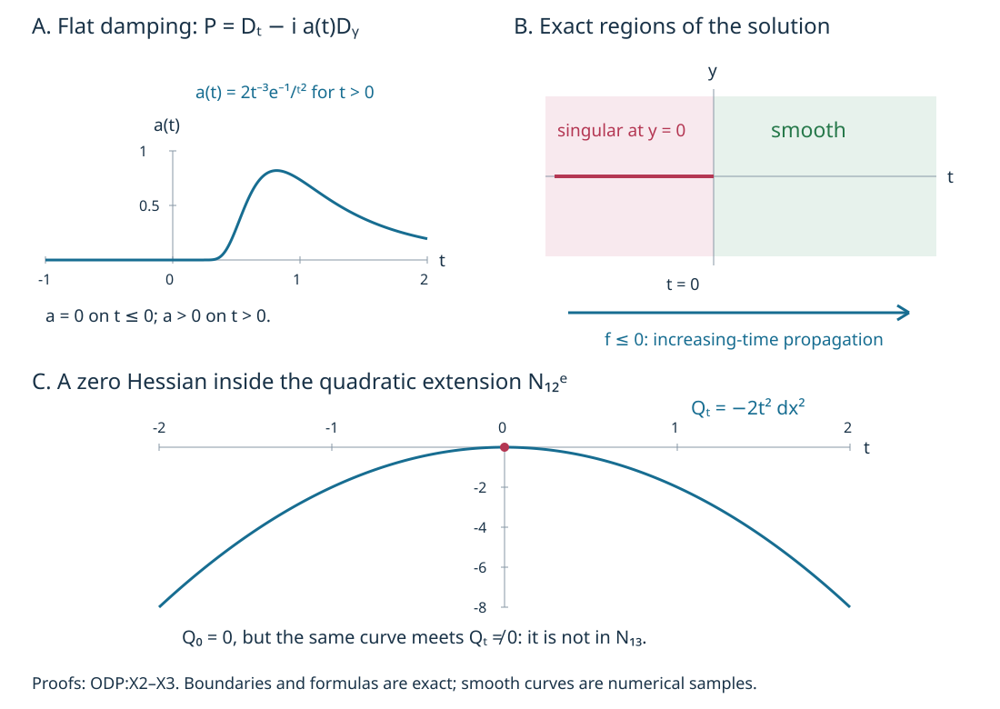

# One-direction propagation and the remaining characteristic strata

With \(D=-i\partial\), the favorable symbol for increasing-time propagation is \(\tau+i f\) with **\(f\le0\)**. The sign gives an upper quadratic-form bound. An exponential time weight then controls the localized solution by its forcing and incoming regularity. We prove this for distributional inputs, retain the exact outgoing cutoff term, and pass to the unregularized operator on one fixed cone.

The primary antecedent is Lars Hörmander, *The Analysis of Linear Partial Differential Operators IV*, Springer 2009 eBook, ISBN 978-3-642-00136-9: the characteristic classification at the end of Section 26.5, printed 117, and Proposition 26.6.1, printed 118–119.  Its printed inequality is \(f\le0\); the sign is also checked directly by the differential equation below. This lesson supplies independent exposition and complete receiving arguments. Exact earlier proofs and their versions are in the proof map. The human foundations remain external; internal export P514 closure is not claimed.

## 1. Complete the geometric register

**G0. Persistent curves and their quadratic extensions.** Work in the regular characteristic locus \(N=\{p=0,dp\ne0\}\) of a smooth homogeneous symbol satisfying (P). All curves remain in the given open domain. Use the sets and proved continuation statements from CPG:T0–C0:

\[
 S=N_2^e,\qquad N_1=N\setminus S,\qquad
 R=N_1\setminus N_{11}. \tag{OP1}
\]

Here \(N_2\) is the real-rank-two set, \(S\) its semibicharacteristic saturation, and \(N_{11}\) the characteristic points which can reach a noncharacteristic point by a regular semibicharacteristic. The proof CPG:T2 makes the two saturated mechanisms disjoint. Every regular semibicharacteristic through \(R\) remains characteristic and has rank one; CPG:C0 supplies its continuation inside the regular locus.

On such a parametrized curve write \(H_p=c(t)\gamma'(t)\). QAF:T0–T1 prove that the imaginary Hessian of \(p/c(t)\) descends to

\[
 E_t=\ker dp(\gamma(t))/\mathbb R\gamma'(t),
 \qquad Q_t=\bigl(\operatorname{Im}(p/c(t))\bigr)''|_{E_t}. \tag{OP2}
\]

It is invariant under nonzero symbol multipliers and canonical changes, and a regular change of parameter multiplies it by the nonzero real derivative of the old time. Consequently being zero, nonzero, or indefinite is intrinsic. Define \(N_{12}\subset R\) by \(Q\ne0\), and \(N_{12}^{i}\subset N_{12}\) by indefiniteness. Define \(N_{12}^e\) and \(N_{12}^{ie}\) by extending these two sets along their full regular rank-one characteristic curves in \(R\). Finally set

\[
 N_{13}=R\setminus N_{12}^e. \tag{OP3}
\]

These are set definitions, not assertions that every set is a manifold. Uniqueness of the local nonzero real Hamilton flow shows that two rank-one curves sharing a point agree as unparametrized local curves; hence each extension is a union of whole maximal curves. Multipliers, canonical maps and positive fiber dilation transport those curves and preserve the Hessian tests, so all these sets are invariant and conic. The four disjoint pieces \(S,N_{11},N_{12}^e,N_{13}\) exhaust the regular characteristic set.

The earlier CPG receiving proofs cover Definitions/Propositions 26.5.1–6, QAF and SQD together prove all cases of 26.5.7, and QAF:T0–A0 give the affine construction on \(N_{12}^{ie}\). CPG:X3 disproves the broad semidefinite Hessian proportionality used in the printed 26.5.8 argument. We retain that corrected indefinite scope. This register supplies the remaining characteristic definitions without importing the broader proportionality claim.

**G1. The residual normal form has zero quadratic jet.** On a compact embedded subarc of a curve in \(N_{13}\), QAF:D0 gives an ordinary compact canonical tube and nonzero multiplier with

\[
 bp=\tau+i f(t,Y),\qquad f(t,0)=0,\quad d f(t,0)=0,
 \qquad \partial_\tau f=0. \tag{OP4}
\]

No point of this curve meets \(N_{12}\). Thus (OP2) vanishes at every time, and in (OP4) this is exactly \(f_{YY}''(t,0)=0\). Differentiating the identically zero value and transverse gradient along the curve gives all second derivatives involving time equal to zero; derivatives involving \(\tau\) vanish identically. Taylor's integral formula therefore gives, on one common neighborhood,

\[
 f(t,Y)=\sum_{|\alpha|=3}Y^\alpha r_\alpha(t,Y),\qquad
 r_\alpha=\frac3{\alpha!}\int_0^1(1-\theta)^2
          \partial_Y^\alpha f(t,\theta Y)\,d\theta. \tag{OP5}
\]

Every coefficient is smooth jointly in \(t,Y\); differentiating under the fixed integral gives every compact parameter bound. The formula follows by applying one-variable Taylor to \(\theta\mapsto f(t,\theta Y)\), expanding its third derivative, and using the zero lower jets. On an admissible nonradial homogeneous tube, the same argument applies on the positive momentum slice and extends homogeneously. Ordinary tubes also cover radial arcs. The vanishing is *at least* third order; it need not have finite order. A zero Hessian at a single point does not imply membership in \(N_{13}\), as X3 demonstrates.

## 2. The analytic statement and its localization

**H0. Forward Sobolev propagation.** Let \(P\) be a scalar properly supported classical operator of order one on \(\mathbb R^n\), with principal symbol

\[
 p(t,y;\tau,\eta)=\tau+i f(t,y;\tau,\eta),\qquad f\le0, \tag{OP6}
\]

on a conic neighborhood of the compact segment \(\Gamma=\{(t,0;0,\eta_0):a\le t\le b\}\), where \(\eta_0\ne0\). The imaginary part may depend on every momentum variable. For any real \(s\), assume \(Pu\) is microlocally \(H^s\) on \(\Gamma\), and \(u\) is microlocally \(H^s\) at its initial point. Then \(u\) is microlocally \(H^s\) on \(\Gamma\). If the forcing and initial data are microlocally smooth on neighborhoods of these sets, the conclusion is smooth on a neighborhood of \(\Gamma\). No characteristic condition \(f=0\) on the segment is needed.

Microlocal \(H^s\) means that an ordinary order-zero cutoff elliptic at the point gives an \(H^s\) distribution. The exact conic parametrix K:K2–K3 and global operator bounds CE:G1 make this definition equivalent to testing by any order-\(s\) operator whose microsupport is contained in the regularity neighborhood. Smoothing errors act on compact distributions by their fixed finite negative Sobolev norm (KS:S1). These are the conventions used in every localization below. The nonzero transverse covector in the displayed segment requires \(n\ge2\); in the one-dimensional analogue its nonzero covector has \(\tau\ne0\), so \(p\ne0\) and the same conclusion follows immediately, with an extra derivative, from the elliptic parametrix.

**L0. Reduce one half-order step to a global calculation.** First assume in addition that \(u\) is microlocally \(H^{s-1/2}\) on a neighborhood of \(\Gamma\). Choose nested compactly generated conic tubes, all strictly inside the sign, forcing and weak-regularity neighborhoods. Choose an incoming time window just before or around \(a\), lying in the initial regularity neighborhood. Shrinking the transverse tube makes that whole window regular. Choose a proper order-zero cutoff \(T\), microlocally the identity on a larger tube and supported in the weak-regularity neighborhood. Its input/output base supports can be made compact. Replace \(u\) by \(Tu\). This gives

\[
 u\in H^{s-1/2}_{\mathrm{comp}},\qquad
 Pu\in H^s\text{ on the working tube},\qquad
 u\in H^s\text{ on its incoming window}. \tag{OP7}
\]

Indeed \([P,T]u\) is microlocally smooth where \(T=I\), by the full composition and conic smoothing proofs P2:OP3–OP6 and CH:T2. Every smoothing error is retained and bounded by the compact distribution norm; it has no effect on the stated regularities. Membership of \(Tu\) in global \(H^{s-1/2}\) follows from a finite conic partition and the same parametrices, including the low-frequency smooth part.

We can also replace the operator outside the working tube by

\[
 \widetilde P=D_t+i\operatorname{Op}(f_e)+R_0,
 \qquad f_e\in S^1\text{ real},\quad f_e\le0,
 \qquad R_0\in\Psi^0, \tag{OP8}
\]

with global bounded symbol seminorms. To construct it, take a nonnegative compact-base conic cutoff equal to one on a larger working tube and supported in the sign region. Multiply the degree-one \(f\) by this cutoff and a nonnegative large-frequency cutoff, and extend by zero to obtain \(f_e\). In a full left-symbol representation, the difference between the symbol of \(P\) and \(\tau+i f\) is of order zero. Multiply that remainder by another cutoff equal to one on the same tube; its low-frequency extension is smooth. Quantize it to obtain \(R_0\). The resulting operator agrees with \(P\) microlocally there, with a smoothing error. Separated symbol supports make \(Q(\widetilde P-P)u\) uniformly smooth for every bounded localized symbol family \(Q\) used below. This follows by taking arbitrary orders in the full composition remainder. Thus (OP7) holds with \(\widetilde P\), and \(\widetilde Pu\in H^{s-3/2}\) globally. We now write \(P\) for (OP8).

**L1. Symmetric parts and the weight-independent upper bound.** Write

\[
 A=(P+P^*)/2=D_t+A_0,\quad A_0\in\Psi^0,
 \qquad B=(P-P^*)/(2i),\quad P=A+iB. \tag{OP9}
\]

These are formally symmetric operators with the usual Sobolev extensions; no self-adjoint unbounded-domain assertion is needed. Since \(f_e\) is real, the adjoint expansion gives \(\operatorname{Op}(f_e)-\operatorname{Op}(f_e)^*\in\Psi^0\), which proves the assertion about \(A_0\). Applying the complete sharp lower bound CE:G9 to \(-f_e\ge0\), and the order-zero bound to the remaining terms of \(B\), gives

\[
 (Bv,v)\le K\|v\|_2^2,\qquad v\in H^1. \tag{OP10}
\]

The inner product is linear in the first argument. The constant \(K\) depends only on finitely many fixed symbol seminorms of (OP8); it is independent of the exponential weight and of the regularization introduced next. CE:G9 proves the form bound first on Schwartz functions and extends it by \(H^1\) density, so (OP10) applies to the actual vectors below.

## 3. The exact weighted commutator

**R0. A bounded regularizer with the same cutoff factors.** Choose \(\chi\in C_c^\infty(\mathbb R)\), \(0\le\chi\le1\), equal to one on \([a,b]\), with

\[
 \chi'=\chi_- -\chi_+,\qquad \chi_\pm\ge0, \tag{OP11}
\]

where \(\chi_-\) is supported in the incoming regular window and \(\chi_+\) after the target interval. Smooth monotone transitions constructed from the cutoffs PS:PS5 give these functions. Choose a real symbol \(c(y,\tau,\eta)\in S^s\), independent of time, compactly supported in \(y\), elliptic at \((0,0,\eta_0)\), whose product with the time support lies inside the working tube. One can take \(\langle\xi\rangle^s\) times a real conic cutoff there, with a harmless low-frequency cutoff; \(\xi=(\tau,\eta)\).

For \(0<\delta\le1\), set

\[
 r_\delta(\xi)=(1+\delta|\xi|^2)^{-1},\quad
 Z_\delta=\operatorname{Op}(c)r_\delta(D),\quad
 Q_\delta=e^{-\lambda t}\chi(t)Z_\delta,\quad
 Q_{\pm,\delta}=e^{-\lambda t}\chi_\pm(t)Z_\delta. \tag{OP12}
\]

For fixed \(\delta\) these operators have order \(s-2\); uniformly in \(\delta\) they are bounded in order \(s\), for fixed \(\lambda\). Repeated differentiation of \(r_\delta\) proves \(|\partial_\xi^\alpha r_\delta|\le C_\alpha\langle\xi\rangle^{-|\alpha|}\): each derivative introduces factors of \(\delta\xi/(1+\delta|\xi|^2)\) or \(\delta/(1+\delta|\xi|^2)\), bounded respectively by \(C\langle\xi\rangle^{-1}\) and \(C\langle\xi\rangle^{-2}\). The remaining denominator is at most one. This gives all uniform symbol bounds. The left symbol of \(Q_\delta\) is exactly the real function \(q_\delta=e^{-\lambda t}\chi c r_\delta\), because the regularizer is on the right and the time factor on the left.

**C0. The real-part commutator and the outgoing term.** The exact identity \([\operatorname{Op}(q),D_t]=i\operatorname{Op}(\partial_tq)\), together with (OP9), gives

\[
 [Q_\delta,A]=-i\lambda Q_\delta+iQ_{-,\delta}-iQ_{+,\delta}+E_\delta,
 \qquad E_\delta\text{ bounded in }\Psi^{s-1}. \tag{OP13}
\]

The last order follows from the complete scalar commutator expansion for \([Q_\delta,A_0]\): the zeroth products commute, and every remaining term loses at least one order. Its bound may depend on \(\lambda\), which is harmless. For \(v=Q_\delta u\),

\[
 \operatorname{Im}([Q_\delta,A]u,v)
 \le-\lambda\|v\|_2^2+\|Q_{-,\delta}u\|_2\|v\|_2
       +C_\lambda\|u\|_{s-1}\|v\|_2. \tag{OP14}
\]

The discarded term has a proved sign, not an assumed pseudodifferential positivity property. In fact the common factor \(Z_\delta\) in (OP12) gives exactly

\[
 \operatorname{Re}(Q_{+,\delta}u,Q_\delta u)
   =\int e^{-2\lambda t}\chi_+(t)\chi(t)|Z_\delta u(t,y)|^2\,dt\,dy\ge0. \tag{OP15}
\]

Its minus sign in (OP13) is favorable. All pairings are legitimate: (OP7) and the fixed-\(\delta\) order give \(Q_\delta u\in H^{3/2}\), and the same local regularity for \(Z_\delta u\) on the compact supports of the weights.

**C1. The imaginary-part commutator loses an extra order.** Since \(q_\delta\) and the principal symbol \(f_e\) of \(B\) are real, the leading symbol of \(Q_\delta^*[Q_\delta,B]\) is

\[
 -i q_\delta\{q_\delta,f_e\}. \tag{OP16}
\]

It is purely imaginary. The full adjoint and composition formulas P2:OP3 therefore show that

\[
 T_\delta=\tfrac12\bigl(Q_\delta^*[Q_\delta,B]+[Q_\delta,B]^*Q_\delta\bigr)
 \text{ is bounded in }\Psi^{2s-1}. \tag{OP17}
\]

Every adjoint correction and every term beyond the displayed leading product has at least one less order, uniformly for fixed \(\lambda\). All order-zero terms of \(B\) contribute only that lower order as well. The global Sobolev form estimate CE:G1 now gives

\[
 |\operatorname{Re}([Q_\delta,B]u,Q_\delta u)|
   =|(T_\delta u,u)|\le C_\lambda\|u\|_{s-1/2}^2. \tag{OP18}
\]

One may first compute on Schwartz functions and pass by simultaneous Sobolev density. For fixed \(\delta\), all original terms converge from (OP7), and (OP17) extends the quadratic form at exactly the stated weak order. This also explains why estimating the full unsymmetrized commutator would lose the needed half order.

**E0. Absorb the weight only after fixing its independent constant.** From \(P=A+iB\), formal symmetry and the inner-product convention,

\[
 \operatorname{Im}(Q_\delta Pu,Q_\delta u)
 =(BQ_\delta u,Q_\delta u)
  +\operatorname{Im}([Q_\delta,A]u,Q_\delta u)
  +\operatorname{Re}([Q_\delta,B]u,Q_\delta u). \tag{OP19}
\]

The vectors are in the required domains: \(Pu\in H^{s-3/2}\), so \(Q_\delta Pu\in H^{1/2}\), while \(PQ_\delta u\in H^{1/2}\). Use (OP10), (OP14), (OP18), then move \(-\lambda\|Q_\delta u\|^2\) to the other side. The result is

\[
 (\lambda-K)\|Q_\delta u\|_2^2
 \le\|Q_\delta u\|_2\bigl(\|Q_\delta Pu\|_2+\|Q_{-,\delta}u\|_2
             +C_\lambda\|u\|_{s-1}\bigr)
       +C_\lambda\|u\|_{s-1/2}^2. \tag{OP20}
\]

Choose \(\lambda=K+3\), with \(K\) increased to be nonnegative. Now all constants depending on \(\lambda\) are fixed. Cauchy–Schwarz in the three scalar terms and \(ab\le\varepsilon a^2+(4\varepsilon)^{-1}b^2\), with a fixed small \(\varepsilon\), absorb their squared-solution contribution. Since \(\|u\|_{s-1}\le\|u\|_{s-1/2}\),

\[
 \|Q_\delta u\|_2^2\le C\bigl(\|Q_\delta Pu\|_2^2
            +\|Q_{-,\delta}u\|_2^2+\|u\|_{s-1/2}^2\bigr), \tag{OP21}
\]

uniformly as \(\delta\downarrow0\). The weight was not chosen to dominate a constant which itself grows with that weight.

## 4. Remove the regularizer and the auxiliary regularity

**U0. Local forcing really bounds every regularized term.** Put \(q_0=e^{-\lambda t}\chi c\). The full composition formula, through one derivative, gives

\[
 Q_\delta=r_\delta(D)\operatorname{Op}(q_0)
 +\sum_{j=1}^n(\partial_{\xi_j}r_\delta)(D)
                      \operatorname{Op}(i\partial_{x_j}q_0)
 +R_\delta^{(2)},\qquad R_\delta^{(2)}\text{ bounded in }\Psi^{s-2}. \tag{OP22}
\]

Indeed the zeroth symbol is \(r_\delta q_0\). The first composition term in the first summand is \(-i\sum\partial_\xi r_\delta\partial_xq_0\); the leading terms of the displayed sum cancel it. Every uncancelled term has at least two frequency derivatives in total and the full remainder is uniformly of order \(s-2\). The bounds follow from R0 and the finite-seminorm remainder in P2:OP3; this is an actual operator identity with the stated remainder.

By (OP7), each of the finitely many \(\operatorname{Op}(q_0)Pu\) and \(\operatorname{Op}(i\partial_{x_j}q_0)Pu\) is in \(L^2\). Differentiating the symbol does not enlarge its microsupport. The multiplier norms of \(r_\delta\) and its first derivatives are uniformly bounded on \(L^2\), and the remainder applied to \(Pu\in H^{s-3/2}\) is uniformly in \(H^{1/2}\subset L^2\). Thus \(\|Q_\delta Pu\|_2\) is uniformly bounded. The identical expansion with \(\chi_-\) instead of \(\chi\) proves the bound for \(Q_{-,\delta}u\), using incoming \(H^s\) and global \(H^{s-1/2}\). This justifies the entire right side of (OP21); a pointwise limiting symbol alone would not do so.

Since \(0<r_\delta\le1\) and it tends pointwise to one, Fourier dominated convergence gives \(r_\delta(D)u\to u\) in \(H^{s-1/2}\). Hence \(Q_\delta u\to Q_0u\) in \(H^{-1/2}\). The uniform \(L^2\) bound has a weakly convergent subsequence by LSE:F1; its distributional limit is the already identified \(Q_0u\). Therefore \(Q_0u\in L^2\). Ellipticity of its order-\(s\) symbol on \(\Gamma\), followed by the exact conic parametrix and CE:G1, proves microlocal \(H^s\) there. This completes the half-order step, including the global-to-microlocal localization from L0.

**B0. Finite bootstrap for an arbitrary distribution.** A compact localization of a distribution belongs to \(H^{-M}\) for some finite \(M\), by KS:S1. Choose an integer \(k\) with \(s-k/2\le-M\). Start with weak regularity \(H^{s-k/2}\), and apply the proved half-step successively at target exponents

\[
 s-(k-1)/2,\ s-(k-2)/2,\ldots,s. \tag{OP23}
\]

The forcing and incoming hypotheses at order \(s\) imply them at each lower exponent. At each step the previous conclusion holds on an open tube about the compact ray; choose the next tube compactly inside it. Finitely many steps leave a nonempty tube about the entire ray. This proves H0 for every distribution and every real \(s\).

**B1. One fixed cone for the smooth conclusion.** Assume the forcing and initial regularity are smooth on fixed open neighborhoods. A separate cone for each Sobolev order would not suffice to conclude smooth wavefront exclusion. Choose at the start a nested sequence of product tubes about a slightly extended compact ray, with widths decreasing to strictly positive limits. The incoming windows remain in the fixed smooth initial neighborhood. Their successive closures lie in the interiors of the preceding tubes; a geometric sequence of positive margins constructs them. All are inside the sign and smooth-forcing neighborhoods.

Begin at the finite weak order supplied by KS:S1. Apply the half-step on each larger tube with an order-\(s_j\) real cutoff elliptic on the next, where \(s_j\) increases by \(1/2\). The cutoff may be prescribed in this way: every estimate above holds for every fixed real symbol with the stated support and ellipticity, so the geometric smaller tube need not depend on the estimates. The constants may grow with \(j\), but all are finite. The induction proves all these Sobolev orders on the corresponding tubes. A single order-zero cutoff supported in their common interior, elliptic on a neighborhood of \(\Gamma\), therefore sends \(u\) into every \(H^{s_j}\), by the same conic parametrix and smoothing estimates. Fourier inversion and Cauchy–Schwarz show that membership in all Sobolev orders implies smoothness: each differentiated Fourier integrand is integrable once its order is sufficiently negative. Thus that fixed cutoff gives a smooth output. This proves the claimed smooth-wavefront conclusion on one fixed neighborhood.

## 5. Three solved checks

**X1. Check the sign against the scalar equation.** Let \(v'+\beta v=g\), where \(\beta\ge0\) is constant. Derive the weighted energy identity on \([a,b]\), and match its sign with (OP6).

**Solution.** Multiply by \(e^{-2\lambda t}\bar v\), take the real part, and integrate the derivative of \(e^{-2\lambda t}|v|^2\). This gives exactly

\[
 e^{-2\lambda b}|v(b)|^2+2(\lambda+\beta)\int_a^b e^{-2\lambda t}|v|^2dt
 =e^{-2\lambda a}|v(a)|^2+2\operatorname{Re}\int_a^b e^{-2\lambda t}g\bar v\,dt. \tag{OP24}
\]

Applying \(2|g v|\le|g|^2+|v|^2\) gives control from the incoming value if \(2(\lambda+\beta)>1\). Multiplication of the equation by \(-i\) yields \((D_t-i\beta)v=-ig\); its imaginary symbol is \(-\beta\le0\). With a frequency-sized \(\beta\), reversing this sign would create a growing mode that no fixed frequency-independent \(\lambda\) absorbs. This checks both the operator convention and the favorable direction.

**X2. Smoothness can enter, so it need not propagate backwards.** Put \(A(t)=e^{-1/t^2}\) for \(t>0\) and zero for \(t\le0\), and \(a=A'\ge0\). Choose \(\varphi\in C^\infty(\mathbb R)\), zero on \(( -\infty,1]\) and one on \([2,\infty)\). For any real \(b_0\), define a distribution by its Fourier transform in \(y\):

\[
 \widehat u(t,\eta)=\varphi(\eta)\eta^{-b_0}e^{-A(t)\eta},
 \qquad P=D_t-i a(t)D_y. \tag{OP25}
\]

Show that \(Pu=0\), that \(u\) is smooth for \(t>0\), and that it is singular at \((t,0)\) for \(t<0\).

**Solution.** The flatness proof CPG:X1 gives smooth \(A,a\) at zero. On any compact time interval each time derivative of the displayed Fourier function is bounded by a fixed polynomial in \(\eta\): its terms are products of bounded derivatives of \(A\), powers of \(\eta\), and an exponential at most one. Pairing with a Schwartz function therefore permits every time derivative by dominated convergence. This defines a smooth distribution-valued function of time. The identity \(\partial_t\widehat u=-a\eta\widehat u\) proves \(Pu=0\) exactly.

On a compact interval in \(t>0\), \(A\) has a positive lower bound. All time and space derivatives of the Fourier integral are absolutely integrable, proving smoothness there. On \(t<0\), the function is independent of time and its Fourier transform is \(\varphi(\eta)\eta^{-b_0}\). It is smooth away from \(y=0\): integrate by parts arbitrarily often in \(\eta\), using the symbol derivative bounds and a large-frequency cutoff before passing to the limit.

To verify that the singularity at zero is real, let \(\zeta(y)\) be a compact cutoff with \(\zeta(0)=1\). Fourier convolution and Taylor expansion of \((\eta-\theta)^{-b_0}\) on \(|\theta|<\eta/2\) give

\[
 \widehat{\zeta u}(\eta)=\eta^{-b_0}(1+O(\eta^{-1}))\quad(\eta\to+\infty). \tag{OP26}
\]

Here the leading constant is \((2\pi)^{-1}\int\widehat\zeta(\theta)d\theta=\zeta(0)=1\); every Taylor remainder is bounded by a finite rapidly decreasing moment of \(\widehat\zeta\). On the complement, arbitrary Schwartz decay absorbs the fixed polynomial order of \(\varphi(\eta-\theta)(\eta-\theta)^{-b_0}\), giving an arbitrarily small inverse power. The same estimates give rapid decrease as \(\eta\to-\infty\). Thus the local Sobolev threshold is exactly \(s<b_0-1/2\), with divergence at equality. In particular the distribution is not smooth at zero. A compact time cutoff supported in \(t<0\) adds its rapidly decreasing Fourier factor, leaving the same threshold near \((\tau,\eta)=(0,1)\). The bound (OP26) proves its nonzero leading coefficient on a fixed small \(\tau\) interval, and the two-variable Sobolev integral gives the same convergence test.

On the cone \(\eta>0\), the principal symbol is \(\tau-i a(t)\eta\), with favorable imaginary sign. Along \((t,0;0,1)\) for \(t\le0\), the symbol and imaginary differential vanish and \(H_p=\partial_t\). The curve reaches noncharacteristic points for \(t>0\), so it lies in \(N_{11}\). The full sign criterion PSG:E1 proves (P). The example has singular incoming times and smooth later times with zero forcing. Therefore the forward theorem has no general backward converse.

**X3. An isolated zero Hessian is not the residual stratum.** On \(T^*\mathbb R^3\) with coordinates \((t,x,z;\tau,\eta,\kappa)\), \(\kappa>0\), take

\[
 p=\tau-i t^2\kappa x^2,\qquad \gamma(t)=(t,0,0;0,0,1). \tag{OP27}
\]

Determine which extension contains \(\gamma(0)\).

**Solution.** The imaginary part has a fixed weak sign on every real vertical line, including whole rank-one intervals. PSG:E1 gives (P). On \(\gamma\), \(dp=d\tau\) and \(H_p=\partial_t\). Every multiplier's real field is tangent to this one-dimensional curve there, so uniqueness preserves it. It can reach neither rank-two nor noncharacteristic points; hence it lies in \(R\). Its transverse imaginary Hessian is \(-2t^2dx^2\). It is nonzero semidefinite for \(t\ne0\), zero at \(t=0\), and never indefinite. Consequently the entire curve, including its middle point, lies in \(N_{12}^e\), and none lies in \(N_{13}\). This distinguishes a curve with an isolated zero quadratic jet from the identically zero jet in G1.

## 6. Direction and degeneracy in the models

**V0. Coordinate plots with fixed formulas.** The first panel shows the flat damping coefficient \(a(t)=2t^{-3}e^{-1/t^2}\) for \(t>0\), zero otherwise. The next panel shows the exact regions of the solution in X2: the incoming side retains a singularity at \(y=0\), while the positive-time side is smooth. The final panel shows the Hessian coefficient \(-2t^2\) in X3; the zero at the origin is still inside the same quadratic extension. Smooth graph traces are numerical samples. Region boundaries and the proofs of regularity or degeneracy are exact.

The [figure generator](figures/build_figure.py), [finite checks](model-check.json), [proof review](proof-review.json), [reader checks](reader-check.json) and source credit accompany the editable lesson. Continue with [shrinking real cutoffs](../20261011-shrinking-cutoff-energy/shrinking-cutoffs-and-left-regularized-energy.html), [complex-cutoff energy](../20261011-complex-cutoff-energy/adaptive-square-roots-and-complex-cutoff-energy.html), [intrinsic directed propagation](../20261011-intrinsic-directed-propagation/intrinsic-orientation-and-entering-regularity.html) and [prescribed concave regularity](../20261011-prescribed-concave-regularity/positive-packets-and-prescribed-concave-regularity.html). These readings keep the indefinite affine scope and the semidefinite rank obstruction.

Original expression: CC0-1.0. Linked components retain their terms. 