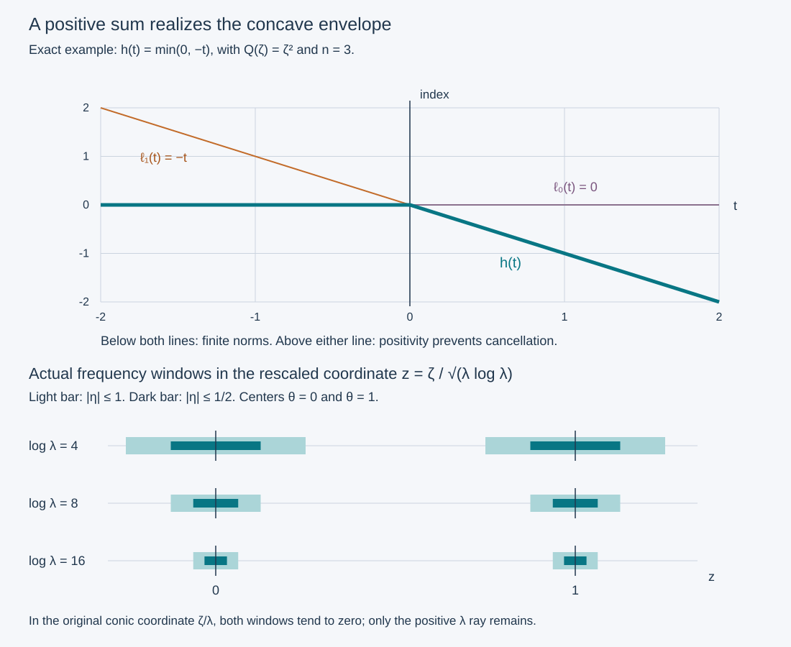

# Positive Fourier packets with a prescribed concave regularity index

A solution can have exactly one singular covector direction at each point of a line, while its Sobolev regularity changes along that line. We construct such solutions with any finite concave index allowed by the sign of a quadratic form. The construction is an actual convergent positive sum of exact solutions. It proves that no cancellation can hide a required singularity.

The antecedent is Hörmander IV, Example 26.6.5, printed 121–123 in the 2009 edition. We retain its logarithmically shifted packets, derive their full Fourier and Sobolev bounds, and give a direct positive-series realization of the concave envelope. The earlier [prescribed superharmonic lesson](../20261011-prescribed-superharmonic-regularity/prescribed-superharmonic-regularity.html) supplies a related complete-space construction; positivity here permits a simpler explicit selection of coefficients. The [ordinary propagation proof](../20261011-one-direction-propagation/one-direction-propagation-and-characteristic-strata.html) explains the sign restriction when the quadratic form is nonnegative. Exact Fourier, distribution, localization and calculus providers appear in the proof map.

Original expression, solutions and figure are CC0-1.0.  The human foundations recorded in the current export remain external; internal export P514 closure is not claimed.

## 1. Statement and the affine envelope

**H0. The full model realization.** Write \(x=(t,y)\in\mathbb R\times\mathbb R^{n-1}\), with \(n\ge3\), and write the dual variables to \(y\) as \((\zeta,\lambda)\in\mathbb R^d\times\mathbb R\), where \(d=n-2\). Let \(Q\) be a real quadratic form taking at least one positive value. Put

\[
 P=D_tD_{y_{n-1}}+iQ(D_{y_1},\ldots,D_{y_d}),\qquad D=-i\partial,
 \qquad \Gamma=\{(t,0;0,0,\lambda):t\in\mathbb R,\ \lambda>0\}. \tag{CR1}
\]

For every finite real-valued nonincreasing concave function \(h\) on \(\mathbb R\), there is \(u\in\mathcal D'(\mathbb R^n)\) with

\[
 Pu=0,\qquad \operatorname{WF}(u)=\Gamma,\qquad
 s_u^*(t,0;0,0,\lambda)=h(t)\quad(\lambda>0). \tag{CR2}
\]

If \(Q\) takes both signs, any finite concave \(h\) is allowed, without monotonicity. The index is the supremum of microlocally attained Sobolev orders; equality of indices does not specify attainment at the endpoint. We prove the assertion globally in \(t\). We do not assert that this constant-coefficient model's central line lies in the escaping set \(N_{11}\). Nor do we prove here the later theorem that concavity is necessary for all solutions.

**C0. Countably many supporting affine functions.** A finite concave function on \(\mathbb R\) is locally Lipschitz. Here are the needed elementary details. Concavity implies the ordered secant inequalities: for \(a<x<y<b\), the slope from \(a\) to \(x\) is at least the slope from \(x\) to \(y\), which is at least the slope from \(y\) to \(b\). On an inner compact interval the values have a finite lower bound from the chord joining two outside points. They also have a finite upper bound: fix an interior point, express it as a convex combination of a variable point on either side and a fixed outside point on the opposite side, and use concavity; the coefficient of the variable point is bounded below. The secant inequalities, applied with outside points at a positive distance, now bound all slopes on a smaller compact interval. This proves local Lipschitz continuity.

At a point \(q\), the one-sided secant slopes have finite limits \(h'_+(q)\le h'_-(q)\); their existence follows from their monotonicity as the increment decreases and the local bounds just proved. Choose \(v_q\) between those limits. The same secant inequalities give

\[
 \ell_q(t)=h(q)+v_q(t-q)\ge h(t)\quad(t\in\mathbb R).
 \tag{CR3}
\]

Choose one such slope for every rational \(q\), and enumerate the resulting lines as \(\ell_j(t)=a_j-c_jt\). They have

\[
 h(t)=\inf_{j\ge1}\ell_j(t). \tag{CR4}
\]

Indeed rational \(q\) tend to any fixed \(t\); their chosen slopes are uniformly bounded on a compact neighborhood by the preceding secant bounds. Thus \(\ell_q(t)-h(t)=h(q)-h(t)+v_q(t-q)\to0\). Every line already majorizes \(h\). If \(h\) is nonincreasing, its one-sided slopes and all the chosen \(v_q\) are nonpositive, so \(c_j\ge0\). No differentiability of \(h\) is assumed at a corner.

## 2. An exact positive packet for one affine index

**A0. Solve the equation before summing.** Fix \(\theta\in\mathbb R^d\), put \(c=Q(\theta)\), and choose \(b\in\mathbb R\). Choose a nonnegative \(\psi\in C_c^\infty(\mathbb R^d)\) that is one near zero, and a smooth nonnegative \(\phi\) that is zero for \(\lambda\le2\) and one for \(\lambda\ge3\). For \(\lambda>2\) define

\[
 L=\log\lambda,\qquad
 \eta=\bigl(\zeta-\theta\sqrt{\lambda L}\bigr)\sqrt{L/\lambda},\qquad
 A_{\theta,b}(t,\zeta,\lambda)=\lambda^b\phi(\lambda)\psi(\eta)
                 \exp\bigl(tQ(\zeta)/\lambda\bigr), \tag{CR5}
\]

and extend the amplitude by zero for \(\lambda\le2\). It is smooth across that boundary because the cutoff is smooth and identically zero on one side; all other factors are smooth on a neighborhood of \(\lambda=2\). Its partial inverse Fourier transform will be denoted \(u_{\theta,b}\), with unitary normalization. The exact identity

\[
 \lambda\partial_t A_{\theta,b}=Q(\zeta)A_{\theta,b}
 \tag{CR6}
\]

gives \(Pu_{\theta,b}=0\) in distributions once the inverse transform is justified. Positivity is pointwise in this **partial Fourier amplitude**, not a claim that the physical-space solution is real or positive.

Write \(Q(z)=B(z,z)\) with \(B\) its symmetric bilinear form. On the support of the amplitude,

\[
 \frac{Q(\zeta)}\lambda
  =cL+2B(\theta,\eta)+\frac{Q(\eta)}L,
 \qquad
 \zeta=\theta\sqrt{\lambda L}+\eta\sqrt{\lambda/L}. \tag{CR7}
\]

On each compact time interval the last two terms in the exponential give factors bounded above and below by positive constants. This remains true when \(c=0\), and in particular when \(\theta=0\).

**A1. All derivatives and one common order on each time compact.** Fix \(0<\rho<1/2\), henceforth \(\rho=1/4\). For every compact time interval \(K\), every \(k\) and multi-index \(\alpha\), and every \(\epsilon>0\),

\[
 |\partial_t^k\partial_{(\zeta,\lambda)}^\alpha A_{\theta,b}|
 \le C_{K,k,\alpha,\epsilon}\,
       \lambda^{b+ct+\epsilon-\rho|\alpha|}\quad(\lambda\ge3).
 \tag{CR8}
\]

To prove it, on the compact \(\eta\)-support use

\[
 \partial_{\zeta_r}\eta_s=\delta_{rs}\sqrt{L/\lambda},\qquad
 \partial_\lambda\eta=\frac{1-L}{2\lambda L}\eta
                  -\frac{1+L}{2\lambda}\theta. \tag{CR9}
\]

Every further frequency derivative adds at least a factor \(\lambda^{-1/2}\) up to a fixed power of \(L\). This follows inductively from (CR9), differentiating its coefficients; a \(\lambda\)-derivative of a coefficient adds \(\lambda^{-1}\) times a rational expression in \(L\), which has polynomial logarithmic growth for \(\lambda\ge3\). For the exponential, \(\partial_\zeta(Q(\zeta)/\lambda)=O(\sqrt{L/\lambda})\), \(\partial_\lambda(Q(\zeta)/\lambda)=O(L/\lambda)\) on this support, and its higher derivatives satisfy the same counting. A time derivative contributes \(Q(\zeta)/\lambda=O(L)\). The product and chain rules therefore bound the left side by \(C\lambda^{b+ct-|\alpha|/2}L^N\), with a finite \(N\) depending on the derivative. Since \(L^N\le C_\delta\lambda^\delta\) for every \(\delta>0\), (CR8) follows. The latter inequality follows by maximizing \(r^Ne^{-\delta r}\) for \(r\ge\log3\). The bounded frequency transition is harmless.

If \(\ell(t)=-b-ct-n/4\ge h(t)\), define

\[
 M_K=1-\min_K h-n/4.
 \tag{CR10}
\]

Then all derivatives satisfy \(|\partial_t^k\partial_\xi^\alpha A_{\theta,b}|\le C_{K,k,\alpha}\langle\xi\rangle^{M_K-\rho|\alpha|}\), where \(\xi=(\zeta,\lambda)\). For a fixed packet, \(|\xi|\asymp\lambda\) at large frequency by (CR7). Its remaining frequency support is bounded, so can be included by increasing the constant. Crucially, the order \(M_K\) is the same for **all** derivatives and all affine majorants; only the constants depend on the packet.

**A2. The inverse transform and smooth spatial tails.** More generally, suppose a smooth amplitude has these bounds on every time compact for some finite \(M_K\). Define

\[
 u(t,y)=(2\pi)^{-(n-1)/2}\int e^{iy\cdot\xi}A(t,\xi)\,d\xi
 \tag{CR11}
\]

as a distribution. A compact test function has a partial Fourier transform decreasing faster than any power of \(\xi\), uniformly on its time compact, by repeated integration by parts. Choosing that decay larger than \(M_K+n\) makes the pairing absolutely convergent and bounds it by finitely many test seminorms. This also proves continuity under convergence of the weighted amplitude seminorms.

For \(y\ne0\), apply \((-\Delta_\xi)^N\) to the amplitude and integrate by parts, gaining \(|y|^{-2N}\). After any fixed time and spatial derivatives, choose \(2N\rho>M_K+|\beta|+n-1\), where \(\beta\) is the spatial derivative index. The differentiated amplitude is integrable. Frequency cutoffs justify integration by parts; terms in which derivatives hit their cutoffs tend to zero by the same bound, since an ordinary cutoff derivative gains a full power, at least as much as \(\rho\). This proves a smooth function on \(y\ne0\), with every derivative rapidly decreasing as \(|y|\to\infty\), uniformly on time compacts. Increasing \(N\) gives any requested decay. Thus a compact time cutoff times \((1-\chi(y))u\), for \(\chi=1\) near zero, is a Schwartz function in all variables.

## 3. The positive ray and the exact Sobolev threshold

**W0. Full frequency localization, including time.** For a single packet the support in (CR7) has \(\lambda>2\) and \(|\zeta|/\lambda\to0\). Hence on the complement of any conic neighborhood of \(e=(0,1)\) in the \(\xi\)-space, all amplitude derivatives decrease faster than any power: the support there is bounded. We shall preserve these estimates under summation.

Let \(A\) have both these complementary-cone estimates and the common-order bounds of A2. For a compact time cutoff \(\chi_0\), its Fourier transform in time satisfies

\[
 |\widehat{\chi_0 A}(\tau,\xi)|
 \le C_N\langle\xi\rangle^{M_K}\langle\tau\rangle^{-N}.
 \tag{CR12}
\]

This follows by integrating time derivatives onto \(\chi_0 A\); all derivative orders have the same \(M_K\). On any cone where \(|\tau|\ge\delta|\xi|\), taking \(N\) large gives arbitrary joint decay. Where the \(\xi\)-direction stays away from \(e\), its rapid estimates combined with time integration give arbitrary joint decay as well. Thus (CR12) is rapidly decreasing outside every conic neighborhood of the full covector \((0,e)\). The same estimates hold after any fixed Fourier derivatives, using compact time factors and the amplitude bounds. The low-frequency regions cause no difficulty.

Multiplication by a compact spatial cutoff preserves this conic rapid decrease. Explicitly its Fourier transform is a convolution with a Schwartz function. Split into shifts smaller than a fixed small fraction of the output frequency, where the shifted argument remains in a slightly larger complementary cone, and the other shifts, where arbitrarily rapid decay of the Schwartz factor dominates the polynomial bound of the transformed distribution. Peetre's inequality and an integrable extra power bound both parts. This is also the exact earlier cutoff-localization proof. Combined with A2 it gives \(\operatorname{WF}(u)\subset\Gamma\).

**N0. A partial Fourier norm detects the microlocal order.** Under A2 and W0, for every real \(\sigma\),

\[
 \chi_0(t)u\in H^\sigma(\mathbb R^n)
 \quad\Longleftrightarrow\quad
 E_{\sigma,\chi_0}(A)^2
 :=\int|\chi_0(t)A(t,\xi)|^2\langle\xi\rangle^{2\sigma}\,dt\,d\xi<\infty.
 \tag{CR13}
\]

On \(|\tau|\le|\xi|\), the full and partial Sobolev weights are comparable for every real \(\sigma\), including negative ones. On its complement the transformed amplitude is rapidly decreasing by (CR12), so both weighted integrals there are finite. Plancherel in time, followed by Tonelli for the nonnegative integrals, identifies the complete integral with the right side. This proves both directions even when the extended norm is infinite: for each fixed \(\xi\) the time function is smooth and compactly supported, so its Plancherel identity is already legitimate before integration in \(\xi\).

If \(u\) were microlocally \(H^\sigma\) at \((t_0,0;0,e)\), it would be locally \(H^\sigma\) on a smaller base neighborhood of \((t_0,0)\). Indeed that microlocal neighborhood covers the only possible singular direction; every other direction is smooth by W0, and a finite angular partition with exact elliptic localizers gives the full local Sobolev norm. Choose \(\chi_0\) supported in the resulting time interval and nonzero at \(t_0\), and a spatial cutoff near zero. A2 supplies a Schwartz tail outside that spatial cutoff. Consequently \(\chi_0u\in H^\sigma\) globally. Conversely a finite norm in (CR13), with \(\chi_0(t_0)\ne0\), gives microlocal \(H^\sigma\) there. Thus these time-localized partial norms really detect the desired local index, not a nonlocal obstruction at spatial infinity.

**N1. Compute the affine index without discarding logarithms.** For the packet (CR5), the frequency change of variables in (CR7) has Jacobian

\[
 d\zeta=(\lambda/L)^{d/2}d\eta.
 \tag{CR14}
\]

On a compact time interval, (CR7), \(\langle\xi\rangle\asymp\lambda\), and the nonzero nonnegative profile show that the part of (CR13) with \(\lambda\ge3\) is bounded above and below by positive constants times

\[
 \int_3^\infty\int |\chi_0(t)|^2
   \lambda^{2(b+ct+\sigma)+d/2}(\log\lambda)^{-d/2}\,dt\,d\lambda.
 \tag{CR15}
\]

If \(\sigma<-b-ct-n/4\) throughout the compact support of \(\chi_0\), continuity gives a uniform strict gap and the power of \(\lambda\) is strictly below \(-1\); the integral converges. If \(\chi_0(t_0)\ne0\) and \(\sigma>-b-ct_0-n/4\), the power is strictly above \(-1\) on a small interval where \(\chi_0\) is bounded away from zero; its integral diverges despite the logarithm. For example, \((\log\lambda)^{d/2}\le C_\delta\lambda^\delta\) proves the latter assertion for any smaller positive power gap. N0 therefore proves

\[
 s_{u_{\theta,b}}^*(t,0;0,e)=-b-ct-n/4. \tag{CR16}
\]

Any line \(\ell_j=a_j-c_jt\) in C0 is realized by taking \(b_j=-a_j-n/4\) and choosing \(Q(\theta_j)=c_j\). For \(c_j\ge0\), scale one vector on which \(Q>0\), using \(\theta_j=0\) when \(c_j=0\). If \(Q\) takes both signs, scaling a positive or a negative vector realizes every real \(c_j\). This covers constant, decreasing and, in the indefinite case, increasing affine indices.

## 4. A convergent positive sum for the whole envelope

**T0. Keep every required estimate in a countable list.** Let \(A_j=A_{\theta_j,b_j}\) be the positive packets realizing the supporting lines. Enumerate the following nonnegative seminorms \(p_i\) on smooth amplitudes:

* The weighted suprema of every \(\partial_t^k\partial_\xi^\alpha A\) on \([-m,m]\times\mathbb R^{n-1}\), with weight \(\langle\xi\rangle^{-M_m+\rho|\alpha|}\), where \(M_m=1-\min_{[-m,m]}h-n/4\).
* The suprema of \(\langle\xi\rangle^N|\partial_t^k\partial_\xi^\alpha A|\) on the same time compacts and on \(\{|\xi|\ge1,\ |\xi/|\xi|-e|\ge1/l\}\), for positive integers \(l,N\) and every derivative.
* The square-root norms \(E_{r,\chi_I}\) in (CR13), for every bounded rational open interval \(I\), every rational \(r<\min_{\overline I}h\), and a fixed smooth cutoff \(\chi_I\) supported in \(\overline I\) and strictly positive on \(I\).

All these seminorms are finite on each \(A_j\). A1 proves the first family with its **common** order. W0 proves the second. Since \(\ell_j\ge h\), the strict margin \(r<\min_{\overline I}h\) and N1 prove the third. Its square root is a seminorm by the \(L^2\) triangle inequality. The cutoff functions exist by the earlier smooth bump construction. There are countably many tests, since derivative indices, integer parameters, rational intervals and rational exponents are countable.

**T1. Choose the coefficients and identify the actual limit.** Define strictly positive numbers

\[
 \epsilon_j=\frac{2^{-j}}{1+\sum_{i=1}^j p_i(A_j)},\qquad
 A=\sum_{j=1}^\infty\epsilon_j A_j. \tag{CR17}
\]

For a fixed test \(p_i\), its terms with \(j\ge i\) have total seminorm at most \(\sum_{j\ge i}2^{-j}\); the earlier terms form a finite sum. Every derivative therefore converges uniformly on compact sets, and the coordinate fundamental theorem of calculus identifies the limits as the derivatives of one smooth amplitude. The weighted uniform tests pass to that limit and give the common-order and rapid complementary-cone estimates required by A2 and W0.

For each weighted \(L^2\) test, the triangle inequality makes the partial sums Cauchy in the complete weighted \(L^2\) space. Its limit equals the same amplitude: compact uniform convergence identifies the local distributional limit, and integration against compact tests identifies the \(L^2\) limit with it. Thus every listed energy is finite. This uses the complete Fourier \(L^2\) proof, not an assumed completeness of an unspecified symbol space.

All packets vanish for \(\lambda\le2\), so the limit does too. Termwise differentiation in the exact equation (CR6) is legitimate on every frequency compact and gives \(\lambda\partial_tA=Q(\zeta)A\) everywhere. A2 makes its inverse transform a distribution and proves convergence of the inverse transforms there. Hence its equation is exactly \(Pu=0\), without a smooth forcing remainder. Positivity also passes pointwise:

\[
 A(t,\xi)\ge\epsilon_j A_j(t,\xi)\ge0
 \quad\text{for every }j,t,\xi. \tag{CR18}
\]

**R0. All orders below the prescribed index are attained.** Fix \(t_0\) and a real \(\sigma<h(t_0)\). Continuity of the concave \(h\) gives a rational interval \(I\ni t_0\) and a rational \(r\) with \(\sigma<r<\min_{\overline I}h\). The corresponding energy test is finite by T1. N0 yields \(\chi_Iu\in H^r\), and \(\chi_I(t_0)>0\) gives microlocal \(H^r\), hence \(H^\sigma\), at the required covector. Therefore \(s_u^*\ge h\) on \(\Gamma\). A2 and W0 also give \(\operatorname{WF}(u)\subset\Gamma\) with actual smooth spatial tails and rapid complementary cones.

**R1. Positivity enforces every upper bound.** Suppose \(\sigma>h(t_0)\). By (CR4) there is a line with \(\ell_j(t_0)<\sigma\). For every time cutoff \(\chi_0\) nonzero at \(t_0\), (CR18) gives

\[
 E_{\sigma,\chi_0}(A)^2
 \ge\epsilon_j^2 E_{\sigma,\chi_0}(A_j)^2=+\infty, \tag{CR19}
\]

where N1 proves the last equality on a small interval. Were the sum microlocally \(H^\sigma\) at the marked point, N0 would supply such a cutoff with a finite energy, a contradiction. Thus no order strictly larger than \(h(t_0)\) is attained. Combining this with R0 proves equality of the indices at every real time. Homogeneity gives all \(\lambda>0\). Since \(h\) is finite, every point of \(\Gamma\) is singular: a smooth microlocal cutoff would give all Sobolev orders. The reverse inclusion is R0. This completes (CR2) for the full concave envelope, including corners and unbounded slopes as \(|t|\to\infty\).

## 5. Three solved checks

**X1. Recover the dimension shift and inspect the endpoint.** Determine why the affine index contains \(n/4\), and decide whether a constant-index packet belongs to its critical local Sobolev space.

**Solution.** The \(d=n-2\) transverse frequency variables contribute \(\lambda^{d/2}(\log\lambda)^{-d/2}\) to the squared norm, while the remaining frequency measure is \(d\lambda\). The threshold equation is \(2(b+ct+\sigma)+d/2=-1\), hence \(\sigma=-b-ct-(d+2)/4=-b-ct-n/4\). For a constant index take \(\theta=0\), so \(c=0\). At that exponent the integral is comparable to

\[
 \int_3^\infty\lambda^{-1}(\log\lambda)^{-d/2}\,d\lambda
 =\int_{\log3}^\infty r^{-d/2}\,dr. \tag{CR20}
\]

It converges precisely when \(d>2\), equivalently \(n\ge5\). For \(n=3,4\) it diverges. If \(c\ne0\), any time cutoff nonzero at \(t_0\) includes times on the side where the affine index is strictly smaller than its value at \(t_0\); N1 then forces failure at that endpoint order. These differences do not alter the supremum index.

**X2. A corner and the direction of regularity.** In dimension three take \(Q(\zeta)=\zeta^2\) and \(h(t)=\min(0,-t)\). Construct an exact solution with this index. Explain the sign direction without assuming its central line belongs to \(N_{11}\).

**Solution.** The two lines are realized by \((\theta,b)=(0,-3/4)\) and \((1,-3/4)\). Any positive linear combination of their amplitudes has index equal to their minimum, by the finite version of R0–R1. It solves the equation exactly and has wavefront set \(\Gamma\). Near the positive last covector, a left order-minus-one parametrix for \(D_{y_{n-1}}\) reduces the principal symbol to \(\tau+i\zeta^2/\lambda\); proper localizers leave only smooth errors on the smaller cone. Reverse time and multiply the reduced operator by \(-1\). Its principal symbol becomes \(\tau-i\zeta^2/\lambda\), with nonpositive imaginary part. The full ordinary estimate ODP:H0–B0, which permits all lower terms, propagates regularity toward **decreasing original time**. It needs a sign neighborhood, not an accessible characteristic endpoint. Thus an index may decrease with increasing \(t\), exactly as this example does. No assertion of membership in \(N_{11}\) was required.

**X3. An indefinite quadratic form realizes both slopes.** In dimension four take \(Q(\zeta_1,\zeta_2)=\zeta_1^2-\zeta_2^2\) and \(h(t)=1-|t|\). Give the two packets and explain why arbitrarily small positive coefficients retain the corner.

**Solution.** The supporting lines \(1-t\) and \(1+t\) have \(c=1\) and \(c=-1\). Choose \(\theta=(1,0)\) and \(\theta=(0,1)\); in both cases \(b=-1-n/4=-2\). N1 gives their exact indices. A positive combination is no more regular than either packet by (CR19), regardless of how small its positive coefficient is: a positive constant times an infinite squared norm is still infinite. Below both indices the triangle inequality gives a finite energy. Their minimum is \(1-|t|\). Multiplying one packet by zero would remove that obstruction, which is why every coefficient in (CR17) is strictly positive.

## 6. What the packet picture shows

**V0. The affine envelope and the actual moving frequency windows.** The first panel shows X2's two affine indices and their minimum. The second uses the exact one-dimensional windows of (CR5), choosing a profile supported in \(|\eta|\le1\) and equal to one for \(|\eta|\le1/2\). In coordinates \(z=\zeta/\sqrt{\lambda\log\lambda}\), their centers are \(\theta\), support half-widths are \(1/\log\lambda\), and plateau half-widths are \(1/(2\log\lambda)\). The rows use \(\log\lambda=4,8,16\). In the original conic coordinate \(\zeta/\lambda\), both centers and widths tend to zero; the displayed rescaling is explicitly different. These are exact support bounds for the chosen profile, not estimates extracted from the drawing.

The [figure generator](figures/build_figure.py), [finite checks](model-check.json), [proof review](proof-review.json), [reader checks](reader-check.json) and source credit accompany the lesson. The positive series realizes the prescribed index and solves the model equation exactly; necessity of concavity for arbitrary solutions is a separate theorem. The [complex-cutoff energy theorem](../20261011-complex-cutoff-energy/adaptive-square-roots-and-complex-cutoff-energy.html) treats a different measurement problem. The monotonicity argument here uses ordinary sign propagation without assuming that the model curve lies in N11.
