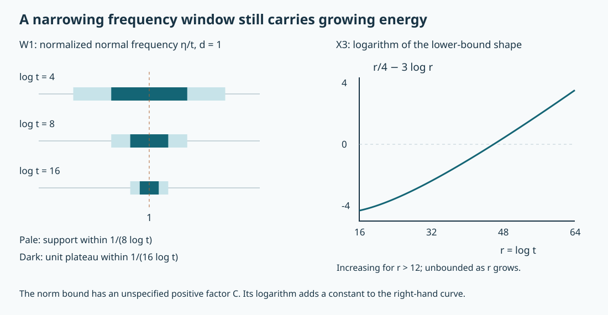

# Prescribing regularity on a complex characteristic leaf

The complex propagation theorem says that the Sobolev regularity index obeys superharmonic comparison along a nonradial involutive characteristic leaf. We now prove the converse for the planar model: every allowable superharmonic index occurs. The proof constructs smooth holomorphic packets that defeat each proposed stronger regularity estimate, then uses completeness to obtain one distribution satisfying all the required conditions simultaneously.

The mathematical antecedent is Lars Hörmander, *The Analysis of Linear Partial Differential Operators IV*, 2009 edition, Section 26.2, Theorem 26.2.3 and Lemma 26.2.4, printed pages 76–80. The exposition and packet norm argument below are independently written. The earlier [weighted planar lesson](../20261011-weighted-cauchy-riemann/weighted-cauchy-riemann-estimates-and-holomorphic-peaks.html), WCR:P0–P2, proves the holomorphic peaks with every derivative bound. The [complex propagation lesson](../20261011-complex-involutive-propagation/complex-involutive-normal-form-and-regularity-propagation.html), CIP:P0–P2 and N3, supplies the comparison foundations and complete scalar normal form. The current proof map also identifies exact ordinary-calculus, Fourier, Baire and complete-space providers. All uses retain their hypotheses and versions.

Original expression, solutions and the reproducible figure are CC0-1.0. Some prerequisite proofs are external readings identified by the proof index. 

## 1. The complete realization statement

**H0. Keep the boundary and the positive ray.** Write \(x=(z,y)\in\mathbb R^2\times\mathbb R^d\), where \(z=x_1+ix_2\), \(d=n-2\ge1\), and let \(e\) be the last unit vector of \(\mathbb R^d\). Put \(L=D_1+iD_2=-2i\bar\partial\), with \(D_j=-i\partial_{x_j}\). Let \(\Omega\subset\mathbb R^2\) be nonempty, connected and open, with no boundary regularity assumption. Suppose
\[
 s:\mathbb R^2\longrightarrow(-\infty,+\infty]
 \text{ is lower semicontinuous},\qquad
 s=+\infty\text{ on }\mathbb R^2\setminus\overline\Omega,
 \qquad s|_\Omega\text{ is superharmonic and not identically infinite}.
 \tag{SR1}
\]
The complement in this condition is the complement of the **closure**; finite boundary values are allowed. Define the closed positive conic sets
\[
 \Gamma=\{(z,0;0,\lambda e):z\in\overline\Omega,\ \lambda>0\},\qquad
 \Gamma'=\{(z,0;0,\lambda e):z\in\partial\Omega,\ \lambda>0\}.
 \tag{SR2}
\]
There is \(u\in\mathcal D'(\mathbb R^n)\) such that
\[
 \operatorname{WF}(u)=\Gamma,\qquad
 \operatorname{WF}(Lu)\subset\Gamma',\qquad
 s_u^*(z,0;0,\lambda e)=s(z)\ (z\in\Omega),\qquad
 s_u^*(z,0;0,\lambda e)\ge s(z)\ (z\in\partial\Omega).
 \tag{SR3}
\]
Here \(s_u^*\) is the supremum of attained microlocal Sobolev orders, as defined and justified in CIP:H1. Equality in (SR3) does not assert membership at the endpoint. Nor is equality of the source wavefront set with \(\Gamma'\) required. Section 6 gives the local transfer to a general scalar operator with the nonradial involutive hypotheses.

## 2. Two preparations for a rough index

**R0. A countable set that detects upper bounds.** Let \(h\) be lower semicontinuous on an open subset \(U\subset\mathbb R^k\), with values in \((-\infty,+\infty]\). Enumerate all closed balls with rational centers and positive rational radii contained in \(U\). On each such ball \(K_j\), choose a point \(z_j\) attaining \(\min_{K_j}h\). Attainment follows from compactness and lower semicontinuity: a minimizing sequence has a convergent subsequence, and the lower limit inequality gives its minimum; the identically infinite case permits any point. Then
\[
 h'(z_j)\le h(z_j)\text{ for all }j,\quad h'\text{ lower semicontinuous}
 \quad\Longrightarrow\quad h'\le h\text{ on }U.
 \tag{SR4}
\]
If the conclusion failed at \(z\), its value \(h(z)\) would be finite. Choose a real number strictly between \(h(z)\) and \(h'(z)\). A small neighborhood of \(z\) has \(h'\) greater than that number. A rational closed ball containing \(z\) fits inside this neighborhood and \(U\). Its chosen minimizer has \(h(z_j)\le h(z)<h'(z_j)\), a contradiction. Rational centers and radii give a countable family and arbitrarily small such balls.

For the particular \(s\) in (SR1), the finite-valued points are dense in \(\Omega\). Otherwise \(s\) would be infinite on an open disk, and CIP:P2 would force it to be infinite throughout connected \(\Omega\). Consequently every rational ball used in (SR4) has finite minimum. We may and do choose a countable set \(E=\{z_j\}\subset\Omega\) with \(s(z_j)<\infty\) that detects (SR4).

**R1. Smooth strict subharmonic majorants with finite constraints.** Put \(v=-s\) on \(\Omega\). It is upper semicontinuous, locally bounded above, and satisfies the subharmonic circle mean inequality, by CIP:P1. Its values may be \(-\infty\). We first prove \(v\in L^1_{\mathrm{loc}}(\Omega)\). Choose a finite-valued center \(a\) and a closed disk inside \(\Omega\), with \(v\le M\) on it. The circle mean inequality bounds the integral of the nonnegative function \(M-v\) on every concentric circle by \(2\pi(M-v(a))\). Integration with radial measure \(r\,dr\), using Tonelli, bounds its integral on the disk. Thus \(v\) is integrable there. Every point has a neighborhood covered by such a disk: choose a nearby finite-valued center, which exists by R0, and a sufficiently small disk around it contained in \(\Omega\). A finite cover handles each compact set.

Let \(\omega\Subset\Omega\). Convolve \(v\) with a nonnegative smooth radial mollifier of integral one and sufficiently small radius \(\epsilon\), obtaining \(v_\epsilon\) on a neighborhood of \(\overline\omega\). Polar integration of circle means proves \(v_\epsilon\ge v\). The upper semicontinuity bound on small neighborhoods proves \(\limsup_{\epsilon\to0}v_\epsilon(z)\le v(z)\), including when \(v(z)=-\infty\). Smoothness follows by differentiating the compact convolution against a locally integrable function. Integrating the circle inequality under that convolution gives the same inequality for \(v_\epsilon\). The second-order Taylor expansion of its circle mean is \(v_\epsilon(z)+r^2\Delta v_\epsilon(z)/4+o(r^2)\); hence \(\Delta v_\epsilon\ge0\).

Suppose finitely many compact sets \(F_j\subset\overline\omega\) and real numbers \(\mu_j\) satisfy \(\mu_j<s\) on \(F_j\). Upper semicontinuity and compactness give neighborhoods of \(F_j\) where \(v<-\mu_j\) with a uniform strict margin. Choosing \(\epsilon\) smaller than all their buffers makes \(v_\epsilon\) satisfy these same inequalities with a smaller margin. Then choose \(\delta>0\) small enough that
\[
 \phi=v_\epsilon+\delta(1+|z|^2),\qquad
 \Delta\phi\ge4\delta>0,\qquad
 \phi>-s\text{ on }\omega,\qquad
 \phi<-\mu_j\text{ on }F_j.
 \tag{SR5}
\]
The compact constraint sets can be empty. This proof works on any relatively compact open \(\omega\), whether or not it is simply connected, and supplies a smooth real \(\phi\). It uses no unproved regularization theorem for singular subharmonic functions.

## 3. The complete space used for the simultaneous construction

**T0. Countably many actual microlocal tests.** On the cosphere bundle set \(h(q)=s(z)\) for \(q=(z,0;0,e)\in\Gamma\), and \(h(q)=+\infty\) outside \(\Gamma\). This extended function is lower semicontinuous: \(\Gamma\) is closed, its relative finite sublevel sets are closed by (SR1), and the complement of \(\Gamma\) is open. Thus \(O_r=\{h>r\}\) is open for every rational \(r\).

For each rational \(r\), choose a countable family of smooth base/angular cutoffs whose compact normalized microsupports lie in \(O_r\) and whose elliptic regions cover it. Such a family is obtained from rational coordinate balls with closures in \(O_r\), with a smaller concentric ball where each cutoff is one, and the finite coordinate charts of the sphere. Extend homogeneously at large frequencies, extend smoothly at low frequencies, and quantize with a proper kernel cutoff. Compose each with an order reducer of order \(r\). Denote these properly supported tests, with compact output supports, by \(B_j\in\Psi^{\mu_j}\), where initially \(\mu_j\) is rational. They satisfy
\[
 \mu_j<h\text{ on }\operatorname{WF}(B_j),\qquad p_j(u)=\|B_ju\|_{L^2}.
 \tag{SR6}
\]
Include the direct coarse seminorms \(c_k(u)=\|\chi_k u\|_{H^{r_k}}\), where \(\chi_k\) is compactly supported and one on the \(k\)-th compact set of a nested exhaustion, and \(r_k\) is a negative integer strictly below the minimum of \(s\) on its compact planar projection. Lower semicontinuity and compactness allow this choice. These are the full Fourier norms, with compact input support. We retain them explicitly instead of dropping any smoothing remainders in an order-reducer replacement. They identify the distributional limits below.

Let \(\mathcal F\) be the distributions for which all these seminorms are finite. Then
\[
 \mathcal F=\{u:\operatorname{WF}(u)\subset\Gamma,
                    \ s_u^*\ge s\text{ on }\Gamma\}.
 \tag{SR7}
\]
Here are the finite-cover details that also justify later estimates. An arbitrary compactly localized proper test \(B\) of order \(\mu\), with \(\mu<h\) on its microsupport, is controlled by finitely many of the selected tests and one coarse norm. At each microsupport point select a rational \(r>\mu\) still below \(h\), and a selected cutoff elliptic there. A finite cover and smooth partition reduce \(B\) to pieces factored through the selected order-\(r\) tests using their local elliptic parametrices. The left factors have order \(\mu-r<0\) and are bounded on \(L^2\). The remaining kernel is smooth on a compact input/output product; its norm is bounded by a coarse negative Sobolev norm. Proper support bounds the required input compact set. These are the full local inverse and Sobolev estimates, including separated microsupport errors.

This proves finiteness in one direction of (SR7). In the other, the selected elliptic tests of orders arbitrarily close to \(s(q)\) give \(s_u^*(q)\ge s(q)\). Off \(\Gamma\), fix one compact microlocal neighborhood and a cutoff inside it. The finite-cover argument gives every Sobolev order for that same cutoff, hence smoothness by Fourier Sobolev embedding. An infinite index at an isolated point is not being used as a substitute for this open-neighborhood argument. Conversely, the right side of (SR7), strict margins on compact microsupports, and the ordinary mapping theorem imply each selected seminorm is finite.

**T1. Completeness with the source condition.** Define
\[
 \mathcal F_0=\{u\in\mathcal F:Lu\in C^\infty(\Omega\times\mathbb R^d)\},
 \tag{SR8}
\]
and add the suprema of every derivative of \(Lu\) on a countable compact exhaustion of that open set. Enumerate the resulting seminorms, replacing them by increasing finite sums \(q_j\). The metric
\[
 d_0(u,w)=\sum_{j\ge0}2^{-j-1}\min\{1,q_j(u-w)\}
 \tag{SR9}
\]
induces exactly the seminorm topology: a finite initial sum controls a chosen seminorm, while the geometric tail is uniformly small. The coarse norms separate distributions.

A metric Cauchy sequence is Cauchy in every seminorm. Its coarse compact Sobolev limits exist by completeness of the Fourier norms, and agree on overlaps because all restrictions have the same distributional limit. They define one \(u\in\mathcal D'\). Proper tests and \(L\) are continuous on distributions. The \(L^2\) limit of each \(B_j u_k\) is therefore the actual \(B_j u\). Each compact uniform limit of derivatives of \(Lu_k\) is the corresponding derivative of \(Lu\): pass to limits in the coordinate fundamental theorem of calculus, successively in each derivative order. Hence \(Lu\) is smooth on the open set, all seminorms are finite and the sequence converges in each of them. This proves completeness of \(\mathcal F_0\). Every globally smooth function belongs to it. Since differential operators do not enlarge the wavefront set, (SR7)–(SR8) imply \(\operatorname{WF}(Lu)\subset\Gamma'\).

**B0. An interior norm ball would force a finite estimate.** Fix a proper order-\(\sigma\) operator \(T\), with homogeneous principal symbol nonzero at \(q_0=(z_0,0;0,e)\), and let \(\theta\) be compactly supported and equal to one near \((z_0,0)\). The sets
\[
 A_k=\{u\in\mathcal F_0:\|\theta Tu\|_2\le k\},\qquad k=1,2,\ldots,
 \tag{SR10}
\]
are closed. Indeed convergence in \(\mathcal F_0\) implies distributional convergence, with one fixed compact output support for \(\theta T\). Testing against a cutoff times Fourier exponentials gives pointwise convergence of Fourier transforms; Fatou and Plancherel make the extended \(L^2\) norm lower semicontinuous.

If some \(A_k\) had interior, there would be \(u_0\), a finite maximum \(q\) of defining seminorms, and \(a>0\), such that \(u_0+\{w:q(w)<a\}\subset A_k\). Subtracting the output at \(u_0\) bounds \(\|\theta Tw\|_2\le2k\) on that neighborhood. For \(q(w)>0\), scale by \(a/(2q(w))\); for \(q(w)=0\), arbitrary multiples remain in the neighborhood and force \(\theta Tw=0\). We obtain an estimate on every \(w\in\mathcal F_0\) involving only finitely many tests:
\[
 \|\theta Tw\|_2\le C\left(\|\chi Lw\|_{C^M}
                     +\sum_{j=1}^J\|B_jw\|_2
                     +\sum_{k=1}^{K}\|\chi_k w\|_{H^{r_k}}\right).
 \tag{SR11}
\]
A single \(\chi\in C_c^\infty(\Omega\times\mathbb R^d)\) equal to one on all the source compacts and a sufficiently large integer \(M\) dominate the finitely many source seminorms. The finite coarse list is the actual list from T0, without an implicit replacement. Every \(\mu_j\) obeys (SR6). We will contradict (SR11) for \(\sigma=s(z_0)<\infty\).

## 4. The packet action of a full ordinary operator

**C0. A reduced amplitude, with the whole remainder.** For a compactly supported planar amplitude \(a(z,\eta)\in S^r_{1,0}\), use unitary normal Fourier normalization
\[
 U(a)(z,y)=(2\pi)^{-d/2}\int e^{iy\cdot\eta}a(z,\eta)\,d\eta.
 \tag{SR12}
\]
The integral defines a distribution for every real \(r\): integrate \((1-\Delta_y)^N\) onto a compact test and the amplitude, gaining \(\langle\eta\rangle^{-2N}\), then choose \(2N>r+d\). This proves finite test-seminorm bounds and uniform distributional boundedness on bounded symbol families, as in CNF:O1.

Let \(P\in\Psi^\mu_{1,0}\) be proper. After compact output localization, its action has an exact reduced amplitude \(b(z,\eta)\), with local expansion
\[
 P U(a)=U(b),\qquad
 b(z,\eta)=p(z,0;0,\eta)a(z,\eta)+S^{r+\mu-1},
 \tag{SR13}
\]
where \(p\) is a full left symbol. All remainder seminorms are bounded by finitely many amplitude seminorms, and the assertion is uniform for bounded families. Smooth proper-kernel terms contribute \(S^{-\infty}\) after compact localization. If a homogeneous principal symbol \(p_\mu\) is used instead, the lower-order part of \(p\) is absorbed into the displayed remainder.

We spell out the symbol reduction. Before normal reduction, the amplitude of the output is the tangential oscillatory integral
\[
 c(z,y,\eta)=(2\pi)^{-2}\iint e^{i(z-z')\cdot\zeta}
                  p(z,y;\zeta,\eta)a(z',\eta)\,dz'\,d\zeta.
 \tag{SR14}
\]
This formula follows first with frequency cutoffs by integrating the input normal variable, and then in distributions by the preceding bounds. Taylor expansion in \(\zeta\) at zero, or the ordinary parameter composition theorem, gives leading term \(p(z,y;0,\eta)a(z,\eta)\) and order \(r+\mu-1\) remainder. To see why the parameter estimates apply, split into \(|\zeta|\le\langle\eta\rangle/2\) and its complement. In the first part each symbol derivative in \(\zeta\) lowers the \(\eta\)-order by one; the Taylor remainder and the ordinary oscillatory remainder estimates have this same gain. In the second part, repeated integration by parts in \(z'\) gives arbitrary powers of \(\langle\zeta\rangle^{-1}\). Peetre's inequality bounds every possibly negative symbol order by a fixed power of \(\langle\zeta\rangle\langle\eta\rangle\), and integration over \(|\zeta|\gtrsim\langle\eta\rangle\) then gives any requested negative remainder order by choosing enough integrations. Apply the argument after every \(z,y,\eta\) derivative; only finitely many input seminorms are used for each output estimate. This also proves every higher Taylor remainder order.

Multiply by the compact output cutoff and apply the exact normal amplitude reduction CNF:O2 to \(c(z,y,\eta)\). Its leading term is evaluation at \(y=0\); every subsequent term includes at least one \(\eta\)-derivative, hence gains an order. Its full remainder and distributional identity prove (SR13). The unitary constant in (SR12) multiplies both sides equally. Input pieces separated from the retained output base neighborhood give uniformly smooth kernels; after compact output localization their partial normal Fourier transforms are rapidly decreasing. Thus (SR13) may use a sharper local amplitude order on any smaller planar neighborhood. Properness bounds the input compact set, so no global base-growth assumption has been inserted.

**C1. The two estimates we need.** If \(r+\mu<-d/2\) on a compact output piece, the reduced amplitude in (SR13) is square integrable in \((z,\eta)\). Indeed its square is bounded by a constant times \(\langle\eta\rangle^{2(r+\mu)}\), whose radial integral converges precisely under this strict inequality. Partial Plancherel therefore bounds that output in \(L^2\), uniformly on bounded symbol families.

We also need a lower estimate. Suppose \(a_t\) is a bounded family in \(S^{\phi(z_0)-d/2+1/2}\) on a fixed small planar neighborhood, and \(T\) is classical to its first order, with degree-\(\sigma\) principal symbol \(\tau\). For compact output cutoffs equal to one near \((z_0,0)\), (SR13) gives there
\[
 b_t(z,\eta)=\tau(z,0;0,\eta)a_t(z,\eta)+r_t(z,\eta),\qquad
 |r_t(z,\eta)|\le C\langle\eta\rangle^{\sigma+\phi(z_0)-d/2-1/2}.
 \tag{SR15}
\]
This is an estimate for the **actual partial Fourier amplitude** of the localized output. It permits a lower \(L^2\) bound by integration over any chosen \((z,\eta)\)-box. It does not infer pointwise amplitude control from unproved conormal endpoint regularity.

## 5. Defeat every finite stronger estimate

**W0. Select a barrier for the actual finite tests.** In (SR11), fix \(z_0\in\Omega\) with \(\sigma=s(z_0)<\infty\). Choose open sets
\[
 \{z_0\}\cup\pi_z(\operatorname{supp}\chi)
       \subset\omega_0\Subset\omega_1\Subset\omega\Subset\Omega.
 \tag{SR16}
\]
They can contain the finitely many compact sets even when the source projection is disconnected. For each \(B_j\), the set
\(F_j=\{z\in\overline{\omega_1}:(z,0;0,e)\in\operatorname{WF}(B_j)\}\)
is compact. Condition (SR6) gives \(\mu_j<s\) there. Include also the compact sets \(\overline{\omega_1}\cap\pi_z(\operatorname{supp}\chi_k)\), with constraint order \(r_k\), for the finitely many coarse norms. T0 gives \(r_k<s\) on these sets. Apply R1 to obtain a smooth strict subharmonic \(\phi\) on \(\omega\), satisfying all these finite constraints. In particular,
\[
 \gamma:=\sigma+\phi(z_0)>0,\qquad
 \phi+\mu_j<0\text{ on }F_j.
 \tag{SR17}
\]
Choose \(\chi_0\in C_c^\infty(\omega_1)\) equal to one on a neighborhood of the compact set in (SR16). The strict inequalities hold with uniform margins in sufficiently small neighborhoods of their relevant compact sets.

**W1. One smooth holomorphic packet at each scale.** WCR:P0–P2 supplies holomorphic \(f_t\) on \(\omega\), for all sufficiently large \(t\), such that
\[
 f_t(z_0)=t^{\phi(z_0)},\qquad
 |D_z^\beta f_t(z)|\le C_\beta(\log t)^{|\beta|}t^{\phi(z)}
                     \quad(z\in\overline{\omega_1}).
 \tag{SR18}
\]
Choose \(\psi\in C_c^\infty(\mathbb R^d)\), nonnegative, equal to one on \(|v|\le1/16\), and supported in \(|v|<1/8\). Put
\[
 a_t(z,\eta)=\chi_0(z)f_t(z)t^{-d/2}
           \psi\big((\eta/t-e)\log t\big),\qquad u_t=U(a_t).
 \tag{SR19}
\]
For each \(t\) the frequency support is compact, so \(u_t\) is globally smooth, compactly supported in \(z\) and rapidly decreasing in \(y\). Thus \(u_t\in\mathcal F_0\). Because \(f_t\) is holomorphic and \(L\) differentiates only \(z\),
\[
 \chi Lu_t=0.
 \tag{SR20}
\]
Indeed the only derivative in the amplitude is \((L\chi_0)f_t\), whose planar support is disjoint from the projection of \(\operatorname{supp}\chi\).

On the frequency support, \(|\eta|\asymp t\). Each frequency derivative of the profile contributes \((\log t)/t\). The product rule and (SR18) give
\[
 |\partial_\eta^\alpha D_z^\beta a_t(z,\eta)|
 \le C_{\alpha\beta}(\log t)^{|\alpha|+|\beta|}
                     t^{\phi(z)-d/2-|\alpha|}.
 \tag{SR21}
\]
On a fixed compact planar set with \(\phi\le A\), this is a bounded ordinary-symbol family of order \(A-d/2+\epsilon\), for **every** \(\epsilon>0\). The elementary inequality \((\log t)^k\le C_{k,\epsilon}t^\epsilon\) absorbs all derivatives, with constants depending on the derivative index but with the same \(\epsilon\). Outside any fixed cone about the positive ray \(\mathbb R_+e\), the family is uniformly of order \(-\infty\): its frequency support is absent there for large \(t\), and the remaining bounded range of \(t\) has uniformly compact frequencies and bounded derivatives. Normal base points away from \(y=0\) are uniformly smooth by integration by parts in \(\eta\), using as many derivatives as needed. These facts retain the direction and full ambient microlocal localization.

**W2. All the finitely many input norms stay bounded.** Fix \(j\). Near the compact intersection of its microsupport with the limiting packet ray over \(\operatorname{supp}\chi_0\), (SR17) and continuity allow neighborhoods where \(\phi+\mu_j\le-2\epsilon_j\) for some \(\epsilon_j>0\). Cover this compact intersection by finitely many smaller planar pieces, and use (SR21) with log loss less than \(\epsilon_j\). On each such piece the amplitude has order strictly below \(-\mu_j-d/2\). C0–C1 give a uniform \(L^2\) bound after applying the full operator \(B_j\), including its lower terms and proper cutoffs.

The remaining microsupport pieces are separated from the limiting ray, or from the normal plane. The rapid estimates after (SR21), with ordinary separated-support composition, make their outputs uniformly smooth on the compact output support. The family is uniformly bounded in distributions by C0, so all smooth-kernel errors are uniformly bounded there too. A finite partition therefore gives
\[
 \sup_{t\ge t_0}\|B_j u_t\|_2<\infty\quad(1\le j\le J).
 \tag{SR22}
\]
Properness confines all input localizations to fixed compact sets. No uniform symbol bound on an entire unbounded leaf is needed. With (SR20), the right side of (SR11) is bounded independently of \(t\).
For clarity, the coarse norms retained in (SR11) satisfy the same conclusion. Apply the Fourier multiplier \(\langle D\rangle^{r_k}\) to the compactly supported input \(\chi_k u_t\). Near its base support, C0–C1 and the extra strict constraints in W0 prove the \(L^2\) bound. Outside a fixed larger compact set, the multiplier kernel and all its derivatives decay faster than any power of the distance from that support: integrate by parts in frequency arbitrarily often, separating a smooth low-frequency piece. The compact inputs are a uniformly bounded family of distributions of one finite order by C0. Pairing them against these kernel derivatives gives a uniform rapidly decreasing bound for the omitted output tail, hence a uniform \(L^2\) bound there too. This proves the actual full Fourier norm bound, including its nonlocal tail, and completes the boundedness assertion for (SR11).

**W3. The target norm grows on an explicit box.** Choose compact output cutoffs \(\theta_1(z)\theta_2(y)\), equal to one near \((z_0,0)\) and supported where \(\theta=1\). Restrict to a fixed smaller planar neighborhood where \(\chi_0=1\) and \(\phi(z)\le\phi(z_0)+1/4\). With log loss \(1/4\), (SR21) gives the local symbol order required for (SR15). The input part outside a slightly larger neighborhood is uniformly smoothing after output localization, as C0 proves, despite any larger values of \(\phi\) elsewhere.

There is a constant \(c_0>0\), independent of \(t\), such that
\[
 |f_t(z)|\ge\tfrac12t^{\phi(z_0)}
       \quad\text{when }|z-z_0|\le c_0/\log t.
 \tag{SR23}
\]
To prove it, let \(M\) bound \(|\nabla\phi|\) on the fixed neighborhood. Along that small segment, \(t^{\phi(z)}\le e^{Mc_0}t^{\phi(z_0)}\). The first derivative bound in (SR18) and the fundamental theorem give
\(|f_t(z)-f_t(z_0)|\le Cc_0e^{Mc_0}t^{\phi(z_0)}\).
Choose \(c_0\) small enough that its coefficient is at most \(1/2\). This proves (SR23).

Since \(\tau(q_0)\ne0\) and \(\tau\) is homogeneous of degree \(\sigma\), it obeys \(|\tau(z,0;0,\eta)|\ge c_1t^\sigma\) on the box
\[
 |z-z_0|\le c_0/\log t,\qquad
 |\eta-te|\le \frac{t}{16\log t},
 \tag{SR24}
\]
for all large \(t\), after decreasing \(c_0\) if needed. The profile \(\psi\) equals one there. The leading term in (SR15) therefore has modulus at least \(c_2t^{\sigma+\phi(z_0)-d/2}\). Its remainder is smaller by \(t^{-1/2}\), so the actual reduced amplitude \(b_t\) has at least half that lower bound for sufficiently large \(t\).

The planar area of the box is \(\pi c_0^2/(\log t)^2\); its normal-frequency volume is \(\operatorname{vol}(B^d_1)t^d/(16\log t)^d\). Partial Plancherel now proves
\[
 \|\theta Tu_t\|_2^2
 \ge C\frac{t^{2(\sigma+\phi(z_0))}}{(\log t)^{d+2}}
 =C\frac{t^{2\gamma}}{(\log t)^n}\longrightarrow\infty.
 \tag{SR25}
\]
The first inequality uses cutoffs of modulus at most one, supported where \(\theta=1\). Exponential growth in \(\log t\) dominates its fixed power, since \(\gamma>0\). This contradicts (SR11). Thus every closed set (SR10), for \(\sigma=s(z_0)\), has empty interior.

## 6. Obtain one distribution and identify its exact singular set

**G0. Enforce all selected upper bounds simultaneously.** For each \(z_j\in E\), put \(\sigma_j=s(z_j)\), and choose a countable sequence of properly supported order-\(\sigma_j\) tests \(T_{j\ell}\), elliptic at \((z_j,0;0,e)\), with compact normalized microsupports shrinking to that point. They can be built from a positive homogeneous degree-\(\sigma_j\) order factor and shrinking base/angular cutoffs. Give each a compact output cutoff equal to one near its marked base point. By B0–W3, the set where the localized output is in \(L^2\) is a countable union of closed sets with empty interior.

If \(s_u^*(z_j,0;0,e)>\sigma_j\), some attained exponent exceeds \(\sigma_j\) on a neighborhood. For sufficiently small microsupport, the corresponding \(T_{j\ell}\) sends \(u\) to \(L^2\) there, by the full elliptic cutoff and Sobolev mapping argument. Hence the condition \(s_u^*>\sigma_j\) is contained in the preceding countable union. There are only countably many pairs \((j,\ell)\). The complete-metric Baire theorem TG:B1, applied to the complete space \(\mathcal F_0\), leaves a distribution outside all these exceptional sets. It satisfies \(s_u^*\le s\) on the countable set \(E\), and T0 gives the reverse inequality on \(\Gamma\).

The restriction \(z\mapsto s_u^*(z,0;0,e)\) is lower semicontinuous, by CIP:H1. R0 therefore extends the upper inequality to every point of \(\Omega\). Equality follows there. Homogeneity of microlocal regularity gives every \(\lambda>0\), and membership in \(\mathcal F\) already supplies the boundary lower bound. This establishes the index assertions in (SR3) with one distribution, rather than a separate example for each point or each Sobolev order.

**G1. The full wavefront equality and local coordinate transfer.** At every finite-valued point of \(s\) in \(\Omega\), the established finite index forces that positive characteristic covector to belong to \(\operatorname{WF}(u)\): a smooth microlocal cutoff would give all Sobolev orders. Those finite-valued points are dense by R0. Since the wavefront set is closed in the punctured cotangent bundle and conic, it contains all of \(\Gamma\), including its boundary over \(\partial\Omega\). The reverse inclusion and the source inclusion follow from T0–T1. This proves (SR3).

For a general scalar operator satisfying CIP:H0, take the order-zero inverse graph pair \(\mathcal A,\mathcal B\) and the elliptic graph operator \(\mathcal C\) of order \(1-m\) constructed in CIP:N3. In a matched canonical patch, put \(u=\mathcal A v\), where \(v\) is the distribution just constructed and its leaf region lies in that patch. The identities \(\mathcal C P\mathcal A=L\) modulo smooth kernels and the elliptic inverse for \(\mathcal C\) transport the source wavefront condition. The order-zero inverse pair transports the exact regularity index and the wavefront set. Proper cutoffs outside the retained smaller cones have separated graph microsupport and contribute only smooth errors there. Thus the same realization holds locally on the corresponding nonradial complex leaf. This local transfer does not assert a global realization across arbitrary changes of canonical chart.

## 7. Three exercises with complete solutions

**X1. Why an arbitrary dense set is insufficient.** Define \(h(x)=0\) for irrational \(x\), and \(h(p/q)=-1/q\) for a reduced rational with \(q>0\). Show that it is lower semicontinuous and that any set detecting (SR4) must contain every rational point.

**Solution.** On a compact interval there are only finitely many reduced rationals with denominators at most a fixed integer. Thus each strict sublevel threshold below zero is locally a finite collection of downward points. At an irrational point these finitely many points can be avoided, so the lower limit is zero. At a rational point, a sufficiently small neighborhood avoids every other rational with value below any chosen lower threshold, proving the lower semicontinuity inequality there too. Now omit a rational \(r\) from the proposed test set and define \(h'\) by raising only \(h(r)\) to zero. At \(r\), other rationals approaching it have denominators tending to infinity, so their values tend to zero; \(h'\) is still lower semicontinuous. It equals \(h\) on the test set but exceeds it at \(r\). This contradicts the detecting property. Density alone cannot replace the minimizer construction.

**X2. Check the dimension in the packet normalization.** For (SR19), compute the exact full \(L^2\) norm in terms of \(\chi_0 f_t\) and \(\psi\). Explain the powers in (SR25).

**Solution.** Unitary partial Plancherel and the change of variables \(v=(\eta/t-e)\log t\) give
\[
 \|u_t\|_2^2
 =(\log t)^{-d}\|\chi_0 f_t\|_{L^2(dA)}^2\|\psi\|_{L^2(dv)}^2.
 \tag{SR26}
\]
The frequency Jacobian is \(t^d/(\log t)^d\), exactly canceling the squared factor \(t^{-d/2}\). For the target lower bound, localization to a planar disk of radius \(c_0/\log t\) contributes two further inverse logarithms. The squared symbol and peak values contribute \(t^{2\sigma+2\phi(z_0)}\). Thus the total logarithmic exponent is \(d+2=n\), including in the lowest dimension \(n=3\).

**X3. An explicit barrier and a growing norm.** Let \(\Omega=D(0,2)\), set \(s(z)=-|z|^2\) on \(\overline\Omega\) and \(s=+\infty\) outside it. At \(z_0=0\), take \(\omega=D(0,1)\), \(\phi(z)=|z|^2+1/8\), and a test order \(\mu=-2\). Check the inequalities and the growth for \(n=3\).

**Solution.** The boundary assignment makes \(s\) lower semicontinuous globally; inside \(\Omega\), \(\Delta s=-4\), so it is superharmonic by the circle mean calculation. Also \(\Delta\phi=4\), \(\phi>-s\), and \(\phi+\mu<-7/8\) on \(\omega\). The constant holomorphic function \(f_t=t^{1/8}\) has the exact prescribed value and obeys \(|f_t|\le t^\phi\), with all positive-order derivatives zero. Here \(\sigma=0\), \(\gamma=1/8\), and (SR25) gives the shape \(t^{1/4}/(\log t)^3\). With \(r=\log t\), its logarithm is \(r/4-3\log r\); its derivative is \(1/4-3/r>0\) for \(r>12\), and it tends to infinity. The exact identity (SR26) for this special constant peak gives an even stronger lower growth when a fixed planar region is retained.

## 8. The frequency window and the growing lower bound

**F0. Exact plotted scales.** The first panel shows the normal-frequency window in the one-dimensional case, in coordinates \(\eta/t\): the support lies within \(1/(8\log t)\) of one and the unit plateau within \(1/(16\log t)\). Three rows use \(\log t=4,8,16\). The second panel plots the exact logarithm \(r/4-3\log r\) from X3 for \(16\le r\le64\). A positive multiplicative constant in (SR25) adds a constant to that logarithm; the plot shows its growth shape, not an asserted sharp norm constant.

The proof locators are W1 for the frequency support, W3 for the norm lower bound and X2–X3 for its dimension and explicit parameters.  The [weighted planar estimates](../20261011-weighted-cauchy-riemann/weighted-cauchy-riemann-estimates-and-holomorphic-peaks.html) and [complex involutive propagation](../20261011-complex-involutive-propagation/complex-involutive-normal-form-and-regularity-propagation.html) supply the companion proofs for Section 26.2. The [positive-packet model](../20261011-prescribed-concave-regularity/positive-packets-and-prescribed-concave-regularity.html) gives a separate explicit realization of concave indices on a real characteristic curve.
