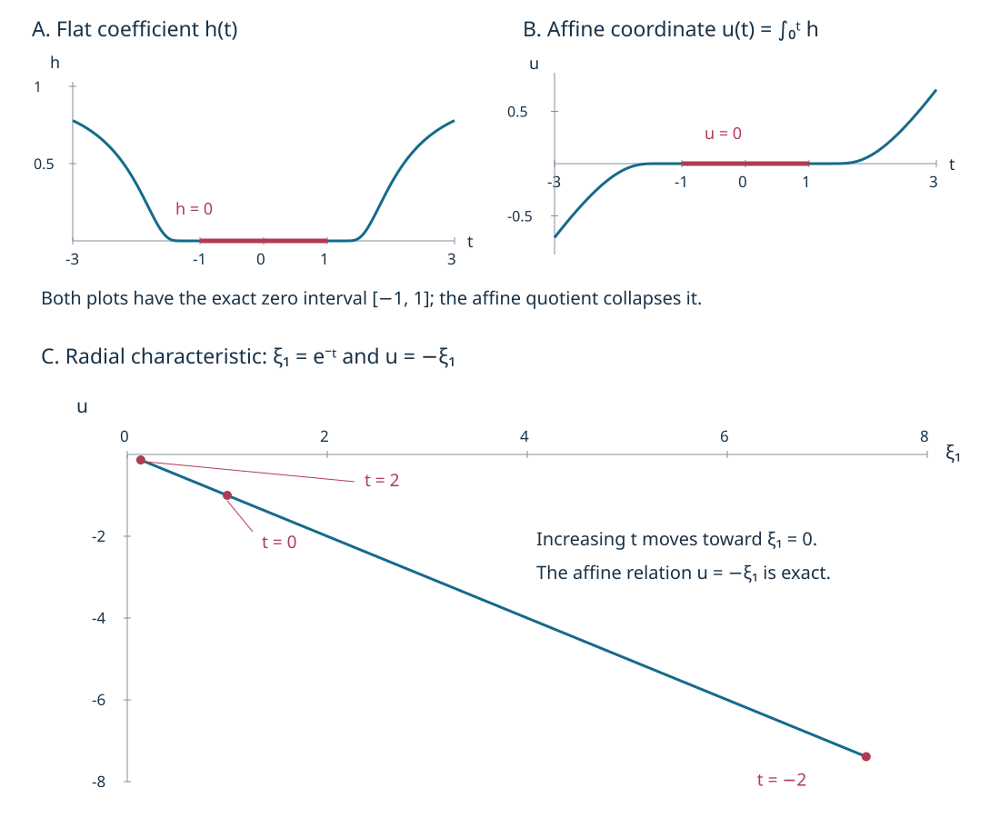

# Indefinite quadratic division and affine characteristic parameters

A changing-rank characteristic can carry a preferred affine parameter even when its ordinary time parameter is not preferred. The construction needs more than a nonzero semidefinite Hessian. We prove exact division when the transverse imaginary Hessian is indefinite, derive its invariant transport, and construct affine charts after collapsing intervals on which that Hessian vanishes. Ordinary compact tubes make the argument apply to radial characteristics as well.

The antecedent is Lars Hörmander, *The Analysis of Linear Partial Differential Operators IV*, Springer 2009 eBook, ISBN 978-3-642-00136-9, Section 26.5, printed 114–116.  We supply an independent proof of the indefinite case of Proposition 26.5.7 and of the affine construction on the indefinite extension. The full semidefinite remainder assertion is proved in [the nonnegative-quotient companion](../20261011-semidefinite-quadratic-division/semidefinite-division-with-a-nonnegative-quotient.html). [CPG:X3](../20261011-condition-p-geometry/condition-p-and-characteristic-saturation.html) already gives an explicit obstruction to extending Hessian proportionality to every semidefinite characteristic.

The proof map records exact earlier versions and locators. [PSG](../20261011-condition-psi-geometry/condition-psi-and-complex-characteristic-tubes.html) supplies compact ordinary tubes and the all-multiplier sign criterion. [FN](../20261005-restored-function-normal-forms/real-and-complex-symplectic-function-normal-forms.html) supplies complete smooth complex division. [GGL](../20261007-restored-generalized-glancing/generalized-glancing-flow-preparation.html) supplies parameter Morse coordinates and smooth even/odd extension. Human foundations remain external.

## 1. An ordinary tube that also covers radial motion

**H0. The precise characteristic hypothesis.** Let a smooth complex homogeneous symbol \(p\) satisfy condition (P) on an open conic set. Take an embedded compact regular one-dimensional characteristic \(\gamma:I\to\{p=0\}\), with

\[
 H_p(\gamma(t))=c(t)\gamma'(t),\qquad c(t)\ne0. \tag{QA1}
\]

The complex scalar is smooth, by dividing any nonzero component locally; these quotients agree on overlaps. A point of the curve is called indefinite if the Hessian of \(\operatorname{Im}(p/c(t))\), on the real hyperplane \(\ker dp\) modulo \(\mathbb R\gamma'\), is indefinite. The expression uses \(c(t)\) as a constant when differentiating in the ambient variable. Its differential has zero imaginary part at the marked point because \(dp/c(t)\) is real. We will prove both that the Hessian descends to this quotient and that the definition is invariant.

**D0. Remove the temporal momentum on the whole ordinary tube.** Extend \(1/c(t)\) smoothly from the embedded compact arc to a nonzero multiplier \(q\) nearby. For explicit local extensions, a coordinate whose derivative on \(\gamma\) is nonzero represents the curve as a graph by the inverse-function theorem; extend \(1/c\) constantly in the remaining graph coordinates. A finite ambient partition of unity glues these extensions, since their restrictions agree. Compactness then permits a neighborhood where the result is nonzero. On the curve, \(H_{\operatorname{Re}(qp)}=\gamma'\) and \(d\operatorname{Im}(qp)=0\).

PSG:I0 puts the real Hamiltonian into an ordinary compact canonical tube:

\[
 qp=\tau+i F(t,Y,\tau),\qquad F=dF=0\text{ on }J=\{(t,0,0):t\in I\}. \tag{QA2}
\]

Here \(Y\) is the vector of transverse position and momentum coordinates. No positive covector slice or nonradial projection is required. Divide \(\tau\) by \(\tau+iF\) using FN:D0–D4, with \((t,Y)\) as parameters. Finitely many local divisions patched with a partition depending only on \(t\) give, on one common transverse neighborhood,

\[
 \tau=a(\tau+iF)+r(t,Y),\qquad \partial_\tau r=0,\qquad
 a=1,\ r=dr=0\text{ on }J. \tag{QA3}
\]

The last statements follow by evaluating and differentiating this identity on \(J\). In particular \(a\ne0\) after shrinking. Write \(r=r_1+i r_2\), retain \(t\), and set \(\sigma=\tau-r_1\). Their bracket is \(\{\sigma,t\}=1\). Complete them canonically by prescribing the old transverse coordinates at one time and transporting them along \(H_\sigma\). Its time component is one and its transverse equations are independent of \(\tau\). Existence on the whole compact interval follows from the finite flow continuation G2:NF1–NF7, since the central solution is fixed. The transported coordinates remain independent of \(\tau\); their mutual brackets are preserved by the Hamilton flow and their brackets with \(\sigma\) vanish. Thus they are full canonical coordinates. The inverse is given by the unique backward transverse flow and \(\tau=\sigma+r_1\).

In these coordinates (QA3) becomes

\[
 bp=\sigma+i f(t,Y),\qquad f=df=0\text{ on }J,
 \qquad \partial_\sigma f=0. \tag{QA4}
\]

Indeed the imaginary part is \(-r_2\), and its bracket with \(t\) is zero. The central curve and its parameter are unchanged. All divisions were ordinary smooth divisions. This proves the needed ordinary counterpart of PSG:N0–N2, including radial arcs. In the nonradial homogeneous setting those providers give homogeneous coordinates and the same result with \(\deg f=1\).

## 2. Two real divisions give a smooth quotient

**D1. Expose two opposite quadratic directions.** Fix a time \(t_0\) at which the transverse Hessian is indefinite and put \(g(Y)=f(t_0,Y)\). T1 below proves that the normal-form multiplier and coordinate change preserve this hypothesis; its proof does not use division. Invertible transverse changes preserve the inertia. A positive Hessian direction and the parameter Morse construction GGL:T002 give coordinates \((u,Z)\) with \(g=u^2+a_1(Z)\). The Hessian of \(a_1\) still has a negative direction: subtract the component in the positive direction from a negative vector to make it orthogonal for the Hessian form; its quadratic value becomes strictly smaller. Applying the same parameter Morse construction with negative sign in that direction gives

\[
 g(u,v,w)=u^2-v^2+a(w),\qquad a(0)=0,\quad da(0)=0. \tag{QA5}
\]

These coordinate changes are used only for division, so they need not be canonical. They are independent of \(t\). The parameter Morse construction is exact: solve for the critical coordinate by the implicit-function theorem, use the integral Taylor remainder to obtain a nonzero quadratic coefficient, and absorb its positive square root into the coordinate. Its inverse is smooth on a common neighborhood. Applying it twice proves (QA5).

**D2. Quadratic division with all smooth parameters.** For a smooth function \(A(u,z)\), GGL:T003 gives the exact even/odd representation

\[
 A(u,z)=A_0(u^2,z)+uA_1(u^2,z), \tag{QA6}
\]

where both functions are smooth also at negative first arguments. This includes every parameter derivative on a compact parameter set. That provider proves half-line smoothness by arbitrary Taylor remainders, then gives a cutoff-series extension of the full jets and a flat zero extension of the difference; no analytic continuation is assumed.

Let \(b(z)\) be smooth and small. For \(j=0,1\), the fundamental theorem gives

\[
 A_j(u^2,z)=A_j(-b,z)+(u^2+b)
  \int_0^1\partial_r A_j(-b+s(u^2+b),z)\,ds. \tag{QA7}
\]

Substitute these two identities into (QA6). It yields an exact smooth division

\[
 A=(u^2+b)H+B(z)u+C(z). \tag{QA8}
\]

Every term is smooth in all parameters, including \(t\) when \(t\) is one of them. A finite parameter cover and a partition of unity give one such division near a compact interval. Differentiating the integral proves its parameter bounds directly from those of the extended \(A_j\).

Condition (P) in (QA4) says that \(f(t,Y)\) has the weak sign of \(g(Y)\) wherever \(g\ne0\). It also forces \(f=0\) at every zero of \(g\) in (QA5). At a regular zero, approach from its two signs. A remaining zero has \(u=v=0\), \(a(w)=0\); keeping \(w\) fixed and taking \(u=v\ne0\) approximates it by regular zeros. Continuity completes the argument.

Divide first in \(u\), then separately in \(v\), using (QA8). Absorb the minus sign of the \(v^2\) coefficient into its quotient. We obtain smooth functions on one common neighborhood with

\[
 f=gH_u+R_u=gH_v+R_v,\qquad
 R_u=B_u(t,v,w)u+C_u(t,v,w),\quad
 R_v=B_v(t,u,w)v+C_v(t,u,w). \tag{QA9}
\]

If \(a(w)-v^2<0\), the two distinct real roots in \(u\) are zeros of \(f\), so the affine polynomial \(R_u\) vanishes at both roots and is identically zero. The analogous argument in \(v\) gives

\[
 R_u=0\text{ when }a(w)<v^2,\qquad
 R_v=0\text{ when }-a(w)<u^2. \tag{QA10}
\]

Choose the retained neighborhood small enough that both roots used here lie in the domain of the division: their sizes tend to zero with \((v,w)\) or \((u,w)\), independently of compact time. This supplies the common-domain requirement in the root argument.

**D3. Why the quotients glue with every derivative.** On \(a<0\), (QA10) makes \(R_u\) zero for every \(u,v\); on \(a>0\), it makes \(R_v\) zero for every \(u,v\). We will use \(H_u\) on the first region and \(H_v\) on the second.

At any fixed \(w_0\) with \(a(w_0)=0\), every derivative of \(R_u\) vanishes. To see this at \(v\ne0\), (QA10) holds in a full neighborhood, so all derivatives are zero there. Let \(v\to0\) while keeping \((t,u,w_0)\) fixed; continuity of each derivative proves the assertion also at \(v=0\). Interchanging \(u,v\) proves the corresponding assertion for \(R_v\). Thus both remainders are flat on the full set \(E=\{a(w)=0\}\).

From (QA9),

\[
 g(H_u-H_v)=R_v-R_u. \tag{QA11}
\]

Every derivative of \(H_u-H_v\) must vanish at each point of \(E\). Otherwise let \(k\) be its first nonzero Taylor order at that point. The first nonzero Taylor order of \(g\) is finite and at most two, since \(g_{uu}=2\). The lowest homogeneous term of their product is the product of two nonzero real polynomials, which is nonzero. For completeness, the product of two nonzero polynomials is nonzero by selecting a monomial order and multiplying their leading terms; that term cannot cancel. This contradicts the flatness of the right side of (QA11).

Now define \(H=H_u\) for \(a\le0\) and \(H=H_v\) for \(a\ge0\). The definitions agree on \(E\). Here is a direct smooth-pasting justification for this possibly singular closed set. On a compact smaller coordinate ball, each derivative of \(\Delta=H_u-H_v\) is flat on \(E\). Taylor's integral remainder about a nearest point of \(E\), whenever the distance is sufficiently small, bounds that derivative by \(C_N\operatorname{dist}(z,E)^N\) for any fixed \(N\). The segment stays in the original coordinate ball after shrinking; finite covering gives uniform constants. Away from \(E\) there is nothing to prove. Extending \(\Delta\mathbf1_{a<0}\) by zero across \(E\), these estimates show continuity of every proposed derivative. At a point of \(E\), the estimate with \(N=2\) for each already differentiated function gives zero difference quotients. Induction on derivative order proves that the extension is smooth with the expected derivatives. Hence \(H\) is smooth in all variables and parameters.

**F0. Exact nonnegative factorization in the indefinite case.** On \(a<0\) or \(a>0\), the appropriate remainder in (QA9) is zero, so \(f=gH\). On \(a=0\), both remainders vanish by D3, giving the same identity. The set \(g\ne0\) is dense because a function with \(g_{uu}=2\) cannot vanish on an open set. There \(H=f/g\ge0\), and continuity makes \(H\ge0\) everywhere. Thus, back in the original transverse coordinates,

\[
 f(t,Y)=g(Y)H(t,Y),\qquad H\in C^\infty,\quad H\ge0,
 \qquad H(t_0,Y)=1. \tag{QA12}
\]

The normalization follows first where \(g\ne0\), then by density. All constructions take place on a single neighborhood of the compact time interval. In a homogeneous nonradial tube, carry them out on the positive last-momentum-one slice and extend \(H\) by degree zero. Since both \(f\) and \(g\) have degree one, the exact identity persists on the resulting conic neighborhood. No homogeneity is needed for the ordinary version.

**F1. The indefinite points are persistent.** These points lie in the source's indefinite subset of \(N_1\setminus N_{11}\). First, a rank-one point in the saturation has the local factorization CPG:T1, with \(g=0\), \(h=0\), and \(dh=0\) because \(h\ge0\). The transverse Hessian of \(gh\) is therefore zero there. T1 below transfers this conclusion invariantly, excluding an indefinite Hessian in the saturation. Second, if an indefinite point were in \(N_{11}\), CPG:C0 gives a compact characteristic component from it to an endpoint that cannot continue, or a singleton component. CPG:M2 then gives an imaginary part of one weak sign on a neighborhood of that component. At a zero of a smooth function of one sign, every directional second derivative has that same weak sign: apply the second-order Taylor formula along each line. Its Hessian is semidefinite. Invariance again contradicts indefiniteness. Thus the points are outside both sets, and CPG:C0 supplies their persistent regular characteristic continuation.

## 3. Define the transport without a complex nonlinear flow

**T0. A symplectic linear transport on the normal quotient.** Along (QA1), define the real symplectic space and its complexification by

\[
 E_t=\ker dp(\gamma(t))/\mathbb R\gamma'(t),\qquad E_t^{\mathbb C}=E_t\otimes\mathbb C. \tag{QA13}
\]

The covector \(dp/c\) is real and nonzero; its symplectic dual is \(\gamma'\). Consequently the radical of its kernel is exactly that line, so the quotient is symplectic (SN:L1). In a canonical chart solve the complex linear ODE

\[
 V'(t)=\frac1{c(t)}\,dH_p(\gamma(t))V(t). \tag{QA14}
\]

The real and imaginary components form a real linear system with smooth coefficients. G2:NF2–NF3 provide its full fundamental solution and inverse on a compact interval. Differentiating \(dp(V)\) along the curve gives

\[
 \frac d{dt}dp(V)=\frac1c\bigl(d^2p(H_p,V)+dp(dH_pV)\bigr)=0, \tag{QA15}
\]

because the expression in parentheses is the derivative in direction \(V\) of the identically zero function \(dp(H_p)\). Also \(H_p(\gamma(t))\) itself solves (QA14). Thus the kernel and its one-dimensional radical are preserved. The matrix \(dH_p\) is infinitesimally symplectic: in canonical coordinates it is \(Jp''\) with \(p''\) symmetric. The derivative of the symplectic pairing of two solutions is therefore zero. This proves an invertible complex symplectic transport on (QA13).

A change of canonical coordinates preserves this construction. Differentiating its Jacobian along \(\gamma\) produces the extra second-derivative term \(d^2\chi(\gamma',V)=d^2\chi(H_p,V)/c\), exactly the extra term in differentiating the transformed Hamilton field. Thus the variational equations agree on overlaps. No nonlinear flow at complex points of a smooth real manifold has been invoked.

If \(p\) is replaced by \(qp\), then \(c\) is replaced by \(q(\gamma)c\), and for \(dp(V)=0\), at a characteristic point,

\[
 dH_{qp}V=q\,dH_pV+dq(V)H_p. \tag{QA16}
\]

After dividing by the new \(c\), the extra term is tangent to the radical. Hence the induced quotient transport is unchanged. Under a regular reparametrization \(t=t(s)\), the new scalar is \(c_s=c_t/(dt/ds)\), and (QA14) transforms by the chain rule. Transport is therefore intrinsic to the parametrized characteristic up to this ordinary reparametrization.

**T1. The transverse Hessian is well defined.** Let \(Q_t\) be the real Hessian of \(\operatorname{Im}(p/c(t))\) restricted to \(\ker dp\). This ambient imaginary differential vanishes at \(\gamma(t)\), so its Hessian is coordinate independent. Differentiating the vanishing imaginary differential along \(\gamma\) gives, for any \(V\in\ker dp\),

\[
 \operatorname{Im}\frac{d^2p(\gamma',V)}c
   =\operatorname{Im}\frac{c'}{c^2}dp(V)=0. \tag{QA17}
\]

Thus the tangent line is in the radical of the restricted Hessian, and \(Q_t\) descends to \(E_t\). For a multiplier \(q\), write \((qp)/(q(\gamma)c)=(q/q(\gamma))(p/c)\). In its Hessian, every additional term has a factor \(dp(V)\) or \(dp(W)\) when restricted to the two kernel arguments. Those terms vanish, and the leading factor equals one at the mark. Hence \(Q_t\) is multiplier invariant. Under \(t=t(s)\),

\[
 Q_s=(dt/ds)Q_t. \tag{QA18}
\]

Indefiniteness is preserved by any nonzero real scalar and any invertible real coordinate change. This proves the invariance promised in H0.

**T2. Exact proportionality on the indefinite extension.** In the ordinary normal form (QA4), \(c=1\). Put \(Q=g''(0)\), \(h(t)=H(t,0)\). Since \(g(0)=dg(0)=0\), (QA12) gives \(Q_t=h(t)Q\). The quotient equation (QA14) becomes

\[
 U'=i h(t)JQ\,U,\qquad U(t_0)=I. \tag{QA19}
\]

There are no omitted time/transverse terms: the transverse gradient of \(f\) vanishes on the whole central curve, so its time derivative does also; the temporal momentum coefficient is exactly one. Direct differentiation yields

\[
 \frac d{dt}(U^TQU)=i h\,U^T\bigl((JQ)^TQ+QJQ\bigr)U=0,
 \qquad U^TQ_tU=h(t)Q. \tag{QA20}
\]

Here transpose, rather than conjugate transpose, is required: the transport and quadratic forms are complex bilinear extensions. Since \(h(t_0)=1\), the transported Hessians are nonnegative scalar multiples of the nonzero indefinite base form. They are indefinite where \(h>0\) and zero where \(h=0\). In particular a nonzero semidefinite Hessian cannot occur along this extension. The ordinary proof covers every embedded compact subarc containing an indefinite point, including radial arcs. A periodic curve is treated on simple subarcs and overlapping charts; local conclusions agree by intrinsic transport. This establishes the result on the entire connected one-dimensional extension of the indefinite set.

## 4. Affine charts on the reduced curve

**A0. Collapse exactly the zero intervals.** Normalize at an indefinite base point. Intrinsic transport makes the scalar \(h(t)\) in (QA20) unique. Replacing the base point by \(t_1\) with \(h(t_1)>0\) divides it by the positive constant \(h(t_1)\). Define a local affine coordinate by

\[
 u(t)=\int_{t_*}^t h(r)\,dr. \tag{QA21}
\]

It is nondecreasing. Its values at two ordered points agree exactly when \(h\) is identically zero between them: the integral of a nonnegative continuous function is zero only if that function is zero everywhere on the interval, as a positive value would persist on a smaller interval. Identify precisely those zero intervals. The map induced by \(u\) on the quotient is continuous and strictly increasing. On a compact arc it is a homeomorphism onto its image: the quotient is compact and the image is Hausdorff, so the continuous bijection is closed (the elementary compact-image argument is included in U001:F0-COMP). Locally at a bounded collapsed interval, a saturated open neighborhood contains that whole compact interval and small extensions at its two ends; its image therefore contains a neighborhood of the corresponding value. If a zero interval is an entire terminal tail, the same argument at its finite endpoint gives a half-interval neighborhood in the image. This proves the quotient-topology assertion also for noncompact arcs. Such a terminal tail produces an endpoint of the reduced interval, where the affine charts take values in half-intervals. Interior reduced points have active points on both sides. No assumption of two-sided activity at a collapsed terminal tail is needed.

Changing the integration origin adds a constant; changing the indefinite base point multiplies \(u\) by a nonzero constant. For a regular parameter change \(t=t(s)\), write \(\lambda(s)=dt/ds\). Formula (QA18), with normalization at \(s_0\), gives

\[
 h_s(s)=\frac{\lambda(s)}{\lambda(s_0)}h_t(t(s)),\qquad
 h_s(s)\,ds=\frac1{\lambda(s_0)}h_t(t)\,dt. \tag{QA22}
\]

The ratio of the two \(\lambda\)'s is positive on a connected parameter interval. Hence the induced coordinates differ by \(u\mapsto Au+B\), \(A\ne0\), including orientation reversal. These transition maps define the invariant affine structure on the reduced one-dimensional curve. If the curve closes, overlapping arc charts still give this atlas; no globally single-valued affine coordinate or trivial holonomy is asserted.

At an isolated zero of \(h\), the quotient map need not be a local diffeomorphism for the original smooth structure. For example \(h=t^2\) gives \(u=t^3/3\). The affine smooth structure is defined by the coordinate \(u\) on the reduced curve; on the open active part \(h>0\) it agrees with the original one by the inverse-function theorem. This qualification is part of the construction.

**A1. The semidefinite remainder.** A single positive Morse direction gives \(g=u^2+a(w)\). D2 still gives \(f=gH+Bu+C\). If \(a<0\), the two-root argument forces \(B=C=0\); therefore the remainder vanishes wherever \(g<0\). This proves a smooth one-sided remainder statement. It does not, by itself, prove \(H\ge0\) on the region where there are no real roots. D3 used an opposite Morse direction to avoid that issue, so its proof cannot simply be repeated when the Hessian is semidefinite.

If \(g\ge0\) throughout a neighborhood and \(f\ge0\) there, the desired one-sided decomposition is trivial: take \(H=0\) and remainder \(f\). The analogous statement holds with both signs reversed. The general semidefinite case with sign changes in higher-order directions requires a nonnegative-quotient construction; [the semidefinite companion](../20261011-semidefinite-quadratic-division/semidefinite-division-with-a-nonnegative-quotient.html) supplies that construction, including the common compact-time parameter neighborhood. The rank-changing example CPG:X3 also shows why a general semidefinite remainder cannot be discarded when defining Hessian transport.

## 5. Three complete calculations

**X1. An affine coordinate that collapses a flat interval.** On \(T^*\mathbb R^3\), let \((t,x,y;\tau,\eta,\kappa)\) be canonical coordinates and \(\kappa>0\). With the smooth function \(E\) from CPG:X1, set

\[
 h(t)=E(t-1)+E(-t-1),\qquad
 p=\tau+i h(t)\kappa(x^2-y^2). \tag{QA23}
\]

Find the reduced affine parameter along \(\gamma(t)=(t,0,0;0,0,1)\), including the plateau.

**Solution.** The imaginary part has the weak sign of the fixed transverse factor along every real \(\partial_t\) characteristic. PSG:E1 applied to both orientations proves (P). The curve is rank one and \(c=1\). Its Hessian is \(h(t)Q_*\), where \(Q_*=2dx^2-2dy^2\) on the four-dimensional normal quotient. With base time \(t_0=2\), the normalized coefficient is \(h(t)/h(2)=e h(t)\). The matrix \(JQ_*\) has square zero, since it maps position variations into momentum variations and vanishes on the latter. Thus the full transport is exactly

\[
 U(t,2)=I+i\left(\int_2^t h(r)\,dr\right)JQ_* . \tag{QA24}
\]

Substitution in the ODE verifies the identity, and (QA20) verifies preservation of \(Q_*\). An affine rescaling and translation allow the simpler coordinate \(u(t)=\int_0^t h(r)\,dr\). It is zero on \([-1,1]\), strictly increasing on either side, and unbounded at both ends because \(h\to1\). The quotient identifies exactly the plateau. Its zero Hessian there does not destroy the affine coordinate on the quotient.

**X2. A radial indefinite characteristic.** On \(T^*\mathbb R^3\), use \((x_1,x_2,x_3;\xi_1,\xi_2,\xi_3)\), \(\xi_1>0\), and

\[
 p=\xi_1\bigl(x_1+i(x_2^2-x_3^2)\bigr),\qquad
 \gamma(t)=(0,0,0;e^{-t},0,0). \tag{QA25}
\]

Compute its affine parameter and check that the constant cosphere projection causes no obstruction.

**Solution.** The multiplier \(1/\xi_1\) gives real Hamiltonian \(x_1\), whose field is \(-\partial_{\xi_1}\). Its imaginary part is constant along every such curve. The point-and-interval criterion PSG:E1 for both signs proves (P). Along \(\gamma\), \(H_p=-\xi_1\partial_{\xi_1}=\gamma'\), so \(c=1\). The submanifold \(x_1=x_2=x_3=\xi_2=\xi_3=0\), \(\xi_1>0\), is tangent to every multiplier's real field there. Flow uniqueness preserves it; thus this curve cannot reach rank-two or noncharacteristic points.

The kernel is \(dx_1=0\), its radical is the \(\xi_1\) direction, and the quotient has coordinates \((\delta x_2,\delta x_3,\delta\xi_2,\delta\xi_3)\). Its Hessian is \(Q_t=2e^{-t}(dx_2^2-dx_3^2)\). In the quotient variational equation, position variations stay fixed and only momentum variations change, so pullback leaves the displayed position form unchanged. At base \(t_0=0\), the normalized scalar is \(e^{-t}\). An affine coordinate is therefore

\[
 u(t)=-e^{-t}=-\xi_1. \tag{QA26}
\]

The cosphere projection is constant; the ordinary tube D0 and invariant construction apply nonetheless. If the symbol is divided by \(\xi_1\), its new scalar in (QA1) is \(e^t\), so dividing the new symbol by that scalar reproduces the same Hessian. This directly checks multiplier invariance in the radial example.

**X3. Normalization under a change of time.** Suppose the transported Hessian has \(h_t(t)=1+t^2\), normalized at \(t=0\). Reparametrize by \(t=2s\), with base \(s=0\). Compute the normalized new coefficient and both affine coordinates.

**Solution.** The Hessian itself is multiplied by two, including its base value. These factors cancel in the normalized coefficient: \(h_s(s)=1+4s^2\). Formula (QA22) gives \(h_s ds=\tfrac12 h_t dt\). Consequently

\[
 u_t=t+t^3/3,\qquad u_s=s+4s^3/3,\qquad u_t(2s)=2u_s(s). \tag{QA27}
\]

Differentiation verifies both primitives and the factor two. A failure to renormalize the base Hessian would incorrectly assert equality of the two normalized differentials instead of their constant proportionality.

## 6. The affine parameter in the two models

**V0. Coordinate plots and their exact interpretation.** The top panels show the coefficient \(h\) and the admissible affine coordinate \(u\) in X1. Both vanish on the same exact plateau, but \(u\) increases outside it. The lower panel plots the radial example X2, with its exact relation \(u=-\xi_1\). Smooth graph traces are numerical samples; the interval endpoints, coordinate formulas and transport proofs are exact.

[Computational material](figures/build_figure.py) accompanies the text. [The semidefinite companion](../20261011-semidefinite-quadratic-division/semidefinite-division-with-a-nonnegative-quotient.html) proves the nonnegative-quotient construction with its one-sided remainder. [Ordinary one-direction propagation](../20261011-one-direction-propagation/one-direction-propagation-and-characteristic-strata.html) supplies the next operator estimate. The affine clock here is defined on the indefinite extension.

Original expression: CC0-1.0. Linked components retain their terms. 
