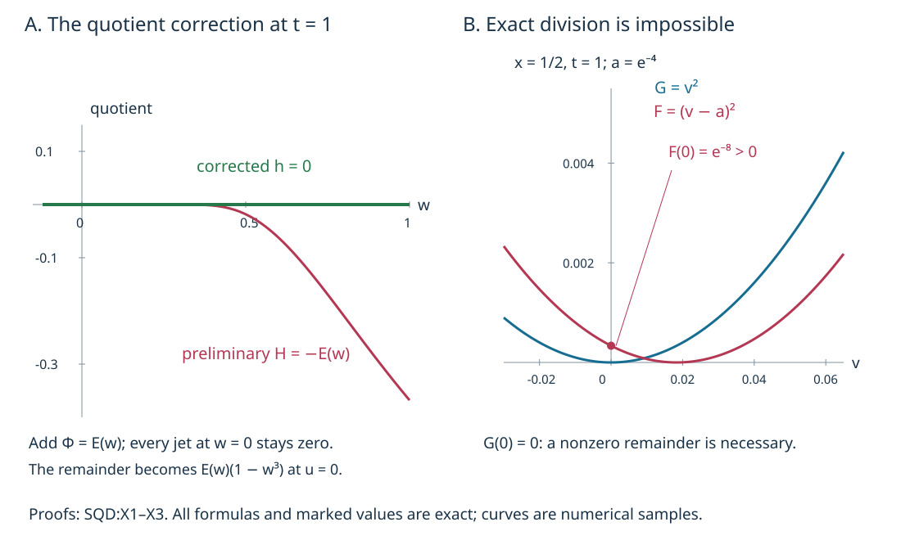
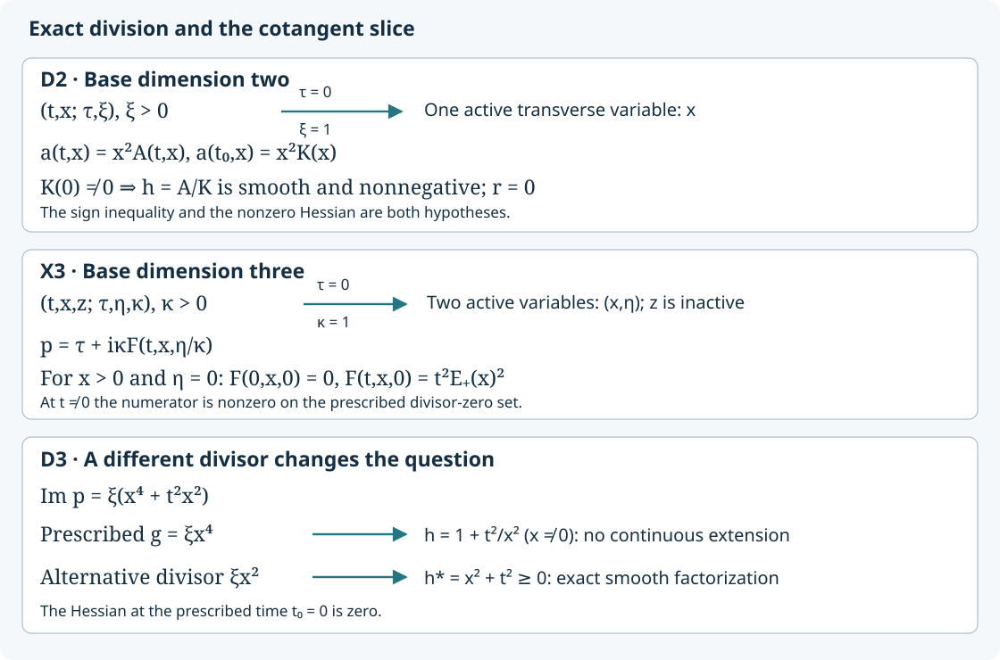

# Semidefinite division with a nonnegative quotient

A smooth division can have the right remainder and still have a negative quotient. We complete the missing positivity step by proving a flat correction lemma. The correction preserves the exact quotient wherever the divisor changes sign. It also explains why the one-sided remainder cannot generally be removed.

The mathematical antecedent is Lars Hörmander, *The Analysis of Linear Partial Differential Operators IV*, Springer 2009 eBook, ISBN 978-3-642-00136-9, Proposition 26.5.7, printed 114–115.  The proof below supplies the full semidefinite assertion; the [preceding lesson](../20261011-quadratic-affine-geometry/indefinite-quadratic-division-and-affine-parameters.html) supplies its indefinite assertion and the invariant affine construction on the indefinite extension. All exposition and the correction construction here are independently written. Human foundations remain external; the proof map gives exact versions and locators.

## 1. What must remain fixed

**H0. The statement on one common parameter neighborhood.** Let \(I\) be a compact time interval with marked \(t_0\), and let \(f(t,y)\) be smooth on an open neighborhood of \(I\times\{0\}\). Set \(g(y)=f(t_0,y)\). Assume on that open neighborhood, including a time margin about \(I\),

\[
 f(t,0)=0,\quad d_yf(t,0)=0,\qquad f(t,y)g(y)\ge0,\qquad
 g''(0)\ne0. \tag{SD1}
\]

If \(g''(0)\) is positive semidefinite, we will construct smooth functions on a possibly smaller common neighborhood with

\[
 f=gh+r,\qquad h\ge0,\qquad r=0\ \text{where }g<0. \tag{SD2}
\]

For negative semidefinite Hessian, the last condition is instead \(r=0\) where \(g>0\). If the Hessian is indefinite, QAF:D1–F0 already prove the stronger assertion \(r=0\) everywhere. The actual condition-(P) normal form provides (SD1): its imaginary part cannot have opposite nonzero signs at two times on a fixed real characteristic. QAF:D0 gives the ordinary compact tube, including radial arcs; PSG:N0–N2 give the homogeneous version. We first prove the scalar semidefinite statement, retaining the whole compact interval throughout.

**M0. One exact positive square.** Choose a vector on which the positive semidefinite nonzero Hessian is positive. The parameter Morse construction GGL:T002, applied in this direction and with all other coordinates as parameters, gives coordinates independent of time in which

\[
 g(u,w)=u^2+a(w),\qquad a(0)=0,\quad da(0)=0. \tag{SD3}
\]

It solves for the critical value of the chosen coordinate, factors the integral second-order Taylor remainder, and absorbs its positive square root. Its inverse is smooth. We do not assume that \(a\) has one sign; higher-order negative values are the point of the argument. If there are no \(w\) variables, or if \(a\ge0\) near zero, \(g\ge0\) and (SD1) forces \(f\ge0\) on the dense set \(g>0\), hence everywhere. Then \(h=0,r=f\) works. Otherwise zero is in the closure of \(\{a<0\}\), which we now assume.

Choose a larger \(u\)-interval and a smaller \(w\)-ball so that both real roots \(\pm\sqrt{-a(w)}\), when present, lie in the larger interval. Retain a strictly smaller \(u\)-interval for the conclusion. Compactness of \(I\) permits common choices for every time. We will shrink the transverse neighborhood further as needed, without shrinking the time interval.

**D0. The preliminary quotient and the constrained closed set.** QAF:D2, using the smooth even/odd extension GGL:T003 and the integral divided difference, gives

\[
 f(t,u,w)=(u^2+a(w))H(t,u,w)+B(t,w)u+C(t,w). \tag{SD4}
\]

All three coefficients are smooth, including every time derivative. For \(a(w)<0\), the two roots of \(g\) are simple. Across either root \(g\) changes sign; continuity and (SD1) force \(f\) to vanish at that root. The affine remainder therefore vanishes at two distinct points and is identically zero:

\[
 B(t,w)=C(t,w)=0\quad(a(w)<0),\qquad H(t,u,w)\ge0\quad(a(w)<0). \tag{SD5}
\]

The second assertion follows by division where \(g\ne0\), and by continuity at its two roots. Choose a small closed \(w\)-ball whose slightly larger neighborhood is still in the division domain, and let \(F\) be the closure of its negative set \(\{a<0\}\). Thus \(F\) is closed, contains zero, and agrees with the required closure near zero. On \(F\), every derivative of \(B,C\) vanishes, by continuity from the open negative set. Also \(H\ge0\) there by continuity. Write \(\delta(w)=\operatorname{dist}(w,F)\).

## 2. Positivity forces the defect to vanish to every order

**F0. Uniform estimates near the constrained set.** Fix compact smaller time and \(u\) domains containing the ones used in the conclusion, with positive margins inside the original domains. For every integer \(N\ge1\), flatness and Taylor's integral remainder imply

\[
 |B(t,w)|+|C(t,w)|\le A_N\delta(w)^N. \tag{SD6}
\]

These estimates are uniform in time. Indeed a nearest point of the nonempty closed set \(F\) exists: restrict the minimizing sequence to a compact ball and pass to a convergent subsequence. Near zero that point and the segment to it lie in the larger division neighborhood. Taylor-expand about it; all derivatives there vanish and the derivatives on the intervening compact neighborhood are bounded. The same proof works for every derivative, although only the value estimate (SD6) will be needed for the next step.

For \(w\notin F\) near zero, \(a(w)\ge0\). Given a small \(\varepsilon>0\) and a point \(u\) in the retained interval, choose \(u'=u+\varepsilon\) or \(u'=u-\varepsilon\) with \(|u'|\ge\varepsilon\); at least one works. The larger interval contains both choices. Then \(g(u',w)\ge\varepsilon^2>0\), and (SD1), (SD4) give

\[
 H(t,u',w)\ge-\frac{|B(t,w)|\,|u'|+|C(t,w)|}{\varepsilon^2}. \tag{SD7}
\]

The derivative \(H_u\) has one uniform bound \(L\) on the larger compact domain. For a fixed \(N\), use (SD6) with exponent \(3N\) and take \(\varepsilon=\delta(w)^N\). For sufficiently small \(\delta\), this is within the chosen margin. The mean-value estimate and (SD7) give

\[
 H(t,u,w)\ge -D_N\delta(w)^N. \tag{SD8}
\]

The constants may depend on \(N\). At distances bounded away from zero the same inequality follows by increasing \(D_N\), because \(H\) is bounded on the fixed compact domain. On \(F\), it holds by (SD5). Thus the negative part of \(H\), uniformly in the retained \((t,u)\), is smaller than every power of the distance to \(F\). This conclusion uses positivity of \(f\) at the displaced point, not positivity of an arbitrary smooth division operator.

**E0. A continuous flat upper bound.** On a fixed compact \((t,u)\) rectangle \(K\), set

\[
 \rho_0(w)=\max_{(t,u)\in K}\max\{0,-H(t,u,w)\}. \tag{SD9}
\]

The maximum exists by compactness. It is continuous: the difference of the maxima at two parameters is bounded by the supremum of the corresponding differences of the uniformly continuous function on a compact larger set. Multiply by a nonnegative smooth cutoff \(\chi(w)\) equal to one near zero and supported well inside the domain where (SD8) holds, and extend by zero outside that domain. The resulting continuous function \(\rho\) on \(\mathbb R^d\) satisfies

\[
 \rho\ge0,\qquad \rho|_F=0,\qquad
 \rho(w)\le D_N\delta(w)^N\quad\text{for every }N. \tag{SD10}
\]

The cutoff exists by PS:PS5. All bounds are global after enlarging constants because its support is compact. Near zero it still dominates the negative part of \(H\) for every retained time and \(u\). We do not assert that the maximum itself is smooth.

## 3. A smooth majorant with zero jets on the closed set

**P0. Explicit covering and partition.** We prove the required majorant lemma for any nonempty closed \(F\subset\mathbb R^d\), \(d\ge1\), and continuous \(\rho\) satisfying (SD10). If \(F=\mathbb R^d\), take the majorant to be zero. Otherwise let \(\Omega=\mathbb R^d\setminus F\).

For each integer \(j\), put \(\ell_j=2^{-j}\). Use those lattice centers \(z\in\ell_j\mathbb Z^d\) for which

\[
 7\sqrt d\,\ell_j\le\delta(z)\le17\sqrt d\,\ell_j. \tag{SD11}
\]

At each such center use a nonnegative smooth bump \(\theta_{jz}\), equal to one on the ball of radius \(\sqrt d\,\ell_j\), and supported in the ball of radius \(2\sqrt d\,\ell_j\). A single cutoff from PS:PS5, translated and dilated, gives these bumps with derivative bounds \(C_\alpha\ell_j^{-|\alpha|}\).

They cover \(\Omega\): given \(w\in\Omega\), choose a dyadic scale with \(8\sqrt d\,\ell_j\le\delta(w)<16\sqrt d\,\ell_j\). The nearest lattice center has distance at most \(\sqrt d\,\ell_j/2\), so it satisfies (SD11) and its bump is one at \(w\). The distance function is 1-Lipschitz by the triangle inequality. Consequently, on the support of any bump,

\[
 5\sqrt d\,\ell_j\le\delta(w)\le19\sqrt d\,\ell_j. \tag{SD12}
\]

At a fixed point this permits only a uniformly bounded number of dyadic scales. At each scale the number of centers whose support contains that point is bounded solely by the dimension: every coordinate of such a center lies in an interval of length \(4\sqrt d\,\ell_j\), containing at most \(4\sqrt d+3\) lattice positions. The collection is locally finite on \(\Omega\), since every compact subset has distance bounded above and away from zero and meets only finitely many centers at the finitely many allowed scales.

Hence \(S=\sum\theta_{jz}\) is smooth on \(\Omega\), \(1\le S\le C_d\), and

\[
 \psi_{jz}=\theta_{jz}/S,\qquad \sum\psi_{jz}=1,\qquad
 |\partial^\alpha\psi_{jz}(w)|\le C_\alpha\delta(w)^{-|\alpha|}. \tag{SD13}
\]

For clarity, the derivative bound for \(S\) follows by the bounded overlap and (SD12). Differentiate \(S(1/S)=1\) inductively to bound each derivative of \(1/S\); the product rule then gives (SD13). The sums and all differentiations here are locally finite.

**S0. Construct and extend the majorant.** For each chosen bump take the finite number

\[
 A_{jz}=\sup_{|v-z|\le2\sqrt d\,\ell_j}\rho(v),\qquad
 \Phi(w)=\sum_{j,z}A_{jz}\psi_{jz}(w)\quad(w\in\Omega). \tag{SD14}
\]

The supremum is finite on that compact ball. Every summand active at \(w\) has \(A_{jz}\ge\rho(w)\), so \(\Phi\ge\rho\ge0\). On the whole ball in (SD14), (SD12) holds. Thus (SD10) gives \(A_{jz}\le C_N\ell_j^N\) for every \(N\). Using (SD12), (SD13), and bounded overlap yields

\[
 |\partial^\alpha\Phi(w)|\le C_{\alpha,N}\delta(w)^{N-|\alpha|}
 \quad(w\in\Omega),\quad N=1,2,\ldots. \tag{SD15}
\]

Set \(\Phi=0\) on \(F\). This defines a smooth function with every derivative zero there. Here is the full extension argument. Each derivative already defined on \(\Omega\) extends continuously by zero, by (SD15) with exponent larger than its order. At any \(w_0\in F\), \(\delta(w)\le|w-w_0|\). Applying (SD15) with exponent at least two greater than the derivative order proves that its extended value has all first difference quotients zero at \(w_0\). Induction on derivative order therefore identifies the continuous extensions as the actual derivatives. This proves smoothness and all zero jets, without requiring regularity of the closed set.

**H1. Finish the nonnegative division and restore homogeneity.** In (SD4) replace the quotient and remainder by

\[
 h=H+\Phi(w),\qquad r=B(t,w)u+C(t,w)-g(u,w)\Phi(w). \tag{SD16}
\]

Near zero, (SD9) and \(\chi=1\) make \(h\ge0\) for every retained \(t,u\). Both functions are smooth on an open neighborhood of the full compact time interval. If \(a<0\), then \(w\in F\), \(B=C=\Phi=0\). Thus \(r=0\) there, and in particular wherever \(g=u^2+a<0\). Equation (SD4) gives \(f=gh+r\) identically. Pull back by the time-independent Morse coordinates to obtain (SD2). No sign for \(r\) where \(g\ge0\), and no normalization of \(h(t_0,\cdot)\) in that region, is required or claimed.

For a negative semidefinite Hessian, apply the positive case to \(\widetilde f=-f\), \(\widetilde g=-g\). Then \(\widetilde f=\widetilde g h+\widetilde r\) with \(h\ge0\), and \(\widetilde r=0\) where \(\widetilde g<0\). Returning to the original signs gives \(f=gh-\widetilde r\); the remainder vanishes where \(g>0\).

In the homogeneous characteristic tube, first perform the construction on the positive last-momentum-one slice. If \(\lambda>0\) is the scaling coordinate and \(z\) denotes the point on that slice, set

\[
 h(t,\lambda z)=h(t,z),\qquad r(t,\lambda z)=\lambda r(t,z). \tag{SD17}
\]

These functions are smooth on the conic neighborhood, with degrees zero and one. Since \(f\) and \(g\) have degree one, their identity and the required vanishing region extend exactly. Together with QAF:F0, this completes all sign cases of Proposition 26.5.7. It does not extend affine Hessian proportionality to the general semidefinite case: CPG:X3 remains an explicit rank obstruction.

## 4. Three solved examples

**X1. A preliminary quotient that really is negative.** Let \(E(w)=e^{-1/w^2}\) for \(w>0\), and \(E(w)=0\) for \(w\le0\). CPG:X1 proves its smoothness and zero jets. On a small neighborhood where \(|g|<1\), set

\[
 g(u,w)=u^2+w^3,\qquad
 f(t,u,w)=(1-t)^2g+t^2E(w)(1-g),\qquad t_0=0. \tag{SD18}
\]

Find both a smooth division with negative quotient and one with nonnegative quotient.

**Solution.** At \(t=0\), \(f=g\), and \(g''(0)=2\,du^2\) is nonzero positive semidefinite. For \(w\le0\), \(f=(1-t)^2g\); for \(w>0\), both \(g>0\) and \(1-g>0\), so \(f\ge0\). Hence \(fg\ge0\) for every time. A direct rearrangement is

\[
 f=g\bigl((1-t)^2-t^2E(w)\bigr)+t^2E(w). \tag{SD19}
\]

Its remainder is constant in \(u\), yet its quotient at \(t=1,w>0\) equals \(-E(w)<0\). Thus the positivity step cannot be omitted. Add the flat correction \(t^2E(w)\) to this quotient. The resulting exact division is

\[
 h=(1-t)^2\ge0,\qquad r=t^2E(w)(1-g). \tag{SD20}
\]

When \(g<0\), necessarily \(w<0\), so \(r=0\). This explicit correction depends on time; the general proof instead used a time-uniform majorant. Both preserve the prescribed quotient on the negative region.

**X2. A smooth sign-preserving family with no exact factorization.** Define \(E_+(x)=e^{-1/x^2}\) for \(x>0\) and zero otherwise, and \(E_-(x)=E_+(-x)\). Consider

\[
 F(t,x,v)=
 \begin{cases}
 (v-tE_+(x))^2,&x>0,\\
 v(v-E_-(x)),&x<0,\\
 v^2,&x=0,
 \end{cases}
 \qquad G(x,v)=F(0,x,v). \tag{SD21}
\]

Prove the sign property, give a one-sided remainder, and disprove exact divisibility.

**Solution.** Expanding the positive-side square shows that all added terms are flat at \(x=0\), uniformly with every derivative on compact \((t,v)\) sets; the negative-side correction is also flat. Thus \(F\) is smooth. At \((x,v)=(0,0)\), \(F=d_{x,v}F=0\) and \(G''=2\,dv^2\). For \(x<0\), \(F=G\) is independent of time; for \(x>0\), \(G=v^2\) and \(F\) is a square. The weak sign property follows, including at \(x=0\).

Take \(h=1\). Then the smooth remainder is

\[
 r=F-G=
 \begin{cases}-2tvE_+(x)+t^2E_+(x)^2,&x>0,\\0,&x\le0.
 \end{cases} \tag{SD22}
\]

Negative values of \(G\) occur only for \(x<0\), so this remainder vanishes on the required region. But at \(x>0,v=0,t\ne0\), \(G=0\) while \(F=t^2E_+(x)^2>0\). Hence no function, even without a smoothness requirement, can satisfy \(F=Gh\) there. Every neighborhood of the central compact characteristic containing a nonzero time contains such points. The nonzero remainder is necessary.

**X3. Homogeneous realization and the reversed sign.** Use canonical coordinates \((t,x,z;\tau,\eta,\kappa)\) on \(T^*\mathbb R^3\), with \(\kappa>0\), and the family in X2. Set

\[
 p=\tau+i\kappa F(t,x,\eta/\kappa),\qquad
 \gamma(t)=(t,0,0;0,0,1). \tag{SD23}
\]

Verify condition (P), the characteristic hypothesis, and the negative semidefinite variant.

**Solution.** The symbol is smooth and homogeneous of degree one, and its real Hamilton field is \(\partial_t\). Along each such line the imaginary part keeps one weak sign by X2. The full point-and-interval criterion PSG:E1, applied in both orientations, gives condition (P) for all nonvanishing multipliers. On \(\gamma\), the imaginary part and its full differential vanish, so \(dp=d\tau\), \(H_p=\partial_t=\gamma'\). The transverse Hessian is \(2\,d\eta^2\), nonzero positive semidefinite. Formula (SD22), multiplied by \(\kappa\), is the required degree-one remainder with \(h=1\).

Replace the imaginary part by its negative to obtain \(p_-=\tau-i\kappa F\). It still satisfies (P), has the same real characteristic, and has negative semidefinite transverse Hessian. Its divisor is \(g_-=-\kappa G\), its quotient is still one, and its remainder is \(-\kappa r\). This remainder vanishes where \(g_->0\), exactly as required. Neither version permits exact factorization on the positive-side zero set used in X2.

## 5. What the remainder and the correction do

**V0. Exact mechanisms, sampled curves.** The left panel evaluates X1 at \(t=1,u=0\): the preliminary quotient is negative for \(w>0\), the corrected quotient is zero, and the remainder is \(E(w)(1-w^3)\). The right panel fixes \(x=1/2,t=1\) in X2. The divisor is \(v^2\), while the numerator is \((v-e^{-4})^2\). At \(v=0\), their values are zero and \(e^{-8}\), proving the obstruction to exact division. Curve traces are numerical samples of these exact formulas; the proofs are X1–X3.

[Computational material](figures/build_figure.py) accompanies the text. Together with [indefinite division](../20261011-quadratic-affine-geometry/indefinite-quadratic-division-and-affine-parameters.html), this gives both alternatives of Proposition 26.5.7. The affine construction retains its indefinite scope. For the sign-based operator estimate, read [one-direction propagation](../20261011-one-direction-propagation/one-direction-propagation-and-characteristic-strata.html).

Original expression: CC0-1.0. Linked components retain their terms. 

## 6. One normalized transverse variable

### D1. Exact division in one transverse variable

**D1. Exact division in one transverse variable.** Let \(I\) be a compact interval contained in an open interval \(J\), let \(t_0\in I\), and let \(a(t,x)\) be a real smooth function on a neighborhood of \(J\times\{0\}\). Suppose throughout that neighborhood

\[
 a(t,0)=\partial_xa(t,0)=0,\qquad
 a(t,x)a(t_0,x)\ge0,\qquad
 \partial_x^2a(t_0,0)\ne0. \tag{SD24}
\]

There is one neighborhood of \(I\times\{0\}\) on which

\[
 a(t,x)=a(t_0,x)h(t,x),\qquad h\in C^\infty,\quad h\ge0.
 \tag{SD25}
\]

This holds for either sign of the nonzero second derivative; no remainder is needed.

**Proof.** The [compact-parameter Taylor formula](../20261004-free-stationary-phase/integration-prerequisite-completions.md), U001:P12.6, gives, for both signs of \(x\),

\[
 a(t,x)=x^2A(t,x),\qquad
 A(t,x)=\int_0^1(1-s)\,\partial_x^2a(t,sx)\,ds. \tag{SD26}
\]

The compact-parameter integration theorem in the same companion makes \(A\) smooth with every time and space derivative. Put \(K(x)=A(t_0,x)\). Its value \(K(0)=\partial_x^2a(t_0,0)/2\) is nonzero, so \(K\) has no zero on one smaller interval. Compactness of \(I\) permits a single product neighborhood on which all segments in SD26 lie in the domain. Define \(h=A/K\) there. Smooth reciprocal and product rules prove its smoothness and the exact identity SD25. For \(x\ne0\), SD24 gives \(A(t,x)K(x)\ge0\), hence \(A/K\ge0\). Continuity gives the same inequality at \(x=0\), including at times when \(A(t,0)=0\). The denominator is fixed at \(t_0\); it is not necessary that every time slice have a nonzero Hessian. All derivatives of \(h\) are bounded on each smaller compact time-space rectangle by the integral derivative bounds and the positive lower bound for \(|K|\). This proves the common-neighborhood assertion.

### D2. The degree-one homogeneous two-dimensional normal form

**D2. The degree-one homogeneous two-dimensional normal form.** In canonical coordinates \((t,x;\tau,\xi)\), work on the cone \(\xi>0\) with

\[
 p(t,x;\tau,\xi)=\tau+i f(t,x,\xi),\qquad
 f(t,x,\lambda\xi)=\lambda f(t,x,\xi)\quad(\lambda>0). \tag{SD27}
\]

The function \(f\) is real and independent of \(\tau\). Assume condition (P), \(f(t,0,1)=\partial_xf(t,0,1)=0\) on an open time margin about \(I\), and \(\partial_x^2f(t_0,0,1)\ne0\). Then near the compact characteristic segment \((t,0;0,1)\),

\[
 f(t,x,\xi)=g(x,\xi)h(t,x),\qquad
 g(x,\xi)=f(t_0,x,\xi),\qquad h\ge0. \tag{SD28}
\]

Here \(g\) has degree one and \(h\) has degree zero in the covariables. The conclusion concerns this normalized symbol and its prescribed divisor.

**Proof.** Homogeneity with \(\xi>0\) gives \(f(t,x,\xi)=\xi a(t,x)\), where \(a(t,x)=f(t,x,1)\). The real Hamilton field of \(p\) is \(\partial_t\). On each of its null bicharacteristics, \((x,\xi)\) is fixed and \(\tau=0\). Condition (P) therefore forbids opposite nonzero signs of \(a\) at any two times in the working interval. In particular it gives the sign inequality in SD24. The other assumptions give exactly D1. Multiplying SD25 by \(\xi\) proves SD28 on the whole smaller cone. Along the central segment \(df=0\), so \(dp=d\tau\). Restricted to \(dp=0\), the imaginary Hessian is \(\xi\,\partial_x^2a(t,0)\,dx^2\); the \(t\)-derivatives and mixed \(\xi\)-derivatives vanish there by the assumed zero jets. Thus the stated second derivative is precisely the transverse nondegeneracy used in this normal form.

### D3. Failure for a prescribed degenerate divisor

**D3. Failure for a prescribed degenerate divisor.** On the same cone let

\[
 p=\tau+i\xi(x^4+t^2x^2),\qquad t_0=0,\qquad g=\xi x^4. \tag{SD29}
\]

This is a smooth degree-one principal-type symbol satisfying (P), and \(\gamma(t)=(t,0;0,1)\) is a one-dimensional characteristic. Nevertheless no continuous \(h\) on a neighborhood of a nontrivial compact interval containing \(0\) can satisfy \(\operatorname{Im}p=gh\). The nonzero Hessian assumption at the prescribed time cannot be dropped from D2.

**Proof.** The derivative \(\partial_\tau p=1\) proves principal type. The imaginary part is nonnegative everywhere on the cone; the conjugate symbol has a nonpositive imaginary part. The [local sign-test equivalence](../20261011-condition-psi-geometry/condition-psi-and-complex-characteristic-tubes.md), PSG:E1, applied to \(p\) and its conjugate with the multiplier \(1\), gives both sign directions and hence (P) for every permitted nonvanishing multiplier. Indeed, for each multiplier \(q\), \(\operatorname{Re}(\bar q\bar p)=\operatorname{Re}(qp)\) and \(\operatorname{Im}(\bar q\bar p)=-\operatorname{Im}(qp)\), so the two conditions \(\Psi\) exclude both transitions along the same real Hamilton curves. Along \(\gamma\), the imaginary part and its full differential vanish, so \(dp=d\tau\) and \(H_p=\partial_t\). Its transverse second derivative is \(2\xi t^2\), which vanishes at the prescribed time \(0\). At any fixed nearby \(t\ne0\) and any \(x\ne0\), the proposed quotient is forced to equal \(1+t^2/x^2\), which is unbounded as \(x\to0\). This rules out even a continuous quotient on the stated neighborhood. There is a different exact factorization, \(\operatorname{Im}p=(\xi x^2)(x^2+t^2)\), with nonnegative second factor. Thus SD29 disproves division by the prescribed \(g\), not the existence of every possible time-independent divisor.

The smooth family in X2 has two independent transverse variables \((x,v)\). In its homogeneous realization X3, normalizing \(\kappa=1\) leaves both active variables \((x,\eta)\), so both variables remain available in base dimension three. In D2, normalizing the sole positive transverse covariable leaves only \(x\). A smooth family written with a free covariable is not automatically a degree-one homogeneous symbol on a nonzero ray. These are different hypotheses, and SD25 does not assert divisibility for the two-variable family in X2. The general semidefinite theorem H1 and its one-sided remainder retain their full higher-dimensional scope.

The diagram gives the exact coordinate slices in D2 and X3. Its lower row compares the prescribed divisor in D3 with the distinct divisor that does permit a smooth quotient; no curve is a numerical test of (P). The [figure source](figures/draw_one_transverse_variable.py) contains the coordinates and labels.
