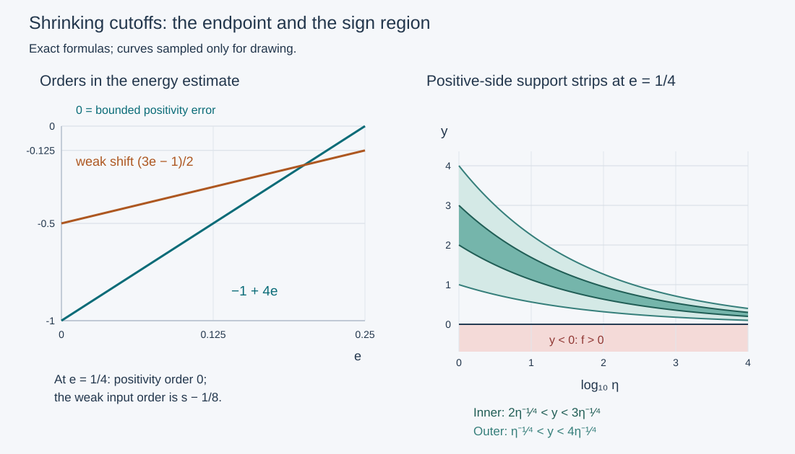

# Shrinking cutoffs and a regularizer that preserves the data

A frequency-dependent cutoff can stay on the favorable side of an imaginary symbol while approaching its zero set. The ordinary conic argument does not cover this geometry. Here the metric positivity theorem controls that cutoff, and a regularizer on the **left** preserves exactly the measured forcing. Its outgoing term differs from a nonnegative square by an operator two orders lower.

The result below proves the real-valued cutoff case of Hörmander IV, Proposition 26.6.1′, including its endpoint and weak distributional hypotheses. The adjacent printed statement does not explicitly repeat the real-valued assumption imposed in the preceding proof. We retain that assumption here: the unrestricted complex-symbol case has an additional phase term and is not certified by this argument. The [complex-cutoff companion](../20261011-complex-cutoff-energy/adaptive-square-roots-and-complex-cutoff-energy.html) treats that additional phase term.

The exact earlier proofs are the ordinary propagation lesson, [metric positivity](../20261005-metric-positivity/scalar-fefferman-phong.md), [metric operator bounds](../20261005-metric-positivity/metric-operator-bounds.md), [Weyl products](../20261005-metric-weyl-calculus/metric-weyl-products.md), and [changes of quantization](../20261005-metric-weyl-calculus/reflection-and-quantization.md). Their local identifiers are resolved, with exact current bytes and locators, in the proof map. Human foundation routes remain external; this export does not claim internal P514 closure.

## 1. The measured-data statement

**H0. Real cutoffs at a shrinking scale.** Write \(x=(t,y)\), \(\xi=(\tau,\eta)\), \(D=-i\partial\), and use the inner product linear in its first argument. Set

\[
 0\le e\le\tfrac14,\qquad \rho=1-e,\quad \delta=e,\quad
 k=\rho-\delta=1-2e,\quad w=\langle\xi\rangle,\quad
 b=s+\frac{3e-1}{2}. \tag{SC1}
\]

Let \(P\) be scalar, properly supported and classical of order one, with principal symbol \(p=\tau+i f\), where \(f\) is real. Let \(C_1\in S^0_{\rho,\delta}\) have compact base support. Require \(f\le0\) on its support at nonzero frequencies. Let \(c(y,\xi)\in S^s_{\rho,\delta}\) be **real**, independent of \(t\). Put \(C=\operatorname{Op}(c)\) in left quantization. Choose a compactly supported smooth time function \(\chi\), equal to one on \([a_0,a_1]\), and nonnegative \(\chi_-,\chi_+\) such that

\[
 \chi'=\chi_- -\chi_+,\qquad
 \operatorname{supp}\chi_-\subset(-\infty,a_0],\quad
 \operatorname{supp}\chi_+\subset[a_1,\infty),\qquad
 C_1=1\text{ near }\operatorname{supp}(\chi c). \tag{SC2}
\]

Then

\[
 u\in H^b_{\mathrm{comp}},\qquad \chi C Pu\in L^2,
 \qquad \chi_- C u\in L^2
 \quad\Longrightarrow\quad \chi C u\in L^2. \tag{SC3}
\]

All products in (SC3) are actual operators on distributions. No derivative of the forcing cutoff is added to the assumptions. Constants can depend on a fixed compact set containing the support of \(u\), the cutoffs, the operator, \(s\) and \(e\).

The time assumptions imply \(0\le\chi\le1\): it increases before \(a_0\), is constant on the interval, and decreases afterwards, with zero values near both infinities. They also imply that the supports of \(\chi_\pm\) lie in the support of \(\chi\). Thus the same identity region of \(C_1\) covers all three measured symbols. No fixed conic neighborhood of that region is required.

We work with full symbols having bounded seminorms after compact localization. For the stated local, properly supported operator this loses only controlled smoothing terms. Indeed proper support makes \(Pu\) compactly supported on a fixed compact set. Choose base cutoffs equal to one near that set, the support of \(u\), and the base supports in (SC2). The off-diagonal kernel argument P2:OP4–OP6 gives smooth errors after these cutoffs; each prescribed output Sobolev norm is bounded by a fixed input \(H^b\) norm on the fixed compact set. The remaining full symbols can be extended with bounded seminorms. Finite frequencies are included in the order-zero remainder. Such errors contribute only a constant times \(\|u\|_b\) to the estimates below. In particular, the measured forcing is not replaced by a stronger microlocal hypothesis.

## 2. The exact calculus and positivity inputs

**C0. Orders, including a mixed ordinary factor.** For this proof the metric is

\[
 g=w^{2e}|dx|^2+w^{-2+2e}|d\xi|^2,\qquad
 h=w^{-1+2e}=w^{-k}. \tag{SC4}
\]

MP:F7 proves its slow variation, temperateness, uncertainty inequality, all power weights, and equivalence of metric and coordinate symbol seminorms. WY:W10 and WY:Q1–Q4 give full composition and adjoint expansions, with all differentiated remainders and finite-seminorm bounds. Two exotic factors of orders \(m,l\) have an \(N\)-term remainder of order \(m+l-Nk\). The left product starts with \(ab-i\partial_\xi a\cdot\partial_x b\). A scalar commutator with one ordinary \(S^l_{1,0}\) factor has the sharper expansion

\[
 [\operatorname{Op}(a),\operatorname{Op}(d)]
 =\operatorname{Op}(-i\{a,d\})+
       \operatorname{Op}(r),\qquad
 r\in S^{m+l-2+2e}_{\rho,\delta},\quad d\in S^l_{1,0}, \tag{SC5}
\]

where \(\{a,d\}=\partial_\xi a\cdot\partial_xd-\partial_xa\cdot\partial_\xi d\). In either ordered product the \(j\)-th cross differentiation loses at least \(j(1-e)\): an ordinary position derivative costs zero and its frequency derivative loses one; an exotic position derivative costs \(e\) and its frequency derivative loses \(1-e\).

Here is why this counting applies to the **full** mixed remainder. Both symbols belong to the metric (SC4). Expand the two quantization conversions and the Weyl product through total degree \(L\), with \(Lk\ge N(1-e)\). The retained differential operators commute because they differentiate independent symbol variables. The exponential product identity therefore cancels the self-contractions and leaves exactly the left cross-contractions \(\partial_\xi a\,\partial_xd\), or those in the reversed product, in each degree below \(L\). Terms of cross degree at least \(N\) have the sharper bound just counted; the unexpanded remainders have at least the required loss by the choice of \(L\). All intermediate factors have finite-seminorm estimates from WY:W10 and WY:Q3. This proves the mixed expansion and every output derivative estimate, without treating a formal first term as a remainder theorem.

An order-\(m\) operator in this class maps \(H^r\) to \(H^{r-m}\). To verify this for every real \(r\), compose on the left and right with the ordinary Fourier multipliers \(w^{r-m}\) and \(w^{-r}\). The resulting symbol is in \(S^0_{\rho,\delta}\). Change it to Weyl quantization and apply MP:B7. This also proves the quadratic-form estimate

\[
 T\in\Psi^{2r}_{\rho,\delta}
 \quad\Longrightarrow\quad |(Tu,u)|\le K\|u\|_r^2. \tag{SC6}
\]

Schwartz density gives the stated Sobolev extensions; WY:A9 supplies their agreement with distributional composition. All these conclusions hold uniformly on bounded symbol families.

**B0. Positivity only where the cutoff is supported.** Replace \(C_1\) by \(m=\psi(\operatorname{Re}C_1)\), where \(0\le\psi\le1\), \(\psi=1\) near one and \(\operatorname{supp}\psi\subset(1/2,3/2)\). The chain rule proves \(m\in S^0_{\rho,\delta}\). It is real, nonnegative, compact in the base, equals one near \(\operatorname{supp}(\chi c)\), and its support lies in that of \(C_1\). Smooth cutoff functions here are supplied by PS:PS5. Extend the homogeneous \(f\) smoothly through low frequencies by a nonnegative frequency cutoff. Its difference from the full symbol is order zero. Hence

\[
 F=m f\le0,\qquad F\in S^1_{\rho,\delta}
       \subset S^{2-4e}_{\rho,\delta}=S(h^{-2},g). \tag{SC7}
\]

The inclusion uses exactly \(e\le1/4\). Apply the full MP:F6 theorem to \(-F\). In changing left to Weyl quantization, the first correction is \((i/2)\partial_x\cdot\partial_\xi F\), purely imaginary. The remaining real error has order \(1-2k=-1+4e\le0\). Thus MP:F8 and MP:B7 give

\[
 \operatorname{Re}(\operatorname{Op}(F)v,v)\le K_F\|v\|_2^2,
 \qquad v\in H^1. \tag{SC8}
\]

The bound is first proved on Schwartz functions, then extended by \(H^1\) density. Its constant is fixed before any time weight or regularizer is chosen. No sign is imposed on \(f\) outside the cutoff support.

## 3. Put the regularizer on the measured side

**R0. An exact left regularization.** For \(0<\nu\le1\) define

\[
 r_\nu(\xi)=(1+\nu|\xi|^2)^{-1},\quad R_\nu=r_\nu(D),\quad
 v_0=e^{-\lambda t}\chi(t),\quad v_\pm=e^{-\lambda t}\chi_\pm(t),\quad
 Q_\nu=R_\nu M_{v_0}C,\quad Q_{\pm,\nu}=R_\nu M_{v_\pm}C. \tag{SC9}
\]

Here \(M_v\) denotes multiplication. The family \(r_\nu\) is bounded in ordinary \(S^0\), and for fixed \(\nu>0\) it is in \(S^{-2}\). Indeed differentiation yields products of \(\nu\xi/(1+\nu|\xi|^2)\) and \(\nu/(1+\nu|\xi|^2)\), bounded by constants times \(w^{-1}\) and \(w^{-2}\), respectively. This proves every uniform derivative estimate. Thus \(Q_\nu\) is uniformly of exotic order \(s\), and for fixed \(\nu\) has order \(s-2\). Its left symbol is

\[
 q_\nu=r_\nu v_0 c+e_\nu,
 \qquad e_\nu\text{ bounded in }S^{s-1+e}_{\rho,\delta}. \tag{SC10}
\]

This is C0's mixed product. The displayed leading symbol is real. It is not asserted to be the complete symbol.

Since \(R_\nu\) is an \(L^2\) contraction, the **given** data satisfy

\[
 \|Q_\nu Pu\|_2\le\|e^{-\lambda t}\chi C Pu\|_2,
 \qquad \|Q_{-,\nu}u\|_2\le\|e^{-\lambda t}\chi_- C u\|_2. \tag{SC11}
\]

These identities use no commutation through \(C\) or differentiation of its forcing symbol. This is the reason for the ordering in (SC9).

**L0. The localized imaginary part has a fixed upper bound.** Write

\[
 P=A+iB,\qquad A=(P+P^*)/2=D_t+A_0,\quad A_0\in\Psi^0_{1,0},
 \qquad B=(P-P^*)/(2i). \tag{SC12}
\]

The exact left symbol of \(B\) has the form \(f+b_0\), with \(b_0\in S^0_{1,0}\); \(b_0\) need not be real. Ordinary adjoint calculus proves these assertions. Subtract \(\operatorname{Op}(F)+\operatorname{Op}(m b_0)\). Every term of the full symbol expansion of its composition with \(Q_\nu\) vanishes: the first factor is \((1-m)(f+b_0)\), and every derivative of the measured symbol is supported where \(m=1\). Expand the intermediate ordinary regularizer as well. All finite coefficients still contain such a vanishing product. Arbitrary remainder orders in C0 imply a uniformly smoothing error, for fixed \(\lambda\). In particular it maps \(H^{s-1}\) to \(L^2\). This argument uses a symbol identity on an open neighborhood, not a presumed uniform Euclidean or conic support gap.

The operator \(\operatorname{Op}(m b_0)\) is \(L^2\)-bounded by C0. With (SC8) it follows that

\[
 (BQ_\nu u,Q_\nu u)
 \le K\|Q_\nu u\|_2^2+
       K_\lambda\|u\|_{s-1}\|Q_\nu u\|_2. \tag{SC13}
\]

Crucially, \(K\) depends only on the fixed cutoff and operator, not on \(\lambda\) or \(\nu\). Lower errors may depend on \(\lambda\).

## 4. The outgoing term and both commutators

**O0. A nonnegative square plus a two-order error.** For real smooth compactly supported \(v,w\), define

\[
 K_\nu(v,w)=\tfrac12(M_vR_\nu^2M_w+M_wR_\nu^2M_v)
                 -R_\nu M_{vw}R_\nu. \tag{SC14}
\]

This is an ordinary operator bounded uniformly in \(\Psi^{-2}_{1,0}\). To prove the order, use the Weyl symbols of each factor: multiplication and a real Fourier multiplier already have real Weyl symbols. The zeroth term of both expressions is \(vwr_\nu^2\). For the first expression, its first correction is purely imaginary and changes sign when \(v,w\) are interchanged; it therefore cancels in the displayed average. In the second, the first corrections in \(r_\nu\#(vw)\#r_\nu\) cancel because the two outer symbols coincide. The full ordinary two-term remainder has order \(-2\), uniformly in \(\nu\), by the bounds R0. This proves the operator assertion, not just a principal-symbol equality.

Apply (SC14) with \(v=v_0,w=v_+\) and put \(z=Cu\). For fixed \(\nu\), initially on smooth vectors and then by the Sobolev extensions of C0,

\[
 \operatorname{Re}(Q_{+,\nu}u,Q_\nu u)
 =\int v_0v_+|R_\nu Cu|^2\,dx+(C^*K_\nu(v_0,v_+)Cu,u)
 \ge-K_\lambda\|u\|_{s-1}^2. \tag{SC15}
\]

The integral is nonnegative. Since \(C^*K_\nu C\) has exotic order \(2s-2\), (SC6) proves the error bound. The whole outgoing term need not itself be nonnegative; its negative part has now been estimated.

**A0. The real-part commutator.** The regularizer commutes with \(D_t\), so

\[
 [Q_\nu,A]=-i\lambda Q_\nu+iQ_{-,\nu}-iQ_{+,\nu}+E_\nu,
 \qquad E_\nu\text{ bounded in }\Psi^{s-1+e}_{\rho,\delta}. \tag{SC16}
\]

Indeed \([M_{v_0}C,D_t]=iM_{v_0'}C\) exactly, because \(c\) is time independent. The remaining commutator with \(A_0\) has the order in (SC16) by (SC5) and the product rule. Pair with \(Q_\nu u\), take the imaginary part, and use (SC15). The result is

\[
 \operatorname{Im}([Q_\nu,A]u,Q_\nu u)
 \le-\lambda\|Q_\nu u\|^2+
   \bigl(\|Q_{-,\nu}u\|+K_\lambda\|u\|_{s-1+e}\bigr)\|Q_\nu u\|
       +K_\lambda\|u\|_{s-1}^2. \tag{SC17}
\]

**I0. Symmetrization gives the precise weak order.** Let \(q=r_\nu v_0c\), the real leading symbol in (SC10). Mixed calculus gives

\[
 [Q_\nu,B]=\operatorname{Op}(-i\{q,f\})+
                  \Psi^{s-1+2e}_{\rho,\delta},\qquad
 \{q,f\}\in S^{s+e}_{\rho,\delta}. \tag{SC18}
\]

The error from \(e_\nu\) in (SC10) has that order as well: its commutator with the ordinary order-one factor costs \(1-e\). The term involving \(b_0\) has still smaller order. Next, \(Q_\nu^*\) has symbol \(q\) modulo order \(s-1+2e\). Multiplying out gives leading symbol \(-i q\{q,f\}\), of order \(2s+e\). All product, adjoint and previous error terms have order at most \(2s-1+3e\). The leading symbol is purely imaginary, so its symmetric part cancels; its own adjoint correction also loses \(k\). Consequently

\[
 T_\nu=\tfrac12\bigl(Q_\nu^*[Q_\nu,B]+[Q_\nu,B]^*Q_\nu\bigr)
       \text{ is bounded in }\Psi^{2s-1+3e}_{\rho,\delta},
 \qquad |(T_\nu u,u)|\le K_\lambda\|u\|_b^2. \tag{SC19}
\]

Here \(2b=2s-1+3e\) exactly. The reality of \(c\) is used at this step. With a complex leading symbol the term would be \(-i\overline q\{q,f\}\), whose real part does not generally vanish.

## 5. Absorption and the distributional limit

**E0. The uniform estimate on the actual domains.** For each fixed \(\nu>0\), C0 gives \(Q_\nu u\in H^{(3+3e)/2}\) and \(Q_\nu Pu\in H^{(1+3e)/2}\). These exponents are at least \(3/2\) and \(1/2\), respectively. Thus every term in the energy identity is defined. Simultaneous Schwartz approximation in \(H^b\), using the fixed-\(\nu\) improved orders, proves

\[
 \operatorname{Im}(Q_\nu Pu,Q_\nu u)
 =(BQ_\nu u,Q_\nu u)+\operatorname{Im}([Q_\nu,A]u,Q_\nu u)
       +\operatorname{Re}([Q_\nu,B]u,Q_\nu u). \tag{SC20}
\]

Combine (SC13), (SC17), (SC19). The lower norms are controlled by \(H^b\), since

\[
 b-(s-1+e)=\frac{1+e}{2}>0,\qquad
 b-(s-1)=\frac{1+3e}{2}>0. \tag{SC21}
\]

Move the term \(-\lambda\|Q_\nu u\|^2\) to the other side. Take \(\lambda=\max(K,0)+3\), fixing all constants that depend on it. Three applications of \(ab\le\epsilon a^2+(4\epsilon)^{-1}b^2\), with one sufficiently small fixed \(\epsilon\), give

\[
 \|Q_\nu u\|_2^2\le L\bigl(
       \|Q_\nu Pu\|_2^2+\|Q_{-,\nu}u\|_2^2+\|u\|_b^2\bigr),
       \qquad 0<\nu\le1. \tag{SC22}
\]

The constant is uniform in \(\nu\). No weight-dependent leading bound was used in selecting \(\lambda\). Formula (SC11) bounds its right side by exactly the measured data in (SC3).

**U0. Recover the unregularized measured solution.** C0 gives \(M_{v_0}Cu\in H^{b-s}\). The multipliers \(r_\nu\) tend to one pointwise and have absolute value at most one. Fourier dominated convergence therefore shows

\[
 Q_\nu u=R_\nu M_{v_0}Cu\longrightarrow M_{v_0}Cu
                    \quad\text{in }H^{b-s}. \tag{SC23}
\]

The uniform \(L^2\) bound (SC22) has a weakly convergent subsequence by the fully proved Hilbert argument LSE:F1. Testing against Schwartz functions identifies its limit with (SC23), so \(M_{v_0}Cu\in L^2\). Multiplication by \(e^{\lambda t}\) on the compact time support of \(\chi\) proves (SC3). It also gives the corresponding bound by the two measured norms and \(\|u\|_b\). This completes the real-valued cutoff theorem, with no implicit regularized-data hypothesis.

## 6. Three solved checks

**X1. Check the endpoint rather than extrapolating it.** Compute the positivity and weak-norm exponents at \(e=0\) and \(e=1/4\). What does this proof say at \(e=1/3\)?

**Solution.** The positivity remainder is \(-1+4e\), while the weak shift is \((3e-1)/2\). Their pairs are \((-1,-1/2)\) and \((0,-1/8)\) at the two endpoints. Thus the last allowed positivity remainder is still \(L^2\)-bounded, and the last weak assumption remains one eighth of an order below \(s\). At \(e=1/3\) the positivity remainder would have order \(1/3\); the leading constant in (SC13) would no longer be an \(L^2\) bound. This proof gives no such extension. A failed estimate at that parameter is not a counterexample to any different theorem.

**X2. A sign region with no uniform conic margin.** In two base dimensions take \(\eta>0\), \(|\tau|<\eta/2\), and \(f=-y\eta\) near \(y=0\). Choose nonzero real \(\alpha\in C_c^\infty((2,3))\) and a real \(\beta\in C_c^\infty((1,4))\), with \(\beta=1\) near \(\operatorname{supp}\alpha\). At large frequencies set

\[
 c(y,\tau,\eta)=\eta^s\alpha(\eta^e y)\theta(\tau/\eta),
 \qquad m(t,y,\tau,\eta)=\zeta(t)\beta(\eta^e y)\theta_1(\tau/\eta), \tag{SC24}
\]

where \(0<e\le1/4\), the frequency cutoffs are real and nonnegative, \(\theta_1=1\) near \(\operatorname{supp}\theta\subset(-1/2,1/2)\), and \(\zeta=1\) near the time support of \(\chi\). Add matching low-frequency cutoffs and a fixed base cutoff equal to one on these supports. Show that the theorem's sign and symbol conditions hold although the supports approach \(y=0\).

**Solution.** A \(y\)-derivative contributes \(\eta^e\). Each frequency derivative of the scaled argument contributes \(\eta^{-1}\) times a bounded function of \(\eta^e y\) on the support. Ratio cutoffs have the same ordinary frequency decay. The product rule gives \(S^s_{1,e}\subset S^s_{1-e,e}\) and the corresponding order-zero bounds for \(m\). Choose the outer low-frequency cutoff equal to one near that of \(c\); then \(m=1\) near \(\operatorname{supp}(\chi c)\). Its support has \(y>0\), so \(f\le0\) there. Both supports approach the normalized direction \((y;\tau,\eta)=(0;0,1)\) as the frequency grows. Any fixed open conic neighborhood containing this limiting direction also contains \(y<0\), where \(f>0\). Thus no sign neighborhood with a uniform angular/base margin around the accumulating supports is available. The open region \(y>0\) itself remains favorable; the assertion concerns a uniform margin, not the existence of that open set. An ordinary compact extension of \(-y\eta\) near the displayed region preserves all hypotheses.

**X3. Compute the first nonzero outgoing correction.** In one dimension take affine multipliers \(v(t)=w(t)=t\) and a real Fourier multiplier \(R=r(D_t)\). Compute the Weyl symbol of \(K(v,v)\) from (SC14).

**Solution.** The exact Weyl product terminates after two differentiations of the affine or quadratic position factors. It gives

\[
 t\#r^2\#t=t^2r^2+\tfrac14(r^2)'',\qquad
 r\#t^2\#r=t^2r^2+\tfrac12(r')^2-\tfrac12r r'',\qquad
 K(t,t)=\operatorname{Op}^w(r r''). \tag{SC25}
\]

For \(r=r_\nu\) the correction is uniformly of order \(-2\), and it is not identically zero. The polynomial calculation is an exact local check of the two-order mechanism; affine multipliers do not have the compact support used in the theorem. It does not assert positivity of the correction.

## 7. The scales in the proof

**V0. Exact exponents and support strips.** The left panel plots the proved exponents \(-1+4e\) and \((3e-1)/2\) on the actual allowed interval. The right panel shows the inner support strip \(2\eta^{-1/4}<y<3\eta^{-1/4}\) and the outer strip \(\eta^{-1/4}<y<4\eta^{-1/4}\). These are support bounds in X2, not the detailed shapes of its smooth cutoffs. The region \(y<0\) is unfavorable for \(f=-y\eta\). Curves are sampled exact formulas; the proofs and boundary inequalities are in the text.

The [editable figure](figures/build_figure.py), [finite checks](model-check.json), [proof review](proof-review.json), [reader checks](reader-check.json), and source credit accompany this lesson. [The complex-phase analysis](../20261011-complex-cutoff-absorption/local-sign-geometry-and-complex-cutoff-phase.html) identifies the additional term for a complex cutoff; [the adaptive-root argument](../20261011-complex-cutoff-energy/adaptive-square-roots-and-complex-cutoff-energy.html) proves its joint operator estimate. [Intrinsic directed propagation](../20261011-intrinsic-directed-propagation/intrinsic-orientation-and-entering-regularity.html) and the concave-index construction give the corresponding invariant and model readings.

Original expression: CC0-1.0. Linked components retain their terms. All nine approved books remain valid mathematical sources.
